# 《大学物理》第9章 机械振动 §9.5 简谐振动的合成（课件）

原件的每一页，下面附识别出的文字。

### §§19.5 简谐振动的合成

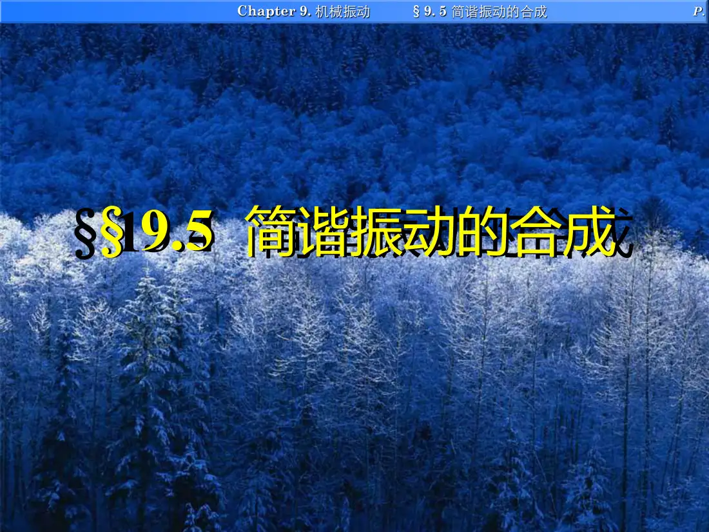

原文：

§§19.5 简谐振动的合成

Chapter 9. 机械振动 § 9.5 简谐振动的合成

P.

### 一、同方向同频率的谐振动合成

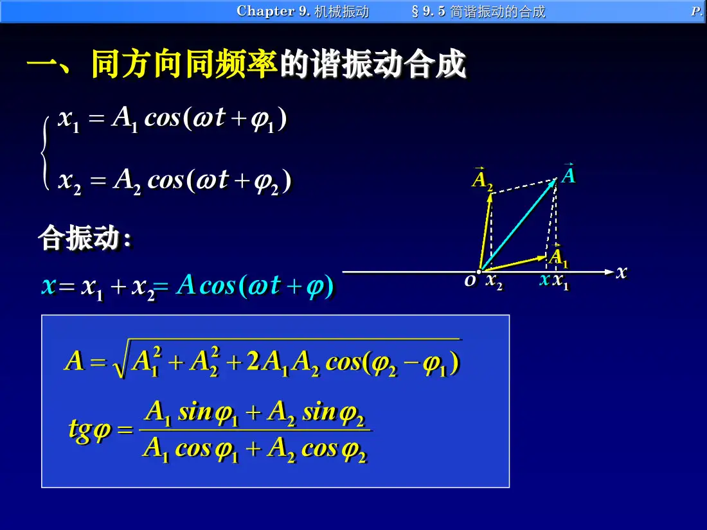

原文：

一、同方向同频率的谐振动合成

$$
x _ {1} = A _ {1} \cos (\omega t + \varphi_ {1})
$$

$$
x _ {2} = A _ {2} \cos (\omega t + \varphi_ {2})
$$

合振动：

$$
x = x _ {1} + x _ {2} = A \cos (\omega t + \varphi)
$$

$$
A = \sqrt {A _ {1} ^ {2} + A _ {2} ^ {2} + 2 A _ {1} A _ {2} \cos (\varphi_ {2} - \varphi_ {1})}
$$

$$
t g \varphi = \frac {A _ {1} \sin \varphi_ {1} + A _ {2} \sin \varphi_ {2}}{A _ {1} \cos \varphi_ {1} + A _ {2} \cos \varphi_ {2}}
$$

Chapter 9. 机械振动

§ 9.5 简谐振动的合成

P.

### 同频率同方向的简谐振动的合成仍然为简谐振动。

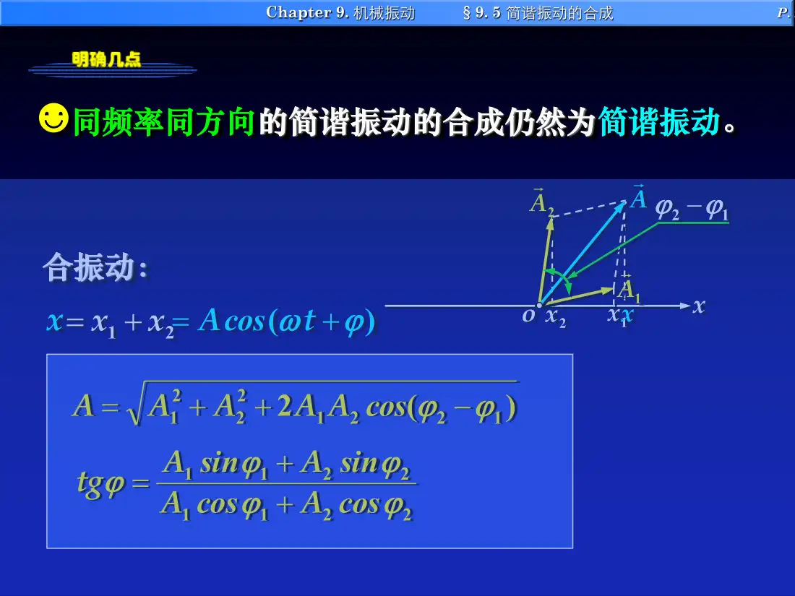

原文：

同频率同方向的简谐振动的合成仍然为简谐振动。

合振动：

$$
x = x _ {1} + x _ {2} = A \cos (\omega t + \varphi)
$$

$$
A = \sqrt {A _ {1} ^ {2} + A _ {2} ^ {2} + 2 A _ {1} A _ {2} \cos (\varphi_ {2} - \varphi_ {1})}
$$

$$
t g \varphi = \frac {A _ {1} \sin \varphi_ {1} + A _ {2} \sin \varphi_ {2}}{A _ {1} \cos \varphi_ {1} + A _ {2} \cos \varphi_ {2}}
$$

Chapter 9. 机械振动

§ 9.5 简谐振动的合成

P.

### 明确几点

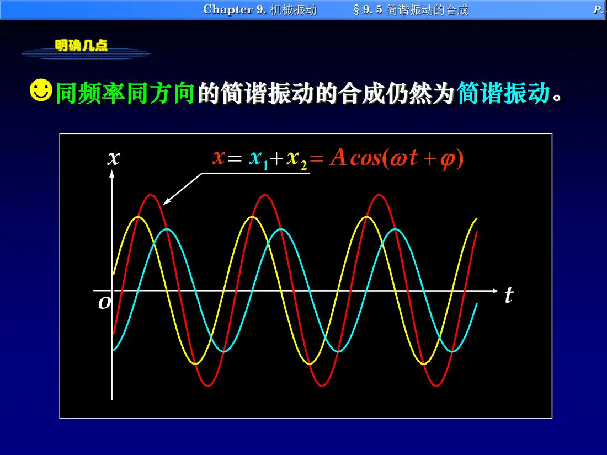

原文：

明确几点

同频率同方向的简谐振动的合成仍然为简谐振动。

Chapter 9. 机械振动

§ 9.5 简谐振动的合成

P.

### $$

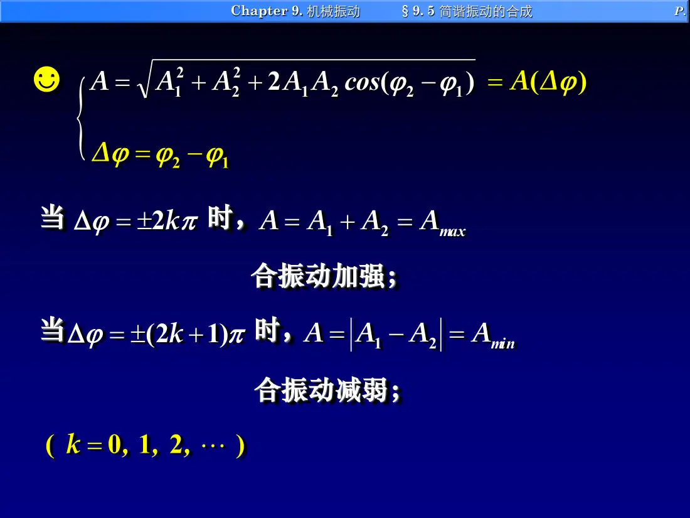

原文：

$$
A = \sqrt {A _ {1} ^ {2} + A _ {2} ^ {2} + 2 A _ {1} A _ {2} \cos \left(\varphi_ {2} - \varphi_ {1}\right)} = A (\Delta \varphi)
$$

$$
\Delta \varphi = \varphi_ {2} - \varphi_ {1}
$$

当 $\Delta \varphi = \pm 2k\pi$ 时， $A = A_{1} + A_{2} = A_{max}$

合振动加强；

当 $\Delta \varphi = \pm (2k + 1)\pi$ 时， $A = |A_1 - A_2| = A_{min}$

合振动减弱；

$$
(k = 0, 1, 2, \dots)
$$

Chapter 9. 机械振动

§ 9.5 简谐振动的合成

P.

### 二、同方向不同频率的谐振动合成

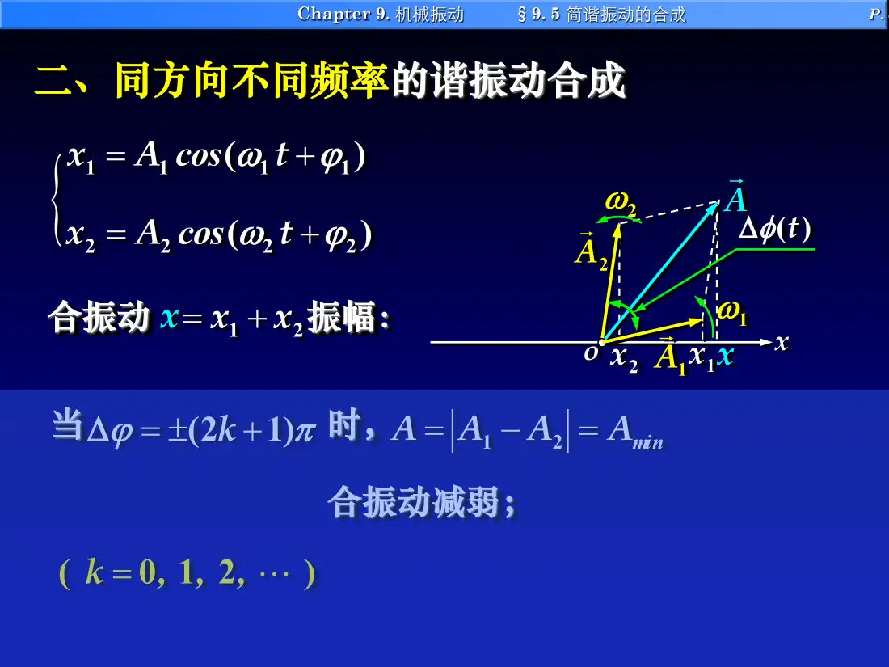

原文：

二、同方向不同频率的谐振动合成

$$
\left\{ \begin{array}{l} x _ {1} = A _ {1} \cos (\omega_ {1} t + \varphi_ {1}) \\ x _ {2} = A _ {2} \cos (\omega_ {2} t + \varphi_ {2}) \end{array} \right.
$$

合振动 $x = x_{1} + x_{2}$ 振幅：

当 $\Delta \varphi = \pm (2k + 1)\pi$ 时， $A = |A_1 - A_2| = A_{min}$

合振动减弱；

$$
(k = 0, 1, 2, \dots)
$$

Chapter 9. 机械振动

§ 9.5 简谐振动的合成

P.

### 二、同方向不同频率的谐振动合成

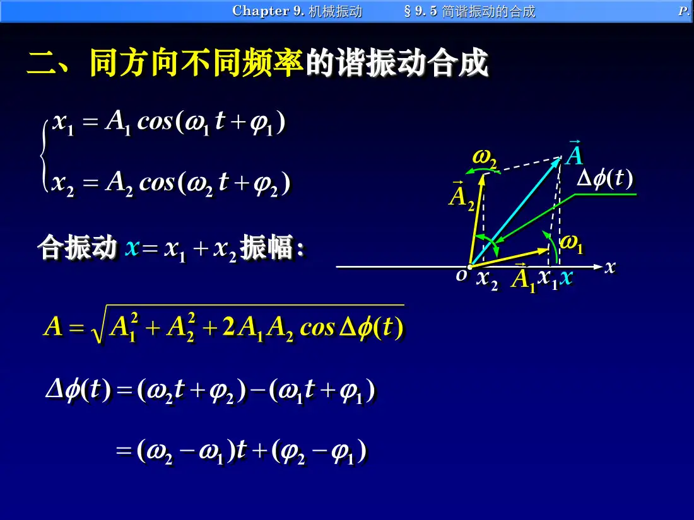

原文：

二、同方向不同频率的谐振动合成

$$
\left\{ \begin{array}{l} x _ {1} = A _ {1} \cos (\omega_ {1} t + \varphi_ {1}) \\ x _ {2} = A _ {2} \cos (\omega_ {2} t + \varphi_ {2}) \end{array} \right.
$$

合振动 $x = x_{1} + x_{2}$ 振幅：

$$
A = \sqrt {A _ {1} ^ {2} + A _ {2} ^ {2} + 2 A _ {1} A _ {2} \cos \Delta \phi (t)}
$$

$$
\begin{array}{r l} \Delta \phi (t) & = (\omega_ {2} t + \varphi_ {2}) - (\omega_ {1} t + \varphi_ {1}) \\ & = (\omega_ {2} - \omega_ {1}) t + (\varphi_ {2} - \varphi_ {1}) \end{array}
$$

Chapter 9. 机械振动

§ 9.5 简谐振动的合成

P.

### $$

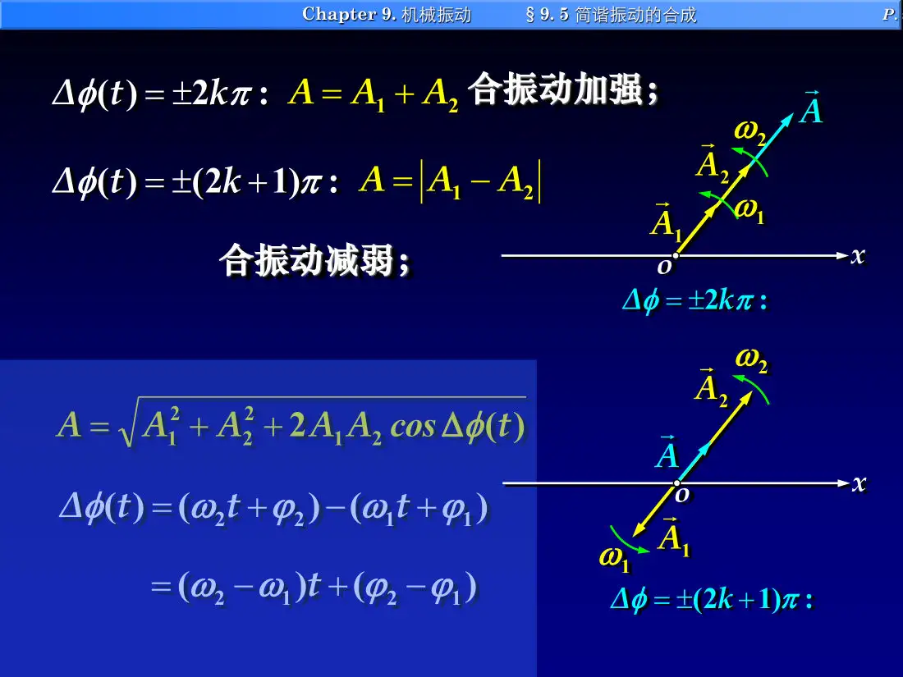

原文：

$\Delta \phi (t) = \pm 2k\pi : A = A_{1} + A_{2}$ 合振动加强；

$$
\Delta \phi (t) = \pm (2 k + 1) \pi : A = \left| A _ {1} - A _ {2} \right|
$$

合振动减弱；

$$
A = \sqrt {A _ {1} ^ {2} + A _ {2} ^ {2} + 2 A _ {1} A _ {2} \cos \Delta \phi (t)}
$$

$$
\begin{array}{r l} \Delta \phi (t) & = (\omega_ {2} t + \varphi_ {2}) - (\omega_ {1} t + \varphi_ {1}) \\ & = (\omega_ {2} - \omega_ {1}) t + (\varphi_ {2} - \varphi_ {1}) \end{array}
$$

$$
\Delta \phi = \pm 2 k \pi :
$$

Chapter 9. 机械振动

§ 9.5 简谐振动的合成

P.

### $$

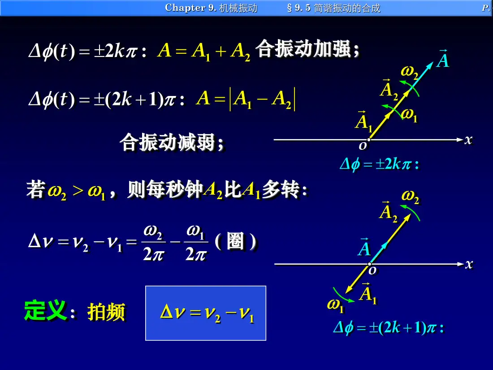

原文：

$\Delta \phi (t) = \pm 2k\pi : A = A_{1} + A_{2}$ 合振动加强；

$$
\Delta \phi (t) = \pm (2 k + 1) \pi : A = \left| A _ {1} - A _ {2} \right|
$$

合振动减弱；

若 $\omega_{2} > \omega_{1}$ , 则每秒钟 $A_{2}$ 比 $A_{1}$ 多转:

$\Delta \nu = \nu_{2} - \nu_{1} = \frac{\omega_{2}}{2\pi} -\frac{\omega_{1}}{2\pi}$ （圈）

定义：拍频

$$
\Delta \nu = \nu_ {2} - \nu_ {1}
$$

$$
\Delta \phi = \pm 2 k \pi :
$$

Chapter 9. 机械振动

§ 9.5 简谐振动的合成

P.

### 定义：拍频

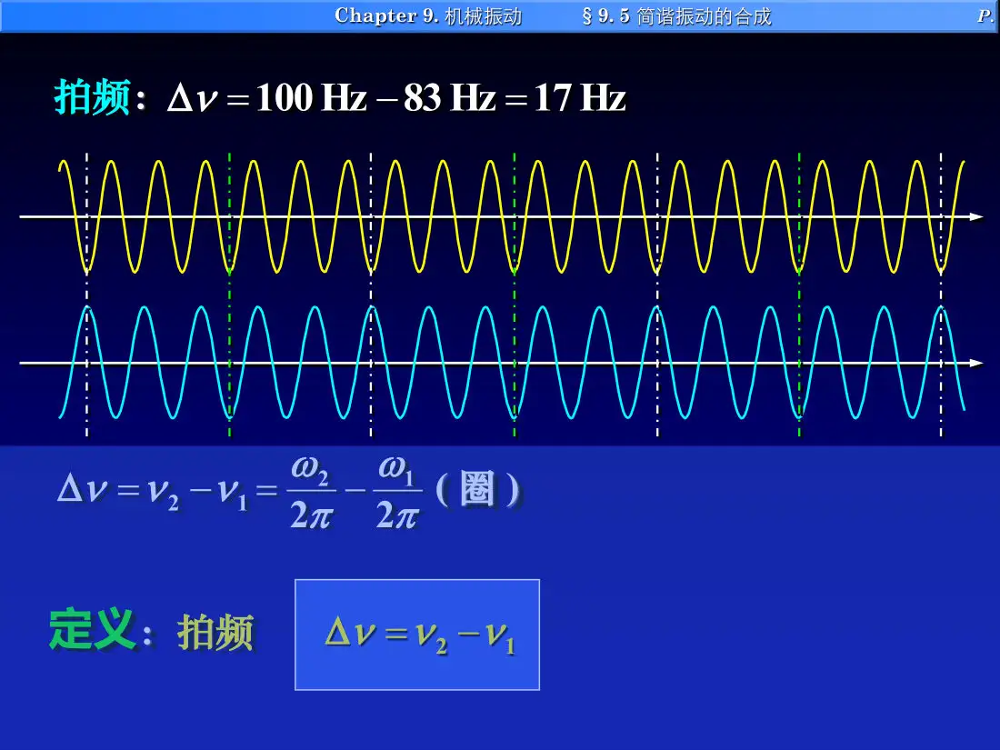

原文：

拍频： $\Delta \nu = 100 \mathrm{~Hz} - 83 \mathrm{~Hz} = 17 \mathrm{~Hz}$

$\Delta \nu = \nu_{2} - \nu_{1} = \frac{\omega_{2}}{2\pi} -\frac{\omega_{1}}{2\pi}$ （圈）

定义：拍频

$$
\Delta \nu = \nu_ {2} - \nu_ {1}
$$

Chapter 9. 机械振动

§ 9.5 简谐振动的合成

P.

### Chapter 9. 机械振动

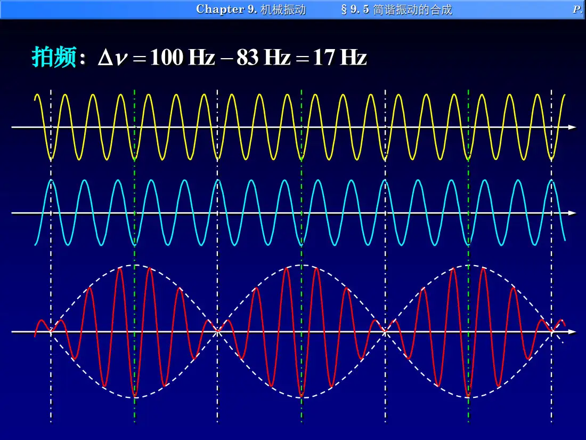

原文：

拍频： $\Delta \nu = 100 \mathrm{~Hz} - 83 \mathrm{~Hz} = 17 \mathrm{~Hz}$

Chapter 9. 机械振动

§ 9.5 简谐振动的合成

P.

### 录像：

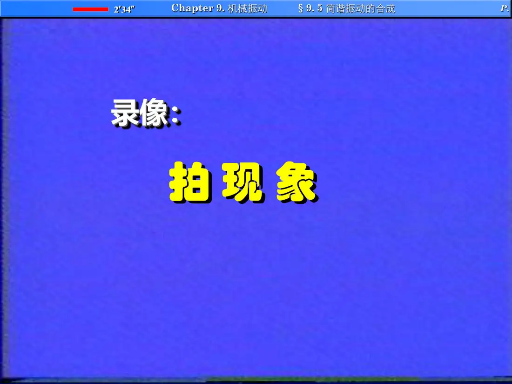

原文：

录像：

拍现象

2'34"

Chapter 9. 机械振动

§ 9.5 简谐振动的合成

P.

### 三、同频率相互垂直方向的谐振动合成

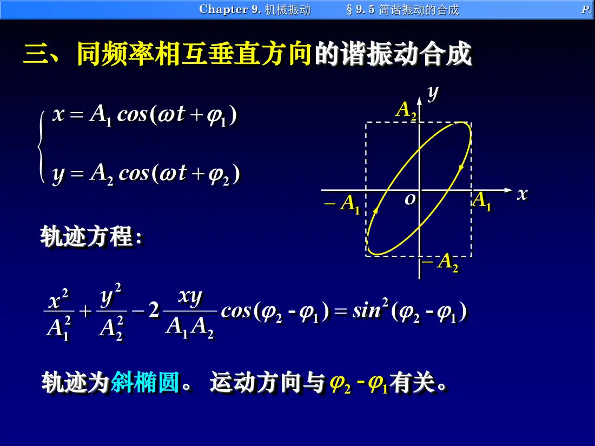

原文：

三、同频率相互垂直方向的谐振动合成

$$
x = A _ {1} \cos (\omega t + \varphi_ {1})
$$

$$
y = A _ {2} \cos (\omega t + \varphi_ {2})
$$

轨迹方程:

$$
\frac {x ^ {2}}{A _ {1} ^ {2}} + \frac {y ^ {2}}{A _ {2} ^ {2}} - 2 \frac {x y}{A _ {1} A _ {2}} \cos (\varphi_ {2} - \varphi_ {1}) = \sin^ {2} (\varphi_ {2} - \varphi_ {1})
$$

轨迹为斜椭圆。运动方向与 $\varphi_{2} - \varphi_{1}$ 有关。

Chapter 9. 机械振动

§ 9.5 简谐振动的合成

P.

### $$

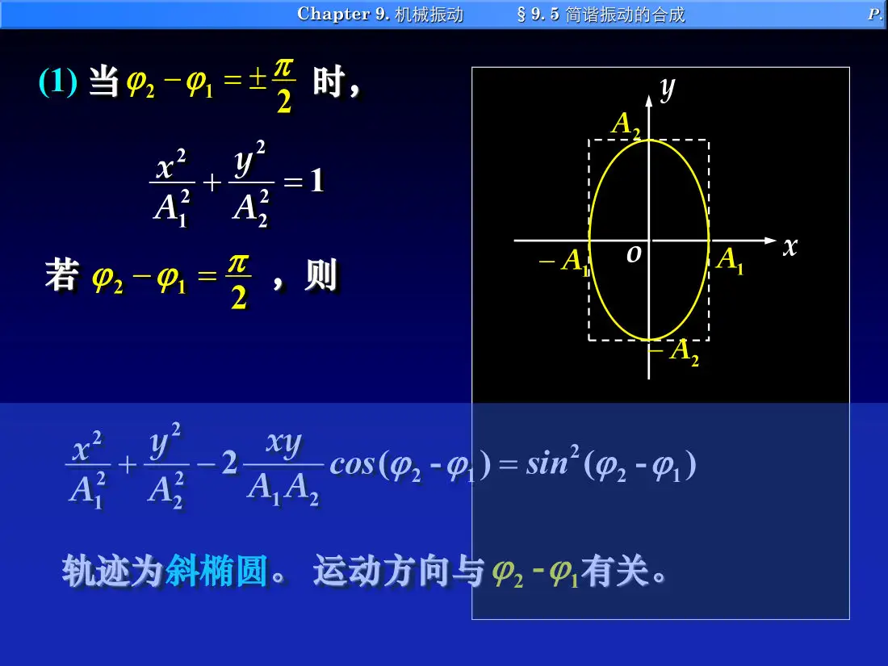

原文：

(1) 当 $\varphi_{2}-\varphi_{1}=\pm\frac{\pi}{2}$ 时，

$$
\frac {x ^ {2}}{A _ {1} ^ {2}} + \frac {y ^ {2}}{A _ {2} ^ {2}} = 1
$$

若 $\varphi_{2} - \varphi_{1} = \frac{\pi}{2}$ ，则

$$
\frac {x ^ {2}}{A _ {1} ^ {2}} + \frac {y ^ {2}}{A _ {2} ^ {2}} - 2 \frac {x y}{A _ {1} A _ {2}} \cos (\varphi_ {2} - \varphi_ {1}) = \sin^ {2} (\varphi_ {2} - \varphi_ {1})
$$

轨迹为斜椭圆。运动方向与 $\varphi_{2} - \varphi_{1}$ 有关。

Chapter 9. 机械振动

§ 9.5 简谐振动的合成

P.

### $$

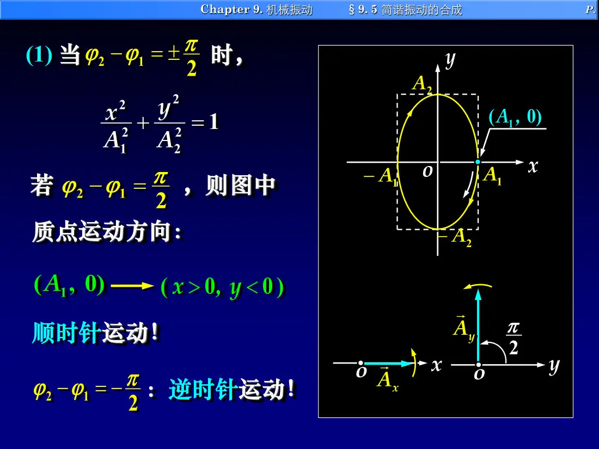

原文：

(1) 当 $\varphi_{2}-\varphi_{1}=\pm\frac{\pi}{2}$ 时，

$$
\frac {x ^ {2}}{A _ {1} ^ {2}} + \frac {y ^ {2}}{A _ {2} ^ {2}} = 1
$$

若 $\varphi_{2}-\varphi_{1}=\frac{\pi}{2}$ ，则图中质点运动方向：

$$
(A _ {1}, 0) \longrightarrow (x > 0, y <   0)
$$

顺时针运动!

$\varphi_{2}-\varphi_{1}=-\frac{\pi}{2}$ ：逆时针运动！

Chapter 9. 机械振动

§ 9.5 简谐振动的合成

P.

### (2) 当 $\varphi_{2}-\varphi_{1}=0$ 时，

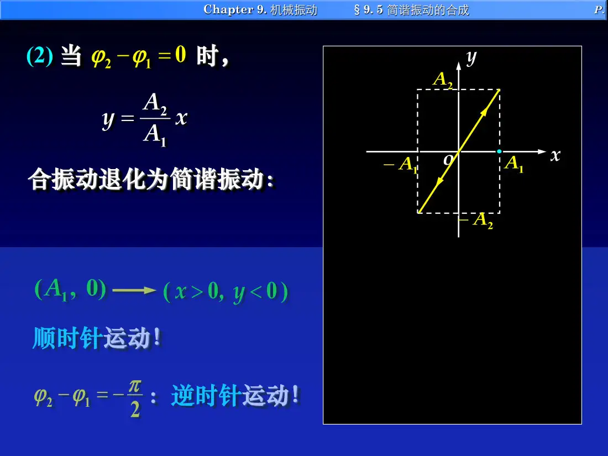

原文：

(2) 当 $\varphi_{2}-\varphi_{1}=0$ 时，

$$
y = \frac {A _ {2}}{A _ {1}} x
$$

合振动退化为简谐振动：

$$
(A _ {1}, 0) \longrightarrow (x > 0, y <   0)
$$

顺时针运动!

$\varphi_{2}-\varphi_{1}=-\frac{\pi}{2}$ ：逆时针运动！

Chapter 9. 机械振动

§ 9.5 简谐振动的合成

P.

### (2) 当 $\varphi_{2}-\varphi_{1}=0$ 时，

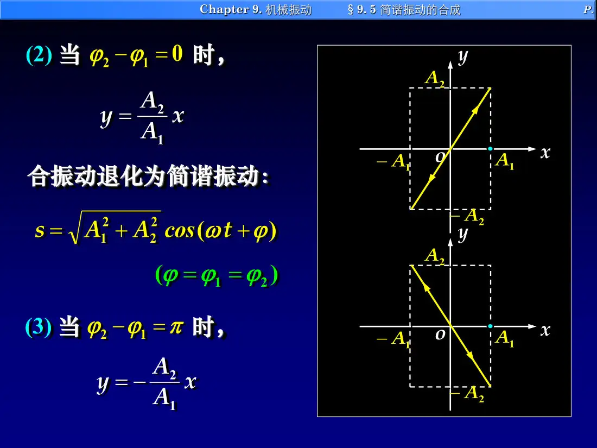

原文：

(2) 当 $\varphi_{2}-\varphi_{1}=0$ 时，

$$
y = \frac {A _ {2}}{A _ {1}} x
$$

合振动退化为简谐振动：

$$
s = \sqrt {A _ {1} ^ {2} + A _ {2} ^ {2}} \cos (\omega t + \varphi)
$$

$$
(\varphi = \varphi_ {1} = \varphi_ {2})
$$

(3) 当 $\varphi_{2}-\varphi_{1}=\pi$ 时,

$$
y = - \frac {A _ {2}}{A _ {1}} x
$$

Chapter 9. 机械振动

§ 9.5 简谐振动的合成

P.

### (3) 当 $\varphi_{2}-\varphi_{1}=\pi$ 时，

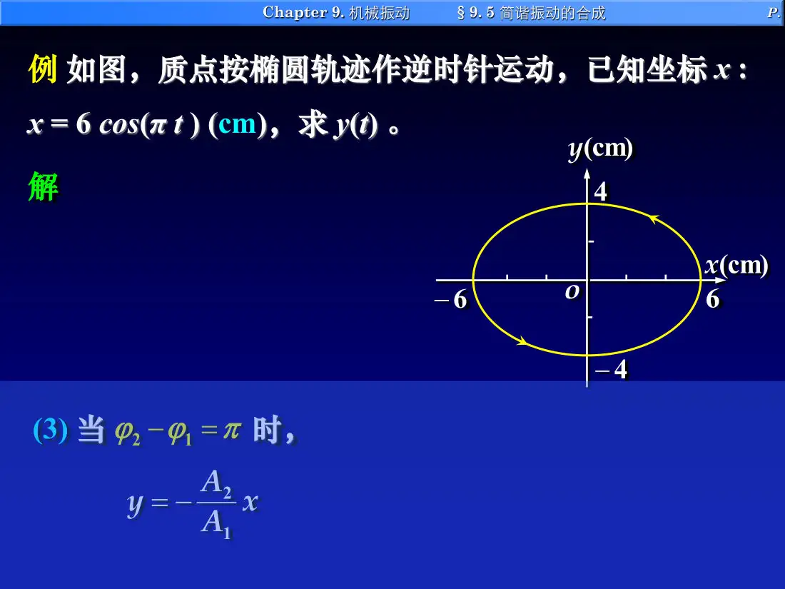

原文：

例如图, 质点按椭圆轨迹作逆时针运动, 已知坐标 $x: x = 6 \cos (\pi t) (\mathrm{cm})$ , 求 $y(t)$ 。

解

(3) 当 $\varphi_{2}-\varphi_{1}=\pi$ 时，

$$
y = - \frac {A _ {2}}{A _ {1}} x
$$

Chapter 9. 机械振动

§ 9.5 简谐振动的合成

P.

### 解 由旋转矢量图可知:

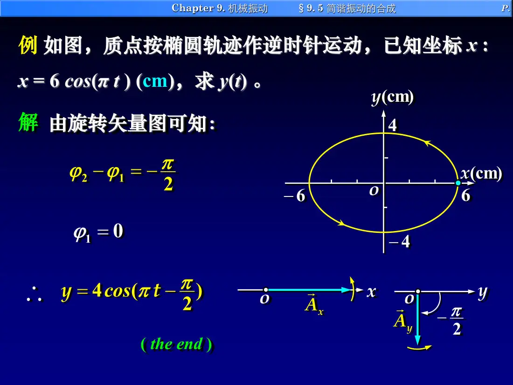

原文：

例如图, 质点按椭圆轨迹作逆时针运动, 已知坐标 $x: x = 6 \cos (\pi t) (\mathrm{cm})$ , 求 $y(t)$ 。

解 由旋转矢量图可知:

$$
\varphi_ {2} - \varphi_ {1} = - \frac {\pi}{2}
$$

$$
\varphi_ {1} = 0
$$

$$
\therefore y = 4 \cos (\pi t - \frac {\pi}{2}) \quad \xrightarrow [ O ]{A _ {x}} x \quad \xrightarrow [ O ]{A _ {y}} y \tag {theend}
$$

Chapter 9. 机械振动

§ 9.5 简谐振动的合成

P.

### 四、不同频率相互垂直方向的谐振动合成

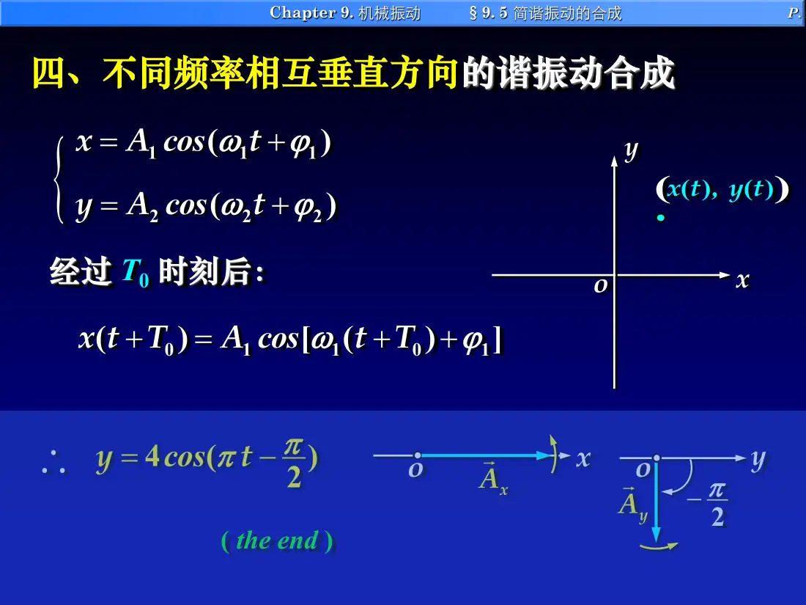

原文：

四、不同频率相互垂直方向的谐振动合成

$$
\left\{ \begin{array}{l} x = A _ {1} \cos (\omega_ {1} t + \varphi_ {1}) \\ y = A _ {2} \cos (\omega_ {2} t + \varphi_ {2}) \end{array} \right.
$$

经过 $T_{0}$ 时刻后:

$$
x (t + T _ {0}) = A _ {1} \cos [ \omega_ {1} (t + T _ {0}) + \varphi_ {1} ]
$$

$$
\therefore \quad y = 4 \cos (\pi t - \frac {\pi}{2}) \quad \xrightarrow {O} \vec {A} _ {x} \quad \xrightarrow {x} \quad \begin{array}{c} O \\ \vec {A} _ {y} \end{array} \xrightarrow {- \frac {\pi}{2}} y
$$

Chapter 9. 机械振动

§ 9.5 简谐振动的合成

P.

### 四、不同频率相互垂直方向的谐振动合成

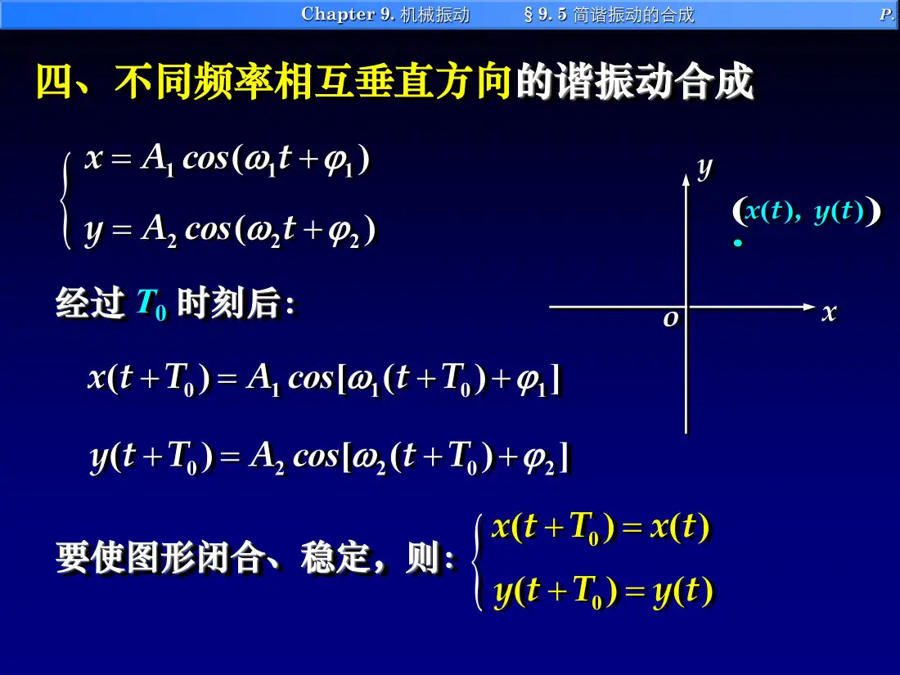

原文：

四、不同频率相互垂直方向的谐振动合成

$$
x = A _ {1} \cos (\omega_ {1} t + \varphi_ {1})
$$

$$
y = A _ {2} \cos (\omega_ {2} t + \varphi_ {2})
$$

$$
(x (t), y (t))
$$

经过 $T_{0}$ 时刻后:

$$
x (t + T _ {0}) = A _ {1} \cos [ \omega_ {1} (t + T _ {0}) + \varphi_ {1} ]
$$

$$
y (t + T _ {0}) = A _ {2} \cos [ \omega_ {2} (t + T _ {0}) + \varphi_ {2} ]
$$

要使图形闭合、稳定，则： $\left\{\begin{aligned}x(t+T_{0})&=x(t)\\ y(t+T_{0})&=y(t)\end{aligned}\right.$

Chapter 9. 机械振动

§ 9.5 简谐振动的合成

P.

### $$

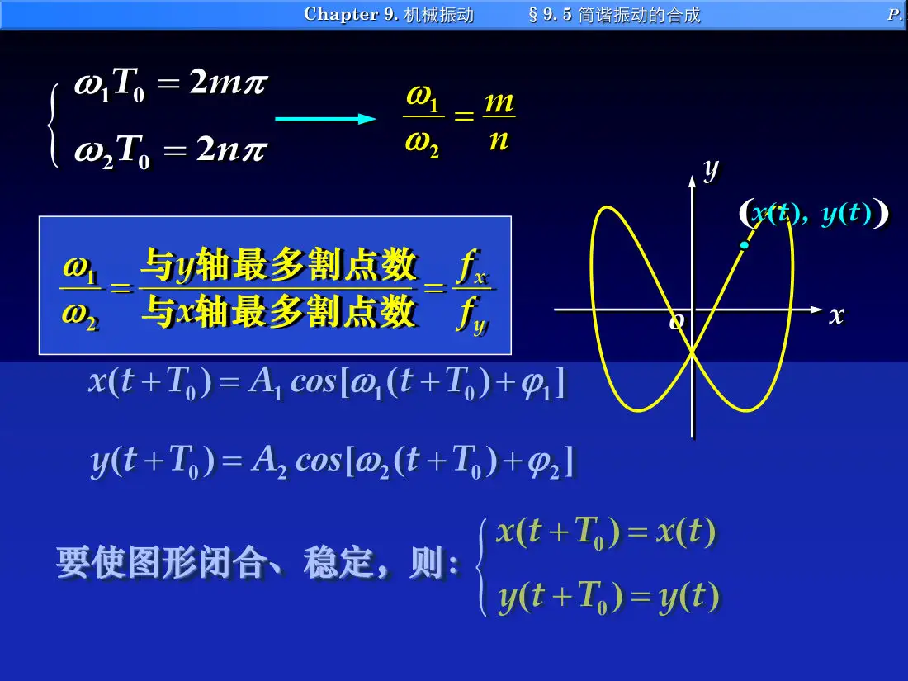

原文：

$$
\left\{ \begin{array}{l} \omega_ {1} T _ {0} = 2 m \pi \\ \omega_ {2} T _ {0} = 2 n \pi \end{array} \right. \longrightarrow \frac {\omega_ {1}}{\omega_ {2}} = \frac {m}{n}
$$

$\frac{\omega_{1}}{\omega_{2}} = \frac{\text{与}y\text{轴最多割点数}}{\text{与}x\text{轴最多割点数}} = \frac{f_{x}}{f_{y}}$

$$
x (t + T _ {0}) = A _ {1} \cos [ \omega_ {1} (t + T _ {0}) + \varphi_ {1} ]
$$

$$
y (t + T _ {0}) = A _ {2} \cos [ \omega_ {2} (t + T _ {0}) + \varphi_ {2} ]
$$

要使图形闭合、稳定，则： $\left\{\begin{aligned}x(t+T_{0})&=x(t)\\ y(t+T_{0})&=y(t)\end{aligned}\right.$

Chapter 9. 机械振动

§ 9.5 简谐振动的合成

P.

### $$

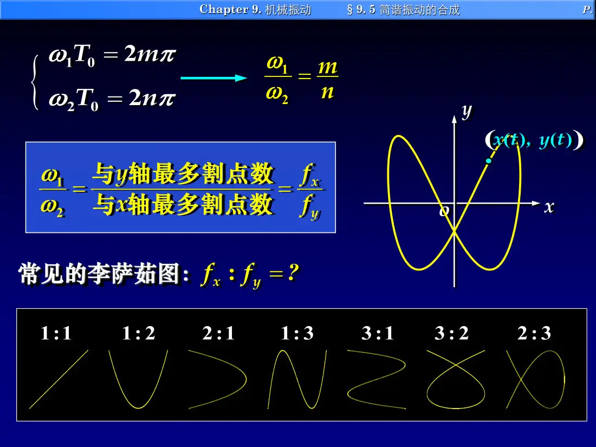

原文：

$$
\left\{ \begin{array}{l} \omega_ {1} T _ {0} = 2 m \pi \\ \omega_ {2} T _ {0} = 2 n \pi \end{array} \right. \longrightarrow \frac {\omega_ {1}}{\omega_ {2}} = \frac {m}{n}
$$

$\frac{\omega_{1}}{\omega_{2}} = \frac{\text{与}y\text{轴最多割点数}}{\text{与}x\text{轴最多割点数}} = \frac{f_{x}}{f_{y}}$

常见的李萨茹图: $f_{x}: f_{y} = ?$

1:1 1:2 2:1 1:3 3:1 3:2 2:3

Chapter 9. 机械振动

§ 9.5 简谐振动的合成

P.

### 归纳:

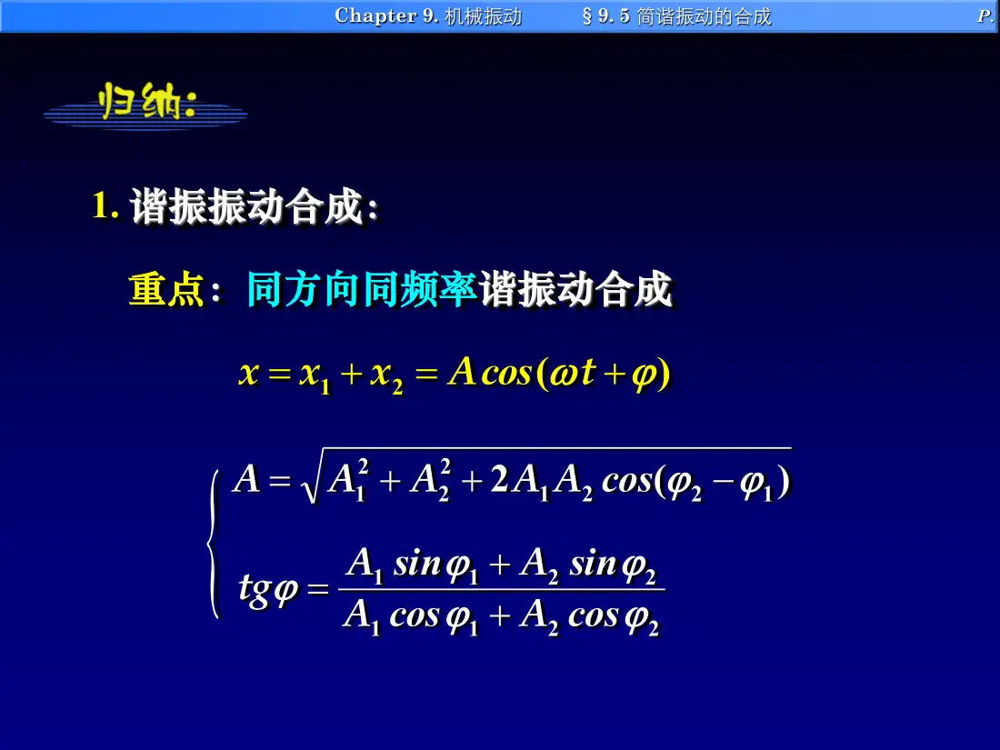

原文：

归纳:

1. 谐振振动合成:

重点：同方向同频率谐振动合成

$$
x = x _ {1} + x _ {2} = A \cos (\omega t + \varphi)
$$

$$
A = \sqrt {A _ {1} ^ {2} + A _ {2} ^ {2} + 2 A _ {1} A _ {2} \cos (\varphi_ {2} - \varphi_ {1})}
$$

$$
t g \varphi = \frac {A _ {1} \sin \varphi_ {1} + A _ {2} \sin \varphi_ {2}}{A _ {1} \cos \varphi_ {1} + A _ {2} \cos \varphi_ {2}}
$$

Chapter 9. 机械振动

§ 9.5 简谐振动的合成

P.

### 归纳：

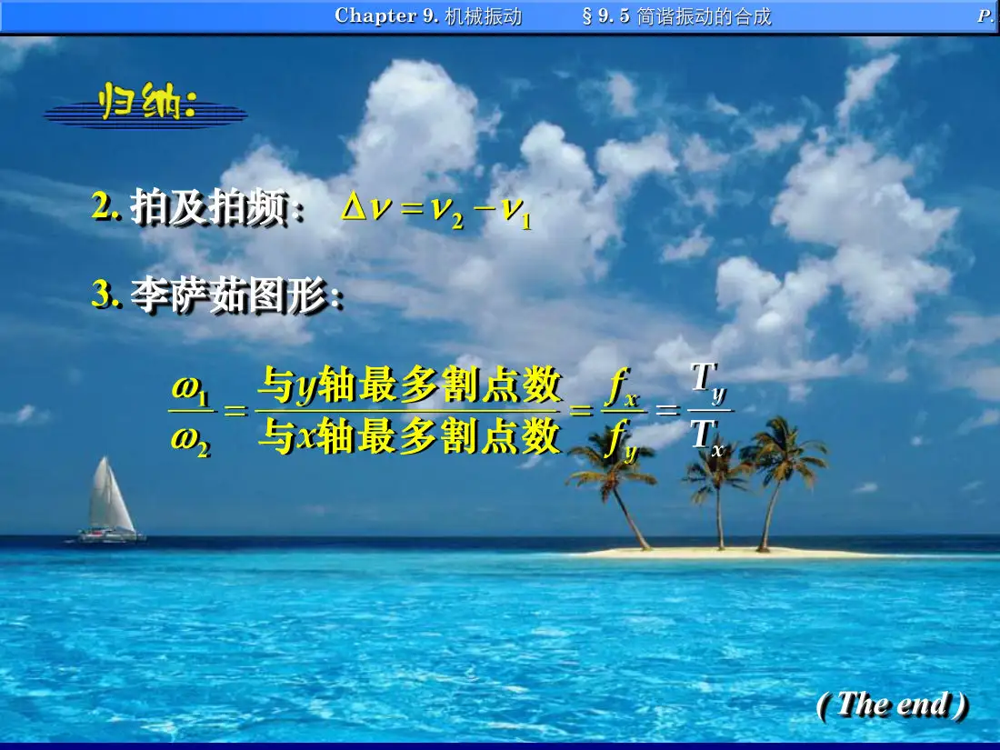

原文：

归纳：

2. 拍及拍频: $\Delta \nu = \nu_{2} - \nu_{1}$

3. 李萨茹图形:

$\frac{\omega_{1}}{\omega_{2}} = \frac{\text{与} y \text{轴最多割点数}}{\text{与} x \text{轴最多割点数}} = \frac{f_{x}}{f_{y}} = \frac{T_{y}}{T_{x}}$

Chapter 9. 机械振动

§ 9.5 简谐振动的合成

P.

(The end)

### 录像：

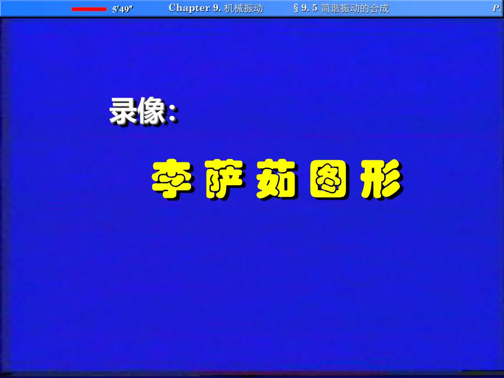

原文：

录像：

李萨茹图形

5'49"

Chapter 9. 机械振动

§ 9.5 简谐振动的合成

P.
