# 《大学物理》第9章 气体动理论 §9.4 Maxwell速率分布律（课件）

原件的每一页，下面附识别出的文字。

### § 9-4 Maxwell速率分布律

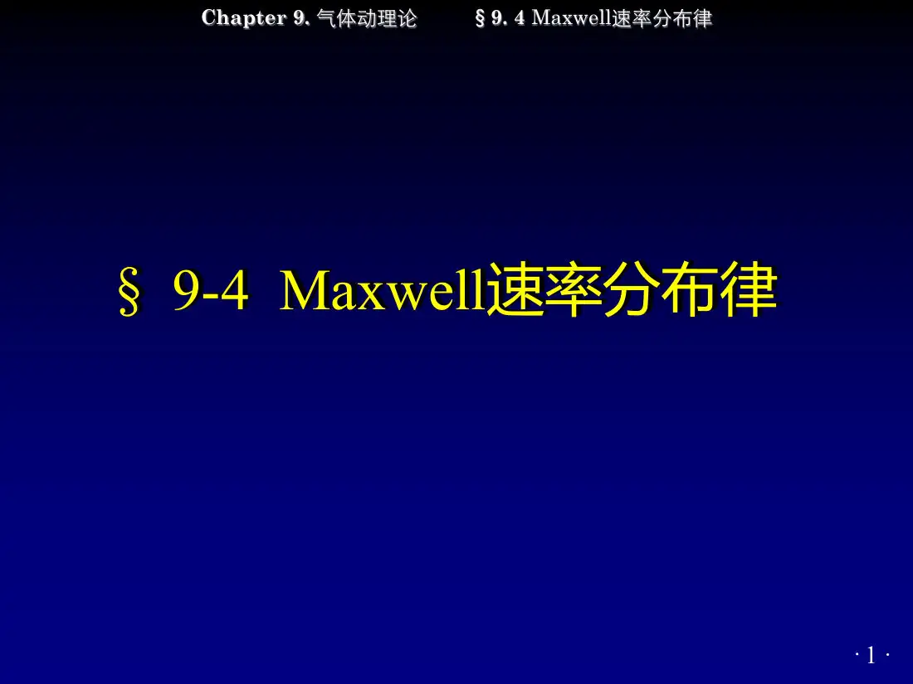

原文：

§ 9-4 Maxwell速率分布律

Chapter 9. 气体动理论 §9. 4 Maxwell速率分布律

1

### Chapter 9. 气体动理论 §9. 4 Maxwell速率分布律

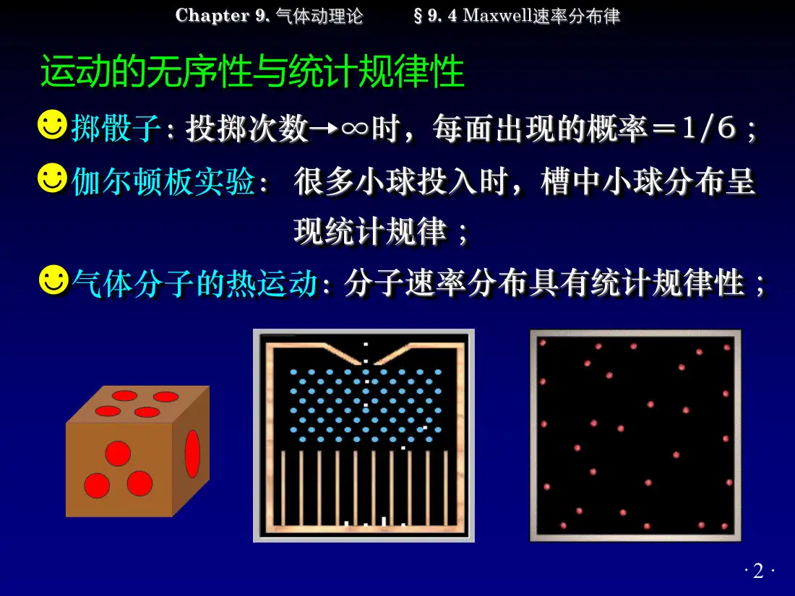

原文：

Chapter 9. 气体动理论 §9. 4 Maxwell速率分布律

运动的无序性与统计规律性

☻掷骰子：投掷次数→∞时，每面出现的概率＝1/6 ;

☻伽尔顿板实验： 很多小球投入时，槽中小球分布呈现统计规律 ;

☻气体分子的热运动：分子速率分布具有统计规律性 ;

· 2

### Chapter 9. 气体动理论 §9. 4 Maxwell速率分布律

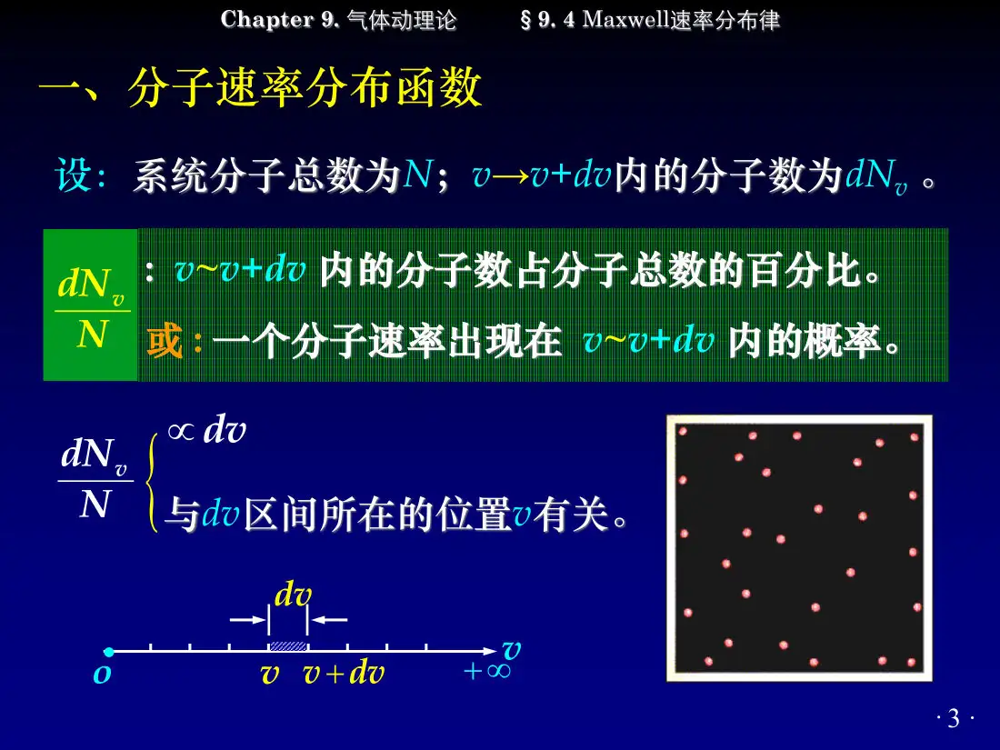

原文：

Chapter 9. 气体动理论 §9. 4 Maxwell速率分布律

一、分子速率分布函数

设：系统分子总数为N；v→v+dv内的分子数为dNv 。

dNv : v\~v+dv 内的分子数占分子总数的百分比。N 或 : 一个分子速率出现在 v\~v+dv 内的概率。

∝ dvdN N 与dv区间所在的位置v有关。

· 3

### Chapter 9. 气体动理论 §9. 4 Maxwell速率分布律

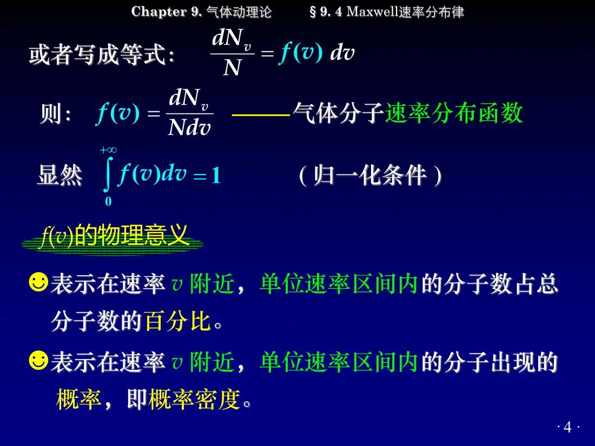

原文：

Chapter 9. 气体动理论 §9. 4 Maxwell速率分布律

或者写成等式： $\frac { 1 0 0 0 } { 1 8 } = 1 \times ( 0 ) = 1 8 0$

则： $1 2 \textcircled { 1 0 } 1 = \frac { 1 } { 1 2 } \times 1 0$ 气体分子速率分布函数显然 $\vert \vert \vert \vert \langle \vert o \rangle \vert o \vert = 1$ ( 归一化条件 )

f(v)的物理意义

☻表示在速率 v 附近，单位速率区间内的分子数占总分子数的百分比。

☻表示在速率 v 附近，单位速率区间内的分子出现的概率，即概率密度。

· 4

### 二、Maxwell 速率分布函数

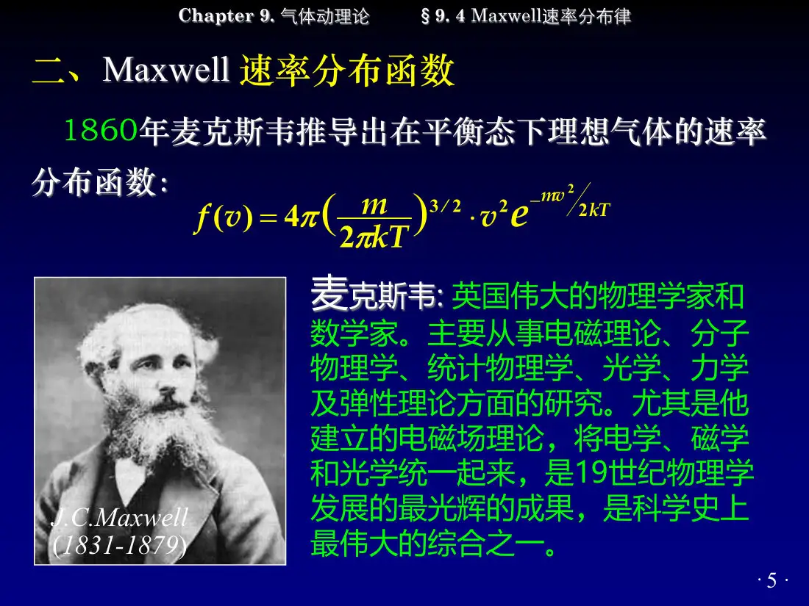

原文：

二、Maxwell 速率分布函数

1860年麦克斯韦推导出在平衡态下理想气体的速率分布函数： mv

$$
f (v) = 4 \pi \left(\frac {m}{2 \pi k T}\right) ^ {3 / 2} \cdot v ^ {2} e ^ {- m v ^ {2} / 2 k T}
$$

麦克斯韦: 英国伟大的物理学家和数学家。主要从事电磁理论、分子物理学、统计物理学、光学、力学及弹性理论方面的研究。尤其是他建立的电磁场理论，将电学、磁学和光学统一起来，是19世纪物理学发展的最光辉的成果，是科学史上最伟大的综合之一。

Chapter 9. 气体动理论 §9. 4 Maxwell速率分布律

· 5

### Chapter 9. 气体动理论

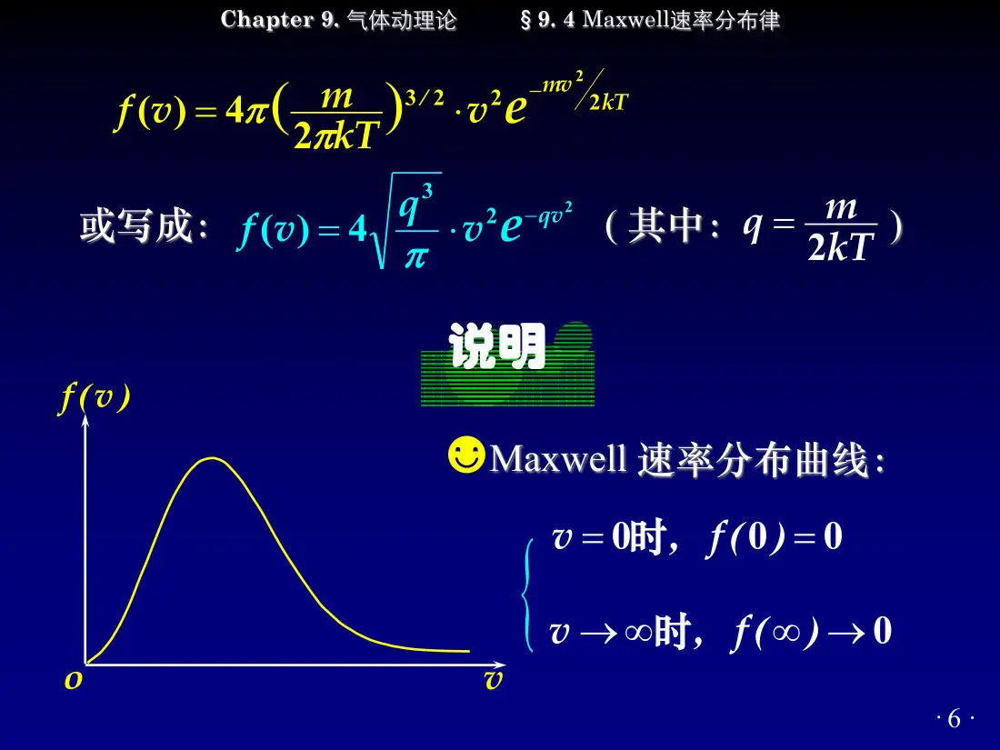

原文：

Chapter 9. 气体动理论

§9. 4 Maxwell速率分布律

$$
f (v) = 4 \pi \left(\frac {m}{2 \pi k T}\right) ^ {3 / 2} \cdot v ^ {2} e ^ {- m v ^ {2} / 2 k T}
$$

或写成： $1 \times ( 0 ) = 1 \times ( 0 . 7 8 - 0 . 5 8 ) = 1 \times ( 0 . 7 8 - 0 . 5 8 ) = 1 \times ( 0 . 7 8 - 0 . 5 8 ) = 1 \times ( 0 . 7 8 - 0 . 5 8 ) ( 0 . 5 8 - 0 . 5 8 ) = 1 \times ( 0 . 7 8 - 0 . 5 8 ) ( 0 . 5 8 - 0 . 5 8 ) ( 0 . 5 8 - 0 . 5 8 )$ ( 其中： $y _ { 1 } = \frac { 1 1 1 } { 1 1 }$

说明

☻Maxwell 速率分布曲线：

v = 0时， $l i ( 0 ) { = } 0$

v→∞时， $1 1 ( 0 0 ) = 1 1$

· 6

### Chapter 9. 气体动理论

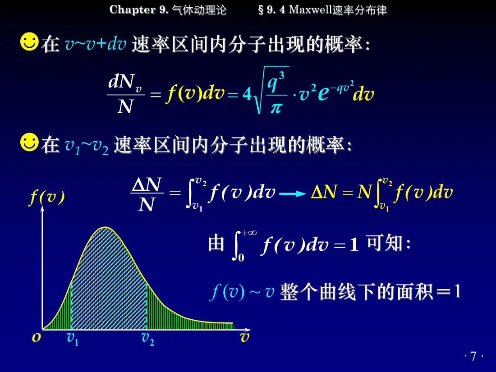

原文：

Chapter 9. 气体动理论

§9. 4 Maxwell速率分布律

☻在 v\~v+dv 速率区间内分子出现的概率：

$$
\frac {d N _ {v}}{N} = f (v) d v = 4 \sqrt {\frac {q ^ {3}}{\pi}} \cdot v ^ {2} e ^ {- q v ^ {2}} d v
$$

☻在 $\textcircled { \bullet } F = \textcircled { \bullet }$ 速率区间内分子出现的概率：

$\frac { A B } { A B } = \frac { A C } { A C }$ f(v)dv→ ∆N = N. f(v)dv Jv1

由 $( 1 ) ( 1 0 0 - 1 ) \times 1 0 = 1 1$ 可知：

$1 1 \textcircled { ( 6 ) } 1 = 1 0$ 整个曲线下的面积＝1

· 7

### Chapter 9. 气体动理论 §9. 4 Maxwell速率分布律

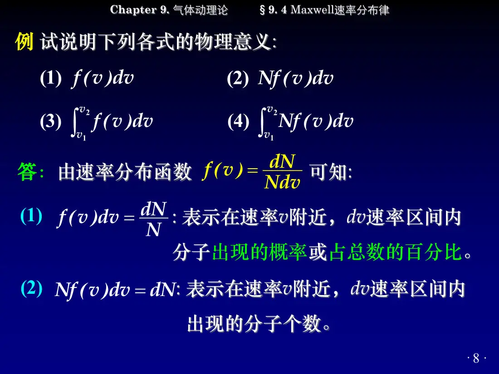

原文：

Chapter 9. 气体动理论 §9. 4 Maxwell速率分布律

例 试说明下列各式的物理意义:

(1) $1 1 ( k g ) \times 1 0$

(2) $\textcircled { 1 } y ( \textcircled { 4 } ) = \textcircled { 1 } \textcircled { 2 } \textcircled { 1 0 }$

(3) $\sqrt { 1 0 ^ { 2 } + ( 4 0 ^ { 2 } ) ^ { 2 } } = \sqrt { 1 0 }$

(4) $( 1 0 0 - 1 ) \times 1 0 ( 1 0 0 ) = 1 0 ( 1 0 0 )$

答：由速率分布函数 $1 8 ( c o ) = \frac { 1 2 N } { 1 8 ( c o ) }$ 可知:

(1) $1 / ( \frac { \sqrt { 3 } } { 2 } ) ^ { 2 } / ( \frac { \sqrt { 3 } } { 2 } - \frac { ( \frac { \sqrt { 3 } } { 2 } ) ^ { 2 } } { 1 2 } )$ 表示在速率v附近，dv速率区间内分子出现的概率或占总数的百分比。

(2) $W / ( C O ) / / C O _ { 2 } = C O _ { 2 } \downarrow$ 表示在速率v附近，dv速率区间内出现的分子个数。

8

### Chapter 9. 气体动理论 §9. 4 Maxwell速率分布律

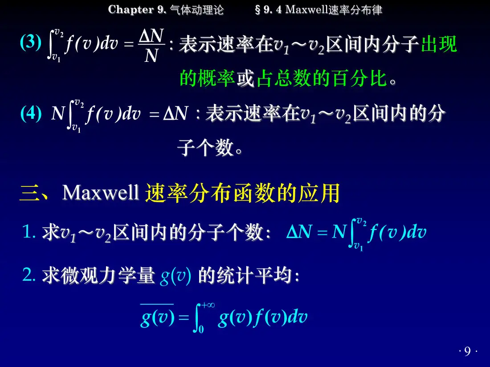

原文：

Chapter 9. 气体动理论 §9. 4 Maxwell速率分布律

(3) $\frac { \Delta B E } { \Delta A B C } = \frac { \Delta A B E } { \Delta B C }$ 表示速率在 $\textcircled { \bullet } \textcircled { < } \textcircled { < } \textcircled { < } \textcircled { < } \textcircled { < } \textcircled { < }$ 区间内分子出现的概率或占总数的百分比。

(4) $W _ { 1 } = ( \frac { 1 } { 2 } - \frac { 1 } { 2 } ) \times ( \frac { 1 } { 2 } - \frac { 1 } { 2 } ) \times ( \frac { 1 } { 2 } - \frac { 1 } { 2 } )$ : 表示速率在 $( 0 ) \textcircled { < } 2$ 区间内的分子个数。

三、Maxwell 速率分布函数的应用

1. 求 $( 0 ) \sim \Delta E D$ 区间内的分子个数： $\Delta A B C = \Delta B C D / / C D / / C D$

2. 求微观力学量 $\textcircled { 9 4 }$ 的统计平均：

$$
\overline {{g (v)}} = \int_ {0} ^ {+ \infty} g (v) f (v) d v
$$

· 9

### Chapter 9. 气体动理论 §9. 4 Maxwell速率分布律

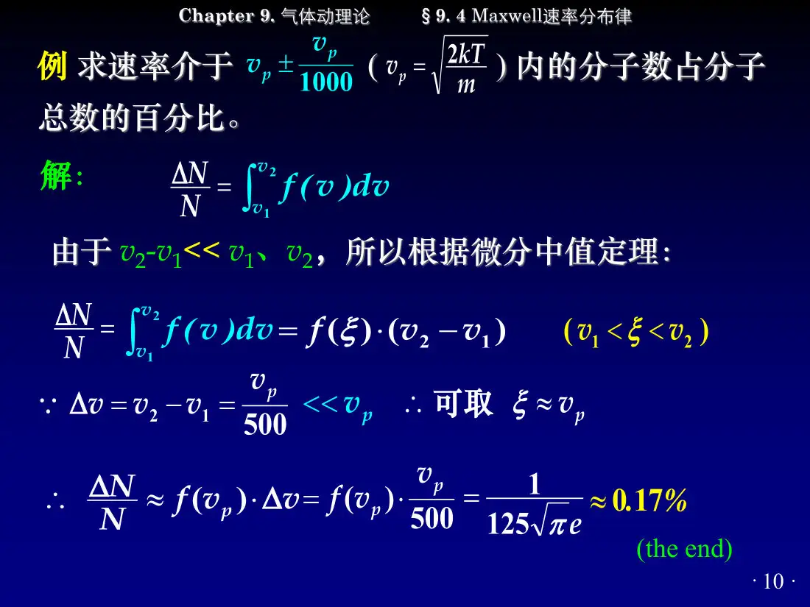

原文：

Chapter 9. 气体动理论 §9. 4 Maxwell速率分布律

例 求速率介于 $\frac { \langle \theta \rangle } { \langle \theta \rangle } = \frac { \langle \theta \rangle } { \langle \theta \rangle } = \frac { \langle \theta \rangle \langle \theta \rangle } { \langle \theta \rangle } = \frac { \langle \theta \rangle \langle \theta \rangle } { \langle \theta \rangle }$ 内的分子数占分子总数的百分比。

解：

$$
\frac {\Delta N}{N} = \int_ {v _ {1}} ^ {v _ {2}} f (v) d v
$$

由于 $( 0 ) ( 0 ) \times ( 0 . 7 ) \times ( 0 . 7 ) \times ( 0 . 7 )$ ，所以根据微分中值定理：

$$
\frac {\Delta N}{N} = \int_ {v _ {1}} ^ {v _ {2}} f (v) d v = f (\xi) \cdot (v _ {2} - v _ {1}) \quad (v _ {1} <   \xi <   v _ {2})
$$

$\angle A C O = \angle O A C = \angle O A C = \angle O A C = \angle O A O$   可取 $( 3 ) \approx ( 0 )$

$$
\therefore \frac {\Delta N}{N} \approx f (v _ {p}) \cdot \Delta v = f (v _ {p}) \cdot \frac {v _ {p}}{5 0 0} = \frac {1}{1 2 5 \sqrt {\pi} e} \approx 0. 1 7
$$

(the end)

10

### Chapter 9. 气体动理论 §9. 4 Maxwell速率分布律

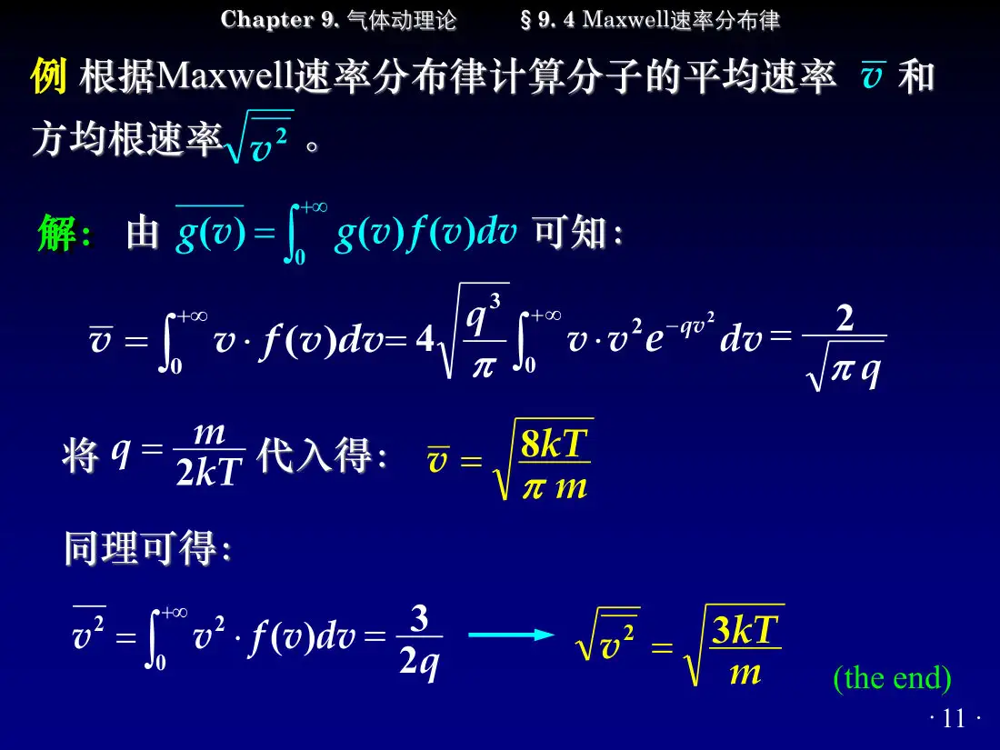

原文：

Chapter 9. 气体动理论 §9. 4 Maxwell速率分布律

例 根据Maxwell速率分布律计算分子的平均速率 和v方均根速率 $\boxed { \pmb { \overrightarrow { \vert \overrightarrow { \mathbf { r } } \vert } } }$

解：由 $3 ( 0 ) = 1 1 ( 0 ) 3 ( 0 ) 1 ( 0 ) 1 ( 0 )$ 可知：

$$
\overline {{v}} = \int_ {0} ^ {+ \infty} v \cdot f (v) d v = 4 \sqrt {\frac {q ^ {3}}{\pi}} \int_ {0} ^ {+ \infty} v \cdot v ^ {2} e ^ {- q v ^ {2}} d v = \frac {2}{\sqrt {\pi q}}
$$

将 $y = \frac { 1 1 1 } { 1 1 3 }$ 代入得： $\textcircled { \cdot } \frac { 1 } { \cdot ( \cdot ) } = \frac { \sqrt { 1 + 1 1 } } { \cdot ( \cdot ) ^ { 2 } }$

同理可得：

$$
\overline {{v ^ {2}}} = \int_ {0} ^ {+ \infty} v ^ {2} \cdot f (v) d v = \frac {3}{2 q} \longrightarrow \sqrt {\overline {{v ^ {2}}}} = \sqrt {\frac {3 k T}{m}}
$$

(the end)

· 11

### 四、三种分子速率

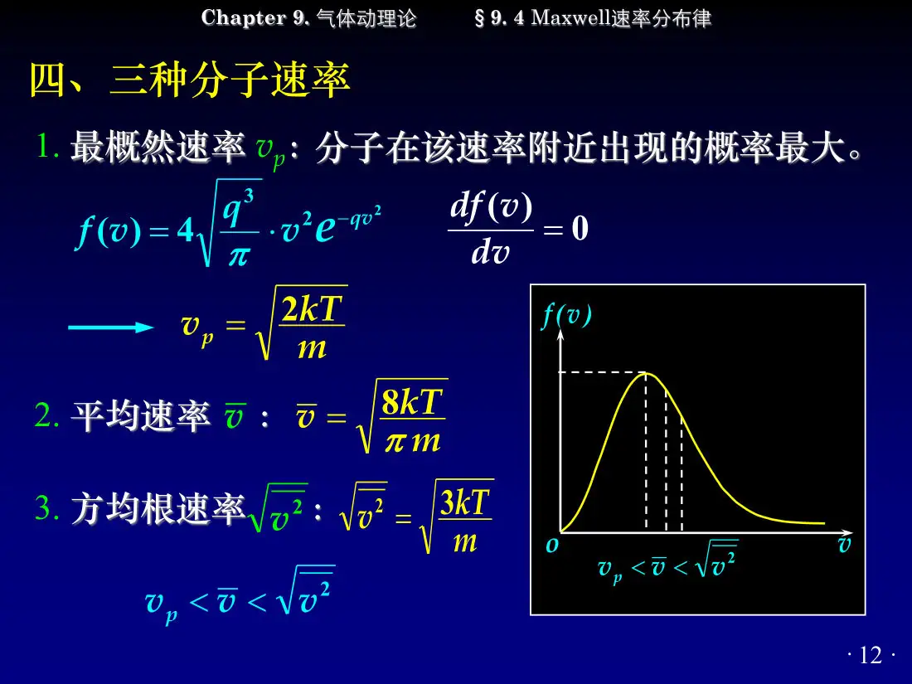

原文：

四、三种分子速率

1. 最概然速率 $\textcircled { \bullet } \frac { 9 } { 1 0 }$ ：分子在该速率附近出现的概率最大。

$$
f (v) = 4 \sqrt {\frac {q ^ {3}}{\pi}} \cdot v ^ {2} e ^ {- q v ^ {2}}
$$

$$
\frac {d f (v)}{d v} = 0
$$

$$
v _ {p} = \sqrt {\frac {2 k T}{m}}
$$

2. 平均速率 v ： $\textcircled { 6 } = \frac { 1 } { 6 } \times \frac { 1 } { 6 } = \frac { 1 } { 6 }$

3. 方均根速率 $\frac { 1 } { 1 0 } \times \frac { 1 } { 1 0 } = \frac { 1 } { 1 0 } \times \frac { 1 } { 1 0 } = \frac { 1 } { 1 0 } ( m ^ { 2 } )$

$$
v _ {p} <   \overline {{v}} <   \sqrt {\overline {{v ^ {2}}}}
$$

Chapter 9. 气体动理论 §9. 4 Maxwell速率分布律

· 12

### 讨论

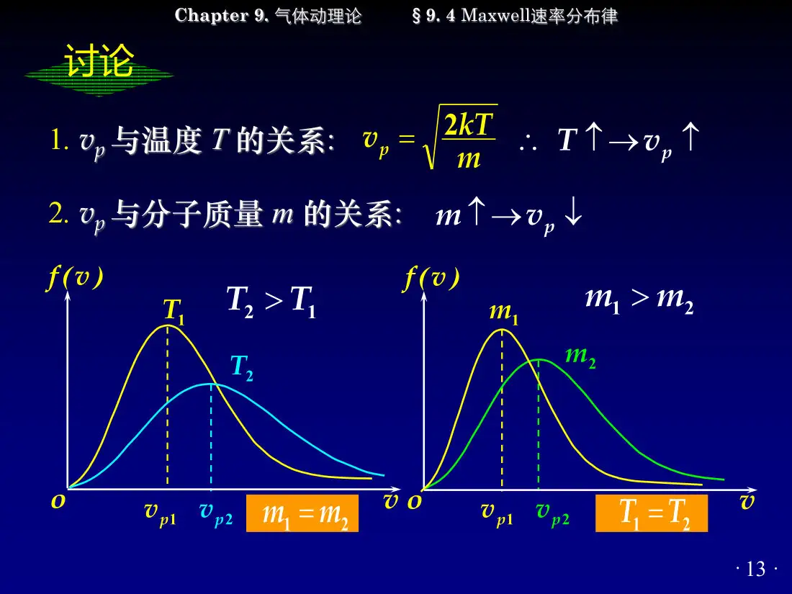

原文：

讨论

$( \bullet )$ 与温度 T 的关系: $\frac { 1 } { 1 1 } \times \frac { 1 } { 1 1 } = \frac { 1 } { 1 1 } ( m ^ { 2 } )$ ←

2. $( \pmb { \mathscr { p } } ) _ { 2 }$ 与分子质量 m 的关系: $1 4 0 \times 1 = 2 4 0 ( c m )$

Chapter 9. 气体动理论

§9. 4 Maxwell速率分布律

· 13

### Chapter 9. 气体动理论

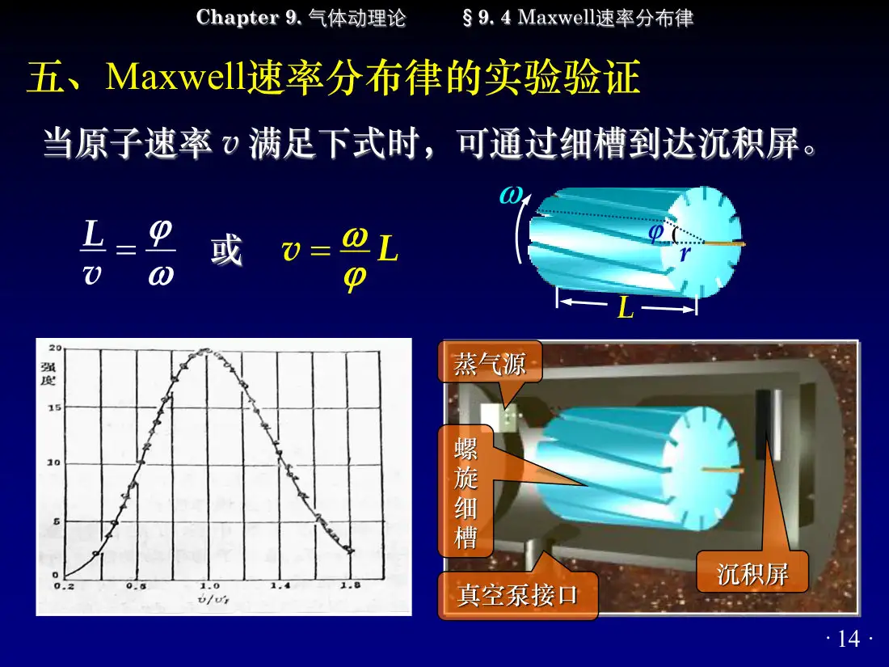

原文：

Chapter 9. 气体动理论

§9. 4 Maxwell速率分布律

五、Maxwell速率分布律的实验验证当原子速率 v 满足下式时，可通过细槽到达沉积屏。

$$
\frac {L}{v} = \frac {\varphi}{\omega}
$$

或

$$
v = \frac {\omega}{\varphi} L
$$

真空泵接口

14

### 归纳

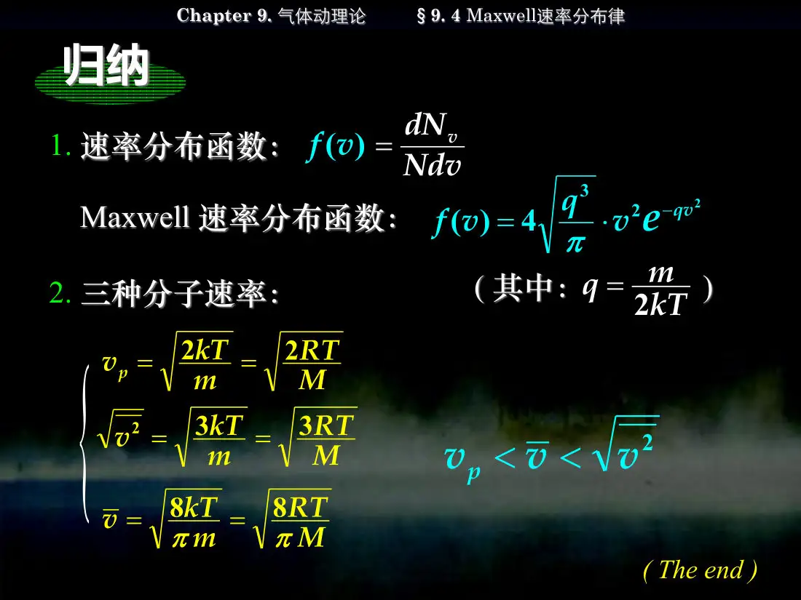

原文：

归纳

1. 速率分布函数： $1 1 ( 0 ) = \frac { 1 1 } { 1 1 } ( 0 )$ Maxwell 速率分布函数： $: ( 0 ) = ( 1 0 ) \times ( 0 . 2 5 ) = ( 1 0 ) \times ( 0 . 2 5 ) = ( 1 0 )$

2. 三种分子速率：

$$
v _ {p} = \sqrt {\frac {2 k T}{m}} = \sqrt {\frac {2 R T}{M}}
$$

$$
\sqrt {\overline {{v ^ {2}}}} = \sqrt {\frac {3 k T}{m}} = \sqrt {\frac {3 R T}{M}}
$$

$$
\overline {{v}} = \sqrt {\frac {8 k T}{\pi m}} = \sqrt {\frac {8 R T}{\pi M}}
$$

( 其中： $q = \frac { 1 1 1 } { 2 1 2 } \times 1 2$

$$
v _ {p} <   \overline {{v}} <   \sqrt {\overline {{v ^ {2}}}}
$$

Chapter 9. 气体动理论

§9. 4 Maxwell速率分布律

( The end )· 1
