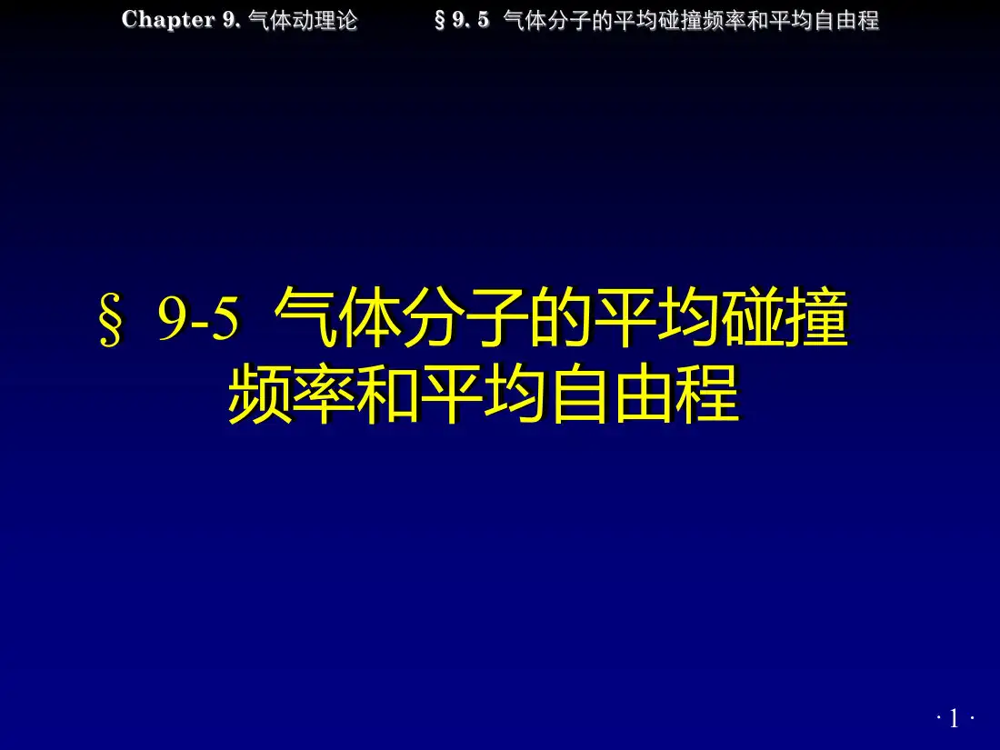
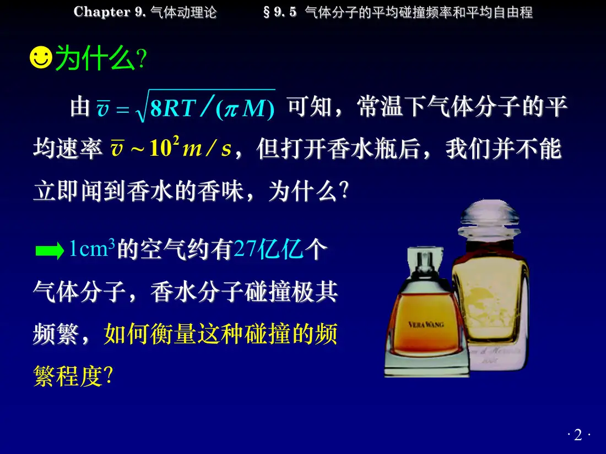
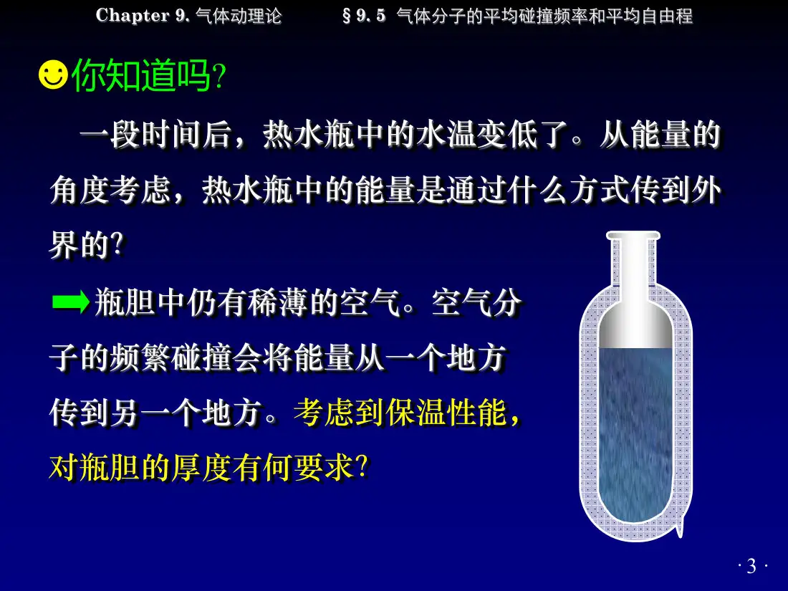
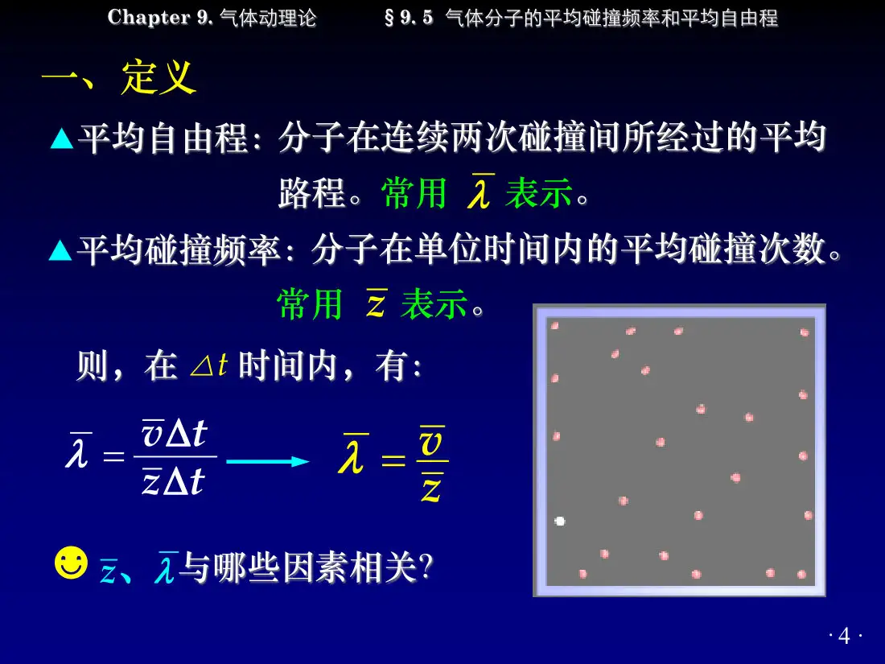
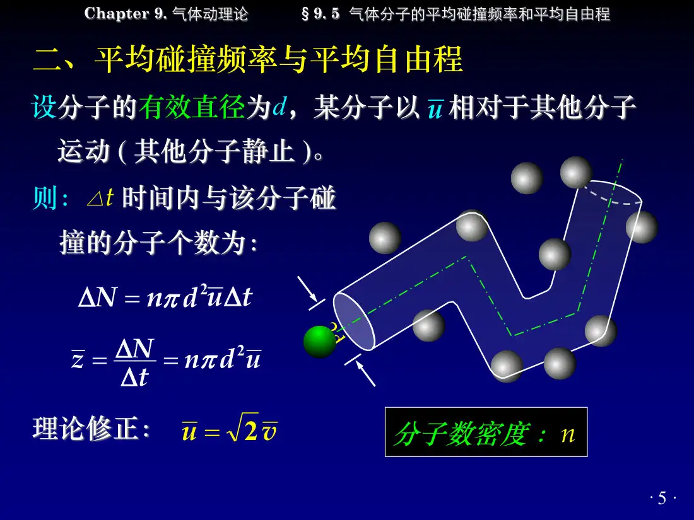
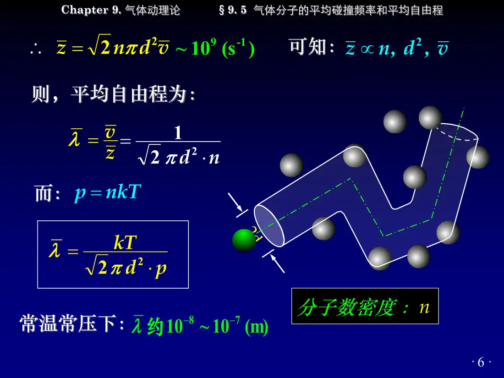
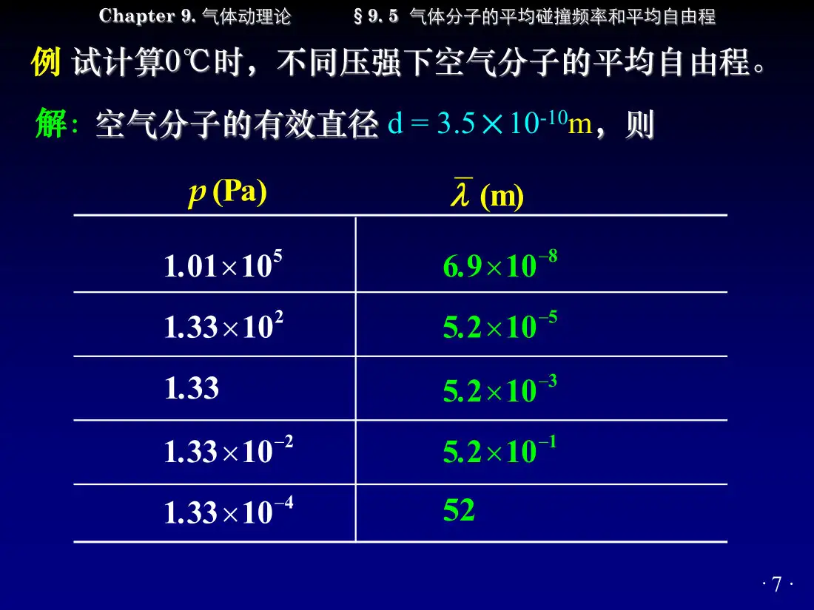
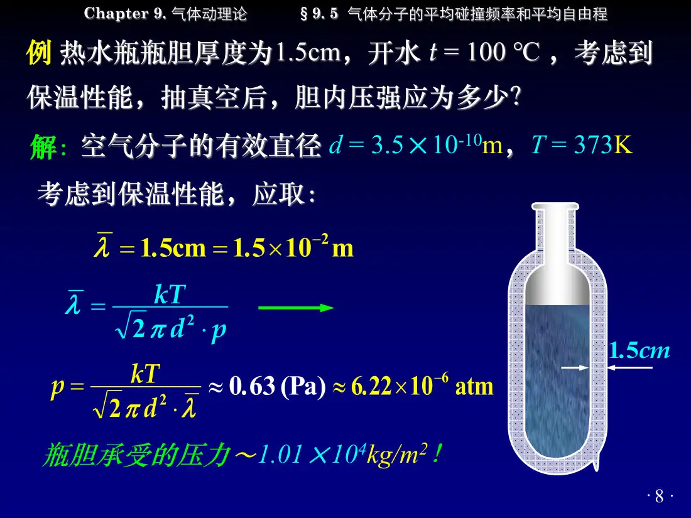
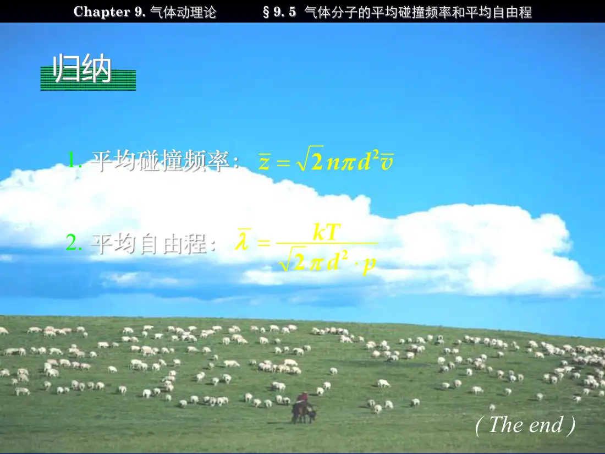

# 《大学物理》第9章 气体动理论 §9.5 气体分子的平均碰撞频率和平均自由程（课件）

原件的每一页，下面附识别出的文字。

### § 9-5 气体分子的平均碰撞频率和平均自由程

原文：

§ 9-5 气体分子的平均碰撞频率和平均自由程

Chapter 9. 气体动理论

§9. 5 气体分子的平均碰撞频率和平均自由程

1

### ☻为什么?

原文：

☻为什么?

由 $\textcircled { 6 } = \textcircled { 6 } \textcircled { 2 } \textcircled { 6 } \textcircled { 6 } \textcircled { 1 }$ 可知，常温下气体分子的平均速率 $\overrightarrow { O } = 1 1 0 ^ { 2 } / / \overrightarrow { O } =$ ，但打开香水瓶后，我们并不能立即闻到香水的香味，为什么？

$\| ( 9 0 ^ { \circ }$ 的空气约有27亿亿个气体分子，香水分子碰撞极其频繁，如何衡量这种碰撞的频繁程度？

Chapter 9. 气体动理论

§9. 5 气体分子的平均碰撞频率和平均自由程

· 2

### ☻你知道吗?

原文：

☻你知道吗?

一段时间后，热水瓶中的水温变低了。从能量的角度考虑，热水瓶中的能量是通过什么方式传到外界的？

瓶胆中仍有稀薄的空气。空气分子的频繁碰撞会将能量从一个地方传到另一个地方。考虑到保温性能，对瓶胆的厚度有何要求？

Chapter 9. 气体动理论

§9. 5 气体分子的平均碰撞频率和平均自由程

· 3

### 一、定义

原文：

一、定义

▲平均自由程：分子在连续两次碰撞间所经过的平均路程。常用 表示。

▲平均碰撞频率：分子在单位时间内的平均碰撞次数。

常用 z 表示。

则，在 $\angle A B C = 9 0 ^ { \circ }$ 时间内，有：

$$
\overline {{\lambda}} = \frac {\overline {{v}} \Delta t}{\overline {{z}} \Delta t} \longrightarrow \overline {{\lambda}} = \frac {\overline {{v}}}{\overline {{z}}}
$$

☻ 与哪些因素相关?

$$
\begin{array}{c c c c c c c c c} \hline  &  &  &  &  &  &  &  \\ \hline  &  &  &  &  &  &  &  \\ \hline  &  &  &  &  &  &  &  \\ \hline  &  &  &  &  &  &  &  \\ \hline \end{array}
$$

Chapter 9. 气体动理论

§9. 5 气体分子的平均碰撞频率和平均自由程

· 4

### 则：△t 时间内与该分子碰撞的分子个数为：

原文：

二、平均碰撞频率与平均自由程设分子的有效直径为d，某分子以 相对于其他分子u运动 ( 其他分子静止 )。

则：△t 时间内与该分子碰撞的分子个数为：

∆N = nπd²u∆t

z = ∆N = nπd²u ∆t

理论修正： $\boxed { 7 } = \boxed { 5 } \boxed { 7 }$

分子数密度：n

Chapter 9. 气体动理论

§9. 5 气体分子的平均碰撞频率和平均自由程

· 5

### Chapter 9. 气体动理论

原文：

Chapter 9. 气体动理论

§9. 5 气体分子的平均碰撞频率和平均自由程

$\angle B = \angle B A E = \angle C A E = \angle C \angle C$ 可知： $\angle B = \angle C A E = \angle C$

则，平均自由程为：

$$
\overline {{\lambda}} = \frac {\overline {{v}}}{\overline {{z}}} = \frac {1}{\sqrt {2} \pi d ^ {2} \cdot n}
$$

而： $1 0 - 1 1 = 1 1$

$$
\overline {{\lambda}} = \frac {k T}{\sqrt {2} \pi d ^ {2} \cdot p}
$$

常温常压下： $1 0 0 \times 1 0 = 1 0 0 0 ( c m ^ { 3 } )$ (m)

分子数密度：n

6

### Chapter 9. 气体动理论 §9. 5 气体分子的平均碰撞频率和平均自由程

原文：

Chapter 9. 气体动理论 §9. 5 气体分子的平均碰撞频率和平均自由程

例 试计算0℃时，不同压强下空气分子的平均自由程。

解：空气分子的有效直径 $\mathrm  \Delta \hat { v } _ { 0 } = \Delta \hat { v } _ { 0 } = \Delta \hat { v } _ { 0 } = \Delta \hat { v } _ { 0 } = \Delta \hat { v } _ { 0 } = \Delta \hat { v } _ { 0 } = \Delta \hat { v } _ { 0 } = 0$ ，则

$$
p (\mathrm{Pa})
$$

$$
\overline {{\lambda}} (\mathbf {m})
$$

$$
1. 0 1 \times 1 0 ^ {5}
$$

$$
6. 9 \times 1 0 ^ {- 8}
$$

$$
1. 3 3 \times 1 0 ^ {2}
$$

$$
5. 2 \times 1 0 ^ {- 5}
$$

1.33

$$
5. 2 \times 1 0 ^ {- 3}
$$

$$
1. 3 3 \times 1 0 ^ {- 2}
$$

$$
5. 2 \times 1 0 ^ {- 1}
$$

$$
1. 3 3 \times 1 0 ^ {- 4}
$$

52

· 7

### $$

原文：

例 热水瓶瓶胆厚度为1.5cm，开水 $v = 0 , 0 0 0 0$ ，考虑到保温性能，抽真空后，胆内压强应为多少？

解：空气分子的有效直径 $\angle C = \angle B = \angle C = \angle C D C = \angle C A B = \angle C = 3 \angle B = 9 5 ^ { \circ }$ 考虑到保温性能，应取：

$$
\overline {{\lambda}} = 1. 5 \mathrm{cm} = 1. 5 \times 1 0 ^ {- 2} \mathrm{m}
$$

$$
\overline {{\lambda}} = \frac {k T}{\sqrt {2} \pi d ^ {2} \cdot p}
$$

$$
p = \frac {k T}{\sqrt {2} \pi d ^ {2} \cdot \overline {{\lambda}}} \approx 0. 6 3 (\mathrm{Pa}) \approx 6. 2 2 \times 1 0 ^ {- 6} \mathrm{atm}
$$

1.5cm

1.01 104kg/m2

8

### 归纳

原文：

归纳

1. 平均碰撞频率： $= - 1 2 \times 1 0 0 0 \div 2 0$

2. 平均自由程： $\frac { T } { \lambda } = \frac { k T } { \sqrt { 2 } - d ^ { 2 } }$

Chapter 9. 气体动理论

§9. 5 气体分子的平均碰撞频率和平均自由程
