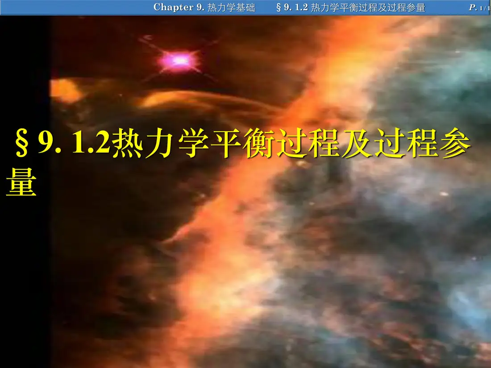
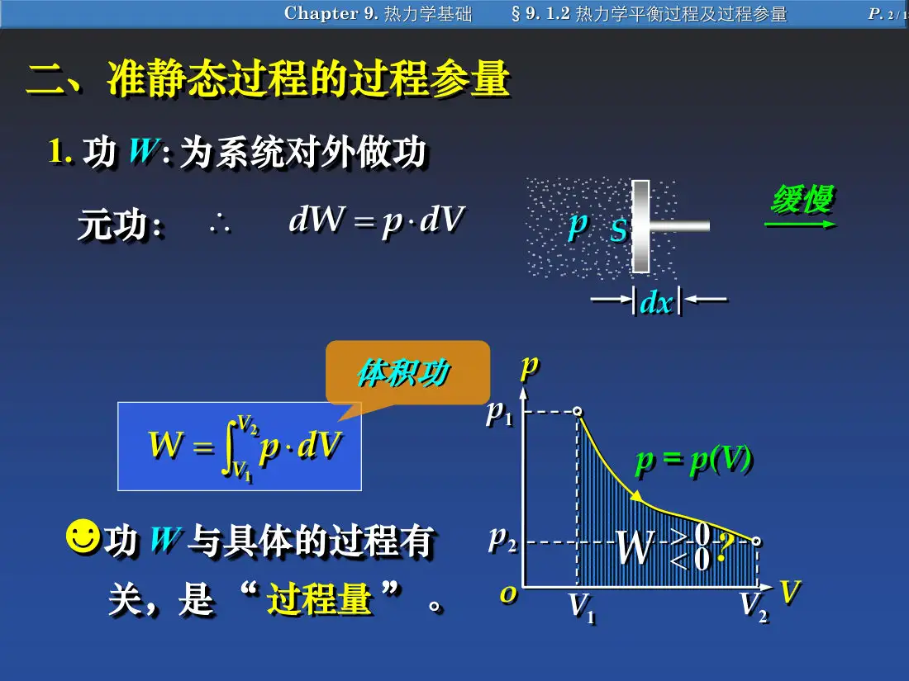
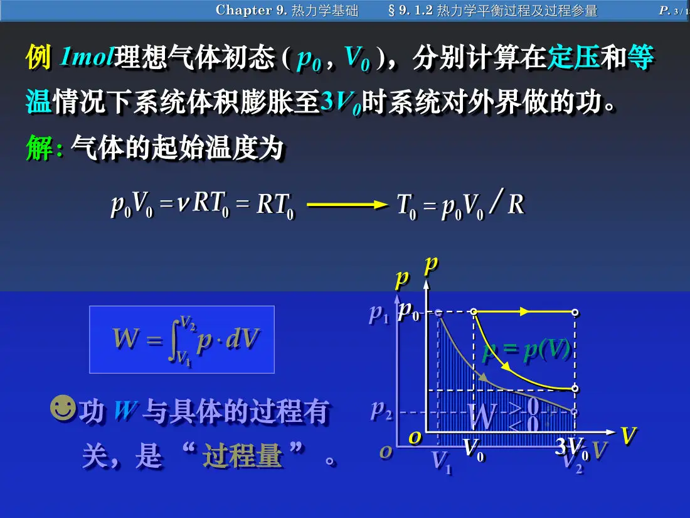
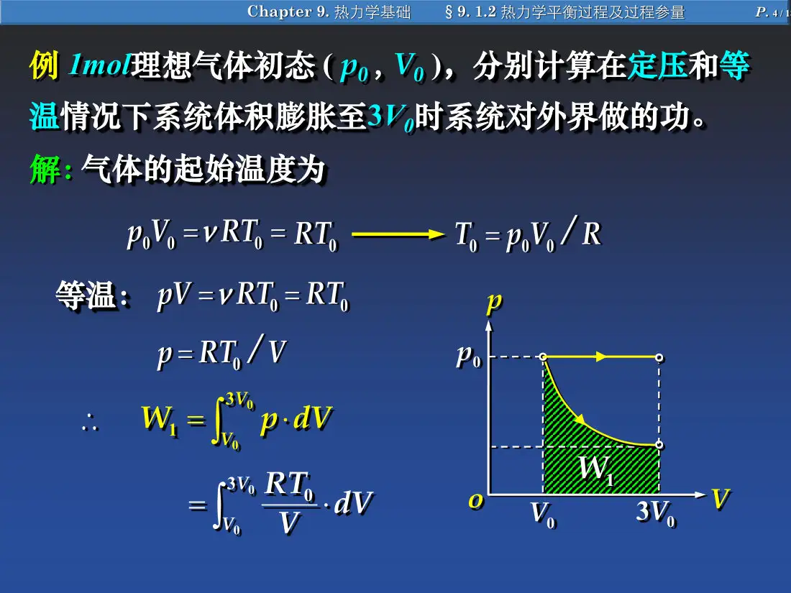
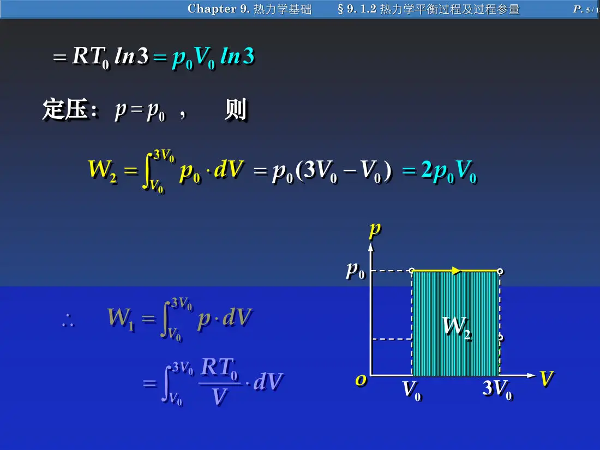
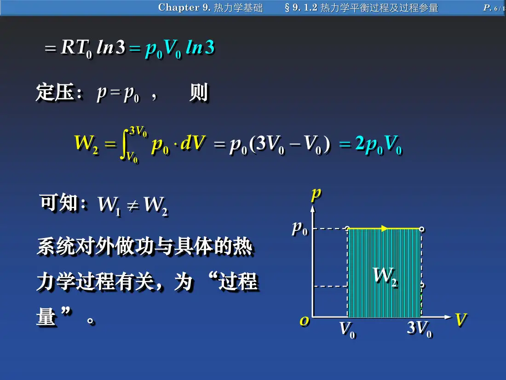
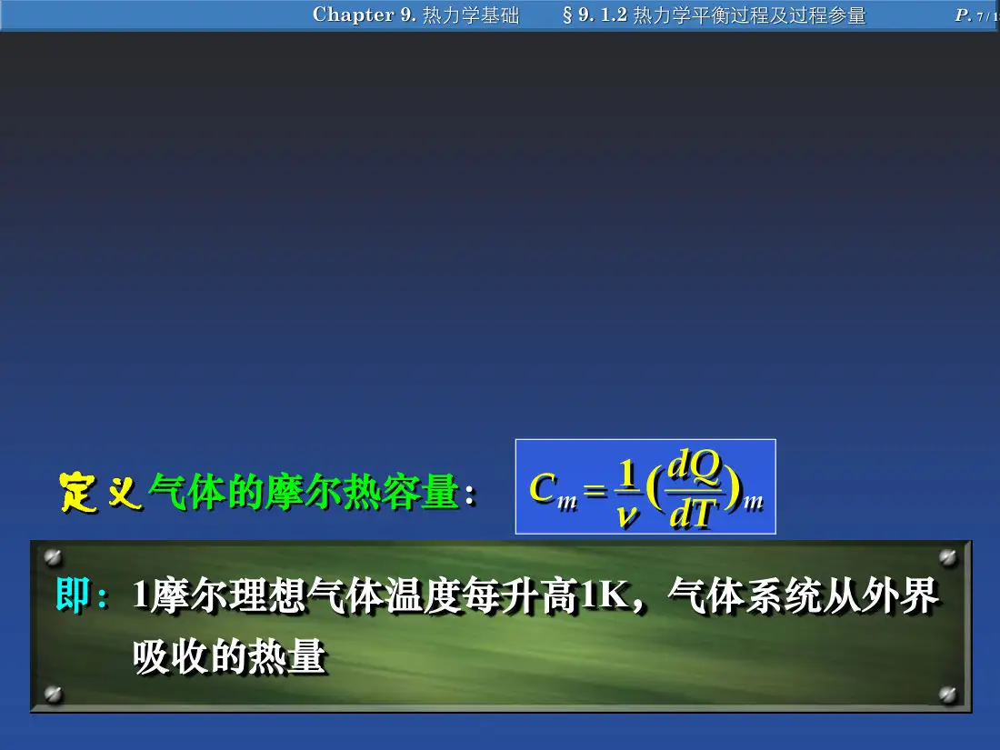
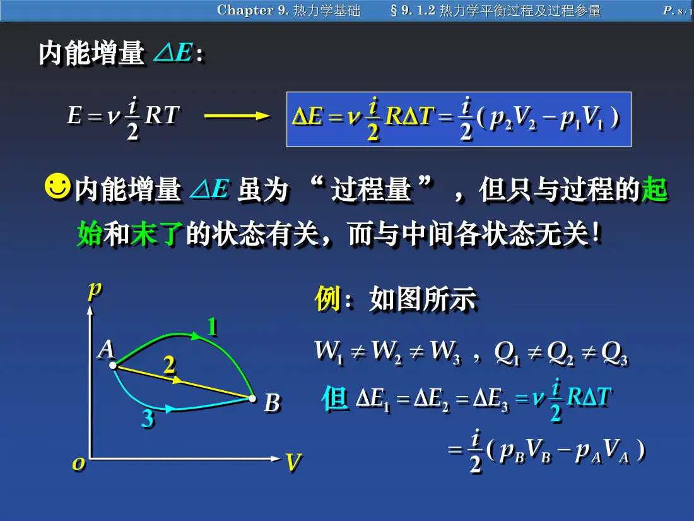
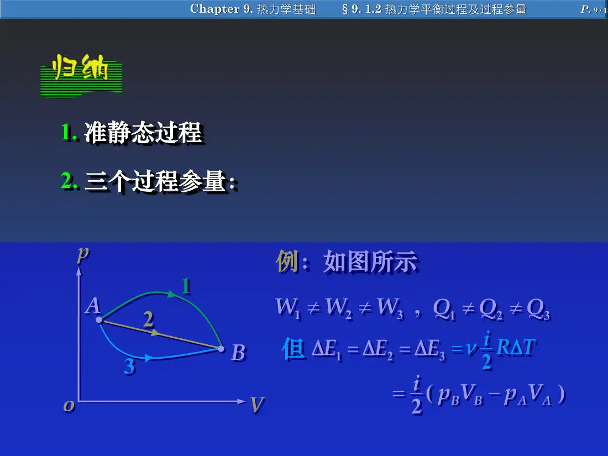
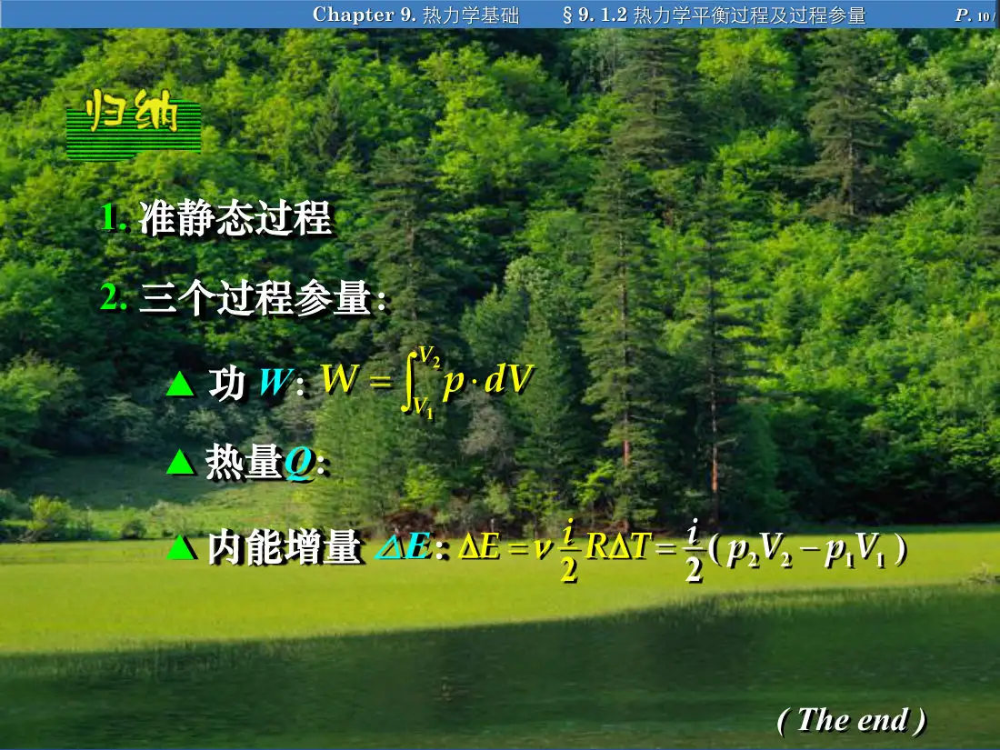

# 《大学物理》第9章 热力学基础 §9.1.2 热力学平衡过程及过程参量（课件）

原件的每一页，下面附识别出的文字。

### §9. 1.2热力学平衡过程及过程参量

原文：

§9. 1.2热力学平衡过程及过程参量

Chapter 9. 热力学基础作者：杨 §9. 1.2 热力学平衡过程及过程参量

P. 1 / 1

### 二、准静态过程的过程参量

原文：

二、准静态过程的过程参量

1. 功 W：为系统对外做功

元功： $\textcircled { 2 } N N = D N \cdot O N$

体积功

$$
W = \int_ {V _ {1}} ^ {V _ {2}} p \cdot d V
$$

☻功 W 与具体的过程有关，是 “ 过程量

缓慢

Chapter 9. 热力学基础作者：杨 §9. 1.2 热力学平衡过程及过程参量

P. 2 / 1

### 解：气体的起始温度为

原文：

例 1mol理想气体初态 $( 1 \% )$ ，分别计算在定压和等温情况下系统体积膨胀至3V时系统对外界做的功。

解：气体的起始温度为

$$
p _ {0} V _ {0} = \nu R T _ {0} = R T _ {0} \longrightarrow T _ {0} = p _ {0} V _ {0} / R
$$

$$
W = \int_ {V _ {1}} ^ {V _ {2}} p \cdot d V
$$

☻功 W 与具体的过程有关，是 “ 过程量

Chapter 9. 热力学基础 作者：杨 §9. 1.2 热力学平衡过程及过程参量

P. 3 / 1

### 解：气体的起始温度为

原文：

例 1mol理想气体初态 $( 1 \% )$ 分别计算在定压和等温情况下系统体积膨胀至3V时系统对外界做的功。

解：气体的起始温度为

$$
p _ {0} V _ {0} = \nu R T _ {0} = R T _ {0} \longrightarrow T _ {0} = p _ {0} V _ {0} / R
$$

等温： $| D | \gamma = | \gamma | B ^ { \prime } | | _ { 0 } ^ { \prime } = | R ^ { \prime } | I _ { 0 } ^ { \prime }$

$$
p = R T _ {0} / V
$$

$$
\begin{array}{r l} W _ {1} & = \int_ {V _ {0}} ^ {3 V _ {0}} p \cdot d V \\ & = \int_ {V _ {0}} ^ {3 V _ {0}} \frac {R T _ {0}}{V} \cdot d V \end{array}
$$

Chapter 9. 热力学基础 作者：杨 §9. 1.2 热力学平衡过程及过程参量

P. 4 / 1

### $$

原文：

$$
= R T _ {0} \ln 3 = p _ {0} V _ {0} \ln 3
$$

定压： $1 0 = 1 0$ 9 则

$$
W _ {2} = \int_ {V _ {0}} ^ {3 V _ {0}} p _ {0} \cdot d V = p _ {0} (3 V _ {0} - V _ {0}) = 2 p _ {0} V _ {0}
$$

$$
\begin{array}{r l} W _ {1} & \equiv \int_ {V _ {0}} ^ {3 V _ {0}} p \cdot d V \\ & = \int_ {V _ {0}} ^ {3 V _ {0}} \frac {R T _ {0}}{V} \cdot d V \end{array}
$$

Chapter 9. 热力学基础作者：杨 §9. 1.2 热力学平衡过程及过程参量

P. 5 / 1

### $$

原文：

$$
= R T _ {0} \ln 3 = p _ {0} V _ {0} \ln 3
$$

定压： $y = 0$ 9 则

$$
W _ {2} = \int_ {V _ {0}} ^ {3 V _ {0}} p _ {0} \cdot d V = p _ {0} (3 V _ {0} - V _ {0}) = 2 p _ {0} V _ {0}
$$

可知： $x y _ { 1 } = x y$ 系统对外做功与具体的热力学过程有关，为 “过程量 ”

Chapter 9. 热力学基础作者：杨 §9. 1.2 热力学平衡过程及过程参量

P. 6 / 1

### 即：1摩尔理想气体温度每升高1K，气体系统从外界吸收的热量

原文：

气体的摩尔热容量： $C _ { m } = \frac { 1 } { \nu } ( \frac { \imath } { \varrho T } ) _ { m }$

即：1摩尔理想气体温度每升高1K，气体系统从外界吸收的热量

Chapter 9. 热力学基础 作者：杨 §9. 1.2 热力学平衡过程及过程参量

P. 7 / 1

### 内能增量 $\Delta V _ { L }$ ：

原文：

内能增量 $\Delta V _ { L }$ ：

$$
E = \nu \frac {i}{2} R T \longrightarrow \Delta E = \nu \frac {i}{2} R \Delta T \equiv \frac {i}{2} (p _ {2} V _ {2} - p _ {1} V _ {1})
$$

☻内能增量 $\Delta V _ { L }$ 虽为 “ 过程量 ” ，但只与过程的起始和末了的状态有关，而与中间各状态无关！

例：如图所示

$$
W _ {1} \neq W _ {2} \neq W _ {3}, Q _ {1} \neq Q _ {2} \neq Q _ {3}
$$

$$
\begin{array}{r l} \text {但} & \Delta E _ {1} = \Delta E _ {2} = \Delta E _ {3} = \nu \frac {i}{2} R \Delta T \\ & \equiv \frac {i}{2} (p _ {B} V _ {B} - p _ {A} V _ {A}) \end{array}
$$

Chapter 9. 热力学基础作者：杨 §9. 1.2 热力学平衡过程及过程参量

P. 8 / 1

### 归纳

原文：

归纳

1. 准静态过程

2. 三个过程参量：

例：如图所示

$$
W _ {1} \neq W _ {2} \neq W _ {3}, Q _ {1} \neq Q _ {2} \neq Q _ {3}
$$

$$
\begin{array}{r l} \text {但} & \Delta E _ {1} = \Delta E _ {2} = \Delta E _ {3} = \nu \frac {i}{2} R \Delta T \\ & = \frac {i}{2} (p _ {B} V _ {B} - p _ {A} V _ {A}) \end{array}
$$

Chapter 9. 热力学基础 作者：杨 §9. 1.2 热力学平衡过程及过程参量

P. 9 / 1

### 归纳

原文：

归纳

准静态过程

2. 三个过程参量：

▲ 功 $U ^ { 2 } = W = \int \frac { 2 } { 1 2 } \langle 2 \rangle = \langle 2 \rangle$

热量Q：

▲ 内能增量 $\Delta B E : \Delta E = V \frac { R } { 2 } \Delta B I = \frac { 1 } { 2 } ( \rho _ { \perp } V _ { \perp } - \rho _ { \perp } V _ { \perp } )$

Chapter 9. 热力学基础作者：杨 §9. 1.2 热力学平衡过程及过程参量

P. 10 /

( The end )
