# 《大学物理》第9章 热力学基础 §9.2 热力学第一定律及其应用（课件）

原件的每一页，下面附识别出的文字。

### § 9.2 热力学第一定律及其应用

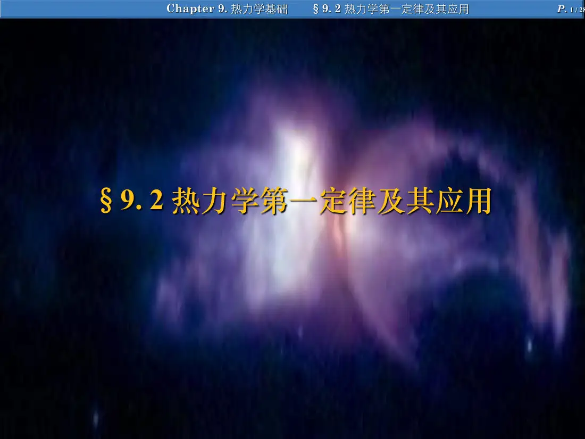

原文：

§ 9.2 热力学第一定律及其应用

Chapter 9. 热力学基础 § 9.2 热力学第一定律及其应用

P. 1/28

### 一、热力学第一定律

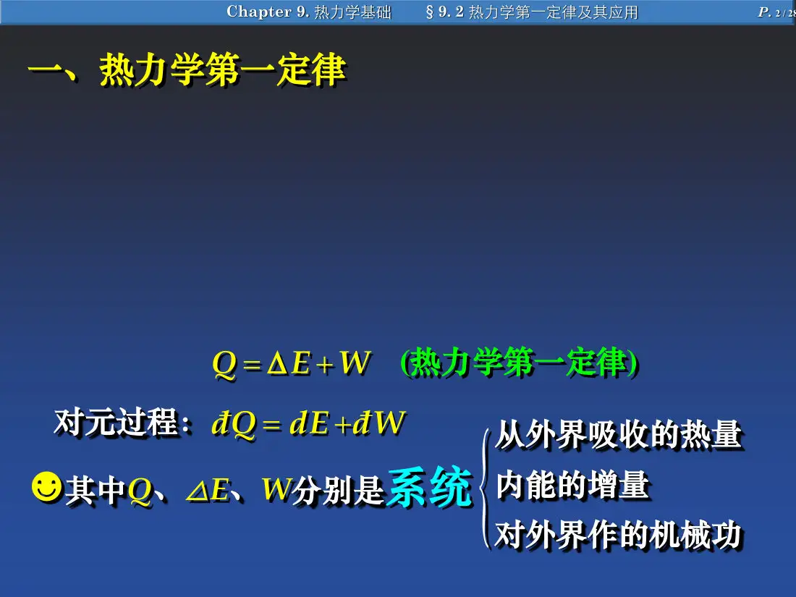

原文：

一、热力学第一定律

$Q \equiv \Delta E + W$ (热力学第一定律)

对元过程: $dQ = dE + dW$

其中Q、 $\Delta E$ 、W分别是系统

从外界吸收的热量

内能的增量

对外界作的机械功

Chapter 9. 热力学基础 § 9.2 热力学第一定律及其应用

P. 2 / 28

### 😊Q、△E、W的“+”、“-”规定：放热为负

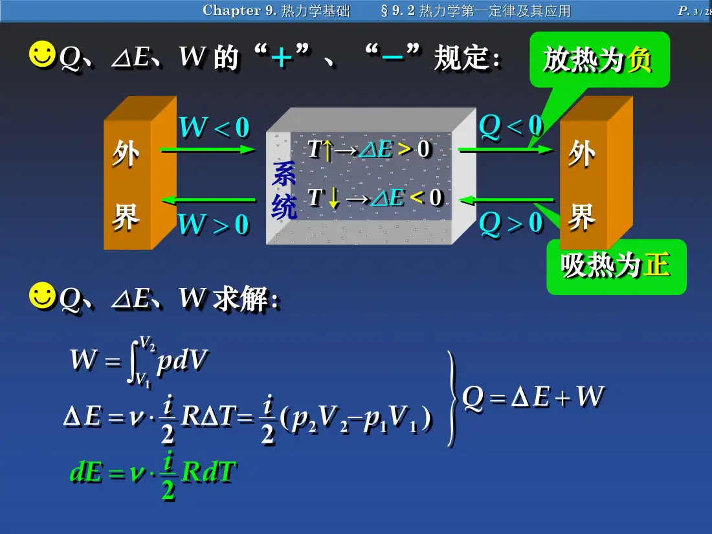

原文：

😊Q、△E、W的“+”、“-”规定：放热为负

外界

$$
\begin{array}{c} W <   0 \\ \hline \hline W > 0 \end{array}
$$

$$
\begin{array}{l}\text {系统}\\T \uparrow \rightarrow \Delta E > 0\\T \downarrow \rightarrow \Delta E <   0\end{array}
$$

$$
\begin{array}{c} Q <   0 \\ \hline Q > 0 \end{array}
$$

外界

吸热为正

😊Q、△E、W求解:

$$
W = \int_ {V _ {1}} ^ {V _ {2}} p d V
$$

$$
\Delta E = \nu \cdot \frac {i}{2} R \Delta T = \frac {i}{2} (p _ {2} V _ {2} - p _ {1} V _ {1})
$$

$$
Q \equiv \Delta E + W
$$

$$
d E = \nu \cdot \frac {i}{2} R d T
$$

Chapter 9. 热力学基础 § 9.2 热力学第一定律及其应用

P. 3/28

### 二、摩尔热容量的计算

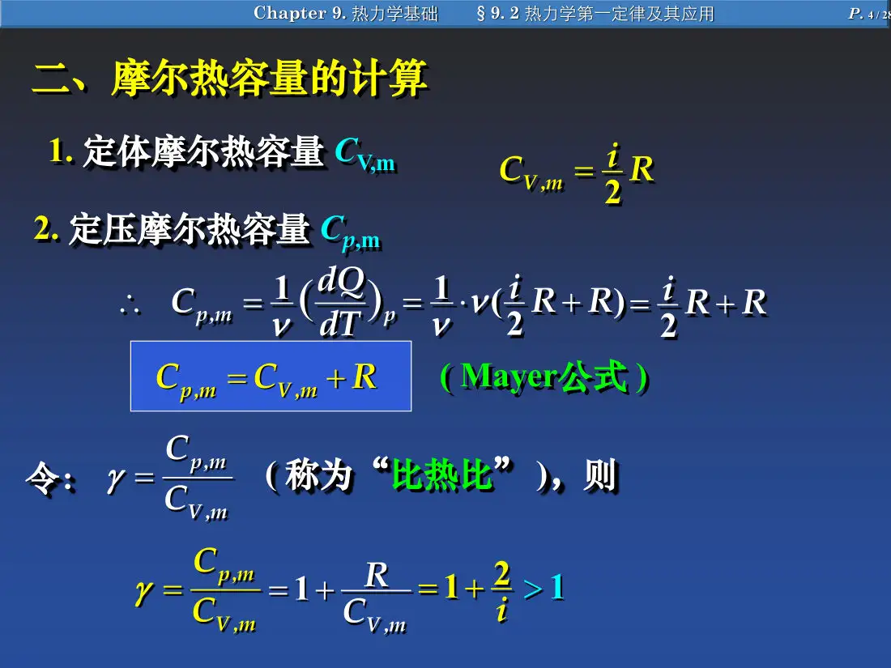

原文：

二、摩尔热容量的计算

1. 定体摩尔热容量 $C_{v,m}$

$$
C _ {V, m} = \frac {i}{2} R
$$

2. 定压摩尔热容量 $C_{p,\mathrm{m}}$

$$
\therefore C _ {p, m} = \frac {1}{\nu} \left(\frac {d Q}{d T}\right) _ {p} = \frac {1}{\nu} \cdot \nu \left(\frac {i}{2} R + R\right) = \frac {i}{2} R + R
$$

$$
C _ {p, m} = C _ {V, m} + R
$$

(Mayer公式)

令: $\gamma = \frac{C_{p,m}}{C_{V,m}}$ (称为“比热比”), 则

$$
\gamma = \frac {C _ {p , m}}{C _ {V , m}} = 1 + \frac {R}{C _ {V , m}} = 1 + \frac {2}{i} > 1
$$

Chapter 9. 热力学基础 § 9.2 热力学第一定律及其应用

P. 4/28

### 三、等值过程Q、 $\Delta E$ 、W的计算

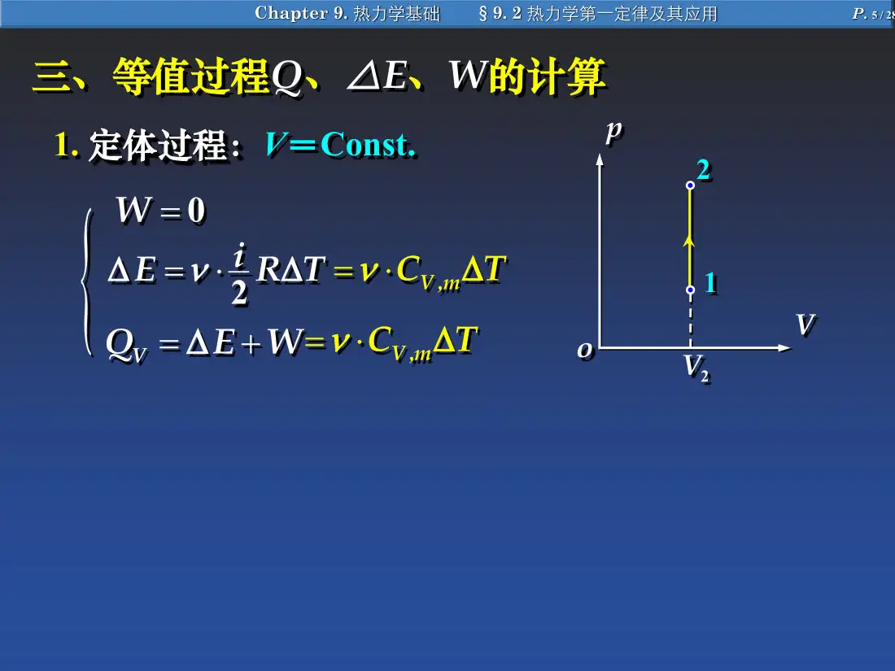

原文：

三、等值过程Q、 $\Delta E$ 、W的计算

1. 定体过程: V=Const.

$$
\left\{ \begin{array}{l} W = 0 \\ \Delta E = \nu \cdot \frac {i}{2} R \Delta T = \nu \cdot C _ {V, m} \Delta T \\ Q _ {V} = \Delta E + W = \nu \cdot C _ {V, m} \Delta T \end{array} \right.
$$

Chapter 9. 热力学基础

§ 9.2 热力学第一定律及其应用

P. 5/28

### 三、等值过程Q、 $\Delta E$ 、W的计算

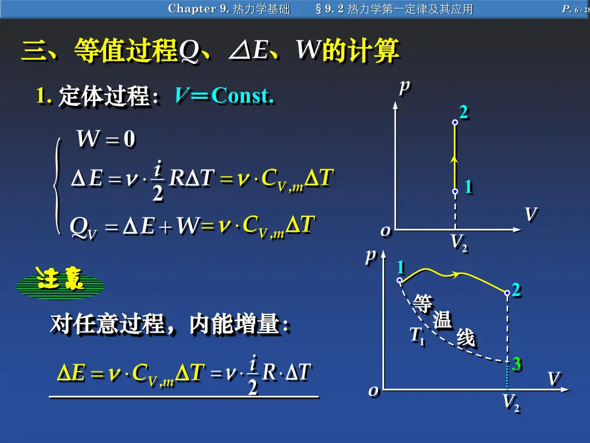

原文：

三、等值过程Q、 $\Delta E$ 、W的计算

1. 定体过程: V = Const.

$$
\left\{ \begin{array}{l} W = 0 \\ \Delta E = \nu \cdot \frac {i}{2} R \Delta T = \nu \cdot C _ {V, m} \Delta T \\ Q _ {V} = \Delta E + W = \nu \cdot C _ {V, m} \Delta T \end{array} \right.
$$

注袁

对任意过程，内能增量：

$$
\Delta E = \nu \cdot C _ {V, m} \Delta T = \nu \cdot \frac {i}{2} R \cdot \Delta T
$$

Chapter 9. 热力学基础

§ 9.2 热力学第一定律及其应用

P. 6/28

### 2. 定压过程: $p = \text {Const}.$

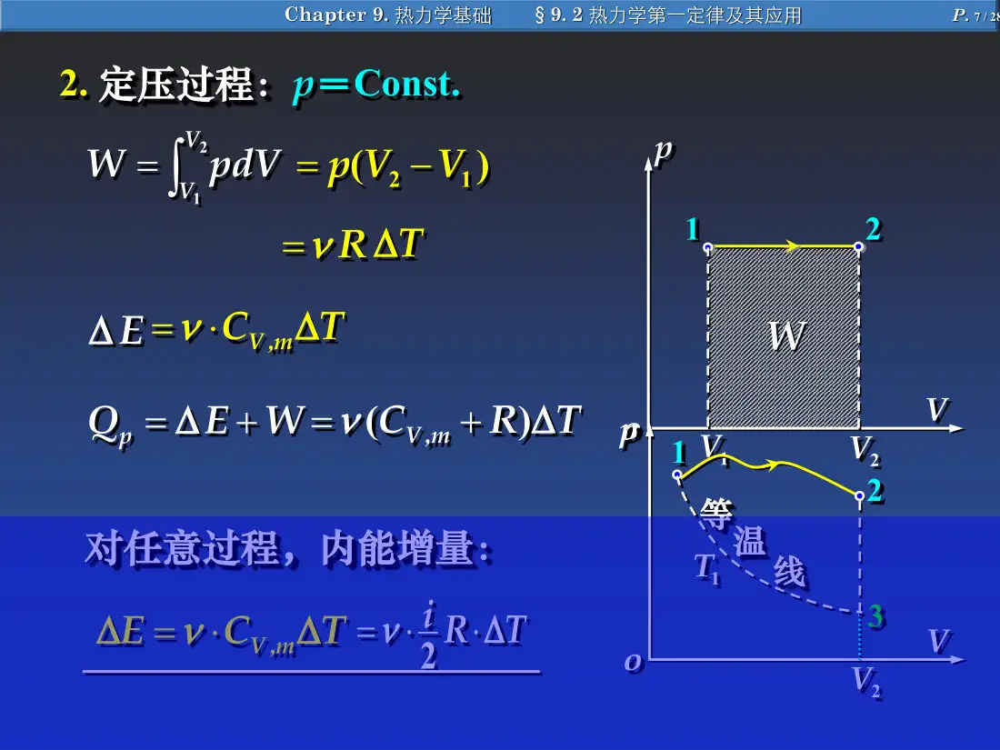

原文：

2. 定压过程: $p = \text {Const}.$

$$
\begin{array}{r} W = \int_ {V _ {1}} ^ {V _ {2}} p d V = p (V _ {2} - V _ {1}) \\ = \nu R \Delta T \end{array}
$$

$\Delta E = \nu \cdot C_{V,m}\Delta T$

$$
Q _ {p} = \Delta E + W = \nu (C _ {V, m} + R) \Delta T
$$

对任意过程，内能增量：

$\Delta E = \nu \cdot C_{V,m}\Delta T = \nu \cdot \frac{i}{2} R \cdot \Delta T$

Chapter 9. 热力学基础

§ 9.2 热力学第一定律及其应用

P. 7/28

### 2. 定压过程: $p = \text {Const}.$

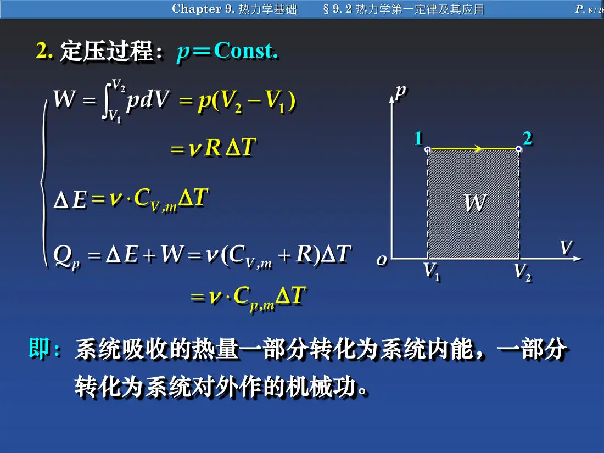

原文：

2. 定压过程: $p = \text {Const}.$

$$
\begin{array}{r l} W & = \int_ {V _ {1}} ^ {V _ {2}} p d V = p (V _ {2} - V _ {1}) \\ & = \nu R \Delta T \end{array}
$$

$$
\Delta E = \nu \cdot C _ {V, m} \Delta T
$$

$$
\begin{array}{r} Q _ {p} = \Delta E + W = \nu (C _ {V, m} + R) \Delta T \\ = \nu \cdot C _ {p, m} \Delta T \end{array}
$$

即：系统吸收的热量一部分转化为系统内能，一部分转化为系统对外作的机械功。

Chapter 9. 热力学基础

§ 9.2 热力学第一定律及其应用

P. 8/28

### 3. 等温过程: $T = \mathrm{Const}$ .

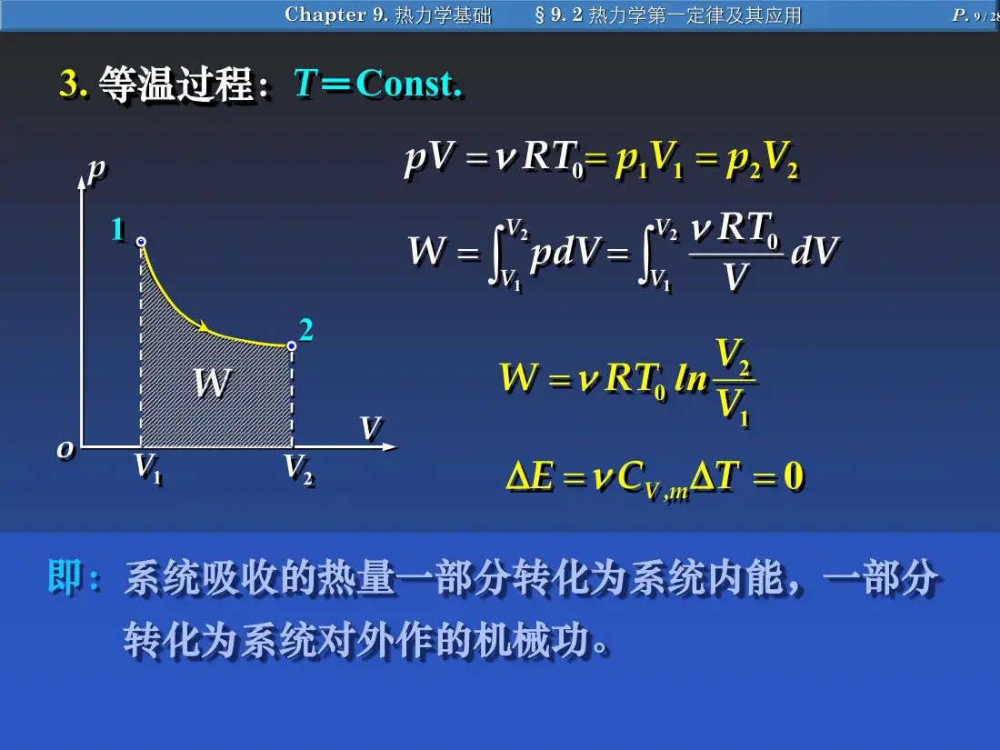

原文：

3. 等温过程: $T = \mathrm{Const}$ .

$$
p V = \nu R T _ {0} = p _ {1} V _ {1} = p _ {2} V _ {2}
$$

$$
W = \int_ {V _ {1}} ^ {V _ {2}} p d V = \int_ {V _ {1}} ^ {V _ {2}} \frac {\nu R T _ {0}}{V} d V
$$

$$
W = \nu R T _ {0} \ln \frac {V _ {2}}{V _ {1}}
$$

$$
\Delta E = \nu C _ {V, m} \Delta T = 0
$$

即：系统吸收的热量一部分转化为系统内能，一部分转化为系统对外作的机械功。

Chapter 9. 热力学基础 § 9.2 热力学第一定律及其应用

P. 9/28

### 3. 等温过程: $T = \mathrm{Const}$ .

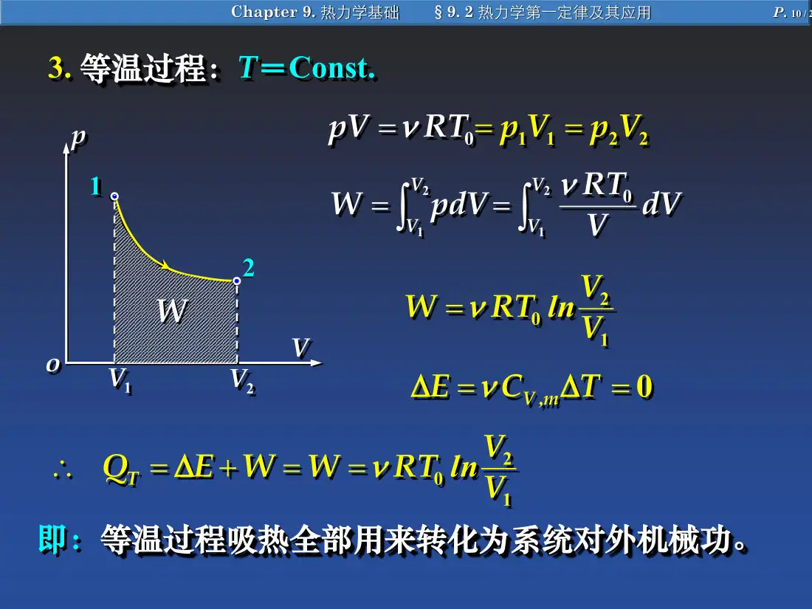

原文：

3. 等温过程: $T = \mathrm{Const}$ .

$$
p V = \nu R T _ {0} = p _ {1} V _ {1} = p _ {2} V _ {2}
$$

$$
W \equiv \int_ {V _ {1}} ^ {V _ {2}} p d V \equiv \int_ {V _ {1}} ^ {V _ {2}} \frac {\nu R T _ {0}}{V} d V
$$

$$
W = \nu R T _ {0} \ln \frac {V _ {2}}{V _ {1}}
$$

$$
\Delta E = \nu C _ {V, m} \Delta T = 0
$$

$\therefore Q_{T} = \Delta E + W = W = \nu R T_{0} \ln \frac{V_{2}}{V_{1}}$

即：等温过程吸热全部用来转化为系统对外机械功。

Chapter 9. 热力学基础 § 9.2 热力学第一定律及其应用

P. 10/2

### 重点掌握

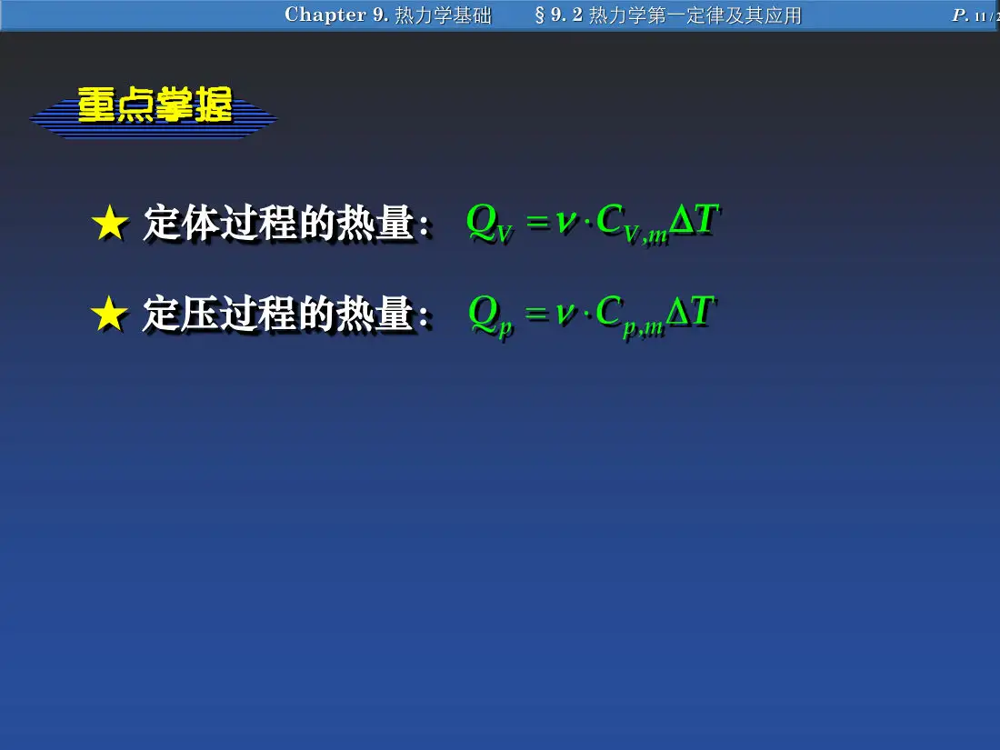

原文：

重点掌握

定体过程的热量: $Q_{V} = \nu \cdot C_{V,m}\Delta T$

★ 定压过程的热量: $Q_{p} = \nu \cdot C_{p,m} \Delta T$

Chapter 9. 热力学基础 § 9.2 热力学第一定律及其应用

P. 11/2

### 重点掌握

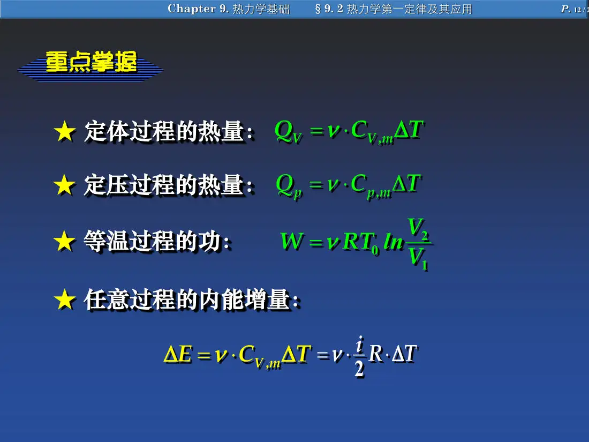

原文：

重点掌握

定体过程的热量: $Q_{V} = \nu \cdot C_{V,m}\Delta T$

定压过程的热量: $Q_{p} = \nu \cdot C_{p,m}\Delta T$

★ 等温过程的功: $W = \nu R T_{0} \ln \frac{V_{2}}{V_{1}}$

★ 任意过程的内能增量：

$$
\Delta E = \nu \cdot C _ {V, m} \Delta T = \nu \cdot \frac {i}{2} R \cdot \Delta T
$$

Chapter 9. 热力学基础 § 9.2 热力学第一定律及其应用

P. 12/2

### 解: $pV \equiv \nu RT$

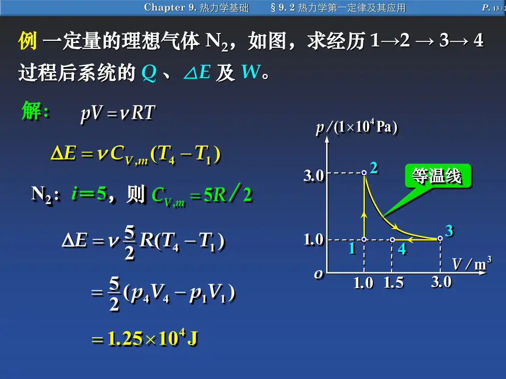

原文：

例一定量的理想气体 $\mathrm{N}_{2}$ , 如图, 求经历 $1 \rightarrow 2 \rightarrow 3 \rightarrow 4$ 过程后系统的 $Q$ 、 $\Delta E$ 及 $W$ 。

解: $pV \equiv \nu RT$

$$
\Delta E = \nu C _ {V, m} (T _ {4} - T _ {1})
$$

$N_{2}$ : i=5，则 $C_{V,m}=5R/2$

$$
\begin{array}{r l} \Delta E & = \nu \frac {5}{2} R (T _ {4} - T _ {1}) \\ & = \frac {5}{2} (p _ {4} V _ {4} - p _ {1} V _ {1}) \\ & = 1. 2 5 \times 1 0 ^ {4} \mathrm{J} \end{array}
$$

Chapter 9. 热力学基础

§ 9.2 热力学第一定律及其应用

P. 13/2

### $$

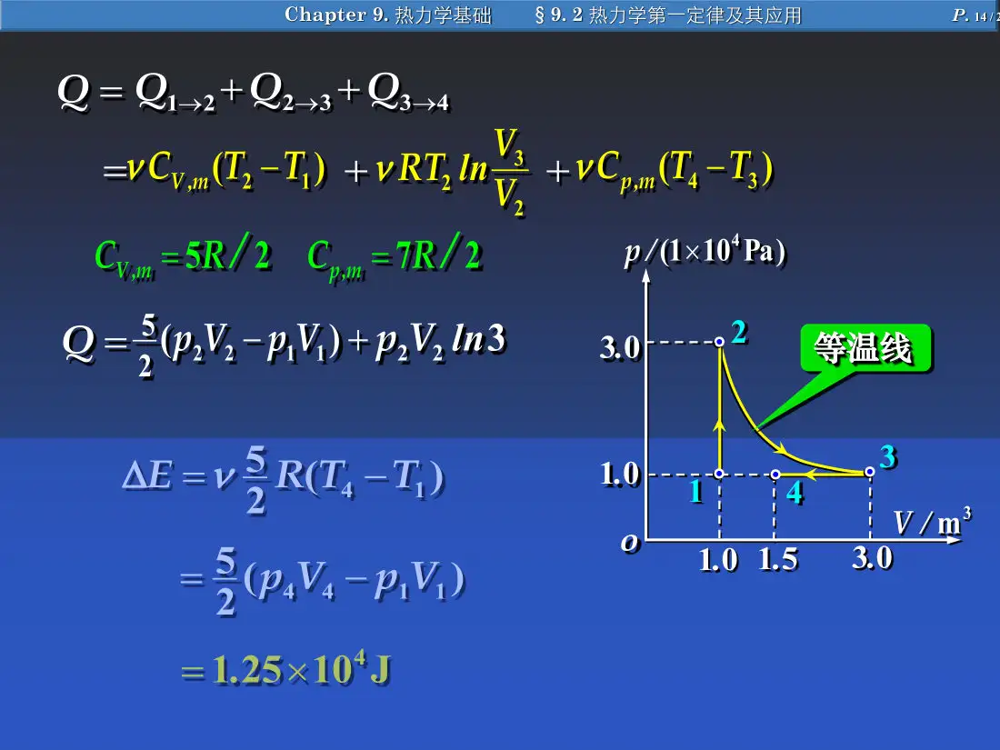

原文：

$$
\begin{array}{r l}&Q = Q _ {1 \rightarrow 2} + Q _ {2 \rightarrow 3} + Q _ {3 \rightarrow 4}\\&= \nu C _ {V, m} (T _ {2} - T _ {1}) + \nu R T _ {2} \ln \frac {V _ {3}}{V _ {2}} + \nu C _ {p, m} (T _ {4} - T _ {3})\end{array}
$$

$$
C _ {V, m} = 5 \mathrm{R/2} C _ {p, m} = 7 \mathrm{R/2}
$$

$$
Q = \frac {5}{2} (p _ {2} V _ {2} - p _ {1} V _ {1}) + p _ {2} V _ {2} \ln 3
$$

$$
\begin{array}{r l} \Delta E & = \nu \frac {5}{2} R (T _ {4} - T _ {1}) \\ & = \frac {5}{2} (p _ {4} V _ {4} - p _ {1} V _ {1}) \\ & = 1. 2 5 \times 1 0 ^ {4} \mathrm{J} \end{array}
$$

Chapter 9. 热力学基础 § 9.2 热力学第一定律及其应用

P. 14/2

### $$

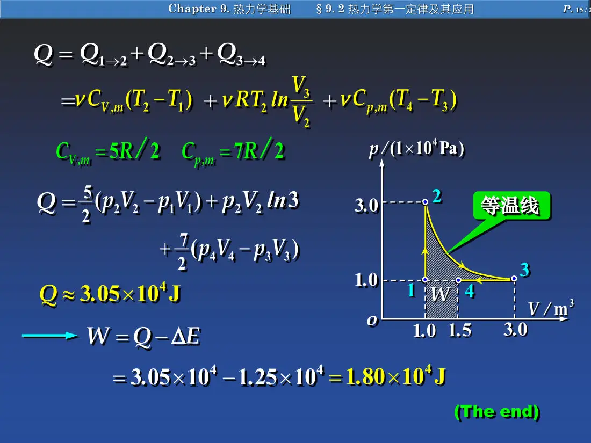

原文：

$$
\begin{array}{r l}&Q = Q _ {1 \rightarrow 2} + Q _ {2 \rightarrow 3} + Q _ {3 \rightarrow 4}\\&\equiv \nu C _ {V, m} (T _ {2} - T _ {1}) + \nu R T _ {2} \ln \frac {V _ {3}}{V _ {2}} + \nu C _ {p, m} (T _ {4} - T _ {3})\end{array}
$$

$$
C _ {V, m} = 5 \mathrm{R/2} C _ {p, m} = 7 \mathrm{R/2}
$$

$$
\begin{array}{r l} Q = & \frac {5}{2} (p _ {2} V _ {2} - p _ {1} V _ {1}) + p _ {2} V _ {2} \ln 3 \\ & + \frac {7}{2} (p _ {4} V _ {4} - p _ {3} V _ {3}) \end{array}
$$

$Q \approx 3.05 \times 10^{4} \mathrm{~J}$

$$
\begin{array}{r l} \longrightarrow & W = Q - \Delta E \\ & = 3. 0 5 \times 1 0 ^ {4} - 1. 2 5 \times 1 0 ^ {4} \equiv 1. 8 0 \times 1 0 ^ {4} \mathrm{J} \end{array}
$$

(The end)

Chapter 9. 热力学基础 § 9.2 热力学第一定律及其应用

P. 15/2

### 提示: ACBDA过程: $\triangle E = 0$

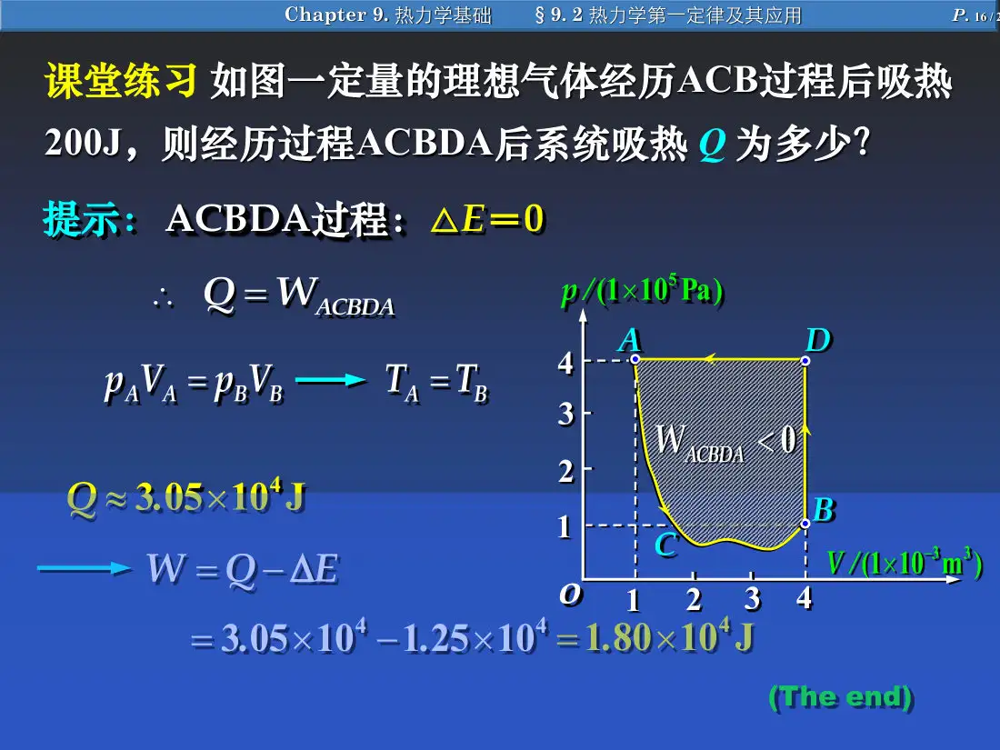

原文：

课堂练习 如图一定量的理想气体经历ACB过程后吸热200J，则经历过程ACBDA后系统吸热Q为多少？

提示: ACBDA过程: $\triangle E = 0$

$$
\therefore Q = W _ {A C B D A}
$$

$$
p _ {A} V _ {A} = p _ {B} V _ {B} \longrightarrow T _ {A} = T _ {B}
$$

$Q \approx 3.05 \times 10^{4} \mathrm{~J}$

$$
= 3. 0 5 \times 1 0 ^ {4} - 1. 2 5 \times 1 0 ^ {4} = 1. 8 0 \times 1 0 ^ {4} \mathrm{J}
$$

Chapter 9. 热力学基础

§ 9.2 热力学第一定律及其应用

P. 16/2

### 提示: ACBDA过程: $\triangle E = 0$

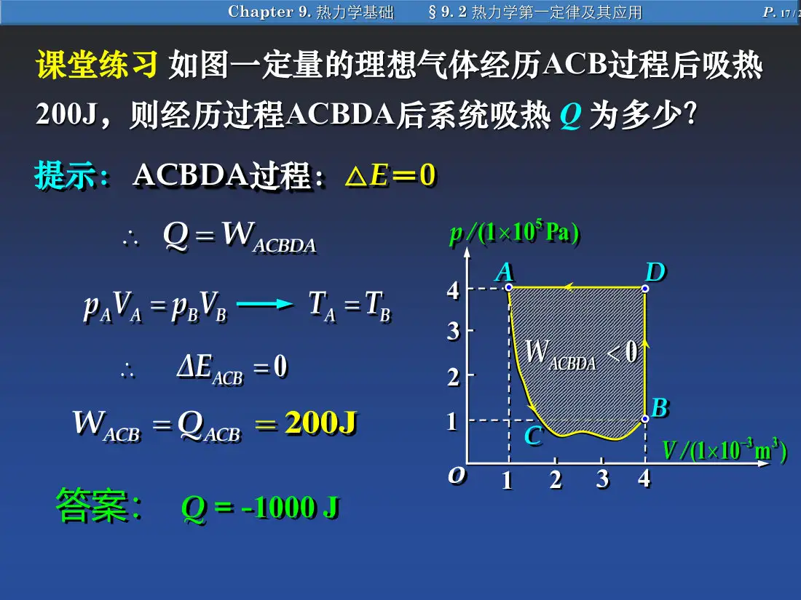

原文：

课堂练习 如图一定量的理想气体经历ACB过程后吸热200J，则经历过程ACBDA后系统吸热Q为多少？

提示: ACBDA过程: $\triangle E = 0$

$$
\begin{array}{r l} & {\therefore Q = W _ {A C B D A}} \\ & {p _ {A} V _ {A} = p _ {B} V _ {B} \longrightarrow T _ {A} = T _ {B}} \\ & {\therefore \Delta E _ {A C B} = 0} \\ & {W _ {A C B} = Q _ {A C B} = 2 0 0 \mathrm{J}} \end{array}
$$

答案: $Q = -1000 \mathrm{~J}$

Chapter 9. 热力学基础

§ 9.2 热力学第一定律及其应用

P. 17/2

### 提示：第一阶段：定体降温

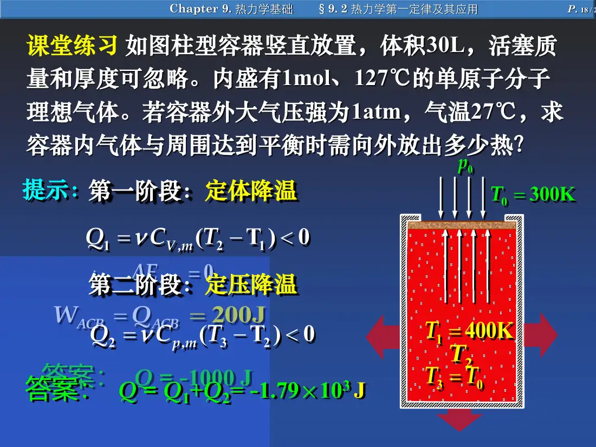

原文：

课堂练习 如图柱型容器竖直放置，体积30L，活塞质量和厚度可忽略。内盛有1mol、127℃的单原子分子理想气体。若容器外大气压强为1atm，气温27℃，求容器内气体与周围达到平衡时需向外放出多少热？

提示：第一阶段：定体降温

$$
Q _ {1} \equiv \nu C _ {V, m} (T _ {2} - T _ {1}) <   0
$$

第二阶段：定压降温

$$
\begin{array}{c} W _ {A C B} = Q _ {A C B} \equiv 2 0 0 \mathrm{J} \\ Q _ {2} \equiv \nu C _ {p, m} (T _ {3} - T _ {2}) <   0 \end{array}
$$

答案： $Q = -1000 \, J$ 答案： $Q = Q_{1} + Q_{2} = -1.79 \times 10^{3} \, J$

Chapter 9. 热力学基础

§ 9.2 热力学第一定律及其应用

P. 18/2

### 归纳：

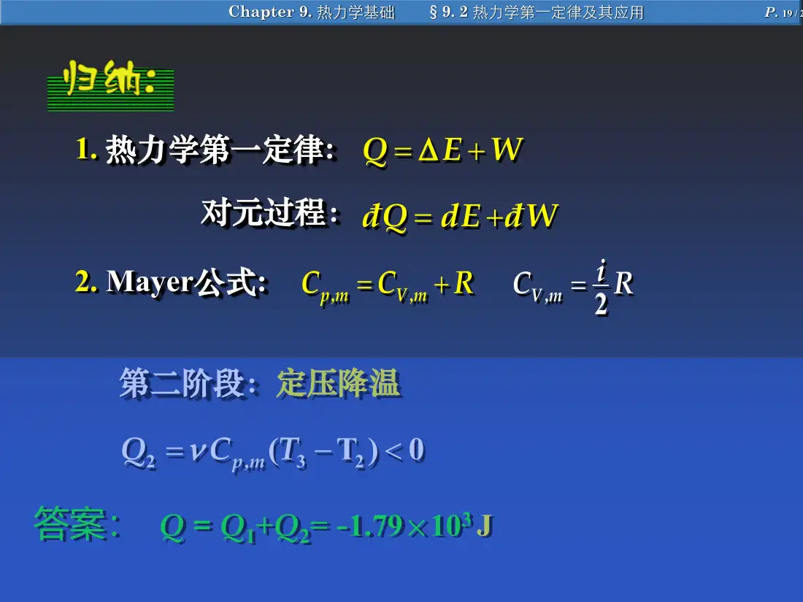

原文：

归纳：

1. 热力学第一定律: $Q = \Delta E + W$

对元过程: $dQ = dE + dW$

2. Mayer公式: $C_{p,m}=C_{V,m}+R$ $C_{V,m}=\frac{i}{2}R$

第二阶段：定压降温

$$
Q _ {2} \equiv \nu C _ {p, m} (T _ {3} - T _ {2}) <   0
$$

答案: $Q = Q_{1} + Q_{2} = -1.79 \times 10^{3} \mathrm{~J}$

Chapter 9. 热力学基础 § 9.2 热力学第一定律及其应用

P. 19/2

### 归纳：

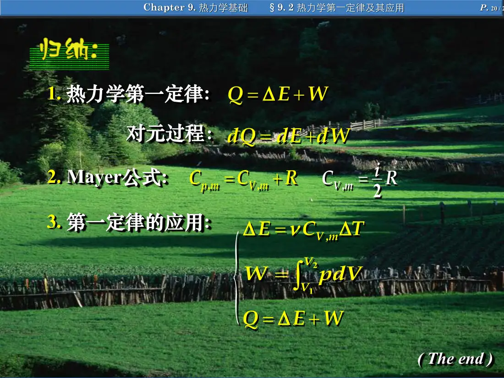

原文：

归纳：

1. 热力学第一定律: $Q = \Delta E + W$

对元过程: $dQ = dE + dW$

2. Mayer公式: $C_{p,m} = C_{V,m} + R \quad C_{V,m} = \frac{t}{2} R$

3. 第一定律的应用:

$$
\Delta E \equiv \nu C _ {V, m} \Delta T
$$

$$
W = \int_ {V _ {1}} ^ {V _ {2}} p d V
$$

$$
Q = \Delta E + W
$$

Chapter 9. 热力学基础 § 9.2 热力学第一定律及其应用

P. 20 / 2

(The end)
