# 《大学物理》第9章 热力学基础 §9.3 绝热过程（课件）

原件的每一页，下面附识别出的文字。

### §9. 3 绝热过程

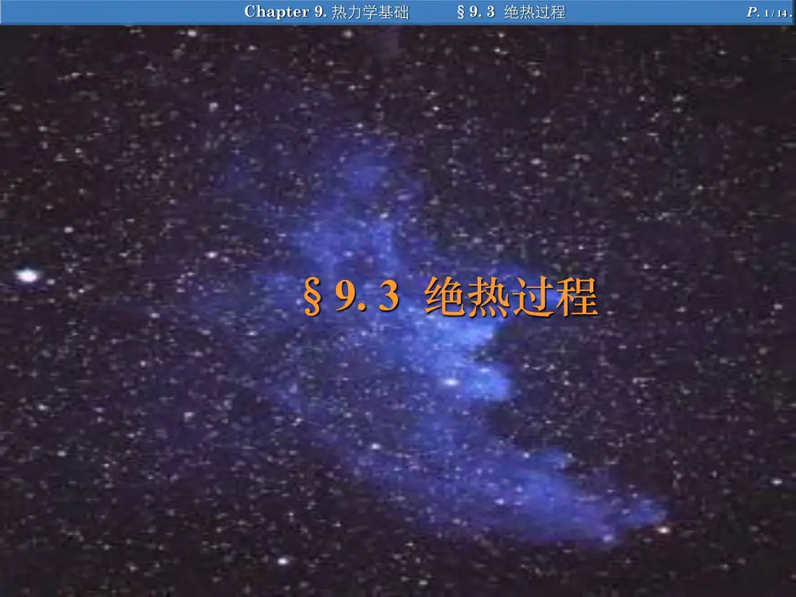

原文：

§9. 3 绝热过程

Chapter 9. 热力学基础作者：

§9. 3 绝热过程

P. 1 / 14 .

### 一、准静态绝热过程

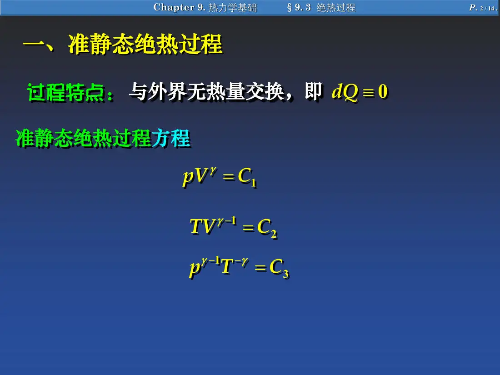

原文：

一、准静态绝热过程

与外界无热量交换，即 $g ( 0 ) \equiv 0$

准静态绝热过程方程

$$
p V ^ {\gamma} \equiv C _ {1}
$$

$$
T V ^ {\gamma - 1} \equiv C _ {2}
$$

$$
p ^ {\gamma - 1} T ^ {- \gamma} \equiv C _ {3}
$$

Chapter 9. 热力学基础 作者：

§9. 3 绝热过程

P. 2 / 14 .

### $$

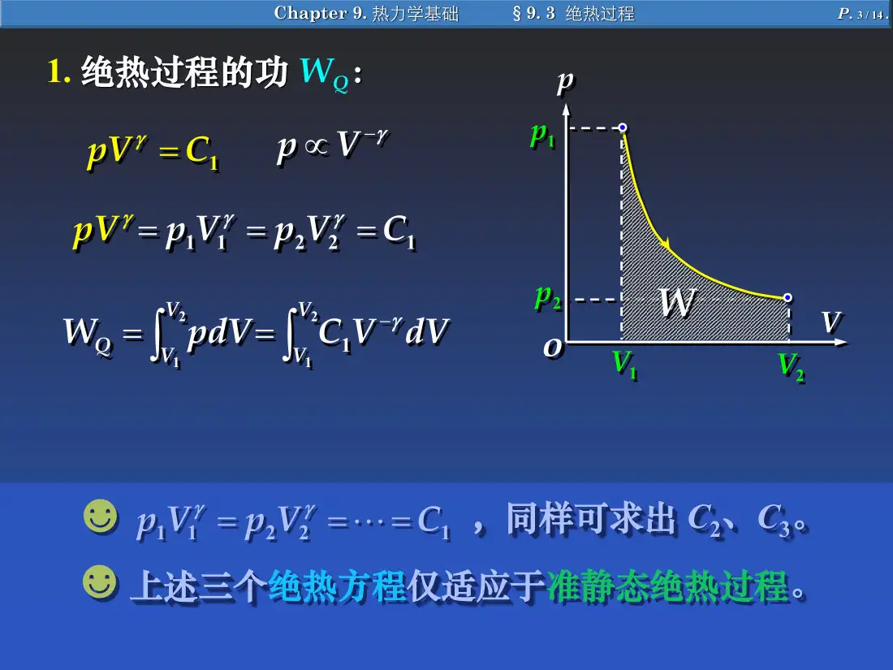

原文：

1. 绝热过程的功 $| \mathbf { \mathit { W } } _ { 0 } \mathbf { \mathit { P } } |$

$$
p V ^ {\gamma} \equiv C _ {1} \qquad p \propto V ^ {- \gamma}
$$

$$
p V ^ {\gamma} = p _ {1} V _ {1} ^ {\gamma} = p _ {2} V _ {2} ^ {\gamma} = C _ {1}
$$

$$
W _ {Q} = \int_ {V _ {1}} ^ {V _ {2}} p d V = \int_ {V _ {1}} ^ {V _ {2}} C _ {1} V ^ {- \gamma} d V
$$

$| \mathcal { P } | _ { 1 } ^ { r } \mathcal { V } _ { 1 } ^ { r } = | \mathcal { P } _ { 2 } | \mathcal { V } _ { 2 } ^ { r } = \cdots = \mathcal { C } _ { 1 }$ ，同样可求出 $C _ { 2 } ^ { 4 } .$

☻ 上述三个绝热方程仅适应于准静态绝热过程。

Chapter 9. 热力学基础 作者：

§9. 3 绝热过程

P. 3 / 14 .

### $$

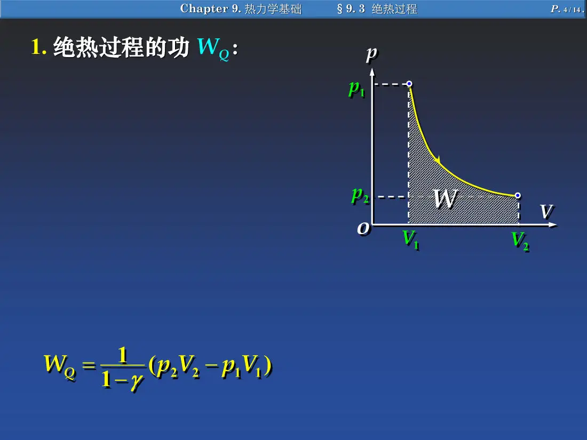

原文：

1. 绝热过程的功 $| \mathbf { \mathit { W } } _ { } | \mathbf { \mathit { \Phi } } _ { }$

$$
W _ {Q} = \frac {1}{1 - \gamma} (p _ {2} V _ {2} - p _ {1} V _ {1})
$$

Chapter 9. 热力学基础作者：

§9. 3 绝热过程

### 或根据热力学第一定律：

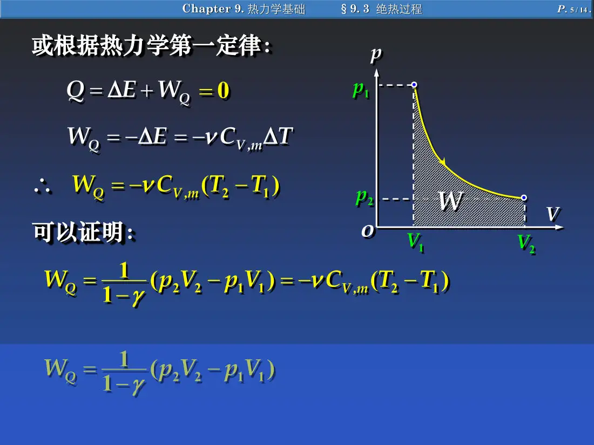

原文：

或根据热力学第一定律：

$$
Q = \Delta E + W _ {Q} \equiv 0
$$

$$
W _ {Q} = - \Delta E = - \nu C _ {V, m} \Delta T
$$

$$
\therefore W _ {Q} = - \nu C _ {V, m} (T _ {2} - T _ {1})
$$

可以证明：

$$
W _ {Q} = \frac {1}{1 - \gamma} (p _ {2} V _ {2} - p _ {1} V _ {1}) = - \nu C _ {V, m} (T _ {2} - T _ {1})
$$

$$
W _ {Q} = \frac {1}{1 - \gamma} (p _ {2} V _ {2} - p _ {1} V _ {1})
$$

Chapter 9. 热力学基础作者：

§9. 3 绝热过程

P. 5 / 14 .

### 或根据热力学第一定律：

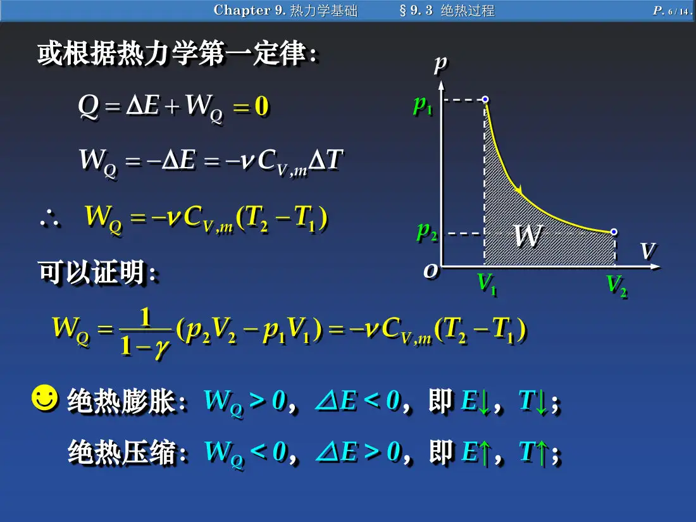

原文：

或根据热力学第一定律：

Q=ΔE+WQ=0WQ=-ΔE =−νCv,m∆T$| Y | _ { ( a ) } = - \chi C \chi _ { ( \bar { Y } ) / ( \bar { Y } ) } - ( \bar { I } \bar { I } )$ 可以证明：

$$
W _ {Q} = \frac {1}{1 - \gamma} (p _ {2} V _ {2} - p _ {1} V _ {1}) = - \nu C _ {V, m} (T _ {2} - T _ {1})
$$

绝热膨胀： $U _ { 0 } ( \mathfrak { g } ) = \mathscr { V }$ $\Delta L E \cong \emptyset$ 即 E↓， $\mathbb { I } [ \mathbb { I } ]$ 绝热压缩： $\textcircled { 1 } y _ { 0 } \leq y$ $\Delta \lvert \underline { { \bar { E } } } > \partial \rangle$ 即 E↑， $\underline { { \hat { \eta } } } ( \mathbf { f } ) \mathbf { B }$ 课堂练习 如图，判断acb过程Q、 $\Delta N B$ 、W的正负号。

Chapter 9. 热力学基础作者：

§9. 3 绝热过程

P. 6 / 14 .

### Chapter 9. 热力学基础作者：

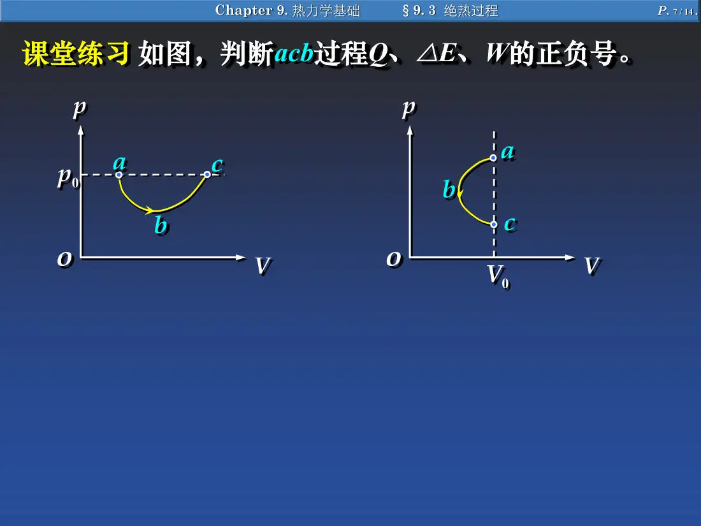

原文：

Chapter 9. 热力学基础作者：

§9. 3 绝热过程

### 课堂练习 如图，判断acb过程Q、△E、W的正负号。

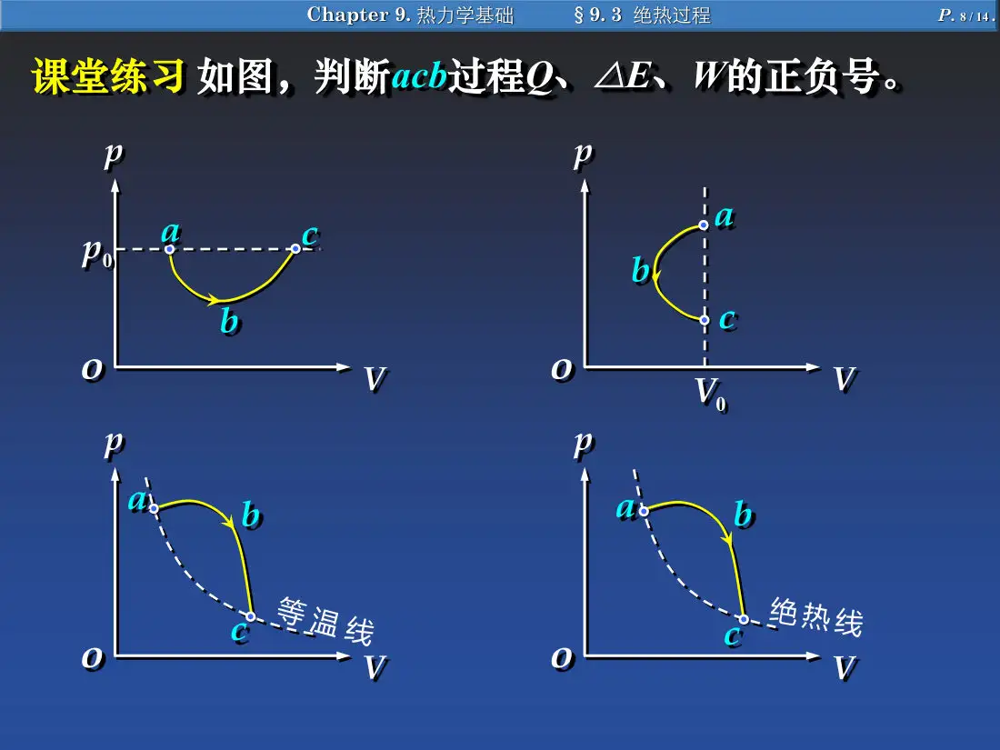

原文：

课堂练习 如图，判断acb过程Q、△E、W的正负号。

Chapter 9. 热力学基础作者：

§9. 3 绝热过程

### 二、绝热自由膨胀

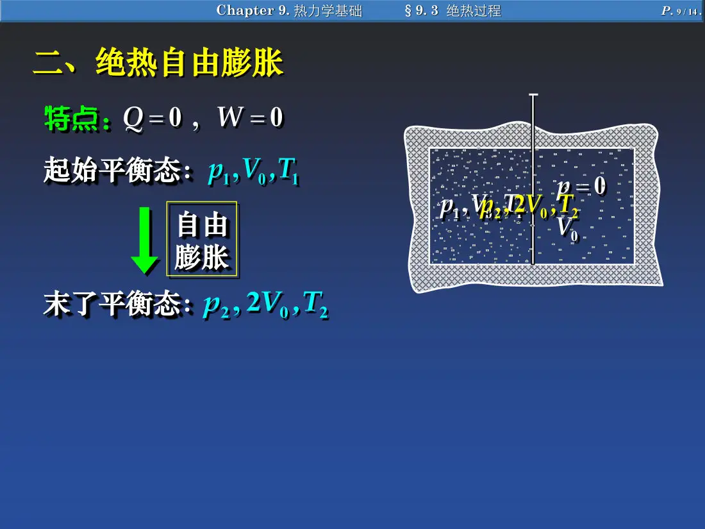

原文：

二、绝热自由膨胀

特点： $\textcircled { 0 } = \textcircled { 1 }$ 9 $\bar { y } \equiv \mathbb { J }$ 起始平衡态： $| \pmb { \mathcal { P } } | | \pmb { \mathcal { V } } | | \pmb { \mathcal { V } } | |$

自由膨胀

末了平衡态： $( 1 ) 2 ( 1 ) 1 5 ( 1 ) 2 ( 2 )$

Chapter 9. 热力学基础作者：

§9. 3 绝热过程

P. 9 / 14 .

### 自由膨胀过程：

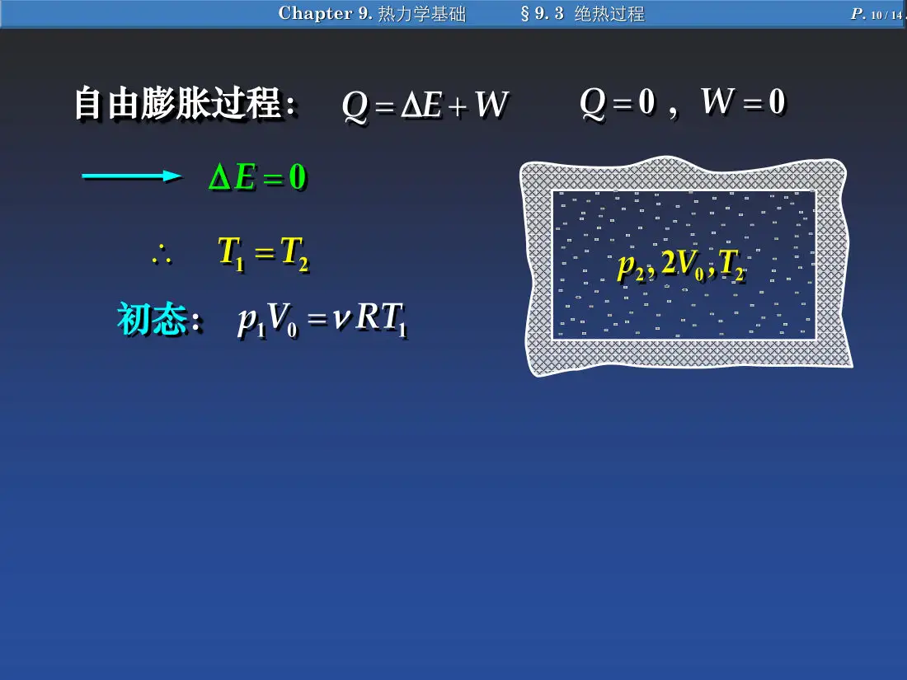

原文：

自由膨胀过程：

$$
Q = \Delta E + W
$$

$$
\Delta E \equiv 0
$$

$$
\therefore \quad T _ {1} \equiv T _ {2}
$$

初态： $1 0 N _ { 1 } V _ { 1 } = 1 0 N _ { 2 } \times 1 5 N$

$$
Q \equiv 0, W \equiv 0
$$

Chapter 9. 热力学基础 作者：

§9. 3 绝热过程

### 自由膨胀过程：

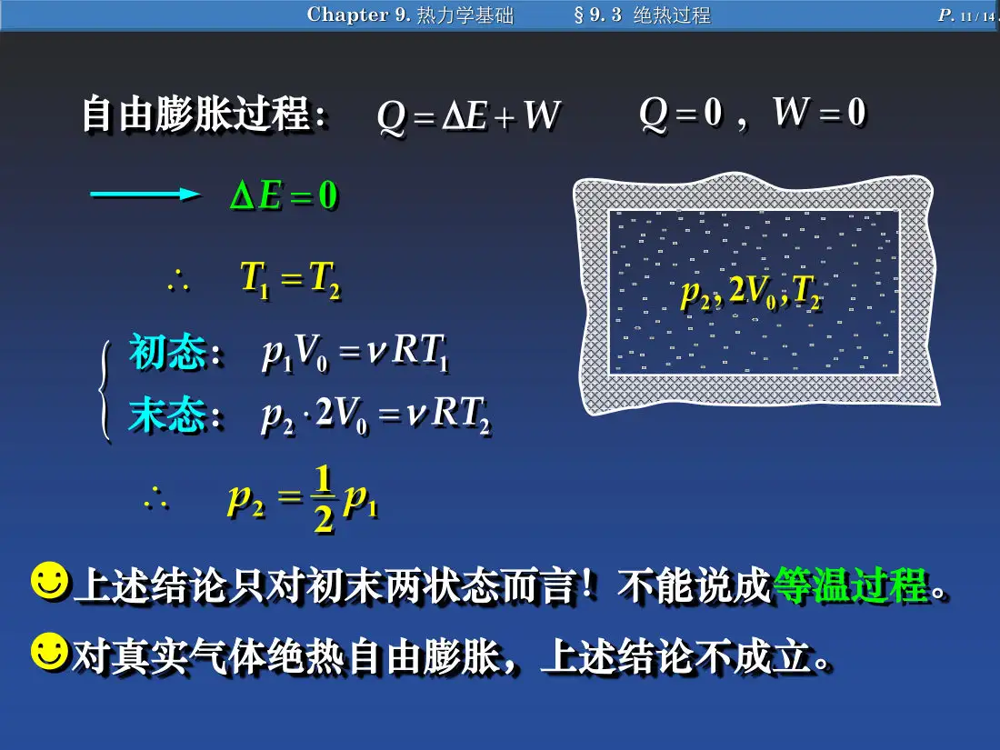

原文：

自由膨胀过程：

$$
Q = \Delta E + W
$$

$$
Q \equiv 0, W \equiv 0
$$

$$
\Delta E \equiv 0
$$

$\underline { { \bar { \Pi } } } _ { 1 } ^ { \prime } = \overline { { \bar { \Pi } } } _ { 2 } ^ { \prime }$

初态： $1 0 N _ { 1 } V _ { 1 } = 1 0 N _ { 2 } \times 1 5 N _ { 1 }$

末态： $( 1 ) 2 . ( 2 ) y _ { 1 } = 1 2 . ( 1 5 )$

$\therefore$ $( 1 ) _ { 1 } = \frac { 1 1 } { 1 1 } ( 1 )$

上述结论只对初末两状态而言！不能说成等温过程。

☻对真实气体绝热自由膨胀，上述结论不成立。

Chapter 9. 热力学基础 作者：

§9. 3 绝热过程

P. 11 / 14 .

### 归纳

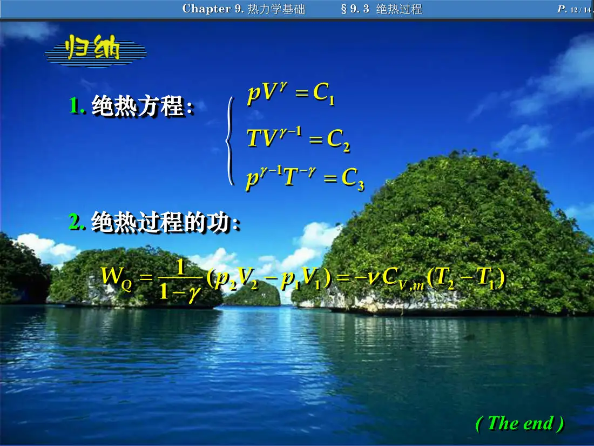

原文：

归纳

1. 绝热方程：

$$
\begin{array}{l} p V ^ {\gamma} = C _ {1} \\ T V ^ {\gamma - 1} = C _ {2} \\ p ^ {\gamma - 1} T ^ {- \gamma} = C _ {3} \end{array}
$$

2. 绝热过程的功：

$$
W _ {Q} = \frac {1}{1 - \gamma} (p _ {2} V _ {2} - p _ {1} V _ {1}) = - \nu C _ {V, m} (T _ {2} - T _ {1})
$$

Chapter 9. 热力学基础 作者：

§9. 3 绝热过程

P. 12 / 14 .

( The end )
