# 《大学物理》第9章 热力学基础 §9.4 循环过程 卡诺循环（课件）

原件的每一页，下面附识别出的文字。

### §9. 4 循环过程

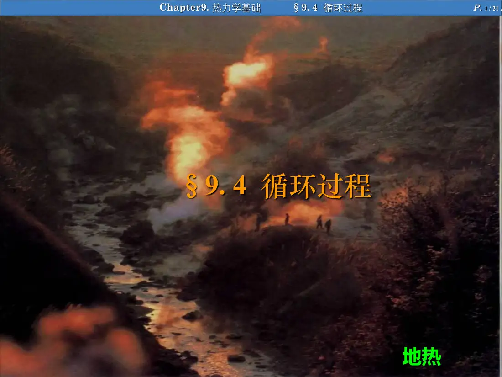

原文：

§9. 4 循环过程

地热

Chapter9. 热力学基础作者：杨

§9. 4 循环过程

P. 1 / 21 .

### 循环过程

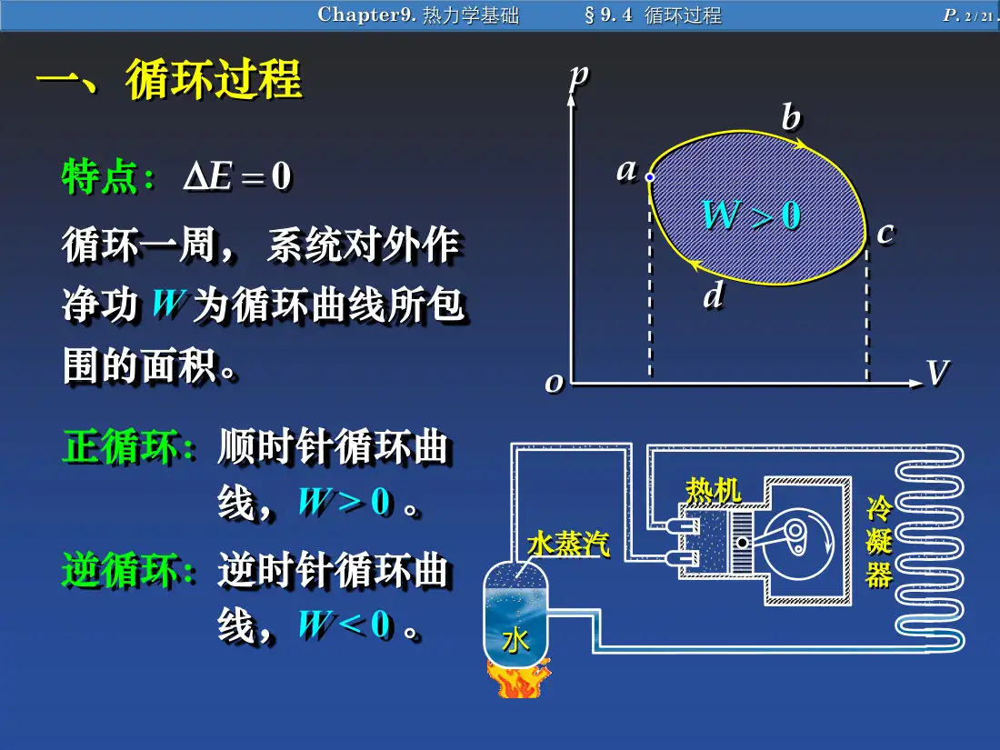

原文：

循环过程

特点： $\underline { { \underline { { A } } } } \underline { { \underline { { E } } } } { } ^ { \prime } \equiv \underline { { \underline { { 0 } } } }$

循环一周， 系统对外作净功 W 为循环曲线所包围的面积。

正循环：顺时针循环曲线， $1 7 > 1 9$

逆循环：逆时针循环曲线， $| \mathbf { \nabla } ^ { \prime \prime } | \prec ( \mathbf { 0 }$

Chapter9. 热力学基础 作者：杨

§9. 4 循环过程

### 1. 热机及热机效率

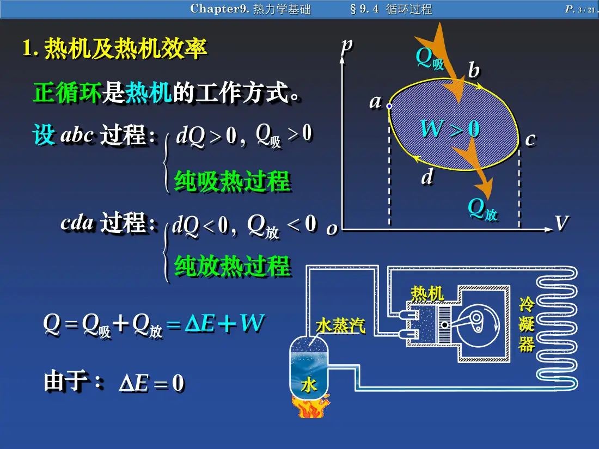

原文：

1. 热机及热机效率

正循环是热机的工作方式。

设 $( 2 1 0 0 0 )$ 过程：

$$
d Q > 0, Q _ {\text {吸}} > 0
$$

纯吸热过程

cda 过程：

$$
d Q <   0, Q _ {\text {放}} <   0
$$

纯放热过程

$$
Q = Q _ {\text {吸}} + Q _ {\text {放}} = \Delta E + W
$$

由于 : $\underline { { \Delta } } \underline { { \nabla } } { } _ { E } ^ { \prime } = \underline { { 0 } }$

P. 3 / 21 .

Chapter9. 热力学基础 作者：杨

§9. 4 循环过程

### $$

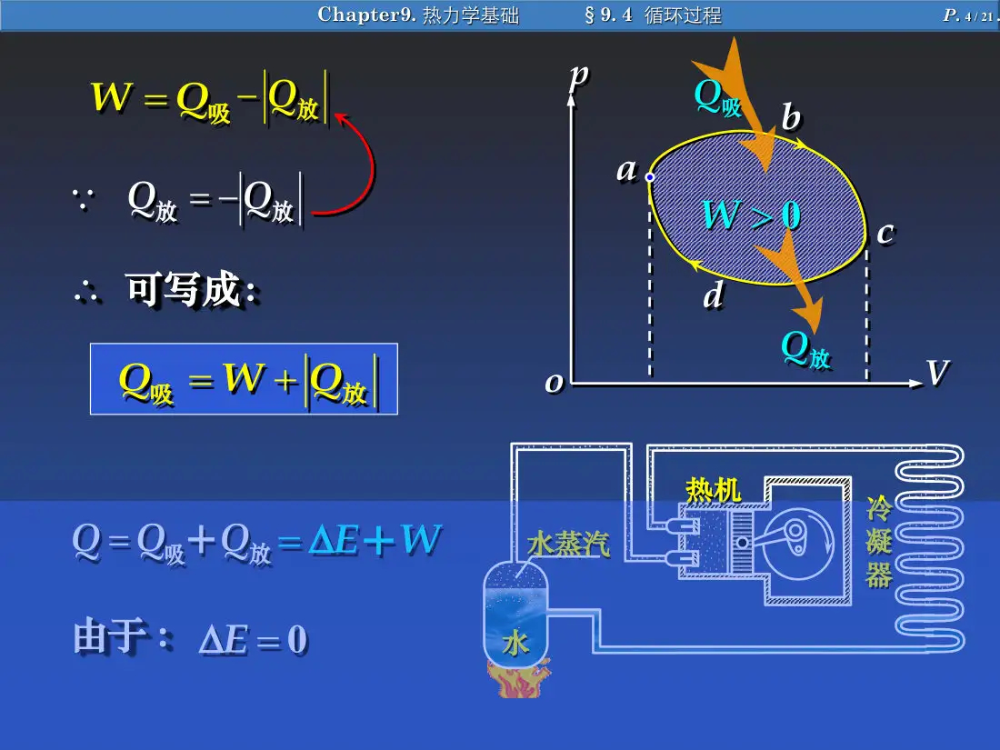

原文：

$$
W \equiv Q _ {\text {吸}} - \left| Q _ {\text {放}} \right|
$$

$$
\because Q _ {\text {放}} \equiv - | Q _ {\text {放}} |
$$

$0 . 8 \dot { 0 } \dot { } \dot { }$ 可写成：

$$
Q _ {\text {吸}} = W + \left| Q _ {\text {放}} \right|
$$

$$
Q = Q _ {\text {吸}} + Q _ {\text {放}} = \Delta E + W
$$

由于 : $\Delta \lor E = \emptyset$

Chapter9. 热力学基础 作者：杨

§9. 4 循环过程

P. 4 / 21 .

### $$

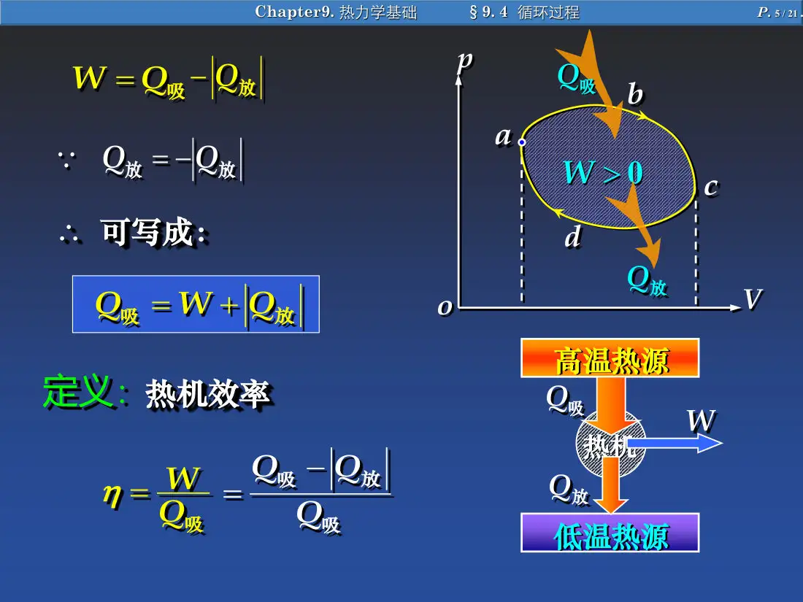

原文：

$$
W = Q _ {\text {吸}} - \left| Q _ {\text {放}} \right|
$$

$$
\because Q _ {\text {放}} \equiv - | Q _ {\text {放}} |
$$

$\phantom { + } \% \phantom { + }$ 可写成：

$$
Q _ {\text {吸}} = W + \left| Q _ {\text {放}} \right|
$$

定义：热机效率

$$
\eta = \frac {W}{Q _ {\text {吸}}} = \frac {Q _ {\text {吸}} - | Q _ {\text {放}} |}{Q _ {\text {吸}}}
$$

低温热源

Chapter9. 热力学基础 作者：杨

§9. 4 循环过程

P. 5 / 21 .

### ☻热机效率用％形式表示。

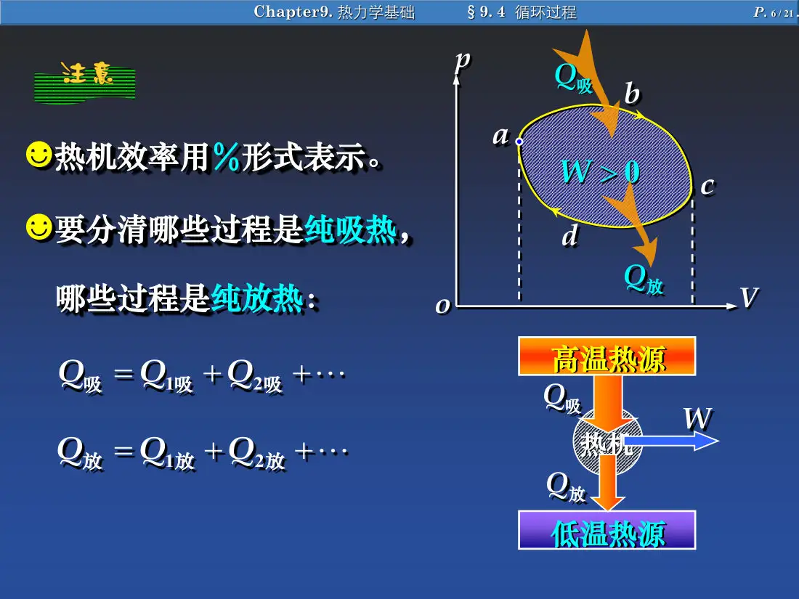

原文：

☻热机效率用％形式表示。

☻要分清哪些过程是纯吸热，

哪些过程是纯放热：

$$
Q _ {\text {吸}} \equiv Q _ {1 \text {吸}} + Q _ {2 \text {吸}} + \dots
$$

$$
Q _ {\text {放}} = Q _ {1 \text {放}} + Q _ {2 \text {放}} + \dots
$$

Chapter9. 热力学基础 作者：杨

§9. 4 循环过程

### 例 一定量的He理想气体经过如图循环，求热机效率。

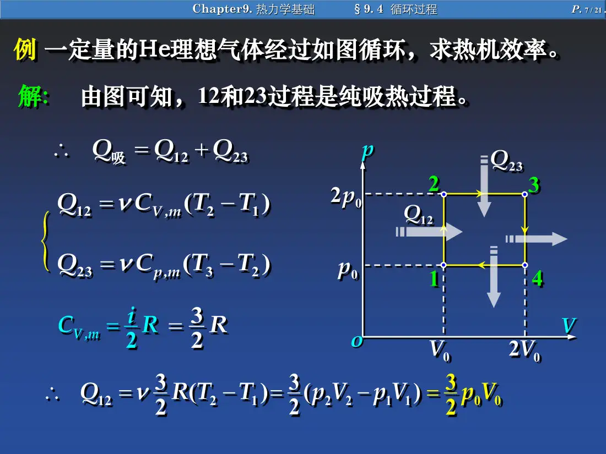

原文：

例 一定量的He理想气体经过如图循环，求热机效率。

解: 由图可知，12和23过程是纯吸热过程。

$$
\therefore Q _ {\text {吸}} = Q _ {1 2} + Q _ {2 3}
$$

$$
Q _ {1 2} = \nu C _ {V, m} (T _ {2} - T _ {1})
$$

$$
Q _ {2 3} \equiv \nu C _ {p, m} (T _ {3} - T _ {2})
$$

$$
C _ {V, m} = \frac {i}{2} R = \frac {3}{2} R
$$

$$
\therefore Q _ {1 2} = \nu \frac {3}{2} R \left(T _ {2} - T _ {1}\right) = \frac {3}{2} \left(p _ {2} V _ {2} - p _ {1} V _ {1}\right) = \frac {3}{2} p _ {0} V _ {0}
$$

Chapter9. 热力学基础 作者：杨

§9. 4 循环过程

P. 7 / 21 .

### $$

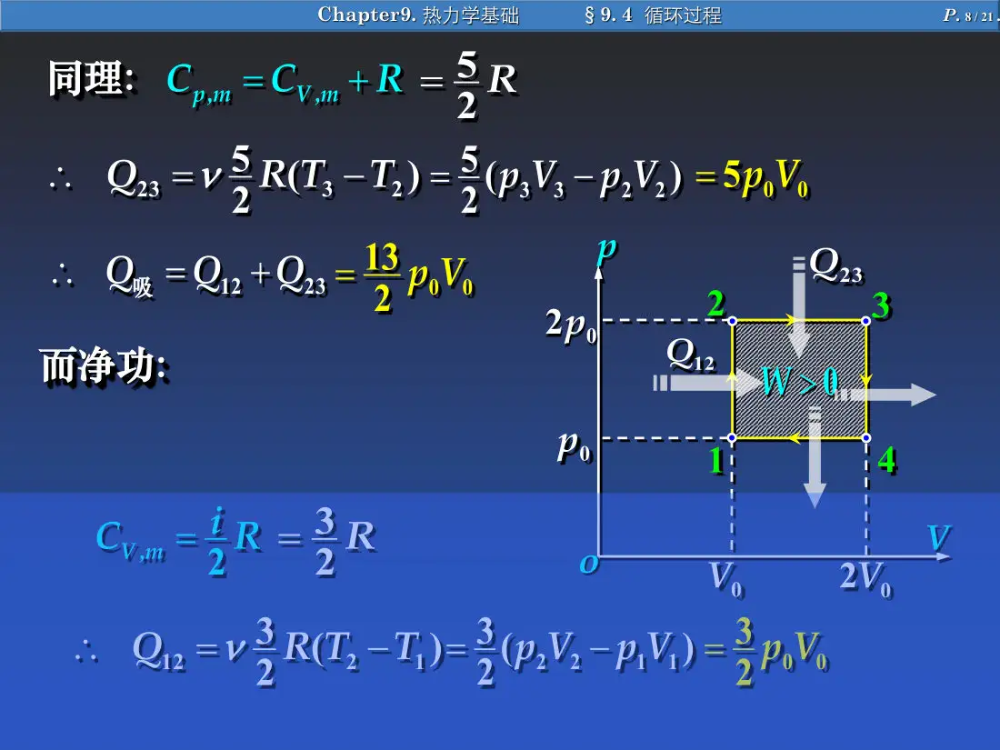

原文：

同理: $C ^ { \prime } = C ^ { \prime } , \because = \frac { 5 } { ( \lambda ) ^ { 2 } } = \frac { 1 5 } { ( \lambda ) ^ { 2 } }$

$$
\therefore Q _ {2 3} = \nu \frac {5}{2} R \left(T _ {3} - T _ {2}\right) = \frac {5}{2} \left(p _ {3} V _ {3} - p _ {2} V _ {2}\right) = 5 p _ {0} V _ {0}
$$

$$
\therefore Q _ {\text {吸}} = Q _ {1 2} + Q _ {2 3} = \frac {1 3}{2} p _ {0} V _ {0}
$$

而净功:

$$
C _ {V, m} \equiv \frac {i}{2} R \equiv \frac {3}{2} R
$$

$$
\therefore Q _ {1 2} = \nu \frac {3}{2} R (T _ {2} - T _ {1}) = \frac {3}{2} (p _ {2} V _ {2} - p _ {1} V _ {1}) = \frac {3}{2} p _ {0} V _ {0}
$$

Chapter9. 热力学基础 作者：杨

§9. 4 循环过程

P. 8 / 21 .

### $$

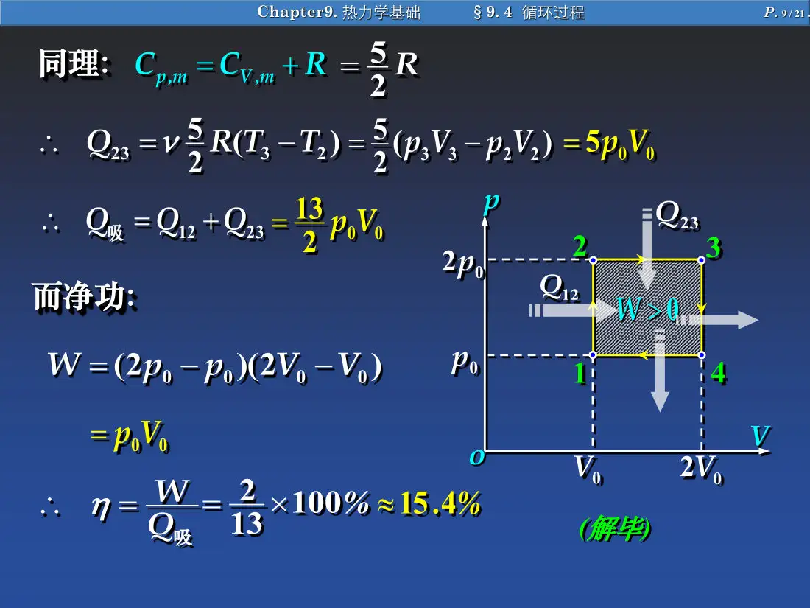

原文：

同理: $C ^ { \prime } = C ^ { \prime } , \because = \frac { 5 } { ( \lambda ) ^ { 2 } } = \frac { 1 5 } { ( \lambda ) ^ { 2 } }$

$$
\therefore Q _ {2 3} = \nu \frac {5}{2} R \left(T _ {3} - T _ {2}\right) = \frac {5}{2} \left(p _ {3} V _ {3} - p _ {2} V _ {2}\right) = 5 p _ {0} V _ {0}
$$

$$
\therefore Q _ {\text {吸}} = Q _ {1 2} + Q _ {2 3} = \frac {1 3}{2} p _ {0} V _ {0}
$$

而净功:

$$
\begin{array}{r l} & W = (2 p _ {0} - p _ {0}) (2 V _ {0} - V _ {0}) \\ & \quad = p _ {0} V _ {0} \end{array}
$$

n Q吸 W 13 2 ×100%≈15.4%课堂练习 如图两个循环：abca及abda，则哪个循环对应的热机效率高？

Chapter9. 热力学基础 作者：杨

§9. 4 循环过程

P. 9 / 21 .

### $$

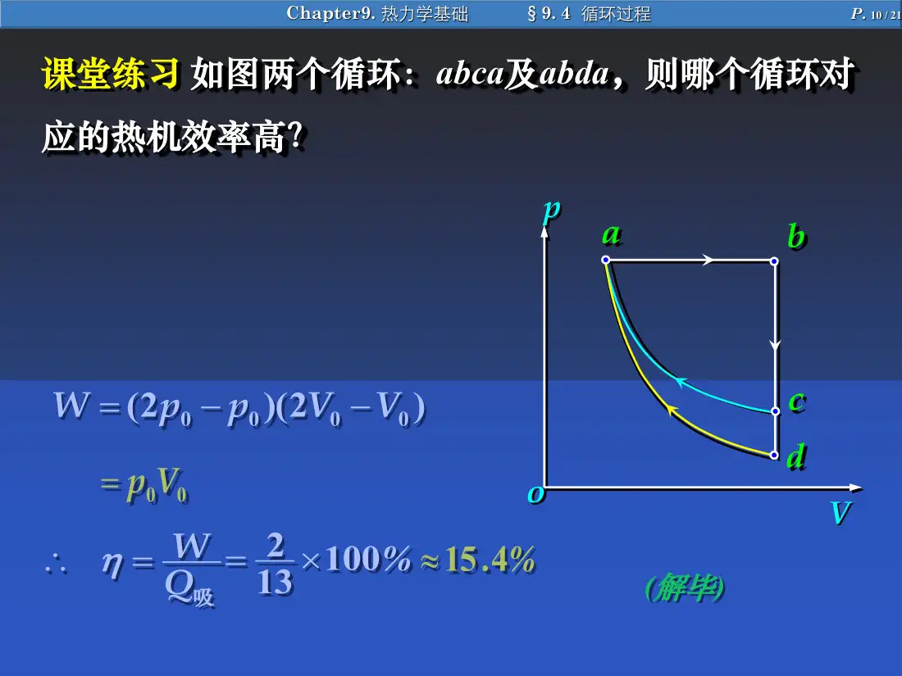

原文：

$$
\begin{array}{r l} W & = (2 p _ {0} - p _ {0}) (2 V _ {0} - V _ {0}) \\ & = p _ {0} V _ {0} \end{array}
$$

$$
\therefore \eta = \frac {W}{Q _ {\text {吸}}} = \frac {2}{13} \times 100 \% \approx 15.4 \%
$$

(解毕)

P. 10 / 21

Chapter9. 热力学基础 作者：杨

§9. 4 循环过程

### 课堂练习 如图两个循环：abca及abda，则哪个循环对应的热机效率高？

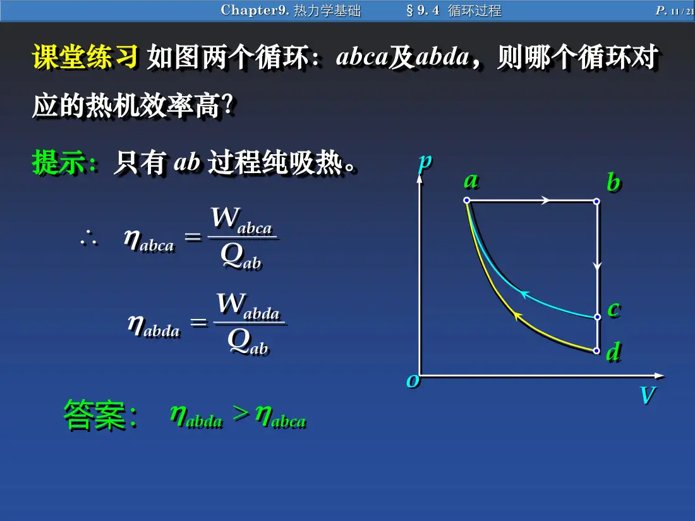

原文：

课堂练习 如图两个循环：abca及abda，则哪个循环对应的热机效率高？

提示：只有 ab 过程纯吸热。

$$
\eta_ {a b c a} = \frac {W _ {a b c a}}{Q _ {a b}}
$$

$$
\eta_ {a b d a} = \frac {W _ {a b d a}}{Q _ {a b}}
$$

答案： $m g w a w > m g v a v e a$

Chapter9. 热力学基础 作者：杨

§9. 4 循环过程

### 二、卡诺正循环

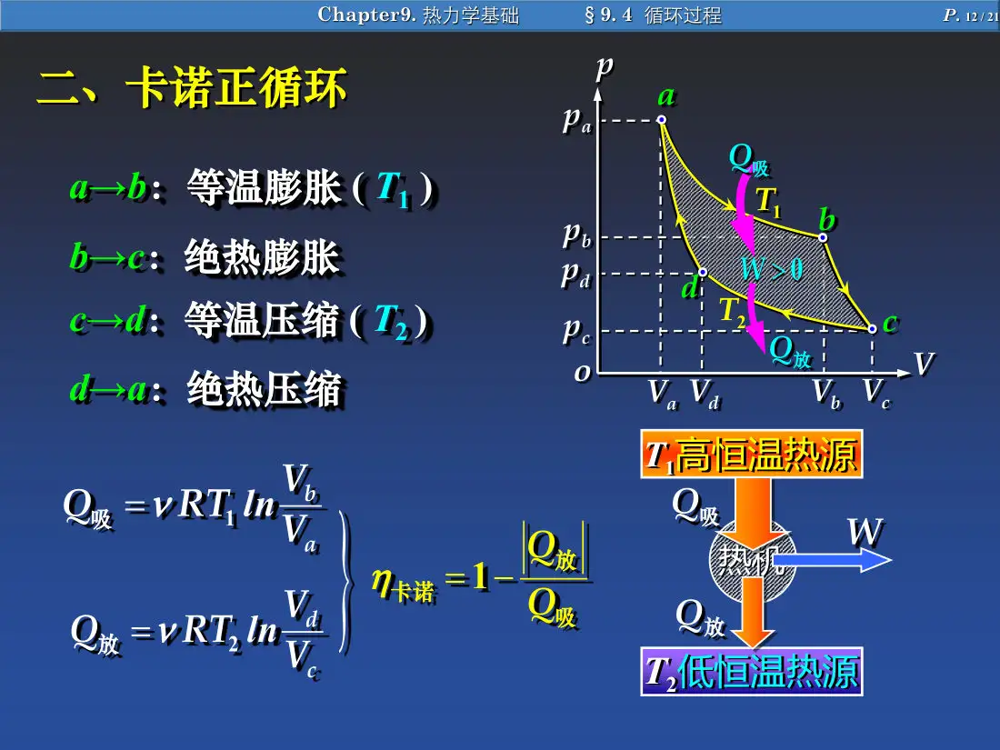

原文：

二、卡诺正循环

$( i i = 7 ) \div 5 =$ 等温膨胀 $( ( l l ) )$

$1 3 - 1 0 = 2 0$ 绝热膨胀

$( e ^ { 2 } - 7 ) \mathrm { { R } }$ 等温压缩 $( ( l l ) )$

$0 l { - } \lambda _ { u } ^ { \mathrm { ~ } }$ 绝热压缩

$$
\left. \begin{array}{l} Q _ {\text {吸}} = \nu R T _ {1} \ln \frac {V _ {b}}{V _ {a}} \\ Q _ {\text {放}} = \nu R T _ {2} \ln \frac {V _ {d}}{V _ {c}} \end{array} \right\} \eta_ {\text {卡诺}} = 1 - \frac {| Q _ {\text {放}} |}{Q _ {\text {吸}}}
$$

$1 1 ^ { \prime }$ 低恒温热源

Chapter9. 热力学基础 作者：杨

§9. 4 循环过程

P. 12 / 21

### $$

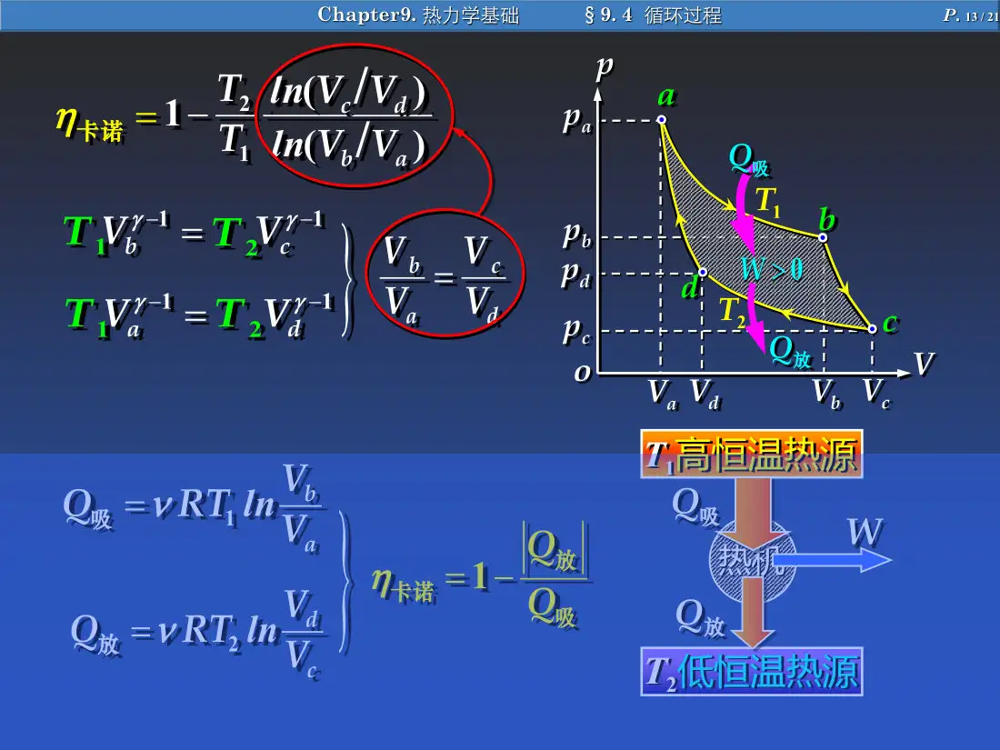

原文：

$$
\eta_ {\text {卡诺}} = 1 - \frac {T _ {2}}{T _ {1}} \frac {\ln \left(V _ {c} / V _ {d}\right)}{\ln \left(V _ {b} / V _ {a}\right)}
$$

$$
\pmb {T} _ {1} V _ {b} ^ {\gamma - 1} = \pmb {T} _ {2} V _ {c} ^ {\gamma - 1}
$$

$$
T _ {1} V _ {a} ^ {\gamma - 1} \equiv T _ {2} V _ {d} ^ {\gamma - 1}
$$

$$
Q _ {\text {吸}} = \nu R T _ {1} \ln \frac {V _ {b}}{V _ {a}}
$$

$$
\frac {V _ {b}}{V _ {a}} = \frac {V _ {c}}{V _ {d}}
$$

$$
Q _ {\text {放}} = \nu R T _ {2} \ln \frac {V _ {d}}{V _ {c}}
$$

$$
\eta_ {\text {卡诺}} = 1 - \frac {| Q _ {\text {放}} |}{Q _ {\text {吸}}}
$$

T高恒温热源

T2低恒温热源

Chapter9. 热力学基础 作者：杨

§9. 4 循环过程

P. 13 / 21

### $$

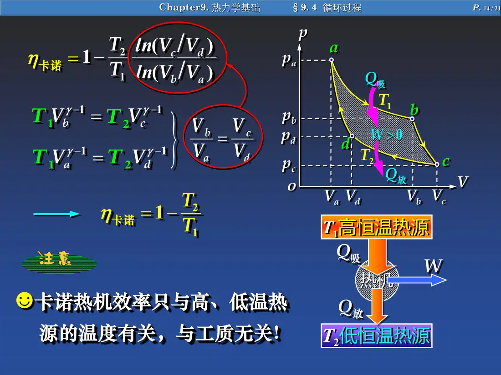

原文：

$$
\eta_ {\text {卡诺}} = 1 - \frac {T _ {2}}{T _ {1}} \frac {\ln \left(V _ {c} / V _ {d}\right)}{\ln \left(V _ {b} / V _ {a}\right)}
$$

$$
\pmb {T} _ {1} V _ {b} ^ {\gamma - 1} = \pmb {T} _ {2} V _ {c} ^ {\gamma - 1}
$$

$$
T _ {1} V _ {a} ^ {\gamma - 1} \equiv T _ {2} V _ {d} ^ {\gamma - 1},
$$

$$
\frac {V _ {b}}{V _ {a}} = \frac {V _ {c}}{V _ {d}}
$$

$$
\eta_ {\text {卡诺}} = 1 - \frac {T _ {2}}{T _ {1}}
$$

注意

☻卡诺热机效率只与高、低温热 源的温度有关，与工质无关!

Chapter9. 热力学基础 作者：杨

§9. 4 循环过程

P. 14 / 21

### 归纳

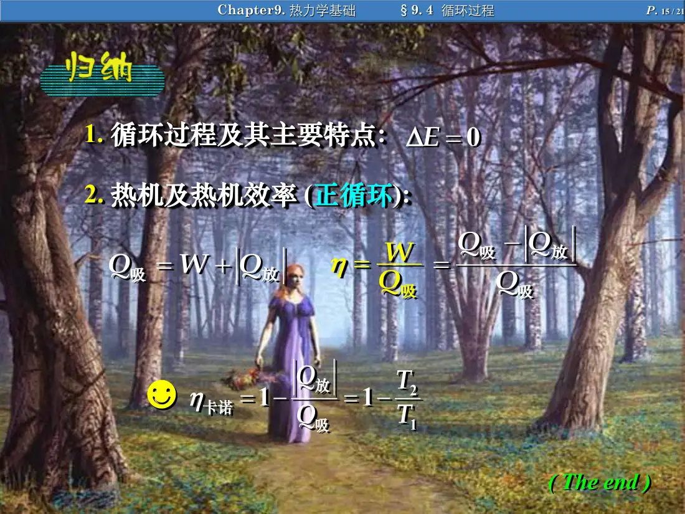

原文：

归纳

1. 循环过程及其主要特点: $\Delta C E = \Delta D$

2. 热机及热机效率 (正循环):

$$
Q _ {\text {吸}} = W + \left| Q _ {\text {放}} \right| \quad \eta = \frac {W}{Q _ {\text {吸}}} = \frac {Q _ {\text {吸}} - \left| Q _ {\text {放}} \right|}{Q _ {\text {吸}}}
$$

$$
\eta_ {\text {卡诺}} = 1 - \frac {| Q _ {\text {放}} |}{Q _ {\text {吸}}} = 1 - \frac {T _ {2}}{T _ {1}}
$$

The end )

Chapter9. 热力学基础 作者：杨

§9. 4 循环过程

P. 15 / 21
