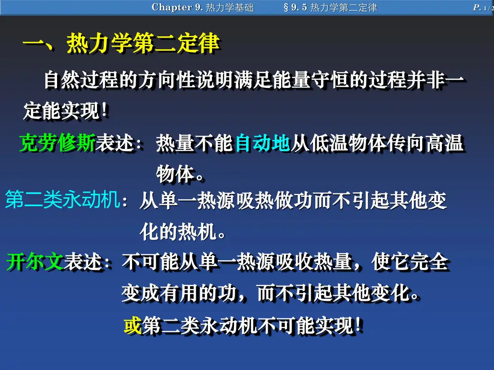
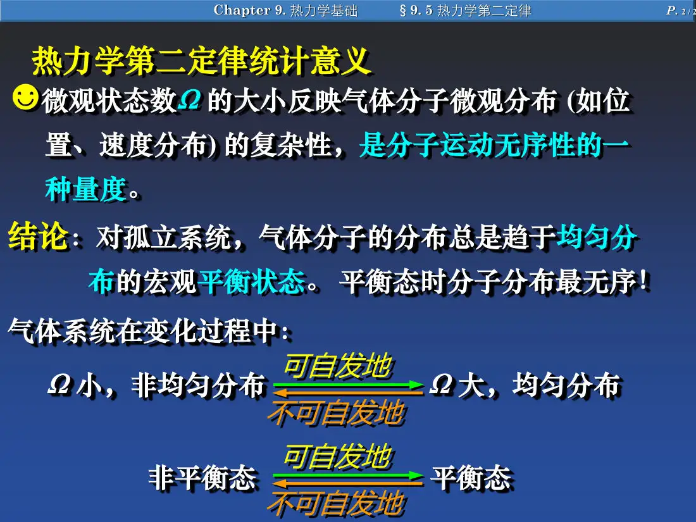
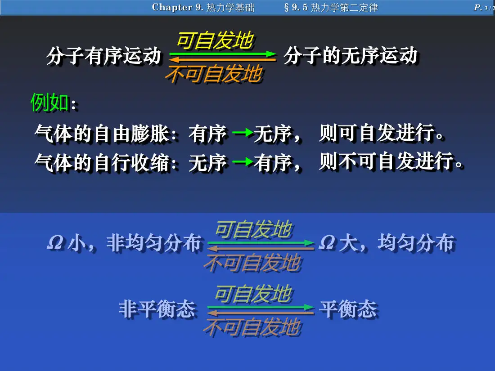
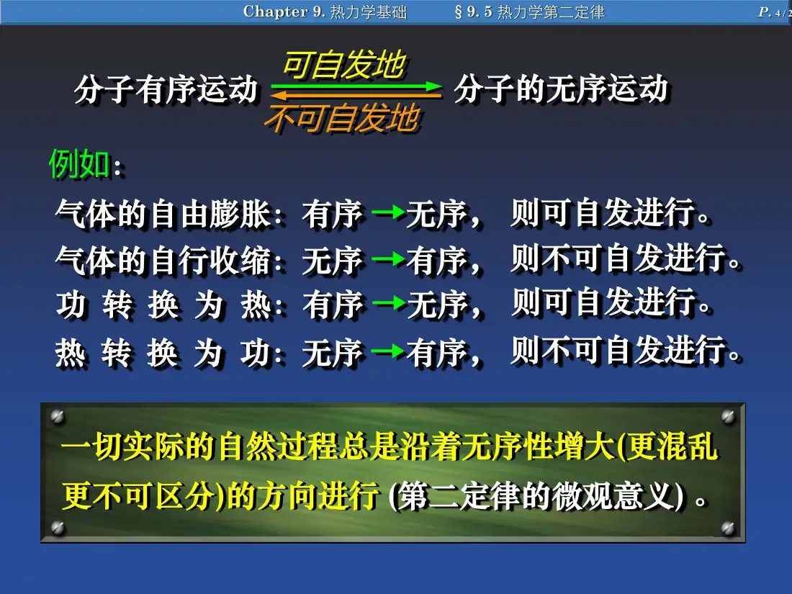
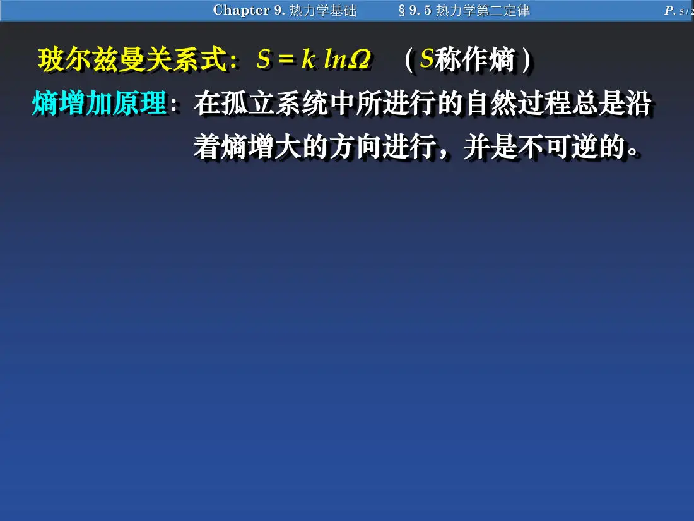

# 《大学物理》第9章 热力学基础 第5节 热力学第二定律（课件）

原件的每一页，下面附识别出的文字。

### 一、热力学第二定律

原文：

一、热力学第二定律

自然过程的方向性说明满足能量守恒的过程并非一定能实现！

克劳修斯表述：热量不能自动地从低温物体传向高温物体。

第二类永动机：从单一热源吸热做功而不引起其他变化的热机。

开尔文表述：不可能从单一热源吸收热量，使它完全变成有用的功，而不引起其他变化。

或第二类永动机不可能实现！

Chapter 9. 热力学基础 § 9.5 热力学第二定律

P. 1/2

### 热力学第二定律统计意义

原文：

热力学第二定律统计意义

微观状态数 $\Omega$ 的大小反映气体分子微观分布 (如位置、速度分布)的复杂性, 是分子运动无序性的一种量度。

结论：对孤立系统，气体分子的分布总是趋于均匀分布的宏观平衡状态。平衡态时分子分布最无序！
气体系统在变化过程中：

Ω小，非均匀分布 $\xrightarrow{可自发地}$ Ω大，均匀分布
不可自发地
非平衡态 $\xrightarrow{可自发地}$ 平衡态
不可自发地

Chapter 9. 热力学基础 § 9.5 热力学第二定律

P. 2/2

### 分子有序运动 $\xrightarrow{可自发地}$ 分子的无序运动

原文：

分子有序运动 $\xrightarrow{可自发地}$ 分子的无序运动
不可自发地

例如：

气体的自由膨胀：有序 $\rightarrow$ 无序，则可自发进行。

气体的自行收缩：无序 $\rightarrow$ 有序，则不可自发进行。

Ω小，非均匀分布 $\xrightarrow{可自发地}$ Ω大，均匀分布
不可自发地

非平衡态 可自发地 平衡态
不可自发地

Chapter 9. 热力学基础

§ 9.5 热力学第二定律

P. 3/2

### 分子有序运动

原文：

分子有序运动

可自发地

分子的无序运动

不可自发地

例如：

气体的自由膨胀：有序 $\rightarrow$ 无序，则可自发进行。

气体的自行收缩：无序 $\rightarrow$ 有序，则不可自发进行。

功转换为热：有序 $\rightarrow$ 无序，则可自发进行。

热转换为功: 无序 $\rightarrow$ 有序, 则不可自发进行。

一切实际的自然过程总是沿着无序性增大(更混乱更不可区分)的方向进行 (第二定律的微观意义)。

Chapter 9. 热力学基础

§ 9.5 热力学第二定律

### Chapter 9. 热力学基础

原文：

玻尔兹曼关系式: $S = k \ln \Omega$ (S称作熵)熵增加原理: 在孤立系统中所进行的自然过程总是沿着熵增大的方向进行, 并是不可逆的。

Chapter 9. 热力学基础

§ 9.5 热力学第二定律

P. 5/2
