# 《大学物理》第一章 1-1 质点运动的描述（课件）

原件的每一页，下面附识别出的文字。

### 第一章 质点运动学 (Kinematics of Particles)

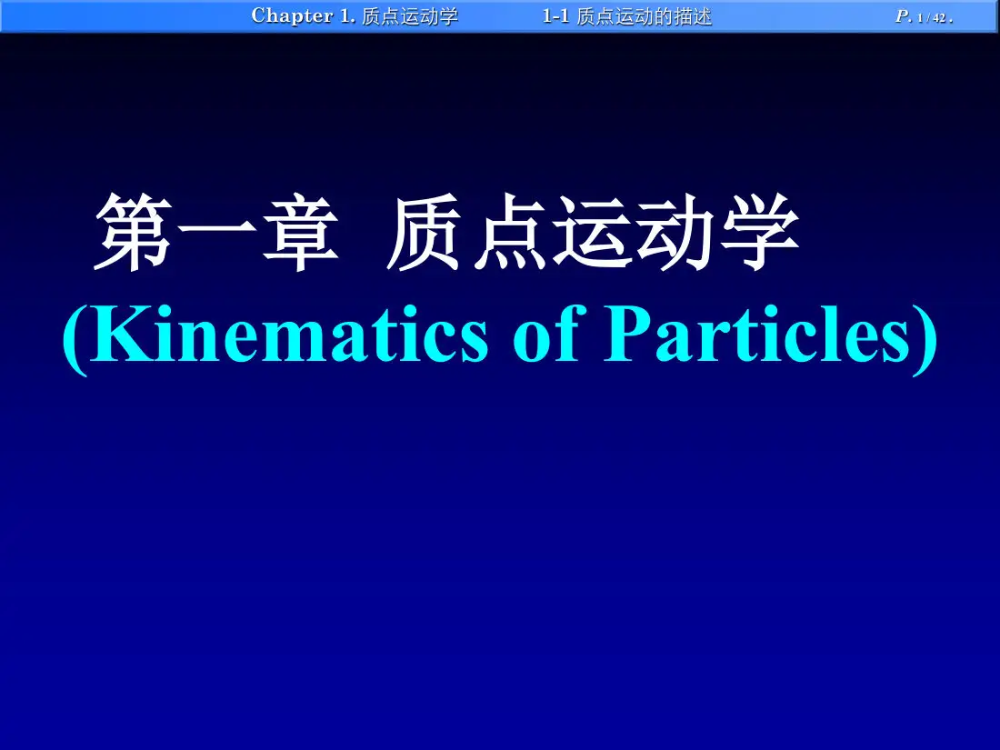

原文：

第一章 质点运动学 (Kinematics of Particles)

Chapter 1. 质点运动学

1-1 质点运动的描述

P. 1/42.

### 1-1 质点运动的描述

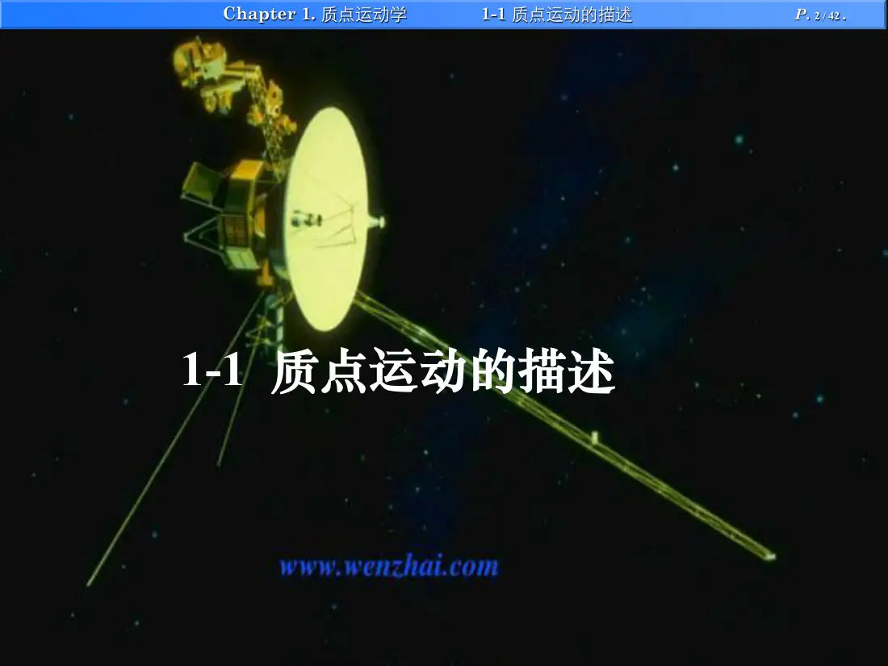

原文：

1-1 质点运动的描述

www.wenzhai.com

Chapter 1. 质点运动学

1-1 质点运动的描述

P. 2 / 42 .

### 研究力学要明确的两个基本概念

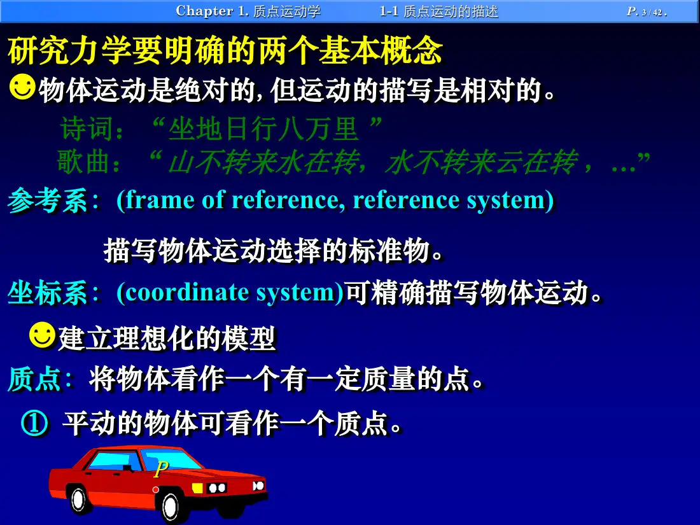

原文：

研究力学要明确的两个基本概念
物体运动是绝对的, 但运动的描写是相对的。

诗词：“坐地日行八万里”

歌曲：“山不转来水在转，水不转来云在转，...”

参考系：(frame of reference, reference system)

描写物体运动选择的标准物。

坐标系：(coordinate system)可精确描写物体运动。

😊建立理想化的模型

质点: 将物体看作一个有一定质量的点。

① 平动的物体可看作一个质点。

Chapter 1. 质点运动学

1-1 质点运动的描述

P. 3 / 42 .

### ② 物体运动范围>>物体本身线度。例如：地球绕太阳公转时地球可视一个质点。

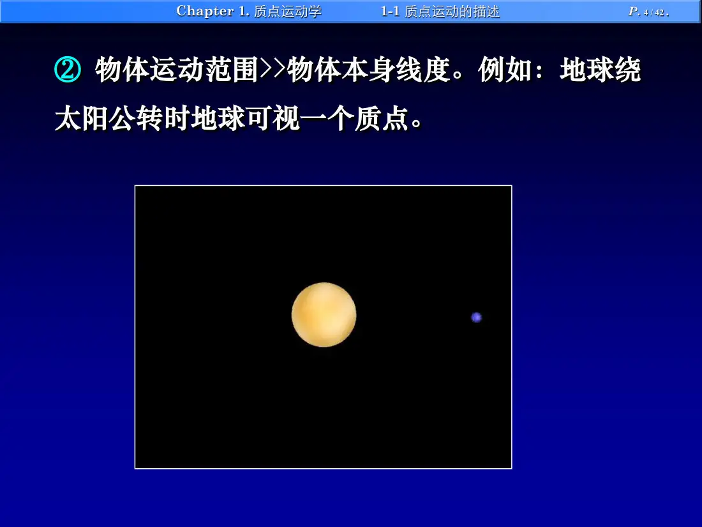

原文：

② 物体运动范围>>物体本身线度。例如：地球绕太阳公转时地球可视一个质点。

Chapter 1. 质点运动学

1-1 质点运动的描述

P. 4/42.

### 一、位置矢量 $\vec{r}$

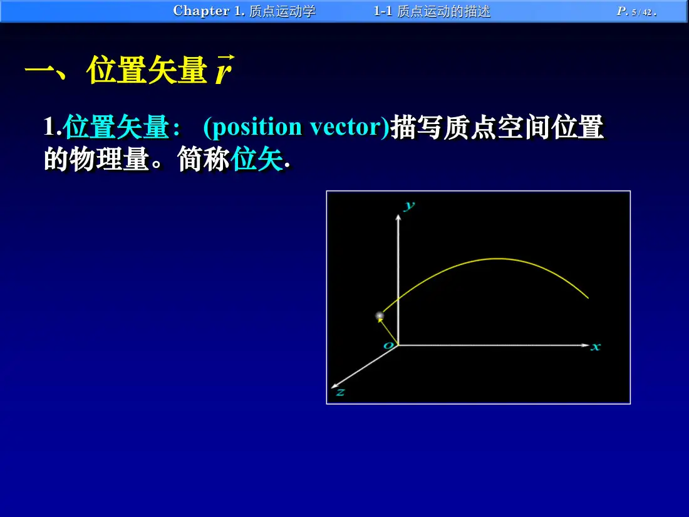

原文：

一、位置矢量 $\vec{r}$

1. 位置矢量: (position vector) 描写质点空间位置的物理量。简称位矢。

Chapter 1. 质点运动学

1-1 质点运动的描述

P. 5/42.

### 一、位置矢量 $\vec{r}$

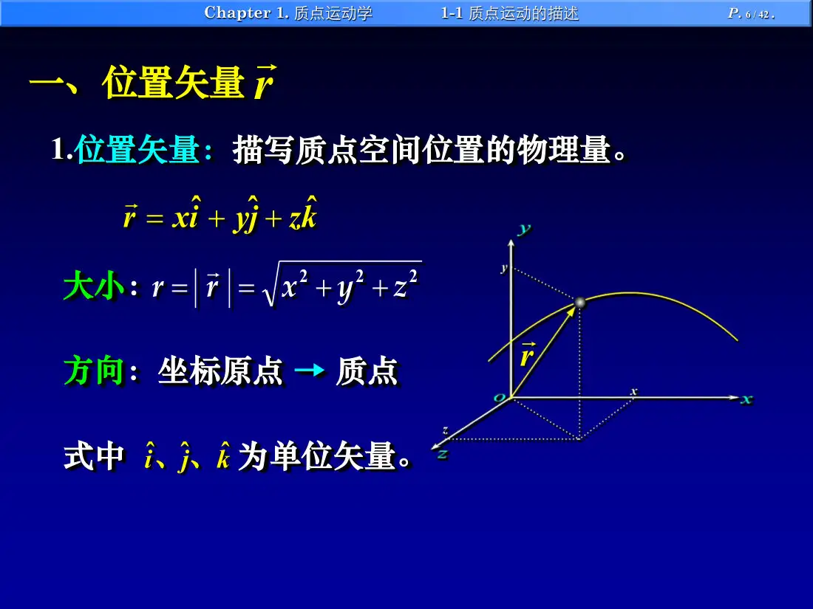

原文：

一、位置矢量 $\vec{r}$

1. 位置矢量：描写质点空间位置的物理量。

$$
\vec {r} = x \hat {i} + y \hat {j} + z \hat {k}
$$

大小： $r=\left|\vec{r}\right|=\sqrt{x^{2}+y^{2}+z^{2}}$

方向：坐标原点 → 质点

式中 $\hat{i}$ 、 $\hat{j}$ 、 $\hat{k}$ 为单位矢量。

Chapter 1. 质点运动学

1-1 质点运动的描述

P. 6/42.

### 2. 运动方程：质点位置随时间变化的关系。

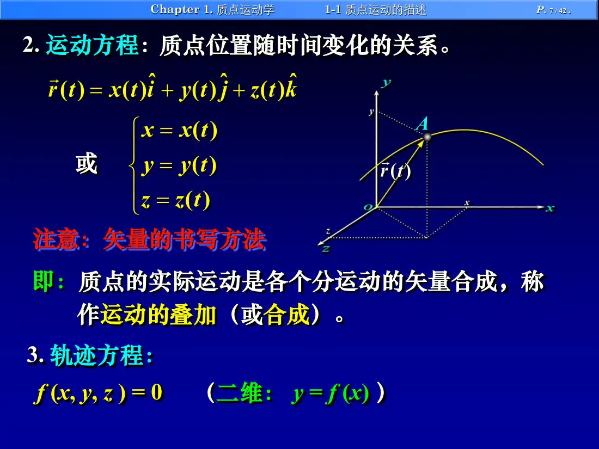

原文：

2. 运动方程：质点位置随时间变化的关系。

$$
\vec {r} (t) = x (t) \hat {i} + y (t) \hat {j} + z (t) \hat {k}
$$

或

$$
\left\{ \begin{array}{l} x = x (t) \\ y = y (t) \\ z = z (t) \end{array} \right.
$$

注意：矢量的书写方法

即：质点的实际运动是各个分运动的矢量合成，称作运动的叠加（或合成）。

3. 轨迹方程:

$$
f (x, y, z) = 0
$$

(二维: $y = f(x)$ )

Chapter 1. 质点运动学

1-1 质点运动的描述

P. 7/42.

### 二、位移 $\Delta \vec{r}$

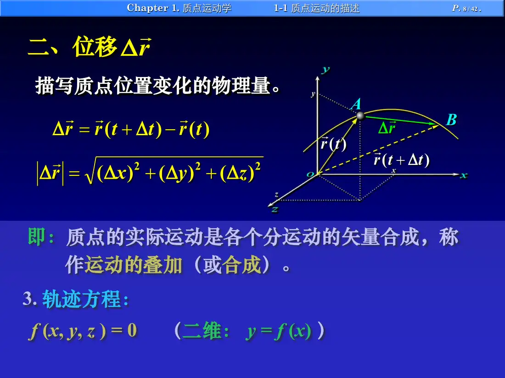

原文：

二、位移 $\Delta \vec{r}$

描写质点位置变化的物理量。

$$
\Delta \vec {r} = \vec {r} (t + \Delta t) - \vec {r} (t)
$$

$$
\left| \Delta \vec {r} \right| = \sqrt {(\Delta x) ^ {2} + (\Delta y) ^ {2} + (\Delta z) ^ {2}}
$$

即：质点的实际运动是各个分运动的矢量合成，称作运动的叠加（或合成）。

3. 轨迹方程:

$$
f (x, y, z) = 0
$$

$$
(\text {二维:} y = f (x))
$$

Chapter 1. 质点运动学

1-1 质点运动的描述

P. 8/42.

### 二、位移 $\Delta \vec{r}$

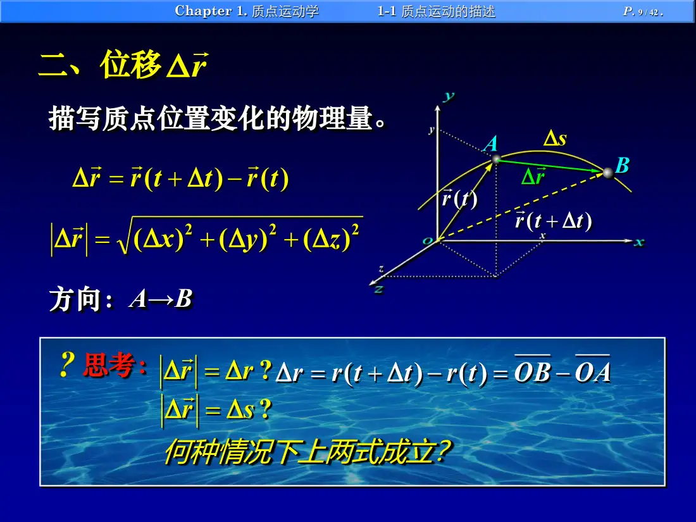

原文：

二、位移 $\Delta \vec{r}$

描写质点位置变化的物理量。

$$
\Delta \vec {r} = \vec {r} (t + \Delta t) - \vec {r} (t)
$$

$$
\left| \Delta \vec {r} \right| = \sqrt {(\Delta x) ^ {2} + (\Delta y) ^ {2} + (\Delta z) ^ {2}}
$$

方向: $A \rightarrow B$

? 思考:

$$
\left| \Delta \vec {r} \right| = \Delta r? \Delta r = r (t + \Delta t) - r (t) = \overline {{O B}} - \overline {{O A}}
$$

$$
\left| \Delta \vec {r} \right| = \Delta s?
$$

何种情况下上两式成立？

Chapter 1. 质点运动学

1-1 质点运动的描述

P. 9/42.

### 三、速度の

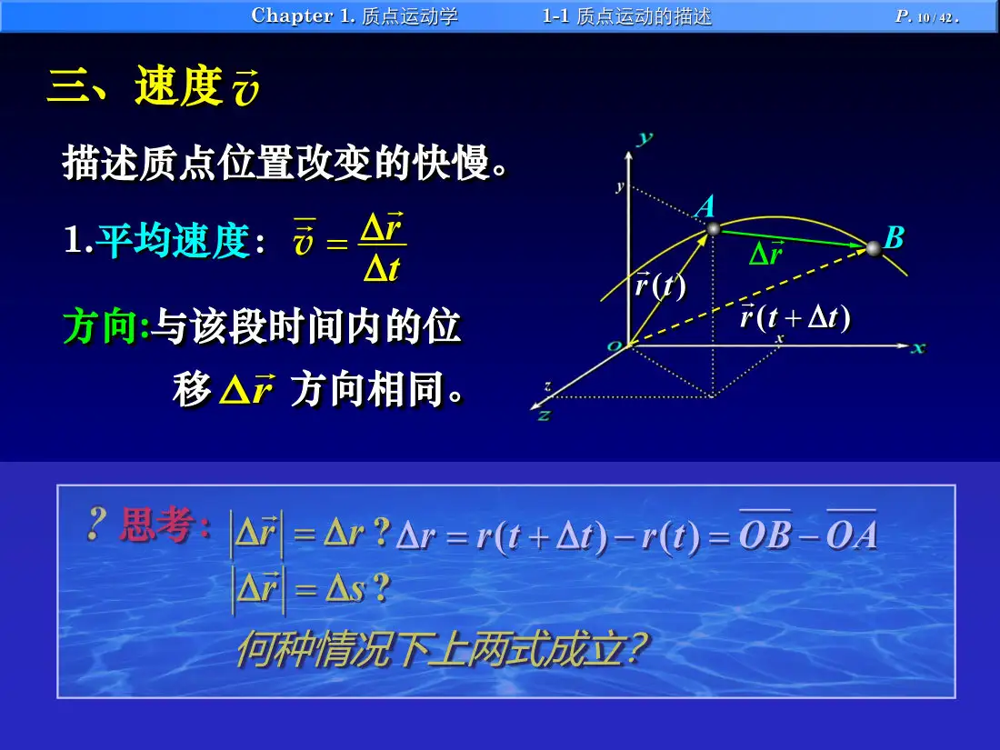

原文：

三、速度の

描述质点位置改变的快慢。

1. 平均速度: $\vec{v} = \frac{\Delta\vec{r}}{\Delta t}$ 方向: 与该段时间内的位移 $\Delta \vec{r}$ 方向相同。

? 思考:

$$
\begin{array}{l} \left| \Delta \vec {r} \right| = \Delta r? \Delta r = r (t + \Delta t) - r (t) = \overline {{O B}} - \overline {{O A}} \\ \left| \Delta \vec {r} \right| = \Delta s? \end{array}
$$

何种情况下上两式成立？

Chapter 1. 质点运动学

1-1 质点运动的描述

P. 10 / 42.

### 三、速度の

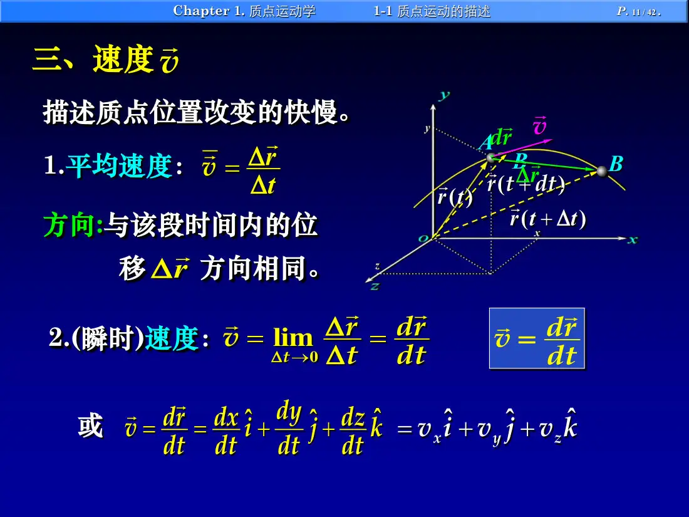

原文：

三、速度の

描述质点位置改变的快慢。

1. 平均速度: $\vec{v} = \frac{\Delta\vec{r}}{\Delta t}$ 方向: 与该段时间内的位移 $\Delta \vec{r}$ 方向相同。

2.(瞬时)速度: $\vec{v} = \lim_{\Delta t \to 0} \frac{\Delta \vec{r}}{\Delta t} = \frac{d \vec{r}}{dt}$

$$
\vec {v} = \frac {d \vec {r}}{d t}
$$

或 $\vec{v} = \frac{d\vec{r}}{dt} = \frac{dx}{dt}\hat{i} +\frac{dy}{dt}\hat{j} +\frac{dz}{dt}\hat{k} = v_x\hat{i} +v_y\hat{j} +v_z\hat{k}$

Chapter 1. 质点运动学

1-1 质点运动的描述

P. 11 / 42.

### 方向：轨迹上该点的切线方向

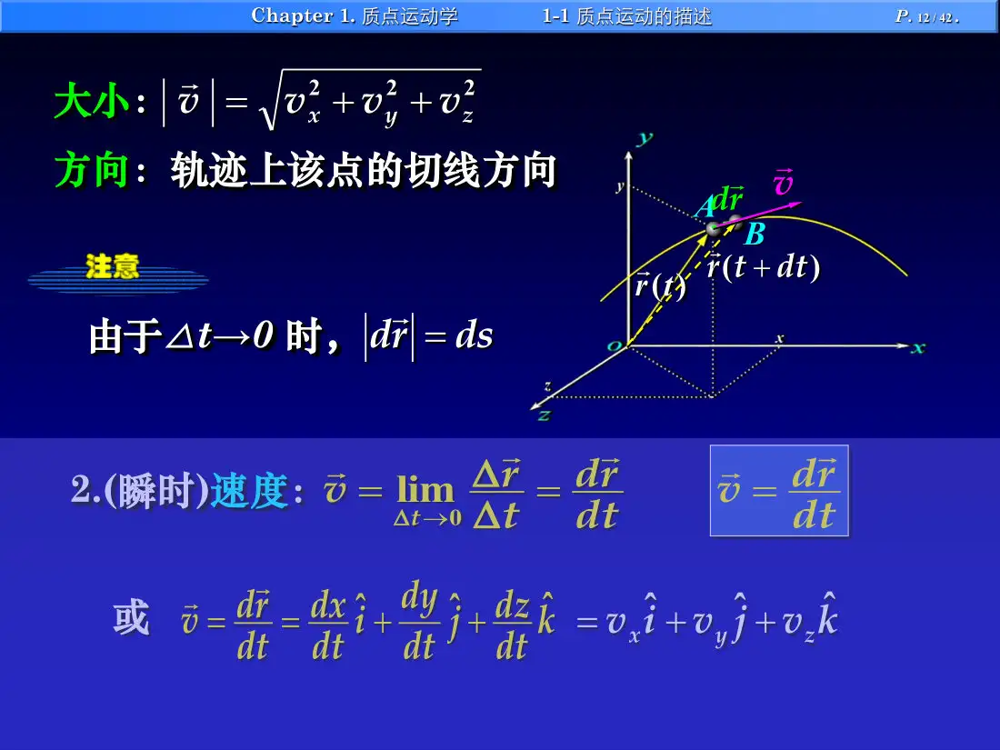

原文：

大小： $|\vec{v}| = \sqrt{v_x^2 + v_y^2 + v_z^2}$

方向：轨迹上该点的切线方向

注意

由于 $\Delta t\to 0$ 时， $|\vec{d r}| = ds$

2.(瞬时)速度: $\vec{v} = \lim_{\Delta t \to 0} \frac{\Delta \vec{r}}{\Delta t} = \frac{d \vec{r}}{dt}$ $\vec{v} = \frac{d \vec{r}}{dt}$

或 $\vec{v} = \frac{d\vec{r}}{dt} = \frac{dx}{dt}\hat{i} +\frac{dy}{dt}\hat{j} +\frac{dz}{dt}\hat{k} = v_x\hat{i} +v_y\hat{j} +v_z\hat{k}$

Chapter 1. 质点运动学

1-1 质点运动的描述

P. 12 / 42.

### 方向：轨迹上该点的切线方

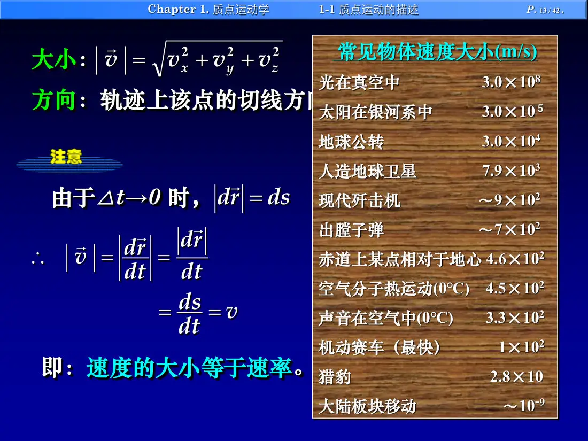

原文：

大小： $|\vec{v}| = \sqrt{v_x^2 + v_y^2 + v_z^2}$

方向：轨迹上该点的切线方

注意

由于 $\Delta t\to 0$ 时， $|\vec{d r}| = ds$

$\therefore \quad |\vec{v}| = \left|\frac{d\vec{r}}{dt}\right| = \frac{|d\vec{r}|}{dt} = \frac{ds}{dt} = v$

即：速度的大小等于速率。

<table><tr><td colspan="2">常见物体速度大小(m/s)</td></tr><tr><td>光在真空中</td><td> $3.0 \times 10^{8}$ </td></tr><tr><td>太阳在银河系中</td><td> $3.0 \times 10^{5}$ </td></tr><tr><td>地球公转</td><td> $3.0 \times 10^{4}$ </td></tr><tr><td>人造地球卫星</td><td> $7.9 \times 10^{3}$ </td></tr><tr><td>现代歼击机</td><td> $\sim 9 \times 10^{2}$ </td></tr><tr><td>出膛子弹</td><td> $\sim 7 \times 10^{2}$ </td></tr><tr><td>赤道上某点相对于地心</td><td> $4.6 \times 10^{2}$ </td></tr><tr><td>空气分子热运动(0°C)</td><td> $4.5 \times 10^{2}$ </td></tr><tr><td>声音在空气中(0°C)</td><td> $3.3 \times 10^{2}$ </td></tr><tr><td>机动赛车(最快)</td><td> $1 \times 10^{2}$ </td></tr><tr><td>猎豹</td><td> $2.8 \times 10$ </td></tr><tr><td>大陆板块移动</td><td> $\sim 10^{-9}$ </td></tr></table>

P. 13 / 42.

Chapter 1. 质点运动学

1-1 质点运动的描述

### 解 1) 由题意可知:

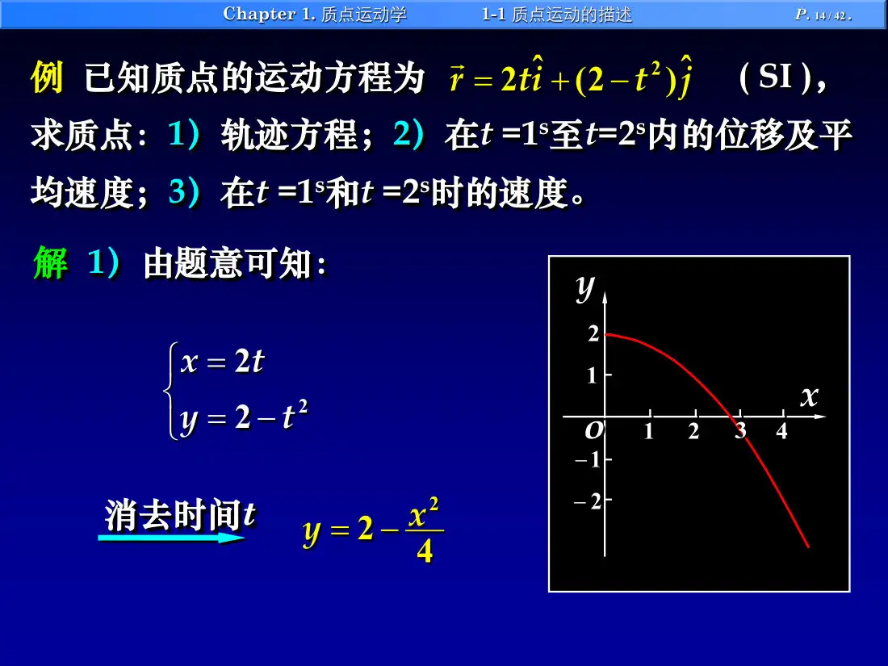

原文：

例 已知质点的运动方程为 $\vec{r} = 2t\hat{i} + (2 - t^2)\hat{j}$ （SI），求质点：1）轨迹方程；2）在 $t = 1^{\mathrm{s}}$ 至 $t = 2^{\mathrm{s}}$ 内的位移及平均速度；3）在 $t = 1^{\mathrm{s}}$ 和 $t = 2^{\mathrm{s}}$ 时的速度。

解 1) 由题意可知:

$$
\left\{ \begin{array}{l} x = 2 t \\ y = 2 - t ^ {2} \end{array} \right.
$$

消去时间t

$$
y = 2 - \frac {x ^ {2}}{4}
$$

Chapter 1. 质点运动学

1-1 质点运动的描述

P. 14 / 42.

### $$

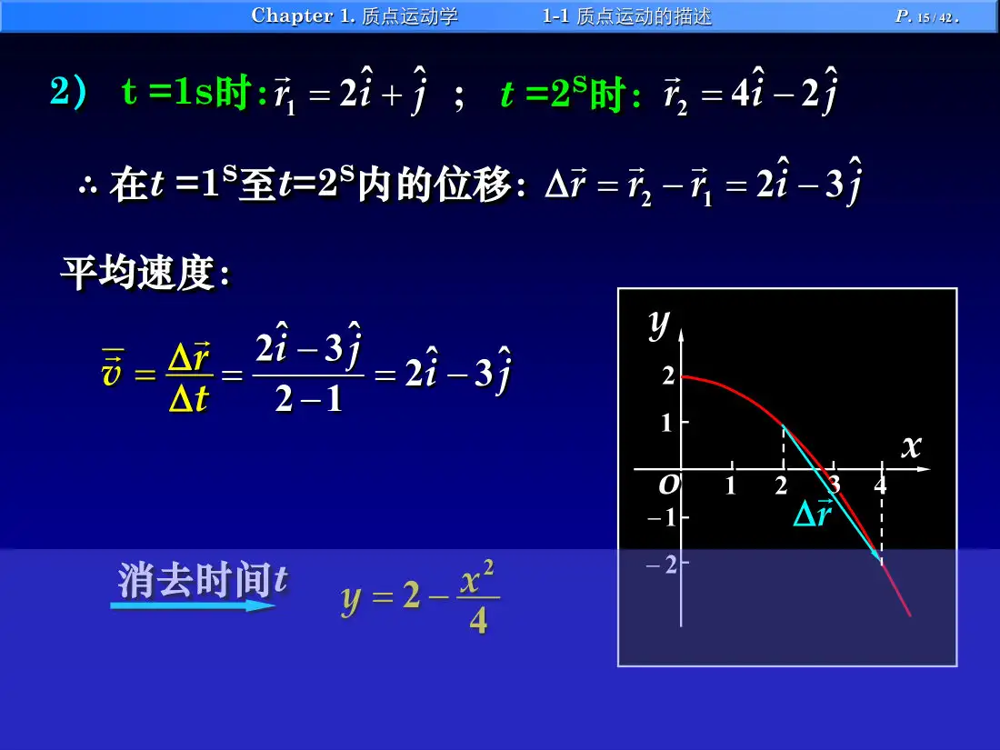

原文：

$$
2) \quad t = 1 s \text {时}: \vec {r} _ {1} = 2 \hat {i} + \hat {j}; \quad t = 2 ^ {s} \text {时}: \vec {r} _ {2} = 4 \hat {i} - 2 \hat {j}
$$

∴ 在 $t=1^{S}$ 至 $t=2^{S}$ 内的位移： $\Delta\vec{r}=\vec{r}_{2}-\vec{r}_{1}=2\hat{i}-3\hat{j}$

平均速度:

$$
\overline {{\vec {v}}} = \frac {\Delta \vec {r}}{\Delta t} = \frac {2 \hat {i} - 3 \hat {j}}{2 - 1} = 2 \hat {i} - 3 \hat {j}
$$

消去时间t

$$
y = 2 - \frac {x ^ {2}}{4}
$$

Chapter 1. 质点运动学

1-1 质点运动的描述

P. 15 / 42.

### $$

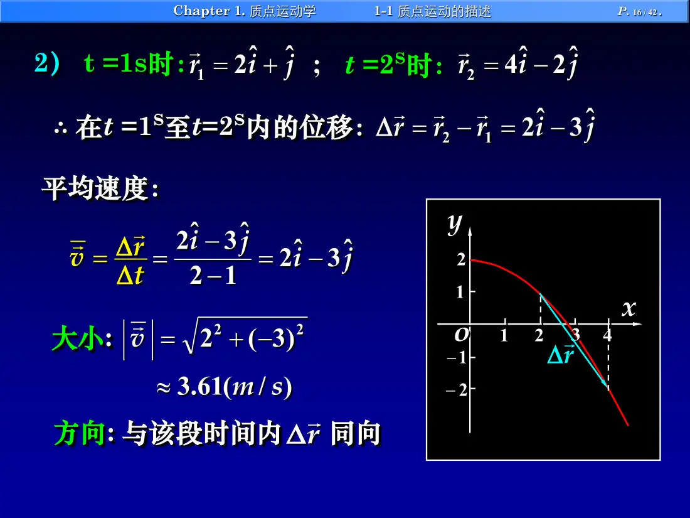

原文：

$$
2) \quad t = 1 s \text {时}: \vec {r} _ {1} = 2 \hat {i} + \hat {j}; \quad t = 2 ^ {s} \text {时}: \vec {r} _ {2} = 4 \hat {i} - 2 \hat {j}
$$

∴ 在 $t=1^{S}$ 至 $t=2^{S}$ 内的位移： $\Delta\vec{r}=\vec{r}_{2}-\vec{r}_{1}=2\hat{i}-3\hat{j}$

平均速度:

$$
\overline {{\vec {v}}} = \frac {\Delta \vec {r}}{\Delta t} = \frac {2 \hat {i} - 3 \hat {j}}{2 - 1} = 2 \hat {i} - 3 \hat {j}
$$

大小: $\left|\overrightarrow{v}\right|=\sqrt{2^{2}+(-3)^{2}}$ $\approx 3.61(m/s)$

方向: 与该段时间内 $\Delta\vec{r}$ 同向

Chapter 1. 质点运动学

1-1 质点运动的描述

P. 16 / 42.

### $$

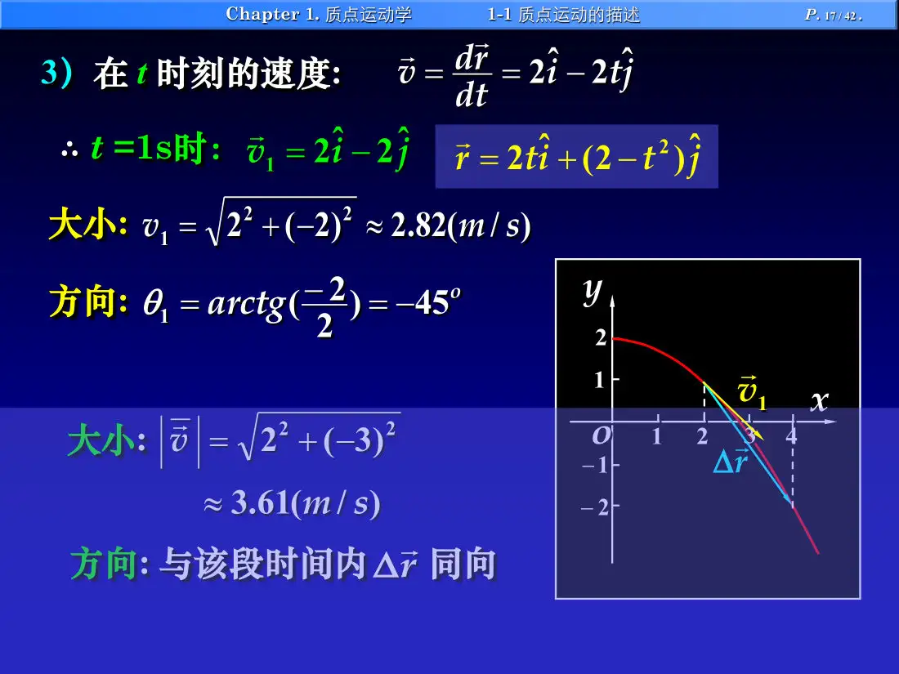

原文：

3) 在 t 时刻的速度: $\vec{v} = \frac{d\vec{r}}{dt} = 2\hat{i} - 2t\hat{j}$

∴ t=1s时： $\vec{v}_{1}=2\hat{i}-2\hat{j}$ $\vec{r}=2t\hat{i}+(2-t^{2})\hat{j}$

大小: $v_{1} = \sqrt{2^{2} + (-2)^{2}} \approx 2.82(m / s)$

方向: $\theta_{1} = \operatorname{arctg}\left(\frac{-2}{2}\right) = -45^{\circ}$

大小: $|\overrightarrow{\vec{v}}| = \sqrt{2^2 + (-3)^2}$

$$
\approx 3. 6 1 (m / s)
$$

方向: 与该段时间内 $\Delta \vec{r}$ 同向

Chapter 1. 质点运动学

1-1 质点运动的描述

P. 17 / 42.

### t=2s时： $\vec{v}_{2}=2\hat{i}-4\hat{j}$

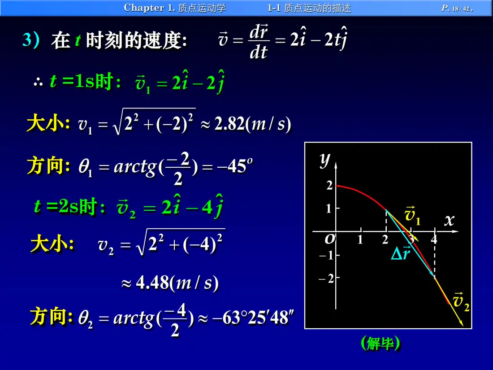

原文：

3) 在 t 时刻的速度: $\vec{v} = \frac{d\vec{r}}{dt} = 2\hat{i} - 2t\hat{j}$

∴ t=1s 时: $\vec{v}_{1}=2\hat{i}-2\hat{j}$

大小: $v_{1} = \sqrt{2^{2} + (-2)^{2}} \approx 2.82(m / s)$

方向: $\theta_{1} = \operatorname{arctg}\left(\frac{-2}{2}\right) = -45^{\circ}$

t=2s时： $\vec{v}_{2}=2\hat{i}-4\hat{j}$

大小: $v_{2} = \sqrt{2^{2} + (-4)^{2}}$

$$
\approx 4. 4 8 (m / s)
$$

方向: $\theta_{2} = \operatorname{arctg}\left(\frac{-4}{2}\right) \approx -63^{\circ} 25' 48''$

Chapter 1. 质点运动学

1-1 质点运动的描述

P. 18 / 42.

### 四、加速度 $\vec{a}$

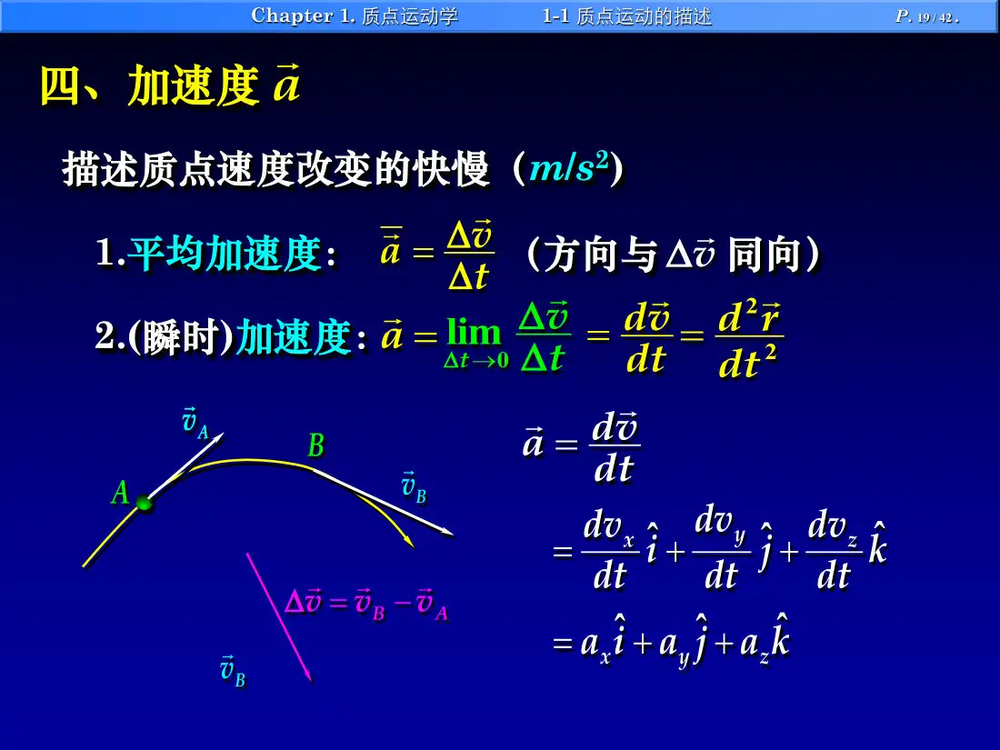

原文：

四、加速度 $\vec{a}$

描述质点速度改变的快慢（ $m/s^{2}$ ）

1. 平均加速度: $\vec{a} = \frac{\Delta \vec{v}}{\Delta t}$ (方向与 $\Delta \vec{v}$ 同向)

2.(瞬时)加速度: $\vec{a}=\lim_{\Delta t\to0}\frac{\Delta\vec{v}}{\Delta t}=\frac{d\vec{v}}{dt}=\frac{d^{2}\vec{r}}{dt^{2}}$

$$
\begin{array}{r l} & {\vec {a} = \frac {d \vec {v}}{d t}} \\ & {= \frac {d v _ {x}}{d t} \hat {i} + \frac {d v _ {y}}{d t} \hat {j} + \frac {d v _ {z}}{d t} \hat {k}} \\ & {= a _ {x} \hat {i} + a _ {y} \hat {j} + a _ {z} \hat {k}} \end{array}
$$

Chapter 1. 质点运动学

1-1 质点运动的描述

P. 19 / 42.

### 其中

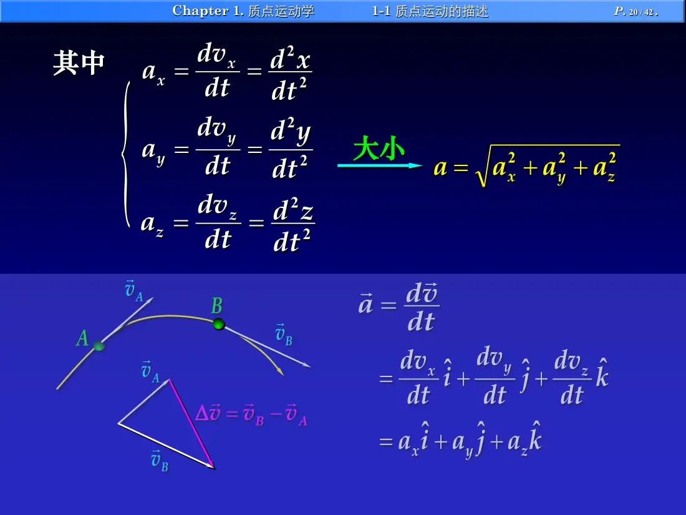

原文：

其中

$$
a _ {x} = \frac {d v _ {x}}{d t} = \frac {d ^ {2} x}{d t ^ {2}}
$$

$$
a _ {y} = \frac {d v _ {y}}{d t} = \frac {d ^ {2} y}{d t ^ {2}}
$$

$$
a = \sqrt {a _ {x} ^ {2} + a _ {y} ^ {2} + a _ {z} ^ {2}}
$$

$$
a _ {z} = \frac {d v _ {z}}{d t} = \frac {d ^ {2} z}{d t ^ {2}}
$$

$$
\Delta \vec {v} = \vec {v} _ {B} - \vec {v} _ {A}
$$

$$
\begin{array}{r l} & {\vec {a} = \frac {d \vec {v}}{d t}} \\ & {= \frac {d v _ {x}}{d t} \hat {i} + \frac {d v _ {y}}{d t} \hat {j} + \frac {d v _ {z}}{d t} \hat {k}} \\ & {= a _ {x} \hat {i} + a _ {y} \hat {j} + a _ {z} \hat {k}} \end{array}
$$

Chapter 1. 质点运动学

1-1 质点运动的描述

P. 20 / 42.

### 其中

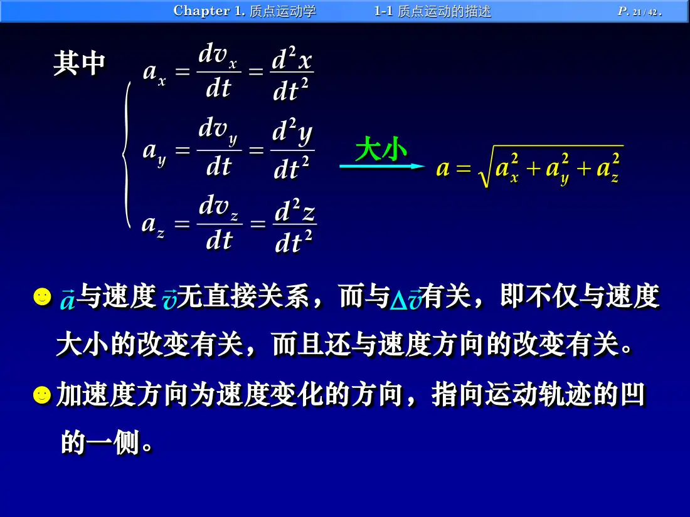

原文：

其中

$$
\left\{ \begin{array}{l} a _ {x} = \frac {d v _ {x}}{d t} = \frac {d ^ {2} x}{d t ^ {2}} \\ a _ {y} = \frac {d v _ {y}}{d t} = \frac {d ^ {2} y}{d t ^ {2}} \\ a _ {z} = \frac {d v _ {z}}{d t} = \frac {d ^ {2} z}{d t ^ {2}} \end{array} \right. \xrightarrow {\text {大小}} a = \sqrt {a _ {x} ^ {2} + a _ {y} ^ {2} + a _ {z} ^ {2}}
$$

\- 与速度 $\vec{v}$ 无直接关系，而与 $\Delta \vec{v}$ 有关，即不仅与速度大小的改变有关，而且还与速度方向的改变有关。

加速度方向为速度变化的方向，指向运动轨迹的凹的一侧。

Chapter 1. 质点运动学

1-1 质点运动的描述

P. 21 / 42.

### $$

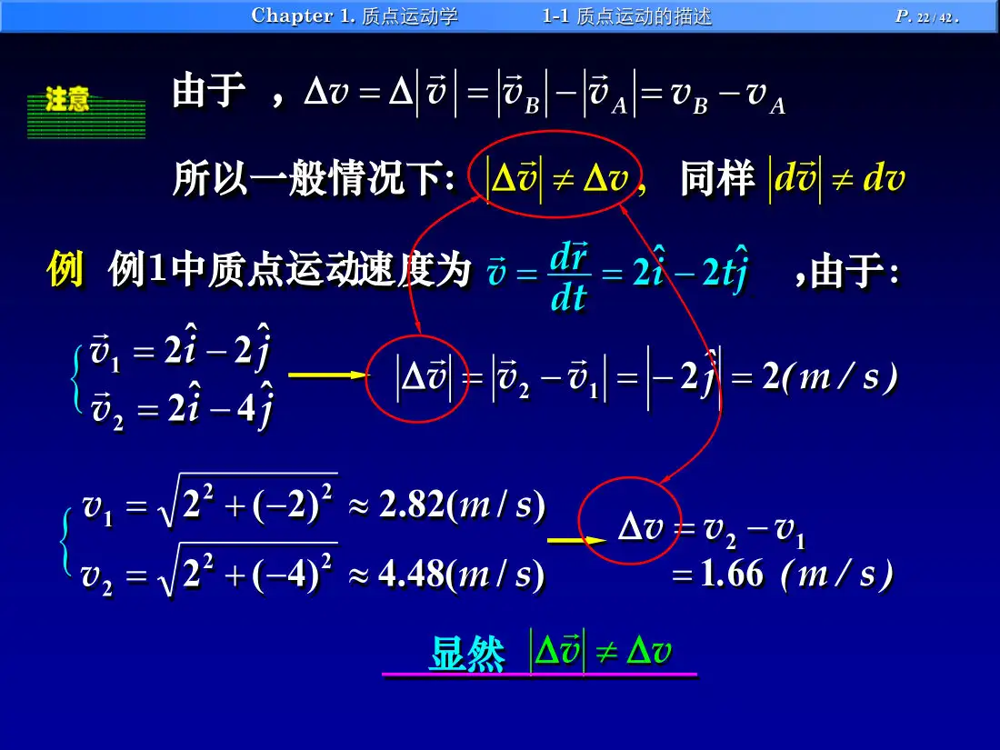

原文：

注意 由于， $\Delta v = \Delta |\vec{v}| = |\vec{v}_B| - |\vec{v}_A| = v_B - v_A$

所以一般情况下: $|\Delta \vec{v}| \neq \Delta v$ , 同样 $|d \vec{v}| \neq d v$

例 例1中质点运动速度为 $\vec{v} = \frac{d\vec{r}}{dt} = 2\hat{i} - 2t\hat{j}$ ，由于：

$$
\left\{ \begin{array}{l} \vec {v} _ {1} = 2 \hat {i} - 2 \hat {j} \\ \vec {v} _ {2} = 2 \hat {i} - 4 \hat {j} \end{array} \right. \longrightarrow \boxed {| \Delta \vec {v} |} = | \vec {v} _ {2} - \vec {v} _ {1} | = | - 2 \hat {j} | = 2 (m / s)
$$

显然 $|\Delta \vec{v}| \neq \Delta v$

Chapter 1. 质点运动学

1-1 质点运动的描述

P. 22 / 42.

### 能由运动方程说明 $|d\vec{v}|\neq dv$ 吗？

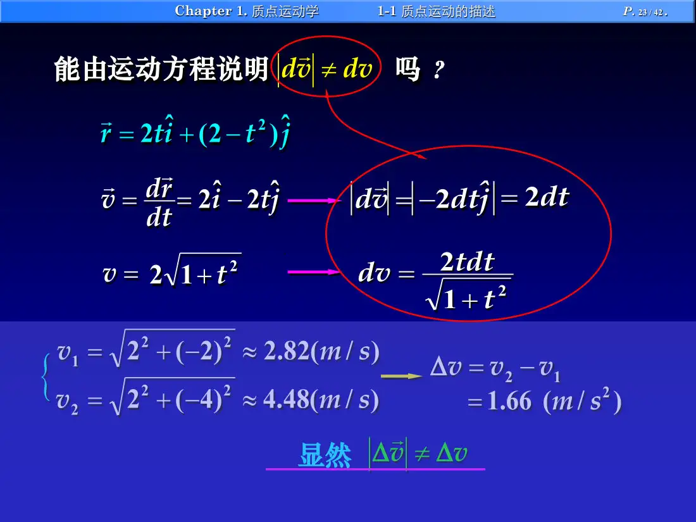

原文：

能由运动方程说明 $|d\vec{v}|\neq dv$ 吗？

$$
\vec {r} = 2 t \hat {i} + (2 - t ^ {2}) \hat {j}
$$

$\vec{v} = \frac{d\vec{r}}{dt} = 2\hat{i} - 2t\hat{j}\longrightarrow |d\vec{v}| = |-2dt\hat{j}| = 2dt$

$$
v = 2 \sqrt {1 + t ^ {2}}
$$

$$
d v = \frac {2 t d t}{\sqrt {1 + t ^ {2}}}
$$

$$
\left\{ \begin{array}{l} v _ {1} = \sqrt {2 ^ {2} + (- 2) ^ {2}} \approx 2. 8 2 (m / s) \\ v _ {2} = \sqrt {2 ^ {2} + (- 4) ^ {2}} \approx 4. 4 8 (m / s) \end{array} \right. \xrightarrow {\Delta v = v _ {2} - v _ {1}} = 1. 6 6 (m / s ^ {2})
$$

显然 $|\Delta \vec{v}| \neq \Delta v$

Chapter 1. 质点运动学

1-1 质点运动的描述

P. 23 / 42.

### 能由运动方程说明 $|d\vec{v}|\neq dv$ 吗？

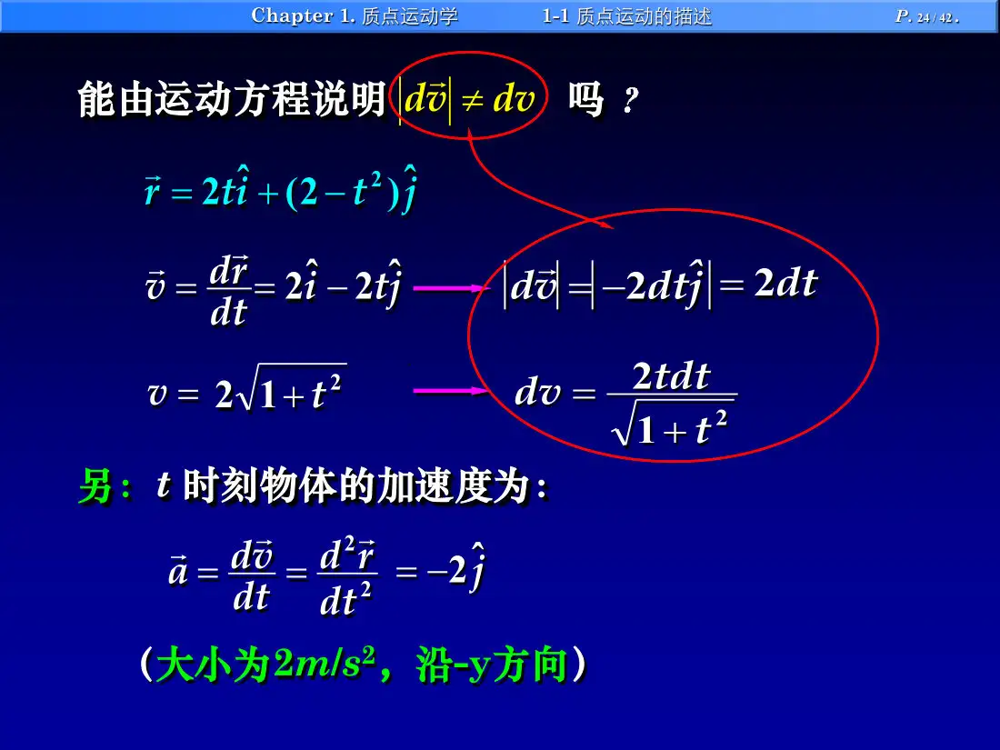

原文：

能由运动方程说明 $|d\vec{v}|\neq dv$ 吗？

$$
\vec {r} = 2 t \hat {i} + (2 - t ^ {2}) \hat {j}
$$

$$
\vec {v} = \frac {d \vec {r}}{d t} = 2 \hat {i} - 2 t \hat {j} \longrightarrow | d \vec {v} | = | - 2 d t \hat {j} | = 2 d t
$$

$$
v = 2 \sqrt {1 + t ^ {2}}
$$

$$
d v = \frac {2 t d t}{\sqrt {1 + t ^ {2}}}
$$

另：t 时刻物体的加速度为：

$$
\vec {a} = \frac {d \vec {v}}{d t} = \frac {d ^ {2} \vec {r}}{d t ^ {2}} = - 2 \hat {j}
$$

(大小为 $2 m / s^{2}$ , 沿-y方向)

Chapter 1. 质点运动学

1-1 质点运动的描述

P. 24 / 42.

### [分析] A的速率:

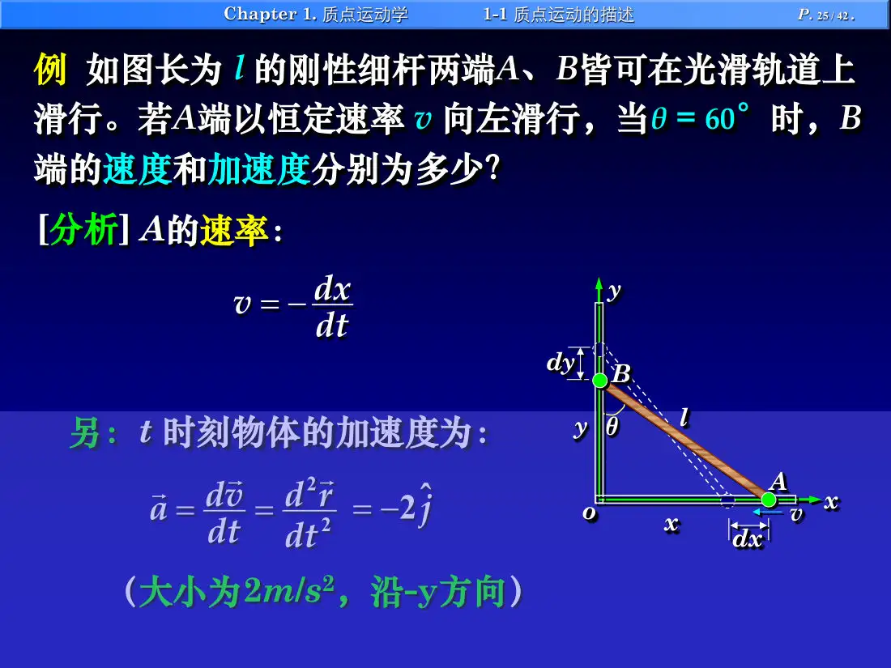

原文：

例如图长为 $l$ 的刚性细杆两端A、B皆可在光滑轨道上滑行。若A端以恒定速率 $\nu$ 向左滑行，当 $\theta = 60^{\circ}$ 时，B端的速度和加速度分别为多少？

[分析] A的速率:

$$
v = - \frac {d x}{d t}
$$

另：t 时刻物体的加速度为：

$$
\vec {a} = \frac {d \vec {v}}{d t} = \frac {d ^ {2} \vec {r}}{d t ^ {2}} = - 2 \hat {j}
$$

(大小为 $2 m / s^{2}$ , 沿-y方向)

Chapter 1. 质点运动学

1-1 质点运动的描述

P. 25 / 42.

### [分析] A的速率:

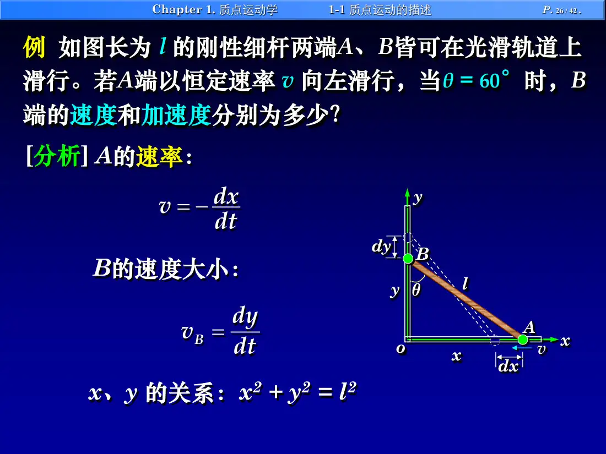

原文：

例如图长为 $l$ 的刚性细杆两端A、B皆可在光滑轨道上滑行。若A端以恒定速率 $\nu$ 向左滑行，当 $\theta = 60^{\circ}$ 时，B端的速度和加速度分别为多少？

[分析] A的速率:

$$
v = - \frac {d x}{d t}
$$

B的速度大小:

$$
v _ {B} = \frac {d y}{d t}
$$

x、y 的关系： $x^{2} + y^{2} = l^{2}$

Chapter 1. 质点运动学

1-1 质点运动的描述

P. 26 / 42.

### $$

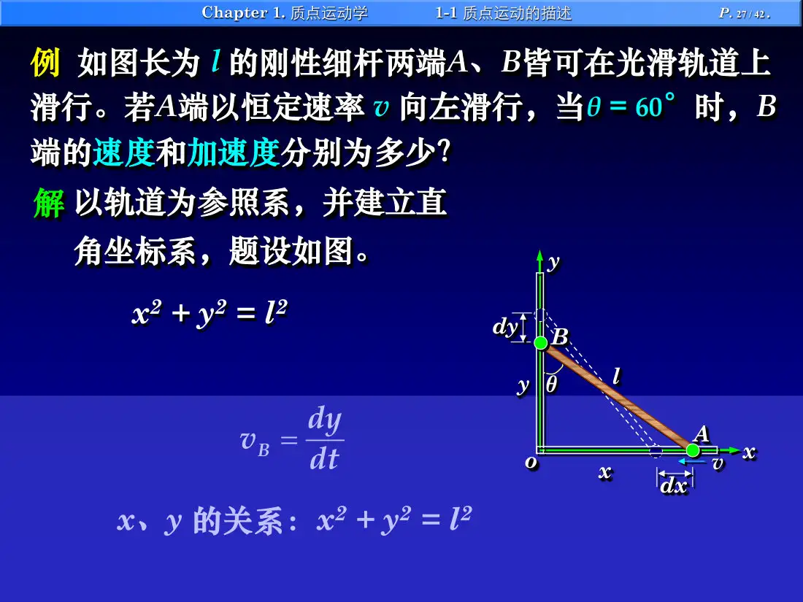

原文：

例如图长为 $l$ 的刚性细杆两端A、B皆可在光滑轨道上滑行。若A端以恒定速率 $\nu$ 向左滑行，当 $\theta = 60^{\circ}$ 时，B端的速度和加速度分别为多少？解以轨道为参照系，并建立直角坐标系，题设如图。

$$
x ^ {2} + y ^ {2} = l ^ {2}
$$

$$
v _ {B} = \frac {d y}{d t}
$$

x、y 的关系： $x^{2} + y^{2} = l^{2}$

Chapter 1. 质点运动学

1-1 质点运动的描述

P. 27 / 42.

### $$

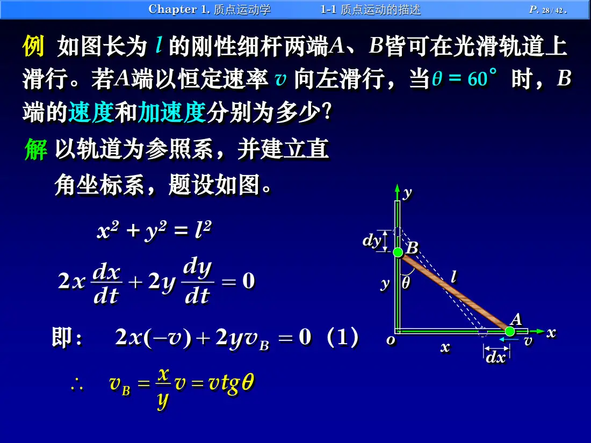

原文：

例如图长为 $l$ 的刚性细杆两端A、B皆可在光滑轨道上滑行。若A端以恒定速率 $\nu$ 向左滑行，当 $\theta = 60^{\circ}$ 时，B端的速度和加速度分别为多少？解以轨道为参照系，并建立直角坐标系，题设如图。

$$
x ^ {2} + y ^ {2} = l ^ {2}
$$

$2x\frac{dx}{dt}+2y\frac{dy}{dt}=0$

即： $2x(-v)+2yv_{B}=0$ (1)

$$
v _ {B} = \frac {x}{y} v = v t g \theta
$$

Chapter 1. 质点运动学

1-1 质点运动的描述

P. 28 / 42.

### $$

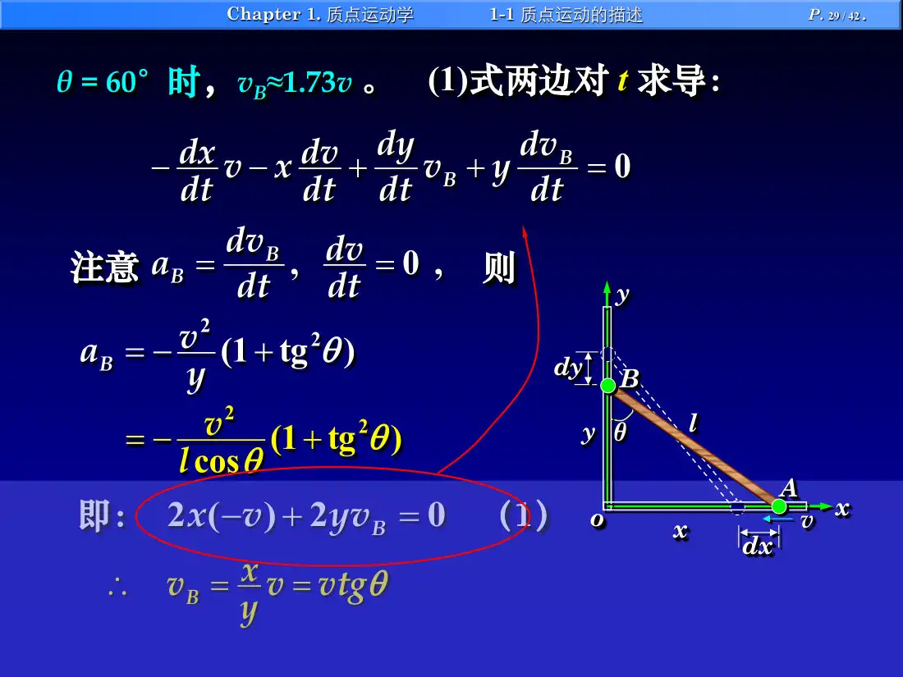

原文：

$\theta = 60^{\circ}$ 时， $v_{B} \approx 1.73 v$ 。（1）式两边对 $t$ 求导：

$$
- \frac {d x}{d t} v - x \frac {d v}{d t} + \frac {d y}{d t} v _ {B} + y \frac {d v _ {B}}{d t} = 0
$$

注意 $a_{B}=\frac{dv_{B}}{dt}$ ， $\frac{dv}{dt}=0$ ，则

$$
\begin{array}{r l} a _ {B} & = - \frac {v ^ {2}}{y} (1 + \operatorname{tg} ^ {2} \theta) \\ & = - \frac {v ^ {2}}{l \cos \theta} (1 + \operatorname{tg} ^ {2} \theta) \end{array}
$$

即： $2x(-v)+2yv_{B}=0$

(1)

$$
\therefore v _ {B} = \frac {x}{y} v = v t g \theta
$$

Chapter 1. 质点运动学

1-1 质点运动的描述

P. 29 / 42.

### $$

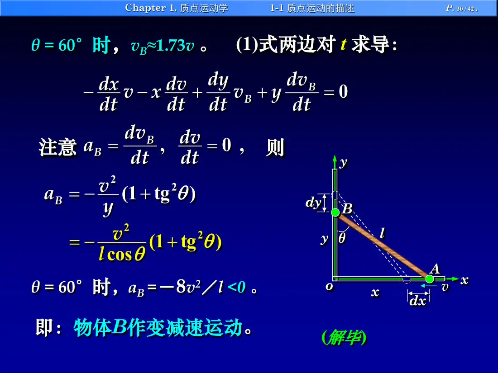

原文：

$\theta = 60^{\circ}$ 时， $v_{B} \approx 1.73 v$ 。（1）式两边对 $t$ 求导：

$$
- \frac {d x}{d t} v - x \frac {d v}{d t} + \frac {d y}{d t} v _ {B} + y \frac {d v _ {B}}{d t} = 0
$$

注意 $a_{B}=\frac{dv_{B}}{dt}$ ， $\frac{dv}{dt}=0$ ，则

$$
\begin{array}{r} a _ {B} = - \frac {v ^ {2}}{y} (1 + \mathrm{tg} ^ {2} \theta) \\ = - \frac {v ^ {2}}{l \cos \theta} (1 + \mathrm{tg} ^ {2} \theta) \end{array}
$$

$\theta = 60^{\circ}$ 时， $a_{B} = -8v^{2} / l <   0$ 。

即：物体B作变减速运动。

(解毕)

Chapter 1. 质点运动学

1-1 质点运动的描述

P. 30 / 42.

### 归纳: 描述质点运动, 即描述 $t$ 时刻质点:

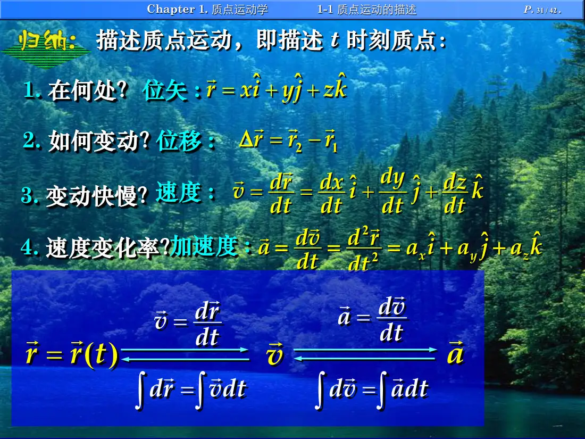

原文：

归纳: 描述质点运动, 即描述 $t$ 时刻质点:

1. 在何处？位矢： $\vec{r} = x \hat{i} + y \hat{j} + z \hat{k}$

2. 如何变动? 位移: $\Delta \vec{r} = \vec{r}_{2} - \vec{r}_{1}$

3. 变动快慢？速度： $\vec{v} = \frac{d\vec{r}}{dt} = \frac{dx}{dt}\hat{i} + \frac{dy}{dt}\hat{j} + \frac{dz}{dt}\hat{k}$

4. 速度变化率?加速度: $\vec{a} = \frac{d\vec{v}}{dt} = \frac{d^2\vec{r}}{dt^2} = a_x\hat{i} + a_y\hat{j} + a_z\hat{k}$

$$
\vec {v} = \frac {d \vec {r}}{d t}
$$

$$
\vec {a} = \frac {d \vec {v}}{d t}
$$

$$
\int d \vec {v} = \int \vec {a} d t
$$

Chapter 1. 质点运动学

1-1 质点运动的描述

P. 31 / 42.
