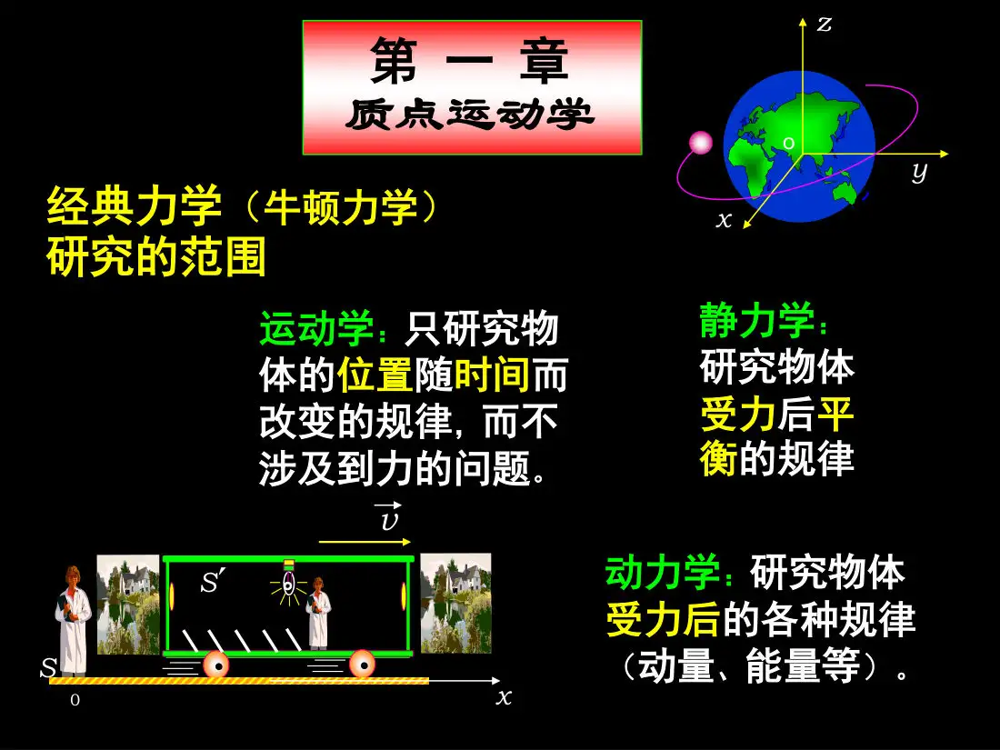
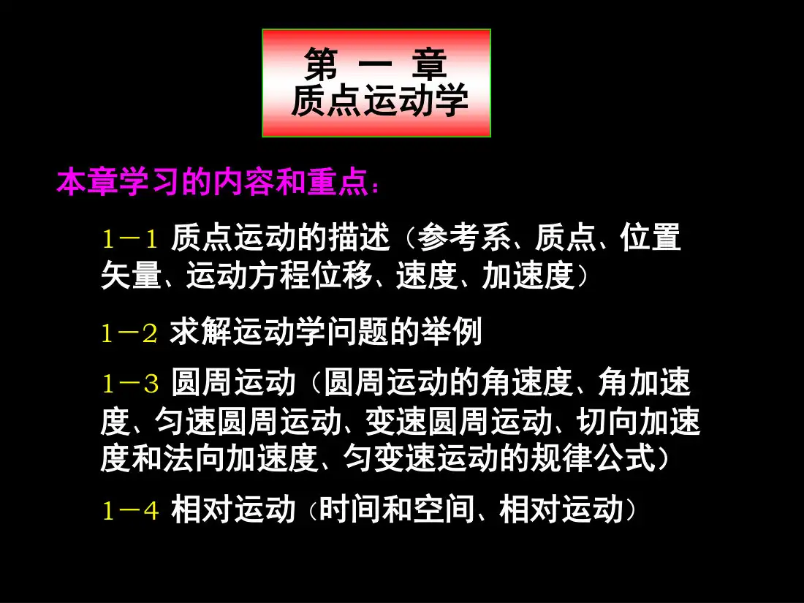
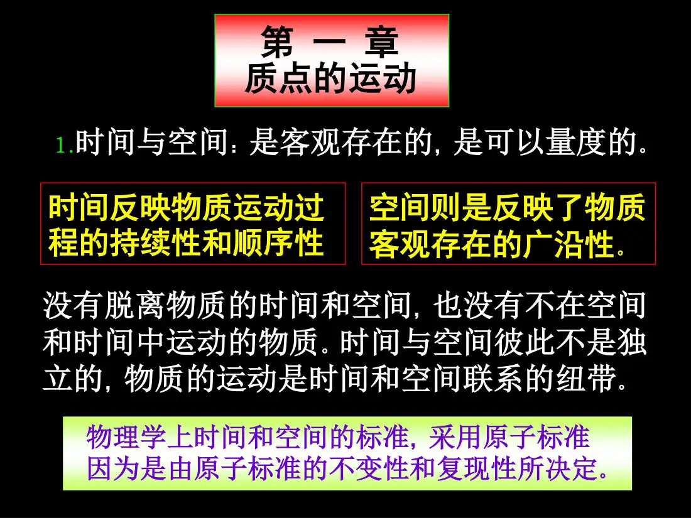
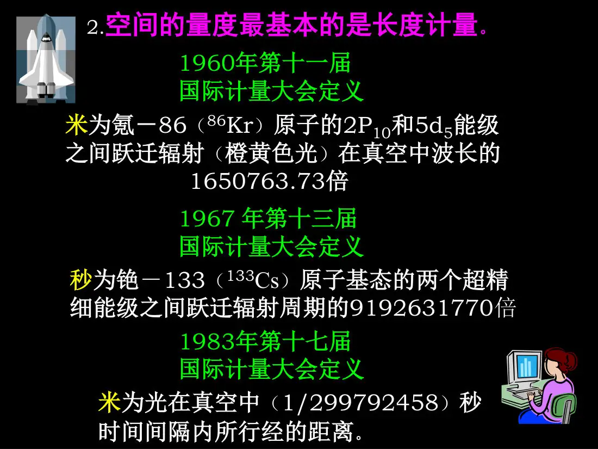
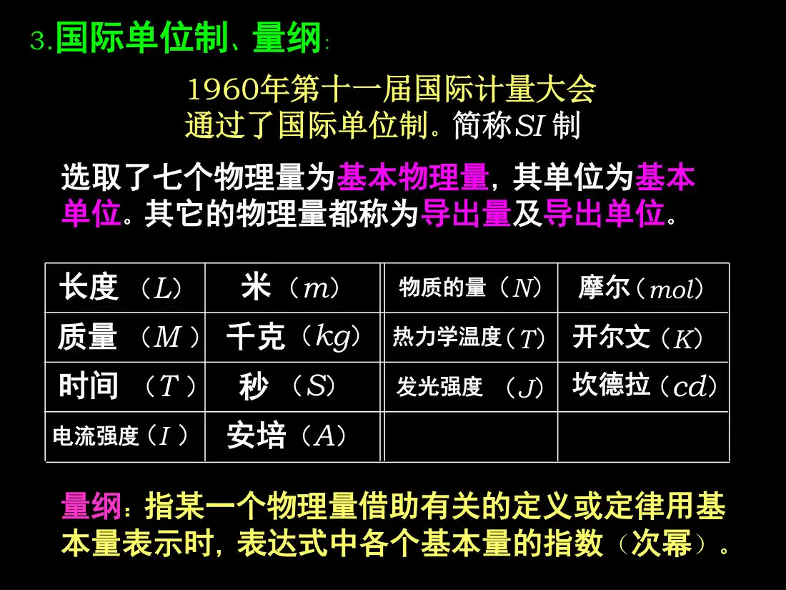
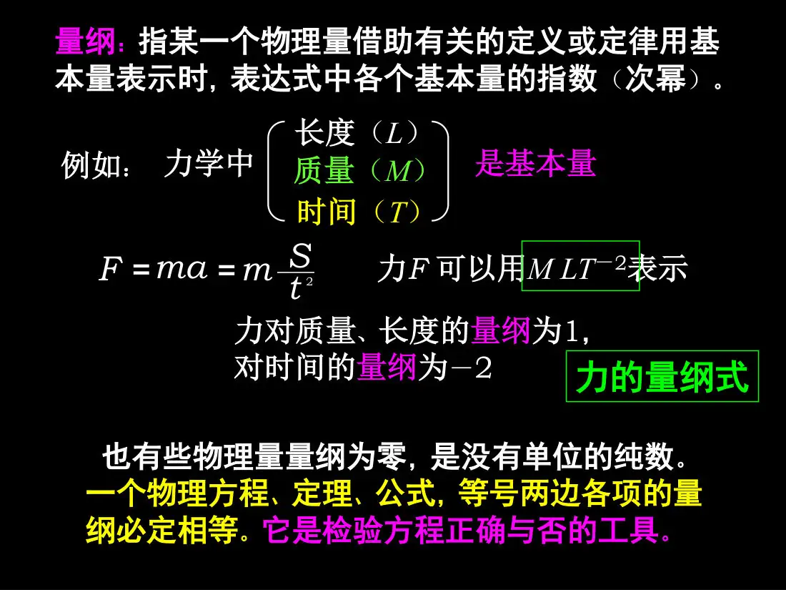
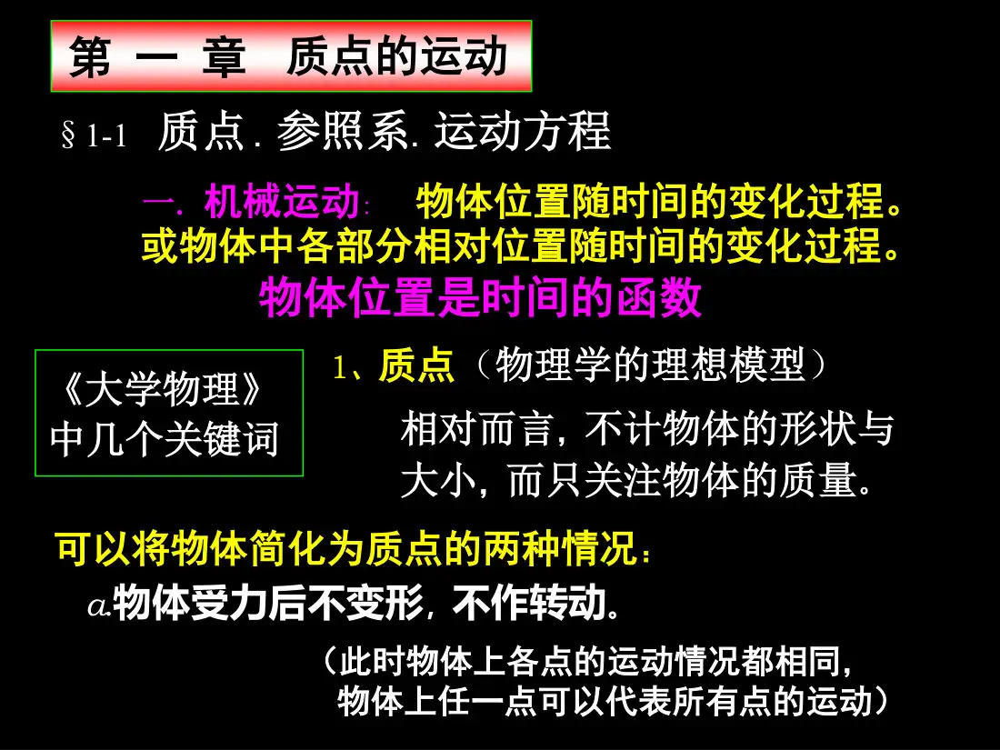
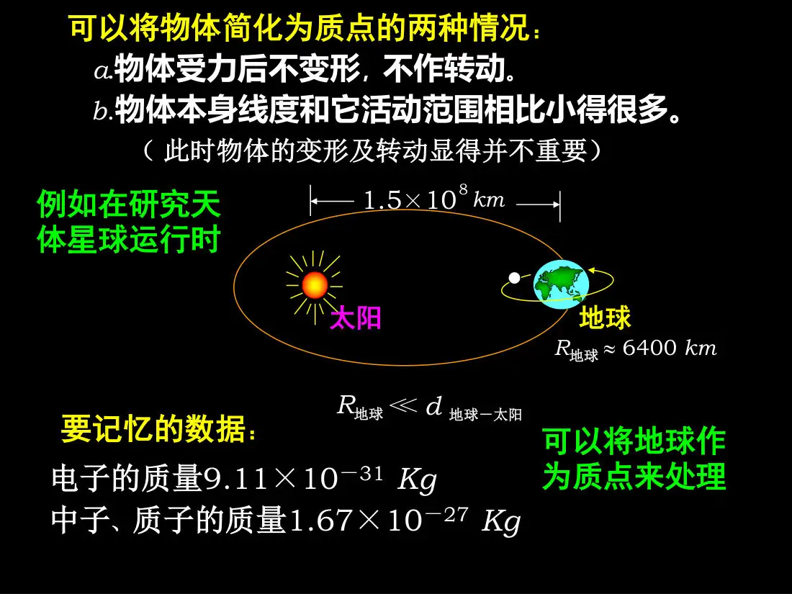
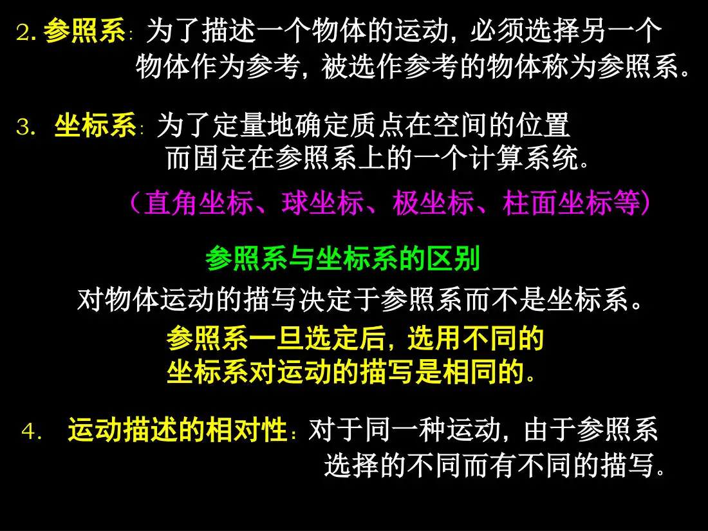
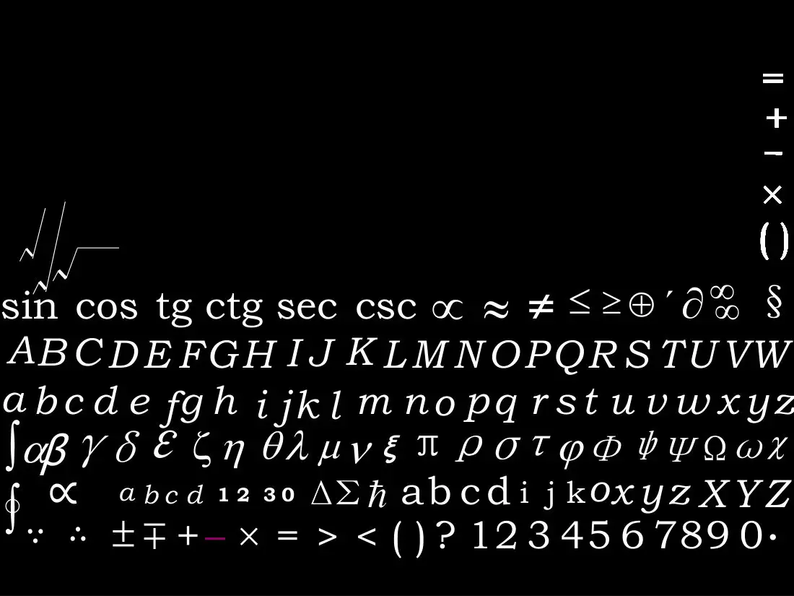

# 《大学物理》第一章 质点运动学（课件）

原件的每一页，下面附识别出的文字。

### 第 一 章质点运动学

原文：

第 一 章质点运动学

经典力学（牛顿力学）研究的范围

运动学：只研究物体的位置随时间而改变的规律，而不涉及到力的问题。

静力学：研究物体受力后平衡的规律

动力学：研究物体受力后的各种规律（动量、能量等）。

0

### 第 一 章质点运动学

原文：

第 一 章质点运动学

本章学习的内容和重点：

1－1 质点运动的描述（参考系、质点、位置矢量、运动方程位移、速度、加速度）

1－2 求解运动学问题的举例

1－3 圆周运动（圆周运动的角速度、角加速度、匀速圆周运动、变速圆周运动、切向加速度和法向加速度、匀变速运动的规律公式）

1－4 相对运动（时间和空间、相对运动）

### 第 一 章质点的运动

原文：

第 一 章质点的运动

1.时间与空间：是客观存在的，是可以量度的。

时间反映物质运动过程的持续性和顺序性空间则是反映了物质客观存在的广沿性。

没有脱离物质的时间和空间，也没有不在空间和时间中运动的物质。时间与空间彼此不是独立的，物质的运动是时间和空间联系的纽带。

物理学上时间和空间的标准，采用原子标准因为是由原子标准的不变性和复现性所决定。

### 第 4 页

原文：

2.空间的量度最基本的是长度计量。1960年第十一届国际计量大会定义米为氪－86（86Kr）原子的2P 和5d 能级之间跃迁辐射（橙黄色光）在真空中波长的1650763.73倍1967 年第十三届国际计量大会定义秒为铯－133（133Cs）原子基态的两个超精细能级之间跃迁辐射周期的9192631770倍1983年第十七届国际计量大会定义V米为光在真空中（1/299792458）秒时间间隔内所行经的距离。

### 3.国际单位制、量纲:

原文：

3.国际单位制、量纲:

1960年第十一届国际计量大会通过了国际单位制。简称SI 制

选取了七个物理量为基本物理量，其单位为基本单位。其它的物理量都称为导出量及导出单位。

长度 （L）

质量 （M ）

时间 （T ）

米（m）

电流强度（I ）

千克（kg）

秒 （S）

安培（A）

物质的量（N）

摩尔（mol）

热力学温度（T）

开尔文（K）

发光强度 （J）

坎德拉（cd）

量纲：指某一个物理量借助有关的定义或定律用基本量表示时，表达式中各个基本量的指数（次幂）。

### 例如： 力学中长度（L）质量（M）时间 （T）

原文：

量纲：指某一个物理量借助有关的定义或定律用基本量表示时，表达式中各个基本量的指数（次幂）。

例如： 力学中长度（L）质量（M）时间 （T）

是基本量

$1 2 = 1 4 \times 0 . 1 8 = 1 4 ( m ^ { 3 } )$ 力F 可以用M LT－2表示

力对质量、长度的量纲为1，

对时间的量纲为－2

力的量纲式

也有些物理量量纲为零，是没有单位的纯数。一个物理方程、定理、公式，等号两边各项的量纲必定相等。它是检验方程正确与否的工具。

### 第 一 章 质点的运动

原文：

第 一 章 质点的运动

§1-1 质点. 参照系. 运动方程

一. 机械运动: 物体位置随时间的变化过程。或物体中各部分相对位置随时间的变化过程。物体位置是时间的函数

《大学物理》中几个关键词

1、质点（物理学的理想模型）相对而言，不计物体的形状与大小，而只关注物体的质量。

可以将物体简化为质点的两种情况：a.物体受力后不变形，不作转动。

（此时物体上各点的运动情况都相同，物体上任一点可以代表所有点的运动）

### 例如在研究天体星球运行时太阳

原文：

可以将物体简化为质点的两种情况：a.物体受力后不变形，不作转动。b.物体本身线度和它活动范围相比小得很多。（ 此时物体的变形及转动显得并不重要）

例如在研究天体星球运行时太阳

R地球 ＜＜ d 地球－太阳要记忆的数据：电子的质量9.11×10－31 Kg中子、质子的质量1.67×10－27 Kg

地球

R地球  6400 km

可以将地球作为质点来处理

### 4. 运动描述的相对性：对于同一种运动，由于参照系选择的不同而有不同的描写。

原文：

2. 参照系: 为了描述一个物体的运动，必须选择另一个物体作为参考，被选作参考的物体称为参照系。

3. 坐标系: 为了定量地确定质点在空间的位置而固定在参照系上的一个计算系统。（直角坐标、球坐标、极坐标、柱面坐标等)

参照系与坐标系的区别对物体运动的描写决定于参照系而不是坐标系。参照系一旦选定后，选用不同的坐标系对运动的描写是相同的。

4. 运动描述的相对性：对于同一种运动，由于参照系选择的不同而有不同的描写。

### 第 10 页

原文：

sin cos tg ctg sec csc ∝ ≈ ≠ ≤ ≥⊕′∂∞ § AB C DEFGH IJ K LMNOPQRSTUVW a b c d e fg h i jk l m no pq r s t u v w x yz ∫αβγδεζηθλμνξπρστφΦψΨΩωx a b c d 1 2 3 0 ΔΣ a b c d i j kox y z XYZ∝ ∵ ∴ ±干+− × = > < ()?1234567890.
