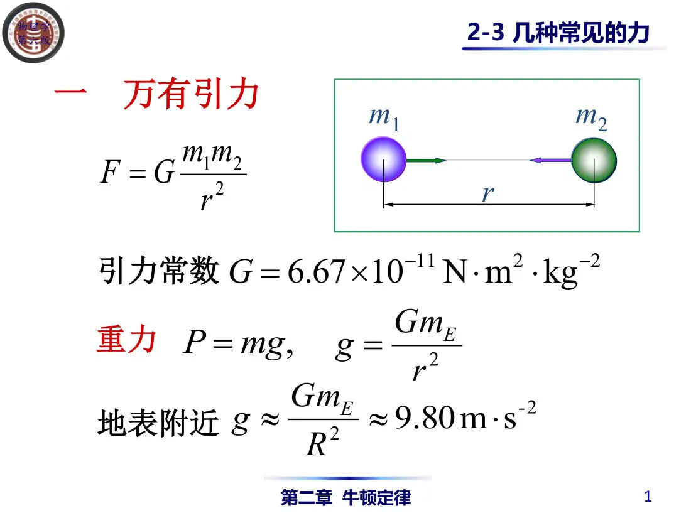
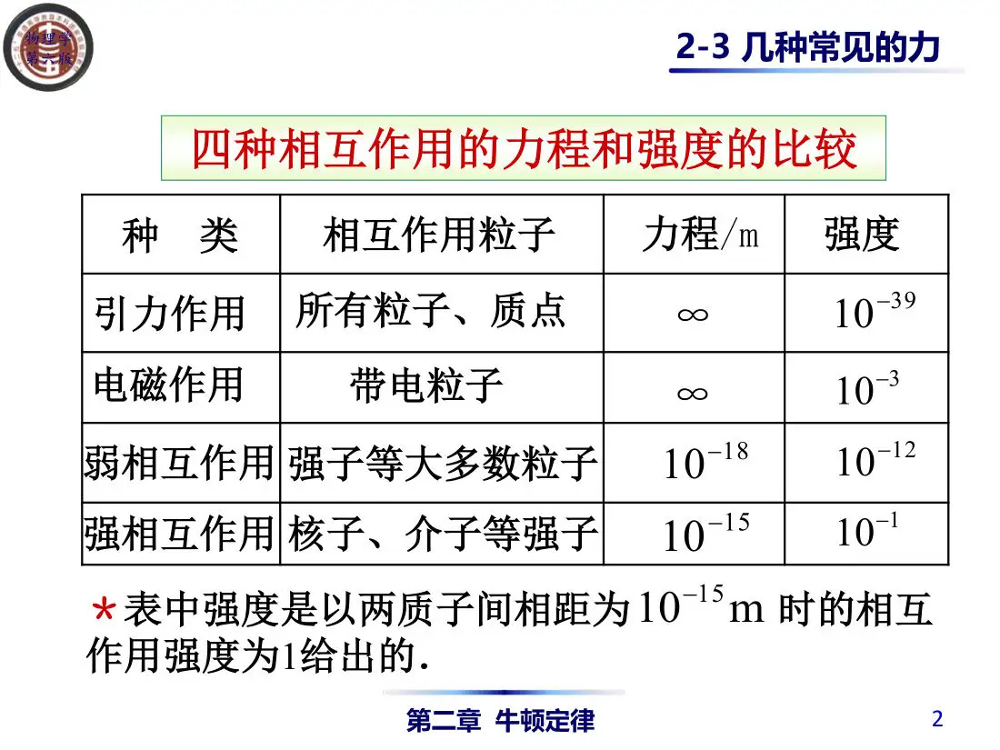
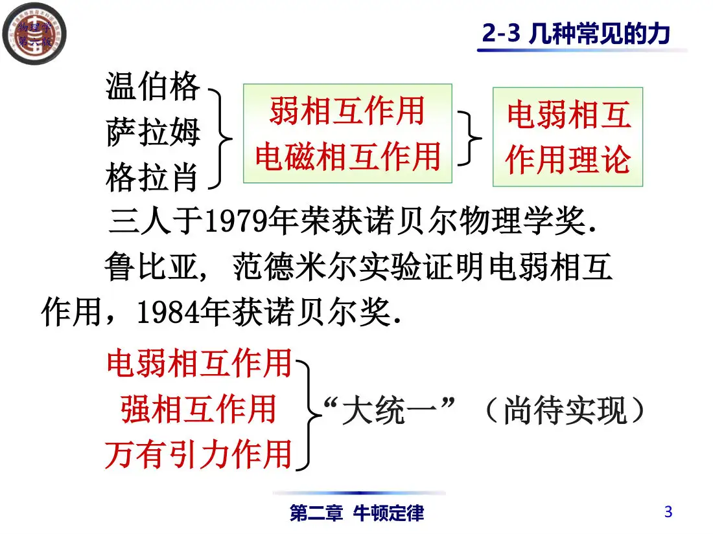
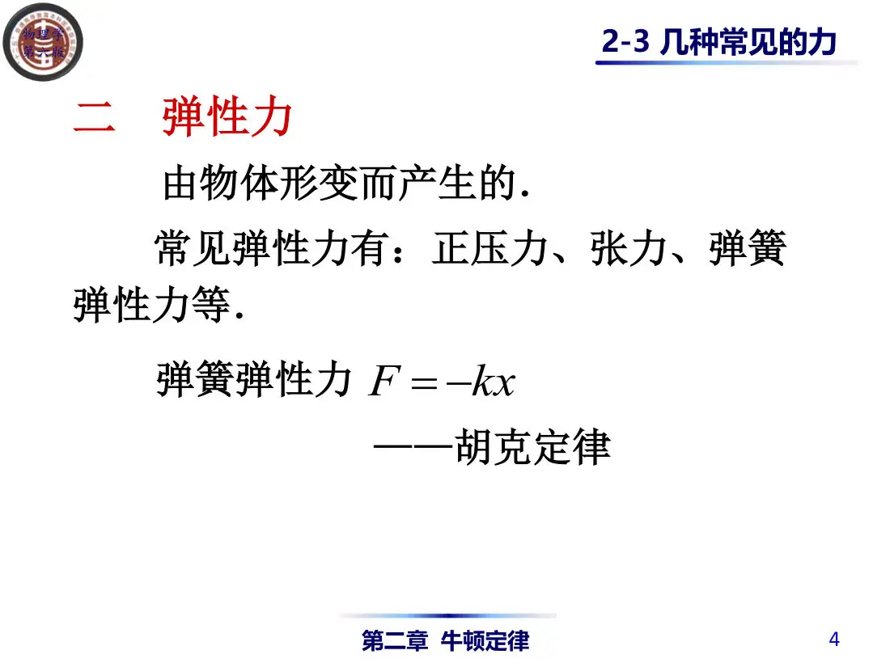
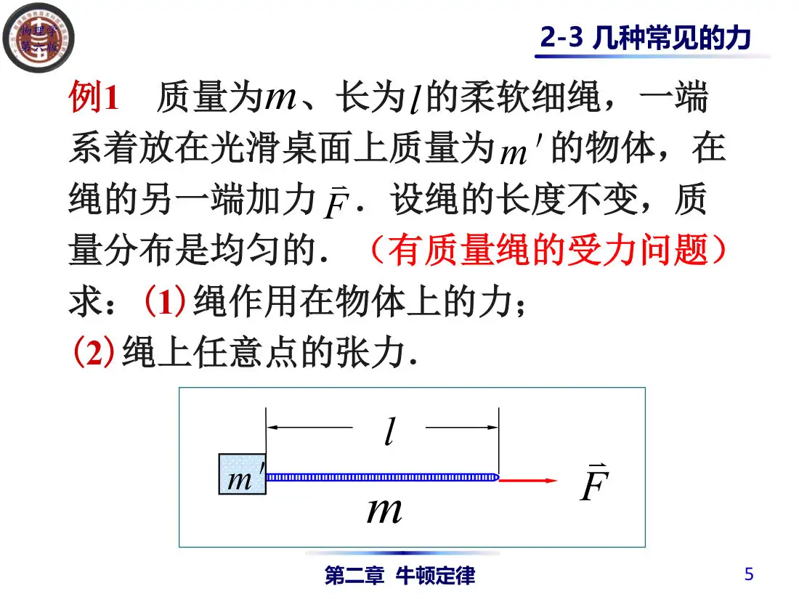
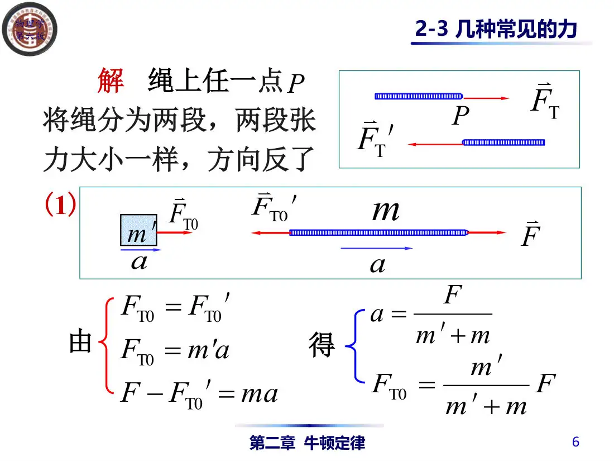
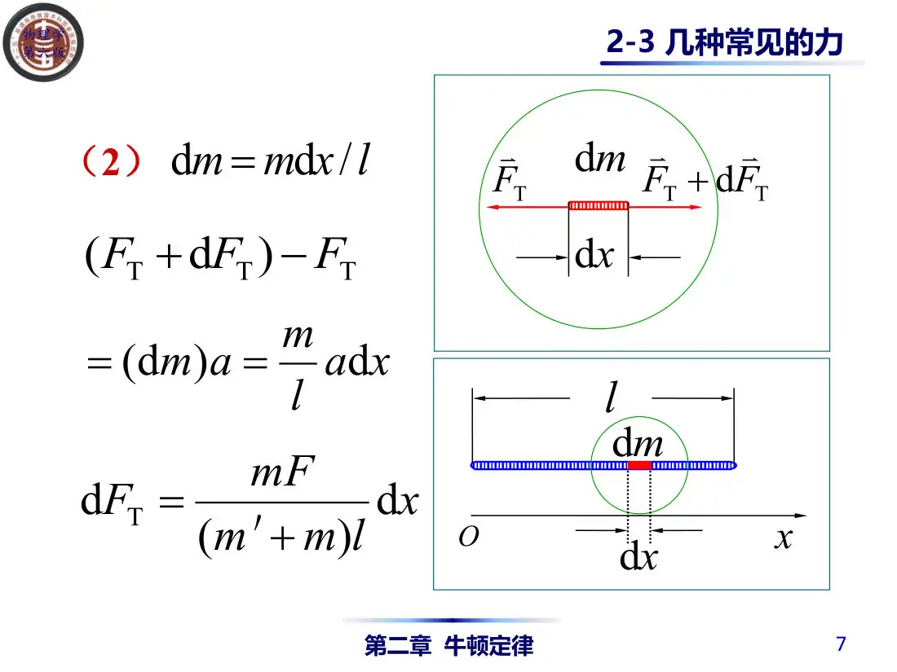
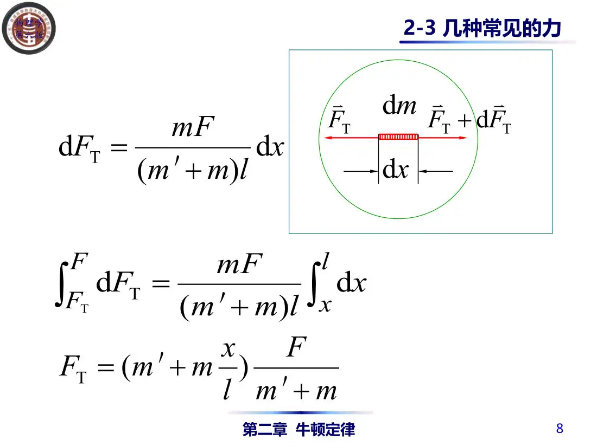
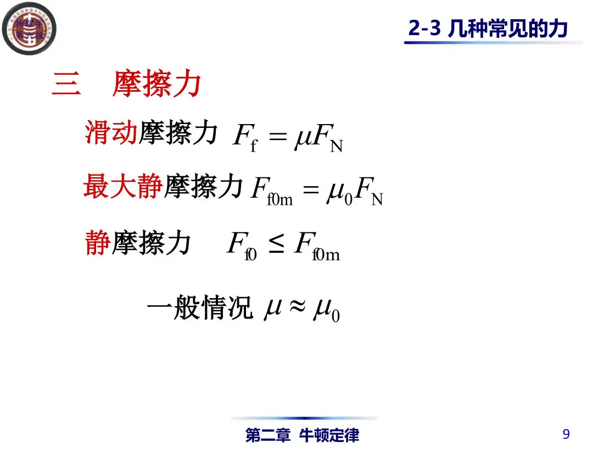

# 《大学物理》第二章 牛顿定律 §2.1-3 几种常见的力（课件）

原件的每一页，下面附识别出的文字。

### 万有引力

原文：

万有引力

$$
F = G \frac {m _ {1} m _ {2}}{r ^ {2}}
$$

引力常数 $G = 6 . 6 7 { \times } 1 0 ^ { - 1 1 } { \mathrm { N } } { \cdot } { \mathrm { m } } ^ { 2 } { \cdot } { \mathrm { k g } } ^ { - 2 }$ 重力 $P = m g , \quad g = { \frac { G m _ { E } } { r ^ { 2 } } }$ 地表附近 $g \approx { \frac { G m _ { E } } { R ^ { 2 } } } \approx 9 . 8 0 \mathrm { m } \cdot \mathrm { s } ^ { - 2 }$

物理学第六版

2-3 几种常见的力

第二章 牛顿定律

1

### 四种相互作用的力程和强度的比较

原文：

四种相互作用的力程和强度的比较

<table><tr><td>种类</td><td>相互作用粒子</td><td>力程/m</td><td>强度</td></tr><tr><td>引力作用</td><td>所有粒子、质点</td><td>∞</td><td> $10^{-39}$ </td></tr><tr><td>电磁作用</td><td>带电粒子</td><td>∞</td><td> $10^{-3}$ </td></tr><tr><td>弱相互作用</td><td>强子等大多数粒子</td><td> $10^{-18}$ </td><td> $10^{-12}$ </td></tr><tr><td>强相互作用</td><td>核子、介子等强子</td><td> $10^{-15}$ </td><td> $10^{-1}$ </td></tr></table>

＊表中强度是以两质子间相距为 $1 0 ^ { - 1 5 } \mathrm { m }$ 时的相互作用强度为1给出的

物理学第六版

2-3 几种常见的力

第二章 牛顿定律

2

### 温伯格萨拉姆格拉肖

原文：

温伯格萨拉姆格拉肖

弱相互作用电磁相互作用电弱相互作用理论

三人于1979年荣获诺贝尔物理学奖

鲁比亚, 范德米尔实验证明电弱相互作用，1984年获诺贝尔奖

电弱相互作用强相互作用 “大统一”（尚待实现）万有引力作用

物理学第六版

2-3 几种常见的力

第二章 牛顿定律

3

### 二 弹性力

原文：

二 弹性力

由物体形变而产生的

常见弹性力有：正压力、张力、弹簧 弹性力等

弹簧弹性力 $F = - k x$

——胡克定律

物理学第六版

2-3 几种常见的力

第二章 牛顿定律

4

### (2)绳上任意点的张力

原文：

例1 质量为 、长为 的柔软细绳，一端系着放在光滑桌面上质量为 $m ^ { \prime }$ 的物体，在＇绳的另一端加力 $\vec { F }$ ．设绳的长度不变，质量分布是均匀的．（有质量绳的受力问题）求：(1)绳作用在物体上的力；

(2)绳上任意点的张力

物理学第六版

2-3 几种常见的力

第二章 牛顿定律

5

### 解 绳上任一点将绳分为两段，两段张力大小一样，方向反了

原文：

解 绳上任一点将绳分为两段，两段张力大小一样，方向反了

(1)

$$
\begin{array}{c c} \text {   m'   } & \vec {F} _ {\mathrm{T0}} \\ \text {   a   } & \text {   m   } \\ \text {   F   } & \text {   a   } \end{array}
$$

FTO 由 Fτo = m'a F-FT0 = ma

得

$$
\left\{ \begin{array}{l} a = \frac {F}{m ^ {\prime} + m} \\ F _ {\mathrm{T0}} = \frac {m ^ {\prime}}{m ^ {\prime} + m} F \end{array} \right.
$$

物理学第六版

2-3 几种常见的力

第二章 牛顿定律

6

### $$

原文：

（2） $\mathrm { d } m = m \mathrm { d } x / l$

$$
(F _ {\mathrm{T}} + \mathrm{d} F _ {\mathrm{T}}) - F _ {\mathrm{T}}
$$

$$
= (\mathrm{d} m) a = \frac {m}{l} a \mathrm{d} x
$$

$$
\mathrm{d} F _ {\mathrm{T}} = \frac {m F}{(m ^ {\prime} + m) l} \mathrm{d} x
$$

物理学第六版

2-3 几种常见的力

第二章 牛顿定律

7

### $$

原文：

$$
\mathrm{d} F _ {\mathrm{T}} = \frac {m F}{(m ^ {\prime} + m) l} \mathrm{d} x \quad \boxed {\vec {F} _ {\mathrm{T}} \quad \begin{array}{c} \mathrm{d} m \\ \mathrm{d} x \end{array} \quad \vec {F} _ {\mathrm{T}} + \mathrm{d} \vec {F} _ {\mathrm{T}}}
$$

$$
\int_ {F _ {\mathrm{T}}} ^ {F} \mathrm{d} F _ {\mathrm{T}} = \frac {m F}{(m ^ {\prime} + m) l} \int_ {x} ^ {l} \mathrm{d} x
$$

$$
F _ {\mathrm{T}} = (m ^ {\prime} + m \frac {x}{l}) \frac {F}{m ^ {\prime} + m}
$$

物理学第六版

2-3 几种常见的力

第二章 牛顿定律

8

### 三 摩擦力

原文：

三 摩擦力

滑动摩擦力 $F _ { \mathrm { f } } = \mu F _ { \mathrm { N } }$

最大静摩擦力 $F _ { \mathrm { f 0 m } } = \mu _ { 0 } F _ { \mathrm { N } }$

静摩擦力 $F _ { \mathrm { f 0 } } \leq F _ { \mathrm { f 0 m } }$

一般情况 $\mu \approx \mu _ { 0 }$

物理学第六版

2-3 几种常见的力

第二章 牛顿定律

9
