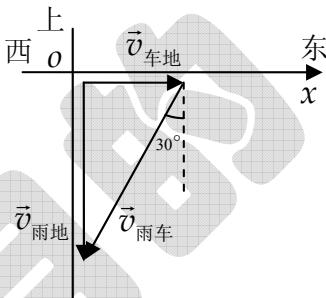
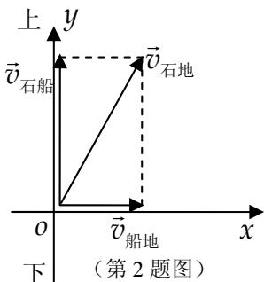
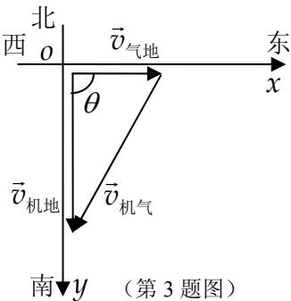
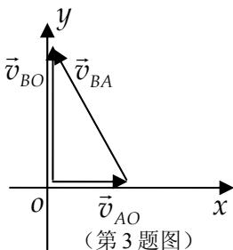
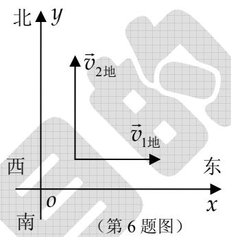

# 《大学物理》第二节 圆周运动和相对运动 同步练习册答案

原件经识别和整理；“参考解答”是我们补的。

# 第二节 圆周运动和相对运动

## 一、计算与推导题

### 计算 1

已知路程： $s = 2 t ^ { 2 }$

则质点的速率：
$$ v = \frac { d s } { d t } = 4 t \ (\mathrm { m / s }) $$

切向加速度：
$$ a _ { t } = \frac { d v } { d t } = 4 \ (\mathbf { m } / \mathbf { s } ^ { 2 }) $$

法向加速度：
$$ a _ { n } = \frac { v ^ { 2 } } { R } = 8 t ^ { 2 } \ (\mathrm { m } { \big / } \mathrm { s } ^ { 2 }) $$

总加速度矢量：
$$ { \vec { a } } = a _ { t } { \vec { e } } _ { t } + a _ { n } { \vec { e } } _ { n } = ( 4 { \vec { e } } _ { t } + 8 t ^ { 2 } { \vec { e } } _ { n } ) \mathrm { m } / \mathrm { s } ^ { 2 } $$

答案：见上述推导过程。

知识点：[自然参数下的切向加速度与法向加速度](../../../topics/大学物理/自然坐标系下的运动.md)、[速度、加速度的定义与微分关系](../../../topics/大学物理/速度与加速度定义.md)

### 计算 2

已知角加速度 $\beta$ 恒定，即 $\beta = { \frac { d \omega } { d t } } =$ 常数；又转过 60 转（即转过 $\Delta \theta = 6 0 \times 2 \pi$ 角度）后，角速度由 $\omega _ { \mathrm { 1 } } = 2 0 \pi \mathrm { r a d / s }$ 变为 $\omega _ { 2 } = 3 0 \pi \mathrm { r a d / s }$。

给出了角速度 $\omega$ 与角位移 $\Delta\theta$ 的关系：
由 $\beta = { \frac { d \omega } { d t } } = { \frac { d \omega } { d \theta } } { \frac { d \theta } { d t } } \quad \Rightarrow \quad \beta = \omega { \frac { d \omega } { d \theta } } \quad \Rightarrow \quad \beta d \theta = \omega d \omega$

积分得：
$$ \int _ { \theta _ { 1 } } ^ { \theta _ { 2 } } \beta d \theta = \int _ { \omega_1 } ^ { \omega _ { 2 } } \omega d \omega $$

其中 $\beta$ 为常数，故：
$$ \beta ( \theta _ { 2 } - \theta _ { 1 } ) = \frac { 1 } { 2 } ( \omega _ { 2 } ^ { 2 } - \omega _ { 1 } ^ { 2 } ) \quad \Rightarrow \quad \omega _ { 2 } ^ { 2 } - \omega _ { 1 } ^ { 2 } = 2 \beta ( \theta _ { 2 } - \theta _ { 1 } ) = 2 \beta \Delta \theta $$

解得角加速度：
$$ \beta = \frac { \omega _ { 2 } ^ { 2 } - \omega _ { 1 } ^ { 2 } } { 2 \Delta \theta } = \frac { 9 0 0 \pi ^ { 2 } - 4 0 0 \pi ^ { 2 } } { 2 \times 6 0 \times 2 \pi } = \frac { 2 5 } { 1 2 } \pi \ (\mathrm { r a d / s ^ { 2 } }) $$

由 $\beta = \frac { d \omega } { d t } \Rightarrow d \omega = \beta d t \Rightarrow \int _ { \omega _ { 1 } } ^ { \omega _ { 2 } } d \omega = \int _ { t _ { 1 } } ^ { t _ { 2 } } \beta d t \Rightarrow \omega _ { 2 } - \omega _ { 1 } = \beta ( t _ { 2 } - t _ { 1 } ) = \beta \Delta t$

解得所需的时间：
$$ \Delta t = \frac { \omega _ { 2 } - \omega _ { 1 } } { \beta } = \frac { 3 0 \pi - 2 0 \pi } { \frac { 2 5 } { 1 2 } \pi } = \frac { 2 4 } { 5 } \mathrm { s } $$

答案：角加速度 $\beta = \frac{25}{12}\pi \ \mathrm{rad/s^2}$，时间 $\Delta t = 4.8 \ \mathrm{s}$。

知识点：[圆周运动的角量描述（角速度、角加速度）](../../../topics/大学物理/圆周运动描述.md)、[速度、加速度的定义与微分关系](../../../topics/大学物理/速度与加速度定义.md)

### 计算 5

已知路程： $s = v _ { 0 } t - { \frac { 1 } { 2 } } b t ^ { 2 }$

则速率：
$$ v = \frac { d s } { d t } = v _ { 0 } - b t $$

切向加速度：
$$ a _ { t } = { \frac { d v } { d t } } = - b $$

法向加速度：
$$ a _ { n } = { \frac { v ^ { 2 } } { R } } = { \frac { ( v _ { 0 } - b t ) ^ { 2 } } { R } } $$

（1）在 $t$ 时刻，质点加速度矢量：
$$ { \vec { a } } = - b { \vec { e } } _ { t } + { \frac { ( v _ { 0 } - b t ) ^ { 2 } } { R } } { \vec { e } } _ { n } $$

（2）加速度大小：
$$ a = \sqrt { ( - b ) ^ { 2 } + \left( \frac { ( v _ { 0 } - b t ) ^ { 2 } } { R } \right) ^ { 2 } } = \sqrt { b ^ { 2 } + \frac { ( v _ { 0 } - b t ) ^ { 4 } } { R ^ { 2 } } } $$

令 $a = b$，即：
$$ \sqrt { b ^ { 2 } + \frac { \left( v _ { 0 } - b t \right) ^ { 4 } } { R ^ { 2 } } } = b \Rightarrow \frac { \left( v _ { 0 } - b t \right) ^ { 4 } } { R ^ { 2 } } = 0 \Rightarrow v _ { 0 } - b t = 0 $$

解得：
$$ t = \frac { v _ { 0 } } { b } $$

即当 $t = \frac { v _ { 0 } } { b }$ 时，加速度大小等于 $b$。

答案：(1) $\vec{a} = -b\vec{e}_t + \frac{(v_0-bt)^2}{R}\vec{e}_n$；(2) $t = \frac{v_0}{b}$。

知识点：[自然参数下的切向加速度与法向加速度](../../../topics/大学物理/自然坐标系下的运动.md)、[速度、加速度的定义与微分关系](../../../topics/大学物理/速度与加速度定义.md)、[圆周运动的角量描述（角速度、角加速度）](../../../topics/大学物理/圆周运动描述.md)

### 计算 6

角加速度 $\beta = 0 . 2 \mathrm { r a d } / \mathrm { s } ^ { 2 }$ （常数），为匀变速圆周运动，且初始条件：$t = 0$ 时， $\omega _ { \mathrm { 0 } } = 0$。

由定义推导角速度：
$$ \beta = \frac {d \omega}{d t} \Rightarrow d \omega = \beta d t \Rightarrow \int_ {\omega_ {0}} ^ {\omega} d \omega = \int_ {0} ^ {t} \beta d t \Rightarrow \omega - \omega_ {0} = \beta t \Rightarrow \omega = \omega_ {0} + \beta t $$

$t$ 时刻边缘上各点的角速度： $\omega = \beta t$
速率（速度大小）： $v = \omega R = R \beta t$ （速度方向沿各点切线方向）

切向加速度：
$$ a _ { t } = \frac { d v } { d t } = R \beta $$

法向加速度：
$$ a _ { n } = \frac { v ^ { 2 } } { R } = R \beta ^ { 2 } t ^ { 2 } $$

当 $t = 2\mathrm{s}$ 时：
速度大小：
$$ v = R \beta t = 0 . 4 \times 0 . 2 \times 2 = 0 . 1 6 \mathrm { m / s } $$
（注：此处原题隐含半径 $R=0.4\mathrm{m}$，根据后续计算反推）
速度方向沿各点轨迹的切线方向。

切向加速度：
$$ a _ { t } = \frac { d v } { d t } = R \beta = 0 . 4 \times 0 . 2 = 0 . 0 8 \mathrm { m } / \mathrm { s } ^ { 2 } $$

法向加速度：
$$ a _ { n } = { \frac { v ^ { 2 } } { R } } = R \beta ^ { 2 } t ^ { 2 } = 0 . 4 \times 0 . 0 4 \times 4 = 0 . 0 6 4 { \mathrm { m / s } } ^ { 2 } $$

合加速度矢量：
$$ \vec { a } = ( 0 . 0 8 \vec { e } _ { t } + 0 . 0 6 4 \vec { e } _ { n } ) \mathrm { m } / \mathrm { s } ^ { 2 } $$

答案：$t=2\mathrm{s}$ 时，$v=0.16\mathrm{m/s}$，$a_t=0.08\mathrm{m/s^2}$，$a_n=0.064\mathrm{m/s^2}$，$\vec{a}=(0.08\vec{e}_t+0.064\vec{e}_n)\mathrm{m/s^2}$。

## 二、选择题解析

知识点：[圆周运动的角量描述（角速度、角加速度）](../../../topics/大学物理/圆周运动描述.md)、[自然参数下的切向加速度与法向加速度](../../../topics/大学物理/自然坐标系下的运动.md)、[速度、加速度的定义与微分关系](../../../topics/大学物理/速度与加速度定义.md)

### 选择 3

**题干分析：**
*   （A）在一般圆周运动中，法向加速度方向一定指向圆心，亦称为向心加速度。切向加速度沿切线方向，总加速度方向不一定指向圆心。
*   （B）速度和加速度都是矢量，既有大小，又有方向。在匀速率圆周运动中速度大小和加速度大小均保持不变，但方向不断变化。
*   （C）物体做曲线运动时，速度方向一定沿轨迹的切线方向，指向运动方向，故在自然坐标系下速度 $\Vec { v } = v \Vec { e } _ { t }$ 可写成速率 $v$ 乘以切向单位矢量 $\vec { e } _ { t }$ 的形式。由此可见，速度无法向分量，法向分速度一定为零，但法向加速度 $a _ { n } = { \frac { v ^ { 2 } } { r } }$ 与法向分速度无关，与速率 $v$ 有关。
*   （D）物体做曲线运动时，速度方向必定变化，而速度方向变化产生法向加速度，所以曲线运动中，必有法向加速度，总加速度指向曲线凹的一侧。

**结论：** 本题选（D）。
*(注：根据常规物理知识，(A)(B)(C)的描述本身也是正确的物理事实，若题目问“下列说法正确的是”，通常多选或单选需看具体语境。但根据原文排版，“本题选（D）”紧跟在D选项描述之后，且D强调了曲线运动必有法向加速度的核心结论。若原题为单选题且考察“关于曲线运动加速度的性质”，D是最具概括性的正确陈述。若原题是多选题，ABCD可能均对。此处严格保留原文给出的最终选择。)*

答案：D

知识点：[自然参数下的切向加速度与法向加速度](../../../topics/大学物理/自然坐标系下的运动.md)、[速度、加速度的定义与微分关系](../../../topics/大学物理/速度与加速度定义.md)、[圆周运动的角量描述（角速度、角加速度）](../../../topics/大学物理/圆周运动描述.md)

### 选择 4

**题干分析：**
*   （A）单摆运动过程中受重力和摆绳的拉力作用，重力竖直向下，保持不变，但绳中拉力在变化，总加速度 $\vec { a }$ 在变化。
*   （B）匀速率圆周运动中，加速度大小 $a = { \frac { v ^ { 2 } } { r } }$ 不变，但方向在变化。
*   （C）行星做椭圆轨道运动，万有引力的方向沿两者的连线方向，是有心力。万有引力的大小和方向都在变化，则总加速度 $\vec { a }$ 在变化。
*   （D）抛体运动中，物体受重力作用，加速度为重力加速度，保持不变。
*   （E）圆锥摆运动中，物体受重力和绳中拉力作用，重力保持不变，但绳中拉力方向不断变化，总加速度 $\vec{a}$ 在变化。

**结论：** 本题选（D）。
*(注：此题显然是在寻找“加速度保持不变”的运动。只有抛体运动（忽略空气阻力）只受恒定的重力，加速度恒定为 $\vec{g}$。其他选项中加速度均为变量。)*

答案：D

## 三、重要结论总结

① **加速度的求解步骤：**
由速率 $v = \left| \vec { v } \right| = \sqrt { v _ { x } ^ { 2 } + v _ { y } ^ { 2 } }$ 或 $v = \frac { d s } { d t }$。
先求切向加速度： $a _ { t } = \frac { d v } { d t }$
再求法向加速度： $a _ { n } = { \frac { v ^ { 2 } } { R } }$ 或 $a _ { n } = \sqrt { a ^ { 2 } - a _ { t } ^ { 2 } }$

② **匀变速圆周运动公式类比：**
匀变速圆周运动中，角加速度 $\alpha$（或 $\beta$）为常数。若初始条件：$t = 0$ 时， $\omega _ { 0 } , \theta _ { 0 }$，有如下结果可直接使用，可类比匀变速直线运动：

| 圆周运动 | 直线运动 |
| :--- | :--- |
| $\omega = \omega_ {0} + \alpha t$ | $v = v _ {0} + a t$ |
| $\theta = \theta_ {0} + \omega_ {0} t + \frac {1}{2} \alpha t ^ {2}$ | $x = x _ {0} + v _ {0} t + \frac {1}{2} a t ^ {2}$ |
| $\omega^ {2} - \omega_ {0} ^ {2} = 2 \alpha (\theta - \theta_ {0})$ | $v ^ {2} - v _ {0} ^ {2} = 2 a (x - x _ {0})$ |

知识点：[速度、加速度的定义与微分关系](../../../topics/大学物理/速度与加速度定义.md)、[自然参数下的切向加速度与法向加速度](../../../topics/大学物理/自然坐标系下的运动.md)、[牛顿三定律与惯性系](../../../topics/大学物理/牛顿三定律.md)

### 第三节 相对运动

重点分析：求解相对运动问题时，首先建立合适的坐标系，写出各速度矢量（例如： $\vec { v } _ { P O } , \vec { v } _ { P O ^ { \prime } } , \vec { v } _ { O ^ { \prime } O } )$ 的表达形式，再利用伽利略速度变换： $\vec { v } _ { P O } = \vec { v } _ { P O ^ { \prime } } + \vec { v } _ { O ^ { \prime } O }$ 求解。

#### 计算 1

1. 建立如图所示地面坐标系：竖直向下为 y 轴正方向；“左西，右东”，水平向东为 x 轴正方向。

设雨相对地面的速度大小为 $v$，则 $\vec { v } _ { \text{雨地} } = v \vec { j }$ ；又已知 $\vec { v } _ { \text{车地} } = 10 \mathrm { m } / \mathrm { s } \vec { i }$

根据速度变换：
$$
\begin{aligned}
\vec { v } _ { \text{雨车} } &= \vec { v } _ { \text{雨地} } + \vec { v } _ { \text{地车} } \\
&= \vec { v } _ { \text{雨地} } - \vec { v } _ { \text{车地} } \\
&= v \vec { j } - 10 \mathrm { m } / \mathrm { s } \vec { i }
\end{aligned}
$$

由雨相对车在竖直方向成 $3 0 ^ { \circ }$ 角，如图：
$$
\tan 3 0 ^ { \circ } = { \frac { 1 0 } { v } } = { \frac { \sqrt { 3 } } { 3 } } \Rightarrow v = 1 0 { \sqrt { 3 } } { \mathrm { m / s } }
$$

所以，雨相对地面的速度： $\vec { v } _ { \text{雨地} } = 1 0 \sqrt { 3 } \mathrm { m } / \mathrm { s } \vec { j }$ ，速率： $v _ { \text{雨地} } = 1 0 \sqrt { 3 } \mathrm { { m } / \mathrm { { s } } }$

雨相对车的速度： $\vec { v } _ { \text{雨车} } = - 1 0 \mathrm { m } / \mathrm { s } \vec { i } + 1 0 \sqrt { 3 } \mathrm { m } / \mathrm { s } \vec { j }$

雨相对车的速率： $v _ { \text{雨车} } = \sqrt { ( - 1 0 ) ^ { 2 } + ( 1 0 \sqrt { 3 } ) ^ { 2 } } = 2 0 \mathrm { m / s }$

#### 计算 2

2. 建立如图所示地面坐标系：船直线航行方向为 x 轴正方向，竖直向上为 y 轴正方向。

$\vec { v } _ { \text{石船} } = v _ { 0 } \vec { i } \ , \ \vec { v } _ { \text{石船竖直} } = v _ { 1 } \vec { j }$ ，则石相对地的初速度：
$$
\vec { v } _ { \text{石地} } = \vec { v } _ { \text{石船} } + \vec { v } _ { \text{船地} } = v _ { 0 } \vec { i } + v _ { 1 } \vec { j }
$$
*(注：此处原文符号识别较乱，根据物理情境推断为石头相对船的速度分解)*

石头相对地面在x轴方向做匀速直线运动： $x = v _ { 0 } t$
在y轴方向做竖直上抛： $y = v _ { 1 } t - { \frac { 1 } { 2 } } g t ^ { 2 }$

消去时间t，得轨迹方程：
$$
y = - \frac { g } { 2 { v _ { 0 } ^ { 2 } } } x ^ { 2 } + \frac { v _ { 1 } } { v _ { 0 } } x
$$

轨迹形状是开口向下的抛物线。

#### 选择 3

3. 由速度变换： $\vec { v } _ { \text{机地} } = \vec { v } _ { \text{机风} } + \vec { v } _ { \text{风地} }$ ，即速度矢量形成一闭合三角形，如图，又由余弦定理：
$$
v _ { \text{机地} } ^ { 2 } = v _ { \text{机风} } ^ { 2 } + v _ { \text{风地} } ^ { 2 } - 2 \cdot v _ { \text{机风} } v _ { \text{风地} } \cdot \cos \theta
$$
代入数据：
$$
2 0 0 ^ { 2 } = 5 6 ^ { 2 } + 1 9 2 ^ { 2 } - 2 \times 5 6 \times 1 9 2 \times \cos \theta \quad \Rightarrow \quad \cos \theta = 0
$$
$\vec { v } _ { \text{机风} }$ 和 $\vec { v } _ { \text{风地} }$ 之间的夹角： $\theta = \frac { \pi } { 2 }$

即飞机相对地面向正南或向正北方向。

答案：C

#### 选择 4

4. 如图， $\vec { v } _ { _ { A O } } = 2 \mathrm { m } / \mathrm { s } \vec { i } \ , \vec { v } _ { _ { B O } } = 2 \mathrm { m } / \mathrm { s } \vec { j }$ ；

$$
\vec {v} _ {B A} = \vec {v} _ {B O} + \vec {v} _ {O A} = \vec {v} _ {B O} - \vec {v} _ {A O} = (2 \vec {j} - 2 \vec {i}) \mathrm{m/s},
$$

即B船相对A船的速度为： ${ \vec { v } } _ { B A } = ( - 2 { \vec { i } } + 2 { \vec { j } } ) \mathrm { m / s }$ .

答案：B

#### 计算 5

5. 物体 A相对 B 的速度大小为 $v = { \sqrt { 2 g y } }$ ，方向沿斜面向下， $\Rightarrow \vec { v } _ { A B } = \sqrt { 2 g y } ( \cos \alpha \vec { i } + \sin \alpha \vec { j } )$

斜面 B 相对地面以u匀速向右运动， $\vec { v } _ { B \text{地} } = u \vec { i }$ （沿x轴正方向）

由速度变换：
$$
\vec { v } _ { A \text{地} } = \vec { v } _ { A B } + \vec { v } _ { B \text{地} } = ( \sqrt { 2 g y } \cos \alpha + u ) \vec { i } + \sqrt { 2 g y } \sin \alpha \vec { j }
$$

物体 A滑到地面时， $y = h$ ，物体 A相对地面的速度：
$$
\vec { v } _ { A \text{地} } = ( \sqrt { 2 g h } \cos \alpha + u ) \vec { i } + \sqrt { 2 g h } \sin \alpha \vec { j }
$$

#### 计算 6

6. 建立如图所示坐标系，船相对地面的速度： $\vec { v } _ { \text{船地} } = 3 0 \vec { i } \mathrm { k m / h }$

小艇相对地面的速度： $\vec { v } _ { \text{艇地} } = 4 0 \vec { j } \mathrm { k m / h }$

在船上看小艇的速度（即小艇相对船的速度）：
$$
\vec {v} _ {\text {艇船}} = \vec {v} _ {\text {艇地}} + \vec {v} _ {\text {地船}} = \vec {v} _ {\text {艇地}} - \vec {v} _ {\text {船地}} = (- 3 0 \vec {i} + 4 0 \vec {j}) \mathrm{km/h};
$$

在艇上看船的速度（即船相对小艇的速度）：
$$
\vec {v} _ {\text {船艇}} = \vec {v} _ {\text {船地}} + \vec {v} _ {\text {地艇}} = \vec {v} _ {\text {船地}} - \vec {v} _ {\text {艇地}} = (3 0 \vec {i} - 4 0 \vec {j}) \mathrm{km/h}.
$$

知识点：[相对运动与伽利略变换](../../../topics/大学物理/相对运动.md)、[速度、加速度的定义与微分关系](../../../topics/大学物理/速度与加速度定义.md)、[位矢及其坐标表示（直角坐标与自然坐标）](../../../topics/大学物理/位矢与坐标表示.md)
