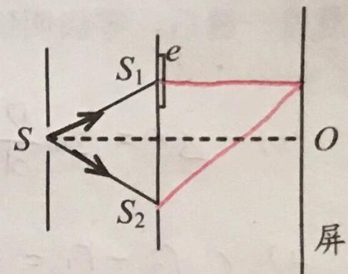
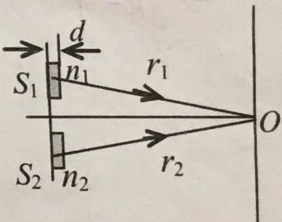

# 《大学物理》第十一章 光学 习题作业参考答案

原件经识别和整理；“参考解答”是我们补的。

# 第十一章 光学

## 一、选择题

### 选择 1

在双缝干涉实验中，为使屏上的干涉条纹间距变大，可以采取的办法是：

- A. 使屏靠近双缝
- B. 使两缝的间距变小
- C. 把两个缝的宽度稍微调窄
- D. 改用波长较小的单色光源

答案：B。

知识点：[杨氏双缝干涉实验与条纹间距](../../../topics/大学物理/杨氏双缝干涉.md)

### 选择 2

在真空中波长为 $\lambda$ 的单色光，在折射率为 $n$ 的透明介质中从 $A$ 沿某路径传播到 $B$，若 $A、B$ 两点位相差为 $3\pi$，则此路径 AB 的光程为：

参考解答：由位相差与光程的关系 $\frac{2 \pi}{\lambda} S = 3 \pi$，解得 $S = \frac{3}{2} \lambda = 1.5 \lambda$。

- A. $1.5 \lambda$
- B. $1.5 n \lambda$
- C. $3 \lambda$
- D. $1.5 \lambda / n$

答案：A。

## 二、填空题

知识点：[光程、光程差与反射时的半波损失](../../../topics/大学物理/光程与半波损失.md)、[平面简谐波的波函数 y=Acos(ω(t±x/u)+φ)](../../../topics/大学物理/平面简谐波方程.md)

### 填空 1

在相同的时间内，一束波长为 $\lambda$ 的单色光分别经过空气和玻璃，则两者传播的路程 **不同** ，走过的光程 **相同** 。

参考解答：在相同的时间内，一束波长为 $\lambda$ 的单色光分别经过空气和玻璃，则两者传播的路程 **不同**，走过的光程 **相同**。

光在介质中的传播速度 $v = c/n$（$n$ 为折射率），由于玻璃的折射率大于空气，相同时间 $t$ 内光在玻璃中走过的几何路程 $s = vt$ 小于在空气中的路程，故路程不同。光程定义为 $L = ns = n \cdot (c/n) t = ct$，仅取决于真空光速和时间，与介质无关，因此在相同时间内两者光程相等。

知识点：[光程、光程差与反射时的半波损失](../../../topics/大学物理/光程与半波损失.md)、[平面简谐波的波函数 y=Acos(ω(t±x/u)+φ)](../../../topics/大学物理/平面简谐波方程.md)

### 填空 2

在双缝干涉实验中，入射光的波长为 $\lambda$，用玻璃纸遮住双缝中的一个缝，若玻璃纸中光程比相同厚度的空气的光程大 $2.5\lambda$，则屏上原来的明纹处为 **暗** （填明暗情况）。

参考解答：**答案：暗**

玻璃纸引入的附加光程差为

$$
\Delta = 2.5\lambda=\frac{5}{2}\lambda.
$$

该光程差对应相位差

$$
\Delta\varphi=2\pi\frac{\Delta}{\lambda}=5\pi,
$$

即奇数倍 $\pi$。因此原来满足相长干涉的明纹处变为相消干涉的暗纹。

其他选项错误原因：亮纹对应偶数倍半波长的光程差，不符合此处附加光程差为 $2.5\lambda$ 的条件。

知识点：[光程、光程差与反射时的半波损失](../../../topics/大学物理/光程与半波损失.md)、[杨氏双缝干涉实验与条纹间距](../../../topics/大学物理/杨氏双缝干涉.md)

### 填空 3

把双缝干涉实验装置放在折射率为 $n$ 的媒质中，双缝到观察屏的距离为 $D$，两缝之间的距离为 $d$ ($d \ll D$)，入射光在真空中的波长为 $\lambda$，则屏上干涉条纹中相邻明纹的间距是 **$\frac{D}{d} \cdot \frac{\lambda}{n}$** 。

参考解答：结论：  

$$
\Delta x=\frac{D}{d}\cdot \frac{\lambda}{n}
$$

理由：  
光在折射率为 $n$ 的媒质中波长变为  

$$
\lambda'=\frac{\lambda}{n}
$$
  
双缝干涉相邻明纹间距公式为  

$$
\Delta x=\frac{D}{d}\lambda'
$$
  
代入即得  

$$
\Delta x=\frac{D}{d}\cdot \frac{\lambda}{n}
$$

知识点：[杨氏双缝干涉实验与条纹间距](../../../topics/大学物理/杨氏双缝干涉.md)、[光程、光程差与反射时的半波损失](../../../topics/大学物理/光程与半波损失.md)

### 填空 4

若一双缝装置的两个缝分别被折射率为 $n_1$ 和 $n_2$ 的两块厚度均为 $e$ 的透明介质所遮盖，此时由双缝分别到屏上原中央极大所在处的两束光的光程差 $\Delta =$ **$(n_{1}-n_{2})e$** 。

*(注：原文答案为 $n_{1}e - n_{2}e$，即 $(n_1-n_2)e$)*

参考解答：**结论**

$(n_1 - n_2)e$

**推理过程**

1.  **光程定义**：光在折射率为 $n$、几何厚度为 $e$ 的介质中传播的光程为 $L = ne$。若在真空中传播相同距离，光程为 $e$（真空折射率近似为 1）。
2.  **附加光程差**：
    *   通过缝 1 的光束，因插入介质 $n_1$，其光程相对于真空增加了 $\Delta L_1 = n_1 e - e = (n_1 - 1)e$。
    *   通过缝 2 的光束，因插入介质 $n_2$，其光程相对于真空增加了 $\Delta L_2 = n_2 e - e = (n_2 - 1)e$。
3.  **总光程差计算**：
    题目考察的是屏上原中央极大处（即几何路程相等处）两束光的光程差。由于几何路径长度相同，总光程差完全由介质引起的附加光程差决定：
    $$
    \Delta = \Delta L_1 - \Delta L_2 = (n_1 - 1)e - (n_2 - 1)e
    $$
    化简得：
    $$
    \Delta = (n_1 - n_2)e
    $$

知识点：[光程、光程差与反射时的半波损失](../../../topics/大学物理/光程与半波损失.md)、[杨氏双缝干涉实验与条纹间距](../../../topics/大学物理/杨氏双缝干涉.md)

### 填空 5

如图，在双缝干涉实验中 $\overline{SS_{1}} = \overline{SS_{2}}$，若将一厚度为 $e$、折射率为 $n$ 的薄云母片覆盖在 $S_{1}$ 缝上，中央明条纹将向 **上** 移动；覆盖云母片后，两束相干光至原中央明纹 O 处的光程差为 **$(n-1)e$** 。

*(注：原文此处光程差写作 $ne-e$，即 $(n-1)e$)*

## 三、计算题

参考解答：**结论**：中央明条纹向**上**移动；覆盖云母片后，两束相干光至原中央明纹 $O$ 处的光程差为 $(n-1)e$。

**推理与计算**：

设 $S_1$ 在下缝、$S_2$ 在上缝（由“向上移动”反推的标准配置），且初始 $\overline{SS_1} = \overline{SS_2}$。

1. **附加光程差**：
   云母片覆盖在 $S_1$ 上后，光线经过厚度 $e$ 的介质，几何路程仍为 $e$，但光程变为 $ne$；原本该段在空气中光程为 $e$。因此 $S_1$ 支路增加的附加光程差为：
   $$ \Delta L_{\text{附加}} = ne - e = (n-1)e $$

2. **光程差表达式**：
   设屏上某点 $P$ 距 $O$ 的位移为 $y$（向上为正），双缝间距为 $d$，缝屏距为 $D$。两束光到达 $P$ 的总光程差为：
   $$ \delta = (\overline{S_2P} - \overline{S_1P}) - (ne-e) $$

3. **中央明纹的移动方向**：
   中央明纹对应 $\delta = 0$，即 $\overline{S_2P} - \overline{S_1P} = (n-1)e$。
   在原中央明纹 $O$ 处（$y=0$），几何路程差 $\overline{S_2P} - \overline{S_1P} = 0$，而光程差 $\delta = -(n-1)e \neq 0$，不再是零级条纹。
   为满足 $\overline{S_2P} - \overline{S_1P} > 0$，需使 $P$ 点靠近 $S_1$（位于 $O$ 点下方），即 $\overline{S_1P}$ 变短。
   由几何近似关系：
   $$ \overline{S_2P} - \overline{S_1P} \approx \frac{d \cdot y}{D} $$
   令 $\frac{d \cdot y}{D} = (n-1)e > 0$，得 $y = \frac{D(n-1)e}{d} > 0$。
   $y > 0$ 表明新的中央明纹位于原 $O$ 点的**上方**（向背离被遮盖狭缝 $S_1$ 的方向移动）。

知识点：[光程、光程差与反射时的半波损失](../../../topics/大学物理/光程与半波损失.md)、[杨氏双缝干涉实验与条纹间距](../../../topics/大学物理/杨氏双缝干涉.md)

### 计算 1

在右图示的双缝干涉实验中，若用薄玻璃片（折射率 $n_{1}=1.4$）覆盖缝 $S_{1}$，用同样厚度的玻璃片（但折射率 $n_{2}=1.7$）覆盖缝 $S_{2}$，将使原来未放玻璃时屏上的中央明条纹处 O 变为第五级明纹。设单色光波长 $\lambda=480\ nm$ ($1nm=10^{-9}m$)，求玻璃片的厚度 $d$（可认为光线垂直穿过玻璃片）。

参考解答：
根据题意，O 点为原中央明纹位置，故几何路程相等，即 $r_{2} - r_{1} = 0$。
加入玻璃片后，O 点变为第五级明纹，说明两束光的光程差为 $5\lambda$。
光程差表达式为：
$$ [r_{2} + (n_{2} d - d)] - [r_{1} + (n_{1} d - d)] = 5 \lambda $$
化简得：
$$ (n_{2} - n_{1}) d = 5 \lambda $$
代入数据：
$$ (1.7 - 1.4) d = 5 \times 480 \times 10^{-9} $$
$$ 0.3 d = 2400 \times 10^{-9} $$
$$ d = \frac{2400}{0.3} \times 10^{-9} = 8000 \times 10^{-9} \text{ m} = 8000 \text{ nm} $$

答案：玻璃片的厚度 $d$ 为 $8000 \text{ nm}$ (或 $8 \mu\text{m}$)。

知识点：[光程、光程差与反射时的半波损失](../../../topics/大学物理/光程与半波损失.md)、[杨氏双缝干涉实验与条纹间距](../../../topics/大学物理/杨氏双缝干涉.md)
