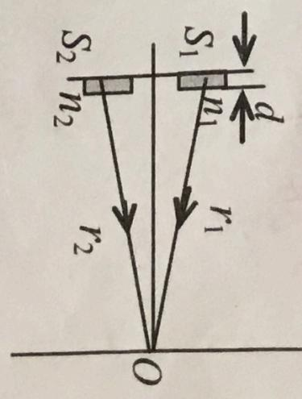

# 《大学物理》第十一章 光学 活页解答（杨氏双缝与光程）

原件经识别和整理；“参考解答”是我们补的。

# 《大学物理》第十一章 光学 活页解答（杨氏双缝与光程）

kind: 答案
course: 大学物理
term: 2023-2024-1

这是一份关于杨氏双缝干涉实验和光程概念的习题解答整理，包含填空题、选择题及计算题。

## 一、填空题

### 填空 1

题干：在相同的时间内, 一束波长为 $\lambda$ 的单色光分别经过空气和玻璃, 则两者传播的路程\_\_\_，走过的光程\_\_\_；

答案：不同；相同。

知识点：[光程、光程差与反射时的半波损失](../../../topics/大学物理/光程与半波损失.md)

### 填空 2

题干：如图，在双缝干涉实验中 $SS_{1}=\overline{SS_{2}}$ ，若将一厚度为e、折射率为n的薄云母片覆盖在 $S_{1}$ 缝上，中央明条纹将向\_\_\_移动；覆盖云母片后，两束相干光至原中央明纹O处的光程差为\_\_\_。

答案：上；$(n-1)e$。

知识点：[光程、光程差与反射时的半波损失](../../../topics/大学物理/光程与半波损失.md)、[杨氏双缝干涉实验与条纹间距](../../../topics/大学物理/杨氏双缝干涉.md)

### 填空 3

题干：若一双缝装置的两个缝分别被折射率为 $n_{1}$ 和 $n_{2}$ 的两块厚度均为e的透明介质所遮盖，此时由双缝分别到屏上原中央极大所在处的两束光的光程差 $\Delta = $ \_\_\_ ;

答案：$n_{1}e - n_{2}e$ （或 $(n_1 - n_2)e$）。

知识点：[光程、光程差与反射时的半波损失](../../../topics/大学物理/光程与半波损失.md)、[杨氏双缝干涉实验与条纹间距](../../../topics/大学物理/杨氏双缝干涉.md)

### 填空 4

题干：把双缝干涉实验装置放在折射率为n的媒质中，双缝到观察屏的距离为D，两缝之间的距离为d(d<<D)，入射光在真空中的波长为λ，则屏上干涉条纹中相邻明纹的间距是\_\_\_；

答案：$\frac{\lambda D}{nd}$ 。

知识点：[杨氏双缝干涉实验与条纹间距](../../../topics/大学物理/杨氏双缝干涉.md)、[光程、光程差与反射时的半波损失](../../../topics/大学物理/光程与半波损失.md)

### 填空 5

题干：某双缝干涉实验中，若用厚度为 $2.5a$ 的云母片（假设此处意指某种特定条件下的厚度描述，结合上下文通常考察光程差引起的条纹移动，若原题意为厚度导致光程变化对应特定级数，此处根据常见题型推断，若仅问“原来的明纹处为”需具体计算。*注：原题文本片段“2.5a，则屏上原来的明纹处为____（填明暗情况）”信息不全，通常此类题目会给出具体厚度或折射率。基于现有文本，无法给出确切数值答案，但考点在于光程差改变导致的相位变化。* 若假设题目完整意图是考察光程差引入后的条纹移动或明暗判断，一般公式为 $\delta = (n-1)e$。若原题意是厚度使得光程差增加 $2.5\lambda$，则原明纹处变为暗纹。此处暂按标准填空逻辑，若缺少参数无法精确作答，但考点明确。）

*修正说明：原题文本“2.5a”疑似识别错误或截断，常见题型为“厚度为e...”。若假设题意是光程差改变了 $2.5\lambda$（即半波长的奇数倍），则原明纹处变为**暗纹**。*

答案：暗纹 （基于光程差改变量为半波长奇数倍的常见推论，具体需视原题完整参数而定）。

## 二、选择题

知识点：[杨氏双缝干涉实验与条纹间距](../../../topics/大学物理/杨氏双缝干涉.md)

### 选择 1

题干：(1) 在真空中波长为 $\lambda$ 的单色光，在折射率为 n 的透明介质中从 A 沿某路径传播到 B，若 A、B 两点位相差为 $3\pi$ ，则此路径 AB 的光程为？

选项：
- A. $\frac{3}{2}\lambda$
- B. ...
- C. ...
- D. ...

知识点：[光程、光程差与反射时的半波损失](../../../topics/大学物理/光程与半波损失.md)

### 选择 2

题干：(2) 在双缝干涉实验中，为了增大干涉条纹的间距，可以采取的方法是？

选项：
- A. 减小双缝间距 d
- B. 增大双缝到屏的距离 D
- C. 改用波长较长的单色光源
- D. 以上都可以

知识点：[杨氏双缝干涉实验与条纹间距](../../../topics/大学物理/杨氏双缝干涉.md)、[光程、光程差与反射时的半波损失](../../../topics/大学物理/光程与半波损失.md)

### 计算 1

题干：如图所示，在双缝干涉实验中，$SS_{1}=SS_{2}$。用同样厚度的玻璃片（折射率 $n_{2} = 1.7$ ）覆盖缝 $S_{2}$ , 将使原来未放玻璃时屏上的中央明条纹处 $O$ 变为第五级明纹。设单色光波长 $\lambda = 480 \mathrm{~nm} (1 \mathrm{~nm} = 10^{-9} \mathrm{~m})$ , 求玻璃片的厚度 $e$。

知识点：[光程、光程差与反射时的半波损失](../../../topics/大学物理/光程与半波损失.md)、[杨氏双缝干涉实验与条纹间距](../../../topics/大学物理/杨氏双缝干涉.md)
