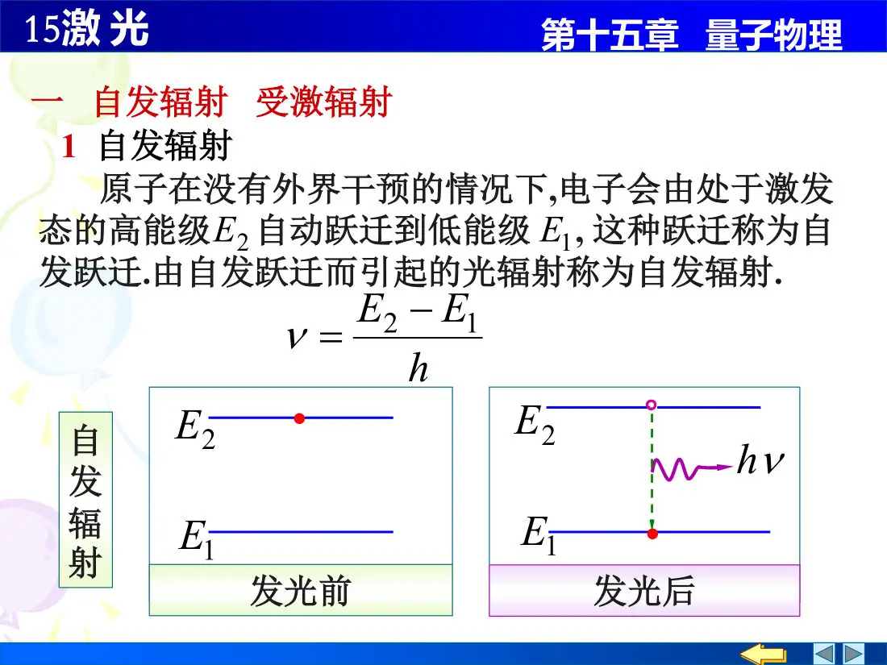
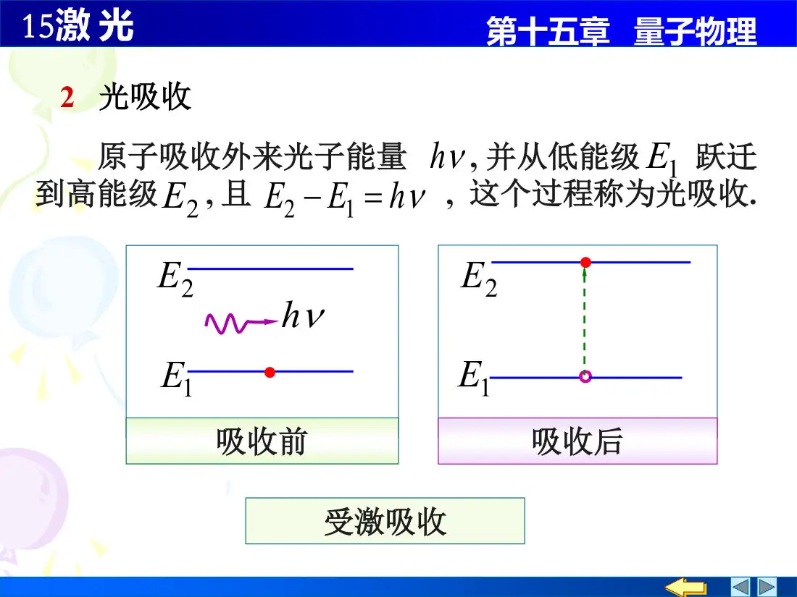
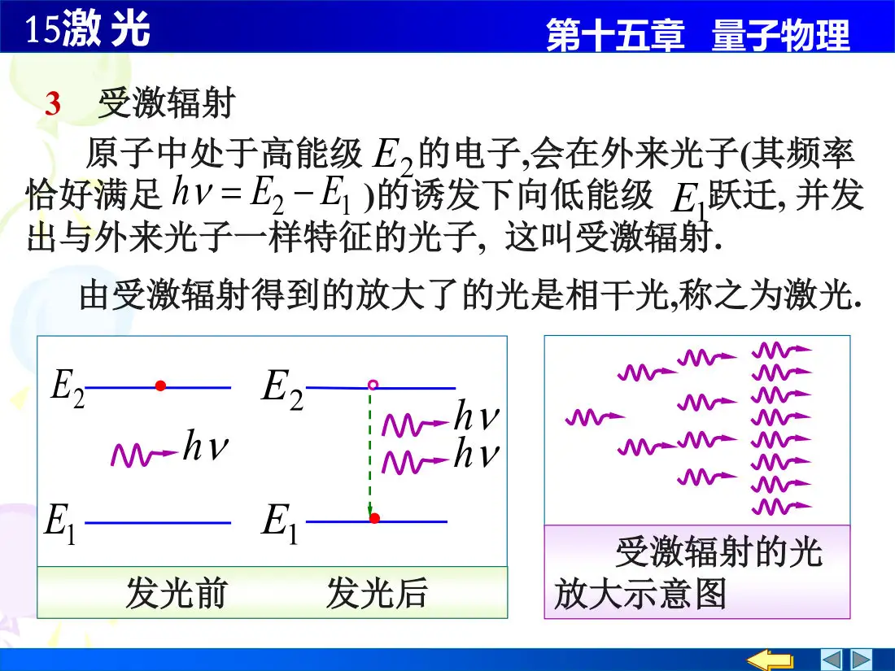
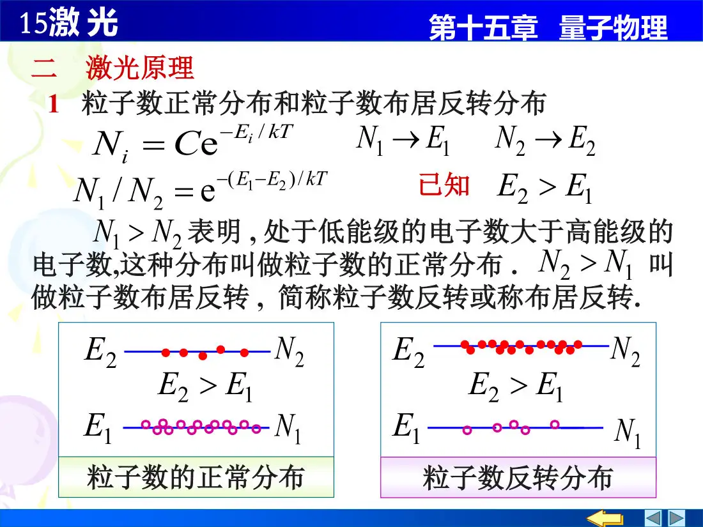
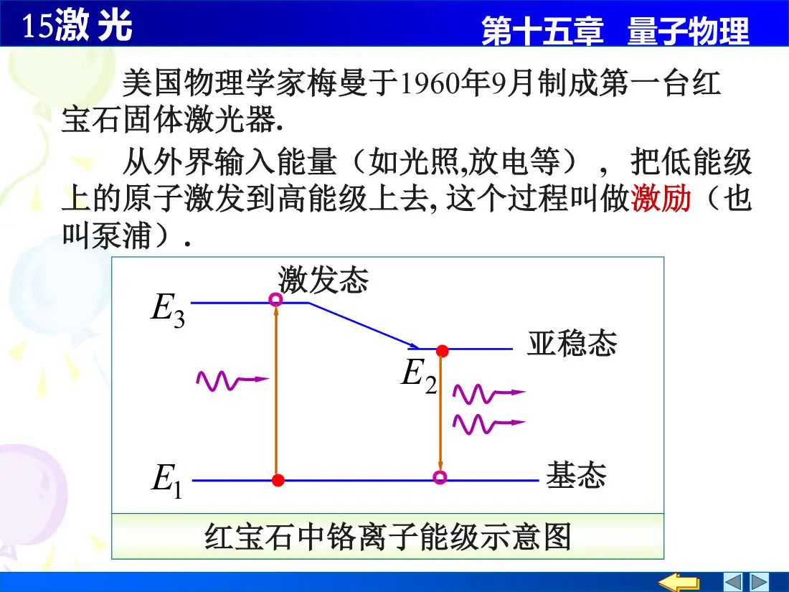
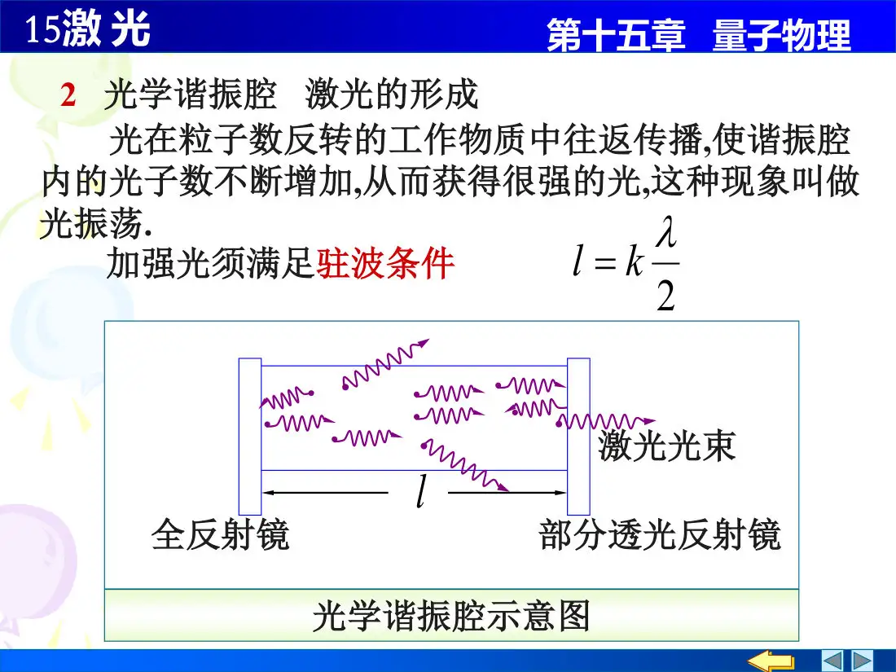
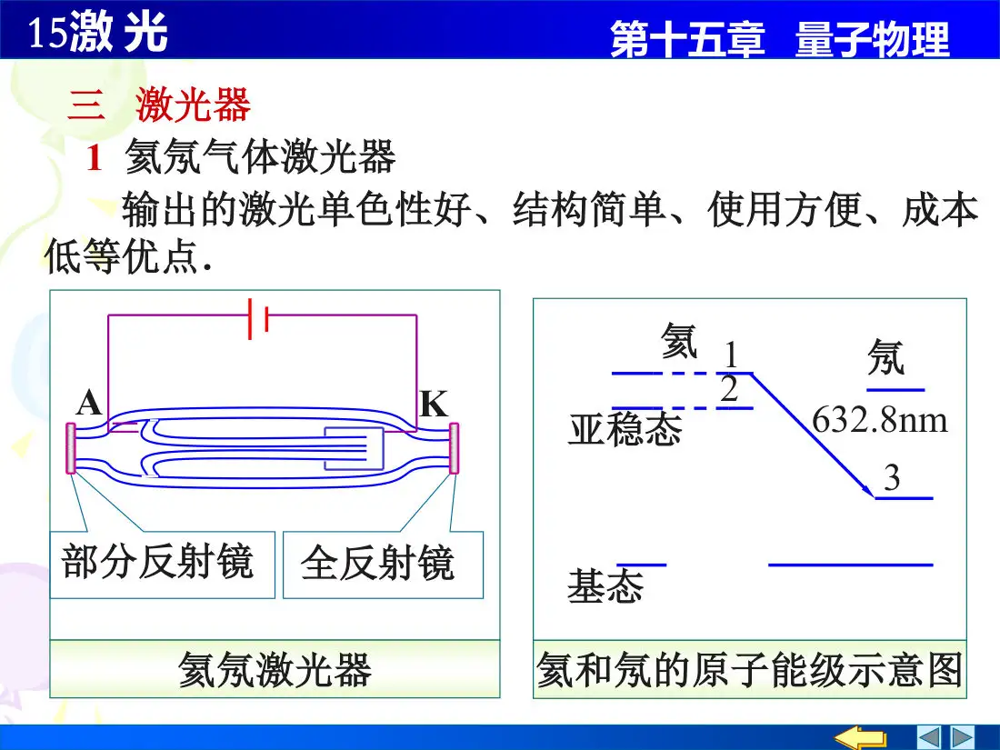
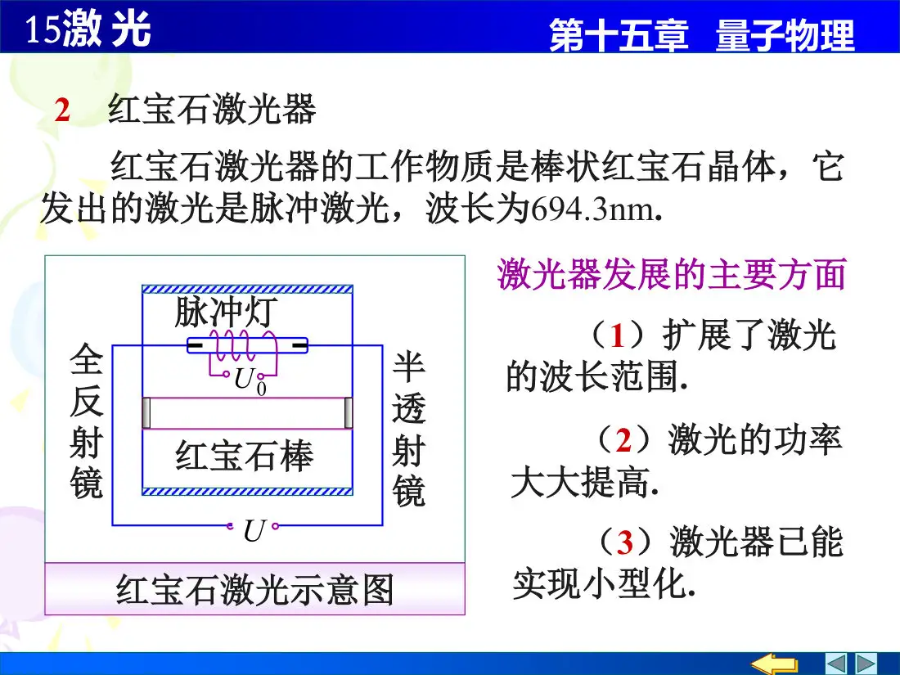
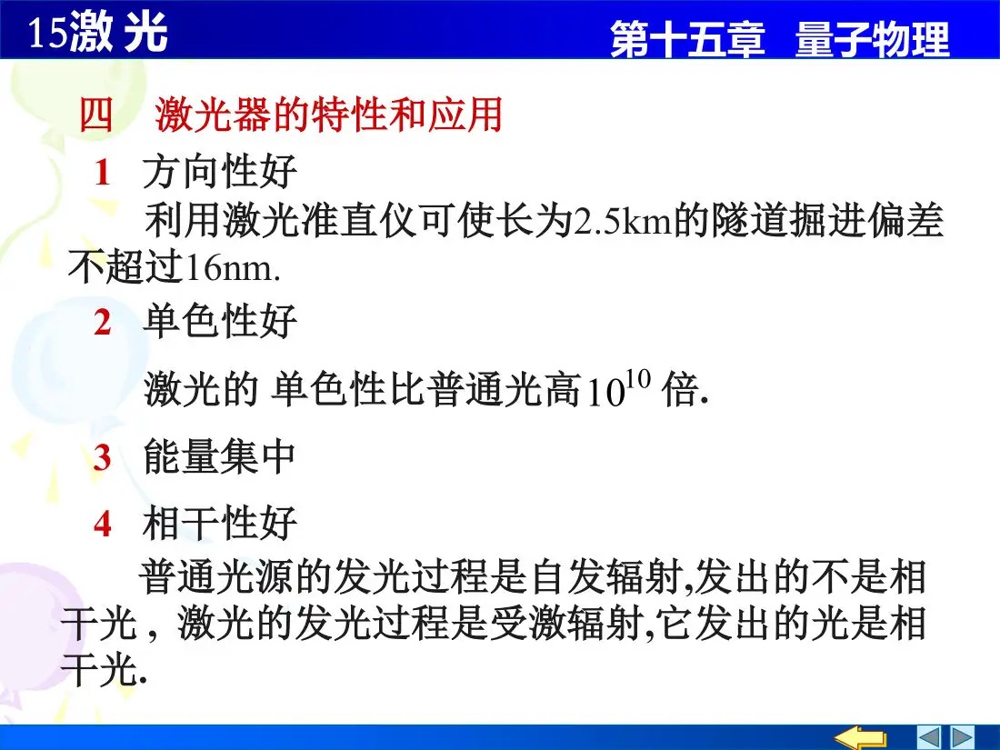

# 《大学物理》第十五章 量子物理——激光（课件）

原件的每一页，下面附识别出的文字。

### 15激 光

原文：

15激 光

第十五章 量子物理

一 自发辐射 受激辐射

1 自发辐射

原子在没有外界干预的情况下,电子会由处于激发态的高能级 $E _ { 2 }$ 自动跃迁到低能级 $E _ { 1 }$ , 这种跃迁称为自发跃迁.由自发跃迁而引起的光辐射称为自发辐射.

$$
\nu = \frac {E _ {2} - E _ {1}}{h}
$$

自

发

辐

射

### 15激 光

原文：

15激 光

第十五章 量子物理

2 光吸收

原子吸收外来光子能量 , 并从低能级 $E _ { 1 }$ 跃迁到高能级 $E _ { 2 }$ , 且 $E _ { 2 } - E _ { 1 } = h \nu$ , 这个过程称为光吸收.

### 3 受激辐射

原文：

3 受激辐射

原子中处于高能级 $E _ { 2 }$ 的电子,会在外来光子(其频率恰好满足 $h \nu = E _ { 2 } - E _ { 1 }$ )的诱发下向低能级 $E _ { 1 }$ 跃迁, 并发出与外来光子一样特征的光子, 这叫受激辐射.

由受激辐射得到的放大了的光是相干光,称之为激光.

15激 光

第十五章 量子物理

### 二 激光原理

原文：

二 激光原理

1 粒子数正常分布和粒子数布居反转分布

$$
\begin{array}{r l r}{N _ {i} = C \mathrm{e} ^ {- E _ {i} / k T}}&{N _ {1} \rightarrow E _ {1}}&{N _ {2} \rightarrow E _ {2}}\\{N _ {1} / N _ {2} = \mathrm{e} ^ {- (E _ {1} - E _ {2}) / k T}}&{\text {已知}}&{E _ {2} > E _ {1}}\end{array}
$$

$N _ { 1 } > N _ { 2 }$ 表明 , 处于低能级的电子数大于高能级的电子数,这种分布叫做粒子数的正常分布 . $N _ { 2 } > N _ { 1 }$ 叫做粒子数布居反转 , 简称粒子数反转或称布居反转.

$$
\begin{array}{r l} & E _ {2} \xrightarrow {\quad \cdots \quad N _ {2}} \\ & E _ {1} \xrightarrow {\quad \cdots \quad N _ {1}} \\ & \text {粒子数的正常分布} \end{array}
$$

$$
\begin{array}{c} \text {粒子数反转分布} \\ E _ {2} - N _ {2} \\ E _ {2} > E _ {1} \\ E _ {1} - N _ {1} \\ \hline \end{array}
$$

15激 光

第十五章 量子物理

### 15激 光

原文：

15激 光

第十五章 量子物理

美国物理学家梅曼于1960年9月制成第一台红宝石固体激光器.

从外界输入能量（如光照,放电等） , 把低能级上的原子激发到高能级上去, 这个过程叫做激励（也叫泵浦）.

### 2 光学谐振腔 激光的形成

原文：

2 光学谐振腔 激光的形成

光在粒子数反转的工作物质中往返传播,使谐振腔内的光子数不断增加,从而获得很强的光,这种现象叫做光振荡. λ

加强光须满足驻波条件

$$
l = k \frac {\lambda}{2}
$$

15激 光

第十五章 量子物理

### 三 激光器

原文：

三 激光器

1 氦氖气体激光器

输出的激光单色性好、结构简单、使用方便、成本低等优点

15激 光

第十五章 量子物理

### 2 红宝石激光器

原文：

2 红宝石激光器

红宝石激光器的工作物质是棒状红宝石晶体，它发出的激光是脉冲激光，波长为694.3nm.

激光器发展的主要方面

（1）扩展了激光的波长范围.

（2）激光的功率大大提高.

（3）激光器已能实现小型化.

15激 光

第十五章 量子物理

### 15激 光

原文：

15激 光

第十五章 量子物理

四 激光器的特性和应用

1 方向性好

利用激光准直仪可使长为2.5km的隧道掘进偏差不超过16nm.

2 单色性好

激光的 单色性比普通光高 $1 0 ^ { 1 0 }$ 倍.

3 能量集中

4 相干性好

普通光源的发光过程是自发辐射,发出的不是相干光 , 激光的发光过程是受激辐射,它发出的光是相干光.
