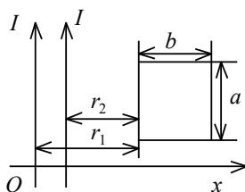
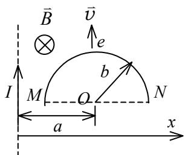
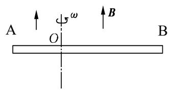
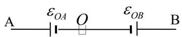

# 《大学物理》练习册活页答案（P63-71：磁场中的磁介质、电磁感应）

原件经识别和整理；“参考解答”是我们补的。

---
title: 《大学物理》练习册活页答案（P63-71：磁场中的磁介质、电磁感应）
kind: 答案
course: 大学物理
term: 
source: 识别工具读出的内容
---

# 《大学物理》练习册活页答案（P63-71：磁场中的磁介质、电磁感应）

本资料整理了《大学物理》练习册中关于“磁场中的磁介质”和“电磁感应”部分的习题答案及解析。

## 一、磁场中的磁介质 P63-64

### 选择 1

答案：C

知识点：[速度、加速度的定义与微分关系](../../../topics/大学物理/速度与加速度定义.md)、[位矢及其坐标表示（直角坐标与自然坐标）](../../../topics/大学物理/位矢与坐标表示.md)

### 选择 2

答案：B。
提示：$n=10 \text{ 匝/cm}=1000 \text{ 匝/m}$，$B=\mu_{0}\mu_{r}nI \Rightarrow \mu_{r}=\frac{B}{\mu_{0}nI}$

知识点：[圆周运动的角量描述（角速度、角加速度）](../../../topics/大学物理/圆周运动描述.md)、[自然参数下的切向加速度与法向加速度](../../../topics/大学物理/自然坐标系下的运动.md)

### 填空 3

答案：$\mu_{0}\mu_{r}\frac{N}{l}I$
提示：$H=nI=\frac{NI}{l}$，$B=\mu H=\mu_{0}\mu_{r}H$

知识点：[法拉第电磁感应定律与楞次定律](../../../topics/大学物理/法拉第电磁感应定律.md)、[动生电动势的计算（含运动线圈在非均匀磁场中的情况）](../../../topics/大学物理/动生电动势.md)、[感生电动势与涡旋电场](../../../topics/大学物理/感生电动势.md)

### 计算 4

解：由安培环路定理：$\oint\vec{H}\cdot d\vec{l}=\sum I_{i}$

**$0 < r < R_{1}$ 区域：**
$2\pi rH = Ir^{2} / R_{1}^{2}$

$$
H = \frac {I r}{2 \pi R _ {1} ^ {2}}, B = \frac {\mu_ {0} I r}{2 \pi R _ {1} ^ {2}}
$$

**$R_{1} < r < R_{2}$ 区域：**
$2\pi rH = I$

$$
H = \frac {I}{2 \pi r}, B = \frac {\mu I}{2 \pi r}
$$

**$R_{2} < r < R_{3}$ 区域：**

$$
2 \pi r H = I - \frac {I (r ^ {2} - R _ {2} ^ {2})}{(R _ {3} ^ {2} - R _ {2} ^ {2})}
$$

$$
H = \frac {I}{2 \pi r} (1 - \frac {r ^ {2} - R _ {2} ^ {2}}{R _ {3} ^ {2} - R _ {2} ^ {2}})
$$

$$
B = \mu_ {0} H = \frac {\mu_ {0} I}{2 \pi r} (1 - \frac {r ^ {2} - R _ {2} ^ {2}}{R _ {3} ^ {2} - R _ {2} ^ {2}})
$$

**$r > R _ {3}$ 区域：**
$H = 0, B = 0$

参考解答：结论：  
- **0 < r < R₁**：$H = \frac{I r}{2\pi R_1^2}$，$B = \frac{\mu_0 I r}{2\pi R_1^2}$  
- **R₁ < r < R₂**：$H = \frac{I}{2\pi r}$，$B = \frac{\mu I}{2\pi r}$  
- **R₂ < r < R₃**：$H = \frac{I}{2\pi r}\left(1 - \frac{r^2 - R_2^2}{R_3^2 - R_2^2}\right)$，$B = \frac{\mu_0 I}{2\pi r}\left(1 - \frac{r^2 - R_2^2}{R_3^2 - R_2^2}\right)$  
- **r > R₃**：$H = 0$，$B = 0$  

推理过程：  
根据安培环路定理 $\oint \vec{H} \cdot d\vec{l} = \sum I_{\text{内}}$，取半径为 r 的圆形回路，对称性使 H 沿切线方向且大小恒定。  

1. **0 < r < R₁**（内导体内部，设电流均匀分布）：  
   穿过回路的电流 $I_{\text{内}} = I \frac{\pi r^2}{\pi R_1^2} = I \frac{r^2}{R_1^2}$，  
   $H \cdot 2\pi r = I \frac{r^2}{R_1^2}$ → $H = \frac{I r}{2\pi R_1^2}$，  
   内导体非铁磁材料取 $\mu = \mu_0$，故 $B = \mu_0 H$。  

2. **R₁ < r < R₂**（磁介质区域，设磁导率为 μ）：  
   回路包围全部电流 I，  
   $H \cdot 2\pi r = I$ → $H = \frac{I}{2\pi r}$，  
   $B = \mu H$。  

3. **R₂ < r < R₃**（外导体内部，电流反向均匀分布）：  
   内导体电流 I 穿出，外导体电流密度 $J = \frac{I}{\pi(R_3^2 - R_2^2)}$，方向相反。  
   回路包围净电流 $I_{\text{内}} = I - J \cdot \pi(r^2 - R_2^2) = I\left(1 - \frac{r^2 - R_2^2}{R_3^2 - R_2^2}\right)$，  
   代入定理得 $H = \frac{I}{2\pi r}\left(1 - \frac{r^2 - R_2^2}{R_3^2 - R_2^2}\right)$，  
   外导体通常非铁磁，$\mu = \mu_0$，故 $B = \mu_0 H$。  

4. **r > R₃**（电缆外部）：  
   穿过回路的净电流为零（一去一回），  
   $H = 0$，$B = 0$。

知识点：[安培环路定理及其应用](../../../topics/大学物理/安培环路定理.md)、[磁介质的分类、磁化强度与磁介质中的安培环路定理（H矢量）](../../../topics/大学物理/磁场中的磁介质.md)

### 计算 5

解：
(1) 在环内作半径为 $r$ 的圆形回路，由安培环路定理得

$H \cdot 2\pi r = NI, H = NI / (2\pi r)$

$$
B = \mu N I / (2 \pi r)
$$

在 $r$ 处取微小截面 $\mathrm{d}S = b\mathrm{d}r$，通过此小截面的磁通量

$$
\mathrm{d} \Phi = B \mathrm{d} S = \frac {\mu N I}{2 \pi r} b \mathrm{d} r
$$

穿过截面的磁通量

$$
\Phi = \int_ {S} B \mathrm{d} S = \frac {\mu N I b}{2 \pi} \ln \frac {R _ {2}}{R _ {1}}
$$

(2) 同样在环外 $(r < R_{1}$ 和 $r > R_{2})$ 作圆形回路，由于 $\sum I_{i} = 0$，$\mathrm{H}\cdot 2\pi r = 0 \therefore H = 0$

参考解答：**结论**

(1) 穿过环形螺线管截面的磁通量为 $\Phi = \frac{\mu N I b}{2 \pi} \ln \frac{R_2}{R_1}$。
(2) 环外区域（$r < R_1$ 和 $r > R_2$）的磁场强度 $H=0$，磁感应强度 $B=0$。

**推理与计算过程**

**(1) 计算磁通量 $\Phi$**

1.  **求磁场分布**：
    在螺线环内部取半径为 $r$ ($R_1 < r < R_2$) 的圆形安培环路。根据安培环路定理 $\oint \vec{H} \cdot d\vec{l} = \sum I_{\text{in}}$：
    $$
    H \cdot 2\pi r = NI \implies H = \frac{NI}{2\pi r}
    $$
    由此得到磁感应强度：
    $$
    B = \mu H = \frac{\mu N I}{2 \pi r}
    $$

2.  **建立磁通量积分元**：
    在截面处取宽度为 $\mathrm{d}r$、高度为 $b$ 的微小面积元 $\mathrm{d}S = b \mathrm{d}r$。通过该面积元的微磁通量为：
    $$
    \mathrm{d} \Phi = B \mathrm{d} S = \frac{\mu N I}{2 \pi r} \cdot b \mathrm{d} r = \frac{\mu N I b}{2 \pi} \frac{\mathrm{d} r}{r}
    $$

3.  **积分求总磁通量**：
    对内径 $R_1$ 到外径 $R_2$ 进行积分：
    $$
    \Phi = \int_{R_1}^{R_2} \frac{\mu N I b}{2 \pi} \frac{\mathrm{d} r}{r} = \frac{\mu N I b}{2 \pi} \left[ \ln r \right]_{R_1}^{R_2} = \frac{\mu N I b}{2 \pi} \ln \frac{R_2}{R_1}
    $$

**(2) 分析环外磁场**

在环外区域（$r < R_1$ 或 $r > R_2$）作同心圆形安培回路。由于回路所包围的净电流为零（穿入和穿出的电流相互抵消，即 $\sum I_i = 0$），根据安培环路定理：
$$
H \cdot 2\pi r = 0 \implies H = 0
$$
因此，环外区域的磁感应强度 $B = \mu H = 0$。

知识点：[安培环路定理及其应用](../../../topics/大学物理/安培环路定理.md)、[磁介质的分类、磁化强度与磁介质中的安培环路定理（H矢量）](../../../topics/大学物理/磁场中的磁介质.md)

### 填空 6

答案：同第 3 题

## 二、电磁感应（I）P67-68

知识点：[毕奥-萨伐尔定律及典型载流导线的磁场计算](../../../topics/大学物理/毕奥-萨伐尔定律.md)、[磁通量与磁场中的高斯定理](../../../topics/大学物理/磁场中的高斯定理.md)、[安培环路定理及其应用](../../../topics/大学物理/安培环路定理.md)

### 选择 1

答案：B

知识点：[速度、加速度的定义与微分关系](../../../topics/大学物理/速度与加速度定义.md)、[位矢及其坐标表示（直角坐标与自然坐标）](../../../topics/大学物理/位矢与坐标表示.md)

### 选择 2

答案：B
提示：$\frac{1}{2} hL\frac{dB}{dt}$ （注：此处原文可能有误，通常自感电动势为 $\mathcal{E} = -L \frac{dI}{dt}$ 或能量相关公式，依原文保留）

知识点：[圆周运动的角量描述（角速度、角加速度）](../../../topics/大学物理/圆周运动描述.md)、[自然参数下的切向加速度与法向加速度](../../../topics/大学物理/自然坐标系下的运动.md)

### 填空 3

答案：$-\mu_{0}n\pi a^{2}\omega I_{m}\cos \omega t$
提示：螺线管中均匀磁场的磁感强度大小为 $B = \mu_{0} n I_{m} \sin \omega t$，穿过圆形回路的磁通

$$
\Phi_ {m} = \pi a ^ {2} B = \pi a ^ {2} \mu_ {0} n I _ {m} \sin \omega t
$$

由法拉第电磁感应定律得 $\varepsilon_{i} = \left| -\frac{d\Phi_{m}}{dt}\right| = \mu_{0}n\pi a^{2}\omega I_{m}\cos \omega t$

知识点：[法拉第电磁感应定律与楞次定律](../../../topics/大学物理/法拉第电磁感应定律.md)、[动生电动势的计算（含运动线圈在非均匀磁场中的情况）](../../../topics/大学物理/动生电动势.md)、[感生电动势与涡旋电场](../../../topics/大学物理/感生电动势.md)

### 填空 4

答案：0
提示：$\vec{v}\times\vec{B}$ 的方向与 $\overrightarrow{dl}$ 的方向垂直

知识点：[法拉第电磁感应定律与楞次定律](../../../topics/大学物理/法拉第电磁感应定律.md)、[感生电动势与涡旋电场](../../../topics/大学物理/感生电动势.md)

### 填空 5

答案：$\frac{1}{2}BR^{2}\omega$，方向由中心O指向边缘

知识点：[位矢及其坐标表示（直角坐标与自然坐标）](../../../topics/大学物理/位矢与坐标表示.md)、[速度、加速度的定义与微分关系](../../../topics/大学物理/速度与加速度定义.md)、[自然参数下的切向加速度与法向加速度](../../../topics/大学物理/自然坐标系下的运动.md)

### 判断 6

答案：等于。
提示：回路中都有磁通量的变化，铜环中有感应电流，木环中无感应电流。

知识点：[法拉第电磁感应定律与楞次定律](../../../topics/大学物理/法拉第电磁感应定律.md)

### 计算 7

解：两个载同向电流的长直导线在如图坐标 $x$ 处所产生的磁场为

$$
B = \frac {\mu_ {0}}{2 \pi} \left(\frac {1}{x} + \frac {1}{x - r _ {1} + r _ {2}}\right)
$$

选顺时针方向为线框回路正方向，则

$$
\begin{array}{l} \Phi = \int B d S = \frac {\mu_ {0} I a}{2 \pi} (\int_ {r _ {1}} ^ {r _ {1} + b} \frac {\mathrm{d} x}{x} + \int_ {r _ {1}} ^ {r _ {1} + b} \frac {\mathrm{d} x}{x - r _ {1} + r _ {2}}) \\ = \frac {\mu_ {0} I a}{2 \pi} \ln (\frac {r _ {1} + b}{r _ {1}} \cdot \frac {r _ {2} + b}{r _ {2}}) \\ \therefore \mathcal {E} _ {\mathrm{i}} = - \frac {\mathrm{d} \Phi}{\mathrm{d} t} = - \frac {\mu_ {0} a}{2 \pi} \ln [ \frac {(r _ {1} + b) (r _ {2} + b)}{r _ {1} r _ {2}} ] \frac {\mathrm{d} I}{\mathrm{d} t} \\ = - \frac {\mu_ {0} I _ {0} a \omega}{2 \pi} \ln [ \frac {(r _ {1} + b) (r _ {2} + b)}{r _ {1} r _ {2}} ] \cos \omega t \end{array}
$$

参考解答：$$\boxed{\mathcal{E}_{\mathrm{i}}=-\frac{\mu_{0} I_{0} a\omega}{2\pi}\ln\!\left[\frac{(r_{1}+b)(r_{2}+b)}{r_{1}r_{2}}\right]\cos\omega t}$$

**推理与计算：**

两导线在线框平面内 $x$ 处产生的磁感应强度为

$$
B=\frac{\mu_{0}I}{2\pi}\left(\frac{1}{x}+\frac{1}{x-r_{1}+r_{2}}\right)
$$

取顺时针为回路正方向，通过线框的磁通量为

$$
\Phi=\int B\,\mathrm{d}S=\frac{\mu_{0}Ia}{2\pi}\left(\int_{r_{1}}^{r_{1}+b}\frac{\mathrm{d}x}{x}+\int_{r_{1}}^{r_{1}+b}\frac{\mathrm{d}x}{x-r_{1}+r_{2}}\right)
=\frac{\mu_{0}Ia}{2\pi}\ln\!\left(\frac{r_{1}+b}{r_{1}}\cdot\frac{r_{2}+b}{r_{2}}\right)
$$

由法拉第电磁感应定律 $\mathcal{E}_{\mathrm{i}}=-\dfrac{\mathrm{d}\Phi}{\mathrm{d}t}$，代入 $I=I_{0}\sin\omega t$ 即得上述结果。负号表示感应电动势方向与所选正方向相反，即实际方向为逆时针。

知识点：[毕奥-萨伐尔定律及典型载流导线的磁场计算](../../../topics/大学物理/毕奥-萨伐尔定律.md)、[法拉第电磁感应定律与楞次定律](../../../topics/大学物理/法拉第电磁感应定律.md)、[动生电动势的计算（含运动线圈在非均匀磁场中的情况）](../../../topics/大学物理/动生电动势.md)

### 计算 8

解：动生电动势 $\varepsilon_{MeN} = \int_{MN} (\vec{v} \times \vec{B}) \cdot d\vec{l}$

为计算简单，可引入一条辅助线 MN，构成闭合回路 MeNM，闭合回路总电动势

$$
\varepsilon_ {\mathrm{总}} = \varepsilon_ {M e N} + \varepsilon_ {N M} = 0
$$

$$
\mathcal {E} _ {M e N} = - \mathcal {E} _ {N M} = \mathcal {E} _ {M N}
$$

$$
\varepsilon_ {M N} = \int_ {\mathrm{MN}} (\vec {\mathrm{v}} \times \vec {B}) \cdot \mathrm{d} \vec {l} = \int_ {a - b} ^ {a + b} - \mathrm{v} \frac {\mu_ {0} I}{2 \pi x} \mathrm{d} x = - \frac {\mu_ {0} I v}{2 \pi} \ln \frac {a + b}{a - b}
$$

负号表示 $\varepsilon_{MN}$ 的方向与 x 轴相反。

$$
\varepsilon_ {M e N} = - \frac {\mu_ {0} I \mathrm{v}}{2 \pi} \ln \frac {a + b}{a - b}
$$

方向 $N\to M$

参考解答：**结论**

单位长度的总磁能为：

$$
W_m = \frac{\mu_0 I^2}{16\pi} + \frac{\mu_0 \mu_r I^2}{4\pi} \ln\frac{R_2}{R_1}
$$

> **注：** 原题给出的最终结果第二项缺少相对磁导率 $\mu_r$。由于 $R_1 < r < R_2$ 区域为磁介质（磁导率为 $\mu_0\mu_r$），积分后该项必须包含 $\mu_r$，下方推导中已修正。

---

**推理与计算过程**

**1. 由安培环路定律求磁场强度 $H$**

取半径为 $r$ 的同心圆作为安培环路，$\oint \vec{H}\cdot d\vec{l} = H \cdot 2\pi r = I_{\text{enc}}$。

- **导体内部 ($r < R_1$)**：电流均匀分布，包围电流 $I_{\text{enc}} = I\dfrac{r^2}{R_1^2}$

$$
H_1 = \frac{I r}{2\pi R_1^2}
$$

- **介质层 ($R_1 < r < R_2$)**：包围全部电流 $I$

$$
H_2 = \frac{I}{2\pi r}
$$

- **外部 ($r > R_2$)**：若外层有反向回流导体使外部磁场抵消，则 $H_3 = 0$。

**2. 求各区域的磁能密度 $w_m$**

利用公式 $w_m = \dfrac{1}{2}\mu H^2$，其中各区域磁导率不同：

$$
w_{m1} = \frac{1}{2}\mu_0 \left(\frac{Ir}{2\pi R_1^2}\right)^2 \quad (r < R_1)
$$

$$
w_{m2} = \frac{1}{2}\mu_0\mu_r \left(\frac{I}{2\pi r}\right)^2 \quad (R_1 < r < R_2)
$$

$$
w_{m3} = 0 \quad (r > R_2)
$$

**3. 对单位长度体积积分求总磁能**

单位长度内取柱壳体积元 $dV = 2\pi r \, dr \cdot 1$，分两段积分：

**第一段（导体内部）：**

$$
W_{m1} = \int_0^{R_1} w_{m1} \cdot 2\pi r \, dr = \int_0^{R_1} \frac{1}{2}\mu_0 \frac{I^2 r^2}{4\pi^2 R_1^4} \cdot 2\pi r \, dr = \frac{\mu_0 I^2}{4\pi R_1^4} \int_0^{R_1} r^3 \, dr
$$

$$
= \frac{\mu_0 I^2}{4\pi R_1^4} \cdot \frac{R_1^4}{4} = \frac{\mu_0 I^2}{16\pi}
$$

**第二段（介质层）：**

$$
W_{m2} = \int_{R_1}^{R_2} w_{m2} \cdot 2\pi r \, dr = \int_{R_1}^{R_2} \frac{1}{2}\mu_0\mu_r \frac{I^2}{4\pi^2 r^2} \cdot 2\pi r \, dr = \frac{\mu_0\mu_r I^2}{4\pi} \int_{R_1}^{R_2} \frac{dr}{r}
$$

$$
= \frac{\mu_0\mu_r I^2}{4\pi} \ln\frac{R_2}{R_1}
$$

**4. 合并得单位长度总磁能**

$$
W_m = W_{m1} + W_{m2} = \frac{\mu_0 I^2}{16\pi} + \frac{\mu_0 \mu_r I^2}{4\pi} \ln\frac{R_2}{R_1}
$$

知识点：[磁能密度与磁场的能量](../../../topics/大学物理/磁场的能量.md)、[安培环路定理及其应用](../../../topics/大学物理/安培环路定理.md)

### 计算 9

解：

(1) 在 OB 上，距点 O 为 $r$ 处取导体元 $\mathrm{d}r$，则 OB 段导体内产生的电动势大小为

$$
\varepsilon_ {O B} = \int_ {0} ^ {\frac {2 l}{3}} (\boldsymbol {v} \times \boldsymbol {B}) \cdot d \boldsymbol {r} = \int_ {0} ^ {\frac {2 l}{3}} \omega r B d r = \frac {2 B \omega}{9} l ^ {2}
$$

方向为 $O \rightarrow B$。

同理 OA 段导体内产生的电动势大小为

$$
\varepsilon_ {O A} = \int_ {0} ^ {\frac {l}{3}} \omega r B \mathrm{d} r = \frac {1}{1 8} B \omega l ^ {2}
$$

方向 $O \rightarrow A$。

将 AB 棒上的电动势看作是 OA 棒和 OB 棒上电动势的代数和，如图(b)所示，则

$$
U _ {A B} = \varepsilon_ {O A} - \varepsilon_ {O B} = (\frac {1}{1 8} - \frac {2}{9}) B \omega l ^ {2} = - \frac {1}{6} B \omega l ^ {2}
$$

## 三、电磁感应（II）P69-70

参考解答：大环电流在圆心 $O$ 处产生的磁感应强度大小为  

$$
B_0=\frac{\mu_0 I}{2r_2}=\frac{\mu_0 I_0\sin\omega t}{2r_2}
$$

小环面积  

$$
S=\pi r_1^2
$$

取小环回路正方向与大环电流方向相同，则穿过小环的磁通量为  

$$
\Phi_m=B_0S=\frac{\mu_0\pi r_1^2 I_0}{2r_2}\sin\omega t
$$

由法拉第电磁感应定律  

$$
\varepsilon_i=-\frac{d\Phi_m}{dt}
=-\frac{\mu_0\pi r_1^2 I_0\omega}{2r_2}\cos\omega t
$$

因此小环中的感应电流为  

$$
I_i=\frac{\varepsilon_i}{R}
=-\frac{\mu_0\pi r_1^2 I_0\omega}{2Rr_2}\cos\omega t
$$

结论：  

$$
\boxed{I_i=-\frac{\mu_0\pi r_1^2 I_0\omega}{2Rr_2}\cos\omega t}
$$

负号表示感应电流方向与所取正方向相反。

知识点：[毕奥-萨伐尔定律及典型载流导线的磁场计算](../../../topics/大学物理/毕奥-萨伐尔定律.md)、[法拉第电磁感应定律与楞次定律](../../../topics/大学物理/法拉第电磁感应定律.md)

### 选择 1

答案：C
提示：$M _ {2 1} = M _ {1 2} = M$

知识点：[速度、加速度的定义与微分关系](../../../topics/大学物理/速度与加速度定义.md)、[位矢及其坐标表示（直角坐标与自然坐标）](../../../topics/大学物理/位矢与坐标表示.md)

### 选择 2

答案：C

知识点：[圆周运动的角量描述（角速度、角加速度）](../../../topics/大学物理/圆周运动描述.md)、[自然参数下的切向加速度与法向加速度](../../../topics/大学物理/自然坐标系下的运动.md)

### 选择 3

答案：C

知识点：[圆周运动的角量描述（角速度、角加速度）](../../../topics/大学物理/圆周运动描述.md)、[自然参数下的切向加速度与法向加速度](../../../topics/大学物理/自然坐标系下的运动.md)、[速度、加速度的定义与微分关系](../../../topics/大学物理/速度与加速度定义.md)

### 填空 4

答案：$\frac{1}{2}\mu (nI)^2,\mu n^2 V$

知识点：[法拉第电磁感应定律与楞次定律](../../../topics/大学物理/法拉第电磁感应定律.md)、[感生电动势与涡旋电场](../../../topics/大学物理/感生电动势.md)

### 填空 5

答案：$^{1}/_{16}$ , $^{1}/_{16}$

知识点：[位矢及其坐标表示（直角坐标与自然坐标）](../../../topics/大学物理/位矢与坐标表示.md)、[速度、加速度的定义与微分关系](../../../topics/大学物理/速度与加速度定义.md)、[自然参数下的切向加速度与法向加速度](../../../topics/大学物理/自然坐标系下的运动.md)

### 填空 6

答案：$\frac{\mu_0b}{2\pi}\ln \frac{d + a}{d}$
提示：同10(1).

知识点：[毕奥-萨伐尔定律及典型载流导线的磁场计算](../../../topics/大学物理/毕奥-萨伐尔定律.md)、[磁通量与磁场中的高斯定理](../../../topics/大学物理/磁场中的高斯定理.md)、[安培环路定理及其应用](../../../topics/大学物理/安培环路定理.md)

### 填空 7

答案：$\frac{1}{n}\sqrt{\frac{2w_{m}}{\mu_{0}}}$
提示：$w = \frac{1}{2}\mu_{0}H^{2} = \frac{1}{2}\mu_{0}(nI)^{2}$

知识点：[磁能密度与磁场的能量](../../../topics/大学物理/磁场的能量.md)、[自感系数、互感系数及其计算](../../../topics/大学物理/自感与互感.md)

### 计算 8

解：由安培环路定律可求 H

$H = \frac{r}{2\pi R^2} I (r < R_1)$
$\left\{ \begin{array}{l} H = \frac{1}{2\pi r} I (R_1 < r < R_2) \\ H = 0 (r > R_2) \end{array} \right.$

$$
W _ {m} = \frac {1}{2} \mu H ^ {2}
$$

$$
\left\{ \begin{array}{c} W _ {m} = \frac {1}{2} \mu_ {0} \left(\frac {r}{2 \pi R ^ {2}} I\right) ^ {2} (r <   R _ {1}) \\ W _ {m} = \frac {1}{2} \mu_ {0} \mu_ {r} \left(\frac {1}{2 \pi r} I\right) ^ {2} (R _ {1} <   r <   R _ {2}) \\ W _ {m} = 0 (r > R _ {2}) \end{array} \right.
$$

单位长度的磁能:

$$
\begin{array}{r} W _ {m} = \int w _ {m} d V = \int_ {0} ^ {R _ {1}} w _ {m 1} d V + \int_ {R _ {1}} ^ {R _ {2}} w _ {m 2} d V \\ = \frac {\mu_ {0} I ^ {2}}{1 6 \pi} + \frac {\mu_ {0} I ^ {2}}{4 \pi} \ln \frac {R _ {2}}{R _ {1}} \end{array}
$$

参考解答：**结论**

单位长度的总磁能为：

$$
W_m = \frac{\mu_0 I^2}{16\pi} + \frac{\mu_0 \mu_r I^2}{4\pi} \ln\frac{R_2}{R_1}
$$

> **注：** 原题给出的最终结果第二项缺少相对磁导率 $\mu_r$。由于 $R_1 < r < R_2$ 区域为磁介质（磁导率为 $\mu_0\mu_r$），积分后该项必须包含 $\mu_r$，下方推导中已修正。

---

**推理与计算过程**

**1. 由安培环路定律求磁场强度 $H$**

取半径为 $r$ 的同心圆作为安培环路，$\oint \vec{H}\cdot d\vec{l} = H \cdot 2\pi r = I_{\text{enc}}$。

- **导体内部 ($r < R_1$)**：电流均匀分布，包围电流 $I_{\text{enc}} = I\dfrac{r^2}{R_1^2}$

$$
H_1 = \frac{I r}{2\pi R_1^2}
$$

- **介质层 ($R_1 < r < R_2$)**：包围全部电流 $I$

$$
H_2 = \frac{I}{2\pi r}
$$

- **外部 ($r > R_2$)**：若外层有反向回流导体使外部磁场抵消，则 $H_3 = 0$。

**2. 求各区域的磁能密度 $w_m$**

利用公式 $w_m = \dfrac{1}{2}\mu H^2$，其中各区域磁导率不同：

$$
w_{m1} = \frac{1}{2}\mu_0 \left(\frac{Ir}{2\pi R_1^2}\right)^2 \quad (r < R_1)
$$

$$
w_{m2} = \frac{1}{2}\mu_0\mu_r \left(\frac{I}{2\pi r}\right)^2 \quad (R_1 < r < R_2)
$$

$$
w_{m3} = 0 \quad (r > R_2)
$$

**3. 对单位长度体积积分求总磁能**

单位长度内取柱壳体积元 $dV = 2\pi r \, dr \cdot 1$，分两段积分：

**第一段（导体内部）：**

$$
W_{m1} = \int_0^{R_1} w_{m1} \cdot 2\pi r \, dr = \int_0^{R_1} \frac{1}{2}\mu_0 \frac{I^2 r^2}{4\pi^2 R_1^4} \cdot 2\pi r \, dr = \frac{\mu_0 I^2}{4\pi R_1^4} \int_0^{R_1} r^3 \, dr
$$

$$
= \frac{\mu_0 I^2}{4\pi R_1^4} \cdot \frac{R_1^4}{4} = \frac{\mu_0 I^2}{16\pi}
$$

**第二段（介质层）：**

$$
W_{m2} = \int_{R_1}^{R_2} w_{m2} \cdot 2\pi r \, dr = \int_{R_1}^{R_2} \frac{1}{2}\mu_0\mu_r \frac{I^2}{4\pi^2 r^2} \cdot 2\pi r \, dr = \frac{\mu_0\mu_r I^2}{4\pi} \int_{R_1}^{R_2} \frac{dr}{r}
$$

$$
= \frac{\mu_0\mu_r I^2}{4\pi} \ln\frac{R_2}{R_1}
$$

**4. 合并得单位长度总磁能**

$$
W_m = W_{m1} + W_{m2} = \frac{\mu_0 I^2}{16\pi} + \frac{\mu_0 \mu_r I^2}{4\pi} \ln\frac{R_2}{R_1}
$$

知识点：[磁能密度与磁场的能量](../../../topics/大学物理/磁场的能量.md)、[安培环路定理及其应用](../../../topics/大学物理/安培环路定理.md)

### 计算 9

解：大环电流在 $O$ 点处产生的磁感应强度大小

$$
B _ {0} = \frac {\mu_ {0} I}{2 r _ {2}} = \frac {\mu_ {0} I \sin \omega t}{2 r _ {2}}
$$

设小环回路的正方向与大环中 I 相同，

$$
\phi_ {m} = B \cdot \pi r _ {1} ^ {2} = \frac {\mu_ {0} I _ {0} \sin \omega t}{2 r _ {2}} \pi r _ {1} ^ {2}
$$

$$
\varepsilon_ {i} = - \frac {d \phi_ {m}}{d t} = - \frac {\mu_ {0} \pi r _ {1} ^ {2}}{2 r _ {2}} I _ {0} \omega \cos \omega t
$$

$$
I _ {i} = \frac {\varepsilon_ {i}}{R} = - \frac {\mu_ {0} \pi r _ {1} ^ {2}}{2 R r _ {2}} I _ {0} \omega \cos \omega t
$$

参考解答：大环电流在圆心 $O$ 处产生的磁感应强度大小为  

$$
B_0=\frac{\mu_0 I}{2r_2}=\frac{\mu_0 I_0\sin\omega t}{2r_2}
$$

小环面积  

$$
S=\pi r_1^2
$$

取小环回路正方向与大环电流方向相同，则穿过小环的磁通量为  

$$
\Phi_m=B_0S=\frac{\mu_0\pi r_1^2 I_0}{2r_2}\sin\omega t
$$

由法拉第电磁感应定律  

$$
\varepsilon_i=-\frac{d\Phi_m}{dt}
=-\frac{\mu_0\pi r_1^2 I_0\omega}{2r_2}\cos\omega t
$$

因此小环中的感应电流为  

$$
I_i=\frac{\varepsilon_i}{R}
=-\frac{\mu_0\pi r_1^2 I_0\omega}{2Rr_2}\cos\omega t
$$

结论：  

$$
\boxed{I_i=-\frac{\mu_0\pi r_1^2 I_0\omega}{2Rr_2}\cos\omega t}
$$

负号表示感应电流方向与所取正方向相反。

知识点：[毕奥-萨伐尔定律及典型载流导线的磁场计算](../../../topics/大学物理/毕奥-萨伐尔定律.md)、[法拉第电磁感应定律与楞次定律](../../../topics/大学物理/法拉第电磁感应定律.md)

### 计算 10

解：
(1) 直导线在 $x$ 处的磁场为： $\mathrm{B} = \frac{\mu_0I}{2\pi x}$

$$
\Phi_ {M} = \int {\vec {B}} \cdot d \vec {S} = \int_ {a} ^ {a + b} {\frac {\mu_ {0} I}{2 \pi x}} c d x = \frac {\mu_ {0} c I}{2 \pi} \ln \frac {a + b}{a}
$$

$$
M = \frac {\phi_ {m}}{I} = \frac {\mu_ {0} c}{2 \pi} \ln \frac {a + b}{a}
$$

(2) $\varepsilon_ {i} = - \frac {d \phi_ {m}}{d t} = - \frac {\mu_ {0} c}{2 \pi} \ln \frac {a + b}{a} \frac {d I}{d t}$

$$
= \frac {\mu_ {0} c}{2 \pi} \ln \frac {a + b}{a} \cdot I _ {0} \omega \sin \omega t
$$

## 四、电磁感应（III）P71

参考解答：**结论**

(1) 互感系数：
$$M = \frac{\mu_0 c}{2\pi} \ln\frac{a+b}{a}$$

(2) 感应电动势（设 $I = I_0 \cos\omega t$）：
$$\varepsilon_i = \frac{\mu_0 c}{2\pi} \ln\frac{a+b}{a} \cdot I_0 \omega \sin\omega t$$

---

**推理与计算过程**

**(1) 求互感系数 $M$**

长直导线在距其 $x$ 处产生的磁感应强度为：
$$B = \frac{\mu_0 I}{2\pi x}$$

矩形线圈中取宽为 $dx$、长为 $c$ 的面积元 $dS = c\,dx$，穿过线圈的总磁通量为：
$$\Phi_M = \int \vec{B} \cdot d\vec{S} = \int_a^{a+b} \frac{\mu_0 I}{2\pi x} \cdot c\,dx = \frac{\mu_0 c I}{2\pi} \ln\frac{a+b}{a}$$

由互感定义 $M = \dfrac{\Phi_M}{I}$，得：
$$M = \frac{\mu_0 c}{2\pi} \ln\frac{a+b}{a}$$

**(2) 求感应电动势 $\varepsilon_i$**

已知电流 $I = I_0 \cos\omega t$，由法拉第电磁感应定律：
$$\varepsilon_i = -\frac{d\Phi_M}{dt} = -M\frac{dI}{dt}$$

对电流求导：
$$\frac{dI}{dt} = -I_0 \omega \sin\omega t$$

代入得：
$$\varepsilon_i = -\frac{\mu_0 c}{2\pi}\ln\frac{a+b}{a} \cdot (-I_0 \omega \sin\omega t) = \frac{\mu_0 c}{2\pi}\ln\frac{a+b}{a} \cdot I_0 \omega \sin\omega t$$

知识点：[毕奥-萨伐尔定律及典型载流导线的磁场计算](../../../topics/大学物理/毕奥-萨伐尔定律.md)、[法拉第电磁感应定律与楞次定律](../../../topics/大学物理/法拉第电磁感应定律.md)

### 选择 1

答案：C

知识点：[速度、加速度的定义与微分关系](../../../topics/大学物理/速度与加速度定义.md)、[位矢及其坐标表示（直角坐标与自然坐标）](../../../topics/大学物理/位矢与坐标表示.md)

### 填空 2

答案：$8.85 \times 10^{-11}$

知识点：[电通量的概念与静电场的高斯定理](../../../topics/大学物理/电通量与高斯定理.md)、[几种特殊带电体（点电荷、无限长直线、圆环、圆盘等）激发的电场](../../../topics/大学物理/特殊带电体电场.md)、[静电场的能量与能量密度](../../../topics/大学物理/静电场的能量.md)

### 填空 3

答案：$\frac{-\varepsilon_0 E_0}{RC} e^{-t / RC}$ ; 相反

知识点：[法拉第电磁感应定律与楞次定律](../../../topics/大学物理/法拉第电磁感应定律.md)、[动生电动势的计算（含运动线圈在非均匀磁场中的情况）](../../../topics/大学物理/动生电动势.md)、[感生电动势与涡旋电场](../../../topics/大学物理/感生电动势.md)

### 填空 4

答案：$I_{d}$ ; $-\int \frac{\partial\vec{B}}{\partial t}\cdot d\vec{s}$

知识点：[法拉第电磁感应定律与楞次定律](../../../topics/大学物理/法拉第电磁感应定律.md)、[感生电动势与涡旋电场](../../../topics/大学物理/感生电动势.md)

### 填空 5

答案：2 ; 1; 3

知识点：[位矢及其坐标表示（直角坐标与自然坐标）](../../../topics/大学物理/位矢与坐标表示.md)、[速度、加速度的定义与微分关系](../../../topics/大学物理/速度与加速度定义.md)、[自然参数下的切向加速度与法向加速度](../../../topics/大学物理/自然坐标系下的运动.md)
