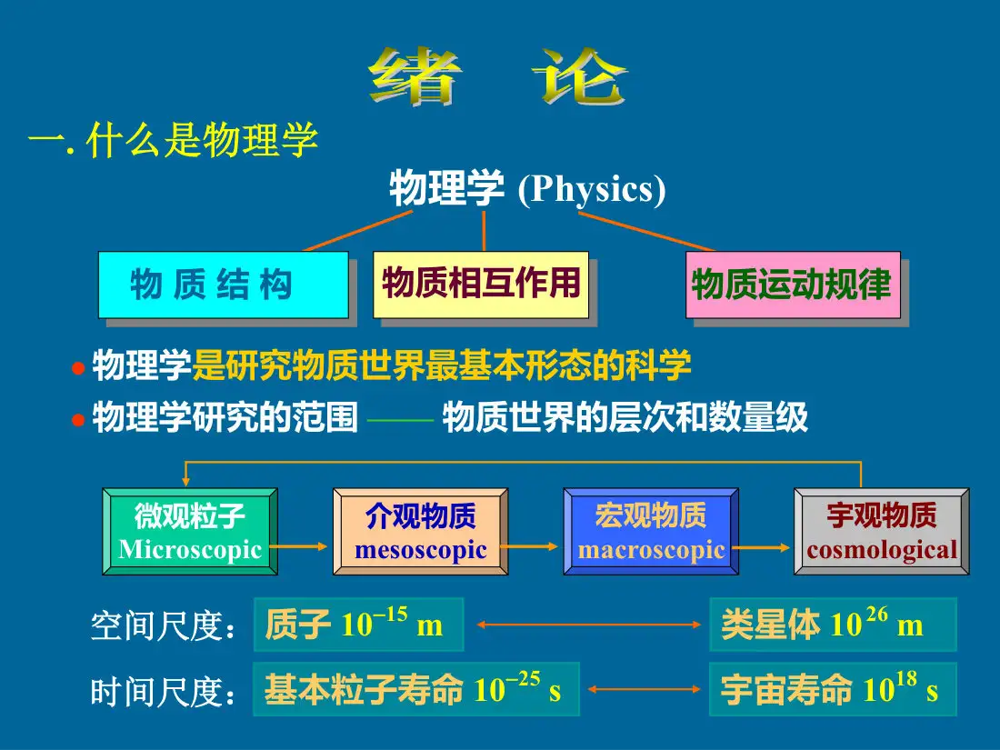
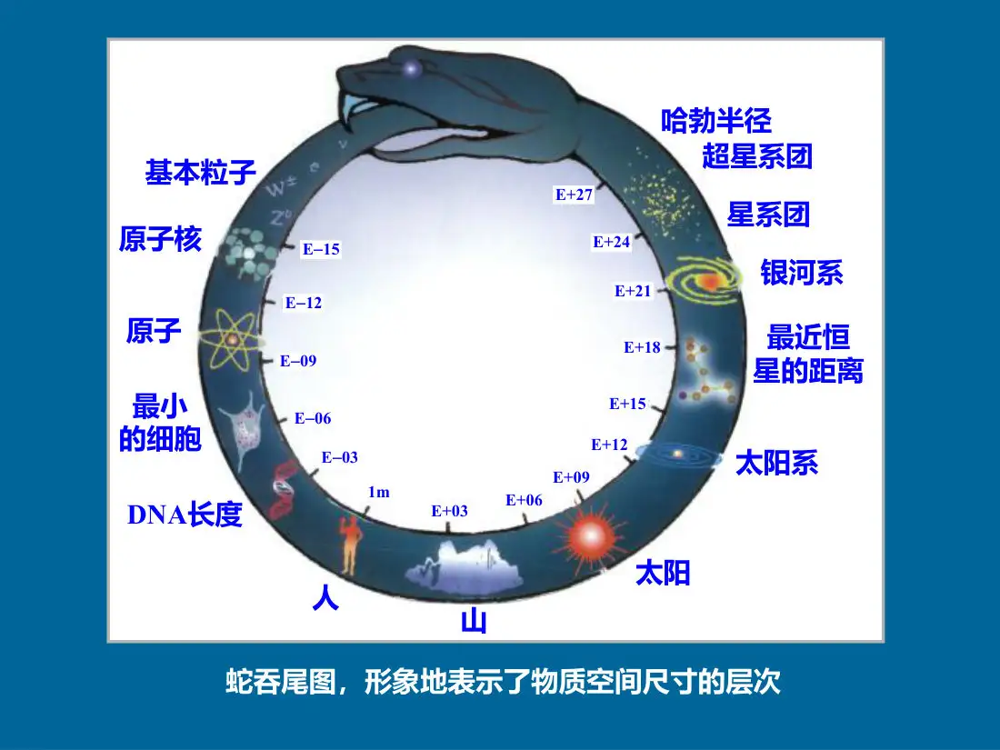
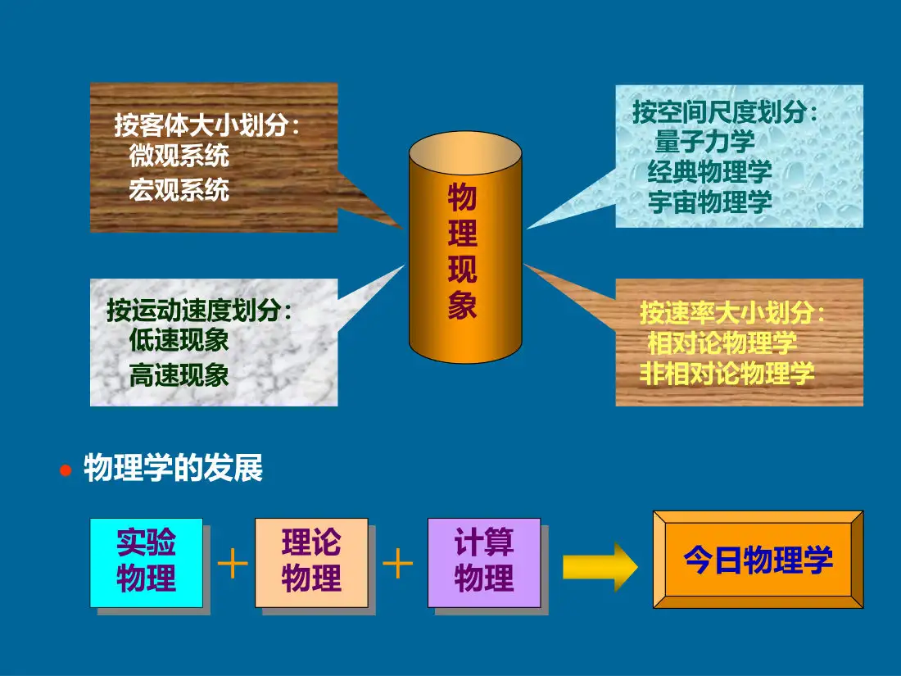
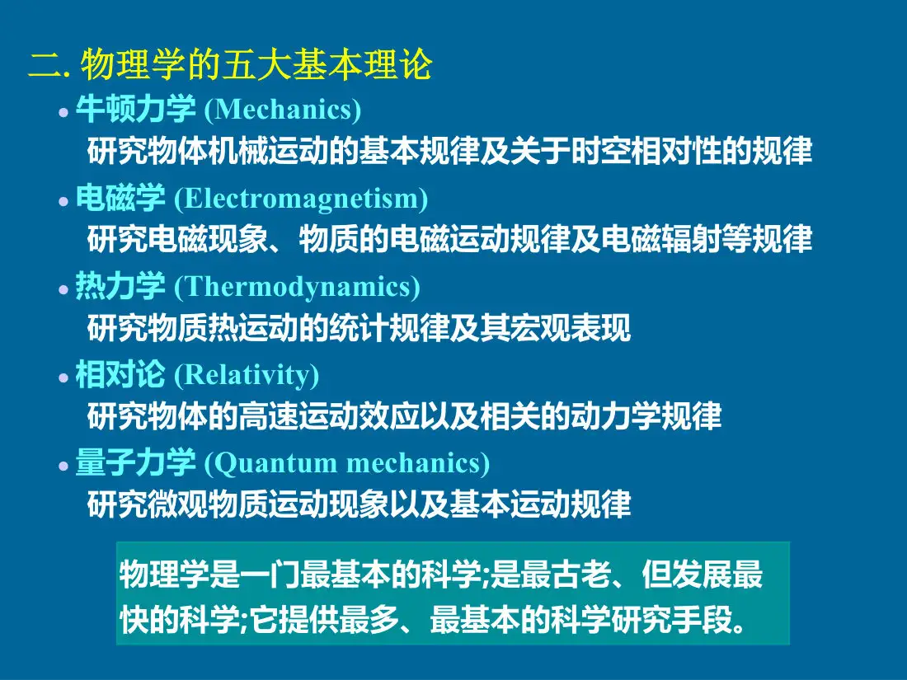
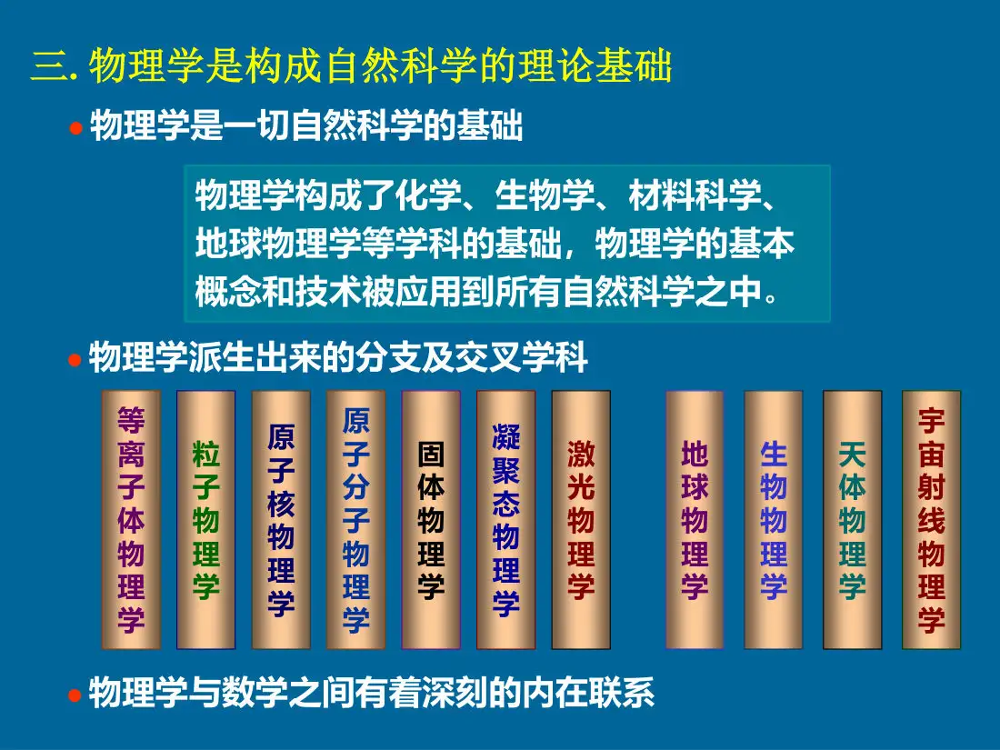
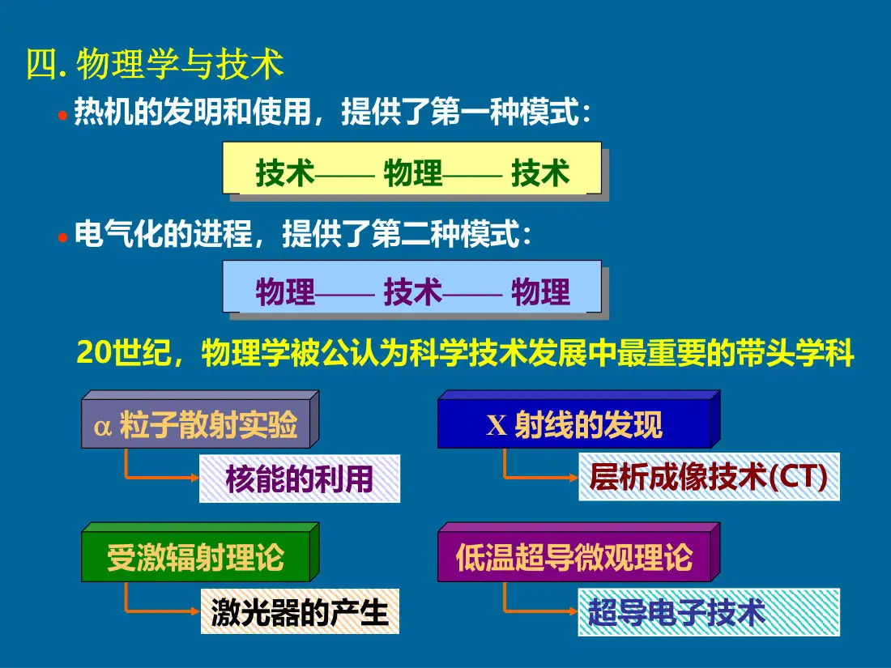
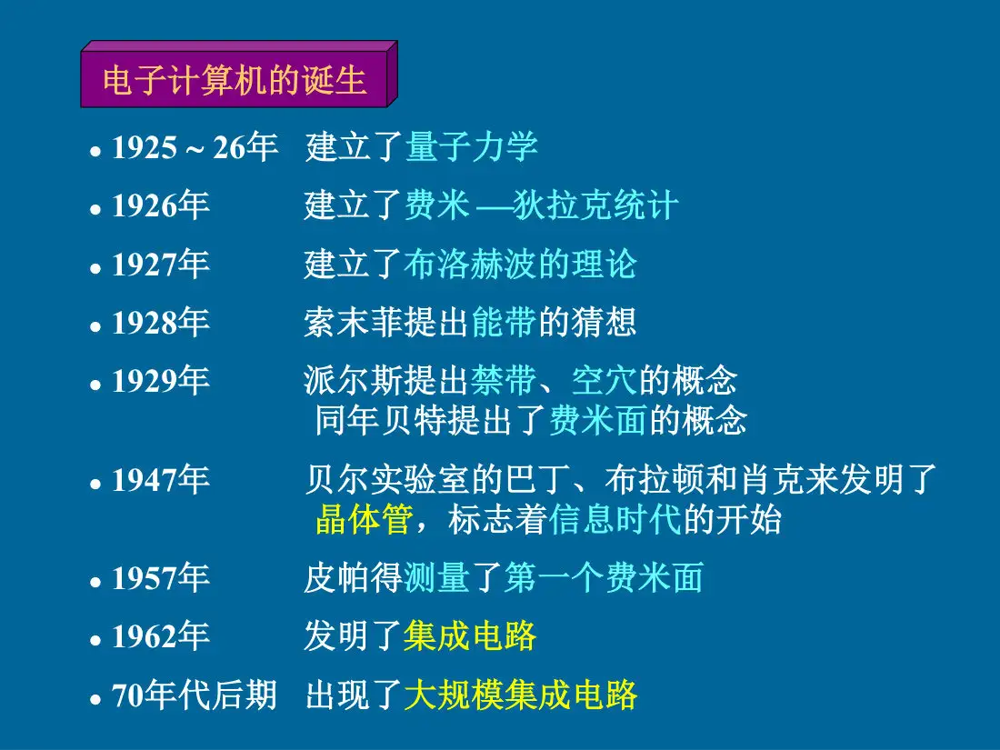
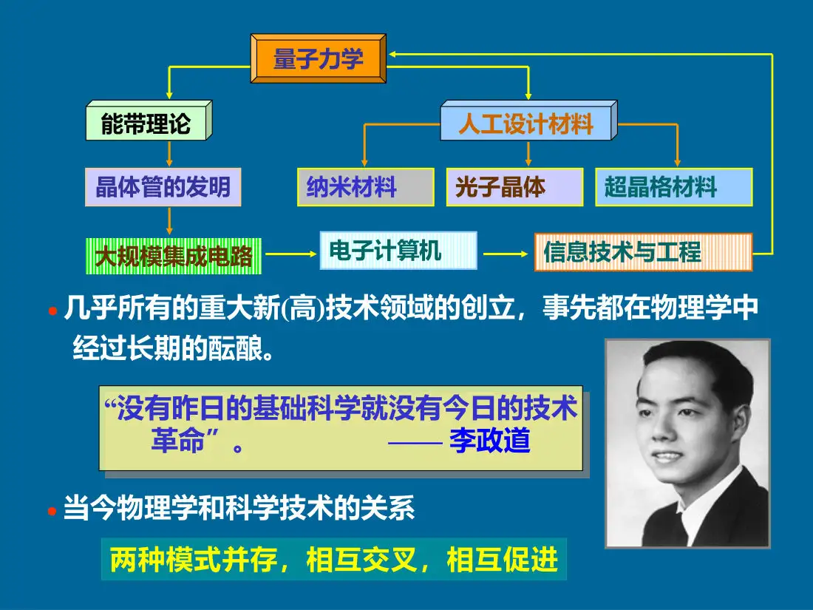
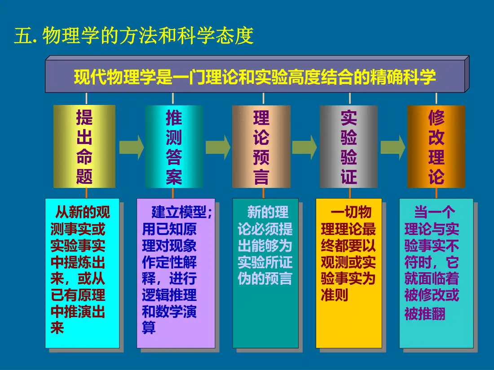
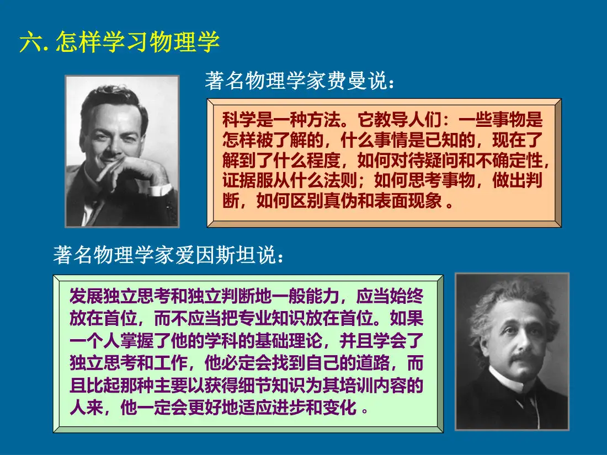

# 《大学物理》绪论（课件）

原件的每一页，下面附识别出的文字。

### 绪 绪 论

原文：

绪 绪 论

一. 什么是物理学

物理学 (Physics)

物 质 结 构

物质相互作用

物质运动规律

物理学是研究物质世界最基本形态的科学

⚫ 物理学研究的范围 物质世界的层次和数量级

微观粒子Microscopic介观物质mesoscopic

宏观物质 macroscopic

宇观物质cosmological

空间尺度：

质子 $1 1 1 - 1 5$ m

类星体 $| | \mathbf { \eta } | | ^ { p _ { 0 } } | | \mathbf { \eta } | |$

时间尺度： 基本粒子寿命 $1 0 ^ { \circ }$

宇宙寿命 $1 0 ^ { 1 8 }$

### 蛇吞尾图，形象地表示了物质空间尺寸的层次

原文：

蛇吞尾图，形象地表示了物质空间尺寸的层次

### 物理现象

原文：

物理现象

按客体大小划分：微观系统宏观系统

按运动速度划分：低速现象高速现象

物理学的发展按速率大小划分：相对论物理学非相对论物理学按空间尺度划分：量子力学经典物理学宇宙物理学

今日物理学

计算物理

理论物理实验物理

### 二.物理学的五大基本理论

原文：

二.物理学的五大基本理论

牛顿力学 (Mechanics)研究物体机械运动的基本规律及关于时空相对性的规律

● 电磁学 (Electromagnetism)研究电磁现象、物质的电磁运动规律及电磁辐射等规律

热力学 (Thermodynamics)研究物质热运动的统计规律及其宏观表现

相对论 (Relativity)研究物体的高速运动效应以及相关的动力学规律

量子力学 (Quantum mechanics)研究微观物质运动现象以及基本运动规律

物理学是一门最基本的科学;是最古老、但发展最快的科学;它提供最多、最基本的科学研究手段。

### 三. 物理学是构成自然科学的理论基础⚫ 物理学是一切自然科学的基础

原文：

三. 物理学是构成自然科学的理论基础⚫ 物理学是一切自然科学的基础

物理学构成了化学、生物学、材料科学、地球物理学等学科的基础，物理学的基本概念和技术被应用到所有自然科学之中。

⚫ 物理学派生出来的分支及交叉学科

宙射线物理

体物理

物物理

球物理

光物理

聚态物理

体物理

子分子物理

子核物理

子物理

离子体物理

⚫ 物理学与数学之间有着深刻的内在联系

### 四. 物理学与技术

原文：

四. 物理学与技术

● 热机的发明和使用，提供了第一种模式：

技术—— 物理—— 技术

电气化的进程，提供了第二种模式：

物理—— 技术—— 物理

20世纪，物理学被公认为科学技术发展中最重要的带头学科

 粒子散射实验

X 射线的发现

核能的利用

层析成像技术(CT)

受激辐射理论

低温超导微观理论

激光器的产生

超导电子技

### 电子计算机的诞生

原文：

电子计算机的诞生

● 1925  26年 建立了量子力学

● 1926年 建立了费米 ⎯狄拉克统计

● 1927年 建立了布洛赫波的理论

● 1928年 索末菲提出能带的猜想

● 1929年 派尔斯提出禁带、空穴的概念同年贝特提出了费米面的概念

● 1947年 贝尔实验室的巴丁、布拉顿和肖克来发明了晶体管，标志着信息时代的开始

● 1957年 皮帕得测量了第一个费米面

● 1962年 发明了集成电路

● 70年代后期 出现了大规模集成电路

### 量子力学

原文：

量子力学

能带理论

人工设计材料

晶体管的发明

纳米材料

光子晶体

超晶格材料

大规模集成电路

电子计算机

信息技术与工程

●几乎所有的重大新(高)技术领域的创立，事先都在物理学中经过长期的酝酿。

“没有昨日的基础科学就没有今日的技术革命” 李政道

●当今物理学和科学技术的关系

两种模式并存，相互交叉，相互促进

### 五. 物理学的方法和科学态度

原文：

五. 物理学的方法和科学态度

现代物理学是一门理论和实验高度结合的精确科学

修
改
理
论

实
验
验
证

理
论
预
言

推
测
答
案

提
出
命
题

当一个理论与实验事实不符时，它就面临着被修改或被推翻一切物理理论最终都要以观测或实验事实为准则

新的理论必须提出能够为实验所证伪的预言

建立模型；用已知原理对现象作定性解释，进行逻辑推理和数学演算

从新的观 测事实或 实验事实 中提炼出 来，或从 已有原理 中推演出 来

### 六. 怎样学习物理学

原文：

六. 怎样学习物理学

著名物理学家费曼说：

科学是一种方法。它教导人们：一些事物是怎样被了解的，什么事情是已知的，现在了解到了什么程度，如何对待疑问和不确定性，证据服从什么法则；如何思考事物，做出判断，如何区别真伪和表面现象。

著名物理学家爱因斯坦说：

发展独立思考和独立判断地一般能力，应当始终放在首位，而不应当把专业知识放在首位。如果一个人掌握了他的学科的基础理论，并且学会了独立思考和工作，他必定会找到自己的道路，而且比起那种主要以获得细节知识为其培训内容的人来，他一定会更好地适应进步和变化。

### ● 学习的关键：

原文：

学习的观点：从整体上逻辑地、协调地学习物理学，了解物理学中各个分支之间的相互联系。

● 学习的关键：

勤于思考

悟物穷理

● 学习的重点：

●物理模型 ●数学表述●研究方法与适用条件

七. 教学计划

● 参考书：
