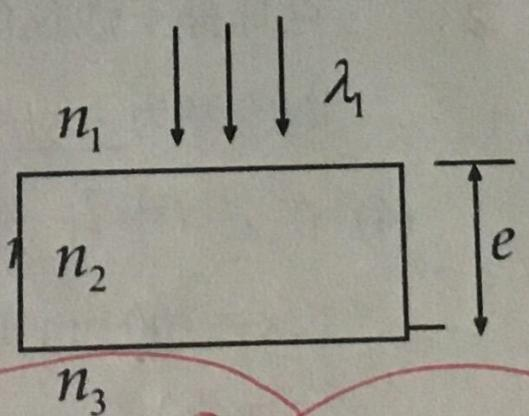

# 《大学物理》薄膜干涉习题参考答案

原件经识别和整理；“参考解答”是我们补的。

## 薄膜干涉

### 选择 1

一束波长为 $\lambda$ 的单色光由空气垂直入射到折射率为 $n$ 的透明薄膜上，透明薄膜放在空气中，要使反射光得到干涉加强，则薄膜最小的厚度为

- A. $\lambda / 4$
- B. $\lambda / (4n)$
- C. $\lambda / 2$
- D. $\lambda / (2n)$

答案：B。

知识点：[光程、光程差与反射时的半波损失](../../../topics/大学物理/光程与半波损失.md)、[等倾干涉与等厚干涉（劈尖、牛顿环）](../../../topics/大学物理/薄膜干涉.md)

### 填空 1

在玻璃（折射率为 1.60）表面镀一层 $MgF_2$（折射率为 1.38）薄膜作为增透膜。为了使波长为 500 nm 的光从空气（折射率为 1.00）正入射时尽可能少反射，$MgF_2$ 薄膜的最小厚度应是 $\underline{90.6\ \text{nm}}$。

答案：90.6 nm。$\left(\dfrac{\lambda}{4n}=\dfrac{500}{4\times 1.38}\approx 90.6\ \text{nm}\right)$，$2e=(2k+1)\dfrac{\lambda}{2}$。

知识点：[等倾干涉与等厚干涉（劈尖、牛顿环）](../../../topics/大学物理/薄膜干涉.md)、[光程、光程差与反射时的半波损失](../../../topics/大学物理/光程与半波损失.md)

### 填空 2

见右图，平行单色光垂直照射到薄膜上，经上下两表面反射的两束光发生干涉，若薄膜的厚度为 $e$，并且 $n_1 < n_2 > n_3$，$\lambda_1$ 为入射光在折射率为 $n_1$ 的媒质中的波长，则两束反射光在相遇点的光程差为 $\underline{2n_2e+\dfrac{\lambda_0}{2}}$，相位差为 $\underline{\dfrac{2\pi}{\lambda_1}\cdot\dfrac{2n_2e+\lambda_0/2}{n_1}}$（按原答案写法：$\dfrac{2\pi}{\lambda_0}$）。

$$\lambda_1=\frac{\lambda_0}{n_1}\quad\therefore\ \lambda_0=n_1\lambda_1$$

知识点：[光程、光程差与反射时的半波损失](../../../topics/大学物理/光程与半波损失.md)、[等倾干涉与等厚干涉（劈尖、牛顿环）](../../../topics/大学物理/薄膜干涉.md)

### 计算 1

白光垂直照射到空气中一厚度为 380 nm 的肥皂膜上，设肥皂膜的折射率为 1.32，试问该膜的正面呈现什么颜色？背面呈现什么颜色？

正：

$$\delta=2n_2e+\frac{\lambda}{2}=k\lambda$$

$$\lambda=\frac{2\times 1.32\times 380}{k-\frac{1}{2}}=\begin{cases}k=1 & \text{舍}\\ k=2 & 668\ \text{nm}\quad\text{红}\\ k=3 & 401\ \text{nm}\quad\text{紫}\\ k=4 & \text{舍}\end{cases}$$

反：

$$\delta=2n_2e=k\lambda,\qquad \lambda=\frac{2n_2e}{k}$$

$$\begin{cases}k=1,\,3 & \text{舍}\\ k=2 & 501.6\ \text{nm}\quad\text{绿}\end{cases}$$

答案：正面呈现红色（668 nm）和紫色（401 nm）；背面呈现绿色（501.6 nm）。

知识点：[光程、光程差与反射时的半波损失](../../../topics/大学物理/光程与半波损失.md)
