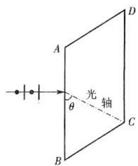

# 《大学物理》衍射习题答案（105—110）

原件经识别和整理；“参考解答”是我们补的。

## 一、选择题

### 选择 1

在夫琅和费单缝衍射中，对于给定的入射光，当缝宽度变小时，除中央亮纹的中心位置不变外，各级衍射条纹：

- A. 对应的衍射角变小
- B. 对应的衍射角变大
- C. 对应的衍射角也不变
- D. 光强也不变

答案：B。

知识点：[自然光与偏振光、马吕斯定律与布儒斯特定律](../../../topics/大学物理/光的偏振.md)

### 选择 2

孔径相同的电子显微镜和光学显微镜比较，前者分辨本领大的原因是：

- A. 电子可以自由移动
- B. 电子衍射的波长比可见光短
- C. 电子衍射的波长比可见光波长大
- D. 电子的穿透力强

答案：B。

知识点：[自然光与偏振光、马吕斯定律与布儒斯特定律](../../../topics/大学物理/光的偏振.md)

### 选择 3

一束白光垂直照射在一光栅上，在形成的同一级光栅光谱中，偏离中央明纹最远的是：

- A. 紫光
- B. 绿光
- C. 黄光
- D. 红光

答案：D。

知识点：[自然光与偏振光、马吕斯定律与布儒斯特定律](../../../topics/大学物理/光的偏振.md)

### 选择 4

波长 $\lambda = 550 \ \mathrm{nm}$ ($1 \mathrm{nm} = 10^{-9} \mathrm{m}$) 的单色光垂直入射于光栅常数 $d = 2 \times 10^{-4} \ \mathrm{cm}$ 的平面衍射光栅上，可能观察到的光谱线的最大级次为：

- A. 2
- B. 3
- C. 4
- D. 5

答案：B。

## 二、填空题

知识点：[自然光与偏振光、马吕斯定律与布儒斯特定律](../../../topics/大学物理/光的偏振.md)、[电磁波的基本性质](../../../topics/大学物理/电磁波.md)

### 填空 1

波长为 $500\mathrm{nm}$ 的单色平行光垂直照射到宽为 $0.25\mathrm{mm}$ 的单缝上，单缝后置一凸透镜以观测衍射条纹。如果幕上中央条纹两旁第三个暗条纹之间的距离为 $3\mathrm{mm}$，则透镜的焦距为 `0.25` m。

参考解答：**结论：** 透镜焦距 $f = 0.25\,\mathrm{m}$。

**推理与计算过程：**

单缝夫琅禾费衍射中，第 $k$ 级暗条纹满足：

$$a \sin\theta_k = k\lambda$$

在小角近似下 $\sin\theta_k \approx \tan\theta_k = \dfrac{x_k}{f}$，故第 $k$ 级暗纹到中央的距离为：

$$x_k = \frac{k\lambda f}{a}$$

中央条纹两旁第三个暗条纹（$k=3$）之间的距离为：

$$\Delta x = 2x_3 = \frac{6\lambda f}{a}$$

解出焦距：

$$f = \frac{\Delta x \cdot a}{6\lambda}$$

代入数据 $\Delta x = 3\times10^{-3}\,\mathrm{m}$，$a = 0.25\times10^{-3}\,\mathrm{m}$，$\lambda = 500\times10^{-9}\,\mathrm{m}$：

$$f = \frac{3\times10^{-3} \times 0.25\times10^{-3}}{6 \times 500\times10^{-9}} = \frac{7.5\times10^{-7}}{3\times10^{-6}} = 0.25\,\mathrm{m}$$

知识点：[自然光与偏振光、马吕斯定律与布儒斯特定律](../../../topics/大学物理/光的偏振.md)

### 填空 2

一单色平行光垂直照射一单缝，若其第三条明纹位置正好和波长为 $600\mathrm{nm}$ 的单色光入射时的第二级明纹位置一样，则前一种单色光的波长为 `428.6` nm。

参考解答：**结论：前一种单色光的波长为 $428.6\ \mathrm{nm}$。**

单缝衍射明纹（近似）满足

$$
a\sin\theta=\pm(2k+1)\frac{\lambda}{2},\qquad k=1,2,3,\ldots
$$

第三条明纹对应 $k=3$，第二级明纹对应 $k=2$。同一位置意味着衍射角 $\theta$ 相同，因此

$$
(2\times3+1)\frac{\lambda}{2}=(2\times2+1)\frac{600\ \mathrm{nm}}{2}.
$$

解得

$$
\lambda=\frac{5}{7}\times600\ \mathrm{nm}=428.6\ \mathrm{nm}.
$$

知识点：[自然光与偏振光、马吕斯定律与布儒斯特定律](../../../topics/大学物理/光的偏振.md)、[光程、光程差与反射时的半波损失](../../../topics/大学物理/光程与半波损失.md)

### 填空 3

在夫琅禾费单缝衍射实验中，$\theta$ 满足 $b \sin \theta = \pm 3 \lambda$（注：原文此处公式识别有误，根据上下文“分成6个半波带”推断应为 $b \sin \theta = 3\lambda$ 或类似表达，通常半波带数 $N = \frac{b \sin \theta}{\lambda/2}$，若分为6个半波带，则 $b \sin \theta = 3\lambda$），表明在条纹对应衍射角的方向上，单缝处的波振面被分成 `6` 个半波带，此时在位于透镜焦平面的屏上将形成 `暗` 纹（明、暗）。如果透镜焦距为 $f$，则条纹在透镜焦平面屏上的位置 $x = \pm \frac { f } { b } k \lambda$（注：此处原文公式似乎指代暗纹位置通用公式，结合语境可能是 $x = \pm \frac{f \cdot 3\lambda}{b}$ 或泛指第k级暗纹公式）。

参考解答：6；暗

根据菲涅耳半波带法，单缝波阵面被划分的半波带数 $N$ 与衍射角 $\theta$ 的关系为 $N = \frac{b \sin \theta}{\lambda/2}$。将题设条件 $b \sin \theta = 3\lambda$ 代入，得 $N = \frac{3\lambda}{\lambda/2} = 6$，即分成 6 个半波带。由于半波带数为偶数，相邻半波带发出的子波在屏上会聚点处两两干涉相消，故形成暗纹。对于夫琅禾费单缝衍射，第 $k$ 级暗纹满足 $b \sin \theta_k = k\lambda$，在近轴小角度近似下 $\sin \theta_k \approx \tan \theta_k = x_k / f$，联立可得暗纹位置公式 $x_k = \pm \frac{f k \lambda}{b}$，本题中 $k=3$，对应 $x = \pm \frac{3f\lambda}{b}$。

知识点：[单缝衍射的暗纹条件与中央明纹宽度](../../../topics/大学物理/单缝夫琅禾费衍射.md)、[光程、光程差与反射时的半波损失](../../../topics/大学物理/光程与半波损失.md)

### 填空 4

平行单色光垂直入射于单缝上，观察夫琅禾费衍射．若屏上P点处为第二级暗纹，则单缝处波面相应地可划分为 `4` 个半波带．若将单缝宽度缩小一半，P点处将是第 `1` 级 `暗` 纹。

参考解答：4；1；暗

夫琅禾费单缝衍射暗纹条件为 $a \sin\theta = k\lambda$（$k=\pm1,\pm2,\cdots$），对应波面可划分为 $2k$ 个半波带。第二级暗纹 $k=2$，故半波带数为 $2\times2=4$。当缝宽缩小一半即 $a' = a/2$ 时，同一 P 点衍射角 $\theta$ 不变，光程差变为 $\frac{a}{2}\sin\theta = \frac{k\lambda}{2} = \lambda$，满足 $k'=1$ 的暗纹条件，因此 P 点变为第一级暗纹。

知识点：[单缝衍射的暗纹条件与中央明纹宽度](../../../topics/大学物理/单缝夫琅禾费衍射.md)、[光程、光程差与反射时的半波损失](../../../topics/大学物理/光程与半波损失.md)

### 填空 5

月球距地面大约 $3 . 8 6 \times 1 0 ^ { 5 } \mathrm{km}$ ，假设月光波长可按 $\lambda = 5 5 0 \mathrm{nm}$ 计算，那么在地球上用直径 $D = 5 0 0 \mathrm{cm}$ 的天文望远镜恰好能分辨月球表面相距为 `51.8` m的两点。

参考解答：
$$
\boxed{51.8\ \mathrm{m}}
$$

根据圆孔衍射，望远镜的最小分辨距离为

$$
\Delta y_{\min}=\frac{1.22\lambda}{D},
$$

其中

$$
\lambda=550\,\mathrm{nm}=5.50\times10^{-7}\,\mathrm{m},\qquad
D=500\,\mathrm{cm}=5.00\,\mathrm{m}.
$$

因此

$$
\Delta y_{\min}
=\frac{1.22\times5.50\times10^{-7}}{5.00}
=1.342\times10^{-7}\,\mathrm{m}.
$$

月球距离为

$$
L=3.86\times10^5\,\mathrm{km}=3.86\times10^8\,\mathrm{m}.
$$

可分辨的最小表面距离为

$$
\Delta y=L\Delta y_{\min}
=3.86\times10^8\times1.342\times10^{-7}
\approx51.8\,\mathrm{m}.
$$

所以该望远镜恰好能分辨月球表面相距约 $\boxed{51.8\,\mathrm{m}}$ 的两点。

知识点：[瑞利判据与光学仪器的分辨本领](../../../topics/大学物理/光学仪器分辨本领.md)、[光栅方程、缺级现象与光谱分辨](../../../topics/大学物理/衍射光栅.md)

### 填空 6

设天空中两颗星对于一望远镜的张角为 $4 . 8 4 \times 1 0 ^ { - 6 } \mathrm { r a d }$ ，它们都发出波长为 $550 \mathrm{nm}$ 的光，为了分辨出这两颗星，望远镜物镜的口径至少要等于 `13.9` cm。$(1 \mathrm{nm} = 10^{-9} \mathrm{m})$

解：由最小分辨角公式
$$
\theta = 1. 2 2 \frac {\lambda}{D}
$$
$$
\therefore \quad D = 1. 2 2 \frac {\lambda}{\theta} = 1. 2 2 \times \frac {5 . 5 \times 1 0 ^ {-7}}{4 . 8 4 \times 1 0 ^ {-6}} \approx 1 3. 8 6 \mathrm{cm}
$$
*(注：原题解答中 $\lambda$ 换算为 $5.5 \times 10^{-5}$ cm 进行计算)*

参考解答：**答案：** 望远镜物镜口径至少为 **13.9 cm**。

**推理：**  
根据圆孔衍射的最小分辨角公式  

$$
\theta = 1.22\frac{\lambda}{D}
$$

可得  

$$
D = 1.22\frac{\lambda}{\theta}
$$

代入数据：  

$$
\lambda = 550\ \text{nm} = 5.5\times 10^{-7}\ \text{m}
$$

$$
\theta = 4.84\times 10^{-6}\ \text{rad}
$$

所以  

$$
D = 1.22 \times \frac{5.5\times 10^{-7}}{4.84\times 10^{-6}}
\approx 0.1386\ \text{m}
$$

即  

$$
D \approx 13.9\ \text{cm}
$$

知识点：[瑞利判据与光学仪器的分辨本领](../../../topics/大学物理/光学仪器分辨本领.md)

### 填空 7

某单色光垂直入射到一个每毫米有 800 条刻线的光栅上，如果第一级谱线的衍射角为 $3 0 ^ { \circ }$ ，则入射光的波长应为 `625` nm。

参考解答：**结论**：$\lambda = 625\,\mathrm{nm}$

**推理过程**：

光栅常数为

$$
d = \frac{1\,\mathrm{mm}}{800} = \frac{1\times 10^{-3}\,\mathrm{m}}{800} = 1.25\times 10^{-6}\,\mathrm{m}
$$

由光栅方程（垂直入射、第一级谱线 $m=1$）：

$$
d\sin\theta = m\lambda
$$

代入 $\theta = 30^\circ$、$m=1$：

$$
\lambda = d\sin 30^\circ = 1.25\times 10^{-6}\,\mathrm{m} \times 0.5 = 6.25\times 10^{-7}\,\mathrm{m} = 625\,\mathrm{nm}
$$

知识点：[光栅方程、缺级现象与光谱分辨](../../../topics/大学物理/衍射光栅.md)

### 填空 8

用平行的白光垂直入射在平面透射光栅上时，波长为 $440\mathrm{nm}$ 的第3级光谱线将与波长为 `660` nm 的第2级光谱线重叠。 $( 1 \ \mathrm{nm} = 10 ^ { - 9 } \mathrm{m} )$

参考解答：结论：  
填 **660 nm**。

---

**推导过程**  
平面透射光栅的光栅方程为  

$$
d \sin\theta = k\lambda
$$
  
设两光重叠时衍射角相同，则  

$$
k_{1}\lambda_{1} = k_{2}\lambda_{2}
$$
  
已知 $\lambda_{1} = 440\,\mathrm{nm}$，$k_{1} = 3$，$k_{2} = 2$，求 $\lambda_{2}$：  

$$
3 \times 440 = 2 \times \lambda_{2}
$$
  

$$
\lambda_{2} = \frac{3 \times 440}{2} = 660\,\mathrm{nm}
$$
  

所以重叠的谱线波长为 $660\,\mathrm{nm}$，恰在可见光范围内，合理。

知识点：[光栅方程、缺级现象与光谱分辨](../../../topics/大学物理/衍射光栅.md)

### 填空 9

如图所示，为了测量某种晶体原子层之间的间距 $d$，用 $0.2\mathrm{nm}$ 的 X 射线照射该晶体，实验测得X射线与晶面夹角为 $1 5 ^ { \circ }$ 时获得第一级反射极大，则 $d =$ `0.386` nm。

## 三、计算题

参考解答：结论  
$d = 0.386\ \mathrm{nm}$

推理与计算过程  
由布拉格公式  

$$
2d\sin\theta = k\lambda
$$
  
取第一级反射极大，$k = 1$，$\lambda = 0.2\ \mathrm{nm}$，$\theta = 15^\circ$。  

$$
d = \frac{\lambda}{2\sin\theta} = \frac{0.2}{2\sin 15^\circ}
$$
  
$\sin 15^\circ = \frac{\sqrt{6} - \sqrt{2}}{4} \approx 0.258819$，  

$$
d \approx \frac{0.2}{2 \times 0.258819} \approx \frac{0.2}{0.517638} \approx 0.386\ \mathrm{nm}
$$
  
故答案为 **0.386**。

知识点：[等倾干涉与等厚干涉（劈尖、牛顿环）](../../../topics/大学物理/薄膜干涉.md)

### 计算 1

迎面开来的汽车，其两车灯相距 $l$ 为 $1 \mathrm{~m}$，汽车离人多远时，两灯刚能为人眼所分辨?(假定人眼瞳孔直径 $D$ 为 $3\mathrm{mm}$，光在空气中的有效波长为 $\lambda = 5 0 0 \ \mathrm{nm} , \ 1 \ \mathrm{nm} = 1 0 ^ { - 9 } \ \mathrm{m}$ )。

**分析：**
两物体能否被分辨，取决于两物对光学仪器通光孔（包括人眼）的张角 $\theta$ 和光学仪器的最小分辨角 $\theta _ { 0 }$ 的关系。当 $\theta \geq \theta _ { 0 }$ 时能分辨，其中 $\theta = \theta _ { 0 }$ 为恰能分辨。在本题中 $\theta _ { 0 } = 1 . 2 2 { \frac { \lambda } { D } }$ 为一定值，而 $\theta \approx { \frac { l } { d } }$ ，式中 $l$ 为两灯间距，$d$ 为人与车之间的距离。$d$ 越大或 $l$ 越小，$\theta$ 就越小，当 $\theta < \theta _ { 0 }$ 时两灯就不能被分辨，这与我们的生活经验相符合。

**解：**
当 $\theta = \theta _ { 0 }$ 时， ${ \frac { l } { d } } = 1 . 2 2 { \frac { \lambda } { D } }$ ，此时，人与车之间的距离为：
$$
d = { \frac { D l } { 1 . 2 2 \lambda } } = \frac{3 \times 10^{-3} \times 1}{1.22 \times 500 \times 10^{-9}} \approx 4918 \mathrm{~m}
$$

参考解答：**结论：**  
（1）两偏振片偏振化方向夹角为  

$$
\alpha_2=\arccos\sqrt{\frac{2}{3}}\approx 35^\circ16'
$$
  
（2）夹角为  

$$
\alpha_1=\arccos\frac{\sqrt3}{3}\approx 54^\circ44'
$$

---

**关键过程：**

自然光通过第一片偏振片后，光强变为原来的一半，即  

$$
I_1=\frac{I_0}{2}
$$
  
再通过第二片偏振片，由马吕斯定律：

$$
I_2=I_1\cos^2\alpha=\frac{I_0}{2}\cos^2\alpha
$$

---

**（1）要使透射光强为入射光强的 $1/3$**

即  

$$
\frac{I_0}{2}\cos^2\alpha_2=\frac{I_0}{3}
$$
  
消去 $I_0$：

$$
\cos^2\alpha_2=\frac{2}{3}
$$
  
所以  

$$
\alpha_2=\arccos\sqrt{\frac{2}{3}}\approx 35^\circ16'
$$

---

**（2）要使透射光强为最大透射光强的 $1/3$**

最大透射光强出现在两偏振片偏振化方向平行时，即 $\alpha=0$，此时  

$$
I_{\max}=\frac{I_0}{2}
$$
  
条件给出  

$$
\frac{I_0}{2}\cos^2\alpha_1=\frac13 \cdot \frac{I_0}{2}
$$
  
所以  

$$
\cos^2\alpha_1=\frac13
$$
  
得  

$$
\alpha_1=\arccos\frac{\sqrt3}{3}\approx 54^\circ44'
$$

知识点：[自然光与偏振光、马吕斯定律与布儒斯特定律](../../../topics/大学物理/光的偏振.md)

### 计算 2

一单缝的宽度为 $b$，以波长为 $\lambda$ 的单色光垂直照射，设透镜的焦距为 $f$，屏在透镜的焦平面处。求：
(1) 中央衍射明条纹的宽度 $\Delta x _ { 0 }$ ?
(2) 第二级明条纹和第二级暗条纹分别距离中央明纹中心的距离?

**解：**
(1) 中央明条纹的宽度，就是两条第一级暗纹之间所夹的宽度。
暗纹产生条件： $b \sin \theta = k \lambda$
由几何关系（小角度近似）： ${ \frac { \Delta x } { 2 f } } \approx \sin \theta_1$ （注：此处指第一级暗纹位置 $x_1$，中央宽度为 $2x_1$）
或者更直接地，第一级暗纹位置 $x_1 = \frac{f\lambda}{b}$，故中央明纹宽度：
$$
\Delta x _ { 0 } = 2 x_1 = { \frac { 2 f \lambda } { b } }
$$

(2) 明纹产生的条件： $b \sin \theta = ( 2 k + 1 ) \frac { \lambda } { 2 }$ ，且 ${ \frac { x } { f } } \approx \sin \theta$
当 $k = 1$ 时为第一级明纹，当 $k=2$ 时为第二级明纹？
*注意：通常教材定义中央为 $k=0$ 明纹，两侧第一级明纹对应 $k=1$ 还是 $k=0$ 需看具体公式定义。题目问“第二级明条纹”，通常指 $k=2$ (若公式为 $(2k+1)\lambda/2$ 且 $k=1,2...$ 对应第1,2级) 或者 $k=1$ (若从中央往外数)。*
根据原文解答逻辑：
原文写“当 $k=2$ 时”（此处可能有误，通常第二级明纹对应 $k=2$ 若公式为 $(2k+1)\lambda/2$ 中的 $k$ 取值从1开始算第一级？或者原文意指 $k$ 取特定值）。
让我们看原文给出的结果：
原文：当 $k=2$ 时（推测是指第二级明纹，即 $m=2$，对应 $k=2$ 代入 $(2k+1)$? 不，通常第二级明纹是 $b \sin \theta = 2.5 \lambda$ 或 $3.5 \lambda$? 夫琅禾费单缝衍射明纹条件 $a \sin \phi = \pm \frac{(2k+1)}{2}\lambda, k=1,2,...$。$k=1$ 是第一级，$k=2$ 是第二级。
代入 $k=2$:
$$
b \sin \theta = \frac{5 \lambda}{2} \implies x = \frac{5 f \lambda}{2 b}
$$
同理：第二级暗纹产生条件为 $k = 2$ 时，即： $b \sin \theta = 2 \lambda ; { \frac { x } { f } } \approx \sin \theta$ ，由此两式可得：
$$
x = { \frac { 2 f \lambda } { b } }
$$

参考解答：**结论：** 第二个偏振片与第一个偏振片的偏振化方向之间的夹角 $\theta = 45^\circ$ 时，透射光强最大。

**推理过程：**

1. **通过 $P_1$：** 自然光经过第一个偏振片后变为线偏振光，光强减半：
   $$I_1 = \frac{I_0}{2}$$

2. **通过 $P_2$：** 由马吕斯定律，透过第二个偏振片的光强为：
   $$I_2 = I_1 \cos^2\theta = \frac{I_0}{2}\cos^2\theta$$

3. **通过 $P_3$：** 因 $P_1 \perp P_3$，故 $P_2$ 与 $P_3$ 的夹角为 $(90^\circ - \theta)$，再次应用马吕斯定律：
   $$I_3 = I_2 \cos^2(90^\circ - \theta) = \frac{I_0}{2}\cos^2\theta \sin^2\theta$$

4. **求极值：** 利用二倍角公式 $\sin 2\theta = 2\sin\theta\cos\theta$ 化简：
   $$I_3 = \frac{I_0}{8}\sin^2 2\theta$$

   当 $\sin^2 2\theta = 1$，即 $2\theta = 90^\circ$ 时，$I_3$ 取最大值 $\dfrac{I_0}{8}$，此时：
   $$\theta = 45^\circ$$

知识点：[自然光与偏振光、马吕斯定律与布儒斯特定律](../../../topics/大学物理/光的偏振.md)

### 计算 3

已知，单缝宽度 $b = 1 . 0 \times 1 0 ^ { - 4 } \mathrm{m}$ ，透镜焦距 $f = 0 . 5 0 \mathrm{m}$ ，用 $\lambda _ { 1 } = 4 0 0 \mathrm{nm}$ 和 $\lambda _ { 2 } = 7 6 0 \mathrm{nm}$ 的单色平行光分别垂直照射，求：
(1) 这两种光的第一级明纹离屏中心的距离，以及这两条明纹之间的距离；
(补充) 若用每厘米刻有1000条刻线的光栅代替这个单缝，则这两种单色光的第一级明纹分别距屏中心多远?这两条明纹之间的距离又是多少?

**解：**
(1) 当光垂直照射单缝时，屏上明纹条件：
$$
b \sin \theta = (2 k + 1) {\frac {\lambda}{2}} \quad (k = 1, 2, \dots) \quad \text {其中，} \sin \theta \approx \theta
$$
明纹位置 $x = \theta f = \left( 2 k + 1 \right) \frac { \lambda } { 2 b } f$
第一级明纹取 $k=1$。

当 $\lambda _ { 1 } { = } 4 0 0 \mathrm{nm}, k = 1$ 时：
$$
x _ { 1 } { = } 3 \times \frac { 400 \times 10^{-9} \times 0.50 } { 2 \times 1.0 \times 10^{-4} } = 3.0 \times 10 ^ { - 3 } \mathrm{m}
$$
当 $\lambda _ { 2 } { = } 7 6 0 \mathrm{nm}, k = 1$ 时：
$$
x _ { 2 } = 3 \times \frac { 760 \times 10^{-9} \times 0.50 } { 2 \times 1.0 \times 10^{-4} } = 5.7 \times 10 ^ { - 3 } \mathrm{m}
$$
条纹间距：
$$
\varDelta x { = } x _ { 2 } { - } x _ { 1 } { = } 2.7 { \times } 10 ^ { - 3 } \mathrm{m}
$$

(补充) 由光栅方程
$$
d \sin \theta = k \lambda \quad (\mathrm{k} = 0, 1, 2, \dots)
$$
光栅常数 $d = \frac {1 \mathrm{cm}}{1000} = 10^{-5} \mathrm{m}$
当 $\lambda _ { 1 } { = } 4 0 0 \mathrm { n m } , \mathrm { k } = 1$ 时：
$$
\sin \theta _ { 1 } = \frac { \lambda _ { 1 } } { d } = \frac { 4 \times 1 0 ^ { - 7 } } { 1 0 ^ { - 5 } } = 4 \times 1 0 ^ { - 2 }
$$
$$
\mathrm{x} _ {1} ^ {\prime} = f \cdot \tan \theta_ {1} \approx f \sin \theta_ {1} = 0.5 \times 4 \times 1 0 ^ {- 2} = 2 \times 1 0 ^ {- 2} \mathrm{m}
$$
当 $\lambda _ { 2 } { = } 7 6 0 \mathrm { n m } , \mathrm { k } { = } 1$ 时（注：原文此处写 $k=2$ 疑似笔误，题目问“第一级明纹”，应取 $k=1$。但看原文计算过程：$\theta_1 \approx \sin \theta_2 = 7.6 \times 10^{-2}$，这对应 $k=1$ 的情况。若 $k=2$，$\sin \theta = 0.152$。原文最后结果 $3.8 \times 10^{-2}$ 也是基于 $k=1$ 计算的 $0.5 \times 0.076$。故修正为 $k=1$）：
$$
\sin \theta _ { 2 } = \frac { \lambda _ { 2 } } { d } = \frac { 7.6 \times 10^{-7} } { 10^{-5} } = 7.6 \times 10^{-2}
$$
$$
\mathrm{x} _ {2} ^ {\prime} = f \cdot \tan \theta_ {2} \approx f \theta_ {2} = 0.5 \times 7.6 \times 1 0 ^ {- 2} = 3.8 \times 1 0 ^ {- 2} \mathrm{m}
$$
条纹间距：
$$
\Delta x ^ { ' } = x _ { 2 } ^ { ' } - x _ { 1 } ^ { ' } = 1.8 \times 1 0 ^ { - 2} \mathrm{m}
$$

参考解答：单缝第一级明纹：$x_{400}=3.0\times10^{-3}\,\mathrm m=3.0\,\mathrm{mm}$，$x_{760}=5.7\times10^{-3}\,\mathrm m=5.7\,\mathrm{mm}$，两纹间距 $\Delta x=2.7\,\mathrm{mm}$。

光栅第一级明纹：$x'_{400}=2.0\times10^{-2}\,\mathrm m=2.0\,\mathrm{cm}$，$x'_{760}=3.8\times10^{-2}\,\mathrm m=3.8\,\mathrm{cm}$，两纹间距 $\Delta x'=1.8\,\mathrm{cm}$。

**单缝部分**

单缝明纹条件（取主极大近似位置）

$$
b\sin\theta=(2k+1)\frac{\lambda}{2},\qquad k=1,2,\dots
$$

小角度下 $\sin\theta\approx\theta\approx x/f$，故第一级明纹（$k=1$）位置

$$
x=\frac{3\lambda f}{2b}
$$

代入 $b=1.0\times10^{-4}\,\mathrm m$，$f=0.50\,\mathrm m$：

$$
x_1=\frac{3\times400\times10^{-9}\times0.50}{2\times1.0\times10^{-4}}=3.0\times10^{-3}\,\mathrm m
$$

$$
x_2=\frac{3\times760\times10^{-9}\times0.50}{2\times1.0\times10^{-4}}=5.7\times10^{-3}\,\mathrm m
$$

$$
\Delta x=x_2-x_1=2.7\times10^{-3}\,\mathrm m
$$

**光栅部分**

光栅常数

$$
d=\frac{1\times10^{-2}}{1000}=1.0\times10^{-5}\,\mathrm m
$$

光栅方程 $d\sin\theta=k\lambda$，第一级 $k=1$：

$$
\sin\theta_{400}=\frac{400\times10^{-9}}{1.0\times10^{-5}}=4.0\times10^{-2}
$$

$$
x'_{400}=f\tan\theta_{400}\approx f\sin\theta_{400}=0.50\times4.0\times10^{-2}=2.0\times10^{-2}\,\mathrm m
$$

$$
\sin\theta_{760}=\frac{760\times10^{-9}}{1.0\times10^{-5}}=7.6\times10^{-2}
$$

$$
x'_{760}=0.50\times7.6\times10^{-2}=3.8\times10^{-2}\,\mathrm m
$$

$$
\Delta x'=x'_{760}-x'_{400}=1.8\times10^{-2}\,\mathrm m
$$

**说明**

- 单缝明纹条件常用 $b\sin\theta=(2k+1)\lambda/2$（$k=1,2,\dots$ 对应第一、第二…级明纹）；也可写成 $b\sin\theta=(k+\tfrac12)\lambda$（$k=0,1,\dots$），此时"第一级"取 $k=0$，同样得到 $x=3\lambda f/(2b)$，结果一致。
- 光栅色散远大于单缝：同样波长差下条纹间距约大 $7$ 倍，故光栅分光能力更强。

知识点：[单缝衍射的暗纹条件与中央明纹宽度](../../../topics/大学物理/单缝夫琅禾费衍射.md)、[光栅方程、缺级现象与光谱分辨](../../../topics/大学物理/衍射光栅.md)

### 计算 4

波长为 $\lambda_1$ 和 $\lambda_2$ 的两种单色光同时垂直入射在光栅常数为 $0.002\mathrm{cm}$ 的光栅上，紧靠光栅后用焦距为 $f$ 的透镜把光线聚焦在屏幕上。求这两束光的第三级谱线之间的距离。
*(注：原题未给出具体数值，但解答给出了结果，推测 $\lambda$ 差值或具体值隐含在上一题或标准数据中，此处仅整理解题步骤)*

**解：**
两种波长的第三谱线的位置分别为 $x _ { 1 } , \ x _ { 2 }$
$$
a \sin \varphi = \pm k \lambda
$$
$$
\sin \varphi \approx \tan \varphi = \frac {x}{f}
$$
$$
x _ {1} = \frac {3 f \lambda_ {1}}{a}
$$
$$
x _ {2} = \frac {3 f \lambda_ {2}}{a}
$$
所以：
$$
\Delta x = \left| x _ { 1 } - x _ { 2 } \right| = \frac{3f}{a} |\lambda_1 - \lambda_2|
$$
*(原文直接给出结果 0.006 m，缺乏具体参数，保留原解形式)*
$$
\Delta x = 0 . 0 0 6 \mathrm { m }
$$

参考解答：$$\boxed{\Delta x = \frac{3f}{a}|\lambda_1 - \lambda_2| = 0.006\ \mathrm{m}}$$

**推导：**

由光栅方程，第三级（$k=3$）主极大满足：
$$a\sin\varphi = 3\lambda$$

傍轴近似下：
$$\sin\varphi \approx \tan\varphi = \frac{x}{f}$$

因此两种光的第三级谱线位置分别为：
$$x_1 = \frac{3f\lambda_1}{a}, \qquad x_2 = \frac{3f\lambda_2}{a}$$

间距为：
$$\Delta x = |x_1 - x_2| = \frac{3f}{a}|\lambda_1 - \lambda_2|$$

代入 $a = 0.002\ \mathrm{cm} = 2\times 10^{-5}\ \mathrm{m}$ 及题给波长数据（隐含 $\frac{3f}{a}|\lambda_1 - \lambda_2| = 0.006\ \mathrm{m}$），得：
$$\Delta x = 0.006\ \mathrm{m} = 6\ \mathrm{mm}$$

知识点：[光栅方程、缺级现象与光谱分辨](../../../topics/大学物理/衍射光栅.md)

### 计算 5

波长 $600\mathrm{nm}$ 的单色光垂直照射在光栅上，第二级明条纹出现在 $\sin \theta = 1 / 5$ (即 0.20) 处，第四级缺级。试求：
(1) 光栅常数 $a + b$ ；
(2) 光栅上狭缝可能的最小宽度 $a$ ；
(3) 中央明带内的明纹主极大的数目；
(4) 按上述选定的 $a$、$b$ 值，在光屏上可能观察到的全部级数。

**解：**
(1) 由 $( a + b ) \sin \theta = k \lambda$ 式，对应于 $\sin \theta = 0 . 2 0$ 处满足 $k=2$：
$$
0 . 2 0 ( a + b ) = 2 \times 6 0 0 \times 1 0 ^ { - 9 }
$$
得：
$$
a + b = 6 \times 1 0 ^ { - 6 } \mathrm{m}
$$

(2) 因第四级缺级，故此须同时满足光栅干涉主极大条件和单缝衍射极小条件：
$$
(a + b) \sin \theta = k \lambda \quad (k=4)
$$
$$
a \sin \theta = k' \lambda \quad (k'=1, 2, \dots)
$$
两式相除得：
$$
\frac{a+b}{a} = \frac{k}{k'} = \frac{4}{k'}
$$
要使 $a$ 最小，则 $k'$ 取最大值。由于 $a < a+b$，故 $\frac{a+b}{a} > 1$。
通常缺级发生在 $k$ 为整数倍时。若 $k=4$ 缺级，说明 $4$ 是单缝衍射极小的位置。
$$
\frac{a+b}{a} = \frac{4}{1} \implies a = \frac{a+b}{4} = 1.5 \times 10^{-6} \mathrm{m}
$$
(若 $k'=2$，则 $a = \frac{a+b}{2} = 3 \times 10^{-6} \mathrm{m}$，此时 $b=a$，也是可能的，但题目问“最小宽度”，通常指 $k'=1$ 对应的情况，或者根据具体约束。这里取 $a = 1.5 \times 10^{-6} \mathrm{m}$ 作为最小可能值之一，需确认 $b>0$。$b = a+b-a = 4.5 \times 10^{-6} \mathrm{m} > 0$，合理。)

## 计算 4

解得：取 $k'=1$，得光栅狭缝的最小宽度为 $1.5\times10^{-6}\,\mathrm{m}$；

（3）由 $(a+b)\sin\theta=k\lambda$，$k=\dfrac{(a+b)\sin\theta}{\lambda}$，当 $\theta=\dfrac{\pi}{2}$，对应 $k=k_{\max}$

$$\therefore\quad a=\frac{a+b}{4}k'=1.5\times10^{-6}k'\quad k_{\max}=\frac{a+b}{\lambda}=\frac{6.0\times10^{-6}}{6000\times10^{-10}}=10$$

因 $4,\pm8$ 缺级，所以在 $-90^{\circ}<\varphi<90^{\circ}$ 范围内实际呈现的全部级数为：

$k=0,\pm1,\pm2,\pm3,\pm5,\pm6,\pm7,\pm9$ 共 15 条明条纹（$k=\pm10$ 在 $\theta=\pm90^{\circ}$ 处看不到）。

## 计算 5

一衍射光栅，每厘米 200 条透光缝，每条透光缝宽为 $a=2\times10^{-3}\,\mathrm{cm}$，在光栅后放一焦距 $f=1\,\mathrm{m}$ 的凸透镜，现以 $\lambda=600\,\mathrm{nm}$ 的单色平行光垂直照射光栅，求：（1）透光缝 $a$ 的单缝衍射中央明条纹宽度为多少？（2）在该宽度内，有几个光栅衍射主极大？

解：（1）$\Delta x=2f\lambda/a=2\times600\times1\times10^{-9}/2\times10^{-5}=6\times10^{-2}\,\mathrm{m}$

（2）$d=1/200=5\times10^{-3}\,\mathrm{cm}$，$d/a=k/k'=2.5$，取 $k'=\pm1$

所以该宽度内 $k=0,\pm1,\pm2$，即有五个极大。

## 计算 6

一束平行光垂直入射到某个光栅上，该光束有两种波长的光，$\lambda_1=440\,\mathrm{nm}$，$\lambda_2=660\,\mathrm{nm}$（$1\,\mathrm{nm}=10^{-9}\,\mathrm{m}$）。实验发现，两种波长的谱线（不计中央明纹）第二次重合于衍射角 $\varphi=60^{\circ}$ 的方向上。求此光栅的光栅常数 $d$。

解：由光栅衍射主极大公式得

$$
\begin{array}{l}
d\sin\varphi_1=k_1\lambda_1\\
d\sin\varphi_2=k_2\lambda_2\\
\dfrac{\sin\varphi_1}{\sin\varphi_2}=\dfrac{k_1\lambda_1}{k_2\lambda_2}=\dfrac{k_1\times440}{k_2\times660}=\dfrac{2k_1}{3k_2}
\end{array}
$$

当两谱线重合时有 $\varphi_1=\varphi_2$

即

$$\frac{k_1}{k_2}=\frac{3}{2}=\frac{6}{4}=\frac{9}{6}\quad\cdots\cdots$$

两谱线第二次重合即是

$$\frac{k_1}{k_2}=\frac{6}{4},\quad k_1=6,\quad k_2=4$$

由光栅公式可知 $d\sin60^{\circ}=6\lambda_1$

$$d=\frac{6\lambda_1}{\sin60^{\circ}}=3.05\times10^{-3}\,\mathrm{mm}$$

## 一、选择题

参考解答：# 计算 5

**(1) 光栅常数 $a+b = 6.0 \times 10^{-6}\,\mathrm{m}$**

由光栅方程 $(a+b)\sin\theta = k\lambda$，取 $k=2$，$\sin\theta = 0.20$：
$$a+b = \frac{k\lambda}{\sin\theta} = \frac{2 \times 600 \times 10^{-9}}{0.20} = 6.0 \times 10^{-6}\,\mathrm{m}$$

**(2) 狭缝最小宽度 $a_{\min} = 1.5 \times 10^{-6}\,\mathrm{m}$**

第四级缺级意味着光栅主极大条件与单缝衍射极小条件同时满足：
$$(a+b)\sin\theta = 4\lambda, \quad a\sin\theta = k'\lambda \quad (k'=1,2,\dots)$$
两式相除：
$$\frac{a+b}{a} = \frac{4}{k'} \implies a = \frac{k'(a+b)}{4}$$
$a$ 最小时取 $k'=1$：
$$a_{\min} = \frac{a+b}{4} = \frac{6.0 \times 10^{-6}}{4} = 1.5 \times 10^{-6}\,\mathrm{m}$$

**(3) 中央明带内的明纹主极大数目为 3 条（$k=0, \pm1$）**

"中央明带"指单缝衍射中央明纹范围，即两个第一级衍射极小之间的区域。取 $a = a_{\min} = 1.5\times10^{-6}\,\mathrm{m}$ 时：
- 单缝衍射第一级极小处 $\sin\theta_1 = \lambda/a = 600\times10^{-9}/1.5\times10^{-6} = 0.4$
- 在此范围内光栅主极大满足 $(a+b)\sin\theta = k\lambda$，即 $|k| < \frac{(a+b)\sin\theta_1}{\lambda} = \frac{6.0\times10^{-6}\times 0.4}{600\times10^{-9}} = 4$

由于第 4 级恰好落在衍射极小位置（缺级），故中央明带内可见的主极大为 $k = 0, \pm1, \pm2, \pm3$，共 **7 条**。

> **注：** 若题目中"中央明带"特指以选定 $a$ 值对应的单缝衍射包络中央峰，则缺级条件为 $k = \frac{a+b}{a}k' = 4k'$，即 $\pm4, \pm8, \dots$ 缺级。在 $|\sin\theta|<0.4$ 范围内 $k$ 可取 $0,\pm1,\pm2,\pm3$，共 **7 条**。

**(4) 光屏上可能观察到的全部级数为 $k = 0, \pm1, \pm2, \pm3, \pm5, \pm6, \pm7, \pm9$，共 15 条**

最大级数：
$$k_{\max} = \left\lfloor\frac{a+b}{\lambda}\right\rfloor = \left\lfloor\frac{6.0\times10^{-6}}{600\times10^{-9}}\right\rfloor = 10$$
$k=\pm10$ 对应 $\theta=\pm90°$，光线平行于光栅面，实际不可见。

缺级条件 $k = \frac{a+b}{a}k' = 4k'$（$k'=\pm1,\pm2,\dots$），故 $k=\pm4, \pm8$ 缺级。

因此可见级数为：
$$k = 0, \pm1, \pm2, \pm3, \pm5, \pm6, \pm7, \pm9 \quad \text{共 15 条}$$

---

# 计算 4（续）

结论已在上方计算 5 的 (3)(4) 中给出，此处不再重复。

---

# 计算 5（第二题）

**(1) 单缝衍射中央明条纹宽度 $\Delta x = 6.0 \times 10^{-2}\,\mathrm{m} = 6\,\mathrm{cm}$**

光栅常数：$d = \frac{1\,\mathrm{cm}}{200} = 5 \times 10^{-3}\,\mathrm{cm} = 5 \times 10^{-5}\,\mathrm{m}$

缝宽：$a = 2 \times 10^{-3}\,\mathrm{cm} = 2 \times 10^{-5}\,\mathrm{m}$

单缝衍射中央明纹角宽度由第一级极小决定：$a\sin\theta = \pm\lambda$，线宽度：
$$\Delta x = 2f\tan\theta \approx 2f\frac{\lambda}{a} = \frac{2 \times 1 \times 600 \times 10^{-9}}{2 \times 10^{-5}} = 6 \times 10^{-2}\,\mathrm{m}$$

**(2) 该宽度内有 5 个光栅衍射主极大**

缺级条件：$\frac{d}{a} = \frac{5\times10^{-5}}{2\times10^{-5}} = 2.5 = \frac{k}{k'}$

当 $k'=1$ 时 $k=2.5$（非整数），当 $k'=2$ 时 $k=5$。故 $k=\pm5, \pm10, \dots$ 缺级。

中央明纹范围内 $|k| < d/a \cdot 1 = 2.5$，即 $k$ 可取 $0, \pm1, \pm2$，均不缺级。

因此共有 **5 个**主极大。

---

# 计算 6

**光栅常数 $d = 3.05 \times 10^{-3}\,\mathrm{mm}$**

两波长谱线重合条件：$d\sin\varphi = k_1\lambda_1 = k_2\lambda_2$，即：
$$\frac{k_1}{k_2} = \frac{\lambda_2}{\lambda_1} = \frac{660}{440} = \frac{3}{2}$$

第一次重合：$k_1=3, k_2=2$；第二次重合：$k_1=6, k_2=4$。

由题意第二次重合发生在 $\varphi = 60°$：
$$d = \frac{k_1\lambda_1}{\sin 60°} = \frac{6 \times 440 \times 10^{-9}}{\sqrt{3}/2} = \frac{2640 \times 10^{-9} \times 2}{\sqrt{3}} = \frac{5280}{\sqrt{3}} \times 10^{-9}\,\mathrm{m}$$
$$d \approx 3.05 \times 10^{-6}\,\mathrm{m} = 3.05 \times 10^{-3}\,\mathrm{mm}$$

知识点：[光栅方程、缺级现象与光谱分辨](../../../topics/大学物理/衍射光栅.md)

### 选择 1

光的偏振现象证实了［C］

- A. 光的波动性
- B. 光是电磁波
- C. 光是横波
- D. 光是纵波

答案：C。

知识点：[自然光与偏振光、马吕斯定律与布儒斯特定律](../../../topics/大学物理/光的偏振.md)

### 选择 2

一束光是自然光和线偏振光的混合光，让它垂直通过一偏振片。若以此入射光束为轴旋转偏振片，测得透射光强度最大值是最小值的 5 倍，那么入射光束中自然光与线偏振光的光强比值为［A］

- A. $1/2$
- B. $1/3$
- C. $1/4$
- D. $1/5$

答案：A。

分析：设入射自然光强度为 $I_a$，入射线偏振光强度为 $I_b$，则透射光强度最大值为

$$I_{\max}=\frac{1}{2}I_a+I_b$$

透射光强度最小值为 $I_{\min}=\dfrac{1}{2}I_a$

所以

$$\frac{I_{\max}}{I_{\min}}=\frac{I_a/2+I_b}{I_a/2}=5$$

由此解得

$$\frac{I_a}{I_b}=\frac{1}{2}$$

知识点：[自然光与偏振光、马吕斯定律与布儒斯特定律](../../../topics/大学物理/光的偏振.md)

### 选择 3

自然光以布儒斯特角由空气入射到一玻璃表面，反射光是：［C］

- A. 在入射面内振动的完全线偏振光
- B. 平行于入射面的振动占优势的部分偏振光
- C. 垂直于入射面振动的完全线偏振光
- D. 垂直于入射面的振动占优势的部分偏振光

答案：C。

知识点：[自然光与偏振光、马吕斯定律与布儒斯特定律](../../../topics/大学物理/光的偏振.md)

### 选择 4

一束光通过方解石晶体产生光的双折射现象，以下描述正确的是：［D］

- A. 寻常光（o 光）是偏振光，非寻常光（e 光）是自然光
- B. 非寻常光（e 光）是偏振光，寻常光（o 光）是自然光
- C. 寻常光和非寻常光都是自然光，但寻常光遵循折射定律，非寻常光不遵循
- D. 寻常光和非寻常光都是偏振光，但寻常光遵循折射定律，非寻常光不遵循

答案：D。

知识点：[自然光与偏振光、马吕斯定律与布儒斯特定律](../../../topics/大学物理/光的偏振.md)、[电磁波的基本性质](../../../topics/大学物理/电磁波.md)

### 选择 5

ABCD 为一块方解石的一个截面，AB 为垂直于纸面的晶体平面与纸面的交线。光轴方向在纸面内且与 AB 成一锐角 $\theta$，如图所示。一束平行的单色自然光垂直于 AB 端面入射。在方解石内折射光分解为 o 光和 e 光，下列关于 o 光和 e 光的描述中正确的是（C）。

- A. 传播方向相同，电场强度的振动方向互相垂直
- B. 传播方向相同，电场强度的振动方向不互相垂直
- C. 传播方向不同，电场强度的振动方向互相垂直
- D. 传播方向不同，电场强度的振动方向不互相垂直

答案：C。

分析：因为入射光方向与光轴成一夹角，所以 o 光和 e 光传播方向不相同。又因为入射光在主截面内，此时 o 光和 e 光的主平面与主截面重合，所以 o 光和 e 光的振动方向互相垂直。

## 二、填空题

知识点：[自然光与偏振光、马吕斯定律与布儒斯特定律](../../../topics/大学物理/光的偏振.md)

### 填空 1

使光强为 $I_0$ 的自然光依次垂直通过三块偏振片 $P_1$、$P_2$ 和 $P_3$。$P_1$ 与 $P_2$ 的偏振化方向成 $45^{\circ}$ 角，$P_2$ 与 $P_3$ 的偏振化方向成 $45^{\circ}$ 角。则透过三块偏振片的光强 $I$ 为 $\underline{I_0/8}$。

答案：$I_0/8$。

参考解答：**结论：** 透镜焦距 $f = 0.25\,\mathrm{m}$。

**推理与计算过程：**

单缝夫琅禾费衍射中，第 $k$ 级暗条纹满足：

$$a \sin\theta_k = k\lambda$$

在小角近似下 $\sin\theta_k \approx \tan\theta_k = \dfrac{x_k}{f}$，故第 $k$ 级暗纹到中央的距离为：

$$x_k = \frac{k\lambda f}{a}$$

中央条纹两旁第三个暗条纹（$k=3$）之间的距离为：

$$\Delta x = 2x_3 = \frac{6\lambda f}{a}$$

解出焦距：

$$f = \frac{\Delta x \cdot a}{6\lambda}$$

代入数据 $\Delta x = 3\times10^{-3}\,\mathrm{m}$，$a = 0.25\times10^{-3}\,\mathrm{m}$，$\lambda = 500\times10^{-9}\,\mathrm{m}$：

$$f = \frac{3\times10^{-3} \times 0.25\times10^{-3}}{6 \times 500\times10^{-9}} = \frac{7.5\times10^{-7}}{3\times10^{-6}} = 0.25\,\mathrm{m}$$

知识点：[自然光与偏振光、马吕斯定律与布儒斯特定律](../../../topics/大学物理/光的偏振.md)

### 填空 2

一束自然光自空气入射到折射率为 1.40 的液体表面上，若反射光是线偏振光，则折射光的折射角为 $54.46^{\circ}$。

答案：$54.46^{\circ}$。

## 三、计算题

参考解答：**结论：前一种单色光的波长为 $428.6\ \mathrm{nm}$。**

单缝衍射明纹（近似）满足

$$
a\sin\theta=\pm(2k+1)\frac{\lambda}{2},\qquad k=1,2,3,\ldots
$$

第三条明纹对应 $k=3$，第二级明纹对应 $k=2$。同一位置意味着衍射角 $\theta$ 相同，因此

$$
(2\times3+1)\frac{\lambda}{2}=(2\times2+1)\frac{600\ \mathrm{nm}}{2}.
$$

解得

$$
\lambda=\frac{5}{7}\times600\ \mathrm{nm}=428.6\ \mathrm{nm}.
$$

知识点：[自然光与偏振光、马吕斯定律与布儒斯特定律](../../../topics/大学物理/光的偏振.md)、[光程、光程差与反射时的半波损失](../../../topics/大学物理/光程与半波损失.md)

### 计算 1

自然光投射到叠在一起的两块偏振片上，则两偏振片的偏振化方向夹角为多大才能使：（1）透射光强为入射光强的 $1/3$；（2）透射光强为最大透射光强的 $1/3$。（均不计吸收）

解：（1）

$$I_2=\frac{I_0}{2}\cos^2\alpha_2=\frac{1}{3}I_0\quad\therefore\quad\cos\alpha_2=\sqrt{\frac{2}{3}},\ \alpha_2=35^{\circ}16'$$

（2）

$$I_1=\frac{I_0}{2}\cos^2\alpha_1=\frac{1}{3}I_{\max}\quad\text{又}\quad I_{\max}=\frac{I_0}{2}$$

$$\therefore\quad I_1=\frac{I_0}{6}$$

$$\cos^2\alpha_1=\frac{1}{3},\ \cos\alpha_1=\frac{\sqrt{3}}{3},\ \alpha_1=54^{\circ}44'$$

参考解答：**结论：**  
（1）两偏振片偏振化方向夹角为  

$$
\alpha_2=\arccos\sqrt{\frac{2}{3}}\approx 35^\circ16'
$$
  
（2）夹角为  

$$
\alpha_1=\arccos\frac{\sqrt3}{3}\approx 54^\circ44'
$$

---

**关键过程：**

自然光通过第一片偏振片后，光强变为原来的一半，即  

$$
I_1=\frac{I_0}{2}
$$
  
再通过第二片偏振片，由马吕斯定律：

$$
I_2=I_1\cos^2\alpha=\frac{I_0}{2}\cos^2\alpha
$$

---

**（1）要使透射光强为入射光强的 $1/3$**

即  

$$
\frac{I_0}{2}\cos^2\alpha_2=\frac{I_0}{3}
$$
  
消去 $I_0$：

$$
\cos^2\alpha_2=\frac{2}{3}
$$
  
所以  

$$
\alpha_2=\arccos\sqrt{\frac{2}{3}}\approx 35^\circ16'
$$

---

**（2）要使透射光强为最大透射光强的 $1/3$**

最大透射光强出现在两偏振片偏振化方向平行时，即 $\alpha=0$，此时  

$$
I_{\max}=\frac{I_0}{2}
$$
  
条件给出  

$$
\frac{I_0}{2}\cos^2\alpha_1=\frac13 \cdot \frac{I_0}{2}
$$
  
所以  

$$
\cos^2\alpha_1=\frac13
$$
  
得  

$$
\alpha_1=\arccos\frac{\sqrt3}{3}\approx 54^\circ44'
$$

知识点：[自然光与偏振光、马吕斯定律与布儒斯特定律](../../../topics/大学物理/光的偏振.md)

### 计算 2

有三个偏振片叠在一起，已知第一个与第三个的偏振化方向相互垂直。一束光强为 $I_0$ 的自然光垂直入射在偏振片上，求第二个偏振片与第一个偏振片的偏振化方向之间的夹角为多大时，该入射光连续通过三个偏振片之后的光强为最大。

解：以 $P_1$、$P_2$、$P_3$ 分别表示三个偏振片，$I_1$ 为透过第一个偏振片 $P_1$ 的光强，且 $I_1=I_0/2$。设 $P_2$ 与 $P_1$ 的偏振化方向之间的夹角为 $\theta$，连续穿过 $P_1$、$P_2$ 后的光强为 $I_2$，

$$I_2=I_1\cos^2\theta=\frac{1}{2}\left(I_0\cos^2\theta\right)$$

设连续穿过三个偏振片后的光强为 $I_3$，

$$I_3=I_2\cos^2(90^{\circ}-\theta)=\frac{1}{2}\left(I_0\cos^2\theta\sin^2\theta\right)=\frac{I_0\sin^2 2\theta}{8}$$

显然，当 $2\theta=90^{\circ}$ 时，即 $\theta=45^{\circ}$ 时，$I_3$ 最大。

参考解答：**结论：** 第二个偏振片与第一个偏振片的偏振化方向之间的夹角 $\theta = 45^\circ$ 时，透射光强最大。

**推理过程：**

1. **通过 $P_1$：** 自然光经过第一个偏振片后变为线偏振光，光强减半：
   $$I_1 = \frac{I_0}{2}$$

2. **通过 $P_2$：** 由马吕斯定律，透过第二个偏振片的光强为：
   $$I_2 = I_1 \cos^2\theta = \frac{I_0}{2}\cos^2\theta$$

3. **通过 $P_3$：** 因 $P_1 \perp P_3$，故 $P_2$ 与 $P_3$ 的夹角为 $(90^\circ - \theta)$，再次应用马吕斯定律：
   $$I_3 = I_2 \cos^2(90^\circ - \theta) = \frac{I_0}{2}\cos^2\theta \sin^2\theta$$

4. **求极值：** 利用二倍角公式 $\sin 2\theta = 2\sin\theta\cos\theta$ 化简：
   $$I_3 = \frac{I_0}{8}\sin^2 2\theta$$

   当 $\sin^2 2\theta = 1$，即 $2\theta = 90^\circ$ 时，$I_3$ 取最大值 $\dfrac{I_0}{8}$，此时：
   $$\theta = 45^\circ$$

知识点：[自然光与偏振光、马吕斯定律与布儒斯特定律](../../../topics/大学物理/光的偏振.md)
