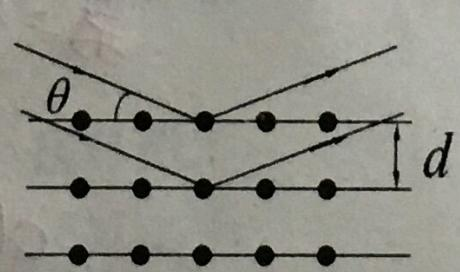

# 《大学物理》衍射光栅习题作业参考答案

原件经识别和整理；“参考解答”是我们补的。

## 衍射光栅

### 选择 1

一束白光垂直照射在一光栅上，在形成的同一级光栅光谱中，偏离中央明纹最远的是

- A. 紫光
- B. 绿光
- C. 黄光
- D. 红光

答案：D。

知识点：[光栅方程、缺级现象与光谱分辨](../../../topics/大学物理/衍射光栅.md)

### 选择 2

波长 $\lambda=550\ \mathrm{nm}\ (1\mathrm{nm}=10^{-9}\mathrm{m})$ 的单色光垂直入射于光栅常数 $d=2\times10^{-4}\ \mathrm{cm}$ 的平面衍射光栅上，可能观察到的光谱线的最大级次为

- A. 2
- B. 3
- C. 4
- D. 5

知识点：[光栅方程、缺级现象与光谱分辨](../../../topics/大学物理/衍射光栅.md)、[平面简谐波的波函数 y=Acos(ω(t±x/u)+φ)](../../../topics/大学物理/平面简谐波方程.md)

### 填空 1

某单色光垂直入射到一个每毫米有 800 条刻线的光栅上，如果第一级谱线的衍射角为 $30^{\circ}$，则入射光的波长应为 $\underline{6.25\times10^{-7}\ \mathrm{m}\ (625\ \mathrm{nm})}$。

解：$d\sin 30^{\circ}=\lambda=\dfrac{1\times10^{-3}}{800}\times\dfrac{1}{2}$。

知识点：[光栅方程、缺级现象与光谱分辨](../../../topics/大学物理/衍射光栅.md)、[单缝衍射的暗纹条件与中央明纹宽度](../../../topics/大学物理/单缝夫琅禾费衍射.md)

### 填空 2

用平行的白光垂直入射在平面透射光栅上时，波长为 $440\ \mathrm{nm}$ 的第 3 级光谱线将与波长为 $\underline{660}\ \mathrm{nm}$ 的第 2 级光谱线重叠。$(1\ \mathrm{nm}=10^{-9}\ \mathrm{m})$

解：$d\sin\theta=3\times440=2\lambda$，$\lambda=660\ \mathrm{nm}$。

知识点：[光栅方程、缺级现象与光谱分辨](../../../topics/大学物理/衍射光栅.md)

### 填空 3

如图所示，为了测量某种晶体原子层之间的间距 $d$，用 $0.2\ \mathrm{nm}$ 的 X 射线照射该晶体，实验测得 X 射线与晶面夹角为 $15^{\circ}$ 时获得第一级反射极大，则 $d=\underline{0.386}\ \mathrm{nm}$。

$$
d=\frac{0.2}{2\sin 15^{\circ}}
$$

知识点：[光栅方程、缺级现象与光谱分辨](../../../topics/大学物理/衍射光栅.md)

### 计算 1

波长为 $500\ \mathrm{nm}$ 和 $520\ \mathrm{nm}$ 的两种单色光同时垂直入射在光栅常数为 $0.002\ \mathrm{cm}$ 的光栅上，紧靠光栅后用焦距为 $2\ \mathrm{m}$ 的透镜把光线聚焦在屏幕上。求这两束光的第三级谱线之间的距离。

$$
\begin{array}{l}
d\sin\theta=3\lambda \\
\sin\theta=\dfrac{3\lambda}{d}=
\begin{cases}
\dfrac{3\times500\times10^{-9}}{0.002\times10^{-2}}=0.075 \\
\dfrac{3\times520\times10^{-9}}{0.002\times10^{-2}}=0.078
\end{cases} \\
\Delta x=f\cdot(\sin\theta_2-\sin\theta_1)=0.006\ \mathrm{m}
\end{array}
$$

知识点：[光栅方程、缺级现象与光谱分辨](../../../topics/大学物理/衍射光栅.md)、[杨氏双缝干涉实验与条纹间距](../../../topics/大学物理/杨氏双缝干涉.md)

### 计算 2

波长 $600\ \mathrm{nm}$ 的单色光垂直照射在光栅上，第二级明条纹出现在 $\sin\theta=1/6$ 处，第四级缺级。试求：（1）光栅常数 $a+b$；（2）光栅上狭缝可能的最小宽度 $a$；（3）中央明带内的明纹主极大的数目；（4）按上述选定的 $a$、$b$ 值，在光屏上可能观察到的全部级数。

（1）$d\sin\theta=2\lambda$，$d=\dfrac{7.2}{2}\times10^{-6}\ \mathrm{m}$。

（2）$d\cdot\dfrac{1}{6}=2\times600 \Rightarrow d=7200\ \mathrm{nm}$；由 $d\sin\theta=k\lambda$、$a\sin\theta=2k'\cdot\dfrac{\lambda}{2}$ 得 $\dfrac{d}{a}=\dfrac{k}{k'}=\dfrac{4}{k'}$，$k'=1,2,3$，显然 $\dfrac{d}{a}=4$，$a=\dfrac{d}{4}$ 为最小宽度，即 $a=1800\ \mathrm{nm}$。

（3）$0,\ \pm1,\ \pm2,\ \pm3$，共 7 条。

（4）由 $d\sin\theta=k\lambda$，$k\leq\dfrac{d}{\lambda}=12$（第 12 级看不见），故可观察到 $0,\ \pm1,\ \pm2,\ \pm3,\ \pm5,\ \pm6,\ \pm7,\ \pm9,\ \pm10,\ \pm11$，共 19 条。

知识点：[光栅方程、缺级现象与光谱分辨](../../../topics/大学物理/衍射光栅.md)
