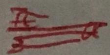

# 《大学物理》衍射光栅习题作业参考答案

原件经识别和整理；“参考解答”是我们补的。

## 衍射光栅

### 选择 1

一束白光垂直照射在一光栅上，在形成的同一级光栅光谱中，偏离中央明纹最远的是

- A. 紫光
- B. 绿光
- C. 黄光
- D. 红光

答案：D。

知识点：[光栅方程、缺级现象与光谱分辨](../../../topics/大学物理/衍射光栅.md)

### 选择 2

波长 $\lambda=550\ \mathrm{nm}\ (1\mathrm{nm}=10^{-9}\mathrm{m})$ 的单色光垂直入射于光栅常数 $d=2\times10^{-4}\ \mathrm{cm}$ 的平面衍射光栅上，可能观察到的光谱线的最大级次为

- A. 2
- B. 3
- C. 4
- D. 5

参考解答：**答案：B**

光栅方程为  

$$
d\sin\theta=k\lambda .
$$

由于实际衍射角满足  

$$
|\sin\theta|\le 1,
$$

所以可能观察到的级次 $k$ 满足  

$$
|k|\le \frac{d}{\lambda}.
$$

代入数据，注意单位换算：

$$
d=2\times10^{-4}\ \mathrm{cm}=2\times10^{-6}\ \mathrm{m},
$$

$$
\lambda=550\ \mathrm{nm}=5.5\times10^{-7}\ \mathrm{m}.
$$

因此

$$
\frac{d}{\lambda}
=\frac{2\times10^{-6}}{5.5\times10^{-7}}
\approx 3.64.
$$

所以整数级次可取

$$
k=0,\pm1,\pm2,\pm3,
$$

最大级次为  

$$
k_{\max}=3.
$$

A 把可取级次算少了；C、D 对应 $\sin\theta>1$，不可能出现。

知识点：[光栅方程、缺级现象与光谱分辨](../../../topics/大学物理/衍射光栅.md)、[平面简谐波的波函数 y=Acos(ω(t±x/u)+φ)](../../../topics/大学物理/平面简谐波方程.md)

### 填空 1

某单色光垂直入射到一个每毫米有 800 条刻线的光栅上，如果第一级谱线的衍射角为 $30^{\circ}$，则入射光的波长应为 $\underline{6.25\times10^{-7}\ \mathrm{m}\ (625\ \mathrm{nm})}$。

解：$d\sin 30^{\circ}=\lambda=\dfrac{1\times10^{-3}}{800}\times\dfrac{1}{2}$。

参考解答：**结论：** 入射光波长为 $6.25\times10^{-7}\ \mathrm{m}$（即 $625\ \mathrm{nm}$）。

**推理过程：**

由光栅方程，垂直入射时：

$$d\sin\theta = k\lambda$$

其中光栅常数：

$$d = \frac{1\times10^{-3}}{800}\ \mathrm{m} = 1.25\times10^{-6}\ \mathrm{m}$$

第一级谱线 $k=1$，衍射角 $\theta = 30^{\circ}$，代入得：

$$\lambda = d\sin 30^{\circ} = 1.25\times10^{-6} \times \frac{1}{2} = 6.25\times10^{-7}\ \mathrm{m}$$

知识点：[光栅方程、缺级现象与光谱分辨](../../../topics/大学物理/衍射光栅.md)、[单缝衍射的暗纹条件与中央明纹宽度](../../../topics/大学物理/单缝夫琅禾费衍射.md)

### 填空 2

用平行的白光垂直入射在平面透射光栅上时，波长为 $440\ \mathrm{nm}$ 的第 3 级光谱线将与波长为 $\underline{660}\ \mathrm{nm}$ 的第 2 级光谱线重叠。$(1\ \mathrm{nm}=10^{-9}\ \mathrm{m})$

解：$d\sin\theta=3\times440=2\lambda$，$\lambda=660\ \mathrm{nm}$。

参考解答：根据光栅方程  

$$
d\sin\theta=k\lambda
$$

重叠时同一衍射角 $\theta$ 对应两条不同波长、不同级次的谱线，故  

$$
3 \times 440 = 2 \times \lambda
$$

解得  

$$
\lambda = 660\ \mathrm{nm}
$$

所以填：**660 nm**。

知识点：[光栅方程、缺级现象与光谱分辨](../../../topics/大学物理/衍射光栅.md)

### 填空 3

如图所示，为了测量某种晶体原子层之间的间距 $d$，用 $0.2\ \mathrm{nm}$ 的 X 射线照射该晶体，实验测得 X 射线与晶面夹角为 $15^{\circ}$ 时获得第一级反射极大，则 $d=\underline{0.386}\ \mathrm{nm}$。

$$
d=\frac{0.2}{2\sin 15^{\circ}}
$$

参考解答：**结论：** $d \approx 0.386\ \mathrm{nm}$

**推理过程：**

由布拉格衍射条件，X射线在晶面发生反射极大的公式为：

$$
2d\sin\theta = k\lambda
$$

其中 $\theta$ 为 X 射线与晶面的夹角（掠射角），$k$ 为衍射级数，$\lambda$ 为波长。

第一级反射极大对应 $k=1$，代入已知量 $\lambda = 0.2\ \mathrm{nm}$，$\theta = 15^{\circ}$：

$$
d = \frac{k\lambda}{2\sin\theta} = \frac{1 \times 0.2}{2\sin 15^{\circ}} = \frac{0.2}{2 \times 0.2588} \approx 0.386\ \mathrm{nm}
$$

知识点：[光栅方程、缺级现象与光谱分辨](../../../topics/大学物理/衍射光栅.md)

### 计算 1

波长为 $500\ \mathrm{nm}$ 和 $520\ \mathrm{nm}$ 的两种单色光同时垂直入射在光栅常数为 $0.002\ \mathrm{cm}$ 的光栅上，紧靠光栅后用焦距为 $2\ \mathrm{m}$ 的透镜把光线聚焦在屏幕上。求这两束光的第三级谱线之间的距离。

$$
\begin{array}{l}
d\sin\theta=3\lambda \\
\sin\theta=\dfrac{3\lambda}{d}=
\begin{cases}
\dfrac{3\times500\times10^{-9}}{0.002\times10^{-2}}=0.075 \\
\dfrac{3\times520\times10^{-9}}{0.002\times10^{-2}}=0.078
\end{cases} \\
\Delta x=f\cdot(\sin\theta_2-\sin\theta_1)=0.006\ \mathrm{m}
\end{array}
$$

参考解答：**结论：** 两束光的第三级谱线之间的距离为 **$6.0\ \mathrm{mm}$**（即 $0.006\ \mathrm{m}$）。

**推导过程：**

1. **光栅方程求衍射角**

   由光栅方程 $d\sin\theta=k\lambda$，第三级谱线满足：
   $$\sin\theta_1=\frac{3\lambda_1}{d}=\frac{3\times500\times10^{-9}}{0.002\times10^{-2}}=0.075$$
   $$\sin\theta_2=\frac{3\lambda_2}{d}=\frac{3\times520\times10^{-9}}{0.002\times10^{-2}}=0.078$$

2. **计算屏上位置**

   透镜将平行光聚焦在焦平面上，谱线位置由 $x=f\tan\theta$ 确定。由于衍射角很小（$\theta\approx4.3^\circ$），有 $\tan\theta\approx\sin\theta$，故：
   $$x_1\approx f\sin\theta_1=2\times0.075=0.150\ \mathrm{m}$$
   $$x_2\approx f\sin\theta_2=2\times0.078=0.156\ \mathrm{m}$$

3. **谱线间距**

   $$\Delta x=x_2-x_1=f(\sin\theta_2-\sin\theta_1)=2\times(0.078-0.075)=\boxed{0.006\ \mathrm{m}=6\ \mathrm{mm}}$$

**说明：** 若严格用 $\tan\theta$ 计算，$\Delta x\approx0.00602\ \mathrm{m}$，与近似结果一致，故小角近似合理。

知识点：[光栅方程、缺级现象与光谱分辨](../../../topics/大学物理/衍射光栅.md)、[杨氏双缝干涉实验与条纹间距](../../../topics/大学物理/杨氏双缝干涉.md)

### 计算 2

波长 $600\ \mathrm{nm}$ 的单色光垂直照射在光栅上，第二级明条纹出现在 $\sin\theta=1/6$ 处，第四级缺级。试求：（1）光栅常数 $a+b$；（2）光栅上狭缝可能的最小宽度 $a$；（3）中央明带内的明纹主极大的数目；（4）按上述选定的 $a$、$b$ 值，在光屏上可能观察到的全部级数。

（1）$d\sin\theta=2\lambda$，$d=\dfrac{7.2}{2}\times10^{-6}\ \mathrm{m}$。

（2）$d\cdot\dfrac{1}{6}=2\times600 \Rightarrow d=7200\ \mathrm{nm}$；由 $d\sin\theta=k\lambda$、$a\sin\theta=2k'\cdot\dfrac{\lambda}{2}$ 得 $\dfrac{d}{a}=\dfrac{k}{k'}=\dfrac{4}{k'}$，$k'=1,2,3$，显然 $\dfrac{d}{a}=4$，$a=\dfrac{d}{4}$ 为最小宽度，即 $a=1800\ \mathrm{nm}$。

（3）$0,\ \pm1,\ \pm2,\ \pm3$，共 7 条。

（4）由 $d\sin\theta=k\lambda$，$k\leq\dfrac{d}{\lambda}=12$（第 12 级看不见），故可观察到 $0,\ \pm1,\ \pm2,\ \pm3,\ \pm5,\ \pm6,\ \pm7,\ \pm9,\ \pm10,\ \pm11$，共 19 条。

参考解答：（1）光栅常数 $a+b = 7.2\times10^{-6}\ \mathrm{m}$。  
由光栅方程 $(a+b)\sin\theta = k\lambda$，代入 $k=2$、$\lambda=600\ \mathrm{nm}=6\times10^{-7}\ \mathrm{m}$、$\sin\theta=1/6$，得  
$$
a+b = \frac{k\lambda}{\sin\theta} = \frac{2\times6\times10^{-7}}{1/6} = 7.2\times10^{-6}\ \mathrm{m}.
$$

（2）狭缝最小宽度 $a = 1.8\times10^{-6}\ \mathrm{m}$。  
缺级条件为 $\dfrac{a+b}{a} = \dfrac{k}{k'}$，其中 $k=4$ 为缺级级次，$k'$ 为正整数。当 $k'=1$ 时 $a$ 最大？不，$a = \dfrac{(a+b)k'}{k}$，故 $k'$ 越小 $a$ 越小；但 $k'$ 必须使 $a>0$ 且物理合理，最小正整数 $k'=1$ 对应 **最大** $a$，而题目要求“可能的最小宽度”，应取满足缺级条件的 **最小正整数比**，即 $\dfrac{a+b}{a}=4$（因若 $\dfrac{a+b}{a}=8$ 则 $a=d/8$ 更小，但此时第4级是否仍缺级？需验证）。实际上，缺级发生在 $k = m\dfrac{a+b}{a}$（$m=1,2,\dots$），故第4级缺级意味着 $\dfrac{a+b}{a}$ 是4的约数或4是其整数倍。为使 $a$ **最小**，需 $\dfrac{a+b}{a}$ **最大**，但受限于 $a>0$ 且单缝衍射中央明纹内需包含该缺级。然而通常“可能的最小宽度”指满足第4级缺级的 **最小可能值**，即取 $\dfrac{a+b}{a}=4$（对应 $m=1$），此时 $a = d/4 = 1.8\times10^{-6}\ \mathrm{m}$；若取 $\dfrac{a+b}{a}=8$，则 $a=d/8$，但此时第4级对应 $m=0.5$，不满足整数条件，故不会缺级。因此唯一使第4级缺级的比值是 $\dfrac{a+b}{a}=4/n$（$n$ 为正整数），即 $n=1$ 时 $\dfrac{d}{a}=4$，$n=2$ 时 $\dfrac{d}{a}=2$（此时第2级缺级，第4级也缺级），但 $a=d/2 > d/4$；故 **最小** $a$ 对应 **最大** $\dfrac{d}{a}$ 使得4是其整数倍，即 $\dfrac{d}{a}=4$，所以 $a_{\min}=d/4=1.8\times10^{-6}\ \mathrm{m}$。

（3）中央明带内主极大数目为 7 条。  
单缝衍射第一极小满足 $a\sin\theta=\lambda$，代入 $a=1.8\times10^{-6}\ \mathrm{m}$、$\lambda=6\times10^{-7}\ \mathrm{m}$，得 $\sin\theta_1=\lambda/a=1/3$。光栅主极大位置满足 $\sin\theta_k = k\lambda/d = k/12$。令 $|k/12| < 1/3$，得 $|k|<4$，故 $k=0,\pm1,\pm2,\pm3$，共7条。

（4）可观察到的全部级数为 $k=0,\pm1,\pm2,\pm3,\pm5,\pm6,\pm7,\pm9,\pm10,\pm11$，共19条。  
理论最大级次 $k_{\max} = \lfloor d/\lambda \rfloor = \lfloor 7.2\times10^{-6}/6\times10^{-7} \rfloor = 12$，但 $k=12$ 时 $\sin\theta=1$，位于无穷远不可见；缺级级次满足 $k = m\cdot(d/a)=4m$（$m=1,2,3,\dots$），即 $k=\pm4,\pm8,\pm12$ 缺级；排除这些及 $k=\pm12$ 后，剩余可见级次如上所列。其他级次如 $k=\pm4,\pm8,\pm12$ 因缺级或不可见被排除，其余均满足 $|\sin\theta_k|<1$ 且在单缝中央明纹包络内（$|k|<12$ 且非缺级）。

知识点：[光栅方程、缺级现象与光谱分辨](../../../topics/大学物理/衍射光栅.md)
