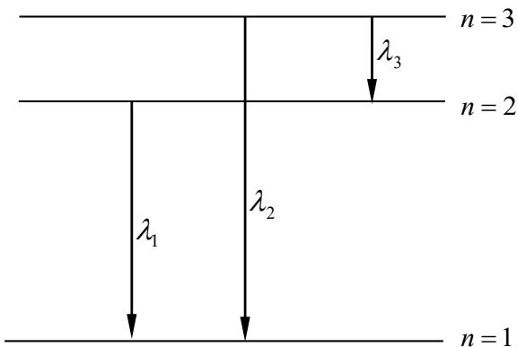

# 《大学物理》量子力学部分同步练习册（含答案）

原件经识别和整理；“参考解答”是我们补的。

# 黑体辐射

### 选择 1

（1）A（2）D（3）C（4）D（5）B

答案：（1）A（2）D（3）C（4）D（5）B

知识点：[简谐振动的运动学方程（振幅、角频率、相位）](../../../topics/大学物理/简谐振动运动学.md)、[用旋转矢量法确定初相与运动状态](../../../topics/大学物理/旋转矢量法.md)、[同方向同频率简谐振动的合成](../../../topics/大学物理/简谐振动的合成.md)

### 填空 1

（1）7:11

答案：7:11

知识点：[薛定谔方程与一维无限深势阱](../../../topics/大学物理/薛定谔方程.md)、[海森堡位置与动量的不确定关系](../../../topics/大学物理/不确定关系.md)

### 计算 1

（1）$\lambda_{\mathrm{m}}T = b$，$\lambda_{\mathrm{m}} = 5796\,\mathrm{K}$

（2）$\sigma T^4 \cdot 4\pi R^2 = 3.6\times 10^{26}\,\mathrm{W}$

（3）$\sigma T^4 \cdot (4\pi R^2)/(4\pi d^2) = 1.6\times 10^{3}\,\mathrm{W/m^2}$

知识点：[薛定谔方程与一维无限深势阱](../../../topics/大学物理/薛定谔方程.md)、[德布罗意物质波假设](../../../topics/大学物理/实物粒子的波动性.md)

### 计算 2

（1）$v = c/\lambda_m = 3.1\times 10^{11}\,\mathrm{Hz}$

# 第二节 光电效应

知识点：[动量定理与动量守恒定律](../../../topics/大学物理/动量定理与动量守恒.md)

### 选择 1

（1）D（2）D（3）C（4）C

答案：（1）D（2）D（3）C（4）C

知识点：[简谐振动的运动学方程（振幅、角频率、相位）](../../../topics/大学物理/简谐振动运动学.md)、[用旋转矢量法确定初相与运动状态](../../../topics/大学物理/旋转矢量法.md)、[同方向同频率简谐振动的合成](../../../topics/大学物理/简谐振动的合成.md)

### 填空 1

（1）连续的 量子化的

（2）2 $\frac{1}{2}$

（3）$\frac{hc}{\lambda}$ $\frac{h}{\lambda}$ $\frac{h}{\lambda c}$

答案：（1）连续的 量子化的（2）2 $\frac{1}{2}$（3）$\frac{hc}{\lambda}$ $\frac{h}{\lambda}$ $\frac{h}{\lambda c}$

知识点：[薛定谔方程与一维无限深势阱](../../../topics/大学物理/薛定谔方程.md)、[海森堡位置与动量的不确定关系](../../../topics/大学物理/不确定关系.md)

### 计算 1

（1）$eU = E_{km}$，$U = \frac{E_{km}}{e} = 2.5\,\mathrm{V}$

（2）$W = \frac{hc}{\lambda} - E_{km} = 2.626\times 10^{-19}\,\mathrm{J}$

（3）$h\nu_0 = W$，$\nu_0 = \frac{W}{h} = 3.96\times 10^{14}\,\mathrm{Hz}$

# 第三节 康普顿散射

知识点：[薛定谔方程与一维无限深势阱](../../../topics/大学物理/薛定谔方程.md)、[德布罗意物质波假设](../../../topics/大学物理/实物粒子的波动性.md)

### 选择 1

（1）C（2）D（3）B（4）D（5）A（6）B

答案：（1）C（2）D（3）B（4）D（5）A（6）B

知识点：[简谐振动的运动学方程（振幅、角频率、相位）](../../../topics/大学物理/简谐振动运动学.md)、[用旋转矢量法确定初相与运动状态](../../../topics/大学物理/旋转矢量法.md)、[同方向同频率简谐振动的合成](../../../topics/大学物理/简谐振动的合成.md)

### 填空 1

（1）$\pi$；0（2）0.586

答案：（1）$\pi$；0（2）0.586

知识点：[薛定谔方程与一维无限深势阱](../../../topics/大学物理/薛定谔方程.md)、[海森堡位置与动量的不确定关系](../../../topics/大学物理/不确定关系.md)

### 计算 1

（1）$\lambda - \lambda_0 = \frac{h}{m_0c}(1 - \cos\theta)$

$$
\lambda = 1.0243\times 10^{-10}\,\mathrm{m}
$$

（2）$E_k = h\nu_0 - h\nu = hc\left(\frac{1}{\lambda_0} - \frac{1}{\lambda}\right) = 4.716\times 10^{-17}\,\mathrm{J}$

# 第四节 氢原子的玻尔模型 实物粒子的波动性

知识点：[薛定谔方程与一维无限深势阱](../../../topics/大学物理/薛定谔方程.md)、[德布罗意物质波假设](../../../topics/大学物理/实物粒子的波动性.md)

### 选择 1

（1）A（2）C（3）C（4）A（5）C（6）D

答案：（1）A（2）C（3）C（4）A（5）C（6）D

知识点：[简谐振动的运动学方程（振幅、角频率、相位）](../../../topics/大学物理/简谐振动运动学.md)、[用旋转矢量法确定初相与运动状态](../../../topics/大学物理/旋转矢量法.md)、[同方向同频率简谐振动的合成](../../../topics/大学物理/简谐振动的合成.md)

### 填空 1

（1）13.6eV、5；（2）6；（3）波动性；（4）短；（5）1、4；（6）$\frac{1}{\sqrt{2m_e e U_{12}}}$。

答案：（1）13.6eV、5（2）6（3）波动性（4）短（5）1、4（6）$\frac{1}{\sqrt{2m_e e U_{12}}}$

知识点：[薛定谔方程与一维无限深势阱](../../../topics/大学物理/薛定谔方程.md)、[海森堡位置与动量的不确定关系](../../../topics/大学物理/不确定关系.md)

### 计算 1

（1）$qv_\alpha B = m_\alpha \frac{v_\alpha^2}{R}$，$m_\alpha v_\alpha = qRB$

$$
\lambda = \frac{h}{m_\alpha v_\alpha} = \frac{h}{qRB} = 9.98\times 10^{-12}\,\mathrm{m}
$$

（2）$v_{\text{子弹}} = v_\alpha = \frac{qBR}{m_\alpha} = 10000\,\mathrm{m/s}$

$$
\lambda_{\text{子弹}} = \frac{h}{m_{\text{子弹}}v_{\text{子弹}}} = 6.626\times 10^{-34}\,\mathrm{m}
$$

知识点：[薛定谔方程与一维无限深势阱](../../../topics/大学物理/薛定谔方程.md)、[德布罗意物质波假设](../../../topics/大学物理/实物粒子的波动性.md)

### 计算 2

（1）$p_{\text{电子}} = p_{\text{光子}} = \frac{h}{\lambda} = 3.313\times 10^{-24}\,\mathrm{kg\cdot m/s}$

（2）$E_{k\text{电子}} = \frac{p^2}{2m_e} = 6.02\times 10^{-18}\,\mathrm{J}$

$$
E_{\text{光子}} = \frac{hc}{\lambda} = 9.939\times 10^{-16}\,\mathrm{J}
$$

知识点：[动量定理与动量守恒定律](../../../topics/大学物理/动量定理与动量守恒.md)

### 计算 3

$\frac{1}{\lambda} = R_H\left(\frac{1}{n_f^2} - \frac{1}{n_i^2}\right)$

$$
E = \frac{hc}{\lambda} = R_H hc\left(\frac{1}{n_f^2} - \frac{1}{n_i^2}\right)
$$

$12.6 = 13.6\left(1 - \frac{1}{n^2}\right)$，$n = 3.69$，取 $n = 3$

$\frac{1}{\lambda_1} = R_H\left(\frac{1}{1^2} - \frac{1}{2^2}\right)$，得：$\lambda_1 = 1.21\times 10^{-7}\,\mathrm{m}$

$\frac{1}{\lambda_2} = R_H\left(\frac{1}{1^2} - \frac{1}{3^2}\right)$，得：$\lambda_2 = 1.026\times 10^{-7}\,\mathrm{m}$

$\frac{1}{\lambda_3} = R_H\left(\frac{1}{2^2} - \frac{1}{3^2}\right)$，得：$\lambda_3 = 6.563\times 10^{-7}\,\mathrm{m}$，可见光

# 第五节 不确定关系

知识点：[玻尔的氢原子理论与能级跃迁](../../../topics/大学物理/玻尔氢原子模型.md)、[海森堡位置与动量的不确定关系](../../../topics/大学物理/不确定关系.md)

### 选择 1

答案：D

知识点：[简谐振动的运动学方程（振幅、角频率、相位）](../../../topics/大学物理/简谐振动运动学.md)、[用旋转矢量法确定初相与运动状态](../../../topics/大学物理/旋转矢量法.md)、[同方向同频率简谐振动的合成](../../../topics/大学物理/简谐振动的合成.md)

### 填空 1

答案：海森堡 微观粒子的波粒二象性

知识点：[薛定谔方程与一维无限深势阱](../../../topics/大学物理/薛定谔方程.md)、[海森堡位置与动量的不确定关系](../../../topics/大学物理/不确定关系.md)

### 填空 2

答案：大于等于

知识点：[用旋转矢量法确定初相与运动状态](../../../topics/大学物理/旋转矢量法.md)

### 计算 1

$p = \frac{h}{\lambda}$

$$
\Delta p = \frac{h}{\lambda^2}\Delta\lambda
$$

$$
\Delta x \geq \frac{h}{\Delta p} = \frac{\lambda^2}{\Delta\lambda} = 0.3\,\mathrm{m}
$$

知识点：[薛定谔方程与一维无限深势阱](../../../topics/大学物理/薛定谔方程.md)、[德布罗意物质波假设](../../../topics/大学物理/实物粒子的波动性.md)

### 计算 2

$\Delta r = 3.6\times 10^{-15}\,\mathrm{m}$

$$
\Delta r \cdot \Delta p \geq h
$$

$$
\Delta p \geq \frac{h}{\Delta r} = 1.84\times 10^{-19}\,\mathrm{kg\cdot m/s}
$$

$$
p = \Delta p = 1.84\times 10^{-19}\,\mathrm{kg\cdot m/s}
$$

$$
E_k = \frac{p^2}{2m_\alpha} = 2.53\times 10^{-12}\,\mathrm{J}
$$

# 第六节 薛定谔方程与一维无限深势阱

知识点：[动量定理与动量守恒定律](../../../topics/大学物理/动量定理与动量守恒.md)

### 选择 1

（1）A（2）D（3）C（4）A

答案：（1）A（2）D（3）C（4）A

知识点：[简谐振动的运动学方程（振幅、角频率、相位）](../../../topics/大学物理/简谐振动运动学.md)、[用旋转矢量法确定初相与运动状态](../../../topics/大学物理/旋转矢量法.md)、[同方向同频率简谐振动的合成](../../../topics/大学物理/简谐振动的合成.md)

### 填空 1

（1）波函数 薛定谔

（2）某时刻某点附近单位体积元中粒子出现的概率

（3）$\int_{-\infty}^{\infty}|\psi(r,t)|^2\,d\tau = 1$

（4）$\frac{1}{6}a,\ \frac{1}{2}a,\ \frac{5}{6}a$

答案：（1）波函数 薛定谔（2）某时刻某点附近单位体积元中粒子出现的概率（3）$\int_{-\infty}^{\infty}|\psi(r,t)|^2\,d\tau = 1$（4）$\frac{1}{6}a,\ \frac{1}{2}a,\ \frac{5}{6}a$

知识点：[薛定谔方程与一维无限深势阱](../../../topics/大学物理/薛定谔方程.md)、[海森堡位置与动量的不确定关系](../../../topics/大学物理/不确定关系.md)

### 计算 1

（1）$E_1 = \frac{h^2}{8ma^2} = 1.51\times 10^{-18}\,\mathrm{J}$

（2）$x_1 = 0.05\,\mathrm{nm}$，$x_2 = 0.15\,\mathrm{nm}$

$$
p_1 = \frac{2}{a}\sin^2\frac{\pi}{2} = 1\times 10^{10},\quad p_2 = \frac{2}{a}\sin^2\frac{3\pi}{2} = 1\times 10^{10}
$$

$$
p = \int_0^{\frac{a}{2}}|\psi(x)|^2\,dx = \frac{1}{2} \tag{3}
$$

知识点：[薛定谔方程与一维无限深势阱](../../../topics/大学物理/薛定谔方程.md)、[德布罗意物质波假设](../../../topics/大学物理/实物粒子的波动性.md)

### 计算 2

$$
\int_0^l c^2 x^2(l-x)^2\,dx = 1,\quad c = \sqrt{\frac{30}{l^5}}
$$

$$
p = \int_0^{\frac{l}{3}} c^2 x^2(l-x)^2 = \frac{17}{81} = 0.21
$$

# 第七节

知识点：[动量定理与动量守恒定律](../../../topics/大学物理/动量定理与动量守恒.md)

### 选择 1

答案：1. A 2. D 3. C 4. D 5. B 6. C 7. D 8. C 9. B 10. C 11. D 12. D 13. B

知识点：[简谐振动的运动学方程（振幅、角频率、相位）](../../../topics/大学物理/简谐振动运动学.md)、[用旋转矢量法确定初相与运动状态](../../../topics/大学物理/旋转矢量法.md)、[同方向同频率简谐振动的合成](../../../topics/大学物理/简谐振动的合成.md)

### 简答 1

根据量子力学原理，当氢原子中电子的动量矩 $L=\sqrt{6}\hbar$ 时，$L$ 在外磁场方向上的投影 $L_z$ 可取的值分别为 $+2\hbar,+\hbar,0$。

答案：$+2\hbar,+\hbar,0$

知识点：[玻尔的氢原子理论与能级跃迁](../../../topics/大学物理/玻尔氢原子模型.md)、[角动量定理与角动量守恒定律](../../../topics/大学物理/角动量与角动量守恒.md)、[四个量子数、泡利不相容原理与电子排布](../../../topics/大学物理/原子的量子理论.md)

### 简答 2

与绝缘体相比较纯净半导体能带的禁带是较小的，在常温下有少量电子由满带激发到导带中，从而形成由电子参与导电的本征导电性。

知识点：[温度的微观本质与分子平均平动动能](../../../topics/大学物理/温度微观解释.md)
