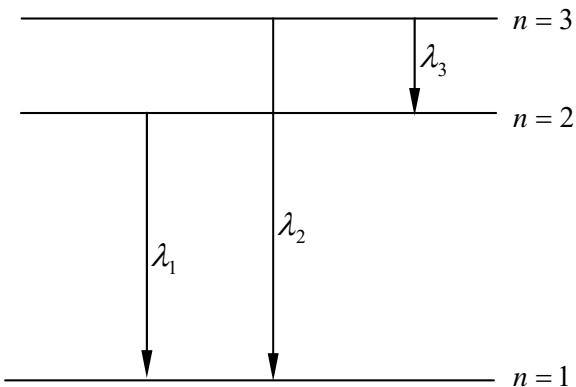

# 《大学物理》量子力学部分同步练习册（答案）

原件经识别和整理；“参考解答”是我们补的。

---
title: 《大学物理》量子力学部分同步练习册（答案）
kind: 答案
course: 大学物理
term: 
source: 识别工具读取内容
---

# 《大学物理》量子力学部分同步练习册（答案）

本资料为《大学物理》课程中量子力学部分的同步练习册参考答案，由识别工具提取并整理。

## 黑体辐射

### 选择 1

(1) A (2) D (3) C (4) D (5) B

答案：(1)A, (2)D, (3)C, (4)D, (5)B

知识点：[四个量子数、泡利不相容原理与电子排布](../../../topics/大学物理/原子的量子理论.md)

### 填空 1

(1) 7:11

(2) 2402K

答案：(1) 7:11; (2) 2402K

知识点：[薛定谔方程与一维无限深势阱](../../../topics/大学物理/薛定谔方程.md)

### 计算 1

(1) $\lambda_{\mathrm{m}} T=b$，$\lambda_m=5796\mathrm{K}$ （注：原题单位可能有误，通常维恩位移定律 $\lambda_m T = b$，此处保留原题数值逻辑）

(2) $\sigma T^4 \cdot 4\pi R^2 = 3.6\times 10^{26} \mathrm{W}$

(3) $\sigma T^4 \cdot (4\pi R^2) / (4\pi d^2) = 1.6\times 10^3 \mathrm{W/m^2}$

答案：见上方公式推导结果。

知识点：[薛定谔方程与一维无限深势阱](../../../topics/大学物理/薛定谔方程.md)

### 计算 2

(1) $v = c / \lambda_{m} = 3.1 \times 10^{11} \mathrm{Hz}$

(2) $P = 2.34 \times 10^9 \mathrm{W}$

答案：见上方计算结果。

## P117-122 第二节 光电效应

知识点：[薛定谔方程与一维无限深势阱](../../../topics/大学物理/薛定谔方程.md)

### 选择 1

(1) D (2) D (3) C (4) C

答案：(1)D, (2)D, (3)C, (4)C

知识点：[四个量子数、泡利不相容原理与电子排布](../../../topics/大学物理/原子的量子理论.md)

### 填空 1

(1) 连续的；量子化的

(2) 2 $\frac{1}{2}$

(3) $\frac{hc}{\lambda}$；$\frac{h}{\lambda}$；$\frac{h}{\lambda c}$

答案：(1) 连续的, 量子化的; (2) 2, 1/2; (3) $\frac{hc}{\lambda}, \frac{h}{\lambda}, \frac{h}{\lambda c}$

知识点：[薛定谔方程与一维无限深势阱](../../../topics/大学物理/薛定谔方程.md)

### 计算 1

(1) $eU = E_{km}$，$U = \frac{E_{km}}{e} = 2.5\mathrm{V}$

(2) $W = \frac{hc}{\lambda} - E_{km} = 2.626 \times 10^{-19} \mathrm{J}$

(3) $h\nu_{0} = W$，$\nu_{0} = \frac{W}{h} = 3.96\times 10^{14}\mathrm{Hz}$

答案：见上方计算过程及结果。

## 第三节 康普顿散射

知识点：[薛定谔方程与一维无限深势阱](../../../topics/大学物理/薛定谔方程.md)

### 选择 1

(1) C (2) D (3) B (4) D (5) A (6) B

答案：(1)C, (2)D, (3)B, (4)D, (5)A, (6)B

知识点：[四个量子数、泡利不相容原理与电子排布](../../../topics/大学物理/原子的量子理论.md)

### 填空 1

(1) $\pi$ ; 0

(2) 0.586

答案：(1) $\pi$, 0; (2) 0.586

知识点：[薛定谔方程与一维无限深势阱](../../../topics/大学物理/薛定谔方程.md)

### 计算 1

(1) $\lambda -\lambda_0 = \frac{h}{m_0c} (1 - \cos \theta)$

$$
\lambda = 1.0243 \times 10^{-10} \mathrm{m}
$$

(2) $E_{k} = h\nu_{0} - h\nu = hc\left(\frac{1}{\lambda_0} -\frac{1}{\lambda}\right) = 4.716\times 10^{-17}\mathrm{J}$

答案：见上方计算结果。

## 第四节 氢原子的玻尔模型 实物粒子的波动性

知识点：[薛定谔方程与一维无限深势阱](../../../topics/大学物理/薛定谔方程.md)

### 选择 1

(1) A (2) C (3) C (4) A (5) C (6) D

答案：(1)A, (2)C, (3)C, (4)A, (5)C, (6)D

知识点：[四个量子数、泡利不相容原理与电子排布](../../../topics/大学物理/原子的量子理论.md)

### 填空 1

（1）13.6eV、5；（2）6；（3）波动性；（4）短；（5）1、4；（6） $\frac{1}{\sqrt{2m_{e}eU_{12}}}$ 。

答案：见上方填空内容。

知识点：[薛定谔方程与一维无限深势阱](../../../topics/大学物理/薛定谔方程.md)

### 计算 1

(1) $qv_{\alpha}B = m_{\alpha}\frac{v_{\alpha}^{2}}{R}, m_{\alpha}v_{\alpha} = qRB,$

$$
\lambda = \frac {h}{m _ {\alpha} v _ {\alpha}} = \frac {h}{q R B} = 9.98 \times 10 ^ {- 12} \mathrm{m}
$$

(2) $v_{\text{子弹}} = v_{\alpha} = \frac{qBR}{m_{\alpha}} = 10000 \mathrm{~m/s}$

$$
\lambda_ {\text {子弹}} = \frac {h}{m _ {\text {子弹}} v _ {\text {子弹}}} = 6.626 \times 10 ^ {- 3 4} \mathrm{m}
$$

答案：见上方计算结果。

知识点：[薛定谔方程与一维无限深势阱](../../../topics/大学物理/薛定谔方程.md)

### 计算 2

（1） $p_{\text{电子}} = p_{\text{光子}} = \frac{h}{\lambda} = 3.313 \times 10^{-24} \mathrm{~kg} \cdot \mathrm{m} / \mathrm{s}$

(2) $E_{k\text{电子}} = \frac{p^{2}}{2m_{e}} = 6.02 \times 10^{-18} \mathrm{~J}$

$$
E _ {\mathrm{光子}} = \frac {h c}{\lambda} = 9.939 \times 10 ^ {- 1 6} \mathrm{J}
$$

答案：见上方计算结果。

知识点：[薛定谔方程与一维无限深势阱](../../../topics/大学物理/薛定谔方程.md)

### 计算 3

5、 $\frac{1}{\lambda} = R_{H}\left(\frac{1}{n_{f}^{2}} - \frac{1}{n_{i}^{2}}\right)$

$$
E = \frac {h c}{\lambda} = R _ {H} h c \left(\frac {1}{n _ {f } ^ {2}} - \frac {1}{n _ {i } ^ {2}}\right)
$$

$12.6 = 13.6\left(1 - \frac{1}{n^2}\right)$ ， $n = 3.69$ ，取 $n = 3$

$\frac{1}{\lambda_1} = R_H\left(\frac{1}{1^2} - \frac{1}{2^2}\right)$ ，得： $\lambda_1 = 1.21 \times 10^{-7} \mathrm{~m}$

$\frac{1}{\lambda_{2}}=R_{H}\left(\frac{1}{1^{2}}-\frac{1}{3^{2}}\right)$ ，得： $\lambda_{2}=1.026\times10^{-7}m$

$\frac{1}{\lambda_{3}}=R_{H}\left(\frac{1}{2^{2}}-\frac{1}{3^{2}}\right)$ ，得： $\lambda_{3}=6.563\times10^{-7}m$ ，可见光

答案：见上方计算过程及波长结果。

## 第五节 不确定关系

知识点：[玻尔的氢原子理论与能级跃迁](../../../topics/大学物理/玻尔氢原子模型.md)、[光电效应的实验规律与爱因斯坦光子理论](../../../topics/大学物理/光电效应.md)、[康普顿散射实验与光子动量](../../../topics/大学物理/康普顿散射.md)

### 选择 1

1、D

答案：D

知识点：[四个量子数、泡利不相容原理与电子排布](../../../topics/大学物理/原子的量子理论.md)

### 填空 1

2、海森堡 微观粒子的波粒二象性

3、大于等于

答案：(2) 海森堡, 微观粒子的波粒二象性; (3) 大于等于

知识点：[薛定谔方程与一维无限深势阱](../../../topics/大学物理/薛定谔方程.md)

### 计算 1

4、 $p=\frac{h}{\lambda}$

$$
\Delta p = \frac {h}{\lambda^ {2}} \Delta \lambda
$$

$$
\Delta x \geq \frac {h}{\Delta p} = \frac {\lambda^ {2}}{\Delta \lambda} = 0.3 \mathrm{m}
$$

答案：见上方推导及结果。

知识点：[薛定谔方程与一维无限深势阱](../../../topics/大学物理/薛定谔方程.md)

### 计算 2

5、 $\Delta r = 3.6 \times 10^{-15} \mathrm{~m}$

$$
\Delta r \cdot \Delta p \geq h
$$

$$
\Delta p \geq \frac {h}{\Delta r} = 1.84 \times 10 ^ {- 1 9} k g \cdot m / s
$$

$$
p = \Delta p = 1.84 \times 10 ^ {- 1 9} k g \cdot m / s
$$

$$
E _ {k} = \frac {p ^ {2}}{2 m _ {\alpha}} = 2.53 \times 10 ^ {- 1 2} \mathrm{J}
$$

答案：见上方计算结果。

## 第六节 薛定谔方程与一维无限深势阱

知识点：[薛定谔方程与一维无限深势阱](../../../topics/大学物理/薛定谔方程.md)

### 选择 1

1、选择题

(1) A; (2) D; (3) C; (4) A;

答案：(1)A, (2)D, (3)C, (4)A

知识点：[四个量子数、泡利不相容原理与电子排布](../../../topics/大学物理/原子的量子理论.md)

### 填空 1

2、填空题

(1) 波函数 薛定谔

(2) 某时刻某点附近单位体积元中粒子出现的概率

(3) $\int_{-\infty}^{\infty}\left|\psi (r,t)\right|^{2}d\tau = 1$

(4) $\frac{1}{6} a, \frac{1}{2} a, \frac{5}{6} a$

答案：见上方填空内容。

知识点：[薛定谔方程与一维无限深势阱](../../../topics/大学物理/薛定谔方程.md)

### 计算 1

3、(1) $E_{1} = \frac{h^{2}}{8ma^{2}} = 1.51\times 10^{-18}\mathrm{J}$

(2) $x_{1} = 0.05nm$ ， $x_{2} = 0.15nm$

$$
p _ {1} = \frac {2}{a} \sin^ {2} \frac {\pi}{2} = 1 \times 1 0 ^ {1 0}, p _ {2} = \frac {2}{a} \sin^ {2} \frac {3 \pi}{2} = 1 \times 1 0 ^ {1 0}
$$

(3) $p = \int_{0}^{\frac{a}{2}}|\psi (x)|^{2}dx = \frac{1}{2}$

答案：见上方计算结果。

知识点：[薛定谔方程与一维无限深势阱](../../../topics/大学物理/薛定谔方程.md)

### 计算 2

4、 $\int_0^l c^2 x^2 (l - x)^2 dx = 1$ ， $c = \sqrt{\frac{30}{l^5}}$

$$
p = \int_ {0} ^ {\frac {l}{3}} c ^ {2} x ^ {2} (l - x) ^ {2} = \frac {17}{81} = 0.21
$$

答案：见上方归一化系数及概率计算结果。

## 第七节

知识点：[薛定谔方程与一维无限深势阱](../../../topics/大学物理/薛定谔方程.md)

### 选择 1

1. A 2. D 3.C 4.D 5.B 6.C 7.D 8.C 9.B 10.C 11.D

12.D 13.B

答案：(1)A, (2)D, (3)C, (4)D, (5)B, (6)C, (7)D, (8)C, (9)B, (10)C, (11)D, (12)D, (13)B

知识点：[四个量子数、泡利不相容原理与电子排布](../../../topics/大学物理/原子的量子理论.md)

### 简答 1

14、根据量子力学原理，当氢原子中电子的动量矩 $L = \sqrt{6}\hbar$ 时， $L$ 在外磁场方向上的投影 $L_{z}$ 可取的值分别为 $+2\hbar, +\hbar, 0$ .

答案：见上方解答。

知识点：[角动量定理与角动量守恒定律](../../../topics/大学物理/角动量与角动量守恒.md)、[玻尔的氢原子理论与能级跃迁](../../../topics/大学物理/玻尔氢原子模型.md)

### 简答 2

15、与绝缘体相比较纯净半导体能带的禁带是较小的，在常温下有少量电子由满带激发到导带中，从而形成由电子参与导电的本征导电性。

答案：见上方解答。

知识点：[能量按自由度均分定理与理想气体内能](../../../topics/大学物理/能量均分定理.md)、[麦克斯韦速率分布律及其三种特征速率](../../../topics/大学物理/麦克斯韦速率分布.md)、[理想气体的状态方程与平衡态](../../../topics/大学物理/理想气体状态方程.md)
