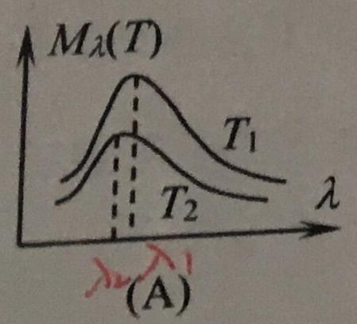
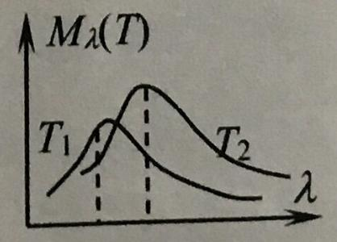

# 《大学物理》量子物理章节习题（黑体辐射与普朗克假设）

原件经识别和整理；“参考解答”是我们补的。

## 第一节 黑体辐射 普朗克能量子假设

### 选择 1

黑体的温度升高一倍，它的辐射出射度（总发射本领）增大

- A. 15 倍
- B. 7 倍
- C. 3 倍
- D. 1 倍

参考解答：**答案：B．7 倍**

根据斯忒藩–玻尔兹曼定律，黑体的总辐射出射度为

$$
M=\sigma T^4.
$$

温度升高一倍，即 $T'=2T$，则

$$
\frac{M'}{M}
=\frac{\sigma(2T)^4}{\sigma T^4}
=2^4=16.
$$

“增大”通常指增加量，因此辐射出射度增大

$$
\Delta M=M'-M=16M-M=15M,
$$

即增大了原值的 $15$ 倍。

- **A 正确**：增量为原值的 $15$ 倍。
- **B 不正确**：$15$ 是增加量，不是增大倍数；新值是原来的 $16$ 倍。
- **C 不正确**：对应总辐射度变为原来的 $3$ 倍，不符合 $T^4$ 规律。
- **D 不正确**：温度升高后总辐射出射度显著增大。

知识点：[黑体辐射规律与普朗克能量子假设](../../../topics/大学物理/黑体辐射与普朗克假设.md)

### 选择 2

所谓“黑体”是指这样的一种物体，即：

- A. 不能反射任何可见光的物体
- B. 不能反射任何电磁辐射的物体
- C. 颜色是纯黑的物体
- D. 能够全部吸收外来的任何电磁辐射的物体

参考解答：**结论：D。**

黑体的定义是能够全部吸收外来任何电磁辐射的物体，不反射也不透射，因此 D 正确。

- A 错：黑体不仅限于可见光，而是针对任意电磁辐射。
- B 错：“不能反射”不等于“全部吸收”，黑体核心是吸收全部入射辐射。
- C 错：黑体不一定是肉眼看起来纯黑，其辐射谱取决于温度。

知识点：[黑体辐射规律与普朗克能量子假设](../../../topics/大学物理/黑体辐射与普朗克假设.md)

### 选择 3

在加热黑体过程中，其最大单色辐出度对应的波长由 $0.8\ \mu\mathrm{m}$ 变到 $0.4\ \mu\mathrm{m}$，则其辐射出射度增大为原来的

- A. 2 倍
- B. 4 倍
- C. 16 倍
- D. 8 倍

参考解答：**结论：** C

**推理：**

由维恩位移定律 $\lambda_m T = b$ 可知，最大单色辐出度对应波长由 $\lambda_{m1}=0.8\ \mu\mathrm{m}$ 变为 $\lambda_{m2}=0.4\ \mu\mathrm{m}$，即减半，故绝对温度变为原来的 $2$ 倍：
$$
\frac{T_2}{T_1} = \frac{\lambda_{m1}}{\lambda_{m2}} = \frac{0.8}{0.4} = 2
$$

又由斯特藩–玻尔兹曼定律，黑体辐射出射度 $M = \sigma T^4$，因此
$$
\frac{M_2}{M_1} = \left(\frac{T_2}{T_1}\right)^4 = 2^4 = 16
$$

故辐射出射度增大为原来的 **16 倍**，选项 C 正确。

其他选项不对的原因：A 只按 $\lambda_m$ 反比温度得 $2$ 倍；B 按面积/平方误算为 $4$ 倍；D 按立方误算为 $8$ 倍，均未正确使用 $M\propto T^4$。

知识点：[黑体辐射规律与普朗克能量子假设](../../../topics/大学物理/黑体辐射与普朗克假设.md)

### 选择 4

在下面四个图中，哪一个图能定性地正确反映黑体单色辐出度 $M_{\lambda}(T)$ 随 $\lambda$ 和 $T$ 的变化关系（已知 $T_2 > T_1$）

参考解答：**结论：图 (B)**

**推理过程：**
黑体单色辐出度 $M_{\lambda}(T)$ 随 $\lambda$ 和 $T$ 的变化须满足两条规律：
1.  **维恩位移定律**：随着温度 $T$ 升高，峰值波长 $\lambda_m$ 向短波方向移动（即 $\lambda_m \propto 1/T$）。因此 $T_2 > T_1$ 时，$T_2$ 曲线的峰值更靠左。
2.  **斯特藩-玻尔兹曼定律**：温度越高，曲线下总面积（总辐出度）越大，且在全波段 $T_2$ 曲线都应高于 $T_1$ 曲线，两线绝不相交。

**选项分析：**
-   **图 (A)**：两条曲线相交，且 $T_2$ 峰值波长更长，不符合位移定律。故错。
-   **图 (B)**：$T_2$ 峰值波长更短，且整条曲线始终高于 $T_1$，完全符合上述两条规律。故正确。
-   **图 (C)**：两线相交，不符合斯特藩-玻尔兹曼定律（高温曲线面积应更大）。故错。
-   **图 (D)**：$T_2$ 峰值波长更长，不符合位移定律。故错。

知识点：[黑体辐射规律与普朗克能量子假设](../../../topics/大学物理/黑体辐射与普朗克假设.md)

### 选择 5

普朗克量子假说是为解释

- A. 光电效应实验规律而提出来的
- B. 黑体辐射的实验规律而提出来的
- C. 原子光谱的规律性而提出来的
- D. X 射线散射的实验规律而提出来的

参考解答：**答案：B**

**推理**  
普朗克于 1900 年为了解释黑体辐射的实验规律，首次提出了能量量子化的假说，即谐振子的能量是量子化的，$E = nh\nu$，从而导出了正确的黑体辐射公式。

**其他选项排除**  
- A：光电效应是爱因斯坦利用光量子假说解释的，并非普朗克提出量子假说的初衷。  
- C：原子光谱的规律性由玻尔模型等解释，基于量子化角动量，但并非普朗克假说的直接应用。  
- D：X 射线散射（康普顿效应）由康普顿解释，再次应用了光量子概念，与普朗克假说的提出无关。

知识点：[黑体辐射规律与普朗克能量子假设](../../../topics/大学物理/黑体辐射与普朗克假设.md)

### 填空 1

测量星球表面温度的方法之一，是把星球看作绝对黑体而测定其最大单色辐出度的波长 $\lambda_{\mathrm{m}}$。现测得太阳的 $\lambda_{\mathrm{m}1} = 0.55\ \mu\mathrm{m}$，北极星的 $\lambda_{\mathrm{m}2} = 0.35\ \mu\mathrm{m}$，则太阳表面温度 $T_1$ 与北极星表面温度 $T_2$ 之比 $T_1 : T_2 = 7:11 \approx 0.64\left(\frac{0.35}{0.55}\right)$

参考解答：**结论**

$7:11$ （或 $\approx 0.64$）

**推理与计算过程**

根据维恩位移定律（Wien's displacement law），绝对黑体的最大单色辐出度波长 $\lambda_{\mathrm{m}}$ 与其热力学温度 $T$ 成反比，即：
$$ \lambda_{\mathrm{m}} T = b $$
其中 $b$ 为维恩常数。

由此可得太阳温度 $T_1$ 与北极星温度 $T_2$ 的关系：
$$ T_1 \lambda_{\mathrm{m}1} = T_2 \lambda_{\mathrm{m}2} = b $$

整理得温度之比：
$$ \frac{T_1}{T_2} = \frac{\lambda_{\mathrm{m}2}}{\lambda_{\mathrm{m}1}} $$

代入已知数据 $\lambda_{\mathrm{m}1} = 0.55\ \mu\mathrm{m}$，$\lambda_{\mathrm{m}2} = 0.35\ \mu\mathrm{m}$：
$$ \frac{T_1}{T_2} = \frac{0.35}{0.55} = \frac{35}{55} = \frac{7}{11} \approx 0.64 $$

知识点：[黑体辐射规律与普朗克能量子假设](../../../topics/大学物理/黑体辐射与普朗克假设.md)

### 填空 2

一个 $100\ \mathrm{W}$ 的白炽灯泡的灯丝表面积为 $S = 5.3 \times 10^{-5}\ \mathrm{m}^{2}$。若将点燃的灯丝看作是黑体，可估算出它的工作温度为 $2402\ \mathrm{K}$。

参考解答：## 结论

工作温度约为 $T \approx 2402\ \mathrm{K}$。

## 推理与计算

将灯丝视为黑体，其辐射功率由斯忒藩–玻尔兹曼定律给出：

$$P = \sigma S T^{4}$$

其中 $\sigma = 5.67\times 10^{-8}\ \mathrm{W\cdot m^{-2}\cdot K^{-4}}$。

解出温度：

$$T = \left(\frac{P}{\sigma S}\right)^{\frac{1}{4}} = \left(\frac{100}{5.67\times 10^{-8}\times 5.3\times 10^{-5}}\right)^{\frac{1}{4}}$$

计算得：

$$T \approx \left(3.33\times 10^{13}\right)^{\frac{1}{4}} \approx 2402\ \mathrm{K}$$

知识点：[黑体辐射规律与普朗克能量子假设](../../../topics/大学物理/黑体辐射与普朗克假设.md)、[温度的微观本质与分子平均平动动能](../../../topics/大学物理/温度微观解释.md)、[能量按自由度均分定理与理想气体内能](../../../topics/大学物理/能量均分定理.md)
