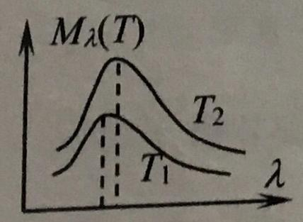
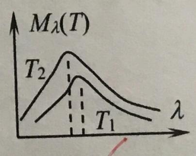

# 《大学物理》量子物理章节习题（黑体辐射与普朗克假设）

原件经识别和整理；“参考解答”是我们补的。

## 第一节 黑体辐射 普朗克能量子假设

### 选择 1

黑体的温度升高一倍，它的辐射出射度（总发射本领）增大

- A. 15 倍
- B. 7 倍
- C. 3 倍
- D. 1 倍

知识点：[黑体辐射规律与普朗克能量子假设](../../../topics/大学物理/黑体辐射与普朗克假设.md)

### 选择 2

所谓“黑体”是指这样的一种物体，即：

- A. 不能反射任何可见光的物体
- B. 不能反射任何电磁辐射的物体
- C. 颜色是纯黑的物体
- D. 能够全部吸收外来的任何电磁辐射的物体

知识点：[黑体辐射规律与普朗克能量子假设](../../../topics/大学物理/黑体辐射与普朗克假设.md)

### 选择 3

在加热黑体过程中，其最大单色辐出度对应的波长由 $0.8\ \mu\mathrm{m}$ 变到 $0.4\ \mu\mathrm{m}$，则其辐射出射度增大为原来的

- A. 2 倍
- B. 4 倍
- C. 16 倍
- D. 8 倍

知识点：[黑体辐射规律与普朗克能量子假设](../../../topics/大学物理/黑体辐射与普朗克假设.md)

### 选择 4

在下面四个图中，哪一个图能定性地正确反映黑体单色辐出度 $M_{\lambda}(T)$ 随 $\lambda$ 和 $T$ 的变化关系（已知 $T_2 > T_1$）

知识点：[黑体辐射规律与普朗克能量子假设](../../../topics/大学物理/黑体辐射与普朗克假设.md)

### 选择 5

普朗克量子假说是为解释

- A. 光电效应实验规律而提出来的
- B. 黑体辐射的实验规律而提出来的
- C. 原子光谱的规律性而提出来的
- D. X 射线散射的实验规律而提出来的

知识点：[黑体辐射规律与普朗克能量子假设](../../../topics/大学物理/黑体辐射与普朗克假设.md)

### 填空 1

测量星球表面温度的方法之一，是把星球看作绝对黑体而测定其最大单色辐出度的波长 $\lambda_{\mathrm{m}}$。现测得太阳的 $\lambda_{\mathrm{m}1} = 0.55\ \mu\mathrm{m}$，北极星的 $\lambda_{\mathrm{m}2} = 0.35\ \mu\mathrm{m}$，则太阳表面温度 $T_1$ 与北极星表面温度 $T_2$ 之比 $T_1 : T_2 = 7:11 \approx 0.64\left(\frac{0.35}{0.55}\right)$

知识点：[黑体辐射规律与普朗克能量子假设](../../../topics/大学物理/黑体辐射与普朗克假设.md)

### 填空 2

一个 $100\ \mathrm{W}$ 的白炽灯泡的灯丝表面积为 $S = 5.3 \times 10^{-5}\ \mathrm{m}^{2}$。若将点燃的灯丝看作是黑体，可估算出它的工作温度为 $2402\ \mathrm{K}$。

知识点：[黑体辐射规律与普朗克能量子假设](../../../topics/大学物理/黑体辐射与普朗克假设.md)、[温度的微观本质与分子平均平动动能](../../../topics/大学物理/温度微观解释.md)、[能量按自由度均分定理与理想气体内能](../../../topics/大学物理/能量均分定理.md)
