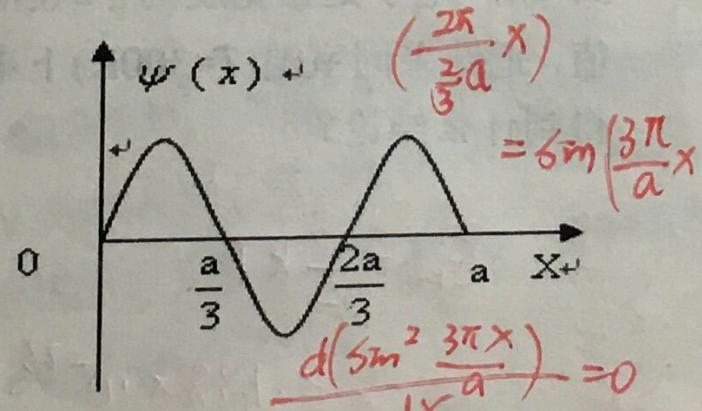

# 《大学物理》量子物理部分习题作业参考答案

原件经识别和整理；“参考解答”是我们补的。

## 一、选择题

### 选择 1

（题干与选项在识别内容中缺失）

知识点：[速度、加速度的定义与微分关系](../../../topics/大学物理/速度与加速度定义.md)

### 选择 2

（题干与选项在识别内容中缺失）

### 选择 3

（题干与选项在识别内容中缺失）

知识点：[简谐振动的动力学特征与回复力](../../../topics/大学物理/简谐振动的动力学.md)、[用旋转矢量法确定初相与运动状态](../../../topics/大学物理/旋转矢量法.md)

### 选择 4

（题干与选项在识别内容中缺失）

知识点：[简谐振动的动力学特征与回复力](../../../topics/大学物理/简谐振动的动力学.md)、[简谐振动的动能、势能与总机械能](../../../topics/大学物理/简谐振动的能量.md)

### 选择 5

卢瑟福 $\alpha$ 粒子实验证实了（E）；康普顿效应证实了（A）；戴维逊-革末实验证实了（D）。

- A. 光的量子性
- B. 玻尔的能级量子化假设
- C. X 射线的存在
- D. 电子的波动性
- E. 原子的有核模型

答案：E；A；D。

知识点：[康普顿散射实验与光子动量](../../../topics/大学物理/康普顿散射.md)、[德布罗意物质波假设](../../../topics/大学物理/实物粒子的波动性.md)、[玻尔的氢原子理论与能级跃迁](../../../topics/大学物理/玻尔氢原子模型.md)

### 选择 6

光电效应和康普顿效应都是光子和物质原子中的电子相互作用过程，其区别何在？在下面几种理解中，正确的是

- A. 两种效应中电子与光子组成的系统都服从能量守恒定律和动量守恒定律
- B. 光电效应是由于电子吸收光子能量而产生的，而康普顿效应则是由于电子与光子的弹性碰撞过程
- C. 两种效应都相当于电子与光子的弹性碰撞过程
- D. 两种效应都属于电子吸收光子的过程

答案：A。

知识点：[光电效应的实验规律与爱因斯坦光子理论](../../../topics/大学物理/光电效应.md)、[康普顿散射实验与光子动量](../../../topics/大学物理/康普顿散射.md)

### 选择 7

粒子在一维无限深方势阱中运动，如图所示为粒子处于某一能态上的波函数 $\psi(x)$ 的曲线。粒子出现概率最大的位置为

- A. $a/2$
- B. $a/6$，$5a/6$
- C. $a/6$，$a/2$，$5a/6$
- D. $0$，$a/3$，$2a/3$，$a$

答案：C。

知识点：[薛定谔方程与一维无限深势阱](../../../topics/大学物理/薛定谔方程.md)

### 选择 8

欲使电子的德布罗意波长为 $0.1\,\text{nm}$，加速电压为

- A. $1.5\,\text{V}$
- B. $12.25\,\text{V}$
- C. $150\,\text{V}$
- D. $125.5\,\text{V}$

答案：C。

知识点：[德布罗意物质波假设](../../../topics/大学物理/实物粒子的波动性.md)、[功的定义、功率与质点动能定理](../../../topics/大学物理/功与动能定理.md)

### 填空 1

若太阳（看成黑体）的半径由 $R$ 增为 $2R$，温度由 $T$ 增为 $2T$，则其总辐射功率为原来的 64 倍。

知识点：[黑体辐射规律与普朗克能量子假设](../../../topics/大学物理/黑体辐射与普朗克假设.md)

### 填空 2

(1) 保持入射光的频率不变，饱和光电流与入射光的光强成正比。

(2) 光电子初动能与入射光频率有关，与光强无关。

(3) 要产生光电效应必须入射光的频率 $>$ 截止频率。

知识点：[光电效应的实验规律与爱因斯坦光子理论](../../../topics/大学物理/光电效应.md)、[黑体辐射规律与普朗克能量子假设](../../../topics/大学物理/黑体辐射与普朗克假设.md)、[玻尔的氢原子理论与能级跃迁](../../../topics/大学物理/玻尔氢原子模型.md)

### 填空 3

用来解释光电效应的爱因斯坦公式为 $h\nu=E_k+W$。

知识点：[光电效应的实验规律与爱因斯坦光子理论](../../../topics/大学物理/光电效应.md)

### 填空 4

波长为 $300\,\text{nm}$ 的光照在某金属表面时，光电子能量范围从 $0$ 到 $4\times10^{-19}\,\text{J}$。此金属遏止电压为 $|V_a|=2.5\,\text{V}$；红限频率 $\nu_0=0.4\times10^{15}\,\text{Hz}$。（普朗克常数 $h=6.63\times10^{-34}\,\text{J}\cdot\text{s}$，电子 $e=1.6\times10^{-19}\,\text{C}$。）

知识点：[光电效应的实验规律与爱因斯坦光子理论](../../../topics/大学物理/光电效应.md)、[黑体辐射规律与普朗克能量子假设](../../../topics/大学物理/黑体辐射与普朗克假设.md)

### 填空 5

以波长为 $\lambda=0.207\,\mu\text{m}$ 紫外光照射金属钯表面产生光电效应，已知钯的红限频率 $\nu_0=1.21\times10^{15}\,\text{Hz}$，则遏止电压 $|U_a|=$ ____ $\text{V}$。

知识点：[光电效应的实验规律与爱因斯坦光子理论](../../../topics/大学物理/光电效应.md)

### 填空 6

用频率为 $\nu$ 的单色光照射某种金属时，逸出光电子的最大动能为 $E_K$；若改用频率为 $2\nu$ 的单色光照射此种金属时，则逸出光电子的最大动能为 $h\nu+E_K$。

知识点：[光电效应的实验规律与爱因斯坦光子理论](../../../topics/大学物理/光电效应.md)

### 填空 7

光子波长为 $\lambda$，则其能量 $=\dfrac{hc}{\lambda}$，动量的大小 $=\dfrac{h}{\lambda}$，质量 $=\dfrac{h}{\lambda c}$。

知识点：[康普顿散射实验与光子动量](../../../topics/大学物理/康普顿散射.md)、[光电效应的实验规律与爱因斯坦光子理论](../../../topics/大学物理/光电效应.md)、[德布罗意物质波假设](../../../topics/大学物理/实物粒子的波动性.md)

### 填空 8

戴维逊-革末实验验证了德布罗意波的存在，德布罗意关系为 $E=h\nu$，$p=\dfrac{h}{\lambda}$。

知识点：[德布罗意物质波假设](../../../topics/大学物理/实物粒子的波动性.md)
