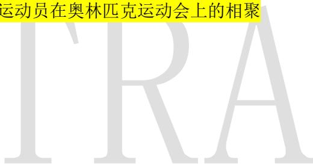

# 《大学生心理健康》体育与健康章节选择题库

原件经识别和整理；“参考解答”是我们补的。

## 一、选择题

### 选择 1

（ ）的狭义概念是一个发展身体，增强体质，传授锻炼身体的知识、技能，培养道德和意志品质的教育过程；是对人体进行培育和塑造的过程；是教育的重要组成部分；是培养全面发展的人的一个重要方面。

- A. 德育
- B. 智育
- C. 体育
- D. 美育

知识点：[体育锻炼对心理健康的促进作用及生理机制](../../../topics/大学生心理健康/身心健康关系.md)、[终身体育观念的培养与健康生活方式的建立](../../../topics/大学生心理健康/终身体育意识.md)

### 选择 2

体育的本质是以身体锻炼为基本手段，以（ ）为主要目的，这是体育区别于其他社会活动的本质特点。

- A. 增强体质
- B. 娱乐消遣
- C. 社会交往
- D. 公益慈善

知识点：[健康体适能与竞技体适能的构成要素](../../../topics/大学生心理健康/体适能概念.md)

### 选择 3

体育课程将“（ ）”的指导思想作为选编教学内容的基本出发点，坚持健身性与文化性相结合、科学性与可接受性相结合、民族性与世界性相结合，开设兴趣选择项目。

- A. 终身体育
- B. 以人为本
- C. 健康第一
- D. 实事求是

知识点：[终身体育观念的培养与健康生活方式的建立](../../../topics/大学生心理健康/终身体育意识.md)

### 选择 4

体育课程对部分身体异常和病残、体弱等特殊群体的学生，开设以（ ）的体育课程。

- A. 运动量大的运动项目为主
- B. 康复、保健为主
- C. 学生喜好的运动项目为主
- D. 理论课程为主

知识点：[体育锻炼对心理健康的促进作用及生理机制](../../../topics/大学生心理健康/身心健康关系.md)

### 选择 5

大学体育的基本目标是根据大多数学生的基本要求而确定的，分为运动参与目标、（ ）、身体健康目标、心理健康目标、社会适应目标等 5 个领域目标。

- A. 长期目标
- B. 短期目标
- C. 中短期目标
- D. 运动技能目标

知识点：[促进心理健康的运动处方要素（FITT原则）](../../../topics/大学生心理健康/运动处方制定.md)

### 选择 6

高等教育担负着为国家培养高级专门人才的重任。在高等院校里主要通过德育、智育、（ ）、美育和专业教育这几个方面对学生进行培养。

- A. 体育
- B. 思想
- C. 品格
- D. 意志品质

知识点：[健康与心理健康的概念（WHO定义及内涵）](../../../topics/大学生心理健康/健康与心理健康概念.md)

### 选择 7

大学体育文化是学校教育的重要组成部分，大学体育文化的功能有（ ）、情操陶冶功能、心理疏导功能、社会实践功能。

- A. 健身功能
- B. 教育功能
- C. 锻炼功能
- D. 强身功能

知识点：[健全自我意识的培养途径与方法](../../../topics/大学生心理健康/健全自我意识.md)、[大学生健全人格的塑造与完善策略](../../../topics/大学生心理健康/健全人格塑造.md)、[体育锻炼对心理健康的促进作用及生理机制](../../../topics/大学生心理健康/身心健康关系.md)

### 选择 8

根据体育实践的基本特征和功能等综合因素，可以把体育划分为三个基本形态：（ ）、竞技体育和社会体育。

- A. 社区体育
- B. 农村体育
- C. 学校体育
- D. 职业体育

知识点：[健康体适能与竞技体适能的构成要素](../../../topics/大学生心理健康/体适能概念.md)、[终身体育观念的培养与健康生活方式的建立](../../../topics/大学生心理健康/终身体育意识.md)

### 选择 9

在推动素质教育实施、促进人的全面发展方面，（ ）是一个重要的途径，它在我国实现教育现代化、健康中国建设、人才强国以及中华民族伟大复兴的战略目标上发挥着不可或缺的作用。

- A. 学校体育
- B. 农村体育
- C. 社区体育
- D. 职业体育

知识点：[健康体适能与竞技体适能的构成要素](../../../topics/大学生心理健康/体适能概念.md)、[终身体育观念的培养与健康生活方式的建立](../../../topics/大学生心理健康/终身体育意识.md)

### 选择 10

大学体育兼有课程、文化、实践等多种育人形式和载体，因而要充分挖掘、梳理大学体育所蕴含的（ ）要素，推动大学体育向集专业知识教育与思想政治教育于一体的重要阵地的转化，使思想政治教育融入大学体育各环节。

- A. 竞技
- B. 健身
- C. 社交
- D. 思想政治教育

知识点：[终身体育观念的培养与健康生活方式的建立](../../../topics/大学生心理健康/终身体育意识.md)

### 选择 11

大学体育对大学生（ ）教育培养以及人格、品质的陶冶塑造有积极、独特的作用。

- A. 文化、专业的
- B. 思想、道德的
- C. 身体、心理的
- D. 道德、专业的

知识点：[体育锻炼对心理健康的促进作用及生理机制](../../../topics/大学生心理健康/身心健康关系.md)、[大学生健全人格的塑造与完善策略](../../../topics/大学生心理健康/健全人格塑造.md)、[情绪的成分、功能及基本情绪理论（如詹姆斯-兰格理论、认知评价理论）](../../../topics/大学生心理健康/情绪基本理论.md)

### 选择 12

以下哪个是健康的标志？

- A. 头发无光泽
- B. 乐观开朗
- C. 脸色苍白
- D. 精神萎靡

知识点：[健康与心理健康的概念（WHO定义及内涵）](../../../topics/大学生心理健康/健康与心理健康概念.md)

### 选择 13

危害健康的行为有（ ）。

- A. 吸烟酗酒
- B. 早睡早起
- C. 按时吃饭
- D. 适量运动

知识点：[体育锻炼对心理健康的促进作用及生理机制](../../../topics/大学生心理健康/身心健康关系.md)、[终身体育观念的培养与健康生活方式的建立](../../../topics/大学生心理健康/终身体育意识.md)

### 选择 14

关于经常参加体育锻炼的人，以下错误的是（ ）。

- A. 行动更加迅速
- B. 动作更加准确
- C. 思维更加清晰
- D. 心理更加消极

知识点：[体育锻炼对心理健康的促进作用及生理机制](../../../topics/大学生心理健康/身心健康关系.md)、[体育锻炼缓解焦虑和抑郁的实证效果](../../../topics/大学生心理健康/运动与情绪调节.md)

### 选择 15

健身最主要的本质功能是（ ）。

- A. 提高运动成绩
- B. 促进健康，增强体质
- C. 包治百病
- D. 没有什么功能

知识点：[体育锻炼对心理健康的促进作用及生理机制](../../../topics/大学生心理健康/身心健康关系.md)、[健康体适能与竞技体适能的构成要素](../../../topics/大学生心理健康/体适能概念.md)

### 选择 16

关于体育运动对人体骨骼产生的影响，以下错误的是（ ）。

- A. 抗弯
- B. 坚固
- C. 抗压
- D. 抗辐射

知识点：[体育锻炼对心理健康的促进作用及生理机制](../../../topics/大学生心理健康/身心健康关系.md)、[健康体适能与竞技体适能的构成要素](../../../topics/大学生心理健康/体适能概念.md)

### 选择 17

体重轻于正常标准的学生体质类型为（ ）。

- A. 健康型
- B. 一般型
- C. 消瘦型
- D. 肥胖型

知识点：[健康体适能与竞技体适能的构成要素](../../../topics/大学生心理健康/体适能概念.md)、[健康与心理健康的概念（WHO定义及内涵）](../../../topics/大学生心理健康/健康与心理健康概念.md)

### 选择 18

研究发现，身体发胖前往往会出现一些异常现象，如能及时注意或可防患于未然。以下哪项不是身体发胖前的预兆？（ ）

- A. 变懒
- B. 怕动
- C. 贪睡
- D. 厌食

知识点：[体育锻炼对心理健康的促进作用及生理机制](../../../topics/大学生心理健康/身心健康关系.md)、[体育锻炼缓解焦虑和抑郁的实证效果](../../../topics/大学生心理健康/运动与情绪调节.md)、[健康与心理健康的概念（WHO定义及内涵）](../../../topics/大学生心理健康/健康与心理健康概念.md)

### 选择 19

（ ）是世界公认的预防肥胖的经济有效、无毒副作用的方法和根本措施，也是终身

- A. 适量运动
- B. 饮食调节结合适量运动
- C. 饮食调节
- D. 减少睡眠

知识点：[体育锻炼对心理健康的促进作用及生理机制](../../../topics/大学生心理健康/身心健康关系.md)、[终身体育观念的培养与健康生活方式的建立](../../../topics/大学生心理健康/终身体育意识.md)

### 选择 20

以下不属于体育运动对现代生活方式的改善的是（ ）。

- A. 能缓解压力、宣泄情绪、增强信心、提高社会适应能力
- B. 生活步调完全以体育运动为中心，忽略对家庭与朋友的关心
- C. 可以缓解、转移现代生活方式所造成的疲劳
- D. 有助于促进心理健康

知识点：[体育锻炼对心理健康的促进作用及生理机制](../../../topics/大学生心理健康/身心健康关系.md)、[体育锻炼缓解焦虑和抑郁的实证效果](../../../topics/大学生心理健康/运动与情绪调节.md)、[终身体育观念的培养与健康生活方式的建立](../../../topics/大学生心理健康/终身体育意识.md)

### 选择 21

生活方式是个非常复杂的问题，但是对（ ）的影响是极其深远的。

- A. 健康
- B. 未来
- C. 人生
- D. 观念

知识点：[健康与心理健康的概念（WHO定义及内涵）](../../../topics/大学生心理健康/健康与心理健康概念.md)、[体育锻炼对心理健康的促进作用及生理机制](../../../topics/大学生心理健康/身心健康关系.md)

### 选择 22

健身运动后以补充（ ）为佳，也可饮用菜汁、果汁、咸菜汤等。

- A. 白开水
- B. 矿泉水
- C. 啤酒
- D. 糖盐水

知识点：[体育锻炼对心理健康的促进作用及生理机制](../../../topics/大学生心理健康/身心健康关系.md)、[促进心理健康的运动处方要素（FITT原则）](../../../topics/大学生心理健康/运动处方制定.md)、[健康与心理健康的概念（WHO定义及内涵）](../../../topics/大学生心理健康/健康与心理健康概念.md)

### 选择 23

（ ）是指在身体、心理和社会各方面都达到完美的状态，而不仅仅是指没有疾病。

- A. 体质
- B. 健康
- C. 体能
- D. 体态

知识点：[健康与心理健康的概念（WHO定义及内涵）](../../../topics/大学生心理健康/健康与心理健康概念.md)

### 选择 24

健康会受到许多因素的影响和制约，归纳起来主要有四个因素：环境因素、（ ）、行为和生活方式因素、卫生医疗因素。

- A. 思想因素
- B. 性格因素
- C. 个性因素
- D. 生物学因素

知识点：[健康与心理健康的概念（WHO定义及内涵）](../../../topics/大学生心理健康/健康与心理健康概念.md)

### 选择 25

生命活动或运动过程中能量供应的能源物质是（ ）。

- A. 糖、脂肪和蛋白质
- B. 水、无机盐和维生素
- C. 糖、无机盐和维生素
- D. 糖、脂肪和维生素

知识点：[体育锻炼对心理健康的促进作用及生理机制](../../../topics/大学生心理健康/身心健康关系.md)

### 选择 26

最易被人体吸收的糖是（ ）。

- A. 蔗糖、麦芽糖、乳糖
- B. 葡萄糖、果糖、半乳糖
- C. 淀粉、糖原、纤维素
- D. 葡萄糖、蔗糖、糖原

### 选择 27

机体最主要的供能物质是（ ）。

- A. 糖类
- B. 脂类
- C. 蛋白质
- D. 维生素

知识点：[终身体育观念的培养与健康生活方式的建立](../../../topics/大学生心理健康/终身体育意识.md)

### 选择 28

正常情况下，大脑所需能量的主要来源是（ ）。

- A. 果糖
- B. 葡萄糖
- C. 酮体
- D. 乳酸

知识点：[体育锻炼对心理健康的促进作用及生理机制](../../../topics/大学生心理健康/身心健康关系.md)

### 选择 29

BMI 是评估体重是否正常的一项常用指标，其计算公式为（ ）。

- A. BMI＝身高/体重（米/千克）
- B. BMI＝体重/身高（千克/平方米）
- C. BMI＝身高/体重（平方米/千克）
- D. BMI＝体重/身高（千克/米）

知识点：[健康体适能与竞技体适能的构成要素](../../../topics/大学生心理健康/体适能概念.md)、[体育锻炼对心理健康的促进作用及生理机制](../../../topics/大学生心理健康/身心健康关系.md)、[促进心理健康的运动处方要素（FITT原则）](../../../topics/大学生心理健康/运动处方制定.md)

### 选择 30

王女士，24 岁，体重 65 千克，身高 160 厘米，她的 BMI 值为（ ）。

- A. 25.39，超重
- B. 28.39，肥胖
- C. 23.39，正常
- D. 27.39，肥胖

知识点：[健康体适能与竞技体适能的构成要素](../../../topics/大学生心理健康/体适能概念.md)

### 选择 31

下列不属于引起肥胖的原因的是（ ）。

- A. 膳食因素
- B. 社会环境因素
- C. 遗传因素
- D. 糖尿病

知识点：[体育锻炼对心理健康的促进作用及生理机制](../../../topics/大学生心理健康/身心健康关系.md)

### 选择 32

（ ）对于提高抵抗力、增粗肌纤维、保持肌肉线条有很好的帮助作用。

- A. 碳水化合物
- B. 脂肪
- C. 蛋白质
- D. 肌酸

知识点：[健康体适能与竞技体适能的构成要素](../../../topics/大学生心理健康/体适能概念.md)、[终身体育观念的培养与健康生活方式的建立](../../../topics/大学生心理健康/终身体育意识.md)

### 选择 33

（ ）时人体在氧供应充分的条件下，由糖和脂肪参与有氧代谢供能。

- A. 有氧运动
- B. 无氧运动
- C. 无氧糖酵解
- D. 混合供能

知识点：[体育锻炼对心理健康的促进作用及生理机制](../../../topics/大学生心理健康/身心健康关系.md)

### 选择 34

经常参加体育锻炼的人一天至少食用新鲜蔬菜（ ）克，品种有 2～3 种，植物油 20～30 克。

- A. 500
- B. 600
- C. 700
- D. 250

知识点：[体育锻炼对心理健康的促进作用及生理机制](../../../topics/大学生心理健康/身心健康关系.md)、[促进心理健康的运动处方要素（FITT原则）](../../../topics/大学生心理健康/运动处方制定.md)、[终身体育观念的培养与健康生活方式的建立](../../../topics/大学生心理健康/终身体育意识.md)

### 选择 35

运动后应休息（ ）小时后进食。

- A. 2
- B. 1.5
- C. 1
- D. 0.5

知识点：[体育锻炼对心理健康的促进作用及生理机制](../../../topics/大学生心理健康/身心健康关系.md)、[体育锻炼缓解焦虑和抑郁的实证效果](../../../topics/大学生心理健康/运动与情绪调节.md)

### 选择 36

运动者每天应保证（ ）个小时的充足睡眠，使机体处于完全放松状态。

- A. 7～8
- B. 8～9
- C. 9～10
- D. 6～7

知识点：[体育锻炼对心理健康的促进作用及生理机制](../../../topics/大学生心理健康/身心健康关系.md)、[终身体育观念的培养与健康生活方式的建立](../../../topics/大学生心理健康/终身体育意识.md)

### 选择 37

贯彻体育锻炼持之以恒的原则，应该注意（ ）。

- A. 一次锻炼后要休息几天
- B. 锻炼要有恒心，贵在坚持
- C. 有时间就锻炼，没时间挤时间也要锻炼
- D. 锻炼要遵从内心，不想锻炼就休息

知识点：[终身体育观念的培养与健康生活方式的建立](../../../topics/大学生心理健康/终身体育意识.md)、[体育锻炼对心理健康的促进作用及生理机制](../../../topics/大学生心理健康/身心健康关系.md)

### 选择 38

根据学生的身体情况和兴趣爱好，在制订锻炼任务、内容、方法时，必须有所区别于他人的锻炼身体的基本原则是（ ）。

- A. 持之以恒原则
- B. 因人而异原则
- C. 全面发展原则
- D. 循序渐进原则

知识点：[促进心理健康的运动处方要素（FITT原则）](../../../topics/大学生心理健康/运动处方制定.md)、[体育锻炼对心理健康的促进作用及生理机制](../../../topics/大学生心理健康/身心健康关系.md)

### 选择 39

体育锻炼的运动量应掌握在（ ）。

- A. 不影响第二天的工作、学习、生活
- B. 达到运动量的极限
- C. 想运动时就锻炼一下
- D. 达到身体发热、出汗

知识点：[促进心理健康的运动处方要素（FITT原则）](../../../topics/大学生心理健康/运动处方制定.md)、[体育锻炼对心理健康的促进作用及生理机制](../../../topics/大学生心理健康/身心健康关系.md)、[终身体育观念的培养与健康生活方式的建立](../../../topics/大学生心理健康/终身体育意识.md)

### 选择 40

以下不属于预防运动中暑的方法是（ ）。

- A. 在高温炎热环境下锻炼时，应适当减少运动量和锻炼时间，要尽量避免在烈日下锻炼
- B. 在高温炎热环境下要发扬不怕苦的精神，加大运动量和强度
- C. 在室外锻炼时，应戴白色凉帽，穿宽松、浅色的运动服
- D. 夏天在室内锻炼时，应注意通风，并备有低糖含盐的饮料

知识点：[促进心理健康的运动处方要素（FITT原则）](../../../topics/大学生心理健康/运动处方制定.md)

### 选择 41

在冬季进行体育锻炼时应该做到（ ）。

- A. 不用做准备活动
- B. 不用注意保暖
- C. 大雪天气不用穿防滑的运动鞋
- D. 大雾天不要锻炼

知识点：[促进心理健康的运动处方要素（FITT原则）](../../../topics/大学生心理健康/运动处方制定.md)

### 选择 42

了解体育锻炼过程中疲劳产生的机制，掌握合理的辨别疲劳的方法并有效地（ ）运动性疲劳，对增进人体健康有着十分重要的意义。

- A. 延长
- B. 消除
- C. 减轻
- D. 增加

知识点：[体育锻炼对心理健康的促进作用及生理机制](../../../topics/大学生心理健康/身心健康关系.md)、[促进心理健康的运动处方要素（FITT原则）](../../../topics/大学生心理健康/运动处方制定.md)

### 选择 43

初级锻炼者必须遵循循序渐进的原则，运动量和运动强度要逐渐加大，切不可冒进。过度运动后要（ ）运动量和运动强度，进行调整性练习。

- A. 降低
- B. 加大
- C. 逐渐加大
- D. 停止

知识点：[促进心理健康的运动处方要素（FITT原则）](../../../topics/大学生心理健康/运动处方制定.md)、[体育锻炼对心理健康的促进作用及生理机制](../../../topics/大学生心理健康/身心健康关系.md)

### 选择 44

体育锻炼的从实际出发的原则是指锻炼身体应从（ ）的实际情况和外界环境条件的实际出发，确定锻炼目的，选择适宜的运动项目，合理地安排运动时间和运动负荷。

- A. 个人
- B. 集体
- C. 经济
- D. 政治

知识点：[体育锻炼对心理健康的促进作用及生理机制](../../../topics/大学生心理健康/身心健康关系.md)、[促进心理健康的运动处方要素（FITT原则）](../../../topics/大学生心理健康/运动处方制定.md)、[积极情绪的培养与主观幸福感的提升](../../../topics/大学生心理健康/积极心理学应用.md)

### 选择 45

（ ）是指在不改变动作结构及其外部运动负荷的情况下，按一定要求反复练习，各次（组）练习之间的间歇时间要使运动员完全恢复，每一次练习都要在完全恢复的条件下进行的训练方法。

- A. 负重训练法
- B. 重复训练法
- C. 综合训练法
- D. 间歇训练法

知识点：[健康与心理健康的概念（WHO定义及内涵）](../../../topics/大学生心理健康/健康与心理健康概念.md)、[体育锻炼对心理健康的促进作用及生理机制](../../../topics/大学生心理健康/身心健康关系.md)、[促进心理健康的运动处方要素（FITT原则）](../../../topics/大学生心理健康/运动处方制定.md)

### 选择 46

两次练习之间有一个严格控制休息时间的间歇阶段，并且这个间歇阶段的长短是通过测量练习者的心率来控制的，关键点是练习者要在尚未完全恢复体力时便开始下一组练习，这种训练方法称为（ ）。

- A. 重复训练法
- B. 循环训练法
- C. 综合训练法
- D. 间歇训练法

知识点：[促进心理健康的运动处方要素（FITT原则）](../../../topics/大学生心理健康/运动处方制定.md)、[体育锻炼对心理健康的促进作用及生理机制](../../../topics/大学生心理健康/身心健康关系.md)、[健康体适能与竞技体适能的构成要素](../../../topics/大学生心理健康/体适能概念.md)

### 选择 47

下列哪一个不是消除运动性疲劳的方法？（ ）

- A. 改善代谢法
- B. 调节神经系统法
- C. 物理疗法
- D. 随心所欲法

知识点：[促进心理健康的运动处方要素（FITT原则）](../../../topics/大学生心理健康/运动处方制定.md)

### 选择 48

以下哪项是运动过度的表现？（ ）

- A. 晨脉搏减少
- B. 免疫力提高
- C. 疲劳不能及时消除
- D. 吃饭有胃口

知识点：[促进心理健康的运动处方要素（FITT原则）](../../../topics/大学生心理健康/运动处方制定.md)、[体育锻炼对心理健康的促进作用及生理机制](../../../topics/大学生心理健康/身心健康关系.md)

### 选择 49

下列不属于运动过度的表现是（ ）。

- A. 受伤和肌肉疼痛的次数增加
- B. 早晨起床时脉搏升高
- C. 提不起精神，缺乏耐久力
- D. 动作灵敏，反应快

知识点：[促进心理健康的运动处方要素（FITT原则）](../../../topics/大学生心理健康/运动处方制定.md)、[体育锻炼对心理健康的促进作用及生理机制](../../../topics/大学生心理健康/身心健康关系.md)

### 选择 50

一位同学没吃早饭，上体育课时感到头晕，他补充（ ）能最快获得能量。

- A. 鸡蛋
- B. 牛奶
- C. 花生
- D. 葡萄糖

知识点：[体育锻炼对心理健康的促进作用及生理机制](../../../topics/大学生心理健康/身心健康关系.md)、[体育锻炼缓解焦虑和抑郁的实证效果](../../../topics/大学生心理健康/运动与情绪调节.md)、[健康与心理健康的概念（WHO定义及内涵）](../../../topics/大学生心理健康/健康与心理健康概念.md)

### 选择 51

（ ）是指由运动引起的人体运动能力暂时下降的生理现象。

- A. 超量恢复
- B. 运动性疲劳
- C. 体能恢复
- D. 运动性贫血

知识点：[健康体适能与竞技体适能的构成要素](../../../topics/大学生心理健康/体适能概念.md)、[促进心理健康的运动处方要素（FITT原则）](../../../topics/大学生心理健康/运动处方制定.md)、[体育锻炼对心理健康的促进作用及生理机制](../../../topics/大学生心理健康/身心健康关系.md)

### 选择 52

力量、速度、耐力、灵敏、柔韧五项素质总称为（ ）。

- A. 身体素质
- B. 个人能力
- C. 身体能力
- D. 基本能力

知识点：[健康体适能与竞技体适能的构成要素](../../../topics/大学生心理健康/体适能概念.md)

### 选择 53

（ ）是指人体长时间持续运动和对抗疲劳的能力。

- A. 力量素质
- B. 耐力素质
- C. 速度素质
- D. 灵敏素质

知识点：[健康体适能与竞技体适能的构成要素](../../../topics/大学生心理健康/体适能概念.md)

### 选择 54

柔韧素质测定的方法是（ ）。

- A. 引体向上
- B. 仰卧起坐
- C. 坐位体前屈
- D. 立定跳远

知识点：[健康体适能与竞技体适能的构成要素](../../../topics/大学生心理健康/体适能概念.md)

### 选择 55

50 米跑反映的是人体的（ ）素质。

- A. 速度
- B. 耐力
- C. 力量
- D. 灵敏

知识点：[健康体适能与竞技体适能的构成要素](../../../topics/大学生心理健康/体适能概念.md)

### 选择 56

为了达到体育锻炼的目的，提高锻炼效果，在锻炼中我们应遵循（ ）原则。

- A. 大运动量
- B. 实战性
- C. 对抗性
- D. 循序渐进

知识点：[促进心理健康的运动处方要素（FITT原则）](../../../topics/大学生心理健康/运动处方制定.md)、[体育锻炼对心理健康的促进作用及生理机制](../../../topics/大学生心理健康/身心健康关系.md)

### 选择 57

发展速度素质的方法是（ ）。

- A. 牵拉动作的练习
- B. 长时间距离的练习
- C. 最快的动作练习
- D. 灵敏的动作练习

知识点：[健康体适能与竞技体适能的构成要素](../../../topics/大学生心理健康/体适能概念.md)

### 选择 58

发展灵敏素质的有效方法是（ ）。

- A. 图形变换跑
- B. 自然地形跑
- C. 轮流领先跑
- D. 变速跑

知识点：[体育锻炼对心理健康的促进作用及生理机制](../../../topics/大学生心理健康/身心健康关系.md)、[促进心理健康的运动处方要素（FITT原则）](../../../topics/大学生心理健康/运动处方制定.md)

### 选择 59

负重锻炼法是使用（ ）等重物进行身体运动来锻炼身体、增强体力的方法。

- A. 杠铃
- B. 双杠
- C. 单杠
- D. 跳绳

知识点：[促进心理健康的运动处方要素（FITT原则）](../../../topics/大学生心理健康/运动处方制定.md)

### 选择 60

（ ）是指肌肉紧张或收缩时所表现出来的一种能力。

- A. 速度
- B. 力量
- C. 耐力
- D. 柔韧

知识点：[健康体适能与竞技体适能的构成要素](../../../topics/大学生心理健康/体适能概念.md)

### 选择 61

速度是指人体快速运动的能力，可分为（ ）、动作速度、移动速度。

- A. 灵敏性
- B. 快速力量
- C. 速度耐力
- D. 反应速度

知识点：[体育锻炼对心理健康的促进作用及生理机制](../../../topics/大学生心理健康/身心健康关系.md)、[体育锻炼缓解焦虑和抑郁的实证效果](../../../topics/大学生心理健康/运动与情绪调节.md)、[健康体适能与竞技体适能的构成要素](../../../topics/大学生心理健康/体适能概念.md)

### 选择 62

下列不属于学校体育中运动损伤的发生特点的是（ ）。

- A. 小伤轻伤多、软组织损伤多
- B. 慢性损伤多
- C. 复合损伤多
- D. 严重伤及急性伤多

知识点：[体育锻炼对心理健康的促进作用及生理机制](../../../topics/大学生心理健康/身心健康关系.md)

### 选择 63

下列不属于开放性运动损伤伤口的处理原则的是（ ）。

- A. 立即拔除嵌入的物品
- B. 预防感染
- C. 控制出血
- D. 减轻疼痛，预防休克

知识点：[体育锻炼对心理健康的促进作用及生理机制](../../../topics/大学生心理健康/身心健康关系.md)

### 选择 64

下列不属于闭合性软组织损伤的是（ ）。

- A. 肌肉拉伤
- B. 软组织挫伤
- C. 关节扭伤
- D. 骨折

知识点：[体育锻炼对心理健康的促进作用及生理机制](../../../topics/大学生心理健康/身心健康关系.md)

### 选择 65

下列不属于急性运动损伤早期的处理原则的是（ ）。

- A. 制动
- B. 热敷
- C. 包扎
- D. 抬高

知识点：[体育锻炼对心理健康的促进作用及生理机制](../../../topics/大学生心理健康/身心健康关系.md)、[健康体适能与竞技体适能的构成要素](../../../topics/大学生心理健康/体适能概念.md)

### 选择 66

下列不属于急性运动损伤中期的处理方法的是（ ）。

- A. 冷敷
- B. 按摩
- C. 针刺
- D. 拔罐

知识点：[体育锻炼对心理健康的促进作用及生理机制](../../../topics/大学生心理健康/身心健康关系.md)、[体育锻炼缓解焦虑和抑郁的实证效果](../../../topics/大学生心理健康/运动与情绪调节.md)、[促进心理健康的运动处方要素（FITT原则）](../../../topics/大学生心理健康/运动处方制定.md)

### 选择 67

下列不属于急性运动损伤晚期的处理方法的是（ ）。

- A. 按摩
- B. 理疗
- C. 冷敷
- D. 功能锻炼

知识点：[促进心理健康的运动处方要素（FITT原则）](../../../topics/大学生心理健康/运动处方制定.md)、[体育锻炼对心理健康的促进作用及生理机制](../../../topics/大学生心理健康/身心健康关系.md)、[体育锻炼缓解焦虑和抑郁的实证效果](../../../topics/大学生心理健康/运动与情绪调节.md)

### 选择 68

根据肌纤维损伤的程度不同，肌肉拉伤可分为三级，下列不属于肌肉拉伤的是（ ）。

- A. 肌肉痉挛
- B. 捩伤
- C. 部分断裂
- D. 完全断裂

知识点：[体育锻炼对心理健康的促进作用及生理机制](../../../topics/大学生心理健康/身心健康关系.md)

### 选择 69

前臂出血时应该压迫的部位为（ ）。

- A. 锁骨下动脉
- B. 肱动脉
- C. 桡动脉
- D. 尺动脉

知识点：[体育锻炼对心理健康的促进作用及生理机制](../../../topics/大学生心理健康/身心健康关系.md)

### 选择 70

大腿及小腿出血时应该压迫的部位为（ ）。

- A. 股动脉
- B. 胫前动脉
- C. 胫后动脉
- D. 足背动脉

知识点：[体育锻炼对心理健康的促进作用及生理机制](../../../topics/大学生心理健康/身心健康关系.md)

### 选择 71

止血带绑扎的位置是（ ）。

- A. 伤口
- B. 伤口上方
- C. 伤口下方
- D. 伤口近心端

知识点：[心理危机的概念、类型及预警信号识别](../../../topics/大学生心理健康/心理危机识别.md)、[大学生自杀风险评估与守门人干预策略](../../../topics/大学生心理健康/自杀预防干预.md)、[问题指向应对与情绪指向应对策略](../../../topics/大学生心理健康/压力应对策略.md)

### 选择 72

采用止血带止血法应该（ ）松解一次。

- A. 5～10 分钟
- B. 10～20 分钟
- C. 20～30 分钟
- D. 30～60 分钟

知识点：[心理危机的概念、类型及预警信号识别](../../../topics/大学生心理健康/心理危机识别.md)、[健康与心理健康的概念（WHO定义及内涵）](../../../topics/大学生心理健康/健康与心理健康概念.md)

### 选择 73

骨折固定的原则不包括（ ）。

- A. 有伤口时应先止血再包扎固定
- B. 发生休克时应先救助休克
- C. 遇开放性骨折时需先将刺出皮肤的骨端送回创口再固定
- D. 夹板固定时应选择合适长宽的夹板

知识点：[体育锻炼对心理健康的促进作用及生理机制](../../../topics/大学生心理健康/身心健康关系.md)

### 选择 74

基本急救中的“ABC”三原则不包括（ ）。

- A. 保持伤者的呼吸道畅通
- B. 保持伤者的正常呼吸
- C. 保持伤者的正常血液循环
- D. 保持与伤者的语言交流

知识点：[心理危机的概念、类型及预警信号识别](../../../topics/大学生心理健康/心理危机识别.md)、[大学生自杀风险评估与守门人干预策略](../../../topics/大学生心理健康/自杀预防干预.md)

### 选择 75

心肺复苏正确的步骤为（ ）。

- A. 首先心脏胸外按压，再开放气道，最后人工呼吸
- B. 首先开放气道，再心脏胸外按压，最后人工呼吸
- C. 首先开放气道，再人工呼吸，最后心脏胸外按压
- D. 首先人工呼吸，再心脏胸外按压，最后开放气道

知识点：[体育锻炼对心理健康的促进作用及生理机制](../../../topics/大学生心理健康/身心健康关系.md)、[促进心理健康的运动处方要素（FITT原则）](../../../topics/大学生心理健康/运动处方制定.md)、[健康体适能与竞技体适能的构成要素](../../../topics/大学生心理健康/体适能概念.md)

### 选择 76

在运动中发生肌肉痉挛最为频繁的部位是（ ）。

- A. 小腿
- B. 大腿
- C. 手指
- D. 脚趾

知识点：[体育锻炼对心理健康的促进作用及生理机制](../../../topics/大学生心理健康/身心健康关系.md)、[促进心理健康的运动处方要素（FITT原则）](../../../topics/大学生心理健康/运动处方制定.md)

### 选择 77

下列不属于运动技术性损伤的是（ ）。

- A. 网球肘
- B. 投掷肘
- C. 跳跃膝
- D. 骨折

知识点：[健康体适能与竞技体适能的构成要素](../../../topics/大学生心理健康/体适能概念.md)、[体育锻炼对心理健康的促进作用及生理机制](../../../topics/大学生心理健康/身心健康关系.md)

### 选择 78

下列属于急性运动损伤的是（ ）。

- A. 肌肉拉伤
- B. 肩袖损伤
- C. 髌骨软化症
- D. 网球肘

知识点：[健康体适能与竞技体适能的构成要素](../../../topics/大学生心理健康/体适能概念.md)

### 选择 79

人体中结构最复杂、承受应力最大的关节是（ ）。

- A. 踝关节
- B. 膝关节
- C. 腕关节
- D. 指关节

知识点：[体育锻炼对心理健康的促进作用及生理机制](../../../topics/大学生心理健康/身心健康关系.md)

### 选择 80

急性脑震荡发生时的临场表现不包括（ ）。

- A. 意识障碍
- B. 逆行性健忘
- C. 自主神经功能紊乱
- D. 头颅 CT 检查异常

知识点：[正常心理与异常心理的区分原则](../../../topics/大学生心理健康/心理异常识别.md)

### 选择 81

使用弹性绷带对受伤部位进行包扎时应注意（ ）。

- A. 从肢体近端往末端方向包扎
- B. 当缠绕到受伤部位时应减轻压力
- C. 以弹绷最大长度的 90%即可获得充足的压力
- D. 以螺旋状方式平均施加压力

知识点：[促进心理健康的运动处方要素（FITT原则）](../../../topics/大学生心理健康/运动处方制定.md)、[体育锻炼对心理健康的促进作用及生理机制](../../../topics/大学生心理健康/身心健康关系.md)

### 选择 82

关于将受伤部位抬高的目的，下列叙述错误的是（ ）。

- A. 帮助受伤部位组织液回流
- B. 避免受伤部位过度肿胀
- C. 有利于快速恢复
- D. 方便进一步检查

知识点：[体育锻炼对心理健康的促进作用及生理机制](../../../topics/大学生心理健康/身心健康关系.md)

### 选择 83

下列不会造成被动牵拉伤的动作是（ ）。

- A. 压腿
- B. 劈叉
- C. 拉韧带
- D. 起跳

知识点：[体育锻炼对心理健康的促进作用及生理机制](../../../topics/大学生心理健康/身心健康关系.md)、[促进心理健康的运动处方要素（FITT原则）](../../../topics/大学生心理健康/运动处方制定.md)

### 选择 84

根据运动项目的特点，下列不容易出现挫伤的项目是（ ）。

- A. 体操
- B. 篮球
- C. 足球
- D. 健美

知识点：[健康体适能与竞技体适能的构成要素](../../../topics/大学生心理健康/体适能概念.md)、[体育锻炼对心理健康的促进作用及生理机制](../../../topics/大学生心理健康/身心健康关系.md)

### 选择 85

英文“CPR”的中文全称是（ ）。

- A. 心肺复苏
- B. 心脏按压
- C. 人工呼吸
- D. 心脏急救

知识点：[大学生自杀风险评估与守门人干预策略](../../../topics/大学生心理健康/自杀预防干预.md)

### 选择 86

下列对心肺复苏中胸外按压的位置叙述正确的是（ ）。

- A. 心脏上方
- B. 胸骨上部
- C. 胸骨中、下部 2/3 交界处
- D. 胸骨正中，两乳头水平连线处

知识点：[生命教育的意义与敬畏生命的价值观](../../../topics/大学生心理健康/生命教育内涵.md)

### 选择 87

奥林匹克运动会包括夏季奥运会和冬季奥运会，两者均（ ）年举行一次。

- A. 2 年
- B. 3 年
- C. 4 年
- D. 5 年

知识点：[体育锻炼对心理健康的促进作用及生理机制](../../../topics/大学生心理健康/身心健康关系.md)、[健康与心理健康的概念（WHO定义及内涵）](../../../topics/大学生心理健康/健康与心理健康概念.md)

### 选择 88

1992 年 7 月 21 日，国际奥委会在巴塞罗那召开第 99 次全会，决定以（ ）为榜样，向国际社会呼吁在奥运会期间实行“奥林匹克神圣休战”。

- A. 罗马
- B. 埃及
- C. 古希腊
- D. 巴塞罗那

知识点：[健康与心理健康的概念（WHO定义及内涵）](../../../topics/大学生心理健康/健康与心理健康概念.md)

### 选择 89

顾拜旦提出奥林匹克运动以（ ）为宗旨。

- A. 更快、更高、更强
- B. 重在参与
- C. 团结、和平、友谊
- D. 强身健体

知识点：[终身体育观念的培养与健康生活方式的建立](../../../topics/大学生心理健康/终身体育意识.md)

### 选择 90

古代奥运会是一个（ ）性的赛会。

- A. 文艺
- B. 教育
- C. 体育
- D. 宗教

知识点：[终身体育观念的培养与健康生活方式的建立](../../../topics/大学生心理健康/终身体育意识.md)、[体育锻炼对心理健康的促进作用及生理机制](../../../topics/大学生心理健康/身心健康关系.md)

### 选择 91

古代奥运会采用的是与（ ）技能紧密相关的古代体育内容。

## 一、选择题（每小题 2 分，共 20 分）

知识点：[体育锻炼对心理健康的促进作用及生理机制](../../../topics/大学生心理健康/身心健康关系.md)

### 选择 92

题干：《奥林匹克宪章》指出，奥林匹克精神就是（ ）。
- A. 相互理解、友谊、团结和公平竞争
- B. 相互支持、帮助、团结和公平竞争
- C. 相互团结、理解、友谊和平等对待
- D. 相互团结、友谊、理解和平等对待

答案：A。

知识点：[体育锻炼对心理健康的促进作用及生理机制](../../../topics/大学生心理健康/身心健康关系.md)

### 选择 93

题干：（ ）是国际奥委会制定的关于奥林匹克运动的最高法律文件。
- A. 奥林匹克条例
- B. 奥林匹克规章
- C. 奥林匹克章程
- D. 奥林匹克宪章

答案：D。

### 选择 94

题干：奥林匹克五环标志的五环颜色从左到右是（ ）。五环标志代表（ ），强调所有参赛运动员应该以公正、坦荡的精神在赛场上相见。
- A. 黄、蓝、黑、绿、红；世界和平
- B. 绿、蓝、黄、黑、红；奥运会连续举办
- C. 黑、蓝、黄、绿、红；轮流举办奥运会
- D. 蓝、黄、黑、绿、红；五大洲的团结和全世界运动员在奥林匹克运动会上的相聚

答案：D。

知识点：[终身体育观念的培养与健康生活方式的建立](../../../topics/大学生心理健康/终身体育意识.md)

### 选择 95

题干：从（ ）举办的奥运会开始允许女子参赛。
- A. 1896 年雅典
- B. 1900 年巴黎
- C. 1936 年柏林
- D. 1904 年圣路易斯

答案：B。

知识点：[终身体育观念的培养与健康生活方式的建立](../../../topics/大学生心理健康/终身体育意识.md)

### 选择 96

题干：现代第一届夏季奥运会在（ ）举行。
- A. 罗马
- B. 雅典
- C. 希腊
- D. 埃及

答案：B。

知识点：[终身体育观念的培养与健康生活方式的建立](../../../topics/大学生心理健康/终身体育意识.md)

### 选择 97

题干：第一个参加奥运会的中国运动员是（ ）。
- A. 刘长春
- B. 刘翔
- C. 姚明
- D. 李娜

答案：A。

### 选择 98

题干：在第（ ）届夏季奥运会上，中国运动员（ ）夺得本届奥运会的首枚金牌，打破了中国奥运会金牌“零”的纪录。
- A. 王义夫
- B. 许海峰
- C. 李宁
- D. 栾菊杰

*(注：原题题干中“第__届”缺失，根据选项及史实推断为第 23 届洛杉矶奥运会)*

答案：B。

知识点：[健康与心理健康的概念（WHO定义及内涵）](../../../topics/大学生心理健康/健康与心理健康概念.md)、[正常心理与异常心理的区分原则](../../../topics/大学生心理健康/心理异常识别.md)

### 选择 99

题干：在奥运会开幕式上，（ ）的队伍是第一个入场的队伍。
- A. 按英文字母排序第一
- B. 希腊
- C. 东道主国家
- D. 下一届举办国

答案：B。

### 选择 100

题干：北京奥运会的口号是（ ）。
- A. 同一个世界，同一个梦想
- B. 同一个世界，同一个希望
- C. 同一个世界，同一个愿望
- D. 同一个世界，同一个理想

答案：A。

### 选择 101

题干：2022 年第 24 届冬季奥林匹克运动会由北京和（ ）联合举办。
- A. 哈尔滨
- B. 长春
- C. 张家口
- D. 沈阳

答案：C。

知识点：[终身体育观念的培养与健康生活方式的建立](../../../topics/大学生心理健康/终身体育意识.md)

### 选择 102

题干：2022 年第 24 届冬季奥林匹克运动会的吉祥物是（ ）。
- A. 福娃
- B. 冰墩墩
- C. 雪容融
- D. 飞火流星

答案：B。（注：雪容融也是吉祥物，但通常指代冬奥会主吉祥物为冰墩墩，若题目意指唯一或主要吉祥物选 B；若多选则 BC。此处按单选惯例处理）

知识点：[体育锻炼缓解焦虑和抑郁的实证效果](../../../topics/大学生心理健康/运动与情绪调节.md)

### 选择 103

题干：中国参加的历届奥运会中，获得奖牌数最多的是（ ）年。
- A. 2000
- B. 2004
- C. 2008
- D. 2012

答案：C。

### 选择 104

题干：具有我国民族特色的传统体育项目是（ ）。
- A. 拳击
- B. 武术
- C. 跆拳道
- D. 柔道

答案：B。

知识点：[体育锻炼对心理健康的促进作用及生理机制](../../../topics/大学生心理健康/身心健康关系.md)

### 选择 105

题干：以下奥运项目没有男性参加的是（ ）。
- A. 体操
- B. 田径
- C. 篮球
- D. 艺术体操

答案：D。

### 选择 106

题干：以下不是男子体操比赛项目的是（ ）。
- A. 吊环
- B. 双杠
- C. 鞍马
- D. 平衡木

答案：D。

知识点：[健康体适能与竞技体适能的构成要素](../../../topics/大学生心理健康/体适能概念.md)

### 选择 107

题干：以下不属于测量类竞赛项目的是（ ）。
- A. 铅球
- B. 跳远
- C. 铁饼
- D. 射击

答案：D。

### 选择 108

题干：竞技体育是为了最大限度地发挥个人和集体的运动能力去争取优异的成绩而进行的（ ）。
- A. 运动训练
- B. 理论教学
- C. 基础练习
- D. 健身运动

答案：A。

知识点：[健康体适能与竞技体适能的构成要素](../../../topics/大学生心理健康/体适能概念.md)

### 选择 109

题干：（ ）是在音乐的伴奏下，以身体练习为基本手段，以有氧运动为基础，集体操、舞蹈、健身、娱乐于一体的一项体育运动。
- A. 定向越野
- B. 素质拓展
- C. 健美操
- D. 舞龙舞狮

答案：C。

知识点：[体育锻炼对心理健康的促进作用及生理机制](../../../topics/大学生心理健康/身心健康关系.md)、[体育锻炼缓解焦虑和抑郁的实证效果](../../../topics/大学生心理健康/运动与情绪调节.md)

### 选择 110

题干：（ ）俗称“玩龙灯”，是一种起源于中国的传统文化体育活动。
- A. 舞龙
- B. 舞狮
- C. 武术
- D. 跆拳道

答案：A。

### 选择 111

题干：（ ）起源于朝鲜半岛，早期是由朝鲜三国时代的跆跟、花郎道演化而来的在韩国民间流行的一项技击术。
- A. 拳击
- B. 柔术
- C. 武术
- D. 跆拳道

答案：D。

