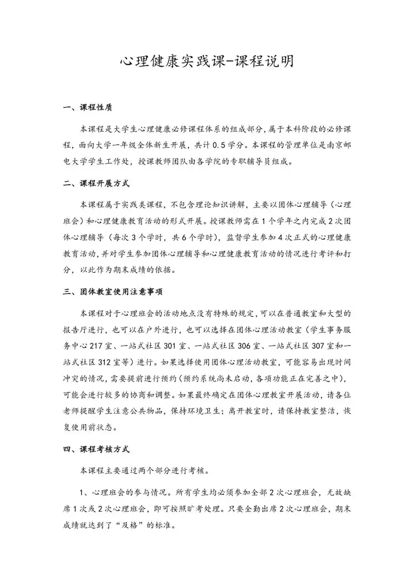
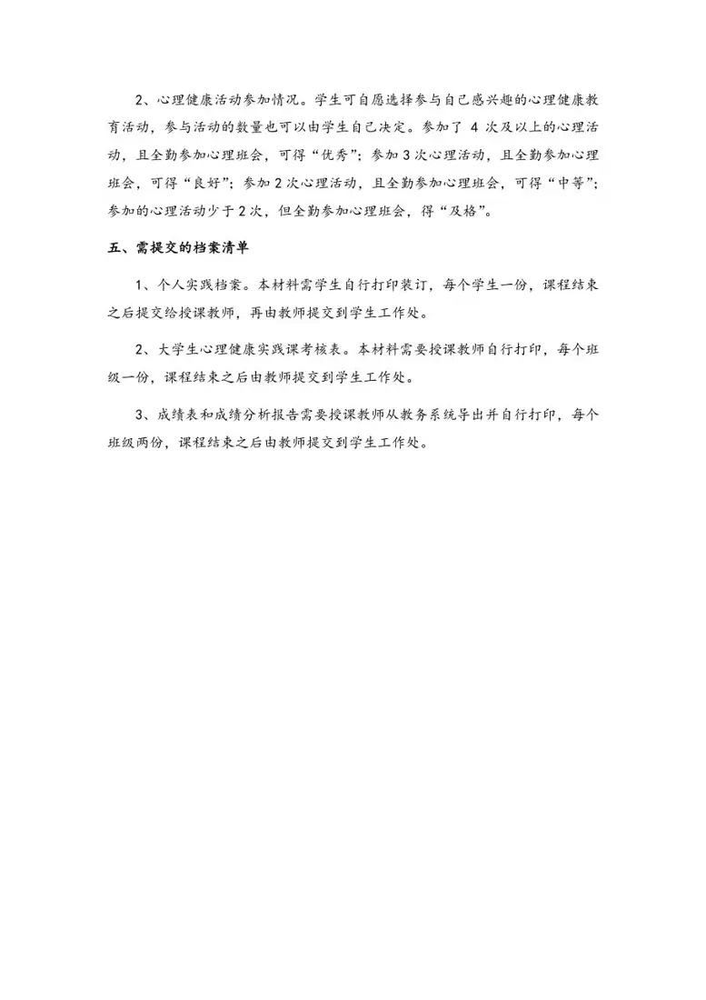

# 《大学生心理健康》实践课 课程说明

原件的每一页，下面附识别出的文字。

### 心理健康实践课-课程说明

原文：

心理健康实践课-课程说明

一、课程性质

本课程是大学生心理健康必修课程体系的组成部分，属于本科阶段的必修课程，面向大学一年级全体新生开展，共计 0.5学分。本课程的管理单位是南京邮电大学学生工作处，授课教师团队由各学院的专职辅导员组成。

二、课程开展方式

本课程属于实践类课程，不包含理论知识讲解，主要以团体心理辅导（心理班会）和心理健康教育活动的形式开展。授课教师需在1个学年之内完成2次团体心理辅导（每次 3 个学时，共 6 个学时），监督学生参加 4 次正式的心理健康教育活动，并对学生参加团体心理辅导和心理健康教育活动的情况进行考评和打分，以此作为期末成绩的依据。

三、团体教室使用注意事项

本课程对于心理班会的活动地点没有特殊的规定，可以在普通教室和大型的报告厅进行，也可以在户外进行，也可以选择在团体心理活动教室（学生事务服务中心217室、一站式社区 301室、一站式社区 306室、一站式社区 307室和一站式社区312室等）进行。如果选择使用团体心理活动教室，可能容易出现时间冲突的情况，需要提前进行预约（预约系统尚未启动，各项功能正在完善之中），可能会进行较多的协商和调整。如果最终确定在团体心理教室开展活动，请各位老师提醒学生注意公共物品，保持环境卫生；离开教室时，请保持教室整洁，恢复使用前状态。

四、课程考核方式

本课程主要通过两个部分进行考核。

1、心理班会的参与情况。所有学生均必须参加全部 2 次心理班会，无故缺席1次或 2次心理班会，即可按照旷考处理。只要全勤出席2次心理班会，期末成绩就达到了“及格”的标准。

### 五、需提交的档案清单

原文：

2、心理健康活动参加情况。学生可自愿选择参与自己感兴趣的心理健康教育活动，参与活动的数量也可以由学生自己决定。参加了 4 次及以上的心理活动，且全勤参加心理班会，可得“优秀”；参加 3 次心理活动，且全勤参加心理班会，可得“良好”；参加 2 次心理活动，且全勤参加心理班会，可得“中等”；参加的心理活动少于 2次，但全勤参加心理班会，得“及格”。

五、需提交的档案清单

1、个人实践档案。本材料需学生自行打印装订，每个学生一份，课程结束之后提交给授课教师，再由教师提交到学生工作处。

2、大学生心理健康实践课考核表。本材料需要授课教师自行打印，每个班级一份，课程结束之后由教师提交到学生工作处。

3、成绩表和成绩分析报告需要授课教师从教务系统导出并自行打印，每个班级两份，课程结束之后由教师提交到学生工作处。
