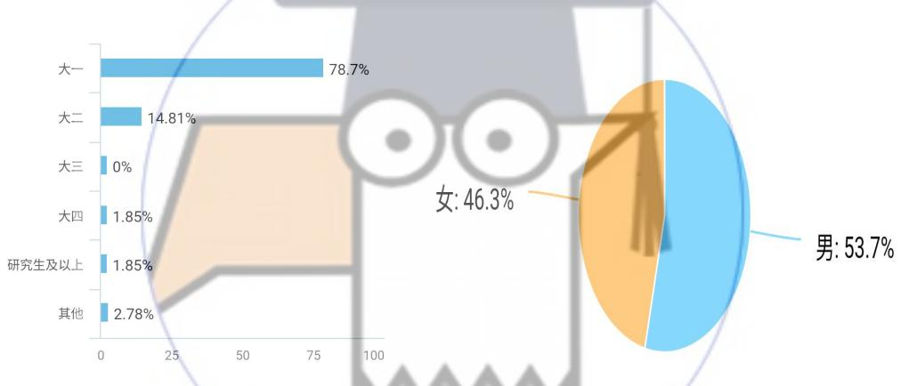
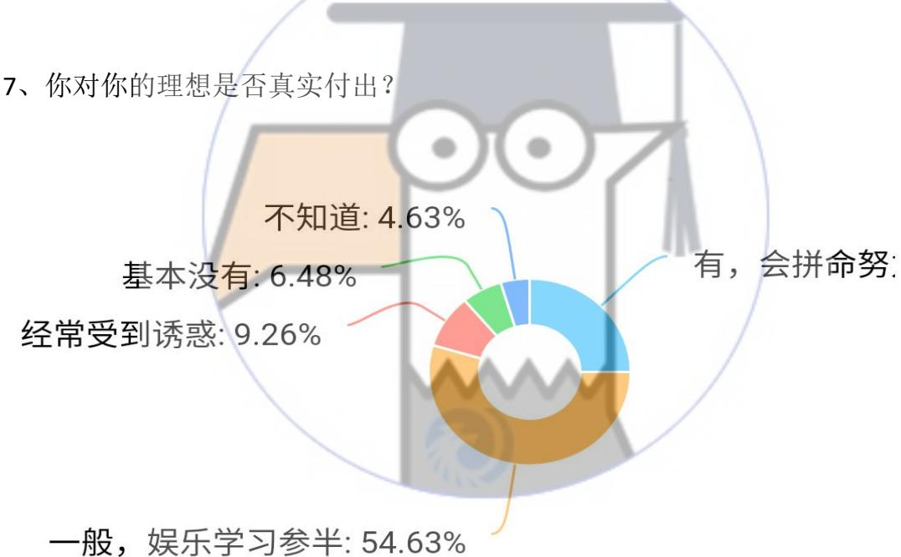

# 《思想道德与法治》社会实践调查报告模板

原件经识别和整理；“参考解答”是我们补的。

# 社会实践调查报告：大学生的理想现状

本报告由通信与信息工程学院广播电视工程专业 B170121 班于 2018 年 6 月完成，指导老师为李咏梅。报告基于对全国高校学生的问卷调查（有效样本 108 人），分析大学生理想信念现状、成因及对策。

## 小组成员分工

| 分工 | 姓名 | 学号 |
| :--- | :--- | :--- |
| 问卷设计 | 周苏、赵伶俐、洪澳萍 | B17012110、B17012111、B17012113 |
| 问卷后期整理制作发布 | 贺晨曦、林天琪 | B17012114、B17012109 |
| 调研方法思路 | 张雪影 | B17012108 |
| 调查过程 | 张雪影 | B17012108 |
| 调查结果分析 | 赵伶俐 | B17012111 |
| 人际交往建议 | 周苏 | B17012110 |
| 心得体会 | 胡颖、洪澳萍 | B17012112、B17012113 |
| 图表制作 | 林天琪 | B17012109 |

## 一、理想现状调查报告

### 选择 1

**前言：**

理想能给我们一个目标，一个追求时的动力，一个让动力运行的方向。有了目标，我们就懂得了如何去追求。不至于让我们迷失自己，更不至于让自己一直消沉下去。只要我们去追求自己心中所存在的理想，不断的为此付出，生活必然充实。敢于去挑战自己，敢于驾驭自己，而不是一味的懈怠自己，安逸自己。那么，生活必然因为自己存在曾经有过的一切，而感到丰富多彩。正是因为充实了，才变的完满。而一旦完满了，自己也就无愧了。我们能为自己在人生的路上走过一遭，并欣赏了人生路上所有属于自己的风景而感到高兴。

理想信念是人的精神世界中价值主导因素，尤其是对于处于人生观、世界观、价值观形成期的青年学生而言更为重要。通过对当前全国高校学生理想信念现状抽样调查问卷进行数据分析，力图全面深入地了解和掌握当前大学生理想信念现状和特点，分析其形成的原因和影响因素，以进行进一步的理论分析和对策思考。

- **调查对象**：全国高校学生（大学生，研究生及以上学历）
- **调查方法**：采用问卷调查方式进行调研。在网络问卷星上发布问卷。共有 106 人通过 QQ 动态，微信朋友圈等途径填写问卷，参与调查。
- **调查内容**：目前高校学生的理想现状。

## 二、调研方法思路和调查过程

本部分主要阐述调研的背景、目的及实施路径。

- **背景与意义**：理想话题在漫长岁月里已经被讨论了一次又一次，但无论怎样，只要地球上有生命存在，它就不会是一个过时的话题。理想的成功确立和妥善实施对每个人来说都很重要，一个有坚定理想的人往往不会平庸过活。
- **实施路径**：通过网络平台（问卷星）分发，利用社交网络（QQ、微信）进行传播，覆盖大一至研究生等不同年级群体。

## 三、调查过程

本次调查问卷有效人次共计 108 人。

- **性别分布**：男生小计 58 人，占比 53.7%；女生小计 50 人，占比 46.3%。
- **年级分布**：
    - 大一学生 85 人，占比 78.7%
    - 大二学生 16 人，占比 14.81%
    - 大三学生 0 人
    - 大四学生 2 人，占比 1.85%
    - 研究生及以上学历 2 人，占比 1.85%
    - 其他 3 人，占比 2.78%

## 四、调查结果分析

参考解答：**B. 有理想目标，但并不明确**

题干数据直接显示“有将近半数（49.07%）的人表示有理想目标，但并不明确”，该选项与材料核心结论完全对应；“明确目标”仅占约五分之一非主流现状，“不确定”和“无理想”虽在材料中提及但占比均低于“不明确”群体，不能概括近半数受访者的主要特征。

知识点：[什么是理想信念（理想与信念的含义及特征）](../../../topics/思想道德与法治/理想信念内涵.md)、[科学把握理想与现实的辩证统一（实现理想的长期性、艰巨性和曲折性）](../../../topics/思想道德与法治/理想与现实辩证统一.md)、[在实现中国梦的实践中放飞青春梦想（立志高远、做大事、躬行）](../../../topics/思想道德与法治/放飞青春梦想.md)

### 选择 1

**问题 1：在步入大学之前，你是否有理想目标？**

分析数据可得：有将近半数（49.07%）的人表示有理想目标，但并不明确。这说明很多人有理想确立的意识，但不能更深入的去思考理想的各个维度，因而这类人的理想现状是模糊的。有研究表明，理想目标不明确的人在实现理想的过程中常常会迷失方向，并且在行动力方面相比于有明确目标的人来说也有所欠缺。

- **明确目标**：24 人（约五分之一），这些明亮的目标通常会指引他们在人生长途中稳步而行。
- **不确定**：16.67% 的人并不清楚是否拥有理想。
- **无理想**：12.04% 的人没有理想。

对于这部分人来说，他们总是会感到没有方向和懵懂无措，私认为此并不利于人生之路的良好开阔。

参考解答：**B. 有理想目标，但并不明确**

题干数据直接显示“有将近半数（49.07%）的人表示有理想目标，但并不明确”，该选项与材料核心结论完全对应；“明确目标”仅占约五分之一非主流现状，“不确定”和“无理想”虽在材料中提及但占比均低于“不明确”群体，不能概括近半数受访者的主要特征。

知识点：[什么是理想信念（理想与信念的含义及特征）](../../../topics/思想道德与法治/理想信念内涵.md)、[科学把握理想与现实的辩证统一（实现理想的长期性、艰巨性和曲折性）](../../../topics/思想道德与法治/理想与现实辩证统一.md)、[在实现中国梦的实践中放飞青春梦想（立志高远、做大事、躬行）](../../../topics/思想道德与法治/放飞青春梦想.md)

### 选择 2

**问题 2：你认为成为一名大学生的最主要的目的是什么？**

分析数据可得：参与调查的半数人认为进入大学的目的是为了学习从而提高自身素质。另外选择为了实现理想抱负、获取文凭方便以后找工作和增长视野，增强人际交往能力的人数相差不大，占比 15% 左右，几乎没有人进大学是为了单纯交友。

这表明很多大学生还是较为重视学习和自身发展，希望可以通过大学这个平台学得丰富的知识，掌握好技能，为将来进入社会打下知识基础。不可否认的是，大学也是一个小社会，四年时间甚至更长的磨砺能很好地锻炼学生的人际交往能力，所以这也不是为步入大学的一个次要目的。当然，也有极少数人认为大学是一个安逸娱乐的地方，这类人往往淡化理想观念，或者并不具有理想，所以他们对于大学生活持有麻木的享乐心态。

参考解答：## 结论

我认为，**通过大学学习知识、提升自身素质，并为未来实现理想和进入社会打下基础，是大学生最主要的目的**。在人际交往、获取文凭等方面，能力锻炼和就业准备也具有重要作用，但不应取代学习与自我提升这一核心目标。

## 简明分析

调查数据显示，半数受访者认为进入大学的主要目的是学习并提高自身素质，说明学习知识、增长能力是大学生普遍认同的核心目标。与此同时，约 $15\%$ 的人选择实现理想抱负或为就业获取文凭，表明大学也承担着促进个人发展、衔接社会职业的重要功能。

大学不仅是获取知识的场所，也是锻炼人际交往能力、理解社会和增强实践能力的平台。因此，大学生应珍惜大学时光，认真学习专业和基础知识，同时提高沟通协作、实践创新等能力，把个人理想与国家社会需要结合起来，而不能把大学仅仅当作文凭、娱乐或单纯交友的工具。

知识点：[理想信念是精神之“钙”（理想信念对大学生成长成才的重要意义）](../../../topics/思想道德与法治/理想信念精神之钙.md)、[反对错误的人生观（拜金主义、享乐主义、极端个人主义）](../../../topics/思想道德与法治/反对错误人生观.md)、[最先进的人生追求（服务人民、奉献社会）](../../../topics/思想道德与法治/高尚人生追求.md)

### 选择 3

**问题 3：步入大学后，你是否就自己的理想制定了新的长期目标或进行了目标调整？**

分析数据可得：制定了新的短期目标的人数与对曾经的目标进行了调整的人数近似持平，都占比 30% 左右。也有 11% 的人对于理想目标做了较大调整，重新制定了新的长期目标，同时 16.67% 表示安于现状，什么也没做。

这表明大学之前的理想目标可能只是我们一小段人生的前进方向，它可能会随着时间或地点而发生微调。新的时间段，新的地点往往会给人新的启发，产生新的思考和改变。

参考解答：结论：题中数据说明多数大学生进入大学后会对原有理想目标进行一定调整或重新规划，只有少数人完全“安于现状”，因此大学阶段是理想目标动态调整的重要时期。

推理要点：  
- “制定了新的短期目标”约占 30%；  
- “对曾经的目标进行了调整”也约占 30%；  
- 两者合计约 60%，说明多数人有主动调整或重新规划的行为；  
- “重新制定了新的长期目标”占 11%，属于较大调整；  
- “安于现状，什么也没做”占 16.67%，是少数。  

因此，数据支持“理想目标会随时间和环境变化而发生微调或较大调整”这一结论，而不是支持“多数人完全不变”或“多数人放弃理想”。

知识点：[什么是理想信念（理想与信念的含义及特征）](../../../topics/思想道德与法治/理想信念内涵.md)、[科学把握理想与现实的辩证统一（实现理想的长期性、艰巨性和曲折性）](../../../topics/思想道德与法治/理想与现实辩证统一.md)、[在实现中国梦的实践中放飞青春梦想（立志高远、做大事、躬行）](../../../topics/思想道德与法治/放飞青春梦想.md)

### 选择 4

**问题 4：你现在所学的专业和你的理想相关度如何？**

分析数据可得：四分之一的人认为无关，绝大多数人表示目前所学专业对理想而言在某方面有益，仅有十分之一不到的人表示其专业与其理想息息相关。

理想饱满，现实骨感，大学生在选择专业时，可能会由于分数等级、未来效应等现实原因而无法选择与理想对等的专业，但世间万物往往存在联系，所以大部分人会认为专业在某方面有益。

参考解答：**结论：多数大学生认为所学专业与理想存在一定关联，但高度契合者较少，反映出理想与现实之间存在差距。**

**推理过程：**

- 数据表明，约四分之一的人认为专业与理想无关，说明部分学生的专业选择与个人理想脱节。
- 绝大多数人认为专业在某方面对理想有益，说明即使专业不完全符合理想，仍可能在知识、能力或综合素质方面提供支持。
- 不到十分之一的人认为专业与理想息息相关，说明真正实现专业与理想高度统一的学生比例较低。
- 造成这种现象的原因主要是专业选择受到分数、就业前景、家庭意见等现实因素影响，学生未必能完全按照个人理想作出选择。
- 因此，大学生应理性看待专业与理想的关系，在现有专业学习中挖掘其价值，同时通过选修课程、社会实践和职业规划等方式逐步接近理想。

知识点：[科学把握理想与现实的辩证统一（实现理想的长期性、艰巨性和曲折性）](../../../topics/思想道德与法治/理想与现实辩证统一.md)、[坚持个人理想与社会理想的有机结合（统一）](../../../topics/思想道德与法治/个人理想与社会理想.md)、[在实现中国梦的实践中放飞青春梦想（立志高远、做大事、躬行）](../../../topics/思想道德与法治/放飞青春梦想.md)

### 选择 5

**问题 5：【排序题】你觉得人生观受什么影响最大？**

选项顺序参考：1 父母亲友 — 2 书籍 — 3 生活经历 — 4 朋友 — 5 师长 — 6 同学 — 7 恋人 — 8 社会媒体

分析数据可得：父母亲友对子女的影响很大。言传身教，潜移默化地影响着子女的价值观，世界观，人生观等。同时书籍和生活经历对大学生的人生观也有较大影响，书医愚，修性，养身；生活经历会改变人的眼界意识和思想形态。

恋人和社会媒体对人生观的影响较小，这从侧面反映，大学生在恋爱上能有自己的原则和标准；尽管如今社会媒体已经日新月异，充斥生活各个角落，但由于一些不实报道的增加和夸张的渲染手法，使得很对媒体已经失去了其存在的意义，而头脑清晰的大学生大底意识到了这一点，所以这些社会媒体基本不会影响其人生观。

参考解答：**结论**：影响程度排序为：3 生活经历 > 1 父母亲友 > 2 书籍 > 4 朋友/5 师长/6 同学（三者相近，视具体情境） > 7 恋人 > 8 社会媒体。核心影响因素为 **生活经历** 与 **父母亲友**。

**推理过程**：

1.  **决定性因素分析**：
    *   **生活经历 (3)**：实践是认识的来源。个人在成长过程中的直接经验、挫折与成就最直接地塑造其世界观和人生观，具有根本性和持久性。
    *   **父母亲友 (1)**：家庭是人生的第一所学校。父母的言传身教、家庭氛围在个体价值观形成的早期起奠基作用，具有潜移默化和深远的影响。

2.  **重要辅助因素分析**：
    *   **书籍 (2)**：间接经验的重要载体。阅读能拓宽视野、提升思维层次，对大学生修身养性、完善人格有显著促进作用。
    *   **师友群体 (4, 5, 6)**：学校教育和同辈群体是社会化过程的关键环节。师长的引导和朋友、同学的互动提供社会参照和情感支持，影响具体行为模式和价值判断。

3.  **相对次要因素分析**：
    *   **恋人 (7)**：虽然情感关系密切，但题干指出大学生在恋爱中逐渐形成独立原则，且相比家庭和长期生活经历，其影响范围相对局限。
    *   **社会媒体 (8)**：尽管渗透率高，但鉴于信息碎片化、虚假宣传及夸张渲染等问题，具备批判性思维的大学生往往对其保持警惕，因此其对核心人生观的深层建构影响相对较弱。

**注**：若为单选题，通常依据马克思主义实践观，**生活经历（实践）** 是最根本的来源；若侧重早期社会化基础，则选 **父母亲友**。根据题干描述侧重“分析数据”及“潜移默化”，**1 父母亲友** 和 **3 生活经历** 为最主要选项，具体排序依题目设定的权重而定，一般认为 **3 > 1** 或 **1 ≈ 3**。

知识点：[人生观的主要内容（人生目的、人生态度、人生价值）](../../../topics/思想道德与法治/人生观主要内容.md)、[辩证对待人生矛盾（五个正确对待：得失、苦乐、顺逆、生死、荣辱）](../../../topics/思想道德与法治/辩证对待人生矛盾.md)、[反对错误的人生观（拜金主义、享乐主义、极端个人主义）](../../../topics/思想道德与法治/反对错误人生观.md)

### 选择 6

**问题 6：当理想和现实发生冲突时，你作何选择？**

分析数据可得：半数多的人表示尚未遇到这种情况，坚持理想和顺从现实的人各占一半。因为参与调查的人数大部分是大一学生，对于刚刚走出高中校园的他们而言，他们并不是很清楚毕业以后所要面临的现实究竟是怎样的。

在严峻的现实面前，每个人都会做出选择，顺从现实的也占到 25%，这是正常现象，至于那些能够坚持理想的人应该是拥有绝对的毅力和坚韧的信心，他们不轻易屈服和退缩。

参考解答：**结论：** 应在正视现实的基础上坚持理想，并通过实践将理想转化为现实；不能简单地二选一，更不能把“顺从现实”理解为放弃理想。

**简明推理：**

理想与现实是对立统一的关系：

- **理想来源于现实**，是对现实的超越；
- **现实制约理想**，但不等于理想不能实现；
- 当二者发生冲突时，正确的态度不是逃避现实，也不是盲目顺从现实，而是**在实践中调整实现理想的路径和方法**。

由材料可知，约半数受访者尚未遇到理想与现实冲突，说明大一学生对未来现实认识尚不充分；在已作出选择的人中，坚持理想与顺从现实各占约一半。材料特别指出，能够坚持理想的人通常具有较强毅力和信心。

因此，面对冲突时，应把个人理想同社会现实、自身实际结合起来，在奋斗中逐步缩小理想与现实之间的差距，而不是轻易向现实妥协。

**选择题说明：**

本题考查正确处理理想与现实的关系，核心观点是：**理想与现实既对立又统一，应在实践中实现理想**。凡是把二者绝对割裂、认为只能顺从现实，或认为可以脱离现实空谈理想的说法，都不符合题意。

知识点：[科学把握理想与现实的辩证统一（实现理想的长期性、艰巨性和曲折性）](../../../topics/思想道德与法治/理想与现实辩证统一.md)、[艰苦奋斗是实现理想的重要条件](../../../topics/思想道德与法治/艰苦奋斗实现理想.md)、[辩证对待人生矛盾（五个正确对待：得失、苦乐、顺逆、生死、荣辱）](../../../topics/思想道德与法治/辩证对待人生矛盾.md)

### 选择 7

**问题 7：你有敬佩/崇拜/向往的榜样偶像吗？**

分析数据可得：绝大多数人表示有自己学习的对象，没有和不清楚的人也各占 14% 左右。赛·约翰逊说：“榜样具有良好的感染力。”所以，榜样的存在对大学生的前行具有引导作用，对其实现理想具有激励作用，这种影响可能是物质层面的也可能是精神层面的。当然，也有人选择独自前行，他们可能是生活的强者，也可能是生活漫无目的的游人。

参考解答：**结论**：本题为开放性的数据分析与观点评述题，没有标准化的“正确选项”，需基于给定数据和引言进行合理推断与阐释。

**推理分析**：
题目提供的信息可归纳为三点：
1. **数据分布**：约 72% 的人有学习对象（榜样/偶像），14% 表示“没有”，14% 表示“不清楚”。
2. **名言引用**：赛·约翰逊的话强调榜样的“感染力”及其引导与激励作用。
3. **补充视角**：承认存在“独自前行”的人，并对其状态做了两种可能的定性（强者或漫无目的者）。

基于此，可形成以下层次化的认识：
- **主流现象**：大多数人（约七成）拥有榜样，这印证了榜样的普遍性和不可忽视的教育意义。根据赛·约翰逊的论述，榜样的影响兼具**精神层面**（价值观、意志品质的感染）与**物质/实践层面**（具体行为、路径的参照），对大学生定向前行和克服困难实现理想具有正向的助推功能。
- **少数选择**：约 28% 的人没有或不清楚自己的榜样，这一比例不可忽视。这部分人并非全处于消极状态——他们可能是具备极强内在驱动和独立人格的“生活强者”，不需要外部镜像；但也可能反映了目标缺失、人生方向模糊的“漫无目的”状态。
- **辩证态度**：因此，一方面应珍视和善用榜样的“良好感染力”，主动选择能传递正向价值的榜样来引导自我成长；另一方面，对于无榜样者，需区分其自立自强的清醒独立与浑噩度日的随波逐流，引导后者确立参照，唤醒对理想生活的向往。整体上，榜样是一种有效的教育资源和成长催化剂，但尊重个人选择的多样性同样重要。

知识点：[理想信念是精神之“钙”（理想信念对大学生成长成才的重要意义）](../../../topics/思想道德与法治/理想信念精神之钙.md)、[树立积极进取的人生态度](../../../topics/思想道德与法治/积极进取人生态度.md)、[最先进的人生追求（服务人民、奉献社会）](../../../topics/思想道德与法治/高尚人生追求.md)

### 选择 8

**问题 7（原文编号重复）：你对你的理想是否真实付出？**

分析数据可得：半数人学习娱乐掺半，四分之一的人表示会拼命努力，也有一些人对理想的付出较少。在浮华万千的大世界中，有各种各样的诱惑存在，我们能抵住诱惑是实现理想的一大前提。但这并不意味着我们需要完全抛弃生活中休闲安逸，劳逸结合也是一个有助于身心健康和实现理想的方法。当然，在巨大的诱惑面前，也有人守不住本心，所以会逐步偏离理想的道路，没有付出，通常会没有收获。

参考解答：**结论：**  
多数人能认识到追求理想需要抵制诱惑，但实际付出情况并不理想——半数人未能专注投入，真正全力以赴的仅占四分之一。

**分析过程：**  
- 图表显示“学习娱乐掺半”占比 **50%**，说明一半人处于半投入状态，容易被诱惑分散精力。  
- “拼命努力”占 **25%**，这部分人能够主动抵制诱惑、高度投入。  
- 其余约 **25%** 的人付出较少或未付出，意味着面对诱惑时守不住本心，逐渐偏离目标。  

这印证了“抵制诱惑是实现理想的重要前提”，但完全抛弃休闲并不现实，**劳逸结合**更有利于长期坚持；而缺乏付出则往往导致无收获。

知识点：[艰苦奋斗是实现理想的重要条件](../../../topics/思想道德与法治/艰苦奋斗实现理想.md)、[科学把握理想与现实的辩证统一（实现理想的长期性、艰巨性和曲折性）](../../../topics/思想道德与法治/理想与现实辩证统一.md)

### 选择 9

**问题 9：你知道理想目标存在的意义吗？**

分析数据可得：大部分人知道其意义，其中有的人很清楚，有的人不清晰；也有人没想过这个话题，少部分人不知道。如果一个人足够清醒和明白，他的理想道路往往是明亮透彻的，但这毕竟是一个感性的话题，它存在于我们的思想意识中，很难具体描述，但它确有其存在的价值。

参考解答：**结论**：理想是人生的精神支柱和奋斗动力，具有指引方向、提供动力和提升境界的重要意义。

**推理过程**：
1.  **指引方向**：理想作为人生奋斗目标，如同灯塔，帮助个体在复杂的社会生活中明确前进方向，避免迷茫。
2.  **提供动力**：崇高的理想能激发人的内在潜能，转化为克服困难、追求卓越的持久精神动力。
3.  **精神支撑**：虽然理想属于意识范畴且具有感性色彩，但它构成了人的精神世界核心，赋予生命以意义和价值，正如题干所述“确有其存在的价值”。

*(注：本题为开放式论述或理解类选择题，核心考点在于确认理想对人生的积极导向作用。若为单选，应选择肯定理想具有指引、激励及精神支撑作用的选项；否定理想价值或认为理想无实际意义的选项均错误，因为它们忽视了意识对物质的能动反作用及理想对个人成长的塑造功能。)*

知识点：[什么是理想信念（理想与信念的含义及特征）](../../../topics/思想道德与法治/理想信念内涵.md)、[理想信念是精神之“钙”（理想信念对大学生成长成才的重要意义）](../../../topics/思想道德与法治/理想信念精神之钙.md)、[科学把握理想与现实的辩证统一（实现理想的长期性、艰巨性和曲折性）](../../../topics/思想道德与法治/理想与现实辩证统一.md)

### 选择 10

**问题 10：你的理想更注重于什么方向？**

分析数据可得：情怀和金钱是选择人数较多的两个方面，其次荣誉感也是一个重要方面，光荣、地位等则在下一考虑层次。情怀无价，它是人的一种精神追求，但也不能没有物质追求，所以调查结果显示情怀和金钱齐头并进；荣誉和光荣不同，荣誉更多的侧重于自身感受，而光荣则是更为广大宏阔的概括，可能是国家层面、社会层面等。

参考解答：## 结论

这反映了当代青年在理想追求上呈现**精神追求与物质追求并重、个人价值与社会价值相统一**的特点。

## 分析

**1. 情怀与金钱并重——精神追求与物质基础的辩证统一**

- 情怀属于**精神层面**的追求，体现了人对意义、价值的向往；金钱代表**物质层面**的保障，是生存和发展的基础。
- 二者"齐头并进"说明同学们既重视精神富足，也承认合理物质需求的正当性，符合马克思主义关于人的全面发展需要物质和精神双重保障的基本观点。

**2. 荣誉感重要——自我价值的肯定**

- 荣誉感侧重于**个体对自身价值的确认和积极情感体验**，是个体在获得认可后产生的内在满足感。

**3. 光荣、地位次之——社会价值与个人定位**

- 光荣比荣誉更具**宏观性和社会性**，可指向国家、集体层面的褒奖；地位则更多关联社会评价和层级定位。
- 这两项排在相对次要位置，说明同学们更倾向于**先实现个人精神满足与物质保障**，再追求更高层次的社会认可。

**4. 总体特征**

这一选择分布体现了理想追求的**层次性**：从基础的生存需求，到精神满足，再到社会价值的实现，与马斯洛需求层次理论和人生价值实现的递进逻辑相吻合。

知识点：[人生观的主要内容（人生目的、人生态度、人生价值）](../../../topics/思想道德与法治/人生观主要内容.md)、[最先进的人生追求（服务人民、奉献社会）](../../../topics/思想道德与法治/高尚人生追求.md)、[什么是理想信念（理想与信念的含义及特征）](../../../topics/思想道德与法治/理想信念内涵.md)

### 选择 11

**问题 11：你是否认为你能实现自己的理想目标？**

分析数据可得：较多人认为大概能，五分之一左右坚信一定能，一部分不知道，极少数人觉得不能。从统计数据来看，十分自信的人在少数，大部分人自信不足。当然这也是正常现象，因为在现实中存在许多未知因素，其影响结果也不得而知，但无论如何，我们仍需葆有积极乐观的心态。

## 五、理想现状建议

爱因斯坦曾说：“每个人都有一定的理想，这种理想决定着他的努力和判断的方向。”所以我们每个人对自己的最低要求应该是拥有理想，没有了理想就意味着浩瀚星辰不再耀眼，汪洋大海变得干枯，这样的人生想必是没有价值的。

- **理想的选取**：理想有大有小，过小的理想，轻而易举的实现了，就没有理想本身的价值。过大的理想，都没有实现的可能性，就不能称之为理想，反而应该称之为梦想，如果是超越梦想的存在，那就只能称之为空想。所以理想的选取也要把握个度。理想同样也分好坏，好的理想对个人对社会都大有裨益，坏的理想就像一颗定时炸弹，对所有人都是一种威胁。周恩来总理的“为中华之崛起而读书”就是最值得我们学习的榜样。

- **理想与现实的关系**：在拥有了理想以后，怎样对待理想也是一个让很多人苦恼的话题。理想是美好的，可是现实总是残酷的，如果你不是富二代、官二代、星二代，你只是个平凡人，那就意味着你不可能一帆风顺的追逐你的理想，现实总是会羁绊着你的前行。家人的期待、环境的局限、资源的缺乏等等都会让你不得不停下脚步，所以现实与理想之间的权衡很重要。在现实中随波逐流是无能的人逃避前行的借口，在理想的大道上不管不顾大步行走是无情的人逃避责任的表现。这两者虽然矛盾，却都对我们至关重要，所以在这两者中达到完美的平衡，是对所有人的一个考验。不妥协向任何一方是我们做出决定的前提。

- **应对策略**：
    - 当你的理想不现实，不正当，那么请赶快丢弃它，重新作出正确的选择。
    - 当你的家人不能理解你的理想时，像刺猬一样的倔强并不是最佳的解决方法，向家人倾诉你的心声，作为最爱你的人，如果你走的是正道，他们会做出适当的妥协。
    - 当你的理想让你不堪重负，穷困潦倒，那么这时适当的妥协必不可少，可以暂时将你的理想从赖以生存的工作变成闲暇时的兴趣。
    - 当你的理想没有得到实现时，不灰心不放弃，不抱怨现实，不厌弃生活，努力做好眼前事才是最正确的。

作为一种心理产物，理想没有固定的判别标准，所以一切还是取决于每个人自己，一个人的心理只有自己最清楚，怎样对待自己的理想还得自身作出判断。

## 六、心得体会

大学生的理想其实并不是都是进入大学后才有的，每个人几乎从小时候开始，就有了自己的理想，就像小学语文老师一定会布的一片作文——你的理想是什么？你长大以后想当什么？我们从小就这个问题有了思考，对自己的理想也有了设定。但是，那个时候，我们对现实的接触是最少的，接触的大多是少年教育的动画片书籍等，还有我们的父母和老师。我们的理想深受他们影响，没有任何现实因素的干扰。

随着年龄的增大，阅历的提高，我们的理想也慢慢发生了变化，我们发现现实中存在很多不可控因素和阻碍。但是不论怎样，对于大多数人来说，可能理想变了，但是理想中的主要因素不会变，或者我们说核心思想没变。

举个不是很恰当但是很容易理解的例子：小明小时候想当国家主席，想要管理国家，但是长大后他发现理想的不可行性很大，他改变主意，想当自己创业，建立一个公司，当公司的总裁。再后来，他的理想成为了当一个知名公司的主管，最后变成当一个公司的主管。就像例子所展示的那样，小明的理想不管怎么变，都是想要管理别人，而不是单纯受人控制。其实大多数人都是这样的，小时候的理想可能是荒诞的，但是正是那个时候纯粹的理想正表达了问我们内心的一种渴求。他对我们以后的理想是有一定影响的。

---
title: 《思想道德与法治》社会实践调查报告模板（习题）第 2 部分
kind: 习题
course: 思想道德与法治
source: 识别工具读出内容（第 13–16 页）
---

# 《思想道德与法治》社会实践调查报告模板（习题）第 2 部分

本部分为《思想道德与法治》课程社会实践调查报告的习题材料，包含对大学生理想现状的分析、建议以及相关的调查问卷附件。

## 一、关于大学生理想的分析与建议

参考解答：## 一、问题 11 的作答要点（问卷数据分析题）

**结论：**  
数据显示，多数人认为“大概能”实现理想，约五分之一坚信“一定能”，少数人“不知道”，极少数人“不能”。这说明大学生总体上有一定自信，但**高度自信者只是少数，相当一部分人自信不足**；同时存在现实不确定性，我们应保持积极乐观、脚踏实地的心态。

**推理过程（分类占比的定性归纳）：**
- 将选项按自信程度排序：一定能 > 大概能 > 不知道 > 不能。
- 由“较多人 + 五分之一左右 + 一部分 + 极少数”的分布可知，众数落在“大概能”区间，说明**适度自信是主流**；“一定能”约占 $20\%$，属于少数派。
- 由于现实中存在大量不可控因素（家庭、资源、环境等），预期不确定性较大，因此不能强求“一定能”，但也不能陷入“不能”的消极结论——保持积极乐观心态是必要的。

---

## 二、“理想现状”部分的答题要点

### （一）理想选取的"度"

**结论：** 理想应兼顾**可实现性**与**正当性**，过小则无激励价值，过大则沦为空想；好理想利己利人，坏理想害人害己。

**推理：** 理想的价值在于“跳一跳够得着”——
$$
\text{合适理想} \approx \text{现实基础} + \text{适度挑战}
$$
脱离现实基础即为空想，毫无挑战性即无动力。同时，理想应与社会发展方向一致（如周恩来“为中华之崛起而读书”），否则可能损害他人与社会。

### （二）理想与现实的关系

**结论：** 理想美好但现实有制约（家庭期待、资源缺乏等），需要在**坚持理想**与**承担责任**之间寻求平衡，既不随波逐流，也不不顾一切。

**推理：**
- 完全屈从现实 → 逃避成长（"无能者借口"）；
- 完全无视现实 → 逃避责任（"无情者表现"）；
- 最优解 = 二者动态平衡：在不放弃核心理想的前提下灵活调整路径。

### （三）应对策略（四条）

1. 理想不现实/不正当 → **果断放弃**，重新选择；
2. 家人不理解 → **沟通倾诉**，而非对抗；
3. 理想造成过重负担 → **适当降级**，从主业转为兴趣；
4. 理想未实现 → **不灰心、不抱怨**，做好眼前事。

---

## 三、“心得体会”部分的答题要点

**结论：** 理想源于童年、随阅历而变，但**核心诉求往往保持稳定**；我们应在变化中守住初心。

**推理（以“小明”为例）：**
$$
\text{国家主席} \rightarrow \text{公司总裁} \rightarrow \text{知名主管} \rightarrow \text{公司主管}
$$
表面目标不断缩小，但内在核心始终是“**管理/自主**”而非“受人控制”。这说明：
- 童年理想受父母、老师、文艺作品影响，缺乏现实约束，往往偏大；
- 随着接触社会，理想逐步“落地”，但精神内核延续；
- 因此不必因理想调整而自责，关键是**抓住核心诉求**，让它在现实中找到合适载体。

知识点：[什么是理想信念（理想与信念的含义及特征）](../../../topics/思想道德与法治/理想信念内涵.md)、[科学把握理想与现实的辩证统一（实现理想的长期性、艰巨性和曲折性）](../../../topics/思想道德与法治/理想与现实辩证统一.md)、[在实现中国梦的实践中放飞青春梦想（立志高远、做大事、躬行）](../../../topics/思想道德与法治/放飞青春梦想.md)

### 分析 1：理想与现实的关系

大部分大学生是有理想的，只不过这些理想他们仍然觉得和现实差距太大，被自己抛弃掉了，选择性忽视掉了。他们迷茫的不是“我以后要做什么”，而是“这个理想不能实现了，目前也没有我可以接受的理想，我要往哪走”。

因此，我觉得大学生应该敢于树立远大理想。这句话不是我们用来当鸡汤的虚话，而是一个方法。大学生是一个特殊的人群，我们一脚踏进社会，一脚留在家庭和校园营造的安逸窝。在我们把另外一只脚踏出去的之前，我们还可以保持我们那一半的“天真”，我们可以用自己一半的“天真”和一半的“现实”尽可能的设立自己的理想目标。设立这个理想不是说我们一定要做到，而是说我们一定想做到，努力往这个方向做，这样的理想因为它远大，所以有压力，又因为它具有可行性，所以有动力。其实这就是一个心理暗示，就像当你想要得到 60 分时，你就告诉自己要到 80 分。

参考解答：# 结论

大学生应当敢于树立远大理想，并通过"天真"与"现实"的结合使理想既具压力感又具可行性，从而在理想与现实的张力中找到前进方向。

# 推理过程

**第一步：厘清理想与现实的关系**

理想与现实是一对辩证统一的矛盾：

- 理想源于现实、高于现实，是对现实的超越性反映；
- 现实是理想的基础，理想不能脱离现实条件而悬空；
- 二者在一定条件下可以相互转化——通过实践，理想能够逐步变为现实。

因此，理想与现实之间存在差距是**必然的、正常的**，这一差距不是抛弃理想的理由，而恰恰是理想之所以为理想的规定性所在。

**第二步：分析材料中大学生迷茫的实质**

材料指出，大学生的困境不在于"没有理想"，而在于：

1. 因理想与现实的**差距过大**而主动放弃理想（选择性忽视）；
2. 放弃之后又找不到可接受的替代理想，导致方向感缺失。

这说明问题不在于"理想本身不现实"，而在于大学生**未能正确处理理想与现实的关系**——将"差距"误解为"不可能"，将"暂时不能实现"误解为"永远不该追求"。

**第三步：阐明"敢于树立远大理想"的方法论意义**

"敢于树立远大理想"之所以是方法而非鸡汤，原因在于：

- **远大 → 产生压力**：目标高远，形成向上牵引的张力，防止自我设限、甘于平庸；
- **可行性 → 产生动力**：立足"一半天真、一半现实"，即立足自身实际条件与社会发展需要，使理想不是空想，而是经过努力**有可能逐步实现**的目标。

这类似于"取法乎上，仅得乎中"的心理机制：以 80 分为目标，即便未达，也远高于以 60 分为目标的结果。远大理想的价值不在于**必然完全实现**，而在于它规定了努力的方向和上限，使人在实践中不断接近更好的自己。

**第四步：落脚于实践路径**

理想只有通过实践才能转化为现实。大学生应：

1. **立志当高远**——不因现实差距而自我放弃；
2. **立志做大事**——将个人理想融入社会理想，在服务国家与社会中实现个人价值；
3. **立志须躬行**——从身边小事做起，在长期奋斗中逐步缩小理想与现实的差距。

# 核心要点总结

| 要点 | 内容 |
|------|------|
| 理想与现实的关系 | 辩证统一：理想源于现实、高于现实，通过实践可以转化 |
| 迷茫的根源 | 误将"差距"当作"不可能"，放弃理想后失去方向 |
| 树立远大理想的意义 | 远大产生压力（不躺平），可行产生动力（有路径） |
| 方法论 | "一半天真、一半现实"——既敢想，又立足实际 |
| 实践要求 | 立志高远 + 融入社会 + 躬身践行 |

知识点：[科学把握理想与现实的辩证统一（实现理想的长期性、艰巨性和曲折性）](../../../topics/思想道德与法治/理想与现实辩证统一.md)、[在实现中国梦的实践中放飞青春梦想（立志高远、做大事、躬行）](../../../topics/思想道德与法治/放飞青春梦想.md)、[理想信念是精神之“钙”（理想信念对大学生成长成才的重要意义）](../../../topics/思想道德与法治/理想信念精神之钙.md)

### 分析 2：信念、行动与目标设定

大学生光有理想还不够，还要有信念和行动。其实这两个是相辅相成的，你从你的行动中得到信念，你的信念鼓舞你坚持行动。要坚持信念和行动，目标的设定很重要，目标要小让你能有信心坚持下去，但是又要逐渐大让他跟得上你的成长。

- **目标设定的误区**：有些人设定的目标一开始就很大，就像第一天就要跑一万米一样，可能你第一天坚持下来了，深受鼓舞，但是逐渐的，身体的疲惫和不适应是你放弃，最后可能 100 米都不想跑了；还有的人，开始设定的目标挺好的，当自己完全适应这个目标的状态的时候，还不加以适当提高目标，就会发现自己会慢慢懈怠，有一种这太简单了，我不做都会或者不屑于做的感觉。所以目标的设定和完善是很重要的。

参考解答：**结论：** 该分析正确。理想信念的实现必须落实到实际行动中，而科学合理的目标设定是连接信念与行动的关键桥梁，体现了“循序渐进”与“知行合一”的实践要求。

**推理过程：**

1. **信念与行动的辩证统一关系**
   - 信念是行动的精神动力和方向指引（“信念鼓舞你坚持行动”）。
   - 行动是信念的实践基础和检验标准，在实践中不断强化信念（“从你的行动中得到信念”）。
   - 二者相辅相成，缺一不可。脱离行动的理想只是空想，缺乏信念的行动难以持久。

2. **目标设定的哲学依据：量变与质变的辩证关系**
   - **目标要小**：符合事物发展从量变开始的规律。将宏大理想分解为切实可行的小目标，通过不断积累成功体验来强化自我效能感，从而坚定信念。公式化表达即：
     $$\text{总目标} = \sum_{i=1}^{n} \text{阶段性小目标}_i$$
   - **逐渐变大**：符合量变引起质变的规律。随着个人能力的提升，必须适时提高目标难度，推动自身向更高层次的质变跃升。

3. **对两种误区的剖析**
   - **误区一（目标过大）**：违背了客观规律与主观能动性相统一的原则。超越当前实际能力的目标会导致实践受挫，消耗意志力，最终不仅无法实现质变，连基础的量变也无法维持（“最后可能 100 米都不想跑了”），导致信念崩塌。
   - **误区二（停滞不前）**：违背了发展的观点。当能力已经发生质变后，若不更新目标，实践活动就失去了挑战性，信念会因缺乏新的实践支撑而逐渐懈怠、消退。

知识点：[什么是理想信念（理想与信念的含义及特征）](../../../topics/思想道德与法治/理想信念内涵.md)、[科学把握理想与现实的辩证统一（实现理想的长期性、艰巨性和曲折性）](../../../topics/思想道德与法治/理想与现实辩证统一.md)、[艰苦奋斗是实现理想的重要条件](../../../topics/思想道德与法治/艰苦奋斗实现理想.md)

### 分析 3：学会变通和接受

再来就是学会变通和接受，下面讲的接受绝不是接受失败，安于原地。很多人可能在一天的早上设定的完美的计划，但是发现计划的第一步被打乱了，于是开始着急，慌乱，后悔等等等，最后选择放弃。其实我们不是说不遵守计划，但是在计划受到不可控因素阻碍的时候，适当变通会更好，与其慌慌忙忙的弥补原来的计划，不如放弃原来的计划，接受现状，重新制定。

参考解答：**结论**  
这段话的论述重心是：计划受阻时，应主动变通并接受现状、重新制定，而不是把“接受”理解为消极认命或原地放弃；其本质是区别“接受现实”与“接受失败”。

**推理或分析**  
作者首先界定“接受”：“绝不是接受失败，安于原地”。这说明“接受”在此指的是正视已经变化的条件，而不是放弃目标。  
接着给出常见情境：早上制定完美计划，但第一步就被打乱，此时人容易产生“着急、慌乱、后悔”等情绪，甚至直接放弃。  
作者提出的应对方式是：计划在不可控因素阻碍下，“适当变通会更好”。理由是与其慌乱弥补原计划，不如“放弃原来的计划，接受现状，重新制定”。  
因此，核心逻辑是：  

$$
\text{计划受阻} \rightarrow \text{区分可控与不可控因素}
\rightarrow \text{不固守原计划} \rightarrow \text{接受现状} \rightarrow \text{重新制定计划}
$$

其中，“接受”的对象是“现状”，而不是“失败”；“变通”是方法，“重新制定”是结果。

**简要点评**  
这段话的合理之处在于强调灵活性与情绪调节；但“放弃原来的计划”若表述不当，容易被误解为轻易放弃目标。更准确的说法应当是：调整实现目标的路径，而非更换目标本身。

知识点：[辩证对待人生矛盾（五个正确对待：得失、苦乐、顺逆、生死、荣辱）](../../../topics/思想道德与法治/辩证对待人生矛盾.md)、[树立积极进取的人生态度](../../../topics/思想道德与法治/积极进取人生态度.md)

### 分析 4：理想的本质与坚持

因此对于理想，尤其是大学生的理想我们需要明确的一点就是它不是我们小时候的梦想，如今的理想是一个可以通过努力触碰到的目标。我们在努力追逐的过程会遇到很多很多的困难与阻碍，那些来自现实的干扰会左右我们的理想，但是理想的存在就是告诉我们前进的方向，让我们能够在繁杂的干扰中始终坚定走下去，实现那个我们的理想。

但是更需要我们了解的一点便是，有的事情不一定努力就一定会得到那个最终的结果，可是千万不能因为没有得到结果而沮丧，或者不懂变通走上一条死胡同，另择出路不是半途而废，毕竟我们一直在实现理想的路上，只要不放弃对理想的追逐，没有什么规则告诉我们，选择就是放弃。

## 二、问卷附件

参考解答：**结论：** 理想源于现实又超越现实，具有实践性、长期性和曲折性；实现理想是一个艰苦奋斗的过程，需要根据客观实际灵活调整具体路径，但绝不能放弃对理想的执着追求。

**分析推理过程：**

1. **理想的本质特征（实践性与超越性）**
   - 材料指出“如今的理想是一个可以通过努力触碰到的目标”，说明理想不同于脱离实际的空想或幻想，而是建立在对客观规律认识基础上的、具有实现可能性的奋斗目标。
   - 理想受现实制约，但又指引现实。现实中存在“很多困难与阻碍”和“繁杂的干扰”，而理想的作用正是提供前进方向，体现了理想对现实的超越性和导向性。

2. **实现理想的长期性与曲折性**
   - 追逐理想的过程必然充满矛盾与挑战，事物的发展是前进性与曲折性的统一。因此，“有的事情不一定努力就一定会得到那个最终的结果”符合唯物辩证法关于发展曲折性的原理。
   - 面对挫折不能沮丧，必须认识到实现理想绝非一蹴而就，需要坚定的信念和长期的艰苦奋斗。

3. **坚持理想与灵活变通的辩证统一**
   - 材料强调“另择出路不是半途而废”。这体现了**原则的坚定性与策略的灵活性相统一**。
   - 理想的具体实现路径（手段、方法）可以根据主客观条件的变化进行调整，但核心方向和根本信念不能动摇。“只要不放弃对理想的追逐”，改变路径本身也是实践探索的一部分，而非对理想的背叛。

知识点：[科学把握理想与现实的辩证统一（实现理想的长期性、艰巨性和曲折性）](../../../topics/思想道德与法治/理想与现实辩证统一.md)、[什么是理想信念（理想与信念的含义及特征）](../../../topics/思想道德与法治/理想信念内涵.md)、[艰苦奋斗是实现理想的重要条件](../../../topics/思想道德与法治/艰苦奋斗实现理想.md)

### 问卷 1：大学生理想现状调查

1. 你的性别？
   - □男
   - □女

2. 你的年级是？
   - □大一
   - □大二
   - □大三
   - □大四
   - □研究生及以上
   - □其他

3. 在步入大学前，你是否有理想目标？
   - □有，能明确描述
   - □有，但不明确
   - □说不清
   - □没有

4. 你认为成为一名大学生的最主要的目的是？
   - □实现理想抱负
   - □学习而提高自身素质
   - □获取文凭方便以后找工作
   - □增长视野，增强人际交往能力
   - □交友
   - □其他

5. 步入大学后，你是否就自己的理想抱负制定了新的长期目标或进行了目标调整？
   - □制定了新的短期目标
   - □制定了新的长期目标
   - □对曾经的目标进行了调整
   - □放弃了曾经的目标
   - □什么也没做

6. 你现在所学的专业和你的理想相关度如何？
   - □无关
   - □某方面有益
   - □息息相关

7. 你觉得你的人生观受什么影响最大？
   - □父母亲友
   - □书籍
   - □生活经历
   - □朋友
   - □师长
   - □同学
   - □恋人
   - □社会媒体

8. 当理想和现实发生冲突时，你作何选择？
   - □坚持理想
   - □顺从现实
   - □尚未发生，不清楚

9. 你有敬佩/崇拜/向往的榜样偶像吗？
   - □有且仅有一个
   - □三人行必有我师
   - □没有
   - □不知道

10. 你对你的理想是否真实付出？
    - □有，会拼命努力
    - □一般，学习娱乐掺半
    - □很差，经常受到诱惑
    - □基本没有
    - □不知道

11. 你知道理想目标存在的意义吗？
    - □知道，很清楚
    - □知道，不清晰
    - □没深入想过
    - □说不清
    - □不知道

12. 你的理想更注重于什么方向？
    - □情怀
    - □金钱
    - □荣誉
    - □光荣
    - □地位
    - □其他

13. 你是否认为你能实现自己的理想目标？
    - □一定能
    - □大概能
    - □能
    - □不知道
    - □不能

参考解答：# 问卷 1：大学生理想现状调查

## 一、基本信息

1. **你的性别？**
   - □ 男
   - □ 女

2. **你的年级是？**
   - □ 大一
   - □ 大二
   - □ 大三
   - □ 大四
   - □ 研究生及以上
   - □ 其他

## 二、理想认知与目标

3. **在步入大学前，你是否有理想目标？**
   - □ 有，能明确描述
   - □ 有，但不明确
   - □ 说不清
   - □ 没有

4. **你认为成为一名大学生的最主要的目的是？**
   - □ 实现理想抱负
   - □ 学习而提高自身素质
   - □ 获取文凭方便以后找工作
   - □ 增长视野，增强人际交往能力
   - □ 交友
   - □ 其他

5. **步入大学后，你是否就自己的理想抱负制定了新的长期目标或进行了目标调整？**
   - □ 制定了新的短期目标
   - □ 制定了新的长期目标
   - □ 对曾经的目标进行了调整
   - □ 放弃了曾经的目标
   - □ 什么也没做

6. **你现在所学的专业和你的理想相关度如何？**
   - □ 无关
   - □ 某方面有益
   - □ 息息相关

## 三、影响因素与价值选择

7. **你觉得你的人生观受什么影响最大？**
   - □ 父母亲友
   - □ 书籍
   - □ 生活经历
   - □ 朋友
   - □ 师长
   - □ 同学
   - □ 恋人
   - □ 社会媒体

8. **当理想和现实发生冲突时，你作何选择？**
   - □ 坚持理想
   - □ 顺从现实
   - □ 尚未发生，不清楚

9. **你有敬佩/崇拜/向往的榜样偶像吗？**
   - □ 有且仅有一个
   - □ 三人行必有我师
   - □ 没有
   - □ 不知道

10. **你对你的理想是否真实付出？**
    - □ 有，会拼命努力
    - □ 一般，学习娱乐掺半
    - □ 很差，经常受到诱惑
    - □ 基本没有
    - □ 不知道

11. **你知道理想目标存在的意义吗？**
    - □ 知道，很清楚
    - □ 知道，不清晰
    - □ 没深入想过
    - □ 说不清
    - □ 不知道

12. **你的理想更注重于什么方向？**
    - □ 情怀
    - □ 金钱
    - □ 荣誉
    - □ 光荣
    - □ 地位
    - □ 其他

13. **你是否认为你能实现自己的理想目标？**
    - □ 一定能
    - □ 大概能
    - □ 能
    - □ 不知道
    - □ 不能

知识点：[什么是理想信念（理想与信念的含义及特征）](../../../topics/思想道德与法治/理想信念内涵.md)、[理想信念是精神之“钙”（理想信念对大学生成长成才的重要意义）](../../../topics/思想道德与法治/理想信念精神之钙.md)、[科学把握理想与现实的辩证统一（实现理想的长期性、艰巨性和曲折性）](../../../topics/思想道德与法治/理想与现实辩证统一.md)
