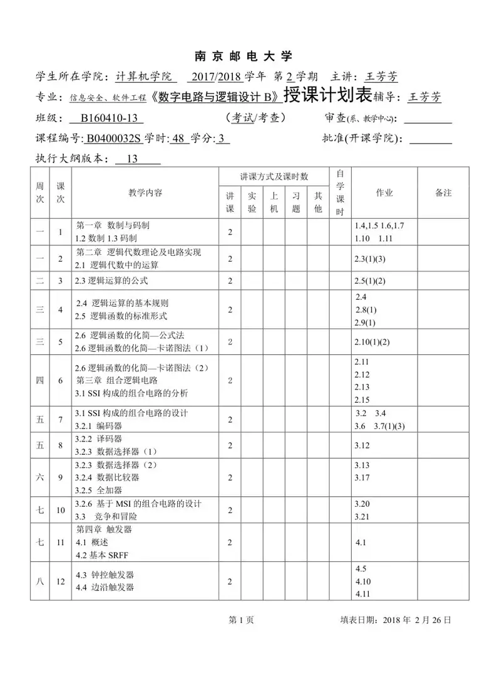
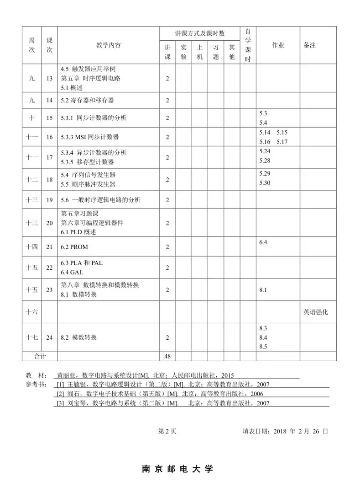
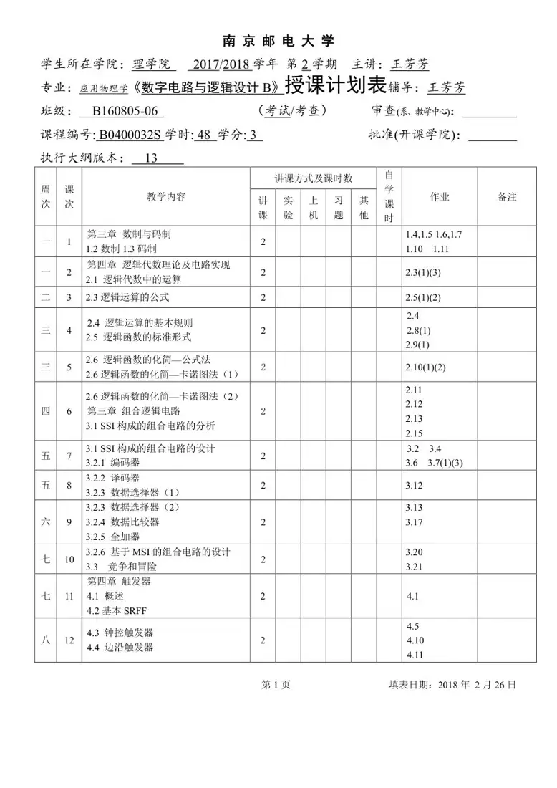
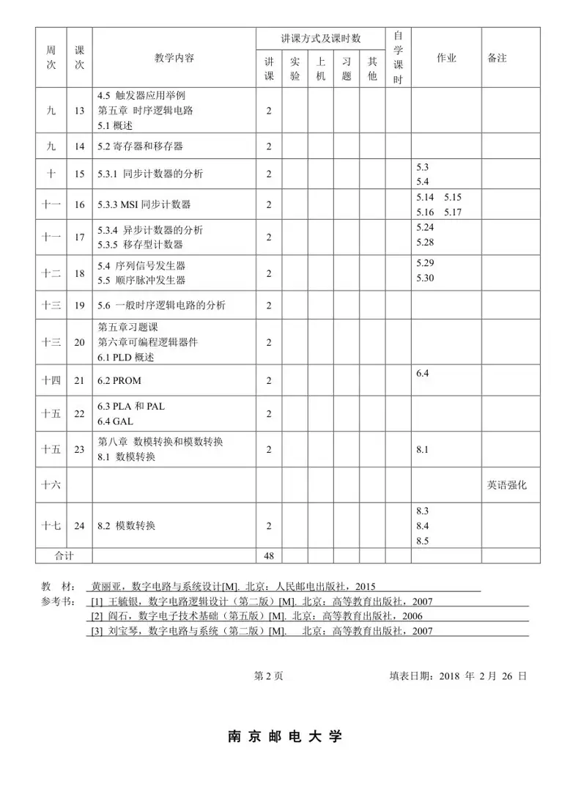

# 2017—2018 学年第二学期《数字电路与逻辑设计B》授课计划表

原件的每一页，下面附识别出的文字。

### 南 京 邮 电 大 学

原文：

南 京 邮 电 大 学

学生所在学院：计算机学院 2017/2018 学年 第2 学期 主讲：王芳芳

专业：信息安全、软件工程《数字电路与逻辑设计 B》授课计划表辅导：王芳芳

班级： B160410-13

（考试/考查）

审查(系、教学中心)：

课程编号: B0400032S 学时: 48 学分: 3

批准(开课学院)：

执行大纲版本： 13

<table><tr><td rowspan="2">周次</td><td rowspan="2">课次</td><td rowspan="2">教学内容</td><td colspan="5">讲课方式及课时数</td><td rowspan="2">自学课时</td><td rowspan="2">作业</td><td rowspan="2">备注</td></tr><tr><td>讲课</td><td>实验</td><td>上机</td><td>习题</td><td>其他</td></tr><tr><td>一</td><td>1</td><td>第一章 数制与码制1.2 数制 1.3 码制</td><td>2</td><td></td><td></td><td></td><td></td><td></td><td>1.4,1.5 1.6,1.71.10 1.11</td><td></td></tr><tr><td>一</td><td>2</td><td>第二章 逻辑代数理论及电路实现2.1 逻辑代数中的运算</td><td>2</td><td></td><td></td><td></td><td></td><td></td><td>2.3(1)(3)</td><td></td></tr><tr><td>二</td><td>3</td><td>2.3 逻辑运算的公式</td><td>2</td><td></td><td></td><td></td><td></td><td></td><td>2.5(1)(2)</td><td></td></tr><tr><td>三</td><td>4</td><td>2.4 逻辑运算的基本规则2.5 逻辑函数的标准形式</td><td>2</td><td></td><td></td><td></td><td></td><td></td><td>2.42.8(1)2.9(1)</td><td></td></tr><tr><td>三</td><td>5</td><td>2.6 逻辑函数的化简—公式法2.6 逻辑函数的化简—卡诺图法 (1)</td><td>2</td><td></td><td></td><td></td><td></td><td></td><td>2.10(1)(2)</td><td></td></tr><tr><td>四</td><td>6</td><td>2.6 逻辑函数的化简—卡诺图法 (2)第三章 组合逻辑电路3.1 SSI 构成的组合电路的分析</td><td>2</td><td></td><td></td><td></td><td></td><td></td><td>2.112.122.132.15</td><td></td></tr><tr><td>五</td><td>7</td><td>3.1 SSI 构成的组合电路的设计3.2.1 编码器</td><td>2</td><td></td><td></td><td></td><td></td><td></td><td>3.2 3.43.6 3.7(1)(3)</td><td></td></tr><tr><td>五</td><td>8</td><td>3.2.2 译码器3.2.3 数据选择器 (1)</td><td>2</td><td></td><td></td><td></td><td></td><td></td><td>3.12</td><td></td></tr><tr><td>六</td><td>9</td><td>3.2.3 数据选择器 (2)3.2.4 数据比较器3.2.5 全加器</td><td>2</td><td></td><td></td><td></td><td></td><td></td><td>3.133.17</td><td></td></tr><tr><td>七</td><td>10</td><td>3.2.6 基于 MSI 的组合电路的设计3.3 竞争和冒险</td><td>2</td><td></td><td></td><td></td><td></td><td></td><td>3.203.21</td><td></td></tr><tr><td>七</td><td>11</td><td>第四章 触发器4.1 概述4.2 基本 SRFF</td><td>2</td><td></td><td></td><td></td><td></td><td></td><td>4.1</td><td></td></tr><tr><td>八</td><td>12</td><td>4.3 钟控触发器4.4 边沿触发器</td><td>2</td><td></td><td></td><td></td><td></td><td></td><td>4.54.104.11</td><td></td></tr></table>

填表日期：2018年 2月 26日

第 1 页

### 填表日期：2018 年 2 月 26 日

原文：

教 材： 黄丽亚，数字电路与系统设计[M]. 北京：人民邮电出版社，2015参考书： [1] 王毓银，数字电路逻辑设计（第二版）[M]. 北京：高等教育出版社，2007[2] 阎石，数字电子技术基础（第五版）[M]. 北京：高等教育出版社，2006[3] 刘宝琴，数字电路与系统（第二版）[M]. 北京：高等教育出版社，2007

<table><tr><td rowspan="2">周次</td><td rowspan="2">课次</td><td rowspan="2">教学内容</td><td colspan="5">讲课方式及课时数</td><td rowspan="2">自学课时</td><td rowspan="2">作业</td><td rowspan="2">备注</td></tr><tr><td>讲课</td><td>实验</td><td>上机</td><td>习题</td><td>其他</td></tr><tr><td>九</td><td>13</td><td>4.5 触发器应用举例第五章 时序逻辑电路5.1 概述</td><td>2</td><td></td><td></td><td></td><td></td><td></td><td></td><td></td></tr><tr><td>九</td><td>14</td><td>5.2 寄存器和移存器</td><td>2</td><td></td><td></td><td></td><td></td><td></td><td></td><td></td></tr><tr><td>十</td><td>15</td><td>5.3.1 同步计数器的分析</td><td>2</td><td></td><td></td><td></td><td></td><td></td><td>5.35.4</td><td></td></tr><tr><td>十一</td><td>16</td><td>5.3.3 MSI 同步计数器</td><td>2</td><td></td><td></td><td></td><td></td><td></td><td>5.14 5.155.16 5.17</td><td></td></tr><tr><td>十一</td><td>17</td><td>5.3.4 异步计数器的分析5.3.5 移存型计数器</td><td>2</td><td></td><td></td><td></td><td></td><td></td><td>5.245.28</td><td></td></tr><tr><td>十二</td><td>18</td><td>5.4 序列信号发生器5.5 顺序脉冲发生器</td><td>2</td><td></td><td></td><td></td><td></td><td></td><td>5.295.30</td><td></td></tr><tr><td>十三</td><td>19</td><td>5.6 一般时序逻辑电路的分析</td><td>2</td><td></td><td></td><td></td><td></td><td></td><td></td><td></td></tr><tr><td>十三</td><td>20</td><td>第五章习题课第六章可编程逻辑器件6.1 PLD 概述</td><td>2</td><td></td><td></td><td></td><td></td><td></td><td></td><td></td></tr><tr><td>十四</td><td>21</td><td>6.2 PROM</td><td>2</td><td></td><td></td><td></td><td></td><td></td><td>6.4</td><td></td></tr><tr><td>十五</td><td>22</td><td>6.3 PLA 和 PAL6.4 GAL</td><td>2</td><td></td><td></td><td></td><td></td><td></td><td></td><td></td></tr><tr><td>十五</td><td>23</td><td>第八章 数模转换和模数转换8.1 数模转换</td><td>2</td><td></td><td></td><td></td><td></td><td></td><td>8.1</td><td></td></tr><tr><td>十六</td><td></td><td></td><td></td><td></td><td></td><td></td><td></td><td></td><td></td><td>英语强化</td></tr><tr><td>十七</td><td>24</td><td>8.2 模数转换</td><td>2</td><td></td><td></td><td></td><td></td><td></td><td>8.38.48.5</td><td></td></tr><tr><td colspan="2">合计</td><td></td><td>48</td><td></td><td></td><td></td><td></td><td></td><td></td><td></td></tr></table>

填表日期：2018 年 2 月 26 日

第 2 页

南 京 邮 电 大 学

### 南 京 邮 电 大 学

原文：

南 京 邮 电 大 学

学生所在学院：理学院 2017/2018学年 第2 学期 主讲：王芳芳

专业：应用物理学《数字电路与逻辑设计B》授课计划表辅导：王芳芳

班级： B160805-06

（考试/考查）

审查(系、教学中心)：

课程编号: B0400032S 学时: 48 学分: 3

批准(开课学院)：

执行大纲版本： 13

<table><tr><td rowspan="2">周次</td><td rowspan="2">课次</td><td rowspan="2">教学内容</td><td colspan="5">讲课方式及课时数</td><td rowspan="2">自学课时</td><td rowspan="2">作业</td><td rowspan="2">备注</td></tr><tr><td>讲课</td><td>实验</td><td>上机</td><td>习题</td><td>其他</td></tr><tr><td>一</td><td>1</td><td>第三章 数制与码制1.2 数制 1.3 码制</td><td>2</td><td></td><td></td><td></td><td></td><td></td><td>1.4,1.5 1.6,1.71.10 1.11</td><td></td></tr><tr><td>一</td><td>2</td><td>第四章 逻辑代数理论及电路实现2.1 逻辑代数中的运算</td><td>2</td><td></td><td></td><td></td><td></td><td></td><td>2.3(1)(3)</td><td></td></tr><tr><td>二</td><td>3</td><td>2.3 逻辑运算的公式</td><td>2</td><td></td><td></td><td></td><td></td><td></td><td>2.5(1)(2)</td><td></td></tr><tr><td>三</td><td>4</td><td>2.4 逻辑运算的基本规则2.5 逻辑函数的标准形式</td><td>2</td><td></td><td></td><td></td><td></td><td></td><td>2.42.8(1)2.9(1)</td><td></td></tr><tr><td>三</td><td>5</td><td>2.6 逻辑函数的化简—公式法2.6 逻辑函数的化简—卡诺图法 (1)</td><td>2</td><td></td><td></td><td></td><td></td><td></td><td>2.10(1)(2)</td><td></td></tr><tr><td>四</td><td>6</td><td>2.6 逻辑函数的化简—卡诺图法 (2)第三章 组合逻辑电路3.1 SSI 构成的组合电路的分析</td><td>2</td><td></td><td></td><td></td><td></td><td></td><td>2.112.122.132.15</td><td></td></tr><tr><td>五</td><td>7</td><td>3.1 SSI 构成的组合电路的设计3.2.1 编码器</td><td>2</td><td></td><td></td><td></td><td></td><td></td><td>3.2 3.43.6 3.7(1)(3)</td><td></td></tr><tr><td>五</td><td>8</td><td>3.2.2 译码器3.2.3 数据选择器 (1)</td><td>2</td><td></td><td></td><td></td><td></td><td></td><td>3.12</td><td></td></tr><tr><td>六</td><td>9</td><td>3.2.3 数据选择器 (2)3.2.4 数据比较器3.2.5 全加器</td><td>2</td><td></td><td></td><td></td><td></td><td></td><td>3.133.17</td><td></td></tr><tr><td>七</td><td>10</td><td>3.2.6 基于 MSI 的组合电路的设计3.3 竞争和冒险</td><td>2</td><td></td><td></td><td></td><td></td><td></td><td>3.203.21</td><td></td></tr><tr><td>七</td><td>11</td><td>第四章 触发器4.1 概述4.2 基本 SRFF</td><td>2</td><td></td><td></td><td></td><td></td><td></td><td>4.1</td><td></td></tr><tr><td>八</td><td>12</td><td>4.3 钟控触发器4.4 边沿触发器</td><td>2</td><td></td><td></td><td></td><td></td><td></td><td>4.54.104.11</td><td></td></tr></table>

填表日期：2018年 2月 26日

第 1 页

### 教 材： 黄丽亚，数字电路与系统设计[M]. 北京：人民邮电出版社，2015

原文：

参考书： [1] 王毓银，数字电路逻辑设计（第二版）[M]. 北京：高等教育出版社，2007

<table><tr><td rowspan="2">周次</td><td rowspan="2">课次</td><td rowspan="2">教学内容</td><td colspan="5">讲课方式及课时数</td><td rowspan="2">自学课时</td><td rowspan="2">作业</td><td rowspan="2">备注</td></tr><tr><td>讲课</td><td>实验</td><td>上机</td><td>习题</td><td>其他</td></tr><tr><td>九</td><td>13</td><td>4.5 触发器应用举例第五章 时序逻辑电路5.1 概述</td><td>2</td><td></td><td></td><td></td><td></td><td></td><td></td><td></td></tr><tr><td>九</td><td>14</td><td>5.2 寄存器和移存器</td><td>2</td><td></td><td></td><td></td><td></td><td></td><td></td><td></td></tr><tr><td>十</td><td>15</td><td>5.3.1 同步计数器的分析</td><td>2</td><td></td><td></td><td></td><td></td><td></td><td>5.35.4</td><td></td></tr><tr><td>十一</td><td>16</td><td>5.3.3 MSI 同步计数器</td><td>2</td><td></td><td></td><td></td><td></td><td></td><td>5.14 5.155.16 5.17</td><td></td></tr><tr><td>十一</td><td>17</td><td>5.3.4 异步计数器的分析5.3.5 移存型计数器</td><td>2</td><td></td><td></td><td></td><td></td><td></td><td>5.245.28</td><td></td></tr><tr><td>十二</td><td>18</td><td>5.4 序列信号发生器5.5 顺序脉冲发生器</td><td>2</td><td></td><td></td><td></td><td></td><td></td><td>5.295.30</td><td></td></tr><tr><td>十三</td><td>19</td><td>5.6 一般时序逻辑电路的分析</td><td>2</td><td></td><td></td><td></td><td></td><td></td><td></td><td></td></tr><tr><td>十三</td><td>20</td><td>第五章习题课第六章可编程逻辑器件6.1 PLD 概述</td><td>2</td><td></td><td></td><td></td><td></td><td></td><td></td><td></td></tr><tr><td>十四</td><td>21</td><td>6.2 PROM</td><td>2</td><td></td><td></td><td></td><td></td><td></td><td>6.4</td><td></td></tr><tr><td>十五</td><td>22</td><td>6.3 PLA 和 PAL6.4 GAL</td><td>2</td><td></td><td></td><td></td><td></td><td></td><td></td><td></td></tr><tr><td>十五</td><td>23</td><td>第八章 数模转换和模数转换8.1 数模转换</td><td>2</td><td></td><td></td><td></td><td></td><td></td><td>8.1</td><td></td></tr><tr><td>十六</td><td></td><td></td><td></td><td></td><td></td><td></td><td></td><td></td><td></td><td>英语强化</td></tr><tr><td>十七</td><td>24</td><td>8.2 模数转换</td><td>2</td><td></td><td></td><td></td><td></td><td></td><td>8.38.48.5</td><td></td></tr><tr><td colspan="2">合计</td><td></td><td>48</td><td></td><td></td><td></td><td></td><td></td><td></td><td></td></tr></table>
教 材： 黄丽亚，数字电路与系统设计[M]. 北京：人民邮电出版社，2015

填表日期：2018 年 2 月 26 日

第 2 页

南 京 邮 电 大 学
