# 《数字电路与系统设计A》2016年期末复习概要

原件经识别和整理；“参考解答”是我们补的。

## 试卷情况及复习方法

采用教考分离方式。

试卷内容涉及到第 1 章～第 8 章绝大部分内容；每份试卷 9～11 道题目。第 1 道为选择题或填空题（20～25 分），其余为大题（75～80 分）。

复习建议：选择题或填空题为第 1 章～第 8 章的基本概念，建议结合近几年的试卷复习；大题及其题型可参考课后习题和书上例题。

## 第 1 章 数码与数制（4%）

涉及题型：选择填空题。

基本要求：

1. 数制、码制的基本概念；
2. 常用数制（二、八、十、十六进制）的表述及相互转换的方法；
3. 常用二进制码（自然二进制码、格雷循环码、奇偶校验码）和二-十进制 BCD 码（8421BCD、5421BCD、余 3BCD、格雷 BCD 码）的表述以及相互转换；
4. 小数的精度及转换位数的确定；
5. 8421BCD 的加减法运算。

常见题型：数制的转换（精度及位数）、码制的转换。

### 数制转换的精度与位数

例：$(83)_{10} = (？)_2$，要求精度达到 0.1％。

解：设二进制数小数点后有 $n$ 位小数，则其精度为 $2^{-n}$。由题意知：$2^{-n} \leq 0.1\%$，解得 $n \geq 10$。所以 $(83)_{10} \approx (1010011.0000000000)_2$。

知识点：[数字系统的基本模型（数据处理器与控制器）及对最小时钟周期、异步信号同步化的约定](../../../topics/数字逻辑电路/数字系统模型.md)

### 十进制小数的转换精度

例：$(0.25)_{10} = (？)_2$，要求转换后精度不低于原精度。

解：原精度为 $10^{-2}$。设转换后为 $n$ 位小数，则 $2^{-n} \leq 10^{-2}$，解得 $n \geq 7$。取整 $n = 7$，$(0.25)_{10} = (0.0100000)_2$。

知识点：[数字系统的基本模型（数据处理器与控制器）及对最小时钟周期、异步信号同步化的约定](../../../topics/数字逻辑电路/数字系统模型.md)

### 二进制码与 BCD 码

1. 二进制码：$n$ 位二进制数表示 $2^n$ 个码。
2. BCD 码：用 4 位二进制数表示 0～9 共 10 个十进制数。

- 有权码：代码中的每一位都有固定权值，如 8421BCD、5421BCD、2421BCD、631-1BCD；
- 无权码：无固定位权，如余 3 码、余 3 循环码、8421 奇校码、格雷码（注意：格雷循环码、格雷 BCD 码）。

二进制码与循环码（格雷码）转换示例：最高位相同，其余各位为相邻两位的异或。

知识点：[寄存器传输语言(RTL)描述的传输操作、算术操作、逻辑操作、移位操作及条件控制语句](../../../topics/数字逻辑电路/RTL语言.md)、[数字系统的基本模型（数据处理器与控制器）及对最小时钟周期、异步信号同步化的约定](../../../topics/数字逻辑电路/数字系统模型.md)

### 8421BCD 的加减法运算

例：试用 8421BCD 码完成下列十进制数的运算。

$$843 - 348 = (1000\ 0100\ 0011)_{8421BCD} - (0011\ 0100\ 1000)_{8421BCD}$$

按位相减得 $0100\ 1111\ 1011$，对需要修正的位减 $0110$ 修正，得 $(0100\ 1001\ 0101)_{8421BCD} = 495$。

知识点：[完整数字系统设计流程实例（如乘法器、交通灯管理系统的算法规律、处理器设计与控制器实现）](../../../topics/数字逻辑电路/数字系统设计实例.md)

### BCD 码与余 3 码表示

例：用 8421BCD、余 3 码代码表示 $(123)_{10}$、$(1011.01)_2$：

$$(123)_{10} = (0001\ 0010\ 0011)_{8421BCD}$$

$$(1011.01)_2 = (11.25)_{10} = (0001\ 0001.0010\ 0101)_{8421BCD}$$

$$(123)_{10} = (0100\ 0101\ 0110)_{余3BCD}$$

$$(1011.01)_2 = (11.25)_{10} = (0100\ 0100.0101\ 1000)_{余3BCD}$$

## 第 2 章 逻辑代数理论及电路实现（13%）

涉及题型：选择填空题、分析计算题。

基本要求：

1. 逻辑代数的基本概念、基本公式、基本规则；
2. 逻辑函数的描述方式（最小项、真值表、表达式、卡诺图、电路图）及其相互转换方法；
3. 逻辑函数最简与或式的公式/卡诺图化简；
4. 非完全描述逻辑函数的概念、运算规则及化简；
5. CMOS 与非门、CMOS 或非门、CMOS 三态门、OD 门的逻辑功能分析。

常见题型：

1. 完全/非完全描述逻辑的公式法/4 变量以下 K 图化简；
2. CMOS 电路逻辑功能分析、表达式。

知识点：[数字系统的基本模型（数据处理器与控制器）及对最小时钟周期、异步信号同步化的约定](../../../topics/数字逻辑电路/数字系统模型.md)、[寄存器传输语言(RTL)描述的传输操作、算术操作、逻辑操作、移位操作及条件控制语句](../../../topics/数字逻辑电路/RTL语言.md)、[算法状态机(ASM)图的状态框、判断框、条件输出框及ASM块的构成规则](../../../topics/数字逻辑电路/ASM图基础.md)

### CMOS 门电路逻辑功能分析

CMOS 反相器：$F = \overline{A}$。

CMOS 与非门：$F = \overline{AB}$。

CMOS 或非门：$F = \overline{A + B}$。

知识点：[数字系统的基本模型（数据处理器与控制器）及对最小时钟周期、异步信号同步化的约定](../../../topics/数字逻辑电路/数字系统模型.md)

### 三态门与传输门

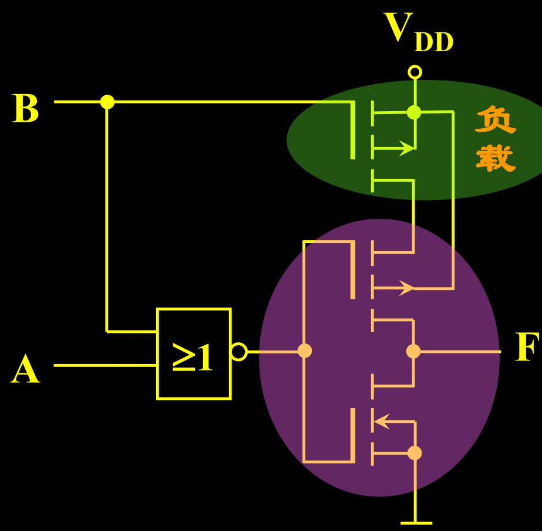

解：当 $B = 0$ 时，$F = \overline{A}$；当 $B = 1$ 时，$F$ 为高阻态。

传输门 TG：当 $B = 0$ 时，$F = A$；当 $B = 1$ 时，$F$ 为高阻态。

知识点：[数字系统的基本模型（数据处理器与控制器）及对最小时钟周期、异步信号同步化的约定](../../../topics/数字逻辑电路/数字系统模型.md)

### 逻辑代数基本公式

1. 合并相邻项公式：$AB + A\overline{B} = A$；
2. 消项公式：$A + AB = A$（原变量吸收）；
3. 消去互补因子公式：$A + \overline{A}B = A + B$（反变量吸收）；
4. 多余项（生成项）公式：$AB + \overline{A}C + BC = AB + \overline{A}C$（混合变量吸收）。

知识点：[寄存器传输语言(RTL)描述的传输操作、算术操作、逻辑操作、移位操作及条件控制语句](../../../topics/数字逻辑电路/RTL语言.md)、[数字系统的基本模型（数据处理器与控制器）及对最小时钟周期、异步信号同步化的约定](../../../topics/数字逻辑电路/数字系统模型.md)

### 代入规则

例：将 $L = A(B + C)$ 中的 $A$ 用 $A + D$ 代入，得 $L = (A + D)(B + C)$。

知识点：[寄存器传输语言(RTL)描述的传输操作、算术操作、逻辑操作、移位操作及条件控制语句](../../../topics/数字逻辑电路/RTL语言.md)

### 反演规则

例：$F = A \cdot B \cdot C \cdot D \cdot E$，则

$$F' = \overline{A} + \overline{B} + \overline{C} + \overline{D} + \overline{E}$$

### 对偶规则

例：$F = A \cdot B + C$，其对偶式为 $F^D = (A + B) \cdot C$。

知识点：[数字系统的基本模型（数据处理器与控制器）及对最小时钟周期、异步信号同步化的约定](../../../topics/数字逻辑电路/数字系统模型.md)、[寄存器传输语言(RTL)描述的传输操作、算术操作、逻辑操作、移位操作及条件控制语句](../../../topics/数字逻辑电路/RTL语言.md)、[算法状态机(ASM)图的状态框、判断框、条件输出框及ASM块的构成规则](../../../topics/数字逻辑电路/ASM图基础.md)

### 两个基本定理

（1）若 $m_i$ 为最小项，则 $\sum m_i$（$i$ 取遍除 $i$ 以外的所有正整数）等性质；最小项之和的性质。

（2）若 $\sqrt{2}$ 相关表达式……见例题。

例：求 $F = \sum m(0, 1, 7)$ 等的最小项表达式与最简式。

# 2016 年期末复习概要：数字电路与系统设计 A

本资料为《数字电路与系统设计 A》2016 年期末复习概要第 2 部分（第 13–21 页）的整理内容，包含逻辑代数理论、约束条件处理及组合逻辑电路设计案例。

## 2. 逻辑代数理论及电路实现

知识点：[算法状态机(ASM)图的状态框、判断框、条件输出框及ASM块的构成规则](../../../topics/数字逻辑电路/ASM图基础.md)

### 约束条件分析

**例：** $12:10:10:10$ （约束条件示例）
$$ \text{约束条件} = \textcircled{1} \times \textcircled{2} $$

**含义说明：**
表示 A 与 B 不能同时为 1，则对应的最小项应视为无关项。

**表达式化简示例：**
$$ F = ABC + AC + \sum \phi = ABC + AC + AB = C $$

**卡诺图示意：**
| BC | 00 | 01 | 11 | 10 |
| :---: | :---: | :---: | :---: | :---: |
| **A=0** | 1 | 0 | 0 | |
| **A=1** | 1 | 0 | | |

> [!NOTE]
> **如何确定约束条件？**
> 在逻辑设计中，若某些输入组合在实际电路中不会出现（如 BCD 码中的 1010-1111），这些状态对应的输出可设为“无关项”（$\phi$），用于简化逻辑表达式。

## 2. 逻辑代数理论及电路实现（续）

知识点：[数字系统的基本模型（数据处理器与控制器）及对最小时钟周期、异步信号同步化的约定](../../../topics/数字逻辑电路/数字系统模型.md)、[寄存器传输语言(RTL)描述的传输操作、算术操作、逻辑操作、移位操作及条件控制语句](../../../topics/数字逻辑电路/RTL语言.md)

### 复杂约束条件示例

**例：** 给定一组复杂的约束条件序列（具体数值略，原文识别存在乱码）。
假设约束条件为：$V_1, V_2$ 等特定组合。

## 2. 逻辑代数理论及电路实现（应用）

知识点：[完整数字系统设计流程实例（如乘法器、交通灯管理系统的算法规律、处理器设计与控制器实现）](../../../topics/数字逻辑电路/数字系统设计实例.md)、[控制器的四种硬件实现方法：每态一触发器法(SSI)、MSI法(MUX+寄存器+译码器)、PLA法(LSI)及对比](../../../topics/数字逻辑电路/控制器实现方法.md)、[根据文字描述建立ASM图的原则，以及从ASM图推导处理器明细表和控制器状态转移图](../../../topics/数字逻辑电路/ASM图建立与分析.md)

### 判断一位十进制数是否为偶数

**题目描述：**
写出逻辑式。假设偶数时输出 Y 为 1，奇数时输出 Y 为 0。

**真值表：**

| ABCD | Y | ABCD | Y |
| :---: | :---: | :---: | :---: |
| 0 0 0 0 | 1 | 1 0 0 0 | 1 |
| 0 0 0 1 | 0 | 1 0 0 1 | 0 |
| 0 0 1 0 | 1 | 1 0 1 0 | $\phi$ |
| 0 0 1 1 | 0 | 1 0 1 1 | $\phi$ |
| 0 1 0 0 | 1 | 1 1 0 0 | $\phi$ |
| 0 1 0 1 | 0 | 1 1 0 1 | $\phi$ |
| 0 1 1 0 | 1 | 1 1 1 0 | $\phi$ |
| 0 1 1 1 | 0 | 1 1 1 1 | $\phi$ |

**卡诺图化简：**

| AB\CD | 00 | 01 | 11 | 10 |
| :---: | :---: | :---: | :---: | :---: |
| **00** | 1 | 0 | 0 | 1 |
| **01** | 1 | 0 | 0 | 1 |
| **11** | $\phi$ | $\phi$ | $\phi$ | $\phi$ |
| **10** | 1 | 0 | $\phi$ | $\phi$ |

**逻辑函数表达式：**
$$ F(A,B,C,D) = \sum m(0, 2, 4, 6, 8) + \sum \phi(10, 11, 12, 13, 14, 15) $$

## 3. 组合逻辑电路

知识点：[寄存器传输语言(RTL)描述的传输操作、算术操作、逻辑操作、移位操作及条件控制语句](../../../topics/数字逻辑电路/RTL语言.md)、[数字系统的基本模型（数据处理器与控制器）及对最小时钟周期、异步信号同步化的约定](../../../topics/数字逻辑电路/数字系统模型.md)、[算法状态机(ASM)图的状态框、判断框、条件输出框及ASM块的构成规则](../../../topics/数字逻辑电路/ASM图基础.md)

### 考试要求与题型

**涉及分值：** 15%
**涉及题型：** 选择填空题、分析计算题。

**基本要求：**
1. 完全状态或非完全描述的 SSI 组合逻辑电路分析与双轨输入逻辑电路设计；
2. MSI 电路（编码器、译码器、数据选择器、数据比较器、加法器）所实现的组合逻辑电路分析；
3. 利用 MSI 电路实现组合逻辑电路；
4. 组合电路中的竞争冒险现象及其消除方法。

**常见题型：**
1. 根据功能描述，列出真值表，设计 SSI 组合逻辑电路；
2. 使用 MSI 功能电路（74138/74151）实现组合逻辑；
3. MSI 功能电路（74138/74151/74283/7485）电路分析。

## 3. 组合逻辑电路（设计案例）

知识点：[寄存器传输语言(RTL)描述的传输操作、算术操作、逻辑操作、移位操作及条件控制语句](../../../topics/数字逻辑电路/RTL语言.md)、[控制器的四种硬件实现方法：每态一触发器法(SSI)、MSI法(MUX+寄存器+译码器)、PLA法(LSI)及对比](../../../topics/数字逻辑电路/控制器实现方法.md)、[完整数字系统设计流程实例（如乘法器、交通灯管理系统的算法规律、处理器设计与控制器实现）](../../../topics/数字逻辑电路/数字系统设计实例.md)

### 教室灯光控制电路设计

**题目描述：**
有三个班学生上自习，大教室能容纳两个班学生，小教室能容纳一个班学生。设计两个教室是否开灯的逻辑控制电路，要求如下：
1. 一个班学生上自习，开小教室的灯。
2. 两个班上自习，开大教室的灯。
3. 三个班上自习，两教室均开灯。

**解题步骤：**

1. **定义变量：**
   - 输入变量 $A, B, C$：分别表示三个班学生是否上自习（1 表示上，0 表示不上）。
   - 输出变量 $Y, G$：分别表示大教室、小教室的灯是否亮（1 表示亮，0 表示灭）。

2. **真值表：**

| A B C | Y G |
| :---: | :---: |
| 0 0 0 | 0 0 |
| 0 0 1 | 0 1 |
| 0 1 0 | 0 1 |
| 0 1 1 | 1 0 |
| 1 0 0 | 0 1 |
| 1 0 1 | 1 0 |
| 1 1 0 | 1 0 |
| 1 1 1 | 1 1 |

3. **卡诺图化简：**

**Y 的卡诺图：**
| BC | 00 | 01 | 11 | 10 |
| :---: | :---: | :---: | :---: | :---: |
| **A=0** | 0 | 1 | 0 | |
| **A=1** | 0 | 1 | 1 | 1 |

**G 的卡诺图：**
| BC | 00 | 01 | 11 | 10 |
| :---: | :---: | :---: | :---: | :---: |
| **A=0** | 0 | 1 | 0 | |
| **A=1** | 1 | 1 | 1 | 0 |

4. **逻辑表达式：**
   - **大教室灯 (Y)：**
     $$ Y = BC + AC + AB $$
   - **小教室灯 (G)：**
     $$ G = \overline{A}\overline{B}C + \overline{A}B\overline{C} + A\overline{B}\overline{C} + ABC = A \oplus B \oplus C $$

5. **逻辑电路图（符号表示）：**
   - 使用与门 ($\&$)、或门 ($\geq 1$)、异或门 ($=1$) 实现上述表达式。

## 3. 组合逻辑电路（BCD 码检测）

知识点：[寄存器传输语言(RTL)描述的传输操作、算术操作、逻辑操作、移位操作及条件控制语句](../../../topics/数字逻辑电路/RTL语言.md)、[数字系统的基本模型（数据处理器与控制器）及对最小时钟周期、异步信号同步化的约定](../../../topics/数字逻辑电路/数字系统模型.md)

### 与非门设计案例

**题目描述：**
试用与非门设计一个组合电路，接收一位 8421BCD 码 $B_3 B_2 B_1 B_0$，仅当 $(12-1)/2 = ?$ (原文识别模糊，推测为特定数值判断) 时，输出 Y 为 1。

**真值表/卡诺图示意：**
- 有效 BCD 码范围：0000 ~ 1001
- 无效 BCD 码范围：1010 ~ 1111 (作为无关项 $\times$)

**逻辑表达式推导：**
$$ Y = B_2 \overline{B}_1 + B_2 \overline{B}_0 + \overline{B}_2 B_1 B_0 $$
转换为与非门形式：
$$ Y = \overline{\overline{B_2 B_1}} \cdot \overline{\overline{B_2 B_0}} \cdot \overline{\overline{B_2} B_1 B_0} $$
*(注：原文公式转换可能存在识别误差，此处保留原文结构)*

## 3. 组合逻辑电路（优先级仲裁）

知识点：[数字系统的基本模型（数据处理器与控制器）及对最小时钟周期、异步信号同步化的约定](../../../topics/数字逻辑电路/数字系统模型.md)

### 三列火车发车控制系统

**题目描述：**
有三列火车，对应信号灯 $F_2, F_1, F_0$。火车提出发车请求时，输入变量取 1；否则取 0。允许发车时，相应函数取 1；反之取 0。
若三列火车同时提出请求，按优先级顺序发车（原文识别为 $25 \div 5 = 11$，推测为优先级编码逻辑）。

**变量定义：**
- 输入：$A_2, A_1, A_0$ (代表三列火车的请求)
- 输出：$F_2, F_1, F_0$ (代表信号灯)
- 优先级：$A_2 > A_1 > A_0$

**逻辑函数：**
$$ F_2(A_2, A_1, A_0) = \sum m(4, 5, 6, 7) + \phi_0 $$
$$ F_1(A_2, A_1, A_0) = \sum m(2, 3) + \phi_0 $$
$$ F_0(A_2, A_1, A_0) = m_1 + \phi_0 $$

**真值表（含优先级逻辑）：**

| $A_2$ | $A_1$ | $A_0$ | $F_2$ | $F_1$ | $F_0$ |
| :---: | :---: | :---: | :---: | :---: | :---: |
| 1 | $\phi$ | $\phi$ | 1 | 0 | 0 |
| 0 | 1 | $\phi$ | 0 | 1 | 0 |
| 0 | 0 | 1 | 0 | 0 | 1 |
| 0 | 0 | 0 | $\phi$ | $\phi$ | $\phi$ |

> [!TIP]
> **优先级编码器原理：**
> 当高优先级输入为 1 时，低优先级输出强制为 0，无论其输入状态如何（即被屏蔽）。

# 《数字电路与系统设计A》2016年期末复习概要（第3部分）

本资料为《数字电路与系统设计A》2016年期末复习概要的第3部分，主要涵盖组合逻辑电路设计实例及触发器基础知识。内容经过整理，修正了识别错误，保留了核心知识点和例题解析。

## 一、组合逻辑电路

知识点：[完整数字系统设计流程实例（如乘法器、交通灯管理系统的算法规律、处理器设计与控制器实现）](../../../topics/数字逻辑电路/数字系统设计实例.md)、[寄存器传输语言(RTL)描述的传输操作、算术操作、逻辑操作、移位操作及条件控制语句](../../../topics/数字逻辑电路/RTL语言.md)

### 例 1：用7485构成4位二进制数判别电路

**题目描述：**
用7485构成4位二进制数判别电路。当输入满足特定条件时，判别输出 F 为 1，否则输出 F 为 0。

**分析：**
将输入二进制数 $J_2 S_2 S_1 S_0$ 与 $(1001)_2$ 进行比较。
即将 7485 的 A 输入端接输入变量 $S_2, S_1, S_0$（注：原题识别有误，根据上下文应为4位比较，通常高位补0或具体连接），B 输入端接 $(1001)_2$。
当 $A > B$ 时，比较器的 $A>B$ 端输出为 1。因此，可用 $A>B$ 端作为判别电路的输出 F。

**关键点：**
- 7485 是比较器芯片。
- 通过固定 B 输入端数值，实现特定数值的判别。
- 利用 $A>B$ 输出端直接作为结果。

知识点：[完整数字系统设计流程实例（如乘法器、交通灯管理系统的算法规律、处理器设计与控制器实现）](../../../topics/数字逻辑电路/数字系统设计实例.md)、[寄存器传输语言(RTL)描述的传输操作、算术操作、逻辑操作、移位操作及条件控制语句](../../../topics/数字逻辑电路/RTL语言.md)

### 例 2：BCD码四舍五入电路设计

**题目描述：**
已知 BCD 码，试设计一个电路将该数四舍五入。例如，小数部分 $\ge 5$ 时，+1 修正；整数部分 $\ge 10$ 时，+6 修正。

**分析：**
- **小数部分四舍五入 +6 修正**：针对 BCD 码加法后的调整。
- **+1 修正**：针对小数部分判断。

**核心逻辑：**
在 BCD 码运算中，若结果大于 9 或产生进位，需加 6 进行修正（因为 $10_{10} = 1010_{2}$，而 BCD 需要表示十进制，故加 $0110_2$）。对于四舍五入，需检测最低位或特定权重位来决定是否加 1 或加 6。

*(注：原题识别公式混乱，此处保留文字描述的逻辑意图)*

知识点：[完整数字系统设计流程实例（如乘法器、交通灯管理系统的算法规律、处理器设计与控制器实现）](../../../topics/数字逻辑电路/数字系统设计实例.md)、[寄存器传输语言(RTL)描述的传输操作、算术操作、逻辑操作、移位操作及条件控制语句](../../../topics/数字逻辑电路/RTL语言.md)、[数字系统的基本模型（数据处理器与控制器）及对最小时钟周期、异步信号同步化的约定](../../../topics/数字逻辑电路/数字系统模型.md)

### 例 3：用74138设计多输出组合网络

**题目描述：**
用 74138 设计一个多输出组合网络，输入为 A、B、C 三个变量，输出为以下三个函数。集成译码器提供最小项反码输出！

$$
\begin{array}{l}
F _ { 1 } = A C + \overline {{B}} C \\
F _ { 2 } = A + \overline {{C}} \\
F _ { 3 } = A + B + C
\end{array}
$$

**原理说明：**
若 $F = \sum m _ { i }$，则 $\overline { { F } } = \sum m _ { k }$ (k 为 $0 \sim ( 2 ^ { n } - 1 )$ 中除了 i 以外的所有正整数)。
74138 输出为低电平有效的最小项 $\overline{Y_i}$。

**推导过程：**

1.  **对于 $F_2$：**
    $$
    \begin{array}{r}
    F _ { 2 } (A, B, C) = A + \overline {{C}} = m _ { 0 } + m _ { 2 } + m _ { 4 } + m _ { 5 } + m _ { 6 } + m _ { 7 } \\
    = \overline {{m _ { 0 } + m _ { 2 } }} \cdot \overline {{m _ { 4 } + m _ { 5 } + m _ { 6 } + m _ { 7 } }} \quad \text{(德摩根定律转换思路)}
    \end{array}
    $$
    *更正推导：*
    $F_2 = m_0 + m_2 + m_4 + m_5 + m_6 + m_7$
    $\overline{F_2} = m_1 + m_3$
    $F_2 = \overline{m_1 + m_3} = \overline{m_1} \cdot \overline{m_3} = \overline{Y_1} \cdot \overline{Y_3}$
    即使用与非门连接 $\overline{Y_1}$ 和 $\overline{Y_3}$。

2.  **对于 $F_3$：**
    $$
    F _ { 3 } (A, B, C) = A + B + C = \overline {{\overline {{A}} \overline {{B}} \overline {{C}}}} = \overline {{m}} _ { 0 } = \overline {{Y}} _ { 0 }
    $$
    即直接取 $\overline{Y_0}$ 作为输出（若需高电平有效，可能需反相，但题目暗示直接利用反码输出特性，此处 $F_3$ 对应 $m_0$ 的反，即 $\overline{Y_0}$ 即为 $F_3$ 如果 $F_3$ 定义为非 $m_0$？不，$A+B+C$ 是除全0外的所有情况。
    $A+B+C = \sum m(1,2,3,4,5,6,7)$
    $\overline{A+B+C} = m_0$
    所以 $A+B+C = \overline{m_0} = \overline{Y_0}$。
    结论：$F_3$ 直接接 $\overline{Y_0}$。

3.  **对于 $F_1$：**
    $$
    F _ { 1 } (A, B, C) = \overline {{\overline {{m}} _ { 1 } \overline {{m}} _ { 5 } \overline {{m}} _ { 7 }}} = \overline {{Y}} _ { 1 } \overline {{Y}} _ { 5 } \overline {{Y}} _ { 7 } \quad \text{(此处符号可能有误，通常为与非逻辑)}
    $$
    正确逻辑：$F_1 = AC + \bar{B}C = C(A+\bar{B})$。
    最小项展开：
    $AC = m_4 + m_5 + m_6 + m_7$ (当C=1) -> 不对，AC意味着A=1,C=1，B任意。即 $1x1$: $101(m_5), 111(m_7)$? 不，$101=m_5, 111=m_7$。还有 $1x1$ 包括 $101, 111$。等等，ABC顺序。
    $A=1, C=1 \Rightarrow 101 (m_5), 111 (m_7)$。
    $\bar{B}C \Rightarrow B=0, C=1 \Rightarrow 001 (m_1), 101 (m_5)$。
    并集：$m_1, m_5, m_7$。
    $F_1 = m_1 + m_5 + m_7$。
    $\overline{F_1} = \overline{m_1 + m_5 + m_7} = \overline{Y_1} \cdot \overline{Y_5} \cdot \overline{Y_7}$ ? 不，$\overline{F_1}$ 是其他项的和。
    $F_1 = \overline{\overline{m_1} \cdot \overline{m_5} \cdot \overline{m_7}} = \overline{\overline{Y_1} \cdot \overline{Y_5} \cdot \overline{Y_7}}$。
    即使用一个与非门，输入接 $\overline{Y_1}, \overline{Y_5}, \overline{Y_7}$。

**控制信号设置：**
$$
\begin{array}{l}
{E _ { 1 } = 1} \\
{\overline {{E}} _ { 2 \mathrm{A}} = \overline {{E}} _ { 2 \mathrm{B}} = 0}
\end{array}
$$

知识点：[控制器的四种硬件实现方法：每态一触发器法(SSI)、MSI法(MUX+寄存器+译码器)、PLA法(LSI)及对比](../../../topics/数字逻辑电路/控制器实现方法.md)

### 例 4：逻辑冒险分析与消除

**题目描述：**
已知 $F = m _ { 2 } + m _ { 3 } + m _ { 5 } + m _ { 7 }$，电路是否存在逻辑冒险？若有，且用 74138 实现该函数，加取样脉冲避免之。

**分析：**
观察卡诺图或相邻最小项：
$m_2 (010)$ 和 $m_3 (011)$ 相邻。
$m_5 (101)$ 和 $m_7 (111)$ 相邻。
$m_2 (010)$ 和 $m_6 (110)$? 无 $m_6$。
检查静态 1 型冒险：
$F = \sum m(2,3,5,7)$。
卡诺圈覆盖情况：
- $m_2, m_3$ 构成一组 ($\bar{A}B$)
- $m_5, m_7$ 构成一组 ($AC$)
- 是否有冗余覆盖？
  $F = \bar{A}B C + \bar{A}B \bar{C} + A \bar{C} B + A B C$?
  $m_2=\bar{A}B\bar{C}, m_3=\bar{A}BC$. Sum: $\bar{A}B$.
  $m_5=A\bar{C}B, m_7=ABC$. Sum: $AB$.
  $F = \bar{A}B + AB = B(\bar{A}+A) = B$?
  让我们重新检查最小项：
  $m_2 (010), m_3 (011) \rightarrow \bar{A}B$
  $m_5 (101), m_7 (111) \rightarrow AB$
  如果 $F = \bar{A}B + AB = B$，那么这是一个简化后的表达式。
  但在实现时，如果直接用 $\bar{A}B$ 和 $AB$ 的两级逻辑，或者直接用译码器输出。
  
  题目指出：“该电路可能会出现 0 型逻辑冒险。”
  通常译码器输出为低有效。
  $F = \overline{\overline{m_2} \cdot \overline{m_3} \cdot \overline{m_5} \cdot \overline{m_7}}$ (与非门实现)。
  
  当输入从 $010 (m_2)$ 变到 $011 (m_3)$ 时，$\overline{m_2}$ 从 0 变 1，$\overline{m_3}$ 从 1 变 0。
  如果门电路延迟不同，可能出现瞬间两个输入都为 1 的情况，导致输出短暂为 0（对于与非门输出 F，正常应为 1）。这就是 0 型冒险（输出出现负脉冲）。

**消除方法：**
加取样脉冲。在稳定状态下采样输出，避开瞬态干扰。

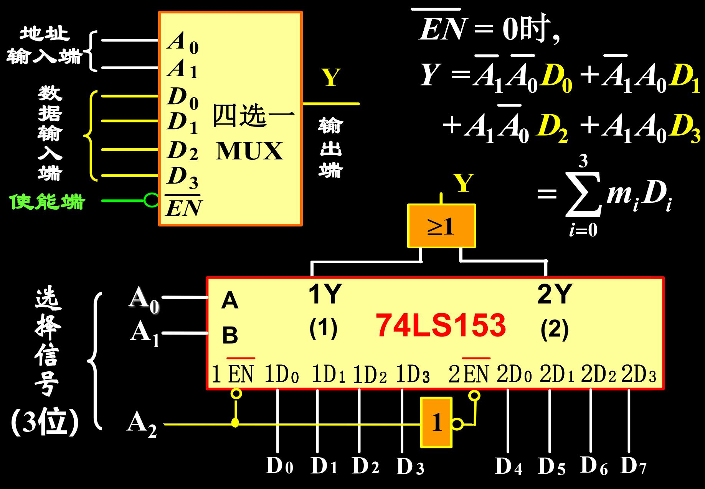

知识点：[数字系统的基本模型（数据处理器与控制器）及对最小时钟周期、异步信号同步化的约定](../../../topics/数字逻辑电路/数字系统模型.md)、[完整数字系统设计流程实例（如乘法器、交通灯管理系统的算法规律、处理器设计与控制器实现）](../../../topics/数字逻辑电路/数字系统设计实例.md)

### 例 5：数据选择器降维法应用

**题目描述：**
函数有 4 个输入变量，而 74151 的地址端只有 3 个，故须对函数的卡诺图进行降维。

**分析：**
使用降维卡诺图（Variable K-Map）技术。
将 4 变量函数 $F(A, B, C, D)$ 映射到 3 变量数据选择器（如 74151，地址端 $A_2, A_1, A_0$）的数据输入端 $D_0 \sim D_7$。

**真值表/降维表结构：**

| BC | 00 | 01 | 11 | 10 |
| :--- | :---: | :---: | :---: | :---: |
| **A=0** | $D_0$ | $D_1$ | $D_3$ | $D_2$ |
| **A=1** | $D_4$ | $D_5$ | $D_7$ | $D_6$ |

*(注：原表头识别混乱，此处为标准降维表逻辑，A为最高位变量，BC为剩余两位，结合 $A_1 A_0$ 对应 BC? 通常 $A_2,A_1$ 接高位变量)*

标准做法：
令 $A_2 = A, A_1 = B$。
则 $D_i$ 的值取决于 $C, D$ 的组合以及 $A,B$ 的状态。
需要根据具体的函数 $F$ 填入 $D_0 \dots D_7$ 的具体逻辑值（0, 1, C, $\bar{C}$, D, $\bar{D}$ 等）。

知识点：[寄存器传输语言(RTL)描述的传输操作、算术操作、逻辑操作、移位操作及条件控制语句](../../../topics/数字逻辑电路/RTL语言.md)、[完整数字系统设计流程实例（如乘法器、交通灯管理系统的算法规律、处理器设计与控制器实现）](../../../topics/数字逻辑电路/数字系统设计实例.md)

### 例 6：用74153设计1位全加器

**题目描述：**
用一片 74153（双4选1数据选择器）设计一个 1 位全加器。
本位和 $S_i$，进位 $C_i$。

**解：**
1.  **全加器逻辑：**
    $S_i = A_i \oplus B_i \oplus C_{i-1}$
    $C_i = A_i B_i + B_i C_{i-1} + A_i C_{i-1}$

2.  **74153 结构：**
    包含两个独立的 4 选 1 MUX。
    地址端 $A_1, A_0$ 共用。
    
3.  **设计步骤：**
    设地址端 $A_1 = A_i, A_0 = B_i$。
    
    **对于进位 $C_i$ (使用第一个 MUX, Y1):**
    列出 $C_i$ 关于 $A_i, B_i$ 的真值表，并将 $C_{i-1}$ 作为数据输入。
    
    | $A_i$ | $B_i$ | $C_i$ (Function of $C_{i-1}$) | Data Input ($D_k$) |
    | :--- | :--- | :--- | :--- |
    | 0 | 0 | 0 | $D_0 = 0$ |
    | 0 | 1 | $C_{i-1}$ | $D_1 = C_{i-1}$ |
    | 1 | 0 | $C_{i-1}$ | $D_2 = C_{i-1}$ |
    | 1 | 1 | 1 | $D_3 = 1$ |
    
    对比得：
    $$
    \begin{array}{l}
    D _ { 0 } = 0 \\
    D _ { 1 } = D _ { 2 } = C _ { \mathrm{i-1}} \\
    D _ { 3 } = 1
    \end{array}
    $$

    **对于和 $S_i$ (使用第二个 MUX, Y2):**
    注意：原题识别中 $S_i$ 的公式混乱，但标准全加器和逻辑为 $S_i = A_i \oplus B_i \oplus C_{i-1}$。
    
    | $A_i$ | $B_i$ | $S_i$ (Function of $C_{i-1}$) | Data Input ($D_k$) |
    | :--- | :--- | :--- | :--- |
    | 0 | 0 | $C_{i-1}$ | $D_0 = C_{i-1}$ |
    | 0 | 1 | $\overline{C}_{i-1}$ | $D_1 = \overline{C}_{i-1}$ |
    | 1 | 0 | $\overline{C}_{i-1}$ | $D_2 = \overline{C}_{i-1}$ |
    | 1 | 1 | $C_{i-1}$ | $D_3 = C_{i-1}$ |
    
    *(注：原题图片显示了对比表格，这里还原标准逻辑)*

    **连线总结：**
    - 地址端 $A_1, A_0$ 接 $A_i, B_i$。
    - 进位输出 $C_i$ 取自 Y1，数据端接 $0, C_{i-1}, C_{i-1}, 1$。
    - 和输出 $S_i$ 取自 Y2，数据端接 $C_{i-1}, \overline{C}_{i-1}, \overline{C}_{i-1}, C_{i-1}$。

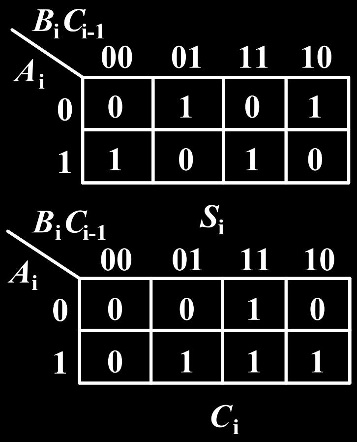
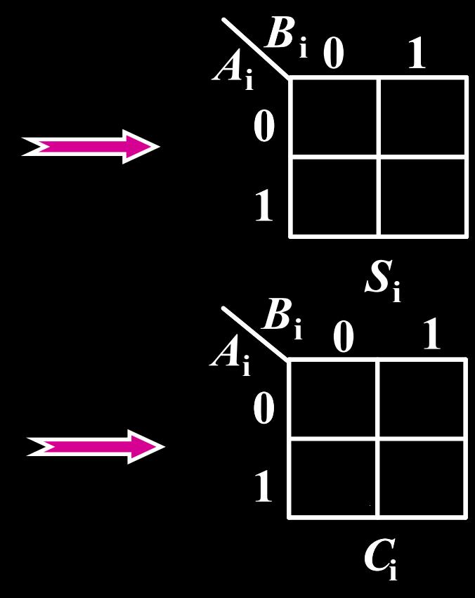

知识点：[完整数字系统设计流程实例（如乘法器、交通灯管理系统的算法规律、处理器设计与控制器实现）](../../../topics/数字逻辑电路/数字系统设计实例.md)、[寄存器传输语言(RTL)描述的传输操作、算术操作、逻辑操作、移位操作及条件控制语句](../../../topics/数字逻辑电路/RTL语言.md)

### 例 7：8选1数据选择器设计奇偶校验器

**题目描述：**
试用 8 选 1 数据选择器 74151 和门电路设计一个四位二进制码奇偶校验器。当输入的四位二进制码中有奇数个 1 时，输出为 1，否则为 0。

**分析：**
输入：A, B, C, D (4位)。
输出：L (1位)。
74151 有 3 个地址端，4 个数据输入。需要处理 4 个变量。
采用降维法或增加门电路。
由于 74151 只能直接处理 3 变量选择，第 4 个变量 D 可以作为数据输入的一部分，或者利用使能端。

通常做法：
令地址端 $A_2=A, A_1=B, A_0=C$。
数据输入 $D_0 \sim D_7$ 由变量 D 及其反相决定。

**真值表推导：**

| A | B | C | D | L (Odd Parity) | 对应最小项 m | D 的关系 |
|:-:|:-:|:-:|:-:|:--------------:|:------------:|:--------:|
| 0 | 0 | 0 | 0 | 0 | $m_0$ | $D=0 \to L=0$ |
| 0 | 0 | 0 | 1 | 1 | $m_1$ | $D=1 \to L=1$ |
| 0 | 0 | 1 | 0 | 1 | $m_2$ | $D=0 \to L=1$ |
| 0 | 0 | 1 | 1 | 0 | $m_3$ | $D=1 \to L=0$ |
| 0 | 1 | 0 | 0 | 1 | $m_4$ | $D=0 \to L=1$ |
| 0 | 1 | 0 | 1 | 0 | $m_5$ | $D=1 \to L=0$ |
| 0 | 1 | 1 | 0 | 0 | $m_6$ | $D=0 \to L=0$ |
| 0 | 1 | 1 | 1 | 1 | $m_7$ | $D=1 \to L=1$ |
| 1 | ... | ... | ... | ... | ... | ... |

*(注：题目只给出了部分表格，以下为完整逻辑推导)*

对于 $D_0 (ABC=000)$: $L = D$ (因为 $0000 \to 0, 0001 \to 1$). 所以 $D_0 = D$.
对于 $D_1 (ABC=001)$: $L = \bar{D}$ (因为 $0010 \to 1, 0011 \to 0$). 所以 $D_1 = \bar{D}$.
对于 $D_2 (ABC=010)$: $L = \bar{D}$ (因为 $0100 \to 1, 0101 \to 0$). 所以 $D_2 = \bar{D}$.
对于 $D_3 (ABC=011)$: $L = D$ (因为 $0110 \to 0, 0111 \to 1$). 所以 $D_3 = D$.
...以此类推。

最终连接：
$D_0=D, D_1=\bar{D}, D_2=\bar{D}, D_3=D, \dots$
需要额外的非门生成 $\bar{D}$。

 
*(注：原题未提供此图的清晰链接，仅提供了占位符，建议参考标准74151应用电路)*

知识点：[数字系统的基本模型（数据处理器与控制器）及对最小时钟周期、异步信号同步化的约定](../../../topics/数字逻辑电路/数字系统模型.md)、[寄存器传输语言(RTL)描述的传输操作、算术操作、逻辑操作、移位操作及条件控制语句](../../../topics/数字逻辑电路/RTL语言.md)

### 例 8：组合逻辑电路功能分析

**题目描述：**
如图题所示的逻辑电路。$A, B$ 为两个三位二进制数（74138 输入，74151 输入）。试分析电路的逻辑功能。

**分析：**
1.  **74138 部分：**
    当 $A$ 取 $000 \sim 111$ 值时，74138 输出分别输出低电平。即 $\overline{Y_i}$ 对应 $A=i$。
2.  **74151 部分：**
    数据选择器将依次选通 $D_i$。
    题目中提到“当 $B // CD$ 取...”，此处识别不清，推测 B 连接到 74151 的地址端或数据端。
    
    通常此类题目考察的是比较器或算术运算单元的设计。
    若 74138 输出连接到 74151 的数据输入端，或者 74138 的使能受 B 控制，则可能实现基于 B 的条件选择或比较。

    *具体功能需依据电路图细节，此处仅保留文字描述框架。*

## 二、触发器

知识点：[数字系统的基本模型（数据处理器与控制器）及对最小时钟周期、异步信号同步化的约定](../../../topics/数字逻辑电路/数字系统模型.md)、[寄存器传输语言(RTL)描述的传输操作、算术操作、逻辑操作、移位操作及条件控制语句](../../../topics/数字逻辑电路/RTL语言.md)

### 基本要求与题型

**涉及题型：**
- 选择填空题
- 分析计算题

**基本要求：**
1.  描述触发器逻辑功能的各类方法（特性方程、状态转移表、波形图等）。
2.  基本 SR FF 结构、激励表、次态方程、状态转移表。
3.  钟控 SR FF / 边沿 DFF / 边沿 JK FF / T FF / T' FF 的激励表、次态方程、状态转移图(表)。
4.  触发器功能转换（如 J-K 转 D-T 等）。
5.  触发器的逻辑功能及其应用（包括特征方程、约束条件、波形图）。

**常见题型：**
1.  电路功能分析，得次态方程、波形图、状态转移图。
2.  根据功能描述，求出激励表、设计同步时序电路。

## 4. 触发器

例：试分析图中时序电路的逻辑功能，写出各触发器的状态方程和输出方程，画出电路的状态转换图。

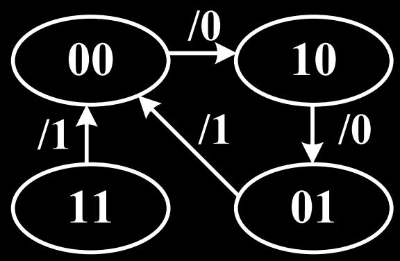

$$
Y = Q_2^n
$$

| $CP \downarrow$ | $Q_1^n$ | $Q_2^n$ | $Q_1^{n+1}$ | $Q_2^{n+1}$ | Y |
| :---: | :---: | :---: | :---: | :---: | :---: |
| 1 | 0 | 0 | 1 | 0 | 0 |
| 2 | 0 | 1 | 0 | 0 | 1 |
| 3 | 1 | 0 | 0 | 1 | 0 |
| 4 | 1 | 1 | 0 | 0 | 1 |

例：图示电路输入波形分别如图所示。若电路初态为0，试画出Q端波形。

$J=A \oplus B, K=A \odot B$ （注：原文识别为 `AθB`，结合JK触发器常见题型及上下文，此处应为同或或异或逻辑，通常此类题目考察特定逻辑关系，保留原意推测为同或 $\odot$ 或根据具体波形判断，此处按常规逻辑符号修正排版）

**JK触发器特性表：**

| JK | 功能 |
| :---: | :---: |
| 00 | 保持 |
| 01 | 置0 |
| 10 | 置1 |
| 11 | 翻转 |

练习：若触发器的初始状态为 0，试画出图示电路中 $Q_1$ 和 $Q_2$ 的波形。

 
*(注：原图识别混乱，此处为D触发器与JK触发器级联电路示意)*

## 5. 时序逻辑电路 （25%）

涉及题型：选择填空题、分析计算题。

基本要求：
1. 一般时序电路的分析方法；
2. 二进制同步/异步计数器的一般结构；
3. MSI移存器74194的功能、级联扩展；
4. 74161/163/160的分析设计、级联；
5. 移存型计数器的结构特点及设计方法；
6. 序列信号发生器。

常见题型：
1. 74161/163/160任意进制的分析与设计、自启性判断
2. 74161/74194 + 74151的分析
3. 已知码，移存型/计数型码发生器设计及自启性判断
4. 隐含表及状态化简问题

知识点：[完整数字系统设计流程实例（如乘法器、交通灯管理系统的算法规律、处理器设计与控制器实现）](../../../topics/数字逻辑电路/数字系统设计实例.md)、[控制器的四种硬件实现方法：每态一触发器法(SSI)、MSI法(MUX+寄存器+译码器)、PLA法(LSI)及对比](../../../topics/数字逻辑电路/控制器实现方法.md)、[根据文字描述建立ASM图的原则，以及从ASM图推导处理器明细表和控制器状态转移图](../../../topics/数字逻辑电路/ASM图建立与分析.md)

### 5.1 移位寄存器 (74194)

**左移 ($M_0 M_1 = 01$):**
$$
Q_0 \leftarrow Q_1 \leftarrow Q_2 \leftarrow Q_3 \leftarrow D_{SL}
$$

**右移 ($M_0 M_1 = 10$):**
$$
D_{SR} \rightarrow Q_0 \rightarrow Q_1 \rightarrow Q_2 \rightarrow Q_3
$$

**功能表：**

| $M_0 M_1$ | 功能 |
| :---: | :---: |
| 0 0 | 保持 |
| 1 1 | 并入 (并行加载) |
| 1 0 | 右移 |
| 0 1 | 左移 |

应用示例：7位数据串并转换。

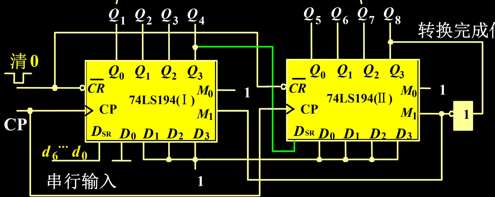

知识点：[寄存器传输语言(RTL)描述的传输操作、算术操作、逻辑操作、移位操作及条件控制语句](../../../topics/数字逻辑电路/RTL语言.md)、[完整数字系统设计流程实例（如乘法器、交通灯管理系统的算法规律、处理器设计与控制器实现）](../../../topics/数字逻辑电路/数字系统设计实例.md)

### 5.2 计数器分析与设计

#### 环形计数器示例

状态方程：
$$
\begin{aligned}
Q_0^{n+1} &= D_0 = \overline{Q}_1^n \\
Q_1^{n+1} &= D_1 = Q_0^n
\end{aligned}
$$

状态转换表（部分）：

| CP个数 | A0 A1 | $Q_0$ | $Q_1$ |
| :---: | :---: | :---: | :---: |
| 0 | 0 0 | 0 | 0 |
| 1 | 0 1 | 1 | 0 |
| 2 | 1 0 | 0 | 1 |
| 3 | 1 1 | 1 | 1 |
| 4 | 0 0 | 0 | 0 |

#### Mealy型时序电路分析

例：完成图示电路状态转换图，并对电路的逻辑功能做出说明。电路有输入控制信号 $x$，为Mealy型。


驱动方程推导（基于OCR模糊内容整理）：
$$
Q_1^{n+1} = (x + Q_3)^{\prime} \cdot 1 + x Q_3 \dots (\text{注：原公式识别严重乱码，此处仅保留结构})
$$

状态转移表：

| $x$ | $Q_3^n$ | $Q_2^n$ | $Q_1^n$ | $Q_3^{n+1}$ | $Q_2^{n+1}$ | $Q_1^{n+1}$ |
| :---: | :---: | :---: | :---: | :---: | :---: | :---: |
| 0 | 0 | 0 | 0 | 0 | 0 | 1 |
| 0 | 0 | 1 | 0 | 0 | 1 | 0 |
| 0 | 1 | 0 | 0 | 1 | 1 | 1 |
| 0 | 1 | 1 | 1 | 1 | 0 | 0 |
| 1 | 0 | 0 | 0 | 0 | 0 | 0 |
| 1 | 1 | 1 | 1 | 1 | 1 | 0 |
| 1 | 1 | 0 | 1 | 1 | 0 | 1 |
| 1 | 0 | 1 | 1 | 1 | 0 | 0 |
| 1 | 0 | 0 | 0 | 1 | 1 | ? | *(原表最后一行数据缺失或错乱)*

注：原电路未画出输出Z。

结论：
1. 当 $x=0$ 时，为 $M=5$ 的加法计数器。
2. 当 $x=1$ 时，为 $M=5$ 的减法计数器。

知识点：[根据文字描述建立ASM图的原则，以及从ASM图推导处理器明细表和控制器状态转移图](../../../topics/数字逻辑电路/ASM图建立与分析.md)、[控制器的四种硬件实现方法：每态一触发器法(SSI)、MSI法(MUX+寄存器+译码器)、PLA法(LSI)及对比](../../../topics/数字逻辑电路/控制器实现方法.md)、[完整数字系统设计流程实例（如乘法器、交通灯管理系统的算法规律、处理器设计与控制器实现）](../../../topics/数字逻辑电路/数字系统设计实例.md)

### 5.3 任意进制计数器设计

#### 1. 模长 $M < N$ (芯片容量N) 的任意进制计数器

*   **清零法**：
    *   异步清0：利用 $CR$ (或 $RD$) 端。适用于 74161, 74160。
    *   同步清0：利用 $CR$ 端配合组合逻辑。适用于 74163。
*   **置数法**：
    *   反馈置数（置最小数）：同步置数 $LD$。适用于 74161/163。
    *   异步置数（置最大数）：适用于 74160, 7490, 74190。

#### 2. 模长 $M > N$ 的任意进制计数器

*   **级联方式**：
    *   同步级联：高位片时钟接低位片时钟或使能端。
    *   异步级联：高位片时钟接低位片进位输出 $CO$。
*   **计数方式**：
    *   $CR$ 清(复)0
    *   反馈置数

**示例：异步清零法 (M=6)**

使用 74163 (同步清零) 或 74161 (异步清零)。
若用 74163 实现 M=6：
状态序列：$0000 \rightarrow 0001 \rightarrow 0010 \rightarrow 0011 \rightarrow 0100 \rightarrow 0101 \rightarrow (0110 \text{瞬间}) \rightarrow 0000$
对于同步清零 74163，需在状态 $0101$ (即十进制5) 时，令下一状态为0。故译码输入取 $Q_2 Q_1 Q_0 = 0101$ 对应的逻辑，或者直接在计到5时产生清零信号给 $CR$。
*(注：原文表格显示 6CP 后回到 0101? 需仔细核对，通常同步清零是在 $M-1$ 状态有效清零信号)*

原文表格片段：
```text
CP   Q3 Q2 Q1 Q0
...
5CP  0  1  0  1
6CP  0  0  0  0 (异步清零效果，如果是74161)
     0  1  0  1 (如果是74163同步清零，状态在5CP时为0101，产生清零信号，6CP变为0000)
```

**示例：整体置数法 (M=12)**

两片 74161 级联。
状态从 $0000 \rightarrow \dots \rightarrow 1011$ (十进制11)。
下一个脉冲到来前，检测状态是否为 $1011$？或者是检测溢出？
原文提示：跳过某些状态。
$M=12$。
若采用置数法，可预置一个起始值。例如从 $0100$ 计到 $1111$ (共12个状态: 4~15)。
当计到 $1111$ 时，$LD=0$，下一个CP到来置入 $0100$。

#### 3. 74160/74163 级联注意事项

*   **74160**：异步清零，同步置数。适合做十进制或分解方案。
*   **74163**：同步清零，同步置数。适合做十六进制或需要严格同步的场合。
*   **异步级联**：低位片的 $CO$ 接高位片的 $CP$。注意毛刺问题，通常用于非关键路径或频率较低时。
*   **同步级联**：所有片子的 $CP$ 连在一起。低位片的 $CO$ 接高位片的 $ENT/ENP$ (使能端)。这是推荐方式，无延迟累积。

知识点：[完整数字系统设计流程实例（如乘法器、交通灯管理系统的算法规律、处理器设计与控制器实现）](../../../topics/数字逻辑电路/数字系统设计实例.md)

### 5.4 设计实例

#### 例：试用 74161 实现模 60 计数器

**分析**：单片 74161 最大计数值为 16。实现模 60 必须用两片。

**方案一：异步分解方案**
分解 $M=60 = 6 \times 10$。
1. 第一片构成模 10 计数器。
2. 第二片构成模 6 计数器。
3. 通过置数法（置最小数或置零）组成异步级联。

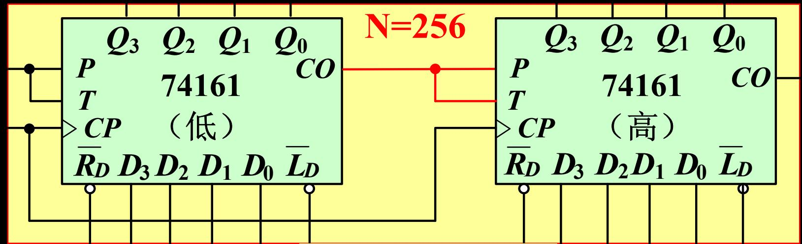
*(注：图中展示了级联连接，低位片每计满10次向高位片提供一个脉冲，高位片计满6次复位)*

**方案二：同步整体置数方案**
先将两片 74161 同步级联组成 $16 \times 16 = 256$ 的计数器。
然后用整体置数法构成模 $M=60$ 计数器。
*   **整体置0法**：计数范围为 $0 \sim 59$。当计到 $59$ ($0011\ 1011$) 时，在下一个 CP 到来时 74161 同步置 0。
    *   译码逻辑：检测 $Q_3^H Q_2^H Q_1^H Q_0^H Q_3^L Q_2^L Q_1^L Q_0^L = 0011\ 1011$。
    *   将译码输出接至两片的 $LD$ 端（低电平有效），数据输入端接地（置0）。

#### 例：试用两片 74160 接成 M=29 的计数器

能否采用分解方案？
$29$ 是质数，无法分解为两个小于10的整数之积（74160是十进制计数器）。因此不能用简单的异步分解（如 $M=N_1 \times N_2$）。
必须采用**同步级联** + **整体置数/清零**。

**方案1：同步级联整体预置0法**

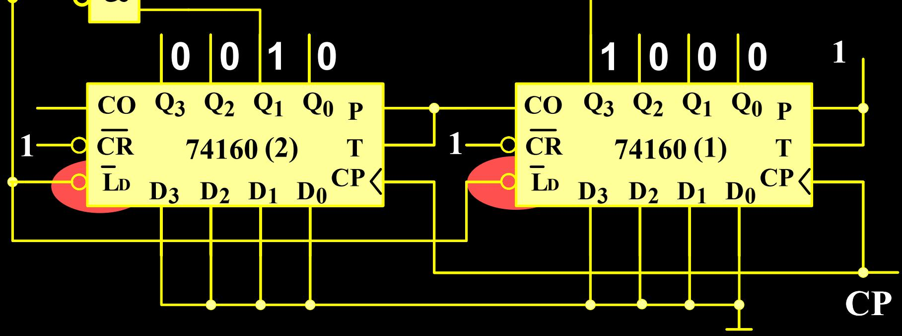

**方案2：同步级联整体复0法**

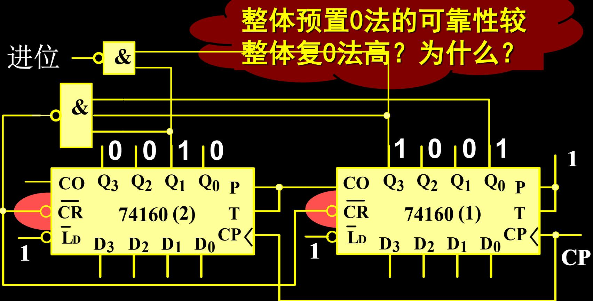

**思考**：整体预置0法的可靠性较整体复0法高？为什么？
*答：因为 74160 具有异步清零端 ($CR/RD$)。如果采用异步清零，当状态出现瞬时毛刺或非稳态时，可能会引起误清零。而同步置数依赖于时钟沿，抗干扰能力更强，且避免了竞争冒险导致的错误复位。此外，对于十进制计数器，清零通常指回到0000，置数可以灵活设定起始点，但在M=29这种接近30的情况下，置数法只需检测28或29状态即可，逻辑相对简单且稳定。*

【思考】若用 74163 同步复0设计，如何修改电路？
*答：74163 的清零端是同步的。需要在状态到达 $M-1$ (即28) 时，让清零信号有效，这样在第29个脉冲到来时，状态才会被清零。因此，译码电路应检测状态 28 ($0010\ 1000$)，其输出接至 $CR$ 端。*

知识点：[完整数字系统设计流程实例（如乘法器、交通灯管理系统的算法规律、处理器设计与控制器实现）](../../../topics/数字逻辑电路/数字系统设计实例.md)

### 5.5 序列信号发生器

练习：电路如题图所示。要求：列出状态转移表，并写出输出 z 端的序列。

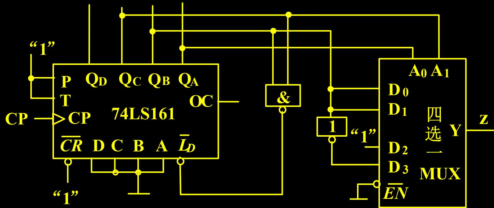

(1) 列出状态转移表（略）
(2) 输出 z 的序列为 `0011111`。

例：试设计一个序列信号 `1110100` 发生器。

**解1：用 DFF 实现移存型发生器**

检查自启动性：
状态循环：$111 \rightarrow 110 \rightarrow 101 \rightarrow 010 \rightarrow 100 \rightarrow 001 \rightarrow 011 \rightarrow 111$ ...
*(注：原文给出的序列是1110100，长度为7。典型的Johnson计数器或扭环计数器可能生成此类序列。需检查是否有无效状态导致死锁)*

原文指出：**无自启动性**。
这意味着存在某些初始状态无法进入主循环。

驱动方程推导：
设三个触发器为 $Q_1, Q_2, Q_3$。
输出 $Z$ 取自某一级（通常是最后一级或特定组合）。

卡诺图化简结果（原文残缺，根据常见逻辑推断）：
$$
D_1 = \overline{Q}_3 Q_1 + Q_3 \overline{Q}_1 = Q_3 \oplus Q_1
$$
*(注：此公式对应的是某种特定的移位反馈逻辑，具体需结合完整电路图确认)*

其他驱动方程需根据具体的状态转移表通过卡诺图求得。

---
title: 《数字电路与系统设计A》2016年期末复习概要（第5部分）
kind: 复习要点
course: 数字电路与系统设计
term: 2016
source: 识别工具读出内容（第 53–69 页）
---

# 《数字电路与系统设计A》2016年期末复习概要（第5部分）

本资料为《数字电路与系统设计A》2016年期末复习概要的第5部分，涵盖时序逻辑电路、可编程逻辑器件、数字系统设计基础及D/A和A/D转换等章节的复习要点。内容已根据原件整理，修正了明显的识别错误，公式转为LaTeX格式，表格转为Markdown格式。

## 5. 时序逻辑电路

知识点：[完整数字系统设计流程实例（如乘法器、交通灯管理系统的算法规律、处理器设计与控制器实现）](../../../topics/数字逻辑电路/数字系统设计实例.md)、[根据文字描述建立ASM图的原则，以及从ASM图推导处理器明细表和控制器状态转移图](../../../topics/数字逻辑电路/ASM图建立与分析.md)

### 解2 ：用74194实现移存型1110100码发生器

设计一个序列信号 $1110100$ 发生器。

$$
D_1 = \overline{Q}_3 Q_1 + Q_3 \overline{Q}_1 = Q_3 \oplus Q_1
$$

左移 $W // D_H // B_F // B$ 送数 $Q_1 Q_2 Q_3$ $D_{sL}$ 1 1 1

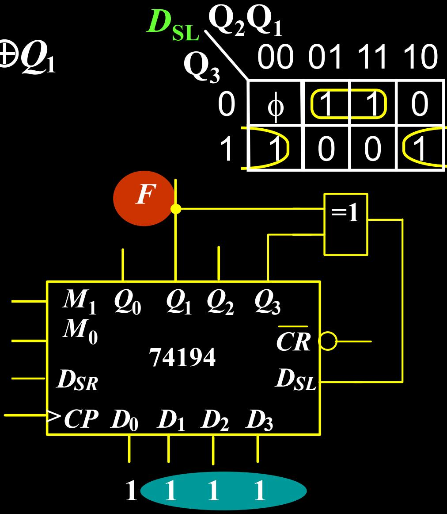

知识点：[控制器的四种硬件实现方法：每态一触发器法(SSI)、MSI法(MUX+寄存器+译码器)、PLA法(LSI)及对比](../../../topics/数字逻辑电路/控制器实现方法.md)、[完整数字系统设计流程实例（如乘法器、交通灯管理系统的算法规律、处理器设计与控制器实现）](../../../topics/数字逻辑电路/数字系统设计实例.md)

### 解3 ：用74161+74151实现计数型1110100码发生器

例：试设计一个序列信号 $1110100$ 发生器。
使用 74161 同步置零构成 $M=7$ 计数器。

$$
D_3 = D_5 = D_6 = 0
$$

状态表如下：

| CP | Q3 | Q2 | Q1 | Q0 | Z |
| :--- | :--- | :--- | :--- | :--- | :--- |
| 0 | 0 | 0 | 0 | 0 | 1 |
| 1 | 0 | 0 | 0 | 1 | 1 |
| 2 | 0 | 0 | 1 | 0 | 1 |
| 3 | 0 | 0 | 1 | 1 | 0 |
| 4 | 0 | 1 | 0 | 0 | 1 |
| 5 | 0 | 1 | 0 | 1 | 0 |
| 6 | 0 | 1 | 1 | 0 | 0 |

*(注：原文此处表格数据较为混乱，结合上下文“1110100”序列及M=7计数器，通常对应状态0-6)*

对比 8选1-MUX 的 K 图，得：
$D_5=1; D_4=D_6=Q_0; D_7=0$
令 $Q_3=A_2, Q_2=A_1, Q_1=A_0$

74161 同步置小数 $M=7$ 计数器

$$
\begin{array}{c c c c} 
Z & Q_2 Q_1 & Q_3 & 00 & 01 & 11 & 10 \\ 
\hline 
0 & 0 & \phi & \phi & \phi & \phi \\ 
1 & 0 & 0 & 1 & 0 & 0 \\ 
1 & 1 & \phi & 1 & 1 & 1 
\end{array}
$$

$$
Z = Q_2 Q_1 Q_3
$$

A0 A1 A2 8选1MUX
P Q3 Q2 Q1 Q0 T CP 74161 Oc CP R D3 D2 D1 D0 LD 1 1 0 1

 *(注：原图链接保留，实际使用时需确认文件存在)*

知识点：[完整数字系统设计流程实例（如乘法器、交通灯管理系统的算法规律、处理器设计与控制器实现）](../../../topics/数字逻辑电路/数字系统设计实例.md)、[控制器的四种硬件实现方法：每态一触发器法(SSI)、MSI法(MUX+寄存器+译码器)、PLA法(LSI)及对比](../../../topics/数字逻辑电路/控制器实现方法.md)、[寄存器传输语言(RTL)描述的传输操作、算术操作、逻辑操作、移位操作及条件控制语句](../../../topics/数字逻辑电路/RTL语言.md)

### 状态转换表的化简— 隐含表法简化

注：等价类、最大等价类的区别！

等价状态：$[A,C]$、$[F,G]$、$[B,D,E]$

**原始状态转换表：**

<table>
<tr><td rowspan="2">S(t)</td><td colspan="2">N(t)/Z(t)</td></tr>
<tr><td>X=0</td><td>X=1</td></tr>
<tr><td>A</td><td>B/0</td><td>C/0</td></tr>
<tr><td>B</td><td>E/1</td><td>C/0</td></tr>
<tr><td>C</td><td>D/0</td><td>A/0</td></tr>
<tr><td>D</td><td>E/1</td><td>A/0</td></tr>
<tr><td>E</td><td>E/1</td><td>C/0</td></tr>
<tr><td>F</td><td>G/1</td><td>E/0</td></tr>
<tr><td>G</td><td>F/1</td><td>E/0</td></tr>
</table>

**化简后状态转换表：**

<table>
<tr><td rowspan="2">S(t)</td><td colspan="2">N(t)/Z(t)</td></tr>
<tr><td>X=0</td><td>X=1</td></tr>
<tr><td>A</td><td>B/0</td><td>A/0</td></tr>
<tr><td>B</td><td>B/1</td><td>A/0</td></tr>
<tr><td>F</td><td>F/1</td><td>B/0</td></tr>
</table>

A B C D E F

## 6. 可编程逻辑器件 （14%）

涉及题型：选择填空题、分析计算题。

基本要求：
1. PLD器件的描述方法和分类；
2. PLD(PLA、PAL、PROM、GAL16V8)的基本结构和基本原理；
3. 半导体存储器的工作原理；
4. ROM存储容量的扩展；
5. 用ROM和PLA实现组合电路的方法。

常见题型：
1. 问题描述→真值表和逻辑式→ROM/PLA实现组合逻辑
2. ROM容量扩展— 字扩展和位扩展

知识点：[根据文字描述建立ASM图的原则，以及从ASM图推导处理器明细表和控制器状态转移图](../../../topics/数字逻辑电路/ASM图建立与分析.md)、[控制器的四种硬件实现方法：每态一触发器法(SSI)、MSI法(MUX+寄存器+译码器)、PLA法(LSI)及对比](../../../topics/数字逻辑电路/控制器实现方法.md)、[寄存器传输语言(RTL)描述的传输操作、算术操作、逻辑操作、移位操作及条件控制语句](../../../topics/数字逻辑电路/RTL语言.md)

### 四种PLD的分类与结构

<table>
<tr><td>名称</td><td>与阵列</td><td>或阵列</td><td>输出部分</td></tr>
<tr><td>PROM</td><td>固定</td><td>可一次编程</td><td>固定</td></tr>
<tr><td>PLA</td><td>可一次编程</td><td>可一次编程</td><td>固定</td></tr>
<tr><td>PAL</td><td>可一次编程</td><td>固定</td><td>固定</td></tr>
<tr><td>GAL</td><td>可重复编程</td><td>固定</td><td>可配置</td></tr>
</table>

知识点：[控制器的四种硬件实现方法：每态一触发器法(SSI)、MSI法(MUX+寄存器+译码器)、PLA法(LSI)及对比](../../../topics/数字逻辑电路/控制器实现方法.md)、[数字系统的基本模型（数据处理器与控制器）及对最小时钟周期、异步信号同步化的约定](../../../topics/数字逻辑电路/数字系统模型.md)

### 例 ：试用ROM实现组合逻辑函数

解：首先应将以上两个逻辑函数化成最小项和。
*(注：原文此处公式识别严重错误，无法还原具体逻辑函数表达式，仅保留解题思路)*

$m_0 \dots m_7$
A O O O O
B O O O O
与阵列 1 B O O O O 固定
C O O O O 1 6 C O O O O 编程 或阵列 X X (D0) (D1) F2 F1

知识点：[完整数字系统设计流程实例（如乘法器、交通灯管理系统的算法规律、处理器设计与控制器实现）](../../../topics/数字逻辑电路/数字系统设计实例.md)

### 例.用ROM设计一个码转换器

用于实现4位二进制码到4位循环码的转换。

$$
\begin{array}{l} 
B_3 = \sum_m (8, 9, 10, 11, 12, 13, 14, 15) \\ 
B_2 = \sum_m (4, 5, 6, 7, 8, 9, 10, 11) \\ 
B_1 = \sum_m (2, 3, 4, 5, 10, 11, 12, 13) \\ 
B_0 = \sum_m (1, 2, 5, 6, 9, 10, 13, 14) 
\end{array}
$$

知识点：[控制器的四种硬件实现方法：每态一触发器法(SSI)、MSI法(MUX+寄存器+译码器)、PLA法(LSI)及对比](../../../topics/数字逻辑电路/控制器实现方法.md)、[数字系统的基本模型（数据处理器与控制器）及对最小时钟周期、异步信号同步化的约定](../../../topics/数字逻辑电路/数字系统模型.md)

### ROM实现组合逻辑

$$
\begin{array}{c c c c c c c c c c c c c c c} 
& & m_0 & m_1 & m_2 & m_3 & m_4 & m_5 & m_6 & m_7 & m_8 & m_9 & m_{10} & m_{11} & m_{12} & m_{13} & m_{14} & m_{15} \\ 
\hline 
A_3 & & B_3 = \Sigma_m (8, 9, 10, 11, 12, 13, 14, 15) \\ 
A_2 & & B_2 = \Sigma_m (4, 5, 6, 7, 8, 9, 10, 11) \\ 
A_1 & & B_1 = \Sigma_m (2, 3, 4, 5, 10, 11, 12, 13) \\ 
A_0 & & B_0 = \Sigma_m (1, 2, 5, 6, 9, 10, 13, 14) 
\end{array}
$$

与阵列固定
或阵列编程

知识点：[数字系统的基本模型（数据处理器与控制器）及对最小时钟周期、异步信号同步化的约定](../../../topics/数字逻辑电路/数字系统模型.md)

### 例：设ABC为三位二进制数

若该数大于等于5，则输出 $F_1$ 为1，否则为0；若该数小于3或大于6，则输出 $F_2$ 为1，否则为0；试用ROM实现该电路，列出真值表，并正确标出与阵列和或阵列连接图。

根据真值表直接写出两个逻辑函数化成最小项和。

A B C F1 F2

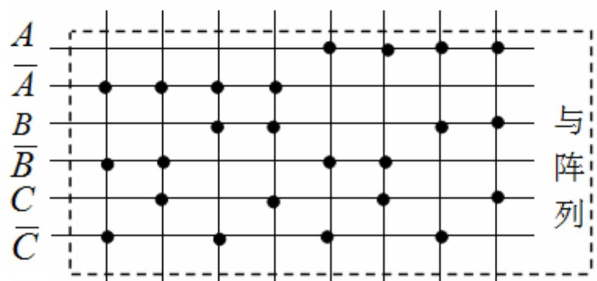

知识点：[完整数字系统设计流程实例（如乘法器、交通灯管理系统的算法规律、处理器设计与控制器实现）](../../../topics/数字逻辑电路/数字系统设计实例.md)

### AT28C64 E²PROM

字、位同时扩展

16K 16 N= X 8K^8 =4(片)
地址线数: A = 14根
数据线数: D = 16根

8K×8 —— A0-A12, D0-D7

例：8K×8位→16K×16位

知识点：[完整数字系统设计流程实例（如乘法器、交通灯管理系统的算法规律、处理器设计与控制器实现）](../../../topics/数字逻辑电路/数字系统设计实例.md)

### 例：PLA实现逻辑电路如图所示

试分析电路功能。

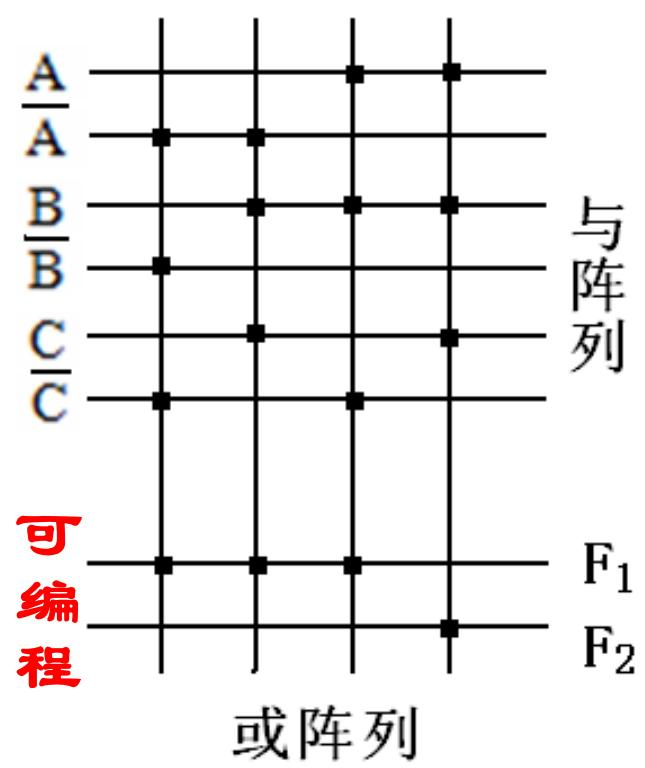

编与阵列
F1 F2

与阵列、或阵列均可编程
$F_1 = \dots$
$F_2 = \dots$
$F_{ABC} = \dots$

结论：
(1) 若能被3整除，则输出 $F_1$ 为 1
(2) 若大于12，则输出 $F_2$ 为 1

## 7. 数字系统设计基础（15%）

涉及题型：选择填空题、分析计算题。

基本要求：
1. 数字系统基本模型和设计过程；
2. 数字系统的4种描述工具；
3. 根据文字描述设计ASM图；
4. 基于ASM图或状态图，以图形方式设计控制器(采用SSI、MSI、每态一触发法)；
5. 使用ASM图设计数字系统的方法。

常见题型：(7.1;7.2;7.3;7.4;7.7)
1. 根据问题描述，画出控制系统的ASM图
2. 根据ASM图，画出控制器的状态转移图，并功能分析
3. 根据ASM图，用每态一触发法实现控制器

知识点：[控制器的四种硬件实现方法：每态一触发器法(SSI)、MSI法(MUX+寄存器+译码器)、PLA法(LSI)及对比](../../../topics/数字逻辑电路/控制器实现方法.md)、[根据文字描述建立ASM图的原则，以及从ASM图推导处理器明细表和控制器状态转移图](../../../topics/数字逻辑电路/ASM图建立与分析.md)、[完整数字系统设计流程实例（如乘法器、交通灯管理系统的算法规律、处理器设计与控制器实现）](../../../topics/数字逻辑电路/数字系统设计实例.md)

### 例：一个数字系统在T0状态下

若启动信号 $S=0$, 则保持T0状态不变; 若 $S=1$, 则完成条件操作：$A \leftarrow N1, B \leftarrow N2$, 且 $T0 \rightarrow T1$。在T1状态下, 下一个CLK到, 完成无条件操作 $B \leftarrow B-1$, 若 $M=0$, 完成条件操作: P右移, 且 $T1 \rightarrow T2$; 若 $M=1$, 状态由 $T1 \rightarrow T3 \rightarrow T0$。

求：

$$
\begin{array}{l} 
D_0 = T_0 \cdot \overline{S} + T_3 \\ 
D_1 = T_0 \cdot S \\ 
D_2 = T_1 \cdot \overline{M} \\ 
D_3 = T_1 \cdot M 
\end{array}
$$

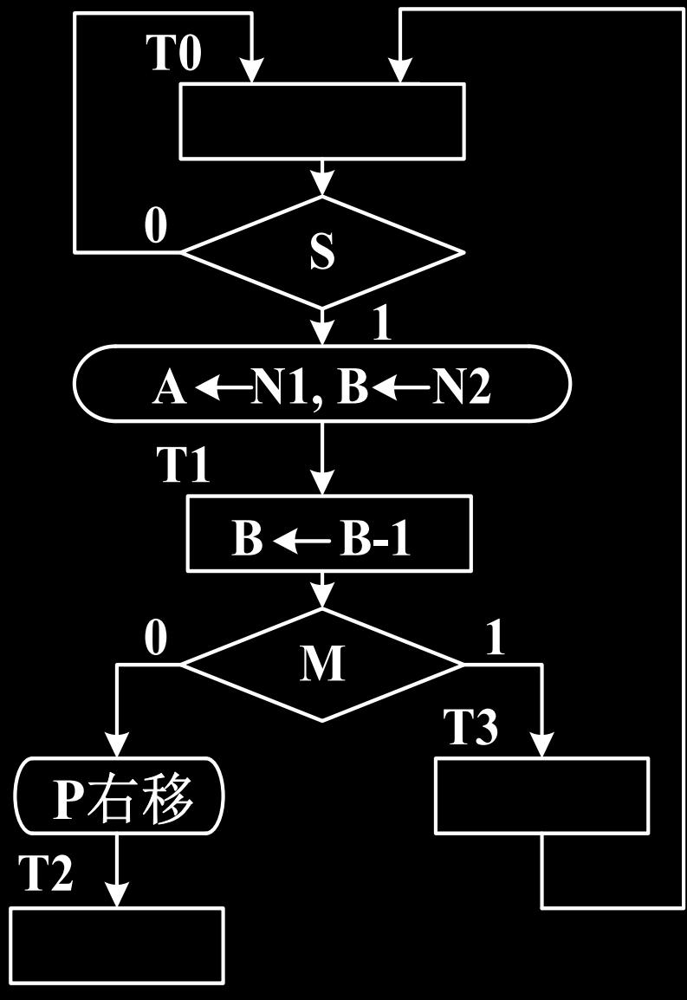

知识点：[根据文字描述建立ASM图的原则，以及从ASM图推导处理器明细表和控制器状态转移图](../../../topics/数字逻辑电路/ASM图建立与分析.md)、[控制器的四种硬件实现方法：每态一触发器法(SSI)、MSI法(MUX+寄存器+译码器)、PLA法(LSI)及对比](../../../topics/数字逻辑电路/控制器实现方法.md)

### 例：图示为某数字系统的ASM图

START和 $A>100$ 分别为处理器发出的状态信号 $S_1$ 和 $S_2$。试画出该系统控制器实现...
当 $A=101$ 时，结果输出 $T_1$

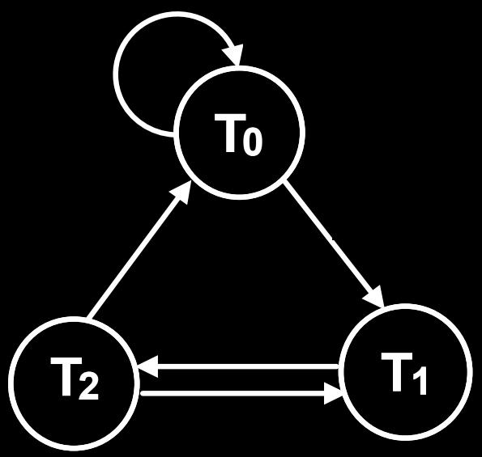

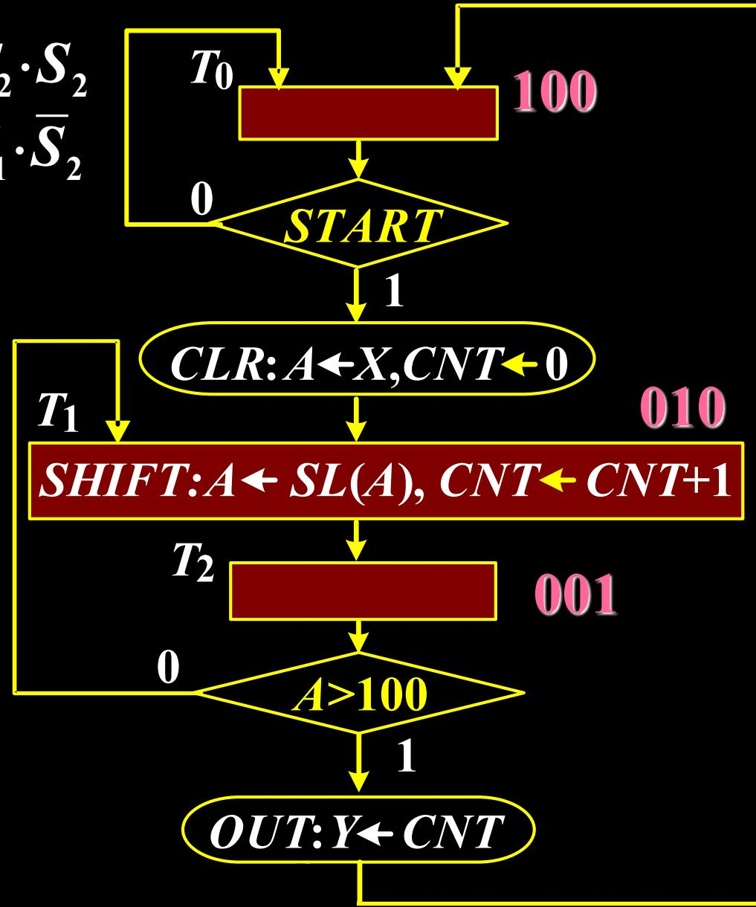

知识点：[算法状态机(ASM)图的状态框、判断框、条件输出框及ASM块的构成规则](../../../topics/数字逻辑电路/ASM图基础.md)、[控制器的四种硬件实现方法：每态一触发器法(SSI)、MSI法(MUX+寄存器+译码器)、PLA法(LSI)及对比](../../../topics/数字逻辑电路/控制器实现方法.md)

### 图示为系统ASM图

READY和 $CNT=N$ 分别为数字系统处理器发出的状态信号 $V_1$ 和 $V_2$, X为外部串行数据输入信号。

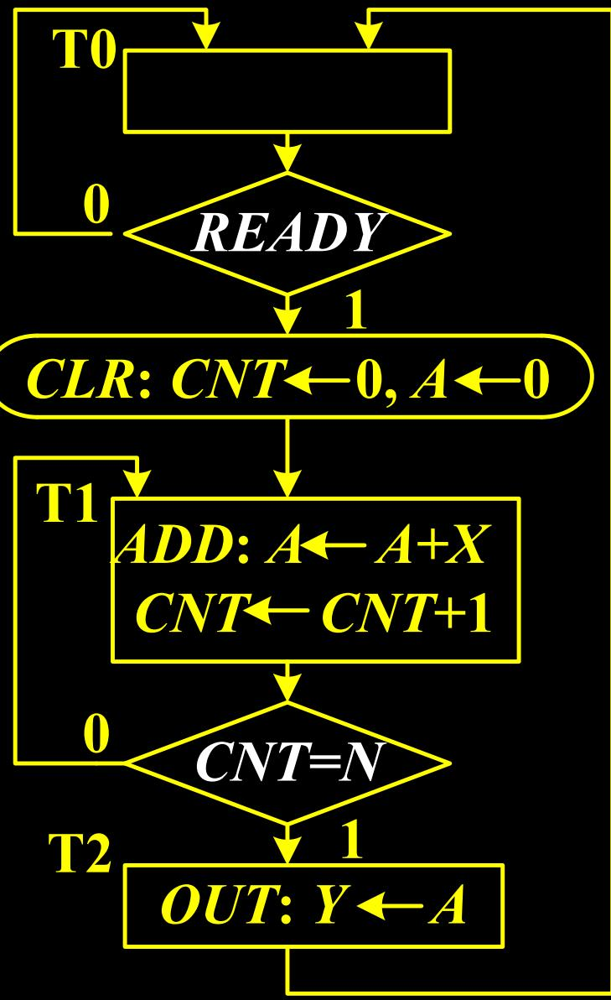

## 8. D/A和A/D转换（4%）

涉及题型：选择填空题。

基本要求：
1. DAC和ADC的主要技术指标(分辨率、精度、量化误差、转换时间等)；
2. DAC和ADC转换的一般原理和过程；
3. 典型D/A(倒T型R-2R电阻网络)和A/D(逐次逼近型、并行比较型)转换电路的工作原理及其应用。

常见题型：
1. DAC、ADC的分辨率、位数、量程的分析计算
2. ADC的量化电平及量化误差

## 8. D/A和A/D转换

知识点：[根据文字描述建立ASM图的原则，以及从ASM图推导处理器明细表和控制器状态转移图](../../../topics/数字逻辑电路/ASM图建立与分析.md)、[数字系统的基本模型（数据处理器与控制器）及对最小时钟周期、异步信号同步化的约定](../../../topics/数字逻辑电路/数字系统模型.md)、[控制器的四种硬件实现方法：每态一触发器法(SSI)、MSI法(MUX+寄存器+译码器)、PLA法(LSI)及对比](../../../topics/数字逻辑电路/控制器实现方法.md)

### 倒T型R-2R电阻网络

$$
u_{\mathrm{O}} = -\frac{U_{\mathrm{REF}}}{2^n}\frac{R_{\mathrm{f}}}{R}\sum_{i=0}^{n-1}D_i 2^i = KDU_{\mathrm{REF}}
$$

通常，取 $R_{\mathrm{f}} = R$，则 $u_{\mathrm{O}} = -\frac{U_{\mathrm{REF}}}{2^n}\sum_{i=0}^{n-1}D_i 2^i$。

满量程（Full Scale Range）电压值：$U_{\mathrm{FSR}} = -\frac{U_{\mathrm{REF}}}{2^n}(2^n-1)$。

DAC 示例：$U_{\mathrm{REF}} = -8\,\mathrm{V}$，$R_{\mathrm{f}} = R$，求 $u_{\mathrm{O}}$。

$$
u_{\mathrm{O}} = -\frac{U_{\mathrm{REF}}}{2^n}D = -\frac{-8}{2^4}\times(8+4+1) = 6.5\,\mathrm{V}
$$

知识点：[数字系统的基本模型（数据处理器与控制器）及对最小时钟周期、异步信号同步化的约定](../../../topics/数字逻辑电路/数字系统模型.md)

### DAC的分辨率

DAC 的分辨率：输入变化 1 LSB 时，输出端产生的电压变化量。

$$
R' = \Delta u_{\mathrm{O}}\big|_{\Delta D=1} = -\frac{U_{\mathrm{REF}}}{2^n} = \frac{U_{\mathrm{Om}}}{2^n-1}
$$

例：倒 T 型网络 DAC 的 $U_{\mathrm{Om}} = 10\,\mathrm{V}$，试问需多少位代码，才能使分辨率达到 $10\,\mathrm{mV}$。

解：由题意知，分辨率 $R' = \frac{U_{\mathrm{Om}}}{2^n-1} \leq 10\,\mathrm{mV}$，则

$$
\frac{10}{2^n-1} \leq 0.01 \Rightarrow 2^n-1 \geq 1000 \Rightarrow n \geq 10
$$

故至少需要 10 位代码。

知识点：[完整数字系统设计流程实例（如乘法器、交通灯管理系统的算法规律、处理器设计与控制器实现）](../../../topics/数字逻辑电路/数字系统设计实例.md)

### 转换误差与位数选择

例：若 DAC 的最大输出电压为 $10\,\mathrm{V}$，要想使转换误差在 $10\,\mathrm{mV}$ 以内，应选多少位 DAC？

解：要想转换误差在 $10\,\mathrm{mV}$ 以内，就必须能分辨出 $10\,\mathrm{mV}$ 电压。就是说分辨率必须小于

$$
R' = \frac{U_{\mathrm{om}}}{2^n-1} \leq \frac{10\,\mathrm{mV}}{10\,\mathrm{V}} = \frac{1}{1000}
$$

根据分辨率可以表示 DAC 的精度这一结论，至少需要 10 位 DAC。

若考虑其它因素，需选 12 位 DAC。

知识点：[完整数字系统设计流程实例（如乘法器、交通灯管理系统的算法规律、处理器设计与控制器实现）](../../../topics/数字逻辑电路/数字系统设计实例.md)

### DAC0808 应用

例：DAC0808 为 8 位单片并行 DAC，结构为 T 型 R-2R 电阻网络。D/A 转换器时需要外接运算放大器。

$V_{\mathrm{CC}} = +15\,\mathrm{V}$，$V_{\mathrm{EE}} = -15\,\mathrm{V}$，外接 $0.01\,\mu\mathrm{F}$ 电容。

引脚：$\mathrm{D}_7$（5，最高位 MSB）、$\mathrm{D}_6$（6）、$\mathrm{D}_5$（7）、$\mathrm{D}_4$（8）、$\mathrm{D}_3$（9）、$\mathrm{D}_2$（10）、$\mathrm{D}_1$（11）、$\mathrm{D}_0$（12，最低位 LSB）。

当 $V_{\mathrm{REF}} = 10\,\mathrm{V}$ 时，

$$
\begin{aligned}
v_{\mathrm{o}} &= \frac{R_{\mathrm{f}}V_{\mathrm{REF}}}{2^8 R_1}\sum_{i=0}^{7}D_i\cdot 2^i \\
&= \frac{10}{2^8}\sum_{i=0}^{7}D_i\cdot 2^i \\
&= 10\left(\frac{D_7}{2}+\cdots+\frac{D_0}{2^8}\right)
\end{aligned}
$$

当输入数字量在全 0 和全 1 之间变化时，输出模拟电压的变化范围为 $0\sim 9.96\,\mathrm{V}$。

知识点：[数字系统的基本模型（数据处理器与控制器）及对最小时钟周期、异步信号同步化的约定](../../../topics/数字逻辑电路/数字系统模型.md)

### A/D转换的一般过程

A/D 转换的一般过程（四步）：采样、保持、量化、编码。

量化电平（离散电平）：某个最小单位（量化单位 $\Delta$）的整数倍。

舍尾量化：

$$
\Delta = \frac{U_{\mathrm{REF}}}{2^n} = \frac{1}{8}U_{\mathrm{REF}}
$$

最大量化误差 $= \Delta = \frac{1}{8}U_{\mathrm{REF}}$。

四舍五入量化：

$$
\Delta' = \frac{2}{2^{n+1}-1}U_{\mathrm{REF}} = \frac{2}{15}U_{\mathrm{REF}}
$$

最大量化误差 $= \frac{1}{2}\Delta' = \frac{1}{15}U_{\mathrm{REF}}$。

知识点：[数字系统的基本模型（数据处理器与控制器）及对最小时钟周期、异步信号同步化的约定](../../../topics/数字逻辑电路/数字系统模型.md)

### ADC分辨率

ADC 分辨率：满量程输入的 $1/2^n$。

例：已知一个 ADC 为 10 位，$U_{\mathrm{Im}} = 5\,\mathrm{V}$，则：

$$
R' = \frac{U_{\mathrm{Im}}}{2^n} = \frac{5}{2^{10}} = 4.88\,\mathrm{mV} \approx 5\,\mathrm{mV}
$$

例：一个 8 位逐次逼近式 ADC 要求转换时间小于 $20\,\mu\mathrm{s}$，则时钟周期应为多少？

解：逐次逼近式 ADC 转换器完成一次转换所需要的节拍数为 $(n+1)$，其中 $n$ 为二进制代码的个数，则完成一次转换所需的时间为：

$$
t_{\mathrm{c}} = (n+1)T_{\mathrm{CLK}}
$$

因此，

$$
T_{\mathrm{CLK}} \leq \frac{20\,\mu\mathrm{s}}{8+1} \approx 2.2\,\mu\mathrm{s}
$$

取 $T_{\mathrm{CLK}} = 2\,\mu\mathrm{s}$。

## 感谢同学们在教学上的配合！

望同学们：

抓住最后时机，认真复习！预祝大家：

人人过关，获得良好成绩！

知识点：[数字系统的基本模型（数据处理器与控制器）及对最小时钟周期、异步信号同步化的约定](../../../topics/数字逻辑电路/数字系统模型.md)、[寄存器传输语言(RTL)描述的传输操作、算术操作、逻辑操作、移位操作及条件控制语句](../../../topics/数字逻辑电路/RTL语言.md)、[根据文字描述建立ASM图的原则，以及从ASM图推导处理器明细表和控制器状态转移图](../../../topics/数字逻辑电路/ASM图建立与分析.md)
