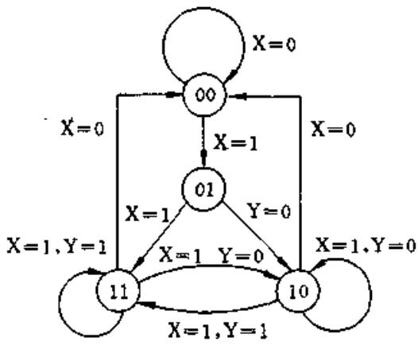
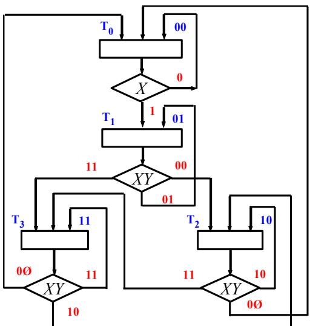
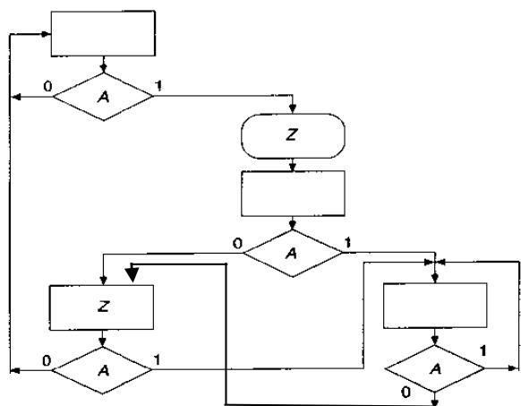
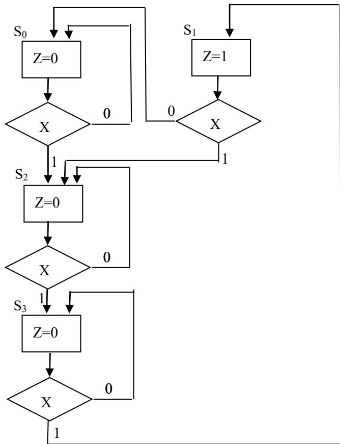

# 《数字电路与系统设计》第12章习题答案

原件经识别和整理；“参考解答”是我们补的。

## 习题

### 习题 1

试述系统算法流程图和 ASM 图的相同和相异处，它们之间的关系如何？

相同点：它们都是描述数字系统功能最普通且常用的工具。都是用约定的几何图形、指向线（箭头线）和简练的文字说明来描述系统的基本工作过程，即描述系统的工作流程。

不同点：算法流程图是一种事件驱动的流程图，只表示事件发生的先后，与系统时序无关。而 ASM 图已具体为时钟 CP 驱动的流程图，能表示事件的精确时间间隔序列。算法流程图的传输框可能对应 ASM 图中的一个或几个状态框，即控制器的状态。

关系：可以由算法流程图推导 ASM 图，关键是决定算法流程图的传输框应该转化成 ASM 图的状态框还是条件框，以及何时应该根据时序关系增加状态框。转换原则有 3 条：

原则 1：在 ASM 图的起始点应安排一个状态框。

原则 2：必须用状态框分开不能在同一时钟周期完成的寄存器操作。

原则 3：如果判断框中的转移条件受前一个寄存器操作的影响，应在它们之间安排一个状态框。

知识点：[算法状态机(ASM)图的状态框、判断框、条件输出框及ASM块的构成规则](../../../topics/数字逻辑电路/ASM图基础.md)、[根据文字描述建立ASM图的原则，以及从ASM图推导处理器明细表和控制器状态转移图](../../../topics/数字逻辑电路/ASM图建立与分析.md)、[数字系统的基本模型（数据处理器与控制器）及对最小时钟周期、异步信号同步化的约定](../../../topics/数字逻辑电路/数字系统模型.md)

### 习题 2

在 $T_1$ 状态下，如果控制输入 Y 和 Z 分别等于 1 和 0，系统实现条件操作：寄存器增 1，并转换到状态 $T_2$。试按上述条件画出一个部分 ASM 图。

知识点：[算法状态机(ASM)图的状态框、判断框、条件输出框及ASM块的构成规则](../../../topics/数字逻辑电路/ASM图基础.md)、[根据文字描述建立ASM图的原则，以及从ASM图推导处理器明细表和控制器状态转移图](../../../topics/数字逻辑电路/ASM图建立与分析.md)

### 习题 3

试分别画出满足下列状态转换要求的数字系统的 ASM 图：

(1) 如果 $X=0$，控制器从状态 $T_1$ 变到状态 $T_2$；如果 $X=1$，产生一个条件操作，并从状态 $T_1$ 变到状态 $T_2$。

(2) 如果 $X=1$，控制器从状态 $T_1$ 变到状态 $T_2$，然后变到状态 $T_3$；如果 $X=0$，控制器从状态 $T_1$ 变到状态 $T_3$。

(3) 在 $T_1$ 状态下，若 $XY=00$，变到状态 $T_2$；若 $XY=01$，变到状态 $T_3$；若 $XY=10$，变到状态 $T_1$；否则变到状态 $T_4$。

知识点：[根据文字描述建立ASM图的原则，以及从ASM图推导处理器明细表和控制器状态转移图](../../../topics/数字逻辑电路/ASM图建立与分析.md)、[算法状态机(ASM)图的状态框、判断框、条件输出框及ASM块的构成规则](../../../topics/数字逻辑电路/ASM图基础.md)

### 习题 4

数字系统的 ASM 图表示于题图 12.4。试用每态一个触发器的方法实现系统控制器。

解：由四个 D 触发器实现控制器，设四个 DFF 的输入分别用 $D_0$、$D_1$、$D_2$、$D_3$ 表示，输出分别用 $Q_0$、$Q_1$、$Q_2$、$Q_3$ 表示。激励函数为：

$$
\begin{array}{l}
D_0 = Q_2 \overline{Y} + Q_0 \overline{W} \\
D_1 = Q_0 W + Q_3 \overline{Y} Z \\
D_2 = Q_3 Y + Q_1 X + Q_2 Y \overline{Z} \\
D_3 = Q_3 \overline{YZ} + Q_1 \overline{X} + Q_2 YZ
\end{array}
$$

根据 ASM 图该控制器无输出函数。

电路图略。

知识点：[根据文字描述建立ASM图的原则，以及从ASM图推导处理器明细表和控制器状态转移图](../../../topics/数字逻辑电路/ASM图建立与分析.md)、[控制器的四种硬件实现方法：每态一触发器法(SSI)、MSI法(MUX+寄存器+译码器)、PLA法(LSI)及对比](../../../topics/数字逻辑电路/控制器实现方法.md)

### 习题 5

控制器的状态转移图如图 12.5 所示，它有四个状态和两个输入端。请完成下列问题：

(1) 试画出等效的 ASM 图（状态框是空的）；

(2) 用数据选择器和译码器实现控制器。

解：

（1）

（2）略

知识点：[算法状态机(ASM)图的状态框、判断框、条件输出框及ASM块的构成规则](../../../topics/数字逻辑电路/ASM图基础.md)、[根据文字描述建立ASM图的原则，以及从ASM图推导处理器明细表和控制器状态转移图](../../../topics/数字逻辑电路/ASM图建立与分析.md)、[控制器的四种硬件实现方法：每态一触发器法(SSI)、MSI法(MUX+寄存器+译码器)、PLA法(LSI)及对比](../../../topics/数字逻辑电路/控制器实现方法.md)

### 习题 6

设计一个数字系统，它有 3 个四位寄存器 A、B 和 C，并实现下列操作：

(1) 启动信号出现，传送两个二进制数给 A 和 B；

(2) 如果 $A<B$，左移 A 的内容，结果传送给 C；

(3) 如果 $A>B$，右移 B 的内容，结果传送给 C；

(4) 如果 $A=B$，将数传给 C。

解：略

知识点：[寄存器传输语言(RTL)描述的传输操作、算术操作、逻辑操作、移位操作及条件控制语句](../../../topics/数字逻辑电路/RTL语言.md)、[完整数字系统设计流程实例（如乘法器、交通灯管理系统的算法规律、处理器设计与控制器实现）](../../../topics/数字逻辑电路/数字系统设计实例.md)、[算法状态机(ASM)图的状态框、判断框、条件输出框及ASM块的构成规则](../../../topics/数字逻辑电路/ASM图基础.md)

### 习题 7

根据题图 12.7 所示 ASM 图，写出控制器状态转移图，画出控制器电路。

知识点：[根据文字描述建立ASM图的原则，以及从ASM图推导处理器明细表和控制器状态转移图](../../../topics/数字逻辑电路/ASM图建立与分析.md)、[控制器的四种硬件实现方法：每态一触发器法(SSI)、MSI法(MUX+寄存器+译码器)、PLA法(LSI)及对比](../../../topics/数字逻辑电路/控制器实现方法.md)

### 习题 8

图 12.8 所示的 ASM 图的状态可以化简，请画出简化后的 ASM 图。

该系统的 ASM 图：

知识点：[算法状态机(ASM)图的状态框、判断框、条件输出框及ASM块的构成规则](../../../topics/数字逻辑电路/ASM图基础.md)、[根据文字描述建立ASM图的原则，以及从ASM图推导处理器明细表和控制器状态转移图](../../../topics/数字逻辑电路/ASM图建立与分析.md)

### 习题 10

某系统实现序列检测，有两输入序列 A 和 B，当两序列对出现 A=1 且 B=1，A=1 且 B=0 或 A=0 且 B=0 时，输出 Z=1，否则输出 0。根据上述要求写出含有两个进程（Process）的 VHDL 程序。

解：

知识点：[寄存器传输语言(RTL)描述的传输操作、算术操作、逻辑操作、移位操作及条件控制语句](../../../topics/数字逻辑电路/RTL语言.md)、[数字系统的基本模型（数据处理器与控制器）及对最小时钟周期、异步信号同步化的约定](../../../topics/数字逻辑电路/数字系统模型.md)

### 习题 11

根据题 12.10 要求写出含有三个并发进程（Process）的 VHDL 程序，其中一个描述触发器，一个描述次态转移，一个描述输出逻辑。

解：

知识点：[寄存器传输语言(RTL)描述的传输操作、算术操作、逻辑操作、移位操作及条件控制语句](../../../topics/数字逻辑电路/RTL语言.md)、[控制器的四种硬件实现方法：每态一触发器法(SSI)、MSI法(MUX+寄存器+译码器)、PLA法(LSI)及对比](../../../topics/数字逻辑电路/控制器实现方法.md)

### 习题 12

根据题 12.10 要求写出只有一个进程的 VHDL 程序。

解：

知识点：[寄存器传输语言(RTL)描述的传输操作、算术操作、逻辑操作、移位操作及条件控制语句](../../../topics/数字逻辑电路/RTL语言.md)、[完整数字系统设计流程实例（如乘法器、交通灯管理系统的算法规律、处理器设计与控制器实现）](../../../topics/数字逻辑电路/数字系统设计实例.md)
