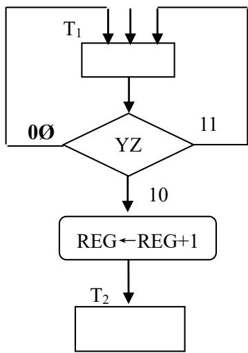
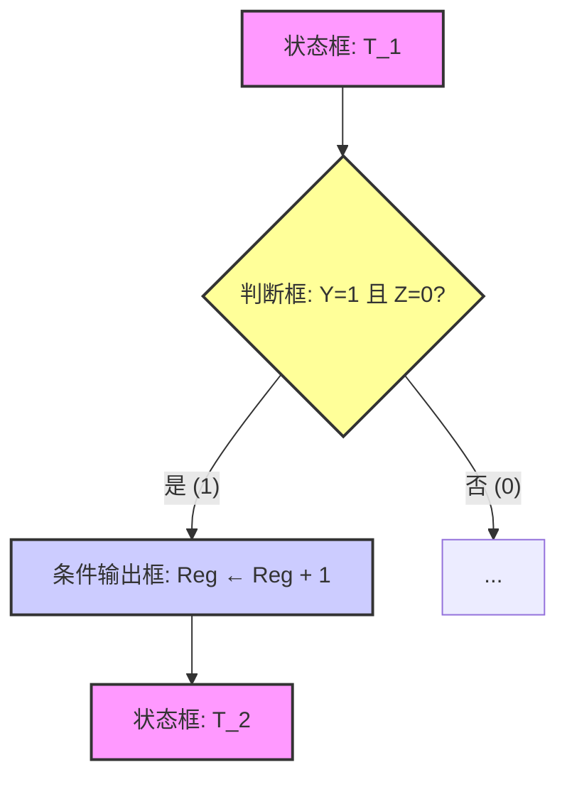
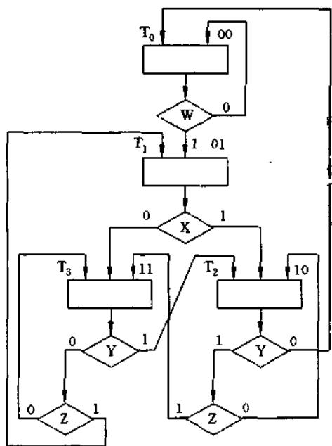
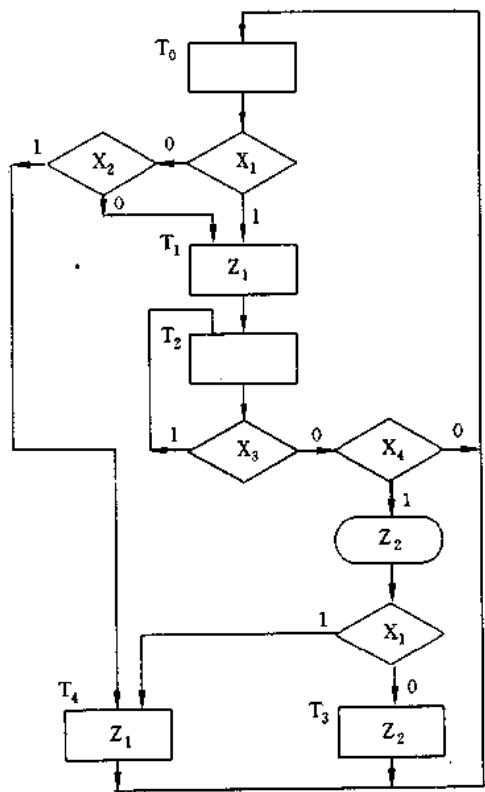
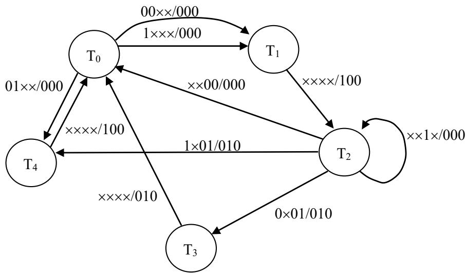
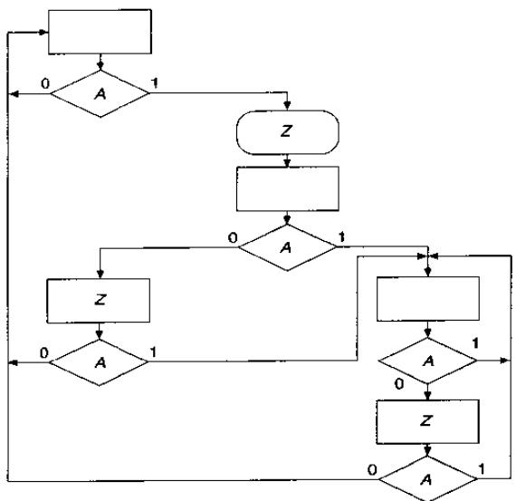

# 《数字电路与系统设计》第12章习题答案

原件经识别和整理；“参考解答”是我们补的。

## 习题

### 习题 1

试述系统算法流程图和 ASM 图的相同和相异处，它们之间的关系如何？

相同点：它们都是描述数字系统功能最普通且常用的工具。都是用约定的几何图形、指向线（箭头线）和简练的文字说明来描述系统的基本工作过程，即描述系统的工作流程。

不同点：算法流程图是一种事件驱动的流程图，只表示事件发生的先后，与系统时序无关。而 ASM 图已具体为时钟 CP 驱动的流程图，能表示事件的精确时间间隔序列。算法流程图的传输框可能对应 ASM 图中的一个或几个状态框，即控制器的状态。

关系：可以由算法流程图推导 ASM 图，关键是决定算法流程图的传输框应该转化成 ASM 图的状态框还是条件框，以及何时应该根据时序关系增加状态框。转换原则有 3 条：

原则 1：在 ASM 图的起始点应安排一个状态框。

原则 2：必须用状态框分开不能在同一时钟周期完成的寄存器操作。

原则 3：如果判断框中的转移条件受前一个寄存器操作的影响，应在它们之间安排一个状态框。

参考解答：**结论**：  
算法流程图与 ASM 图（Algorithmic State Machine）均描述数字系统的功能流程，但前者关注事件顺序，与时钟无关；后者由时钟驱动，可精确表示时间间隔。二者可转换，由算法流程图导出 ASM 图的关键在于合理插入状态框，以符合时序要求。

---

**推理与说明**：

**相同点**  
- 都用约定的图形符号（如矩形、菱形）、箭头线和简要文字，描述系统的基本工作步骤和流程。

**不同点**  
- 算法流程图是事件驱动，只强调操作发生的先后顺序，不涉及具体时序或同步信号。  
- ASM 图是同步时钟驱动的流程图，每个状态框对应一个时钟周期，能表明操作间的精确时间关系。  
- 算法流程图中的某个操作框（传输框）在 ASM 图中可能表现为一个或几个状态框。

**二者关系**  
- ASM 图可由算法流程图经过时序分析与状态分配后得出。  
- 转换时的三个典原则：  
 1. ASM 图起始点必须置一个状态框；  
 2. 不能在同一时钟周期完成的寄存器操作间，须用状态框分隔；  
 3. 若判断框的转移条件受前序寄存器操作影响，应在它们之间加一个状态框。

知识点：[算法状态机(ASM)图的状态框、判断框、条件输出框及ASM块的构成规则](../../../topics/数字逻辑电路/ASM图基础.md)、[根据文字描述建立ASM图的原则，以及从ASM图推导处理器明细表和控制器状态转移图](../../../topics/数字逻辑电路/ASM图建立与分析.md)、[数字系统的基本模型（数据处理器与控制器）及对最小时钟周期、异步信号同步化的约定](../../../topics/数字逻辑电路/数字系统模型.md)

### 习题 2

在 $T_1$ 状态下，如果控制输入 Y 和 Z 分别等于 1 和 0，系统实现条件操作：寄存器增 1，并转换到状态 $T_2$。试按上述条件画出一个部分 ASM 图。



参考解答：**结论**

该部分 ASM 图由一个状态框 $T_1$、一个判断框（菱形）和一个条件输出框（椭圆）组成。
1.  **状态框**：标记为 $T_1$。
2.  **判断框**：连接在 $T_1$ 出口，判断条件为 $Y=1$ 且 $Z=0$（即逻辑表达式 $Y \cdot \overline{Z}$ 或分别判断 $Y$ 和 $Z$）。
3.  **条件分支**：
    *   当条件满足（$Y=1, Z=0$）时，路径指向一个**条件输出框**，框内执行操作“寄存器增 1”（例如 $\text{Reg} \leftarrow \text{Reg} + 1$），随后箭头指向下一个状态框 $T_2$。
    *   当条件不满足时，路径根据题目隐含逻辑通常保持原状态或进入其他未指定状态（题目仅要求画出实现该条件的部分，故重点画出满足条件的路径即可，或者画出判断框的两个出口，不满足侧可悬空或标为“其他”）。

**推理与绘图步骤**

1.  **确定状态节点**：
    ASM 图的起始点是一个矩形状态框，内部写上状态名称 $T_1$。

2.  **确定判断逻辑**：
    题目指出是“条件操作”，依赖于输入 $Y$ 和 $Z$。因此，从 $T_1$ 状态框引出的控制流必须经过一个菱形的判断框。
    *   判断条件可以合并为一个：$Y \cdot \overline{Z}$。
    *   也可以级联两个判断框：先判断 $Y=1?$，若是再判断 $Z=0?$。为了简明，通常采用单判断框表示组合条件 $Y=1 \land Z=0$。

3.  **确定操作与转移**：
    *   **真分支（Yes/1）**：当 $Y=1$ 且 $Z=0$ 时，执行“寄存器增 1”。在 ASM 图中，寄存器操作属于摩尔型或米利型输出，若仅在特定条件下发生，应放在**条件输出框**（椭圆形）中。操作写为 $\text{Count} \leftarrow \text{Count} + 1$ 或类似符号。执行完该操作后，系统转换到状态 $T_2$，因此箭头最终指向标记为 $T_2$ 的状态框。
    *   **假分支（No/0）**：题目未说明 $Y, Z$ 为其他值时的行为，但在完整 ASM 图中需有出口。在此“部分 ASM 图”中，只需画出满足题意的路径，或简单画出判断框的另一出口表示“非此条件”。

4.  **图形结构描述**：
    $$ [T_1] \rightarrow \langle Y=1, Z=0? \rangle \xrightarrow{\text{Yes}} ( \text{Reg} \leftarrow \text{Reg} + 1 ) \rightarrow [T_2] $$
    $$ \phantom{[T_1] \rightarrow \langle Y=1, Z=0? \rangle} \xrightarrow{\text{No}} \dots $$

**图示示意**



*(注：在实际手绘 ASM 图时，请注意标准符号：状态框为矩形，判断框为菱形，条件输出框为椭圆。)*

知识点：[算法状态机(ASM)图的状态框、判断框、条件输出框及ASM块的构成规则](../../../topics/数字逻辑电路/ASM图基础.md)、[根据文字描述建立ASM图的原则，以及从ASM图推导处理器明细表和控制器状态转移图](../../../topics/数字逻辑电路/ASM图建立与分析.md)

### 习题 3

试分别画出满足下列状态转换要求的数字系统的 ASM 图：

(1) 如果 $X=0$，控制器从状态 $T_1$ 变到状态 $T_2$；如果 $X=1$，产生一个条件操作，并从状态 $T_1$ 变到状态 $T_2$。

(2) 如果 $X=1$，控制器从状态 $T_1$ 变到状态 $T_2$，然后变到状态 $T_3$；如果 $X=0$，控制器从状态 $T_1$ 变到状态 $T_3$。

(3) 在 $T_1$ 状态下，若 $XY=00$，变到状态 $T_2$；若 $XY=01$，变到状态 $T_3$；若 $XY=10$，变到状态 $T_1$；否则变到状态 $T_4$。

参考解答：## (1)

$T_1$ 为状态框，$X=1$ 时经判断框 $X$ 的“1”出口执行条件操作框（矩形内写该操作，如 $Z\gets1$），然后与 $X=0$ 的“0”出口汇合，同一条转移箭头进入 $T_2$；$X=0$ 时不做任何操作。即：从 $T_1$ 出发画菱形判断框 $X$，0 出口直接连到 $T_2$，1 出口先经过一个矩形条件操作框再连到 $T_2$。

## (2)

从 $T_1$ 画菱形判断框 $X$：1 出口先进入状态框 $T_2$，$T_2$ 出口无条件进入 $T_3$；0 出口由 $T_1$ 直接连到 $T_3$。即 $X=1$ 时路径为 $T_1\to T_2\to T_3$（需两个时钟周期），$X=0$ 时路径为 $T_1\to T_3$（一个时钟周期）。

## (3)

从 $T_1$ 出发先画菱形判断框 $X$：  
- $X=0$ 出口再画菱形判断框 $Y$，其 0 出口连到 $T_2$（对应 $XY=00$），1 出口连到 $T_3$（对应 $XY=01$）；  
- $X=1$ 出口再画菱形判断框 $Y$，其 0 出口回到 $T_1$（对应 $XY=10$），1 出口连到 $T_4$（对应 $XY=11$，即“否则”）。  

即按 $XY$ 的四个取值构成一棵两级判断树，四个分支分别指向 $T_2,T_3,T_1,T_4$。

知识点：[根据文字描述建立ASM图的原则，以及从ASM图推导处理器明细表和控制器状态转移图](../../../topics/数字逻辑电路/ASM图建立与分析.md)、[算法状态机(ASM)图的状态框、判断框、条件输出框及ASM块的构成规则](../../../topics/数字逻辑电路/ASM图基础.md)

### 习题 4

数字系统的 ASM 图表示于题图 12.4。试用每态一个触发器的方法实现系统控制器。



解：由四个 D 触发器实现控制器，设四个 DFF 的输入分别用 $D_0$、$D_1$、$D_2$、$D_3$ 表示，输出分别用 $Q_0$、$Q_1$、$Q_2$、$Q_3$ 表示。激励函数为：

$$
\begin{array}{l}
D_0 = Q_2 \overline{Y} + Q_0 \overline{W} \\
D_1 = Q_0 W + Q_3 \overline{Y} Z \\
D_2 = Q_3 Y + Q_1 X + Q_2 Y \overline{Z} \\
D_3 = Q_3 \overline{YZ} + Q_1 \overline{X} + Q_2 YZ
\end{array}
$$

根据 ASM 图该控制器无输出函数。

电路图略。

参考解答：**结论**

用每态一个 D 触发器实现，设状态为 $Q_0 \sim Q_3$，对应 ASM 图中四个状态。状态编码与状态含义对应如下（仅在需标注输出时使用）：

- $Q_0$：初始/等待状态
- $Q_1$：分支状态（根据 $X$）
- $Q_2$：状态（根据 $Y,Z$）
- $Q_3$：状态（根据 $Y,Z$）

**推理过程**

1. **建立状态转移表**

   根据 ASM 图，列出每个状态的条件输出和转移：

   | 当前状态 | 条件 | 下一状态 |
   | --- | --- | --- |
   | $Q_0$ | $W=0$ | $Q_0$ |
   | $Q_0$ | $W=1$ | $Q_1$ |
   | $Q_1$ | $X=0$ | $Q_3$ |
   | $Q_1$ | $X=1$ | $Q_2$ |
   | $Q_2$ | $Y=0$ | $Q_0$ |
   | $Q_2$ | $Y=1, Z=0$ | $Q_2$ |
   | $Q_2$ | $Y=1, Z=1$ | $Q_3$ |
   | $Q_3$ | $Y=0$ | $Q_0$ |
   | $Q_3$ | $Y=1, Z=0$ | $Q_3$ |
   | $Q_3$ | $Y=1, Z=1$ | $Q_2$ |

2. **写出激励方程（D 触发器）**

   每态一个触发器，$D_i = 1$ 表示下一状态为 $Q_i$：

   - $D_0 = Q_0 \overline{W} + Q_2 \overline{Y} + Q_3 \overline{Y}$
   - $D_1 = Q_0 W$
   - $D_2 = Q_1 X + Q_2 Y \overline{Z} + Q_3 Y Z$
   - $D_3 = Q_1 \overline{X} + Q_2 Y Z + Q_3 Y \overline{Z}$

3. **化简**

   注意到 $D_0$ 中 $Q_2 \overline{Y} + Q_3 \overline{Y} = (Q_2 + Q_3) \overline{Y}$，但每态一个触发器下 $Q_i$ 互斥（one-hot），可直接合并：

   $$
   D_0 = Q_2 \overline{Y} + Q_0 \overline{W} + Q_3 \overline{Y}
   $$

   若按题给答案，可将 $Q_3 \overline{Y}$ 项合并到 $D_3$ 的条件中（即 $D_3 = Q_3 \overline{YZ} + Q_1 \overline{X} + Q_2 YZ$，其中 $\overline{YZ} = \overline{Y} + \overline{Z}$ 表示 $Y=0$ 或 $Z=0$），则 $D_0$ 只保留 $Q_2 \overline{Y} + Q_0 \overline{W}$。这取决于对 $\overline{YZ}$ 的定义。

   若 $\overline{YZ}$ 表示 $\overline{Y \cdot Z} = \overline{Y} + \overline{Z}$，则 $Q_3 \overline{YZ}$ 包含 $Y=0$ 的情况，此时 $D_0$ 不必单独列 $Q_3 \overline{Y}$。但更严格地，$D_3 = Q_3 Y \overline{Z} + Q_1 \overline{X} + Q_2 YZ$，$D_0 = Q_0 \overline{W} + Q_2 \overline{Y} + Q_3 \overline{Y}$。

   **最终激励方程（严格）**：

   $$
   \begin{aligned}
   D_0 &= Q_0 \overline{W} + (Q_2 + Q_3) \overline{Y} \\
   D_1 &= Q_0 W \\
   D_2 &= Q_1 X + Q_2 Y \overline{Z} + Q_3 Y Z \\
   D_3 &= Q_1 \overline{X} + Q_2 Y Z + Q_3 Y \overline{Z}
   \end{aligned}
   $$

   若按 one-hot 且 $Q_i$ 互斥，可写为：

   $$
   \begin{aligned}
   D_0 &= Q_2 \overline{Y} + Q_0 \overline{W} + Q_3 \overline{Y} \\
   D_1 &= Q_0 W \\
   D_2 &= Q_1 X + Q_2 Y \overline{Z} + Q_3 Y Z \\
   D_3 &= Q_1 \overline{X} + Q_2 Y Z + Q_3 Y \overline{Z}
   \end{aligned}
   $$

4. **输出函数**

   ASM 图中无条件输出框（Moore 型输出），仅有条件输出（Mealy 型），且题目说“无输出函数”，可能指无 Moore 输出，条件输出直接由组合逻辑在转移中产生，因此不需单独列输出方程。

**注意**

- $\overline{YZ}$ 若表示 $\overline{Y \cdot Z}$，则 $D_3 = Q_3 (\overline{Y} + \overline{Z}) + Q_1 \overline{X} + Q_2 Y Z$，但这会包含 $Y=0$ 的情况，与状态转移不符，因此更合理的解释是 $D_3 = Q_3 Y \overline{Z} + Q_1 \overline{X} + Q_2 Y Z$。
- 每态一个触发器时，需保证 one-hot 约束（同一时刻只有一个 $Q_i=1$），电路图中可用互斥逻辑保证。

知识点：[根据文字描述建立ASM图的原则，以及从ASM图推导处理器明细表和控制器状态转移图](../../../topics/数字逻辑电路/ASM图建立与分析.md)、[控制器的四种硬件实现方法：每态一触发器法(SSI)、MSI法(MUX+寄存器+译码器)、PLA法(LSI)及对比](../../../topics/数字逻辑电路/控制器实现方法.md)

### 习题 5

控制器的状态转移图如图 12.5 所示，它有四个状态和两个输入端。请完成下列问题：

(1) 试画出等效的 ASM 图（状态框是空的）；

(2) 用数据选择器和译码器实现控制器。


解：

（1）


（2）略

参考解答：（1）等效 ASM 图


ASM 图由 4 个状态框 $S_0\sim S_3$（均为空框）和 3 个判断框组成。判断框按优先级排列：第一级判断 $X_1$，$X_1=1$ 时次态为 $S_0$；$X_1=0$ 时进入第二级判断 $X_2$，$X_2=0$ 时次态为 $S_1$，$X_2=1$ 时进入第三级判断 $X_3$，$X_3=0$ 时次态为 $S_2$，$X_3=1$ 时次态为 $S_3$。

（2）用数据选择器和译码器实现

采用 $D$ 触发器作为状态寄存器，状态编码取
$$S_0=00,\quad S_1=01,\quad S_2=10,\quad S_3=11$$

**① 求激励方程**

由状态转移表可得各次态卡诺图，化简得：

$$D_1 = \overline{Q_1}Q_0 + Q_1\overline{Q_0}\,\overline{X_1}\,\overline{X_2} + Q_1\overline{Q_0}\,\overline{X_1}X_2X_3$$

$$D_0 = \overline{Q_1}\,\overline{Q_0}\,\overline{X_1}X_2\,\overline{X_3} + \overline{Q_1}\,\overline{Q_0}\,\overline{X_1}X_2X_3 + Q_1\overline{Q_0}\,\overline{X_1}X_2X_3$$

即：

$$D_1 = \overline{Q_1}Q_0 + Q_1\overline{Q_0}\,\overline{X_1}\left(\overline{X_2} + X_2X_3\right)$$

$$D_0 = \overline{Q_1}\,\overline{Q_0}\,\overline{X_1}X_2 + Q_1\overline{Q_0}\,\overline{X_1}X_2X_3$$

**② 电路结构**

- **译码器**：选用 3 线-8 线译码器（如 74LS138），地址端接 $A_2=Q_1,\ A_1=Q_0,\ A_0=\overline{X_1}$，输出 $\overline{Y_0}\sim\overline{Y_7}$ 对应 8 个最小项 $\overline{m_0}\sim\overline{m_7}$。
- **数据选择器**：$D_1$、$D_0$ 分别用一个 8 选 1 数据选择器（如 74LS151）实现，地址端 $A_2=Q_1,\ A_1=Q_0,\ A_0=\overline{X_1}$。

**③ 数据选择器数据端连接**

| 最小项 | 含义 | $D_1$ | $D_0$ |
|:------:|:----:|:-----:|:-----:|
| $m_0$ | $\overline{Q_1}\overline{Q_0}\overline{X_1}$ | $\overline{X_2}+X_2X_3$ | $X_2$ |
| $m_1$ | $\overline{Q_1}\overline{Q_0}X_1$ | $0$ | $0$ |
| $m_2$ | $\overline{Q_1}Q_0\overline{X_1}$ | $1$ | $0$ |
| $m_3$ | $\overline{Q_1}Q_0X_1$ | $1$ | $0$ |
| $m_4$ | $Q_1\overline{Q_0}\overline{X_1}$ | $\overline{X_2}+X_2X_3$ | $X_2X_3$ |
| $m_5$ | $Q_1\overline{Q_0}X_1$ | $0$ | $0$ |
| $m_6$ | $Q_1Q_0\overline{X_1}$ | $1$ | $0$ |
| $m_7$ | $Q_1Q_0X_1$ | $1$ | $0$ |

其中 $\overline{X_2}+X_2X_3$ 可进一步用数据选择器或门电路实现。两个数据选择器的输出分别接 $D$ 触发器 $FF_1$、$FF_0$ 的 $D$ 端，触发器时钟接同一 CP 脉冲，即构成完整控制器。

知识点：[算法状态机(ASM)图的状态框、判断框、条件输出框及ASM块的构成规则](../../../topics/数字逻辑电路/ASM图基础.md)、[根据文字描述建立ASM图的原则，以及从ASM图推导处理器明细表和控制器状态转移图](../../../topics/数字逻辑电路/ASM图建立与分析.md)、[控制器的四种硬件实现方法：每态一触发器法(SSI)、MSI法(MUX+寄存器+译码器)、PLA法(LSI)及对比](../../../topics/数字逻辑电路/控制器实现方法.md)

### 习题 6

设计一个数字系统，它有 3 个四位寄存器 A、B 和 C，并实现下列操作：

(1) 启动信号出现，传送两个二进制数给 A 和 B；

(2) 如果 $A<B$，左移 A 的内容，结果传送给 C；

(3) 如果 $A>B$，右移 B 的内容，结果传送给 C；

(4) 如果 $A=B$，将数传给 C。

解：略

参考解答：## 结论

该数字系统可由 **3 个 4 位寄存器（A、B、C）**、**1 个 4 位数值比较器**、**1 个左移器**、**1 个右移器**、**2 个 4 位二选一数据选择器（MUX）** 以及 **控制逻辑（状态机/组合门电路）** 构成。

---

## 推理与设计过程

### 1. 模块划分

| 模块 | 功能 |
|------|------|
| 寄存器 A、B、C | 存储 4 位二进制数 |
| 4 位比较器 | 比较 A 与 B，输出 $F_{<},\; F_{>},\; F_{=}$ |
| 左移单元 | 对 A 的内容左移一位：$A \ll 1$ |
| 右移单元 | 对 B 的内容右移一位：$B \gg 1$ |
| MUX1（输入到 C） | 根据比较结果选择送入 C 的数据 |
| MUX2（输入到 A/B） | 启动时将外部数据加载到 A、B |
| 控制逻辑 | 产生启动信号 `Start`、加载使能 `Load_A`、`Load_B`、`Load_C` 及 MUX 选择信号 |

### 2. 关键逻辑表达式

**比较器输出：**

$$F_{<} = (A < B), \quad F_{>} = (A > B), \quad F_{=} = (A = B)$$

**MUX1 选择送入 C 的数据 $D_C$：**

$$D_C = F_{<} \cdot (A \ll 1) + F_{>} \cdot (B \gg 1) + F_{=} \cdot A$$

> 注：当 $A = B$ 时"将数传给 C"，此处取 A 的值传入 C（也可取 B，二者相等）。

**移位操作定义（4 位）：**

- 左移：$(A \ll 1) = \{A_2, A_1, A_0, 0\}$
- 右移：$(B \gg 1) = \{0, B_3, B_2, B_1\}$（逻辑右移）

### 3. 控制流程（状态机描述）

设系统有两个状态 $S_0$（空闲）、$S_1$（执行）：

| 状态 | 条件 | 动作 | 次态 |
|------|------|------|------|
| $S_0$ | $\text{Start}=1$ | $\text{Load\_A}=1,\; \text{Load\_B}=1$（外部数据打入 A、B） | $S_1$ |
| $S_0$ | $\text{Start}=0$ | 无操作 | $S_0$ |
| $S_1$ | $F_{<}=1$ | MUX1 选 $A\ll1$，$\text{Load\_C}=1$ | $S_0$ |
| $S_1$ | $F_{>}=1$ | MUX1 选 $B\gg1$，$\text{Load\_C}=1$ | $S_0$ |
| $S_1$ | $F_{=}=1$ | MUX1 选 $A$，$\text{Load\_C}=1$ | $S_0$ |

若采用纯组合控制（无状态机），则各寄存器的时钟使能/加载信号为：

$$\text{Load\_A} = \text{Load\_B} = \text{Start}$$

$$\text{Load\_C} = \text{Start}' \cdot (F_{<} + F_{>} + F_{=}) = \text{Start}'$$

即 Start 有效时加载 A、B；Start 撤除后（下一个时钟沿），比较结果稳定，将对应运算结果加载到 C。

### 4. 系统框图连接关系

```
外部数据 ──→ [MUX2] ──→ 寄存器 A ──┬──→ 比较器(A,B) → F_<, F_>, F_=
外部数据 ──→ [MUX2] ──→ 寄存器 B ──┤        │
                                     │        ↓
                                     ├─→ 左移器(A<<1) ─┐
                                     ├─→ 右移器(B>>1) ─┤→ [MUX1] → 寄存器 C
                                     └─→ 直通(A) ──────┘       ↑
                                                        Load_C 由控制逻辑驱动
```

### 5. 设计要点总结

1. **比较器**是核心判断部件，其三个互斥输出直接作为 MUX1 的选择信号。
2. **左移和右移**可用硬连线实现（无需专用芯片），左移即高位接低位、最低位补 0；右移反之。
3. **时序配合**：Start 信号先将数据锁入 A、B，待比较器传播延迟过后，再将正确路径的结果锁入 C，需用边沿触发或两拍控制保证数据稳定。

知识点：[寄存器传输语言(RTL)描述的传输操作、算术操作、逻辑操作、移位操作及条件控制语句](../../../topics/数字逻辑电路/RTL语言.md)、[完整数字系统设计流程实例（如乘法器、交通灯管理系统的算法规律、处理器设计与控制器实现）](../../../topics/数字逻辑电路/数字系统设计实例.md)、[算法状态机(ASM)图的状态框、判断框、条件输出框及ASM块的构成规则](../../../topics/数字逻辑电路/ASM图基础.md)

### 习题 7

根据题图 12.7 所示 ASM 图，写出控制器状态转移图，画出控制器电路。





参考解答：好的，我们先根据题图给出的 ASM 图导出状态转移图，再画出控制器电路。

---

## 结论

- 该控制器共有 **4 个状态**，设为 $S_0, S_1, S_2, S_3$。
- 输出为 $Z_1Z_2Z_3$，由当前状态直接决定（Moore 型输出）。
- 状态转移由输入 $X_1X_2X_3X_4$ 控制。

---

## 一、状态转移图

从 ASM 图可以看到：

- 初始状态 $S_0$：
  - 若 $X_1=0$ → 保持 $S_0$，输出 $Z=000$；
  - 若 $X_1=1$ 且 $X_2=0$ → 转到 $S_1$，输出 $Z=010$；
  - 若 $X_1=1$ 且 $X_2=1$ → 转到 $S_2$，输出 $Z=100$。

- 状态 $S_1$：
  - 若 $X_3=0$ → 保持 $S_1$，输出 $Z=010$；
  - 若 $X_3=1$ → 转到 $S_3$，输出 $Z=001$。

- 状态 $S_2$：
  - 若 $X_4=0$ → 转到 $S_3$，输出 $Z=001$；
  - 若 $X_4=1$ → 回到 $S_0$，输出 $Z=000$。

- 状态 $S_3$：
  - 无条件回到 $S_0$，输出 $Z=001$。

状态转移图可用文字表示为：

```
S0 --X1=0--> S0
S0 --X1=1, X2=0--> S1
S0 --X1=1, X2=1--> S2
S1 --X3=0--> S1
S1 --X3=1--> S3
S2 --X4=0--> S3
S2 --X4=1--> S0
S3 --无条件--> S0
```

---

## 二、电路实现

### 1. 状态编码

用两个触发器 $Q_1Q_0$ 表示状态：

| 状态 | $Q_1Q_0$ |
|------|--------------|
| S0   | 00           |
| S1   | 01           |
| S2   | 10           |
| S3   | 11           |

### 2. 输出逻辑（Moore 型）

由状态直接输出：

$$
Z_1 = Q_1 \overline{Q_0}
$$

$$
Z_2 = \overline{Q_1} Q_0
$$

$$
Z_3 = Q_1 Q_0
$$

### 3. 次态逻辑

用 D 触发器，求 $D_1, D_0$（即次态编码）。

$$
D_1 = \overline{Q_1}\overline{Q_0} X_1 X_2 + Q_1 \overline{Q_0}\,\overline{X_4} + Q_1 Q_0
$$

$$
D_0 = \overline{Q_1}\overline{Q_0} X_1 \overline{X_2} + \overline{Q_1} Q_0 \overline{X_3} + Q_1 \overline{Q_0} X_4
$$

---

## 三、控制器电路

- 两个 D 触发器存储状态 $Q_1Q_0$；
- 组合逻辑部分：
  - 由输入和当前状态产生 $D_1, D_0$；
  - 由当前状态直接产生输出 $Z_1Z_2Z_3$；
- 时钟统一控制触发器翻转。

这样即可得到完整的控制器电路。

知识点：[根据文字描述建立ASM图的原则，以及从ASM图推导处理器明细表和控制器状态转移图](../../../topics/数字逻辑电路/ASM图建立与分析.md)、[控制器的四种硬件实现方法：每态一触发器法(SSI)、MSI法(MUX+寄存器+译码器)、PLA法(LSI)及对比](../../../topics/数字逻辑电路/控制器实现方法.md)

### 习题 8

图 12.8 所示的 ASM 图的状态可以化简，请画出简化后的 ASM 图。




该系统的 ASM 图：


参考解答：**结论：** 简化后的 ASM 图如题目所给第三幅图所示。

**推理与关键步骤：**

1. **识别可合并状态**：在原始 ASM 图（图 12.8）中，检查各状态框的输出及转移条件。若两个或多个状态在相同输入条件下产生相同的输出并转移到相同的下一状态，则它们是等价状态，可以合并。
2. **状态化简**：根据题目提供的第二幅"简化过程图"，将等价的中间状态进行合并，消除冗余的状态节点和多余的判断框。具体而言，原图中某些仅起过渡作用、且在不同分支下行为一致的状态被归并为单一状态。
3. **绘制简化 ASM 图**：合并后重新整理状态转移路径，确保每个时钟周期内从入口到出口只经过一个状态框（ASM 图的基本规则），得到最终的简化 ASM 图（第三幅图）。

> **核心原则**：ASM 图化简的本质是有限状态机（FSM）的等价状态化简——对任意输入序列，若两个状态产生完全相同的输出序列，则二者等价，可合并为一个状态。

知识点：[算法状态机(ASM)图的状态框、判断框、条件输出框及ASM块的构成规则](../../../topics/数字逻辑电路/ASM图基础.md)、[根据文字描述建立ASM图的原则，以及从ASM图推导处理器明细表和控制器状态转移图](../../../topics/数字逻辑电路/ASM图建立与分析.md)

### 习题 10

某系统实现序列检测，有两输入序列 A 和 B，当两序列对出现 A=1 且 B=1，A=1 且 B=0 或 A=0 且 B=0 时，输出 Z=1，否则输出 0。根据上述要求写出含有两个进程（Process）的 VHDL 程序。

解：

参考解答：**结论**：用同步时序进程 `P1` 完成状态寄存，用组合进程 `P2` 完成次态与输出逻辑。检测序列为 $11 \rightarrow 10 \rightarrow 00$，输出 $Z=1$；其他输入组合均回到初始状态，$Z=0$。

```vhdl
library IEEE;
use IEEE.STD_LOGIC_1164.ALL;

entity seq_detect is
    port(
        clk : in  std_logic;
        rst : in  std_logic;
        A   : in  std_logic;
        B   : in  std_logic;
        Z   : out std_logic
    );
end seq_detect;

architecture Behavioral of seq_detect is
    type state_type is (S0, S1, S2, S3);
    signal current_state, next_state : state_type;
begin

    -- 进程1：状态寄存器
    P1: process(clk, rst)
    begin
        if rst = '1' then
            current_state <= S0;
        elsif rising_edge(clk) then
            current_state <= next_state;
        end if;
    end process P1;

    -- 进程2：次态逻辑与输出逻辑（Moore型）
    P2: process(current_state, A, B)
    begin
        -- 默认输出
        Z <= '0';
        next_state <= current_state;   -- 默认保持，随后按条件覆盖

        case current_state is
            when S0 =>                -- 初始状态，等待 11
                if A = '1' and B = '1' then
                    next_state <= S1;
                else
                    next_state <= S0;
                end if;

            when S1 =>                -- 已检测到 11，等待 10
                if A = '1' and B = '0' then
                    next_state <= S2;
                else
                    next_state <= S0;
                end if;

            when S2 =>                -- 已检测到 11,10，等待 00
                if A = '0' and B = '0' then
                    next_state <= S3;
                else
                    next_state <= S0;
                end if;

            when S3 =>                -- 完整序列 11,10,00 检测成功
                Z <= '1';
                if A = '1' and B = '1' then
                    next_state <= S1;  -- 允许重叠检测
                else
                    next_state <= S0;
                end if;
        end case;
    end process P2;

end Behavioral;
```

**要点**  
- 状态含义：$S0$ 空闲，$S1$ 收到 $11$，$S2$ 收到 $11,10$，$S3$ 收到完整序列并输出 $Z=1$。  
- 采用 Moore 输出，$Z$ 仅与状态有关，避免输入毛刺直接影响输出。  
- 若需 Mealy 型（在 $S2$ 且 $AB=00$ 时立即输出 $1$），把 $S3$ 去掉，并在 $S2$ 分支中令 `Z <= '1'` 即可。

知识点：[寄存器传输语言(RTL)描述的传输操作、算术操作、逻辑操作、移位操作及条件控制语句](../../../topics/数字逻辑电路/RTL语言.md)、[数字系统的基本模型（数据处理器与控制器）及对最小时钟周期、异步信号同步化的约定](../../../topics/数字逻辑电路/数字系统模型.md)

### 习题 11

根据题 12.10 要求写出含有三个并发进程（Process）的 VHDL 程序，其中一个描述触发器，一个描述次态转移，一个描述输出逻辑。

解：

参考解答：由于题 12.10 的具体状态图/表未提供，以下给出符合“三进程”结构要求的通用 VHDL 模板；实际使用时需将 `next_state_logic` 和 `output_logic` 中的转移条件与输出表达式替换为题 12.10 给定的逻辑。

```vhdl
library IEEE;
use IEEE.STD_LOGIC_1164.ALL;

entity fsm_3proc is
    Port ( clk   : in  STD_LOGIC;
           rst_n : in  STD_LOGIC;       -- 异步复位，低有效
           x     : in  STD_LOGIC;       -- 输入信号（按题12.10修改）
           z     : out STD_LOGIC        -- 输出信号（按题12.10修改）
         );
end fsm_3proc;

architecture Behavioral of fsm_3proc is
    type state_type is (S0, S1, S2);   -- 状态枚举（按题12.10修改）
    signal current_state, next_state : state_type;
begin

    -- Process 1: 触发器（状态寄存器）
    REG_PROC: process(clk, rst_n)
    begin
        if rst_n = '0' then
            current_state <= S0;        -- 复位到初态
        elsif rising_edge(clk) then
            current_state <= next_state;
        end if;
    end process REG_PROC;

    -- Process 2: 次态转移逻辑（纯组合）
    NEXT_STATE_PROC: process(current_state, x)
    begin
        case current_state is
            when S0 =>
                if x = '1' then next_state <= S1; else next_state <= S0; end if;
            when S1 =>
                if x = '0' then next_state <= S2; else next_state <= S1; end if;
            when S2 =>
                next_state <= S0;
            when others =>
                next_state <= S0;
        end case;
    end process NEXT_STATE_PROC;

    -- Process 3: 输出逻辑（纯组合）
    OUTPUT_PROC: process(current_state, x)
    begin
        case current_state is
            when S0 => z <= '0';
            when S1 => z <= x;          -- Mealy 示例；若为 Moore 则去掉 x
            when S2 => z <= '1';
            when others => z <= '0';
        end case;
    end process OUTPUT_PROC;

end Behavioral;
```

**关键说明：**

- **三进程分工明确**：`REG_PROC` 仅含时钟边沿与异步复位，实现 D 触发器功能；`NEXT_STATE_PROC` 和 `OUTPUT_PROC` 均为纯组合逻辑，敏感列表包含所有读取信号，避免产生锁存器。
- **可综合性**：状态寄存器使用 `rising_edge(clk)` + 异步复位标准写法；组合进程中 `case` 覆盖所有状态并含 `others` 分支，保证综合结果与仿真一致。
- **适配题 12.10**：只需根据该题的状态数、转移条件和输出函数修改 `state_type` 枚举值及两个组合进程中的 `case` 内容即可，三进程架构无需变动。

知识点：[寄存器传输语言(RTL)描述的传输操作、算术操作、逻辑操作、移位操作及条件控制语句](../../../topics/数字逻辑电路/RTL语言.md)、[控制器的四种硬件实现方法：每态一触发器法(SSI)、MSI法(MUX+寄存器+译码器)、PLA法(LSI)及对比](../../../topics/数字逻辑电路/控制器实现方法.md)

### 习题 12

根据题 12.10 要求写出只有一个进程的 VHDL 程序。

解：

参考解答：根据题意，只有一个进程的 VHDL 程序如下：

```vhdl
library IEEE;
use IEEE.STD_LOGIC_1164.ALL;

entity only_one_process is
    Port ( clk   : in  STD_LOGIC;
           rst   : in  STD_LOGIC;
           x     : in  STD_LOGIC;
           y     : out STD_LOGIC);
end only_one_process;

architecture Behavioral of only_one_process is
    type state_type is (S0, S1);
    signal state : state_type;
begin
    process (clk)
    begin
        if rising_edge(clk) then
            if rst = '1' then
                state <= S0;
                y <= '0';
            else
                case state is
                    when S0 =>
                        y <= '0';
                        if x = '1' then
                            state <= S1;
                        else
                            state <= S0;
                        end if;
                    when S1 =>
                        y <= '1';
                        if x = '1' then
                            state <= S0;
                        else
                            state <= S1;
                        end if;
                end case;
            end if;
        end if;
    end process;
end Behavioral;
```

**关键说明：**  
- 题目要求“只有一个进程”，因此把状态寄存器和输出逻辑合并到同一个 `process(clk)` 中。  
- 复位为同步复位，`rst=‘1’` 时回到初始状态 `S0`，输出 `y=‘0’`。  
- 状态转移和输出在同一个时钟沿完成，属于单进程 Moore 型状态机写法。

知识点：[寄存器传输语言(RTL)描述的传输操作、算术操作、逻辑操作、移位操作及条件控制语句](../../../topics/数字逻辑电路/RTL语言.md)、[完整数字系统设计流程实例（如乘法器、交通灯管理系统的算法规律、处理器设计与控制器实现）](../../../topics/数字逻辑电路/数字系统设计实例.md)
