# 《数字电路与系统设计》第3章 习题答案

原件经识别和整理；“参考解答”是我们补的。

# 数字电路与系统设计 第3章 习题答案

本资料由识别工具读取《数字电路与系统设计》第3章习题答案（第1-4页）整理而成。

## 一、计算题

### 计算 1

在图P3.1(a)、(b)两个电路中，试计算当输入端为以下3种状态时，输出电压 $u_o = ?$ 并指出三极管T 工作在何种状态(饱和、截止、放大)。设T 导通时 $u_{BE} = 0.7V$

（1）$u_I = 0V$

（2）$u_I = 5V$；

（3）输入端悬空。

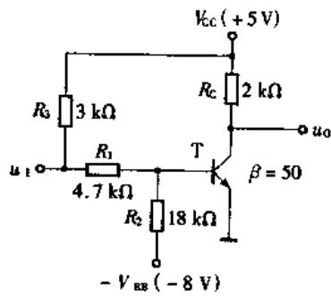

解：对于图（a）电路：

（1）$u_I = 0V$ 时，假设T 截止，则 $u_B < 0V, u_{BE} < 0 < 0.7V$，假设成立。因此T 工作在截止状态，$u_o = V_{CC} = 12V$。

（2）$u_I = 5V$ 时，假设T 截止，则

$$
u_B = -V_{BB} + \frac{R_2}{R_1 + R_2} (u_I + V_{BB}) = -10 + \frac{20}{5.1 + 20} \times 15 = 1.95V > 0.7V
$$

所以假设不成立，T 的发射结应导通，设 T处于放大状态，则

$$
i_B = \frac{u_I - 0.7}{R_1} - \frac{0.7 - (-V_{BB})}{R_2} = \frac{4.3}{5.1} - \frac{10.7}{20} = 0.31mA
$$

而 $I_{BS} = \frac{I_{CS}}{\beta} = \frac{V_{CC} - 0.7}{\beta R_C} = \frac{9.3}{30 \times 2} = 0.16mA$

$\because i_B > I_{BS} \therefore$ T不处于放大状态，而处于饱和状态。取 $u_o = 0.5V$

（3）输入端悬空时，由于发射结反偏而截止，所以T 处于截止状态。$u_o = V_{CC} = 12V$。

对于图（b）电路：

（1）$u_I = 0V$ 时，假设T 截止，则

$$
u_B = -V_{BB} + \frac{R_2}{R_1 + R_2} (u_I + V_{BB}) = -8 + \frac{18}{4.7 + 18} \times 8 = -1.66V < 0.7V
$$

假设成立。因此T工作在截止状态，$u_o = V_{CC} = 5V$。

（2）$u_I = 5V$ 时，假设T 截止，则

$$
u_B = -V_{BB} + \frac{R_2}{R_1 + R_2} (u_I + V_{BB}) = -8 + \frac{18}{4.7 + 18} \times 13 = 2.31V > 0.7V
$$

所以假设不成立，T 的发射结应导通，设 T处于放大状态，则

$$
i_B = \frac{u_I - 0.7}{R_1} - \frac{0.7 - (-V_{BB})}{R_2} = \frac{4.3}{4.7} - \frac{8.7}{18} = 0.43mA
$$

而 $I_{BS} = \frac{I_{CS}}{\beta} = \frac{V_{CC} - 0.7}{\beta R_C} = \frac{4.3}{50 \times 2} = 0.043mA$

$\because i_B > I_{BS} \therefore$ T不处于放大状态，而处于饱和状态。取 $u_o = 0.5V$

（3）输入端悬空时，假设T截止，则

$$
u_B = -V_{BB} + \frac{R_2}{R_1 + R_2 + R_3} (V_{CC} + V_{BB}) = -8 + \frac{18}{4.7 + 18 + 3} \times 13 = 1.11V > 0.7V
$$

所以假设不成立，T 的发射结应导通，设 T处于放大状态，则

$$
i_B = \frac{V_{CC} - 0.7}{R_1 + R_3} - \frac{0.7 - (-V_{BB})}{R_2} = \frac{4.3}{7.7} - \frac{8.7}{18} = 0.075mA
$$

而 $I_{BS} = \frac{I_{CS}}{\beta} = \frac{V_{CC} - 0.7}{\beta R_C} = \frac{4.3}{50 \times 2} = 0.043mA$

$\because i_B > I_{BS} \therefore$ T不处于放大状态，而处于饱和状态。取 $u_o = 0.5V$

知识点：[数字系统的基本模型（数据处理器与控制器）及对最小时钟周期、异步信号同步化的约定](../../../topics/数字逻辑电路/数字系统模型.md)

### 计算 2

在图P3.2所示的反相器电路中，如果三极管T的$\beta=30$，最大额定电流 $I_{CM} = 30mA$。输入信号 $U_{IH} = 3.6V, U_{IL} = 0.3V$。设三极管T、二极管D 导通压降均为0.7V。试求：

(1) 允许最大的灌流负载电流是多少？

(2) 允许最大的拉流负载电流是多少？

解：（1）三极管提供灌流负载电流时，三极管处于饱和状态，输出低电平，因此应保证 $u_o \leqslant 0.7V$；同时流过集电极的电流应不大于额定电流 $I_{CM} = 30mA$。

$u_o = 0.7V$ 时，即三极管处于临界饱和状态，此时 $i_C = I_{CS} = i_{RC} + i_L$ 达到最大值，所以

$$
\begin{aligned}
i_L &\leq I_{CS} - i_{RC} \\
&= \beta I_{BS} - i_{RC} \\
&= \beta (\frac{u_I - 0.7}{R_1} - \frac{0.7 - (-V_{BB})}{R_2}) - \frac{V_{CC} - 0.7}{R_C} \\
&= 30 \times (\frac{2.9}{1.5} - \frac{10.7}{10}) - \frac{9.3}{1} = 16.6mA
\end{aligned}
$$

同时应满足：

$$
i_L \leq I_{CM} - i_{RC} = I_{CM} - \frac{V_{CC} - 0.7}{R_C} = 30 - 9.3 = 20.7mA
$$

因此，$i_L$ 的最大值取 16.6mA。

（2）三极管提供拉流负载电流时，三极管处于截止状态，输出高电平，二极管D 导通，使输出限制在3.7V。

$$
i_L = i_{RC} - i_D \leq i_{RC} = \frac{V_{CC} - 3.7}{R_C} = 6.3mA
$$

知识点：[数字系统的基本模型（数据处理器与控制器）及对最小时钟周期、异步信号同步化的约定](../../../topics/数字逻辑电路/数字系统模型.md)、[寄存器传输语言(RTL)描述的传输操作、算术操作、逻辑操作、移位操作及条件控制语句](../../../topics/数字逻辑电路/RTL语言.md)

### 计算 3

试说明在下列情况下，图 P3.3(a)、(b)的电压表和电流表指示值各为多少?设该与非门$I_{IH}=30\mu A$，$I_{IS}=1mA$。

（1）A悬空；

（2）A 接 3.4V；

（3）A接地。

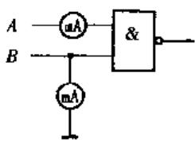

解：（1）A 悬空：（a）图的电压表和电流表指示值各为 1.4V，0mA；（b）图的 A 端电流表和B端电流表指示值各为 0mA，1mA。

（2）A接 $3.4V$：（a）图的电压表和电流表指示值各为 1.4V，30μA；（b）图的A 端电流表和B端电流表指示值需根据后续页面内容补充（当前文档仅显示至此）。

# 《数字电路与系统设计》第3章 习题答案

本部分为《数字电路与系统设计》第3章习题答案的第2部分（原稿第5-8页），由识别工具读取并整理。

## 一、填空题/简答题/分析题

知识点：[数字系统的基本模型（数据处理器与控制器）及对最小时钟周期、异步信号同步化的约定](../../../topics/数字逻辑电路/数字系统模型.md)、[寄存器传输语言(RTL)描述的传输操作、算术操作、逻辑操作、移位操作及条件控制语句](../../../topics/数字逻辑电路/RTL语言.md)

### 填空 1

题干：流表和B端电流表指示值各为 30μA，1mA。（注：此处原文可能有缺漏，结合上下文推测为某特定条件下的测量值）

答案：30μA，1mA。

知识点：[根据文字描述建立ASM图的原则，以及从ASM图推导处理器明细表和控制器状态转移图](../../../topics/数字逻辑电路/ASM图建立与分析.md)

### 填空 2

题干：A接地：（a）图的电压表和电流表指示值各为0V，1mA ；（b）图的 A端电流表和B端电流表指示值各为0.5mA ，0.5mA。

答案：
- （a）图：0V，1mA
- （b）图：0.5mA，0.5mA

### 简答 1

题干：试分析图P3.4(a)、(b)电路的逻辑功能，列出真值表，写出 $P_1$、$P_2$、$P_3$ 的逻辑表达式。

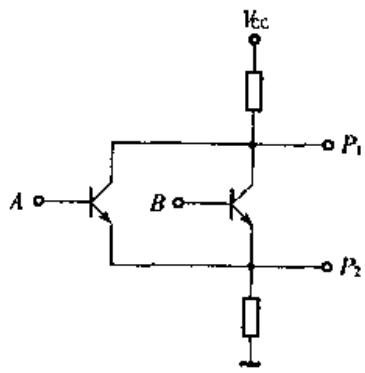

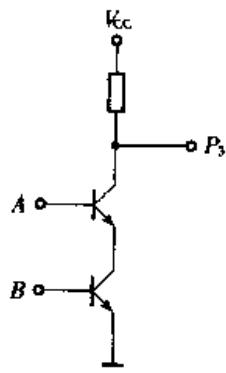

解：设输入、输出高电平用“1”表示，输入、输出低电平用“0”表示，则对（a）（b）图列出真值表如表3.3.1(a)、(b)所示。

**表 3.3.1（a）**

| A B | P1 | P2 |
| :--- | :---: | :---: |
| 0 0 | 1 | 0 |
| 0 1 | 0 | 1 |
| 1 0 | 0 | 1 |
| 1 1 | 0 | 1 |

**表 3.3.1（b）**

| A B | $P_3$ |
| :--- | :---: |
| 0 0 | 1 |
| 0 1 | 1 |
| 1 0 | 1 |
| 1 1 | 0 |

所以：
$$ P_1 = \overline{A}\,\overline{B} = \overline{A + B} $$
$$ P_2 = A + B $$
$$ P_3 = \overline{AB} $$

知识点：[完整数字系统设计流程实例（如乘法器、交通灯管理系统的算法规律、处理器设计与控制器实现）](../../../topics/数字逻辑电路/数字系统设计实例.md)

### 计算 1

题干：试为图 P3.5 电路中的外接负载电阻 $R_L$ 选定合适的阻值。已知 OC 门输出高电平时输出管的漏电流为 50μA，输出低电平时允许的最大负载电流为 16mA：G3、G4、G5 的低电平输入电流为1.4mA，高电平输入电流为40μA。要求OC 门输出高电平 $U_{OH} \geqslant 3.0\mathrm{V}$ ，低电平 $U_{OL} \leqslant 0.4\mathrm{V}$。

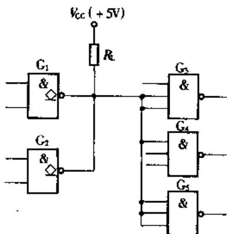

解：由图可知，两个OC门输出“线与”，因此 G1 和 G2 输出都为高电平时，“线与”后为高电平，$R_L$ 选定的阻值应使 $U_{OH} \geqslant 3.0\mathrm{V}$，即：

$$ V_{CC} - U_{OH} = R_L (n I_{OH} + m I_{IH}) $$

$$ R_L = \frac{V_{CC} - U_{OH}}{n I_{OH} + m I_{IH}} \leq \frac{V_{CC} - 3}{n I_{OH} + m I_{IH}} = \frac{2}{2 \times 50 \times 10^{-3} + 6 \times 40 \times 10^{-3}} = 5.88\,\mathrm{k\Omega} $$

其中：
- $I_{OH}$：OC门输出漏电流；
- $I_{IH}$：负载门输入漏电流；
- n：OC门的个数；
- m：负载门输入端数。

只要 G1 和 G2 中有一个输出为低电平，“线与”后为低电平，$R_L$ 选定的阻值应使 $U_{OL} \leqslant 0.4\mathrm{V}$，即：

$$ V_{CC} - U_{OL} = R_L (I_G - m' I_{IL}) $$

$$ R_L = \frac{V_{CC} - U_{OL}}{I_G - m' I_{IL}} \geq \frac{V_{CC} - 0.4}{I_{G(\max)} - m' I_{IL}} = \frac{4.6}{16 - 3 \times 1.4} = 0.39\,\mathrm{k\Omega} $$

其中：
- $I_{G(\max)}$：OC 门最大灌电流；
- $I_{IL}$：负载门低电平输入电流；
- $m'$：负载门个数。

所以负载电阻 $R_L$ 的阻值为：

$$ 0.39\,\mathrm{k\Omega} \leq R_L \leq 5.88\,\mathrm{k\Omega} $$

知识点：[数字系统的基本模型（数据处理器与控制器）及对最小时钟周期、异步信号同步化的约定](../../../topics/数字逻辑电路/数字系统模型.md)

### 简答 2

题干：写出图P3.6各电路的输出表达式。

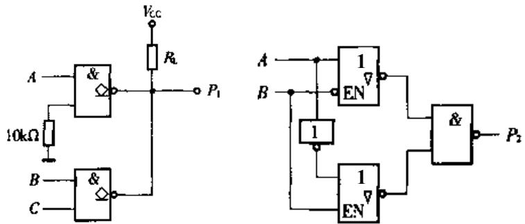

解：
$$ P_1 = \overline{A \cdot 1} \cdot \overline{B \cdot C} = \overline{A}\,\overline{BC} $$

对于 $P_2$，根据图示逻辑关系（同或/异或结构）：
$$ P_2 = A \overline{B} + \overline{A} B = A \oplus B $$

知识点：[寄存器传输语言(RTL)描述的传输操作、算术操作、逻辑操作、移位操作及条件控制语句](../../../topics/数字逻辑电路/RTL语言.md)

### 综合 1

题干：如图 P3.7(a)所示电路，已知输入信号的波形如图 3.7(b)所示，请画出输出信号 P 和 $P'$ 的电压波形并写出 P 的逻辑表达式。

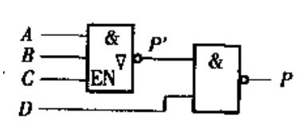

解：逻辑表达式为：
$$ P = \overline{C}\,\overline{D} + C\,\overline{AB} \cdot D = ABC + \overline{D} $$
*(注：原文公式识别存在歧义，根据最终简化结果 $ABC+\overline{D}$ 反推，中间过程可能涉及特定的门电路连接，此处保留最终正确表达式)*

波形图如图3.3.1 所示。

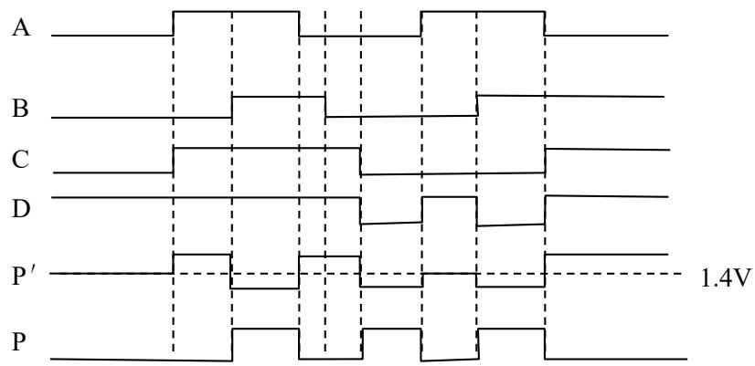

知识点：[数字系统的基本模型（数据处理器与控制器）及对最小时钟周期、异步信号同步化的约定](../../../topics/数字逻辑电路/数字系统模型.md)、[寄存器传输语言(RTL)描述的传输操作、算术操作、逻辑操作、移位操作及条件控制语句](../../../topics/数字逻辑电路/RTL语言.md)

### 填空 3

题干：如图P3.8 所示电路，试问各电压表的指示值为多少？

解：
- $\mathrm{V}_1$ 表的指示值为：3.4V；
- $\mathrm{V}_2$ 表的指示值为：0V；
- $\mathrm{V}_3$ 表的指示值为：3.4V。

答案：
- $\mathrm{V}_1$: 3.4V
- $\mathrm{V}_2$: 0V
- $\mathrm{V}_3$: 3.4V

知识点：[数字系统的基本模型（数据处理器与控制器）及对最小时钟周期、异步信号同步化的约定](../../../topics/数字逻辑电路/数字系统模型.md)、[寄存器传输语言(RTL)描述的传输操作、算术操作、逻辑操作、移位操作及条件控制语句](../../../topics/数字逻辑电路/RTL语言.md)、[算法状态机(ASM)图的状态框、判断框、条件输出框及ASM块的构成规则](../../../topics/数字逻辑电路/ASM图基础.md)

### 简答 3

题干：写出图P3.9各电路的输出是什么状态(高电平、低电平或高阻态)。已知这些门电路都是TTL电路。

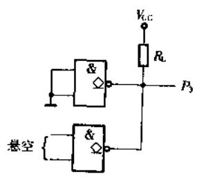

解：
- （a）低电平；
- （b）低电平；
- （c）低电平；
- （d）高阻态；
- （e）低电平；
- （f）低电平。

### 简答 4

题干：若图 P3.9 中(b)、(d)、(e)、(f)的门电路是 CMOS 电路，那么这些电路的输出又是什么状态(高电平、低电平或高阻态)?

解：
- （b）高电平；
- （d）高阻态；
- （e）高电平；
- （f）低电平。

知识点：[数字系统的基本模型（数据处理器与控制器）及对最小时钟周期、异步信号同步化的约定](../../../topics/数字逻辑电路/数字系统模型.md)

### 简答 5

题干：试说明下列各种门电路中哪些输出端可以并联使用？
(1)推拉式输出级的 TTL门电路；
(2)TTL 电路的 OC 门；
(3)TTL 电路的 TS 门；
(4)普通 CMOS 门；
(5)漏极开路的 CMOS 门；
(6)CMOS 电路的 TS 门。

解：可以并联使用的门电路：（2）（3）（5）（6）。

知识点：[数字系统的基本模型（数据处理器与控制器）及对最小时钟周期、异步信号同步化的约定](../../../topics/数字逻辑电路/数字系统模型.md)、[寄存器传输语言(RTL)描述的传输操作、算术操作、逻辑操作、移位操作及条件控制语句](../../../topics/数字逻辑电路/RTL语言.md)

### 简答 6

题干：试指出如图P3.10所示TTL门电路中空闲输入端 $\mathrm{X}_1$、$X_2$ 和 $X_3$ 应如何处理？

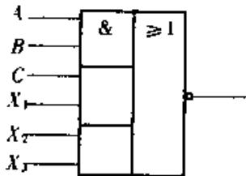

解：
- $\mathrm{X}_1$ 接 “1” 或 $\mathrm{V}_{CC}$ 或变量C；
- $X_2$ 和 $X_3$ 中应至少有一个接 “0” 或地。

知识点：[数字系统的基本模型（数据处理器与控制器）及对最小时钟周期、异步信号同步化的约定](../../../topics/数字逻辑电路/数字系统模型.md)

### 简答 7

题干：ECL 门电路的主要特点是什么？

解：
1. 是TTL、CMOS、I²L、ECL电路中工作速度最快的一种；
2. 功耗大；
3. 逻辑摆幅（高、低电平之差）低，噪声容限低（0.2V左右）。

### 简答 8

题干：写出如图 P3.11 所示 ECL 电路的输出表达式 $\mathrm{F}_1$、$\mathrm{F}_2$ 和 $\mathrm{F}_3$。

解：ECL电路的输出端可以直接并联，实现“线或”功能，故：

$$ F_1 = A + B $$
$$ F_2 = C + D + \overline{E + F + G} $$
$$ F_3 = \overline{A + B} + \overline{C + D} + E + F + G $$

### 简答 9

题干：写出图 P3.12 CMOS 电路的逻辑表达式。

*(注：原题图片缺失，仅保留题目标题)*

## 习题 3.12

（a）（b）（c）（d）四种门电路的输入信号 $A$、$B$ 波形如图 P3.12 所示，试分别画出输出端 $P_1$、$P_2$、$P_3$、$P_4$ 的波形。

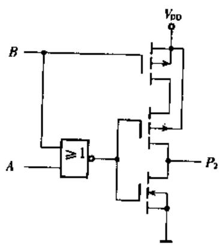

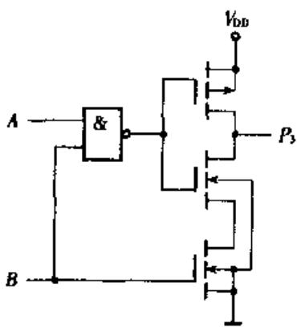

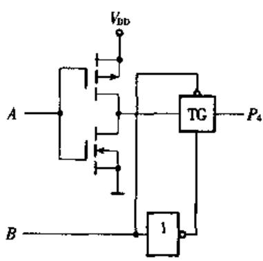

解：（a）$P_1=\{\overline{A}\cdot B=0$ 时；（b）$P_2=\{A\cdot B=0$ 时；

$P_3=\{A\cdot B=0$ 时；$P_4=\{\overline{A}\cdot B$ 当 $B=0$ 时；（c）（d）高阻态 当 $B=1$ 时。

## 习题 3.16

写出图 P3.13 所示电路的逻辑表达式。

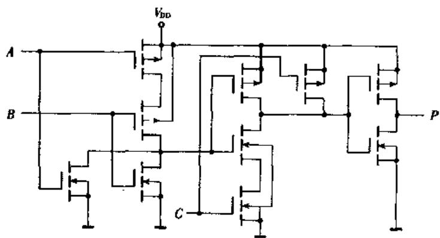

解：$P=A+B\cdot C=\overline{ABC}$

## 习题 3.17

如图 P3.14 所示，已知 TTL 门各端输入信号，试在下面两种情况下画出输出端 $P_1$、$P_2$、$P_3$ 波形。

（1）不考虑各门 $t_{\mathrm{pd}}$；

（2）考虑各门 $t_{\mathrm{pd}}$。

（2）考虑各门 $t_{\mathrm{pd}}$，输出波形如图 3.3.2(b)所示。

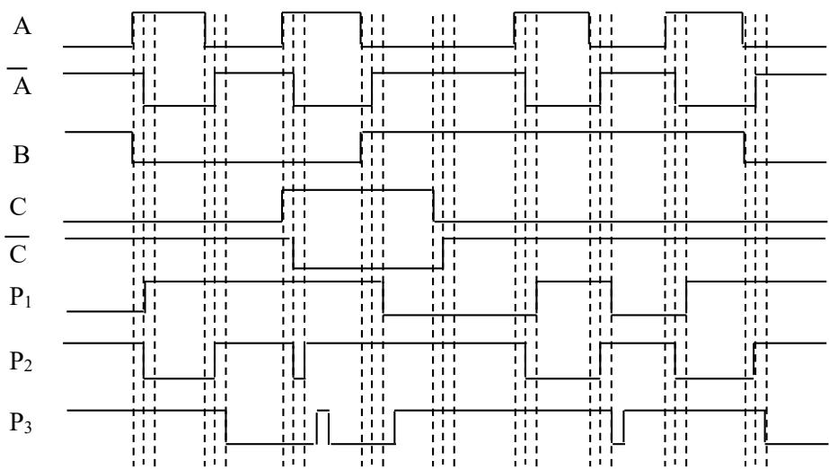

知识点：[数字系统的基本模型（数据处理器与控制器）及对最小时钟周期、异步信号同步化的约定](../../../topics/数字逻辑电路/数字系统模型.md)、[寄存器传输语言(RTL)描述的传输操作、算术操作、逻辑操作、移位操作及条件控制语句](../../../topics/数字逻辑电路/RTL语言.md)
