# 《数字电路与系统设计》第3章 数据选择器（课件）

原件的每一页，下面附识别出的文字。

### 3.2.3 数据选择器 (MUX)

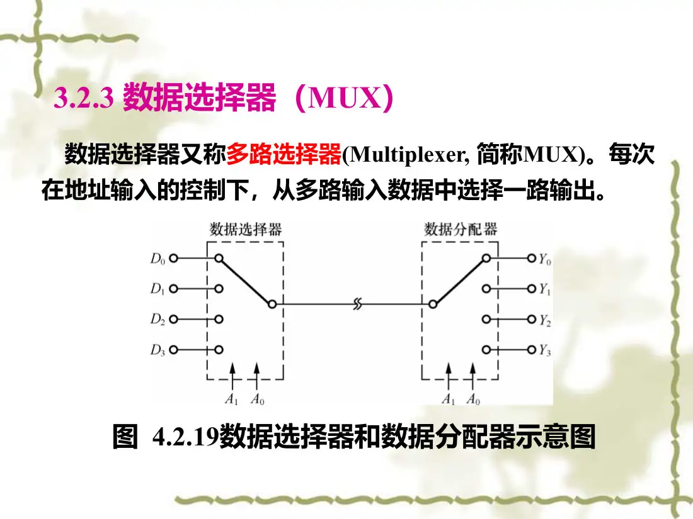

原文：

3.2.3 数据选择器 (MUX)

数据选择器又称多路选择器(Multiplexer, 简称MUX)。每次在地址输入的控制下，从多路输入数据中选择一路输出。

### 1. 四选一数据选择器

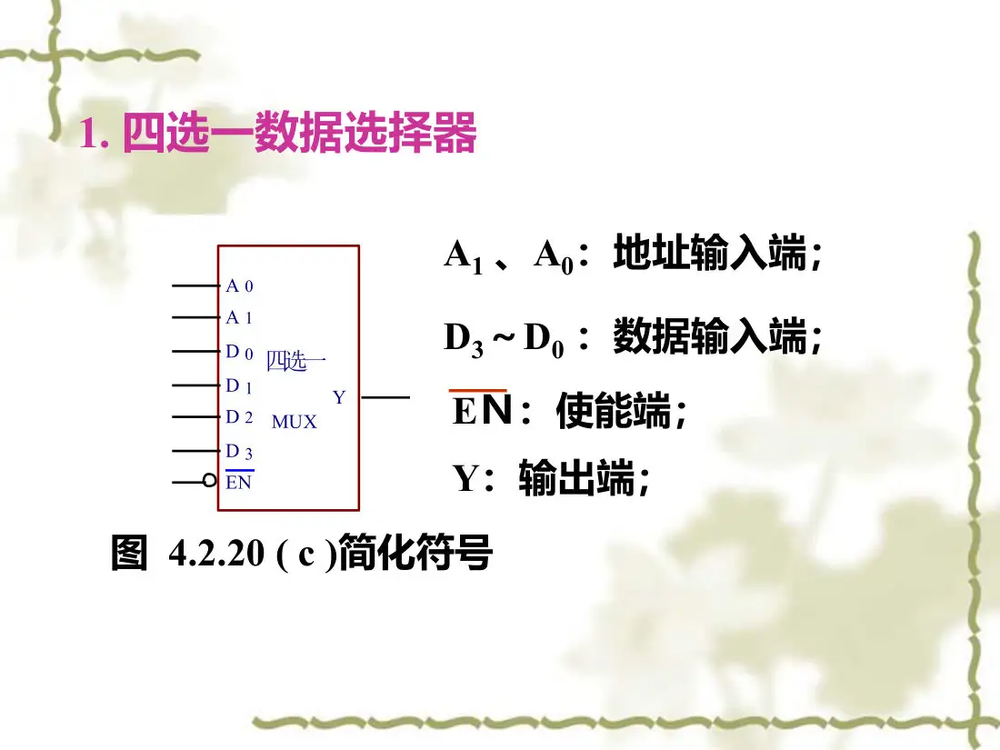

原文：

1. 四选一数据选择器

$$
\begin{array}{l l} \text {四选一} & A _ {1} 、 A _ {0}: \text {地址输入端}; \\ & D _ {3} \sim D _ {0}: \text {数据输入端}; \\ & \overline {{E N}}: \text {使能端}; \\ & Y: \text {输出端}; \\ \text {EN} & \end{array}
$$

图 4.2.20 (c) 简化符号

### 四选一MUX逻辑图

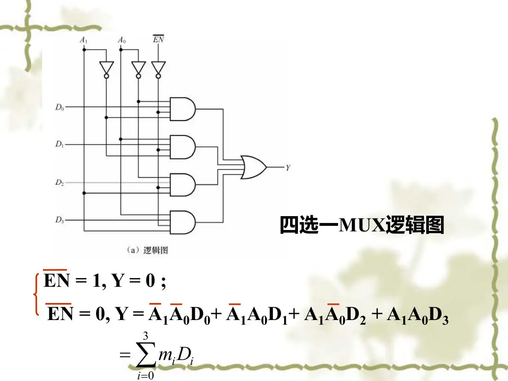

原文：

四选一MUX逻辑图

(a) 逻辑图

$$
\left\{ \begin{array}{l} \overline {{\mathbf {E N}}} = \mathbf {1}, \mathbf {Y} = \mathbf {0}; \\ \overline {{\mathbf {E N}}} = \mathbf {0}, \mathbf {Y} = \overline {{\mathbf {A}}} _ {1} \overline {{\mathbf {A}}} _ {0} \mathbf {D} _ {0} + \overline {{\mathbf {A}}} _ {1} \mathbf {A} _ {0} \mathbf {D} _ {1} + \mathbf {A} _ {1} \overline {{\mathbf {A}}} _ {0} \mathbf {D} _ {2} + \mathbf {A} _ {1} \mathbf {A} _ {0} \mathbf {D} _ {3} \\ = \sum_ {i = 0} ^ {3} m _ {i} D _ {i} \end{array} \right.
$$

### $$

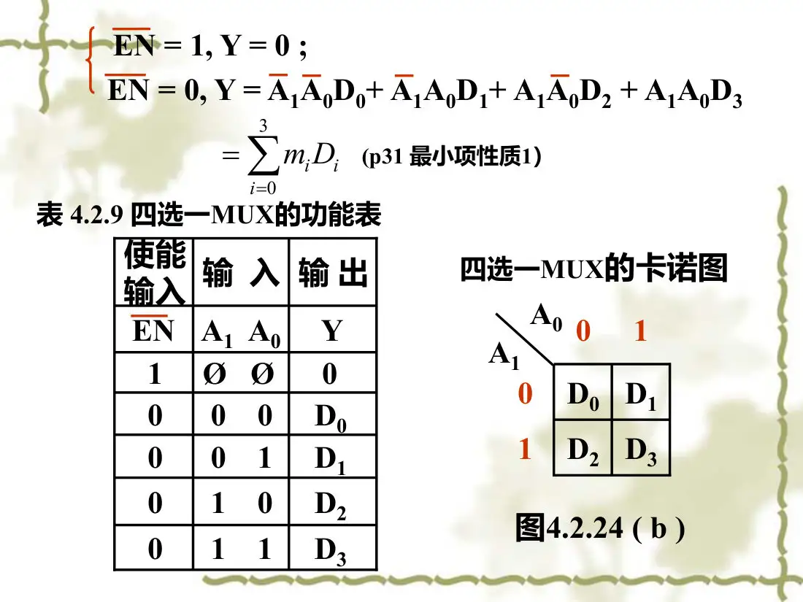

原文：

$$
\left\{ \begin{array}{l} \overline {{\mathbf {E N}}} = 1, \mathbf {Y} = \mathbf {0}; \\ \overline {{\mathbf {E N}}} = \mathbf {0}, \mathbf {Y} = \overline {{\mathbf {A}}} _ {1} \overline {{\mathbf {A}}} _ {0} \mathbf {D} _ {0} + \overline {{\mathbf {A}}} _ {1} \mathbf {A} _ {0} \mathbf {D} _ {1} + \mathbf {A} _ {1} \overline {{\mathbf {A}}} _ {0} \mathbf {D} _ {2} + \mathbf {A} _ {1} \mathbf {A} _ {0} \mathbf {D} _ {3} \\ = \sum_ {i = 0} ^ {3} m _ {i} D _ {i} \quad (\mathrm{p31最小项性质1}) \end{array} \right.
$$

表 4.2.9 四选—MUX的功能表

<table><tr><td>使能输入</td><td>输入</td><td>输出</td></tr><tr><td> $\overline{EN}$ </td><td> $A_1$   $A_0$ </td><td>Y</td></tr><tr><td>1</td><td> $\emptyset$   $\emptyset$ </td><td>0</td></tr><tr><td>0</td><td>0 0</td><td> $D_0$ </td></tr><tr><td>0</td><td>0 1</td><td> $D_1$ </td></tr><tr><td>0</td><td>1 0</td><td> $D_2$ </td></tr><tr><td>0</td><td>1 1</td><td> $D_3$ </td></tr></table>

四选一MUX的卡诺图

### 第 5 页

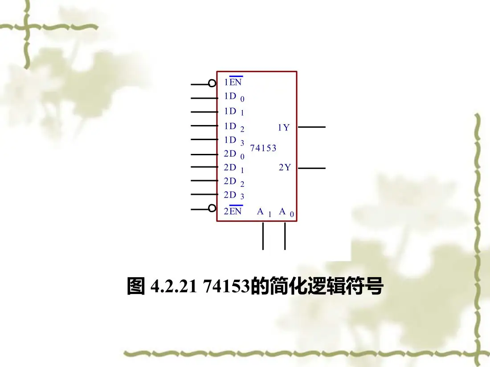

### 2. 八选一数据选择器

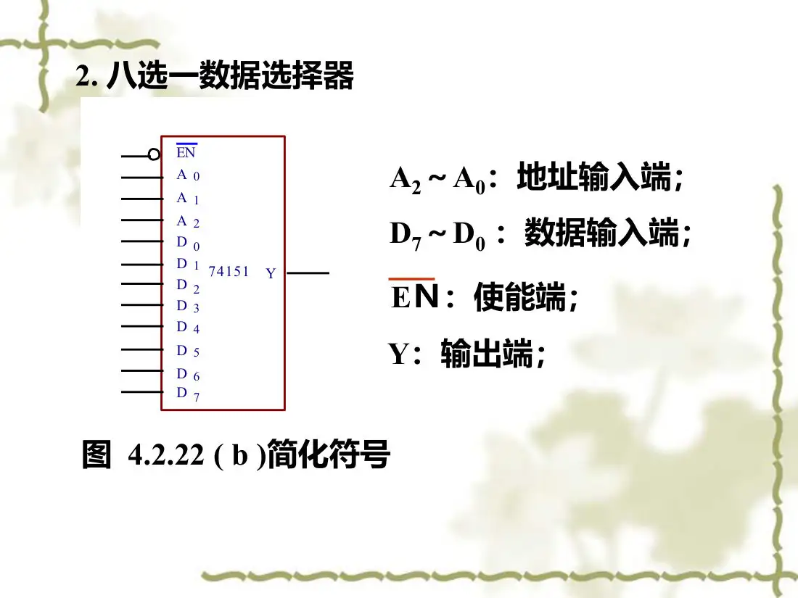

原文：

2. 八选一数据选择器

$\mathrm{A}_2 \sim \mathrm{A}_0$ ：地址输入端；

$\mathbf{D}_7 \sim \mathbf{D}_0$ ：数据输入端；

EN：使能端；

Y: 输出端;

### 第 7 页

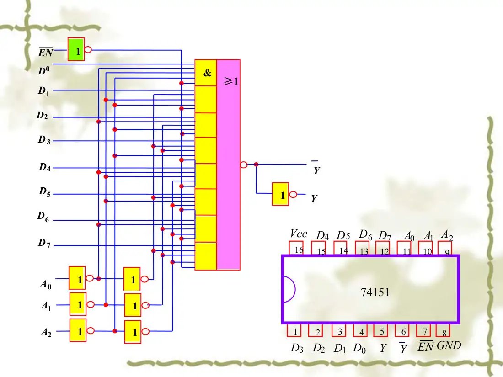

### 八选一MUX的功能表

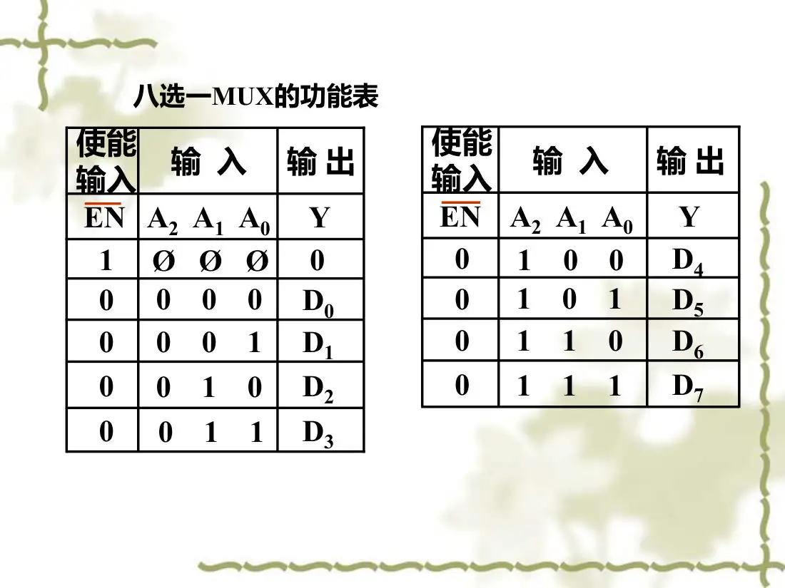

原文：

八选一MUX的功能表

<table><tr><td>使能输入</td><td colspan="3">输入</td><td>输出</td></tr><tr><td> $\overline{EN}$ </td><td> $A_{2}$ </td><td> $A_{1}$ </td><td> $A_{0}$ </td><td>Y</td></tr><tr><td>1</td><td>∅</td><td>∅</td><td>∅</td><td>0</td></tr><tr><td>0</td><td>0</td><td>0</td><td>0</td><td> $D_{0}$ </td></tr><tr><td>0</td><td>0</td><td>0</td><td>1</td><td> $D_{1}$ </td></tr><tr><td>0</td><td>0</td><td>1</td><td>0</td><td> $D_{2}$ </td></tr><tr><td>0</td><td>0</td><td>1</td><td>1</td><td> $D_{3}$ </td></tr></table>

<table><tr><td>使能输入</td><td colspan="3">输入</td><td>输出</td></tr><tr><td> $\overline{EN}$ </td><td> $A_2$ </td><td> $A_1$ </td><td> $A_0$ </td><td>Y</td></tr><tr><td>0</td><td>1</td><td>0</td><td>0</td><td> $D_4$ </td></tr><tr><td>0</td><td>1</td><td>0</td><td>1</td><td> $D_5$ </td></tr><tr><td>0</td><td>1</td><td>1</td><td>0</td><td> $D_6$ </td></tr><tr><td>0</td><td>1</td><td>1</td><td>1</td><td> $D_7$ </td></tr></table>

### 八选一MUX的卡诺图

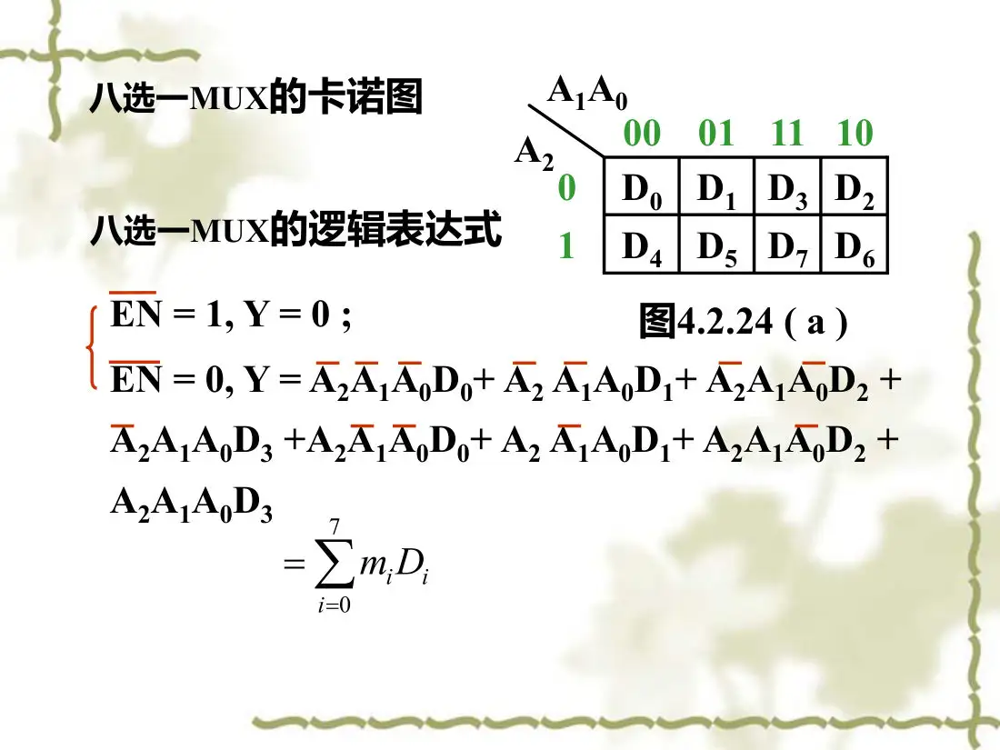

原文：

八选一MUX的卡诺图

八选一MUX的逻辑表达式

$$
\begin{array}{r l} & {\left\{ \begin{array}{l l} {\overline {{{\mathbf {E N}}}} = 1, \mathbf {Y} = \mathbf {0};} & {\text {图4.2.24(a)}} \\ {\overline {{{\mathbf {E N}}}} = \mathbf {0}, \mathbf {Y} = \overline {{{\mathbf {A}}}} _ {2} \overline {{{\mathbf {A}}}} _ {1} \overline {{{\mathbf {A}}}} _ {0} \mathbf {D} _ {0} + \overline {{{\mathbf {A}}}} _ {2} \overline {{{\mathbf {A}}}} _ {1} \mathbf {A} _ {0} \mathbf {D} _ {1} + \overline {{{\mathbf {A}}}} _ {2} \mathbf {A} _ {1} \overline {{{\mathbf {A}}}} _ {0} \mathbf {D} _ {2} +} \\ {\overline {{{\mathbf {A}}}} _ {2} \mathbf {A} _ {1} \mathbf {A} _ {0} \mathbf {D} _ {3} + \mathbf {A} _ {2} \overline {{{\mathbf {A}}}} _ {1} \overline {{{\mathbf {A}}}} _ {0} \mathbf {D} _ {0} + \mathbf {A} _ {2} \overline {{{\mathbf {A}}}} _ {1} \mathbf {A} _ {0} \mathbf {D} _ {1} + \mathbf {A} _ {2} \mathbf {A} _ {1} \overline {{{\mathbf {A}}}} _ {0} \mathbf {D} _ {2} +} \\ {\mathbf {A} _ {2} \mathbf {A} _ {1} \mathbf {A} _ {0} \mathbf {D} _ {3}} & \\ & {\quad = \sum_ {i = 0} ^ {7} m _ {i} D _ {i}} \end{array} \right.} \end{array}
$$

### 3. 数据选择器的扩展

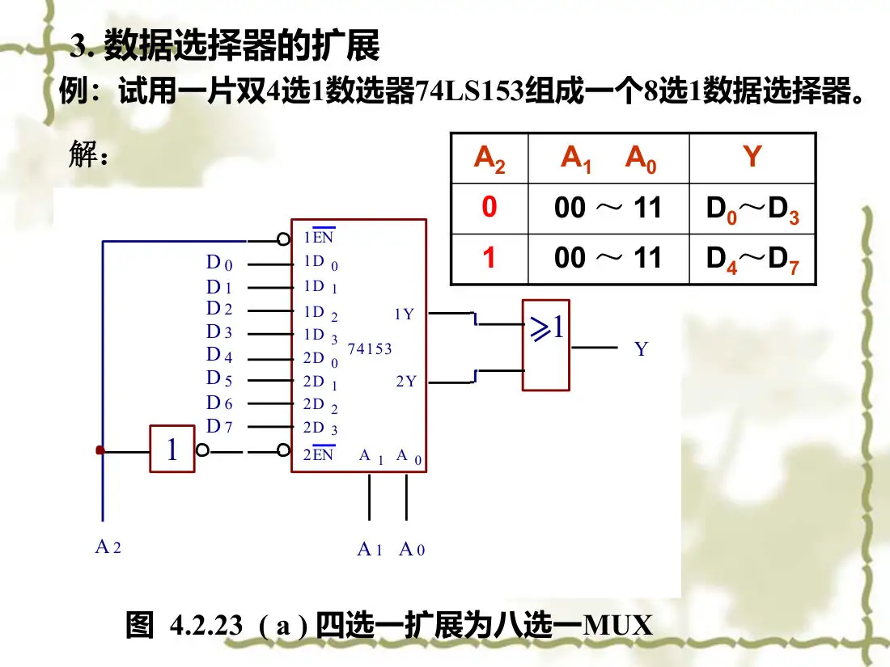

原文：

3. 数据选择器的扩展

例：试用一片双4选1数选器74LS153组成一个8选1数据选择器。

解:

### 例：试将8选1数选器74LS151扩展成一个32选1数据选择器。

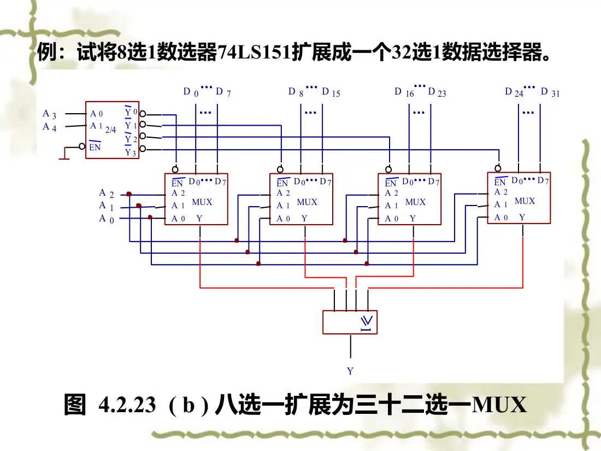

原文：

例：试将8选1数选器74LS151扩展成一个32选1数据选择器。

### 方法二

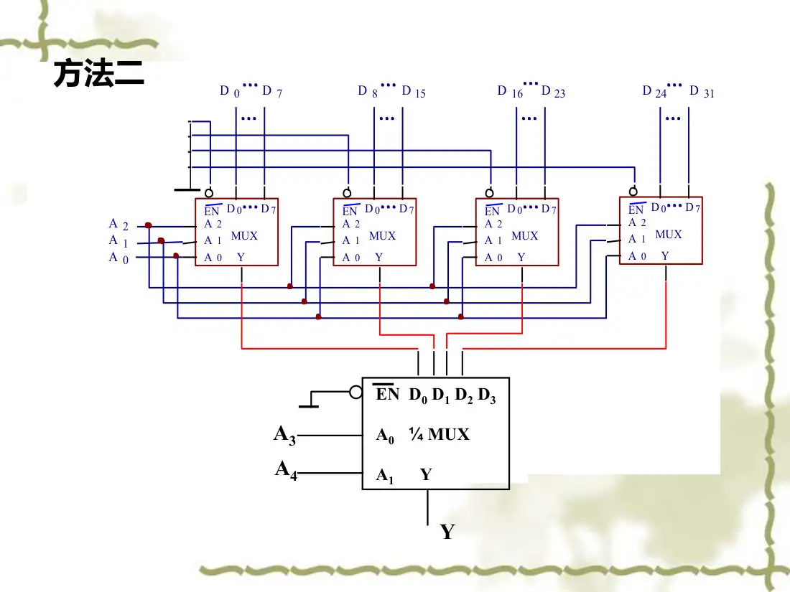

原文：

方法二

### 4.用数据选择器设计组合逻辑电路

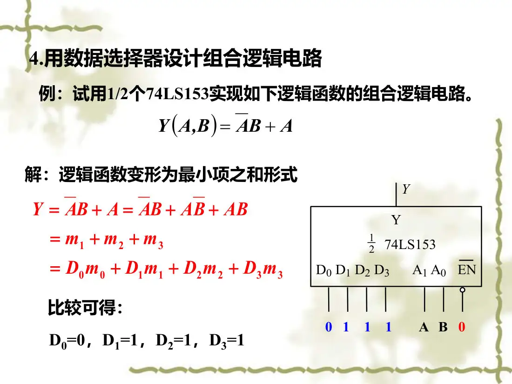

原文：

4.用数据选择器设计组合逻辑电路

例：试用1/2个74LS153实现如下逻辑函数的组合逻辑电路。

$$
\boldsymbol {Y} (\boldsymbol {A}, \boldsymbol {B}) = \overline {{\boldsymbol {A}}} \boldsymbol {B} + \boldsymbol {A}
$$

解：逻辑函数变形为最小项之和形式

$$
\begin{array}{r l} & Y = \overline {{A}} B + A = \overline {{A}} B + A \overline {{B}} + A B \\ & \quad = m _ {1} + m _ {2} + m _ {3} \\ & \quad = D _ {0} m _ {0} + D _ {1} m _ {1} + D _ {2} m _ {2} + D _ {3} m _ {3} \end{array}
$$

比较可得:

$$
\mathbf {D} _ {0} = \mathbf {0}, \quad \mathbf {D} _ {1} = \mathbf {1}, \quad \mathbf {D} _ {2} = \mathbf {1}, \quad \mathbf {D} _ {3} = \mathbf {1}
$$

### A1A0A200011110D0D1D3D2D4D5D7D6

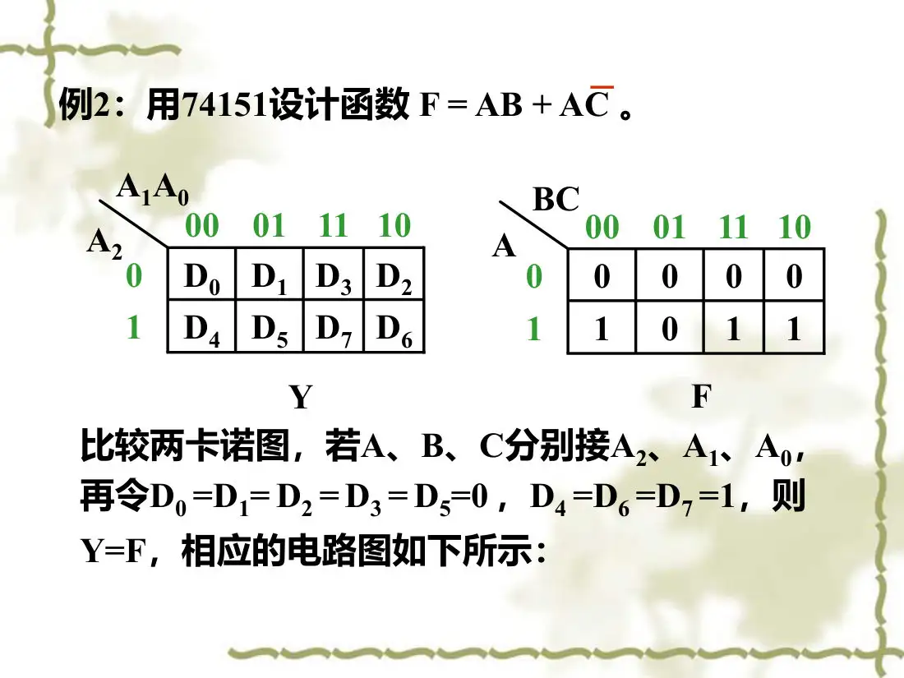

原文：

例2: 用74151设计函数 $\mathrm{F} = \mathrm{AB} + \mathrm{AC}$ 。

<table><tr><td colspan="5">A1A0</td></tr><tr><td rowspan="3">A2</td><td>00</td><td>01</td><td>11</td><td>10</td></tr><tr><td>D0</td><td>D1</td><td>D3</td><td>D2</td></tr><tr><td>D4</td><td>D5</td><td>D7</td><td>D6</td></tr></table>

Y F
<table><tr><td rowspan="3">A\BC</td><td>00</td><td>01</td><td>11</td><td>10</td></tr><tr><td>0</td><td>0</td><td>0</td><td>0</td></tr><tr><td>1</td><td>1</td><td>0</td><td>1</td></tr></table>

比较两卡诺图，若A、B、C分别接 $A_{2}$ 、 $A_{1}$ 、 $A_{0}$ ，再令 $D_{0}=D_{1}=D_{2}=D_{3}=D_{5}=0$ ， $D_{4}=D_{6}=D_{7}=1$ ，则Y=F，相应的电路图如下所示：

### 第 15 页

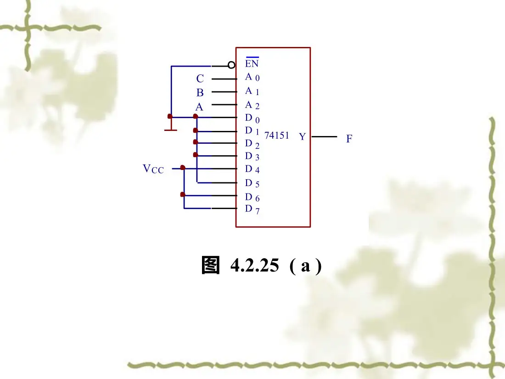

### A1A0A200011110D0D1D3D2D4D5D7D6

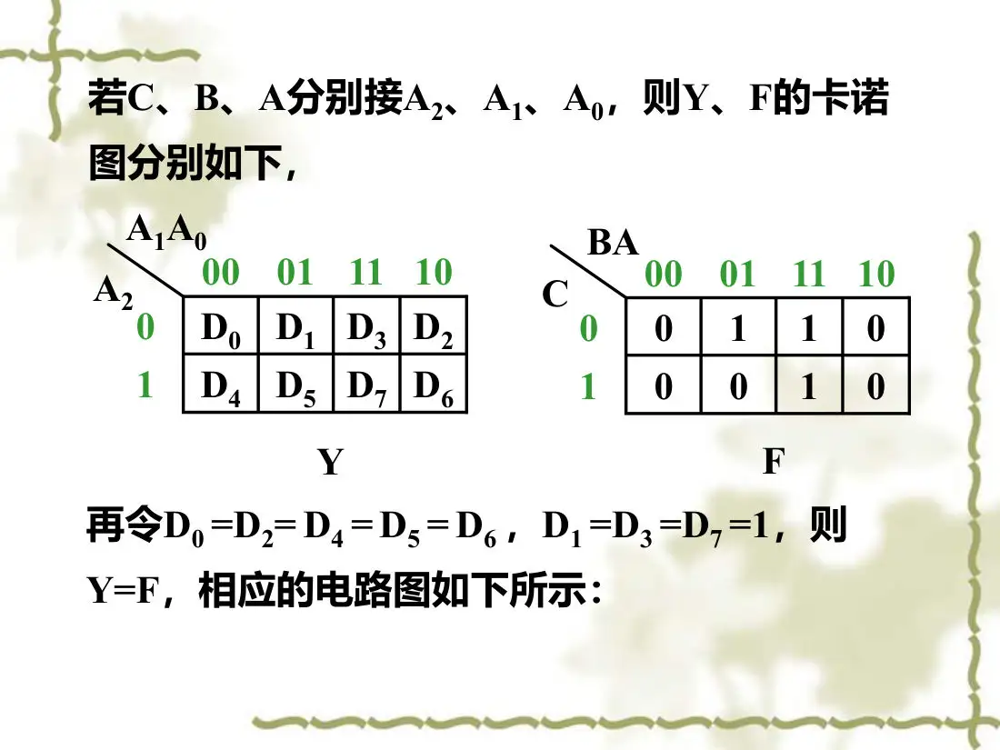

原文：

若C、B、A分别接 $A_{2}$ 、 $A_{1}$ 、 $A_{0}$ ，则Y、F的卡诺图分别如下，

<table><tr><td colspan="5">A1A0</td></tr><tr><td rowspan="3">A2</td><td>00</td><td>01</td><td>11</td><td>10</td></tr><tr><td>D0</td><td>D1</td><td>D3</td><td>D2</td></tr><tr><td>D4</td><td>D5</td><td>D7</td><td>D6</td></tr></table>

<table><tr><td>C\BA</td><td>00</td><td>01</td><td>11</td><td>10</td></tr><tr><td>0</td><td>0</td><td>1</td><td>1</td><td>0</td></tr><tr><td>1</td><td>0</td><td>0</td><td>1</td><td>0</td></tr></table>

Y

F

再令 $D_{0}=D_{2}=D_{4}=D_{5}=D_{6}$ ， $D_{1}=D_{3}=D_{7}=1$ ，则Y=F，相应的电路图如下所示：

### 第 17 页

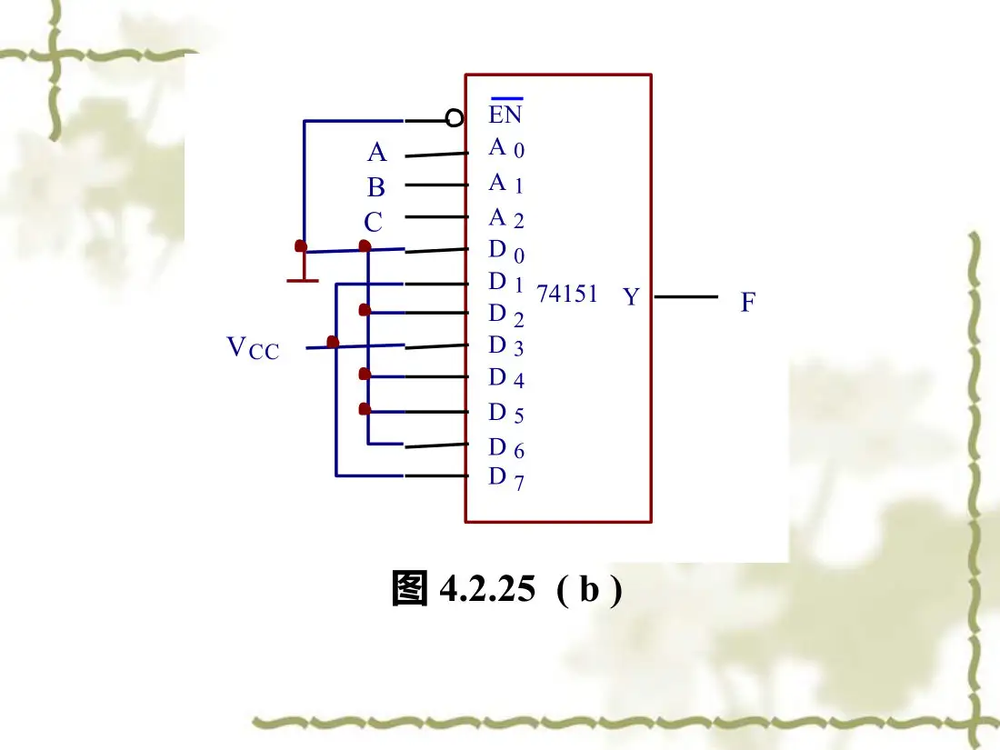

### 降维方法：1、代数法；2、卡诺图法

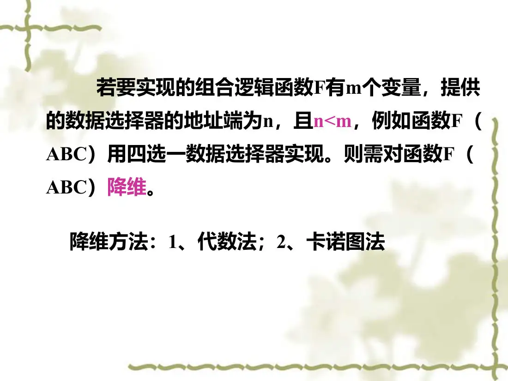

原文：

若要实现的组合逻辑函数F有m个变量，提供的数据选择器的地址端为n，且n<m，例如函数F（ABC）用四选一数据选择器实现。则需对函数F（ABC）降维。

降维方法：1、代数法；2、卡诺图法

### (1) 代数法

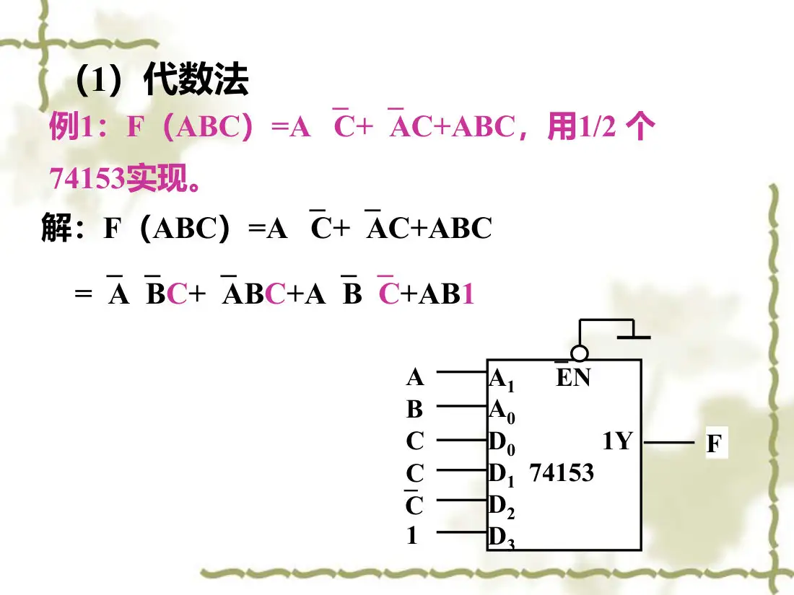

原文：

(1) 代数法

例1: F (ABC) = A $\overline{C} + \overline{A}C + ABC$ ，用1/2个74153实现。

解：F (ABC) = A $\overline{C} + \overline{A}C + ABC$ = $\overline{A}$ $\overline{B}C + \overline{A}BC + A$ $\overline{B}$ $\overline{C} + AB1$

### $\mathbf{S}_{\mathrm{i}}$

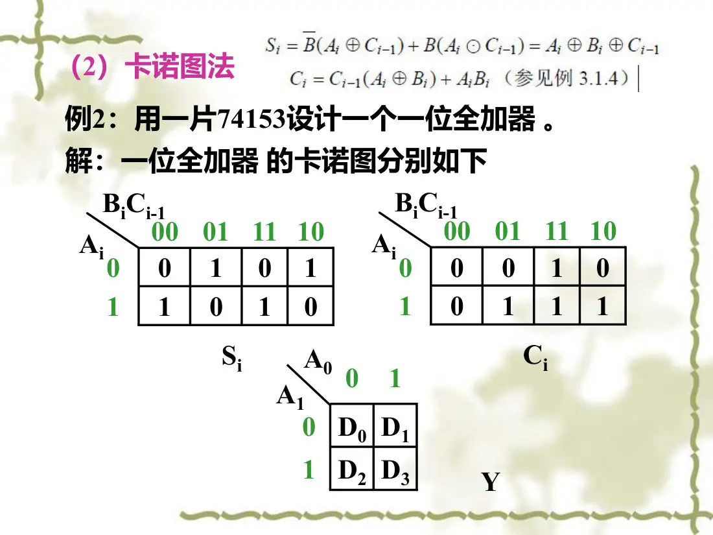

原文：

$\mathbf{S}_{\mathrm{i}}$

(2) 卡诺图法

$$
\begin{array}{r l} & S _ {i} = \overline {{{B}}} (A _ {i} \oplus C _ {i - 1}) + B (A _ {i} \odot C _ {i - 1}) = A _ {i} \oplus B _ {i} \oplus C _ {i - 1} \\ & \quad C _ {i} = C _ {i - 1} (A _ {i} \oplus B _ {i}) + A _ {i} B _ {i} (\text {参见例3.1.4}) \end{array}
$$

例2：用一片74153设计一个一位全加器。

解：一位全加器的卡诺图分别如下

<table><tr><td rowspan="3">Ai\BiCi-1</td><td>00</td><td>01</td><td>11</td><td>10</td></tr><tr><td>0</td><td>1</td><td>0</td><td>1</td></tr><tr><td>1</td><td>1</td><td>0</td><td>1</td></tr></table>

<table><tr><td rowspan="3">Ai\BiCi-1</td><td>00</td><td>01</td><td>11</td><td>10</td></tr><tr><td>0</td><td>0</td><td>1</td><td>0</td></tr><tr><td>1</td><td>0</td><td>1</td><td>1</td></tr></table>

### 第 21 页

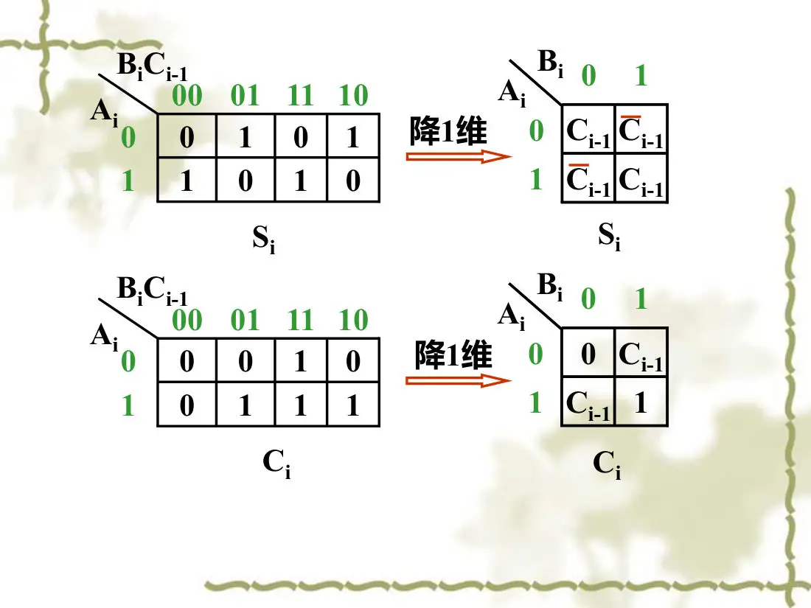

### 第 22 页

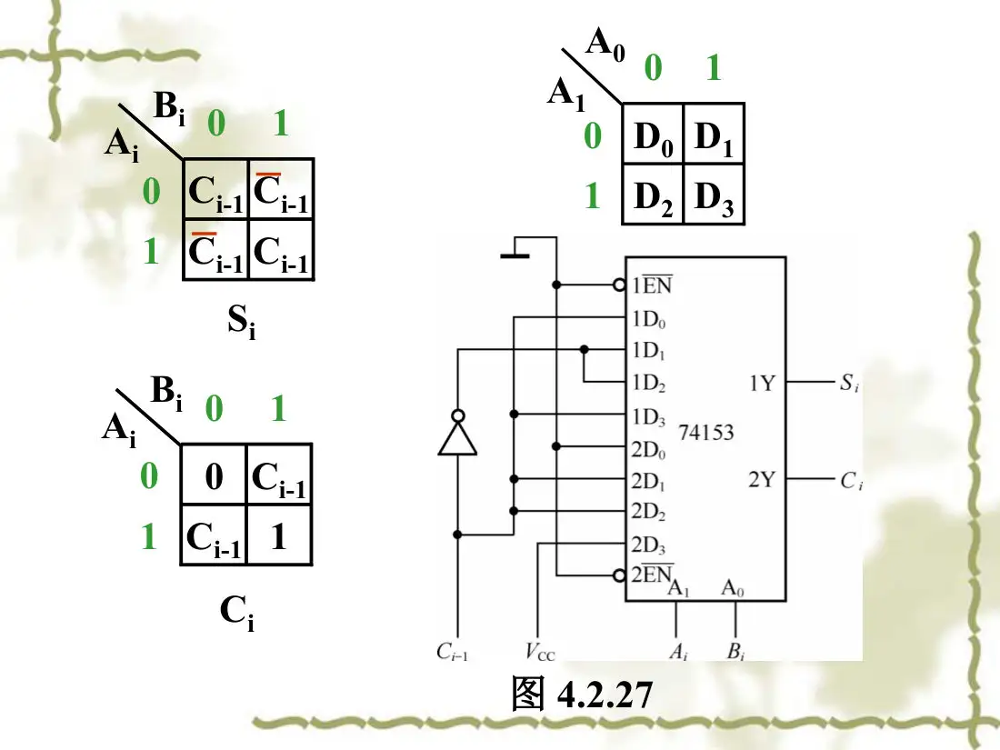

### 用数据选择器设计组合逻辑电路的步骤：

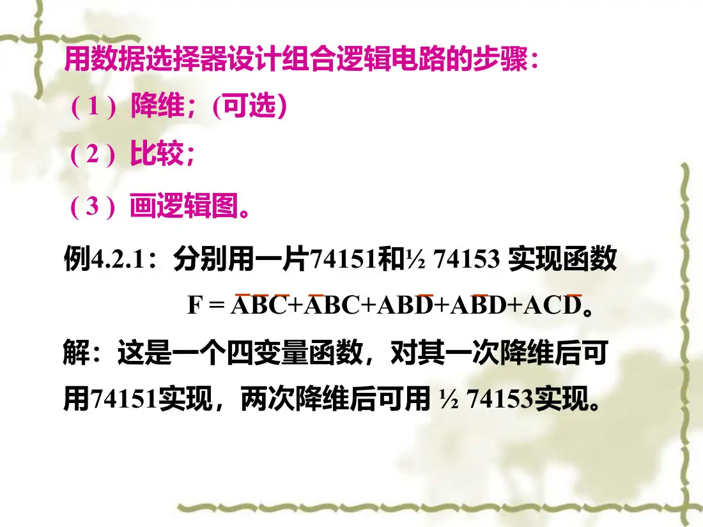

原文：

用数据选择器设计组合逻辑电路的步骤：

(1) 降维；(可选)

(2) 比较;

(3) 画逻辑图。

例4.2.1：分别用一片74151和 $\frac{1}{2}$ 74153实现函数

$$
\mathbf {F} = \overline {{\mathbf {A}}} \mathbf {B} \mathbf {C} + \overline {{\mathbf {A}}} \mathbf {B} \mathbf {C} + \mathbf {A} \mathbf {B} \mathbf {D} + \mathbf {A} \mathbf {B} \mathbf {D} + \mathbf {A} \mathbf {C} \mathbf {D} 。
$$

解：这是一个四变量函数，对其一次降维后可用74151实现，两次降维后可用 $\frac{1}{2}$ 74153实现。

### (a) 图4.2.28

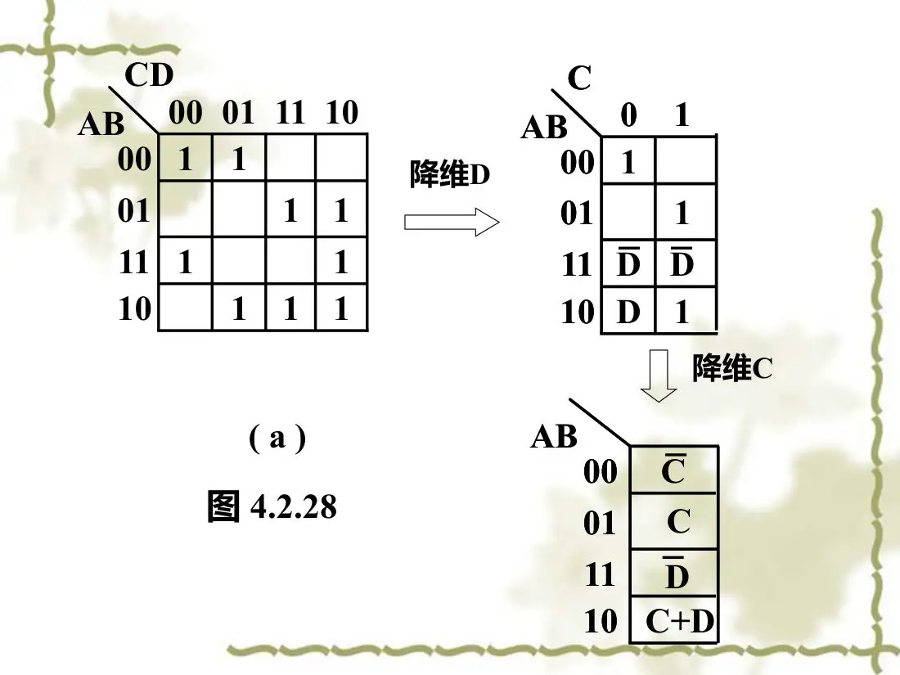

原文：

(a) 图4.2.28
<table><tr><td>AB\CD</td><td>00</td><td>01</td><td>11</td><td>10</td></tr><tr><td>00</td><td>1</td><td>1</td><td></td><td></td></tr><tr><td>01</td><td></td><td></td><td>1</td><td>1</td></tr><tr><td>11</td><td>1</td><td></td><td></td><td>1</td></tr><tr><td>10</td><td></td><td>1</td><td>1</td><td>1</td></tr></table>

### 第 25 页

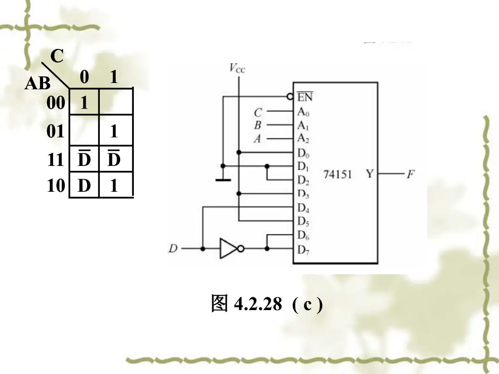

### 第 26 页

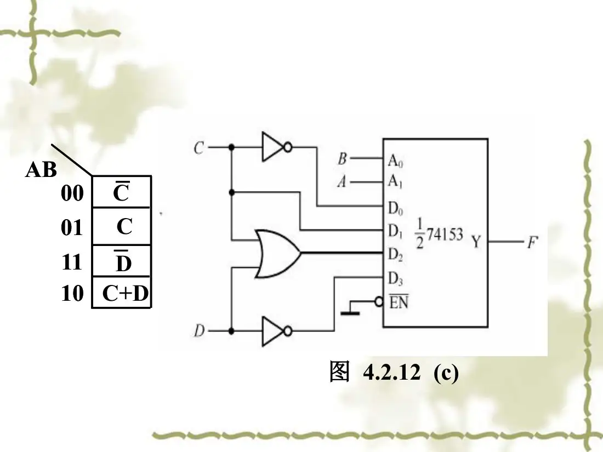

### 四、数据比较器

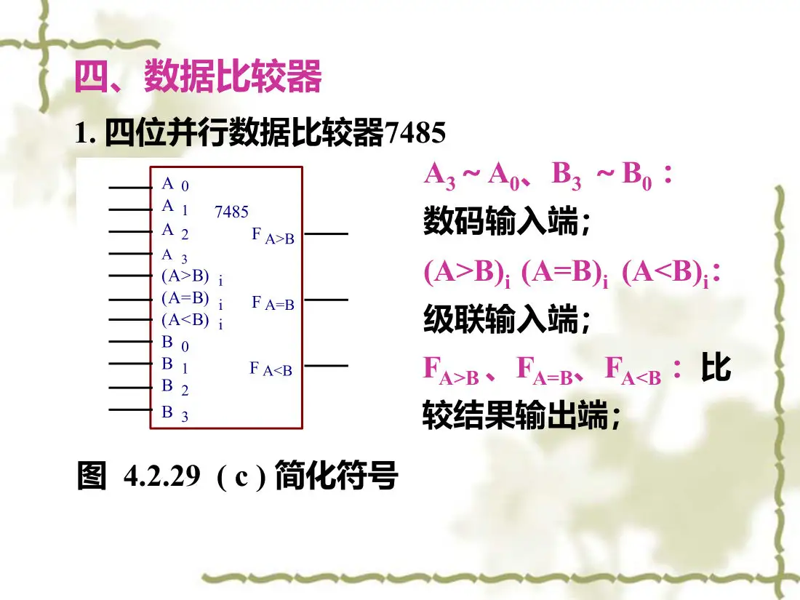

原文：

四、数据比较器

1.四位并行数据比较器7485

$$
\begin{array}{c c c} \text {A 0} & & \\ \text {A 1} & 7 4 8 5 & \\ \text {A 2} & & \text {F A>B} \\ \text {A 3} & & \\ (\text {A>B}) _ {\text {i}} & & \\ (\text {A=B}) _ {\text {i}} & & \text {F A=B} \\ (\text {A< B}) _ {\text {i}} & & \\ \text {B 0} & & \\ \text {B 1} & & \text {F A< B} \\ \text {B 2} & & \\ \text {B 3} & & \end{array}
$$

图 4.2.29 (c) 简化符号

$$
\mathrm{A} _ {3} \sim \mathrm{A} _ {0}, \quad \mathrm{B} _ {3} \sim \mathrm{B} _ {0}:
$$

数码输入端；

$$
(\mathrm{A} > \mathrm{B}) _ {\mathrm{i}} (\mathrm{A} = \mathrm{B}) _ {\mathrm{i}} (\mathrm{A} <   \mathrm{B}) _ {\mathrm{i}}:
$$

级联输入端；

$F_{A>B}$ 、 $F_{A=B}$ 、 $F_{A<B}$ ：比

较结果输出端；

### 表 4.2.10 4位数值比较器7485功能表

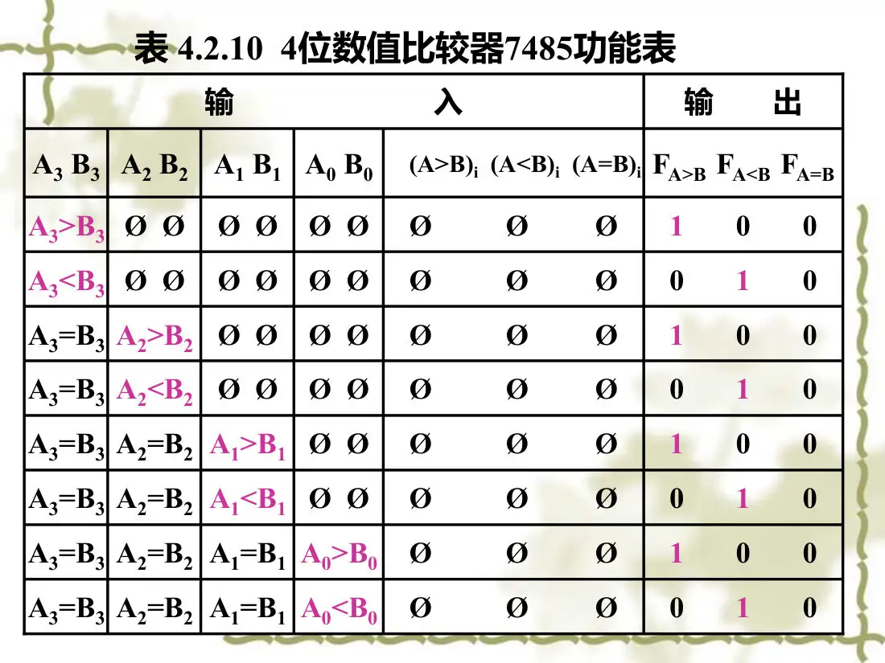

原文：

表 4.2.10 4位数值比较器7485功能表
<table><tr><td colspan="5">输入</td><td colspan="3">输出</td></tr><tr><td> $A_3 B_3$ </td><td> $A_2 B_2$ </td><td> $A_1 B_1$ </td><td> $A_0 B_0$ </td><td> $(A>B)_i (A1F_{A>B} F_{A1F_{A=B}} F_{A=B} F_{A=B}$ </td><td> $F_{A>B}$ </td><td> $F_{A1F_{A=B}}$ </td><td> $F_{A=B}$ </td></tr><tr><td> $A_3>B_3$ </td><td>∅ ∅</td><td>∅ ∅</td><td>∅ ∅</td><td>∅ ∅ ∅</td><td>1</td><td>0</td><td>0</td></tr><tr><td> $A_3< B_3$ </td><td>∅ ∅</td><td>∅ ∅</td><td>∅ ∅</td><td>∅ ∅ ∅</td><td>0</td><td>1</td><td>0</td></tr><tr><td> $A_3=B_3$ </td><td> $A_2>B_2$ </td><td>∅ ∅</td><td>∅ ∅</td><td>∅ ∅ ∅</td><td>1</td><td>0</td><td>0</td></tr><tr><td> $A_3=B_3$ </td><td> $A_210</td><td>∅ ∅</td><td>∅ ∅</td><td>∅ ∅ ∅</td><td>0</td><td>1</td><td>0</td></tr><tr><td>\( A_3=B_3$ </td><td> $A_2=B_2$ </td><td> $A_1>B_1$ </td><td>∅ ∅</td><td>∅ ∅ ∅</td><td>1</td><td>0</td><td>0</td></tr><tr><td> $A_3=B_3$ </td><td> $A_2=B_2$ </td><td> $A_110∅ ∅∅010</td><td>∅ ∅</td><td>∅ ∅ ∅</td><td>0</td><td>1</td><td>0</td></tr><tr><td>\( A_3=B_3$ </td><td> $A_2=B_2$ </td><td> $A_1=B_1$ </td><td> $A_0>B_0$ </td><td>∅ ∅ ∅</td><td>1</td><td>0</td><td>0</td></tr><tr><td> $A_3=B_3$ </td><td> $A_2=B_2$ </td><td> $A_1=B_1$ </td><td>\( A_010∅ ∅∅010</td><td>∅ ∅ ∅</td><td>0</td><td>1</td><td>0</td></tr></table>

### 续表

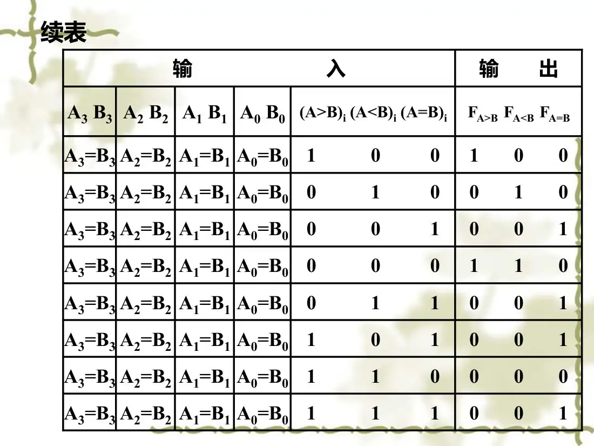

原文：

续表

<table><tr><td colspan="5">输入</td><td colspan="3">输出</td></tr><tr><td> $A_3 B_3$ </td><td> $A_2 B_2$ </td><td> $A_1 B_1$ </td><td> $A_0 B_0$ </td><td> $(A>B)_i (A(A=A)=B)_i$ </td><td colspan="3"> $F_{A>B} F_{A0} F_{A=B} F_{A=B}$ </td></tr><tr><td> $A_3=B_3$ </td><td> $A_2=B_2$ </td><td> $A_1=B_1$ </td><td> $A_0=B_0$ </td><td>1 0 0</td><td>1</td><td>0</td><td>0</td></tr><tr><td> $A_3=B_3$ </td><td> $A_2=B_2$ </td><td> $A_1=B_1$ </td><td> $A_0=B_0$ </td><td>0 1 0</td><td>0</td><td>1</td><td>0</td></tr><tr><td> $A_3=B_3$ </td><td> $A_2=B_2$ </td><td> $A_1=B_1$ </td><td> $A_0=B_0$ </td><td>0 0 1</td><td>0</td><td>0</td><td>1</td></tr><tr><td> $A_3=B_3$ </td><td> $A_2=B_2$ </td><td> $A_1=B_1$ </td><td> $A_0=B_0$ </td><td>0 0 0</td><td>1</td><td>1</td><td>0</td></tr><tr><td> $A_3=B_3$ </td><td> $A_2=B_2$ </td><td> $A_1=B_1$ </td><td> $A_0=B_0$ </td><td>0 1 1</td><td>0</td><td>0</td><td>1</td></tr><tr><td> $A_3=B_3$ </td><td> $A_2=B_2$ </td><td> $A_1=B_1$ </td><td> $A_0=B_0$ </td><td>1 0 1</td><td>0</td><td>0</td><td>1</td></tr><tr><td> $A_3=B_3$ </td><td> $A_2=B_2$ </td><td> $A_1=B_1$ </td><td> $A_0=B_0$ </td><td>1 1 0</td><td>0</td><td>0</td><td>0</td></tr><tr><td> $A_3=B_3$ </td><td> $A_2=B_2$ </td><td> $A_1=B_1$ </td><td> $A_0=B_0$ </td><td>1 1 1</td><td>0</td><td>0</td><td>1</td></tr></table>

### 4. 数据比较器的扩展

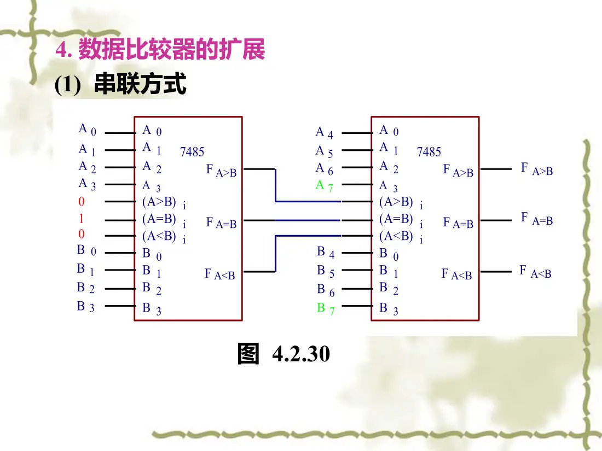

原文：

4. 数据比较器的扩展

(1) 串联方式

### (2) 并联方式

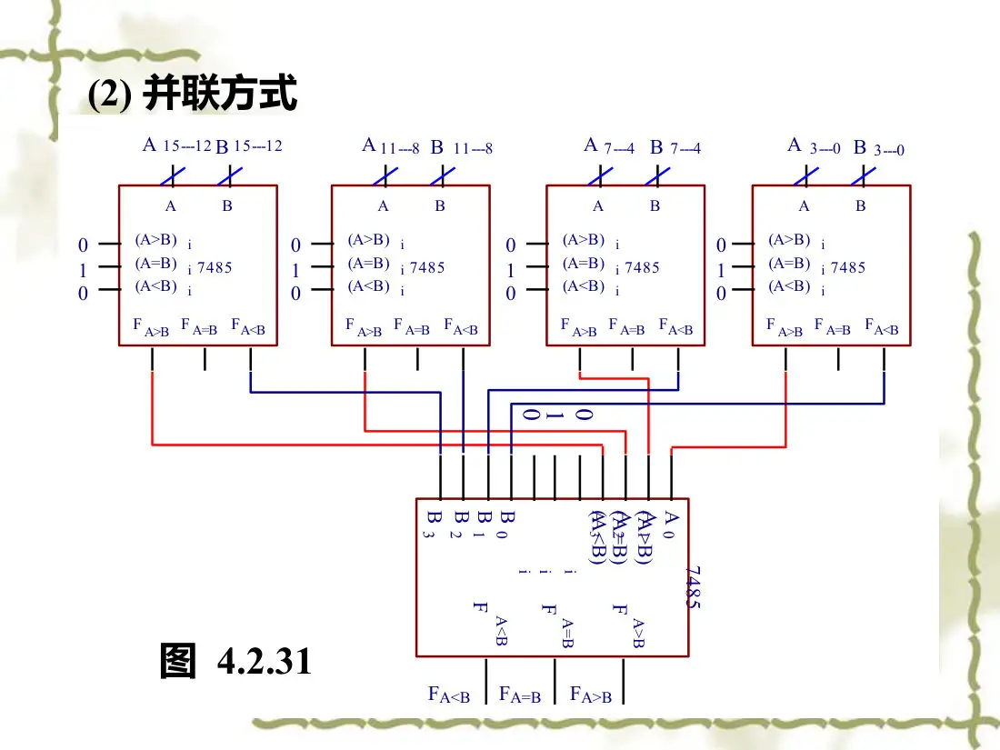

原文：

(2) 并联方式

### 解：关键在最低位的比较

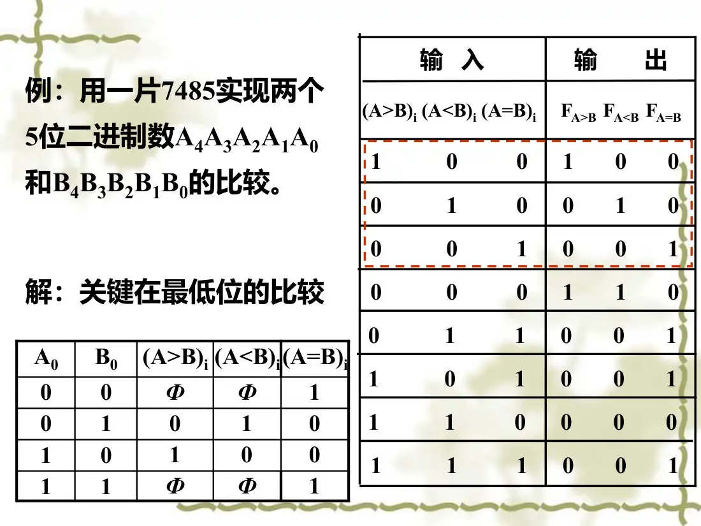

原文：

例：用一片7485实现两个5位二进制数 $A_{4}A_{3}A_{2}A_{1}A_{0}$ 和 $B_{4}B_{3}B_{2}B_{1}B_{0}$ 的比较。

解：关键在最低位的比较
<table><tr><td> $A_0$ </td><td> $B_0$ </td><td> $(A>B)_i$ </td><td> $(A(A=B)_i$ </td><td> $(A=B)_i$ </td></tr><tr><td>0</td><td>0</td><td> $\Phi$ </td><td> $\Phi$ </td><td>1</td></tr><tr><td>0</td><td>1</td><td>0</td><td>1</td><td>0</td></tr><tr><td>1</td><td>0</td><td>1</td><td>0</td><td>0</td></tr><tr><td>1</td><td>1</td><td> $\Phi$ </td><td> $\Phi$ </td><td>1</td></tr></table>

<table><tr><td colspan="3">输入</td><td colspan="3">输出</td></tr><tr><td colspan="3"> $(A>B)_i$   $(A100\( F_{A>B}$   $F_{A100\( F_{A=B}$ </td><td colspan="3"> $F_{A>B}$   $F_{A100\( F_{A=B}$ </td></tr><tr><td>1</td><td>0</td><td>0</td><td>1</td><td>0</td><td>0</td></tr><tr><td>0</td><td>1</td><td>0</td><td>0</td><td>1</td><td>0</td></tr><tr><td>0</td><td>0</td><td>1</td><td>0</td><td>0</td><td>1</td></tr><tr><td>0</td><td>0</td><td>0</td><td>1</td><td>1</td><td>0</td></tr><tr><td>0</td><td>1</td><td>1</td><td>0</td><td>0</td><td>1</td></tr><tr><td>1</td><td>0</td><td>1</td><td>0</td><td>0</td><td>1</td></tr><tr><td>1</td><td>1</td><td>0</td><td>0</td><td>0</td><td>0</td></tr><tr><td>1</td><td>1</td><td>1</td><td>0</td><td>0</td><td>1</td></tr></table>

### $$

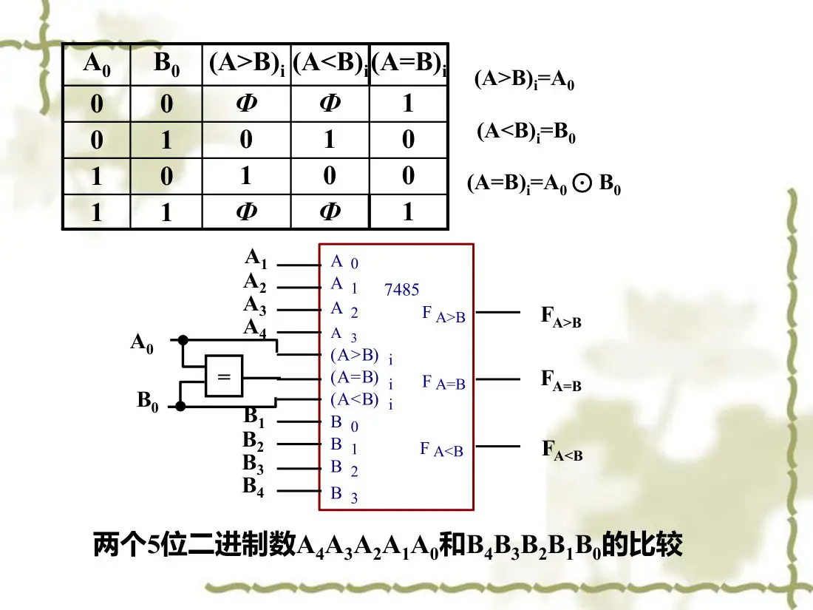

原文：

<table><tr><td> $A_0$ </td><td> $B_0$ </td><td> $(A>B)_i$ </td><td> $(A1(A=B)_i$ </td><td> $(A=B)_i$ </td></tr><tr><td>0</td><td>0</td><td> $\Phi$ </td><td> $\Phi$ </td><td>1</td></tr><tr><td>0</td><td>1</td><td>0</td><td>1</td><td>0</td></tr><tr><td>1</td><td>0</td><td>1</td><td>0</td><td>0</td></tr><tr><td>1</td><td>1</td><td> $\Phi$ </td><td> $\Phi$ </td><td>1</td></tr></table>

$$
(\mathbf {A} > \mathbf {B}) _ {\mathrm{i}} = \mathbf {A} _ {\mathbf {0}}
$$

$$
(\mathbf {A} <   \mathbf {B}) _ {\mathrm{i}} = \mathbf {B} _ {0}
$$

$$
(\mathbf {A} = \mathbf {B}) _ {\mathrm{i}} = \mathbf {A} _ {0} \odot \mathbf {B} _ {0}
$$

$$
\begin{array}{c c c} \text {A_1} & \text {A_0} \\ \text {A_2} & \text {A_1} & 7 4 8 5 \\ \text {A_3} & \text {A_2} & F _ {\text {A>B}} \\ \text {A_4} & \text {A_3} \\ \text {B_0} & (\text {A>B}) _ {i} \\ & (\text {A=B}) _ {i} & F _ {\text {A=B}} \\ & (\text {A< B}) _ {i} \\ \text {B_1} & B _ {0} \\ \text {B_2} & B _ {1} \\ \text {B_3} & B _ {2} \\ \text {B_4} & B _ {3} \end{array}
$$

两个5位二进制数 $\mathrm{A}_4\mathrm{A}_3\mathrm{A}_2\mathrm{A}_1\mathrm{A}_0$ 和 $\mathrm{B}_4\mathrm{B}_3\mathrm{B}_2\mathrm{B}_1\mathrm{B}_0$ 的比较

### 四、全加器

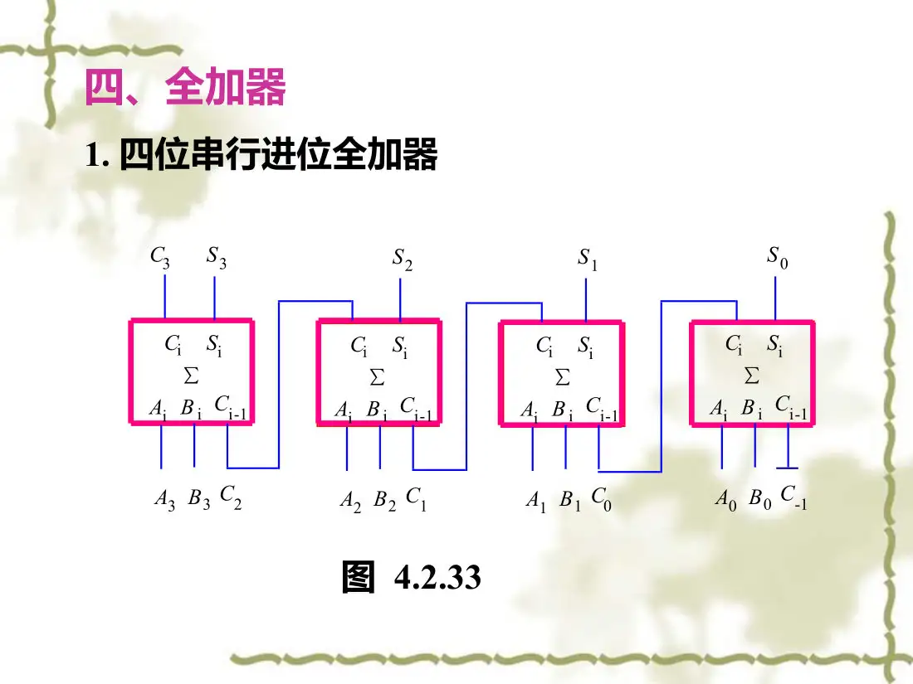

原文：

四、全加器

1. 四位串行进位全加器

### 2. 四位超前进位全加器

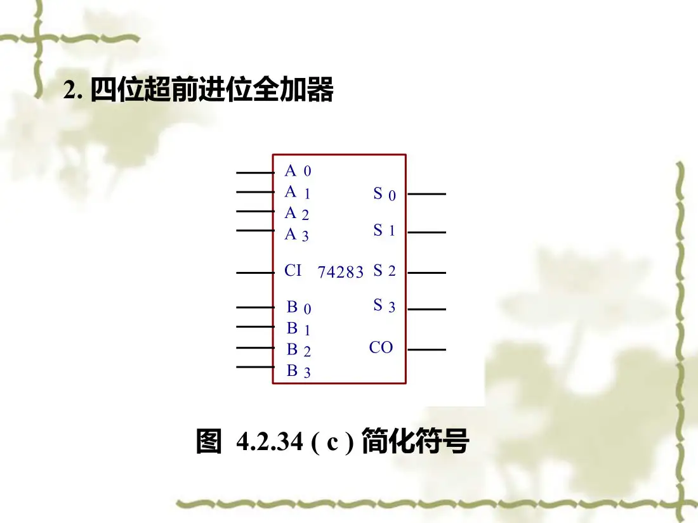

原文：

2. 四位超前进位全加器

### $$

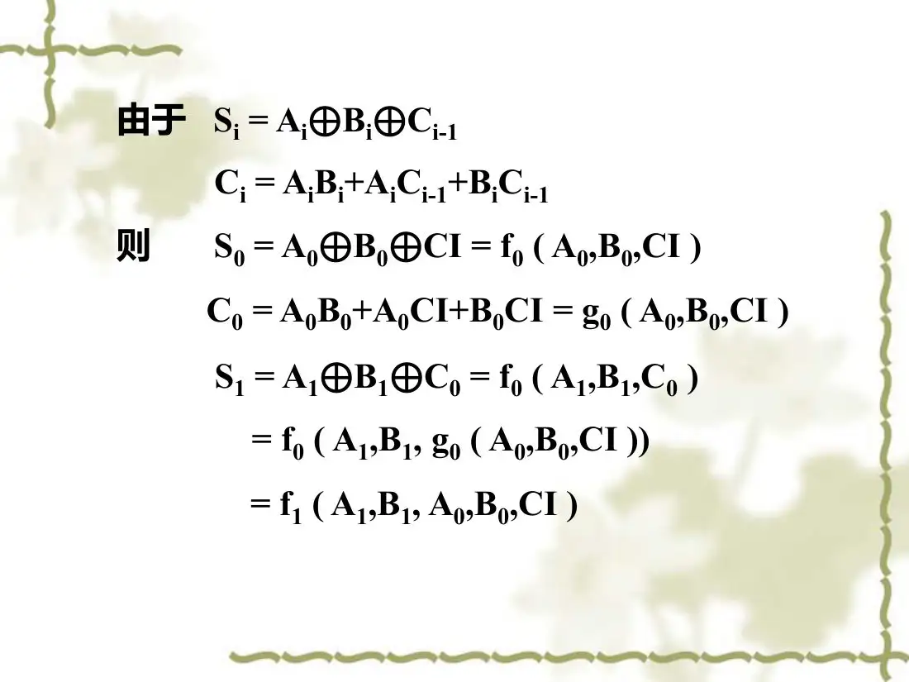

原文：

则

$$
\begin{array}{r l} & {\mathbf {S _ {i}} = \mathbf {A _ {i}} \oplus \mathbf {B _ {i}} \oplus \mathbf {C _ {i - 1}}} \\ & {\mathbf {C _ {i}} = \mathbf {A _ {i}} \mathbf {B _ {i}} + \mathbf {A _ {i}} \mathbf {C _ {i - 1}} + \mathbf {B _ {i}} \mathbf {C _ {i - 1}}} \\ & {\mathbf {S _ {0}} = \mathbf {A _ {0}} \oplus \mathbf {B _ {0}} \oplus \mathbf {C I} = \mathbf {f _ {0}} (\mathbf {A _ {0}}, \mathbf {B _ {0}}, \mathbf {C I})} \\ & {\mathbf {C _ {0}} = \mathbf {A _ {0}} \mathbf {B _ {0}} + \mathbf {A _ {0}} \mathbf {C I} + \mathbf {B _ {0}} \mathbf {C I} = \mathbf {g _ {0}} (\mathbf {A _ {0}}, \mathbf {B _ {0}}, \mathbf {C I})} \\ & {\mathbf {S _ {1}} = \mathbf {A _ {1}} \oplus \mathbf {B _ {1}} \oplus \mathbf {C _ {0}} = \mathbf {f _ {0}} (\mathbf {A _ {1}}, \mathbf {B _ {1}}, \mathbf {C _ {0}})} \\ & {\quad = \mathbf {f _ {0}} (\mathbf {A _ {1}}, \mathbf {B _ {1}}, \mathbf {g _ {0}} (\mathbf {A _ {0}}, \mathbf {B _ {0}}, \mathbf {C I}))} \\ & {\quad = \mathbf {f _ {1}} (\mathbf {A _ {1}}, \mathbf {B _ {1}}, \mathbf {A _ {0}}, \mathbf {B _ {0}}, \mathbf {C I})} \end{array}
$$

### $$

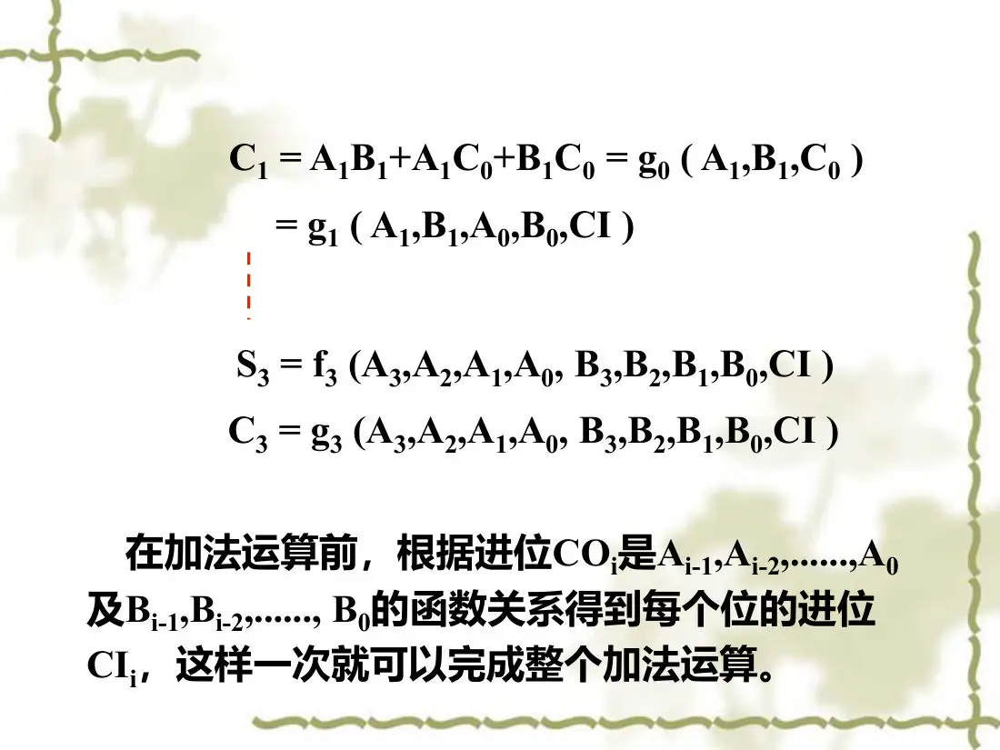

原文：

$$
\begin{array}{r l} & {\mathbf {C} _ {1} = \mathbf {A} _ {1} \mathbf {B} _ {1} + \mathbf {A} _ {1} \mathbf {C} _ {0} + \mathbf {B} _ {1} \mathbf {C} _ {0} = \mathbf {g} _ {0} (\mathbf {A} _ {1}, \mathbf {B} _ {1}, \mathbf {C} _ {0})} \\ & {\qquad = \mathbf {g} _ {1} (\mathbf {A} _ {1}, \mathbf {B} _ {1}, \mathbf {A} _ {0}, \mathbf {B} _ {0}, \mathbf {C I})} \\ & {\vdots} \\ & {\mathbf {S} _ {3} = \mathbf {f} _ {3} (\mathbf {A} _ {3}, \mathbf {A} _ {2}, \mathbf {A} _ {1}, \mathbf {A} _ {0}, \mathbf {B} _ {3}, \mathbf {B} _ {2}, \mathbf {B} _ {1}, \mathbf {B} _ {0}, \mathbf {C I})} \\ & {\mathbf {C} _ {3} = \mathbf {g} _ {3} (\mathbf {A} _ {3}, \mathbf {A} _ {2}, \mathbf {A} _ {1}, \mathbf {A} _ {0}, \mathbf {B} _ {3}, \mathbf {B} _ {2}, \mathbf {B} _ {1}, \mathbf {B} _ {0}, \mathbf {C I})} \end{array}
$$

在加法运算前，根据进位 $\mathrm{CO}_{\mathrm{i}}$ 是 $\mathrm{A_{i - 1},A_{i - 2},\dots\dots,A_0}$ 及 $\mathrm{B_{i - 1},B_{i - 2},\dots\dots,B_0}$ 的函数关系得到每个位的进位 $\mathrm{CI_i}$ ，这样一次就可以完成整个加法运算。

### 4位超前进位加法器 74LS283的逻辑图

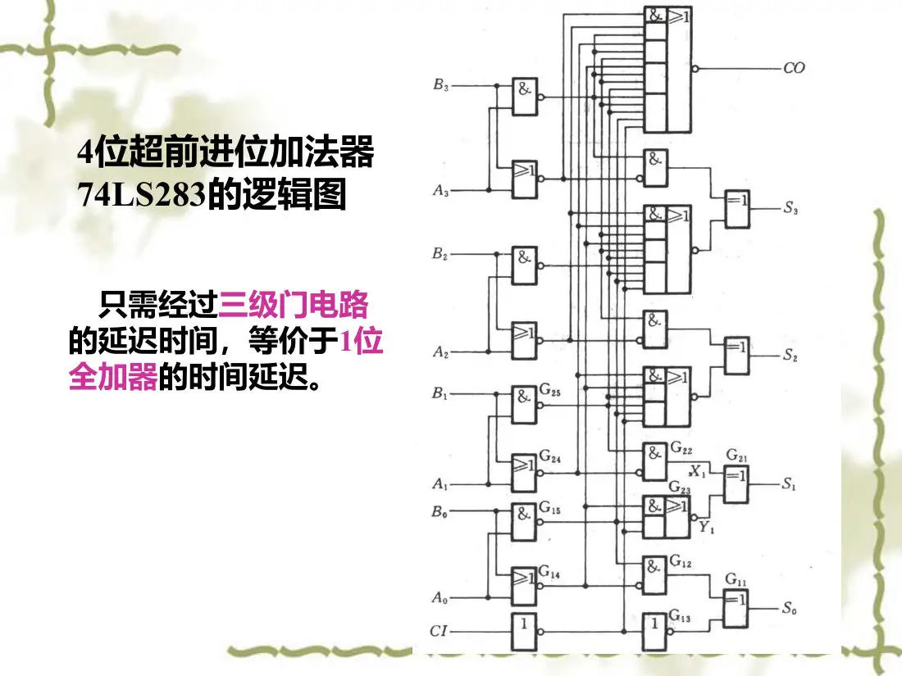

原文：

4位超前进位加法器 74LS283的逻辑图

只需经过三级门电路的延迟时间，等价于1位全加器的时间延迟。

### 例：试用两片4位超前进位加法器74LS283构成一个8位加法器。

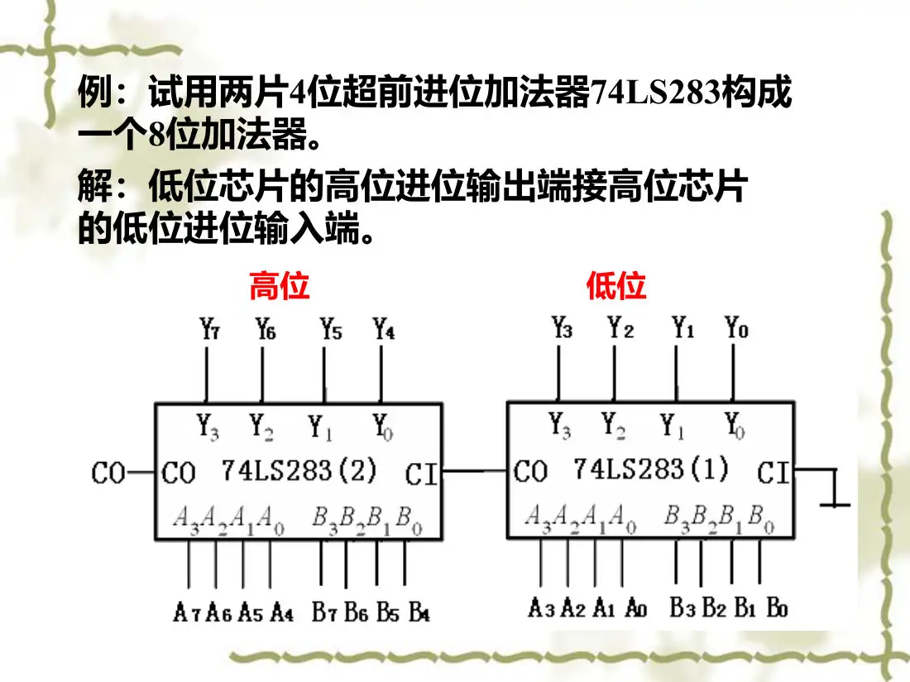

原文：

例：试用两片4位超前进位加法器74LS283构成一个8位加法器。

解：低位芯片的高位进位输出端接高位芯片的低位进位输入端。

### 2. 全加器的应用举例

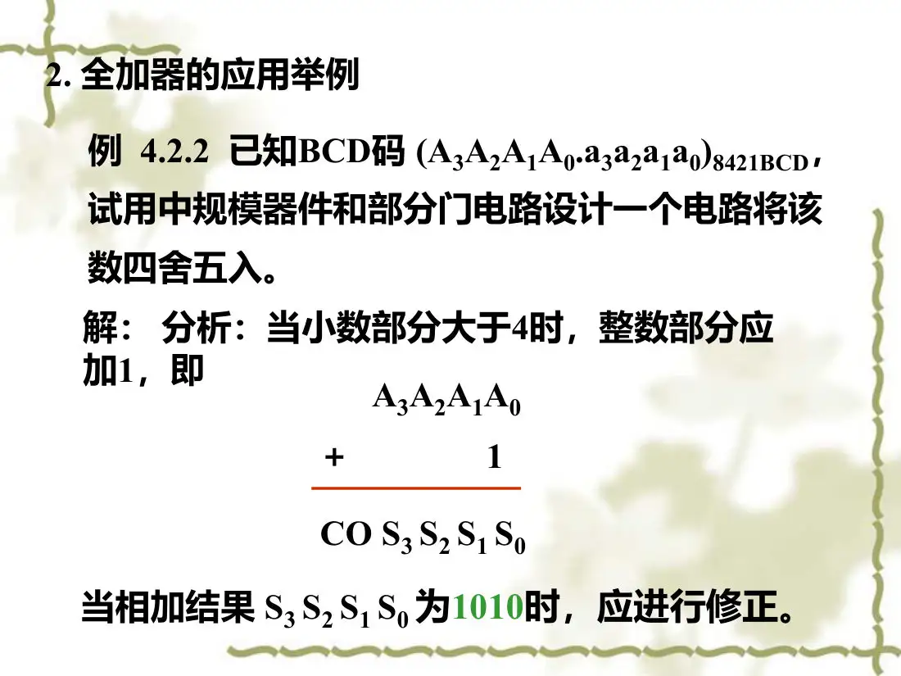

原文：

2. 全加器的应用举例

例 4.2.2 已知BCD码 $(\mathrm{A}_{3}\mathrm{A}_{2}\mathrm{A}_{1}\mathrm{A}_{0}.\mathrm{a}_{3}\mathrm{a}_{2}\mathrm{a}_{1}\mathrm{a}_{0})_{8421\mathrm{BCD}}$ ，试用中规模器件和部分门电路设计一个电路将该数四舍五入。

解：分析：当小数部分大于4时，整数部分应加1，即

$$
\begin{array}{c} \mathrm {A_ {3} A_ {2} A_ {1} A_ {0}} \\ + \quad 1 \\ \hline \mathrm {CO S_ {3} S_ {2} S_ {1} S_ {0}} \end{array}
$$

当相加结果 $S_{3}S_{2}S_{1}S_{0}$ 为1010时，应进行修正。

### 第 41 页

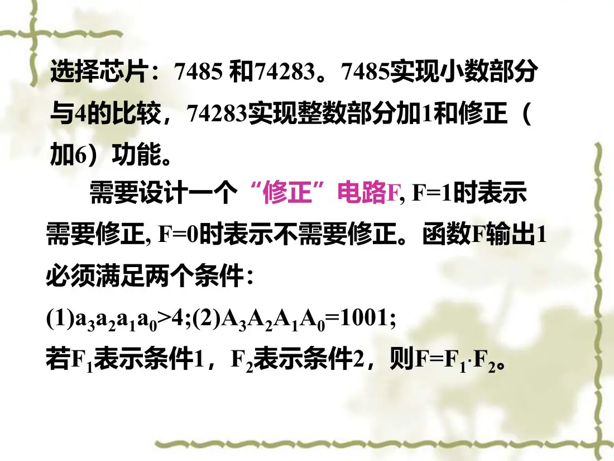

原文：

选择芯片：7485 和 74283。7485 实现小数部分与 4 的比较，74283 实现整数部分加 1 和修正（加 6）功能。

需要设计一个“修正”电路F, F=1时表示需要修正, F=0时表示不需要修正。函数F输出1必须满足两个条件:

(1) $a_{3}a_{2}a_{1}a_{0}>4$ ;(2) $A_{3}A_{2}A_{1}A_{0}=1001$ ;
若 $F_{1}$ 表示条件1， $F_{2}$ 表示条件2，则 $F=F_{1}\cdot F_{2}$ 。

### 函数F2真值表

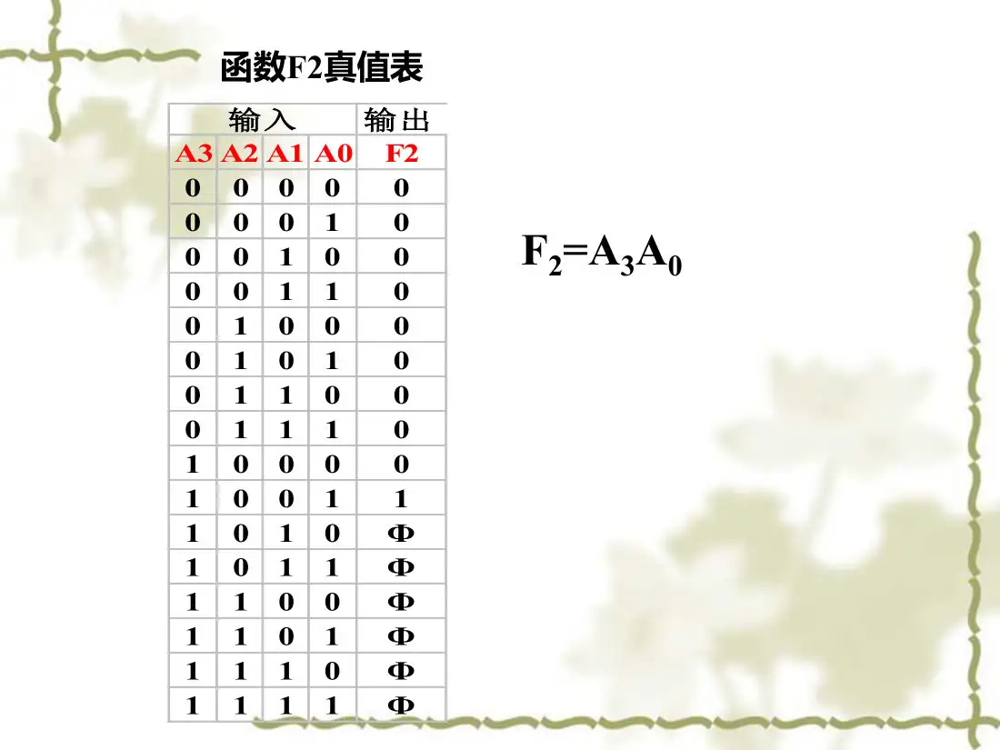

原文：

函数F2真值表

<table><tr><td colspan="4">输入</td><td>输出</td></tr><tr><td>A3</td><td>A2</td><td>A1</td><td>A0</td><td>F2</td></tr><tr><td>0</td><td>0</td><td>0</td><td>0</td><td>0</td></tr><tr><td>0</td><td>0</td><td>0</td><td>1</td><td>0</td></tr><tr><td>0</td><td>0</td><td>1</td><td>0</td><td>0</td></tr><tr><td>0</td><td>0</td><td>1</td><td>1</td><td>0</td></tr><tr><td>0</td><td>1</td><td>0</td><td>0</td><td>0</td></tr><tr><td>0</td><td>1</td><td>0</td><td>1</td><td>0</td></tr><tr><td>0</td><td>1</td><td>1</td><td>0</td><td>0</td></tr><tr><td>0</td><td>1</td><td>1</td><td>1</td><td>0</td></tr><tr><td>1</td><td>0</td><td>0</td><td>0</td><td>0</td></tr><tr><td>1</td><td>0</td><td>0</td><td>1</td><td>1</td></tr><tr><td>1</td><td>0</td><td>1</td><td>0</td><td> $\Phi$ </td></tr><tr><td>1</td><td>0</td><td>1</td><td>1</td><td> $\Phi$ </td></tr><tr><td>1</td><td>1</td><td>0</td><td>0</td><td> $\Phi$ </td></tr><tr><td>1</td><td>1</td><td>0</td><td>1</td><td> $\Phi$ </td></tr><tr><td>1</td><td>1</td><td>1</td><td>0</td><td> $\Phi$ </td></tr><tr><td>1</td><td>1</td><td>1</td><td>1</td><td> $\Phi$ </td></tr></table>

$$
\mathbf {F} _ {2} = \mathbf {A} _ {3} \mathbf {A} _ {0}
$$

### $$

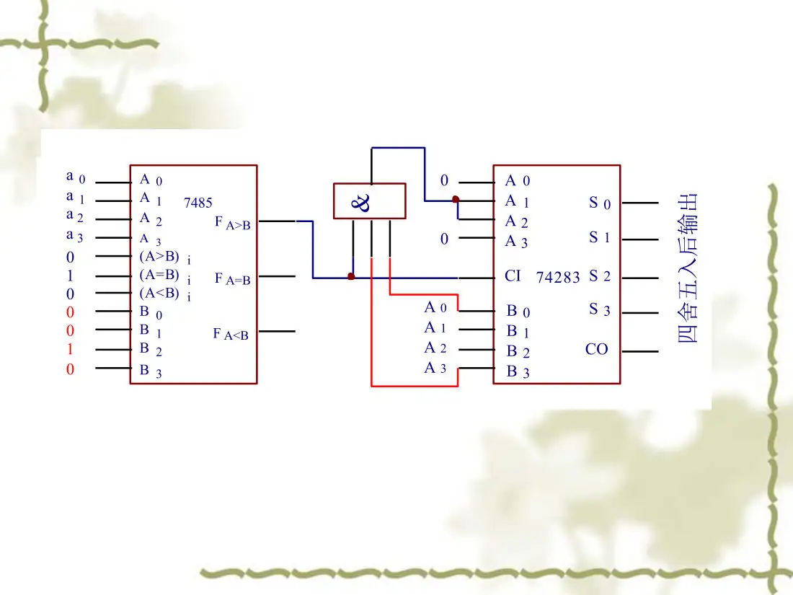

原文：

$$
\begin{array}{c c c} \text {四舍五入后输出} \\ \text {a0} & \text {A0} & \\ \text {a1} & \text {A1} & 7 4 8 5 \\ \text {a2} & \text {A2} & F _ {\text {A>B}} \\ \text {a3} & \text {A3} & \\ 0 & (\text {A>B}) _ {i} & \\ 1 & (\text {A=B}) _ {i} & F _ {\text {A=B}} \\ 0 & (\text {A< B}) _ {i} & \\ 0 & B _ {0} & \\ 0 & B _ {1} & \\ 1 & B _ {2} & \\ 0 & B _ {3} & \end{array}
$$

### 作业题

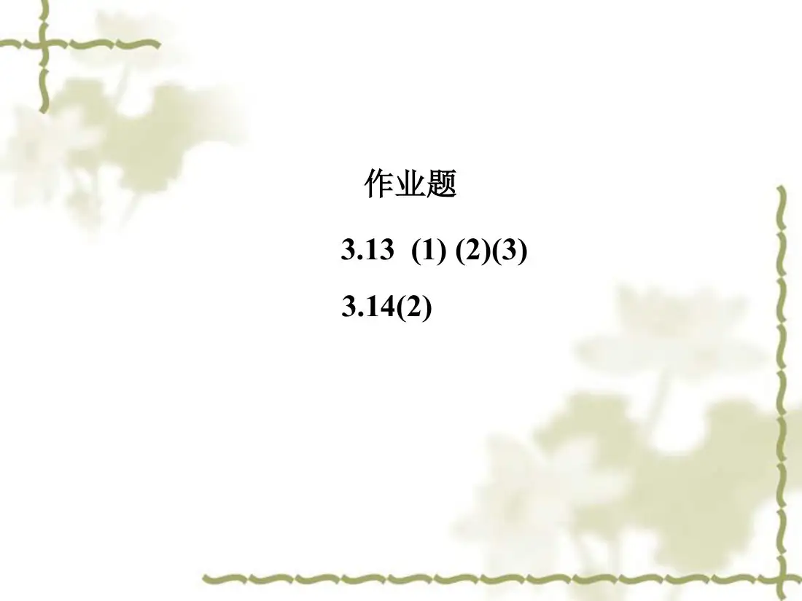

原文：

作业题

3.13 (1) (2)(3)

3.14(2)
