# 《数字电路与系统设计》第3章 组合逻辑电路的竞争与冒险（课件）

原件的每一页，下面附识别出的文字。

### 第三节 竞争和冒险

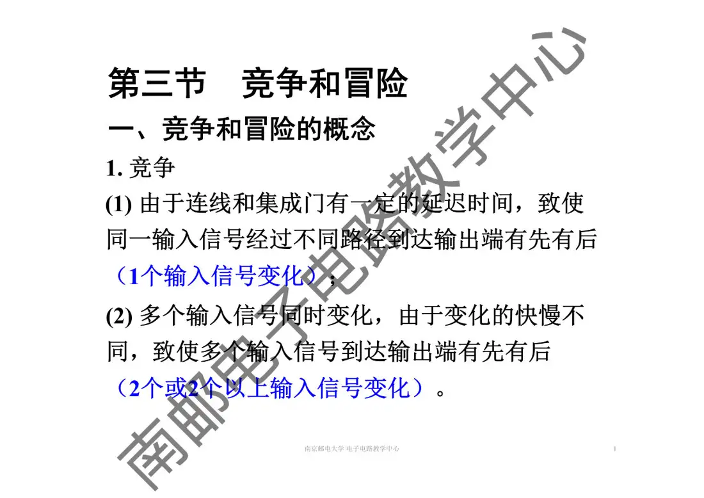

原文：

第三节 竞争和冒险

一、 竞争和冒险的概念

1 . 竞 争

(1) 由 连线 集成门有 定的 时间于 和 一 延迟 ， 致使同 输入信号 过不同路径到达输出端有先有后一 经（1个输入信号变化） ；

(2) 多个输入信号同时变化， 由于变化的快慢不同， 致使多个输 信号到 输出端有先有后入 达

（2个或2个以上输入信号变化） 。

南京邮电大学 电子电路教学中心

1

### 例 1 ： F = AC + AB 。

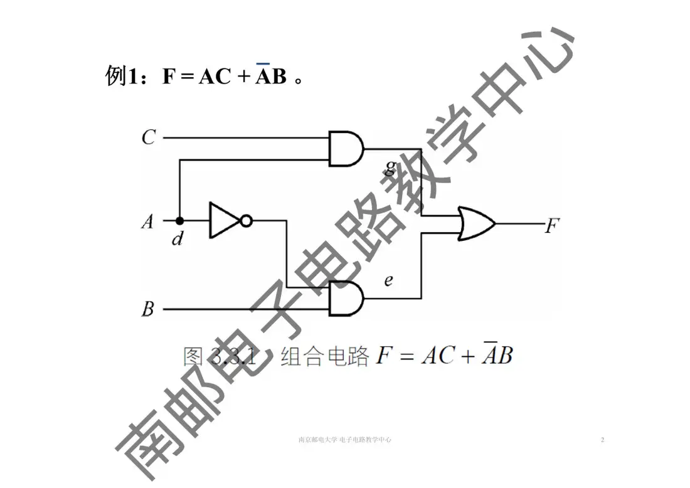

原文：

例 1 ： F = AC + AB 。

图3.31组合电路 $F = A C + { \overline { { A } } } B$

南京邮电大学 电子电路教学中心

2

### 例 1 ： F = AC + AB 。

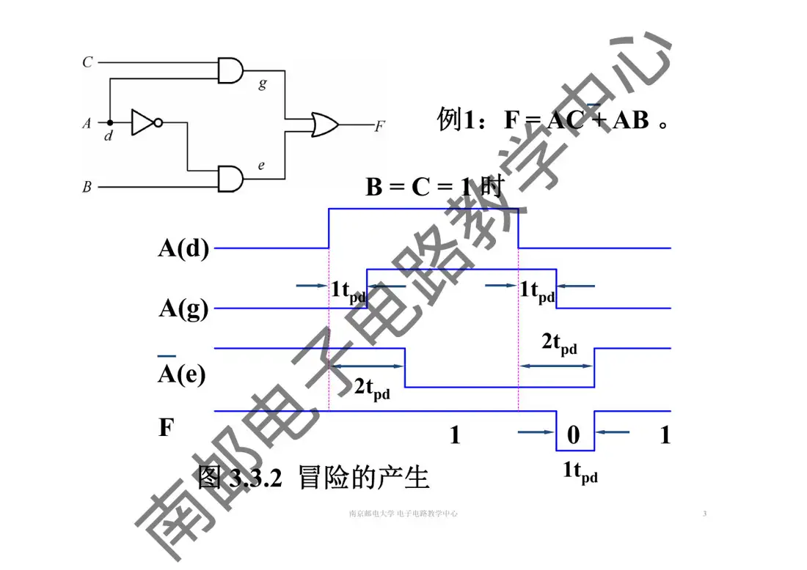

原文：

例 1 ： F = AC + AB 。

图 3 3 2 冒 险 的 产 生 . .

南京邮电大学 电子电路教学中心

3

### 2. 冒 险

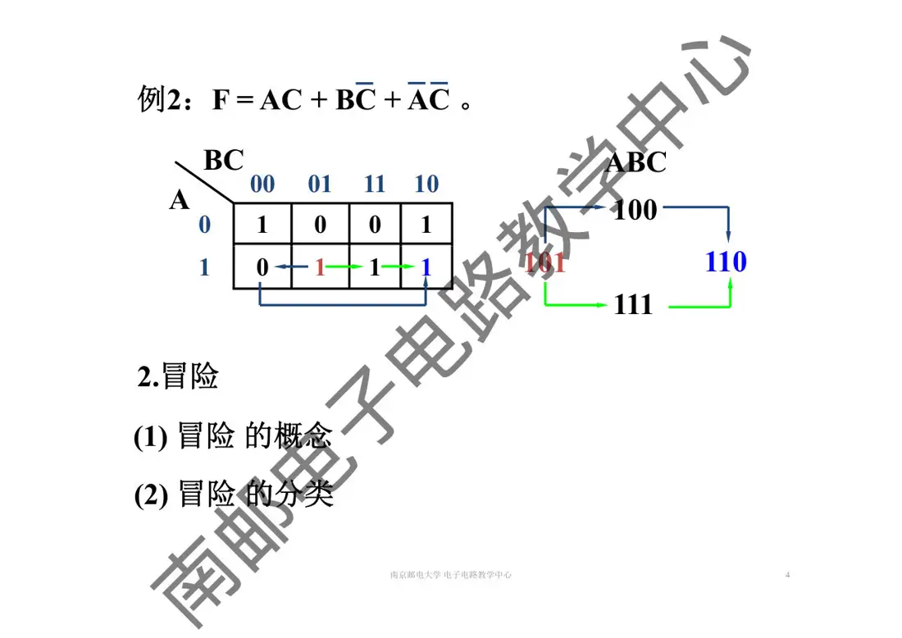

原文：

例 2 ： $\mathbf { F } = \mathbf { A C } + \mathbf { B C } + \mathbf { \overline { { A } } \overline { { C } } }$ 。

2. 冒 险

(1) 冒 险 的概念

(2) 冒 险 的分类

南京邮电大学 电子电路教学中心

4

### ① 按短暂尖峰极性

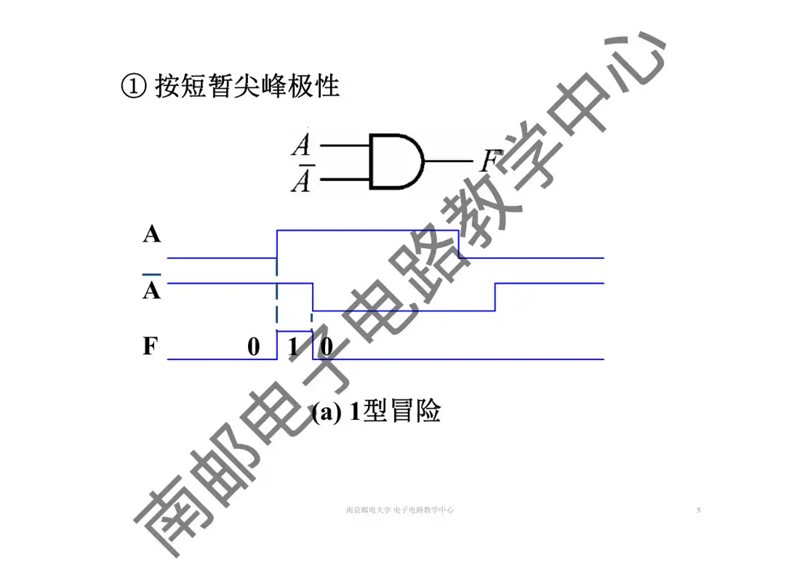

原文：

① 按短暂尖峰极性

(a) 1 型 冒 险

南京邮电大学 电子电路教学中心

5

### (b) 0型 冒 险

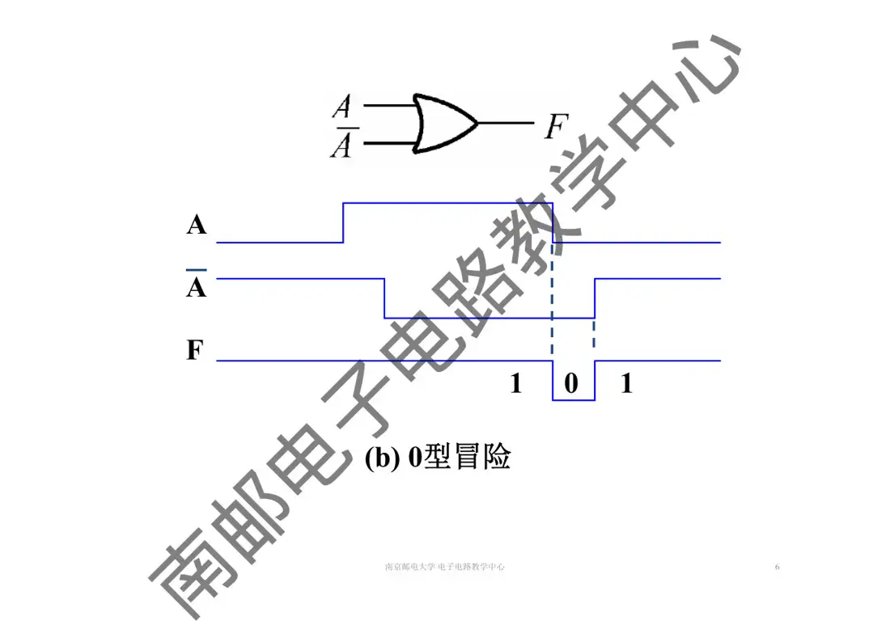

原文：

(b) 0型 冒 险

南京邮电大学 电子电路教学中心

6

### ② 按产生短暂尖峰的原因逻辑冒险和功能冒险

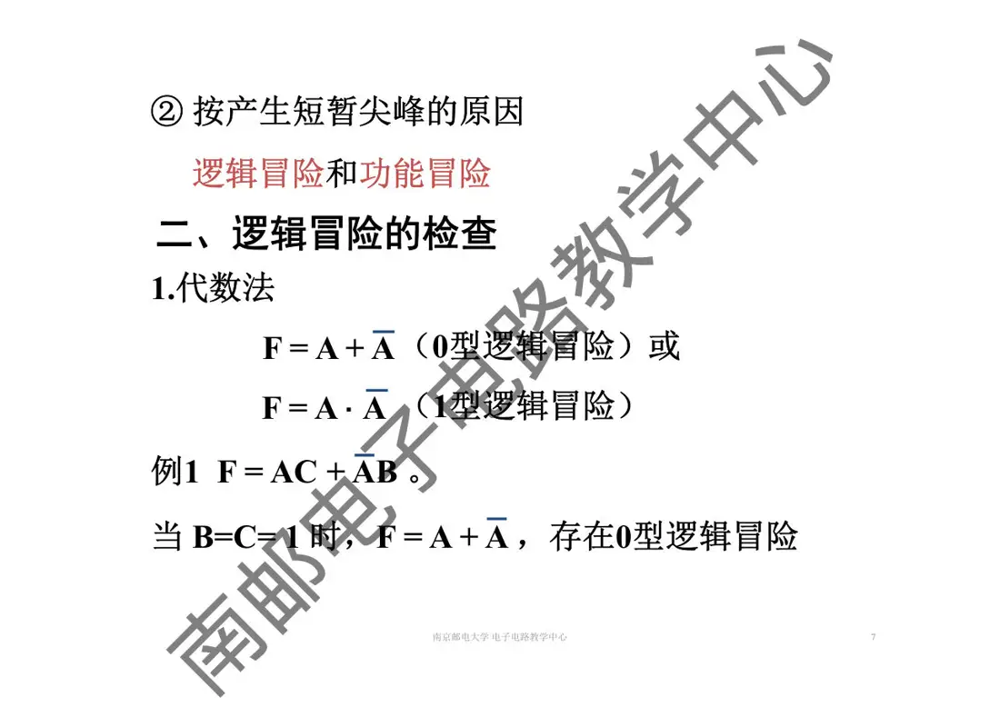

原文：

② 按产生短暂尖峰的原因逻辑冒险和功能冒险

二、 逻辑冒险的检查

1.代数法

$\mathbf { F } = \mathbf { A } + \mathbf { \overline { { A } } }$ （0型逻辑冒险） 或

$\mathbf { F } = \mathbf { A } \cdot { \overline { { \mathbf { A } } } } _ { d }$ （ 1型逻辑冒 险）

例1 $\mathbf { F } = \mathbf { A C } + \mathbf { \bar { A } B }$ 。

$\mathbf { B } { = } \mathbf { C } { \mp } \mathbf { \equiv } \mathbf { \equiv } \mathbf { I }$ 时 ， ${ \mathcal { A } } = \mathbf { A } + { \overline { { A } } }$ ， 存在0型逻辑冒险

南京邮电大学 电子电路教学中心

7

### $$

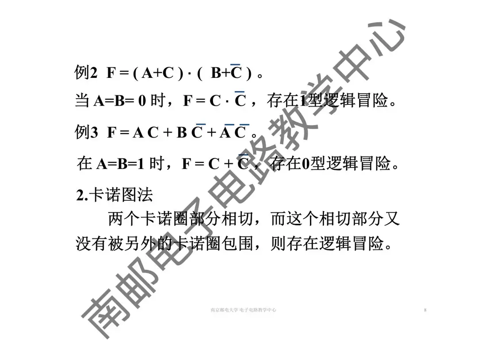

原文：

例2 $\mathbf { F } = \left( \mathbf { \nabla } \mathbf { A } \mathbf { + } \mathbf { C } \right) \cdot \left( \mathbf { \nabla } \mathbf { B } \mathbf { + } \overline { { \mathbf { C } } } \right)$ 。

当 $\mathbf { A } { = } \mathbf { B } { = } \mathbf { 0 }$ 时  ， $\mathbf { F } = \mathbf { C } \cdot \mathbf { \vec { C } }$ 存在 型逻辑冒险， 1 。

$$
\mathbf {F} = \mathbf {A} \mathbf {C} + \mathbf {B} \overline {{\mathbf {C}}} + \overline {{\mathbf {A}}} \overline {{\mathbf {C}}}
$$

在 $\mathbf { A } { = } \mathbf { B } { = } 1$ 时 ， $\mathbf { F } = \mathbf { C } + \widehat { \mathbf { C } }$ ， 存在0型逻辑冒险。

2.卡诺图法

两个卡诺圈部分相切， 而这个相切部分又没有被另外的卡诺圈包围， 则存在逻辑冒险。例4 F A C B C A C= + + 。

南京邮电大学 电子电路教学中心

8

### 逻辑冒险产生的条件：

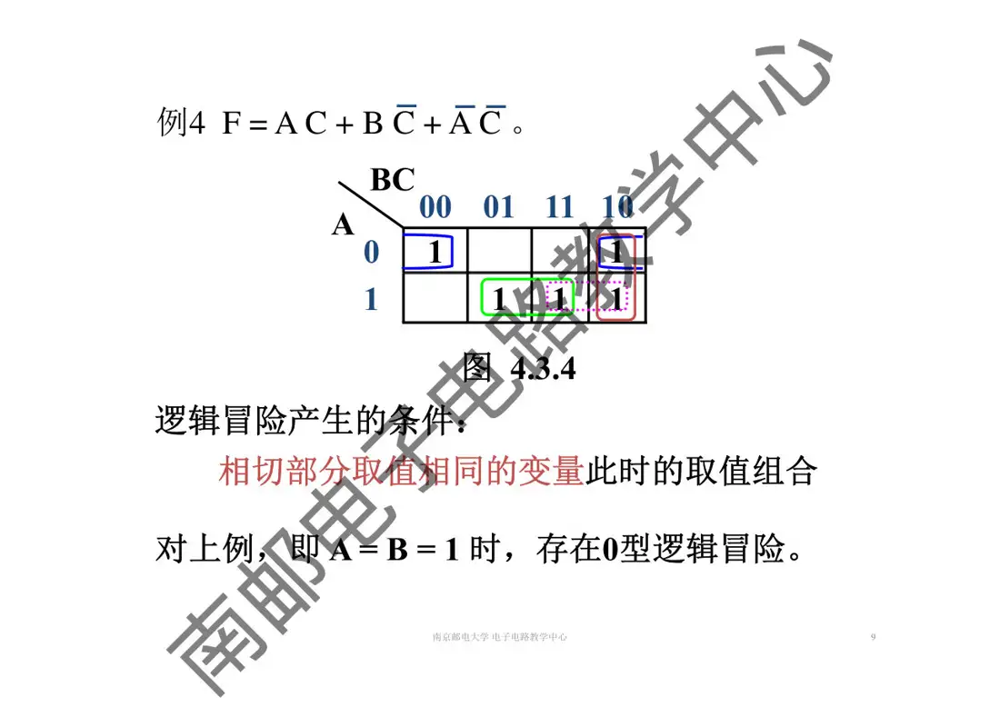

原文：

逻辑冒险产生的条件：

相切部分取值相同的变量此时的取值组合对上例， 即 $\check { \mathbf { A } } \equiv \mathbf { B } = \mathbf { 1 }$ 时， 存在0型逻辑冒险。例 5 $\mathbf { F } = \mathbf { B } \ \mathbf { C } + \overline { { \mathbf { A } } } \ \overline { { \mathbf { B } } } + \mathbf { A } \mathbf { C } \ \mathbf { D }$ 。 试判断是否存在逻辑冒险。

南京邮电大学 电子电路教学中心

9

### 南京邮电大学 电子电路教学中心

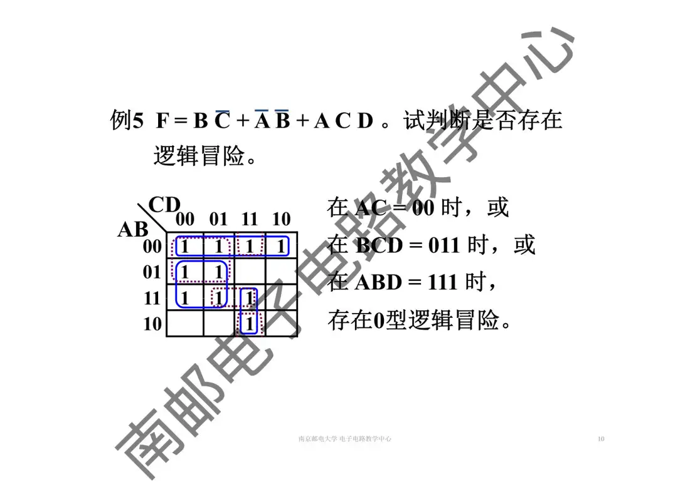

原文：

在 $\mathbf { \hat { A } C } _ { \mathbf { \hat { \mu } } } \overset { 1 } { = } \mathbf { \hat { \theta } 0 }$ 时， 或$\mathbf { \dot { C D } = 0 1 1 }$ 时 或，$\mathbf { A B D } = 1 1 1$ 时 ，存在0型逻辑冒险。

南京邮电大学 电子电路教学中心

1 0

### 三、 功能冒险的检查

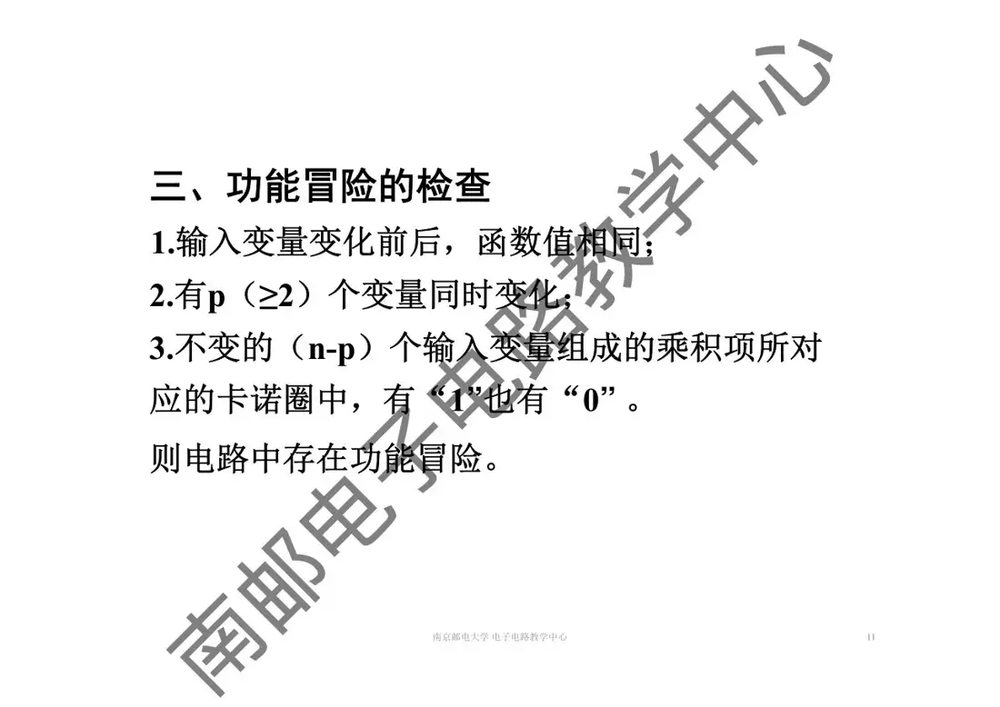

原文：

三、 功能冒险的检查

1.输入变量变化前后， 函数值相同；

2.有p （≥2 ） 个变量 同 时变化 ；

3.不变的 （n-p） 个输入变量组成的乘积项所对应的卡诺圈 中 ， 有 “ 1 ” 也 有 “ 0 ” 。则 电路中存在功能冒险。

南京邮电大学 电子电路教学中心

1 1

### 所以， 电路中存在功能冒险。

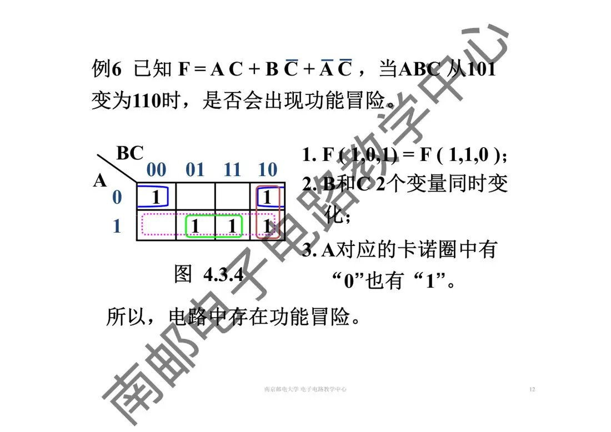

原文：

例6 已知 $\mathbf { F } = \mathbf { A } \mathbf { C } + \mathbf { B } \mathbf { C } + \mathbf { A } \mathbf { C }$ ， 当ABC 从101变为110时， 是否会出现功能冒险。

1 F $\operatorname { \mathrm { \ t } } ( 0 , 0 , 1 ) = \operatorname { \mathrm { \mathbf { F } } } \left( 1 , 1 , 0 \right)$ . B和C 2个变量同时变

3. A对应的卡诺圈 中有$^ { 6 6 } \mathbf { 0 } ^ { 9 9 }$ 也 有 “ 1 ” 。

所以， 电路中存在功能冒险。

南京邮电大学 电子电路教学中心

1 2

### 南京邮电大学 电子电路教学中心

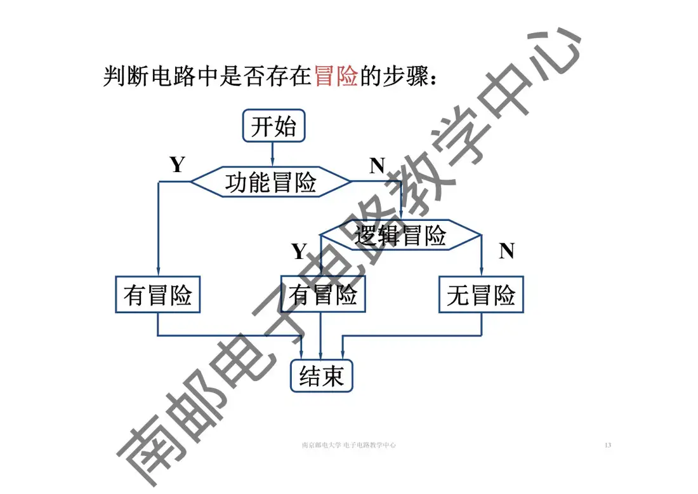

原文：

判断电路中是否存在冒险的步骤：例3.3.3 分析 图3.3.6 所示组合 电路 ， 当 输入信 号ABCD 从01 00 变化 到 11 01 、 由 0111 变化 到 111 0 ， 以及 由1001 变化到1011 时， 是否有冒 险现象发生？

南京邮电大学 电子电路教学中心

1 3

### 南京邮电大学 电子电路教学中心

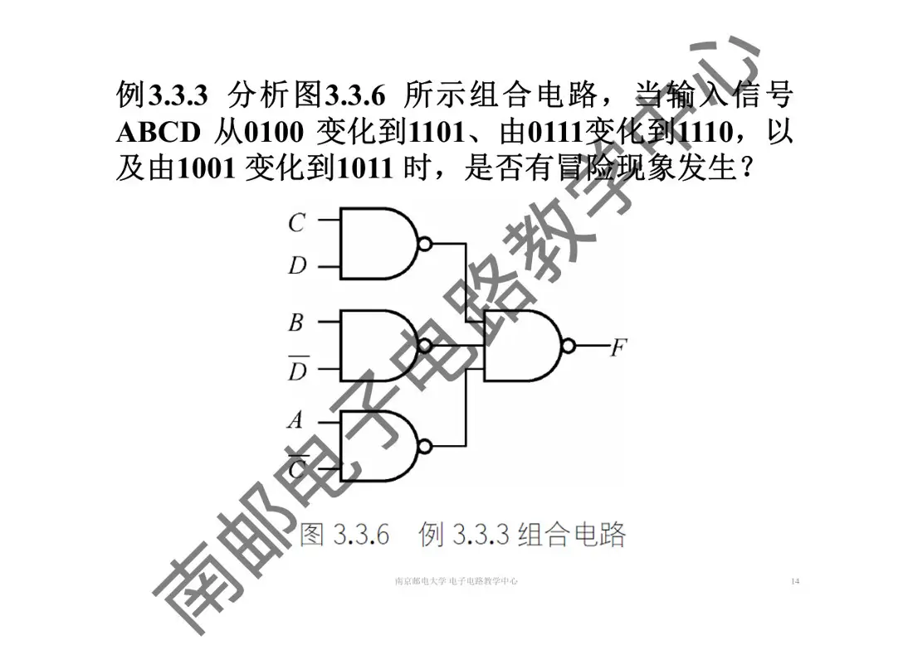

原文：

南京邮电大学 电子电路教学中心

1 4

### 解 ： 1 . 01 00  11 01

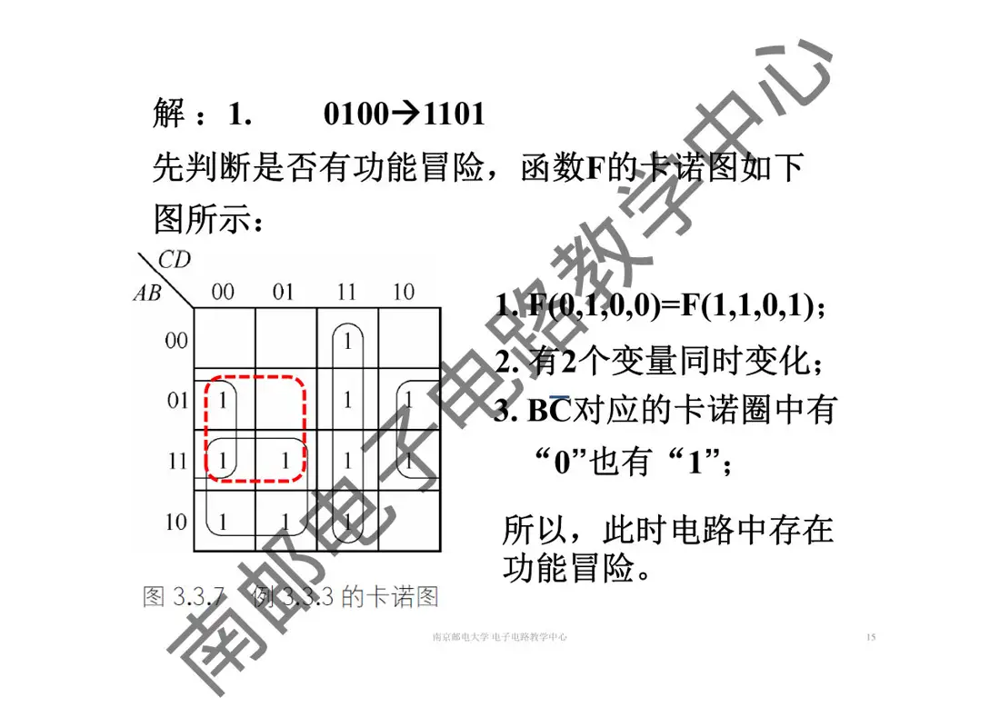

原文：

解 ： 1 . 01 00  11 01

先判断是否有功能冒险， 函数F的卡诺图如下图所示：

2. 有2个变量同时变化；

3. BC对应的卡诺圈 中有“ 0” 也 有 “ 1 ” ；

所以， 此时电路中存在功能冒险。

南京邮电大学 电子电路教学中心

1 5

### 2 . 0 111  111 0

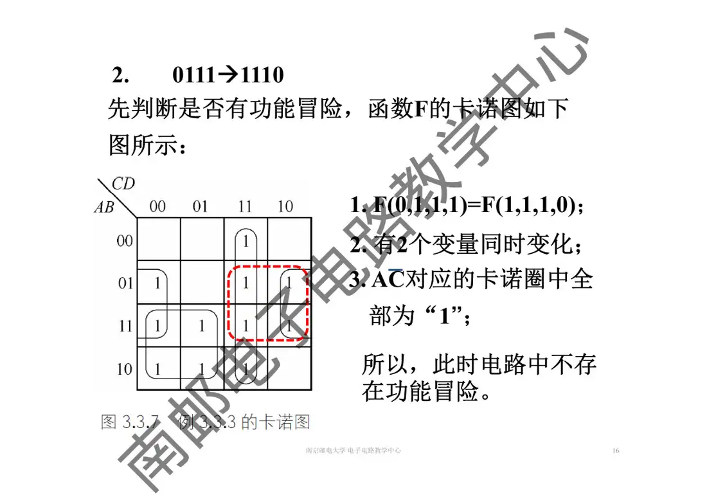

原文：

2 . 0 111  111 0

先判断是否有功能冒险， 函数F的卡诺图如下图所示：

F (0, 1 , 1 , 1 )=F ( 1 , 1 , 1 ,0) ；. 有2个变量同时变化；3. AC对应的卡诺圈 中全部 为 “ 1 ” ；

所以， 此时 电路中不存在功能冒险。

南京邮电大学 电子电路教学中心

1 6

### 再判断是否有逻辑冒险：

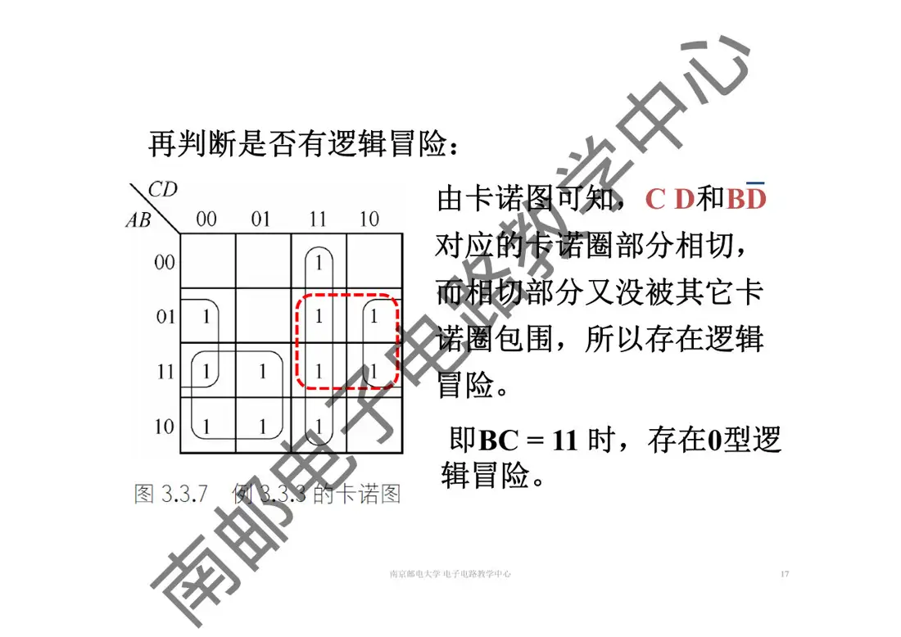

原文：

再判断是否有逻辑冒险：

由卡诺图可知 ， C D和BD对应的卡诺圈部分相切，而相切部分又没被其它卡诺圈包围， 所以存在逻辑冒 险。

即BC = 11 时 ， 存在0型逻辑冒 险。

南京邮电大学 电子电路教学中心

1 7

### 3 . 1 00 1  1 0 11

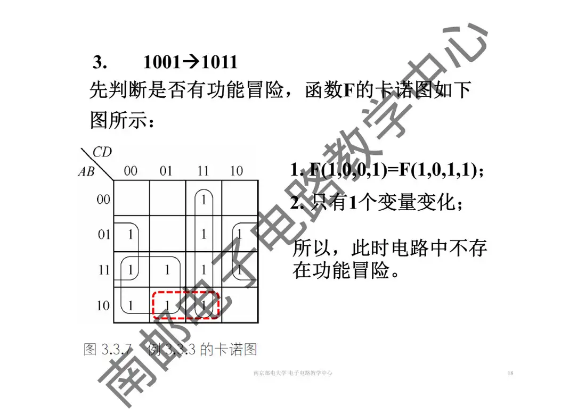

原文：

3 . 1 00 1  1 0 11

先判断是否有功能冒险， 函数F的卡诺图如下图所示：

. F ( 1 ,0,0, 1 )=F ( 1 ,0, 1 , 1 ) ； . 只有1个变量变化；

所以， 此时 电路中不存在功能冒险。

南京邮电大学 电子电路教学中心

1 8

### 再判断是否有逻辑冒险：

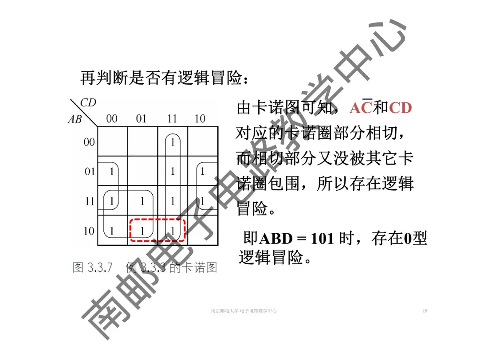

原文：

再判断是否有逻辑冒险：

由卡诺图可知 ， AC和CD对应的卡诺圈部分相切，而相切部分又没被其它卡诺圈包围， 所以存在逻辑冒 险。

即ABD = 101 时 ， 存在0型逻辑冒险。

南京邮电大学 电子电路教学中心

1 9

### 四 、 冒险的消除方法

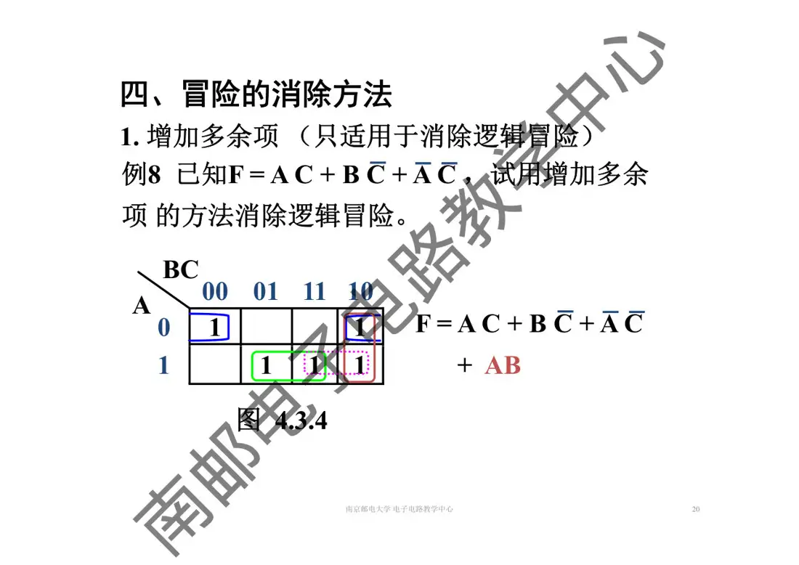

原文：

四 、 冒险的消除方法

1. 增加多余项 （ 只适用于消除逻辑冒 险）例8 已知 $\mathbf { F } = \mathbf { A } \mathbf { C } + \mathbf { B } { \overline { { \mathbf { C } } } } + { \overline { { \mathbf { A } } } } { \overline { { \mathbf { C } } } } ,$ 试用增加多余项 的方法消除逻辑冒险。

图 4.3.4

$$
\begin{array}{r l} \mathbf {F} & = \mathbf {A} \mathbf {C} + \mathbf {B} \overline {{\mathbf {C}}} + \overline {{\mathbf {A}}} \overline {{\mathbf {C}}} \\ & + \mathbf {A B} \end{array}
$$

南京邮电大学 电子电路教学中心

20

### $$

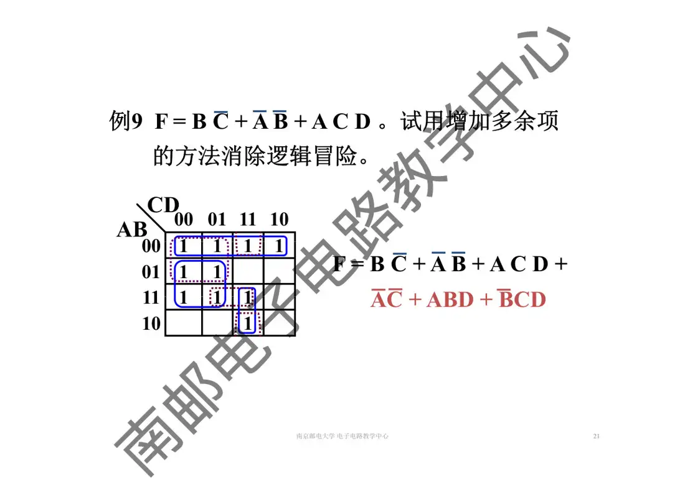

原文：

例 9 $\mathbf { F } = \mathbf { B } \ \mathbf { C } + \overline { { \mathbf { A } } } \ \overline { { \mathbf { B } } } + \mathbf { A } \mathbf { C } \ \mathbf { D }$ 。 试用增加多余项的方法消除逻辑冒险。 X

$$
\mathbf {F} = \mathbf {B} \overline {{\mathbf {C}}} + \overline {{\mathbf {A}}} \overline {{\mathbf {B}}} + \mathbf {A} \mathbf {C} \mathbf {D} +
$$

$$
\overline {{\mathbf {A}}} \overline {{\mathbf {C}}} + \mathbf {A} \mathbf {B} \mathbf {D} + \overline {{\mathbf {B}}} \mathbf {C} \mathbf {D}
$$

南京邮电大学 电子电路教学中心

2 1

### 2.加滤波电容 （对输出波形边沿要求不高的情况下运用)

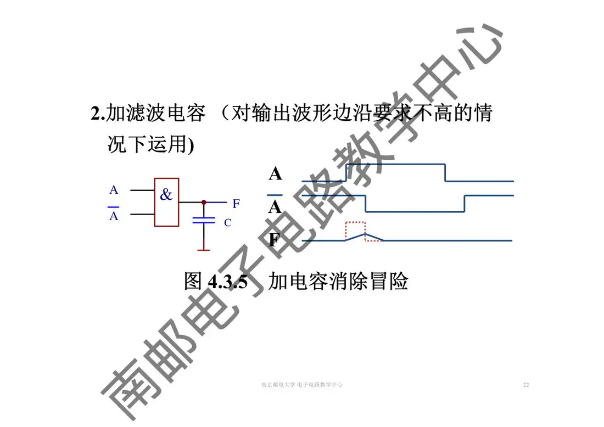

原文：

2.加滤波电容 （对输出波形边沿要求不高的情况下运用)

南京邮电大学 电子电路教学中心

22

### 3.加取样脉冲

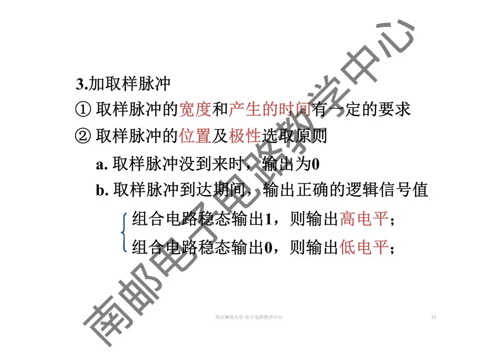

原文：

3.加取样脉冲

① 取样脉冲的宽度和产生的时间有一定的要求

② 取样脉冲的位置及极性选取原则

a. 取样脉冲没到来时， 输出为0

b. 取样脉冲到达期间， 输出正确的逻辑信号值

组合电路稳态输出1， 则输出高电平；

组合电路稳态输出0， 则输出低电平；

南京邮电大学 电子电路教学中心

23

### 取样

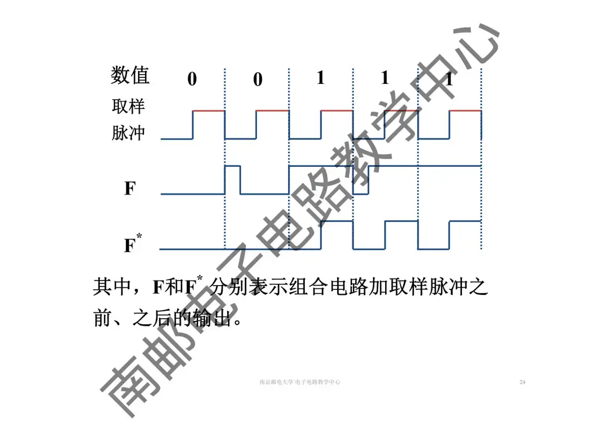

原文：

取样

脉冲

其中， F和F\* 分别表示组合电路加取样脉冲之前、 之后的输出 。

南京邮电大学 电子电路教学中心

24

### 图3.3.12常用组合电路加取样脉冲避免冒险的方法

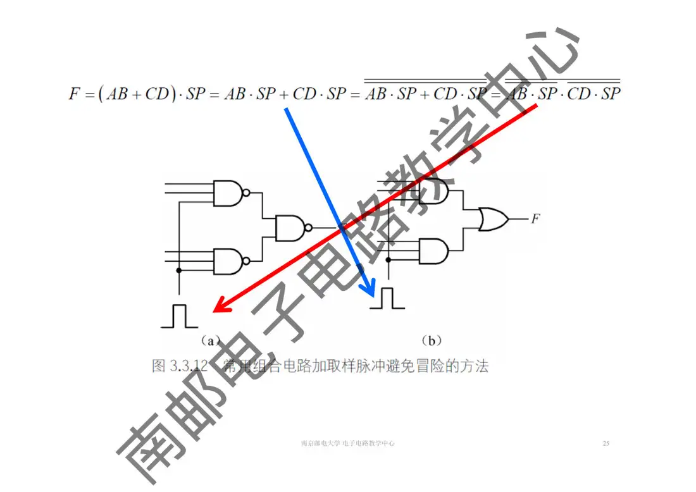

原文：

图3.3.12常用组合电路加取样脉冲避免冒险的方法

南京邮电大学 电子电路教学中心

25

### $$

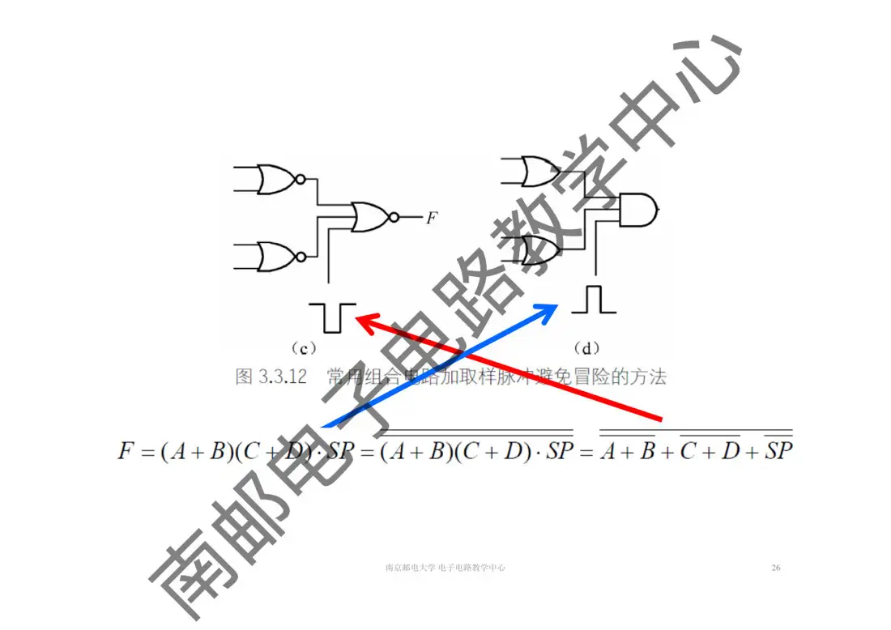

原文：

$$
F = (A + B) (C + D) \cdot S P = \overline {{(A + B) (C + D) \cdot S P}} = \overline {{A + B}} + \overline {{C + D}} + \overline {{S P}}
$$

南京邮电大学 电子电路教学中心

26

### 南京邮电大学 电子电路教学中心

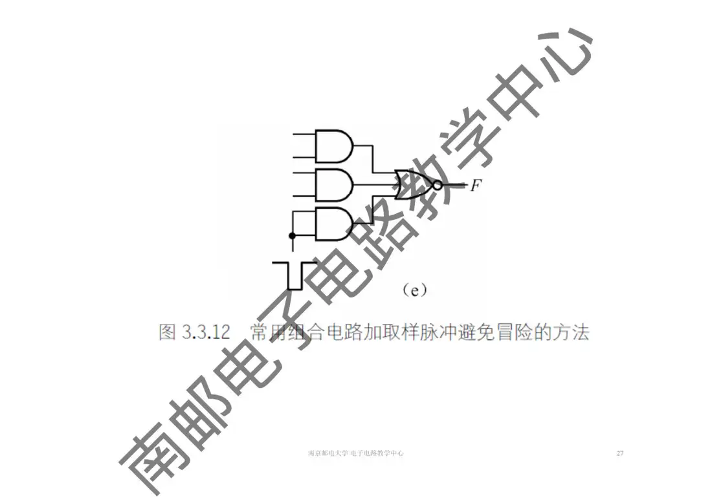

原文：

南京邮电大学 电子电路教学中心

27

### 南京邮电大学 电子电路教学中心

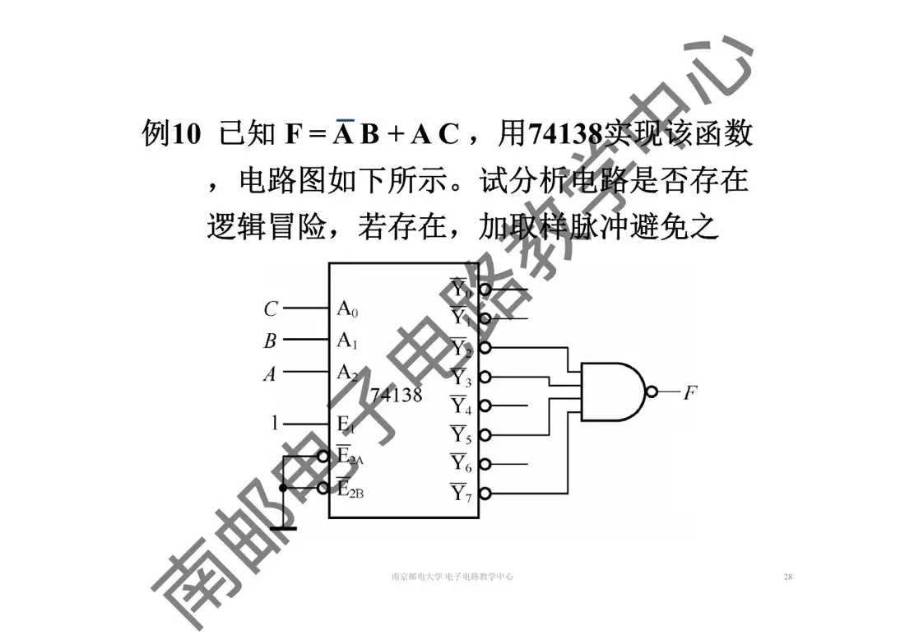

原文：

例10 已知 $\mathbf { F } = \overline { { \mathbf { A } } } \mathbf { B } + \mathbf { A } \mathbf { C }$ ， 用 74138实现该 函 数， 电路图如下所示。 试分析电路是否存在逻辑冒险， 若存在， 加取样脉冲避免之解 ： $\mathbf { F } = \overline { { \mathbf { A } } } \mathbf { B } + \mathbf { A } \mathbf { C }$ 的卡诺图如下所示：

南京邮电大学 电子电路教学中心

28

### 由 存在相 的卡诺于 切 圈 ， 该 电路可能存在0 型逻辑冒险。

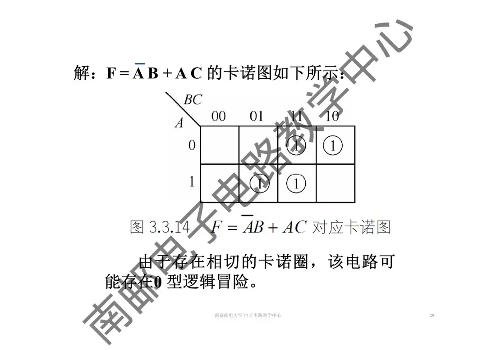

原文：

由 存在相 的卡诺于 切 圈 ， 该 电路可能存在0 型逻辑冒险。

南京邮电大学 电子电路教学中心

29

### (a) $\mathrm { E } _ { 1 }$ 端加正脉冲

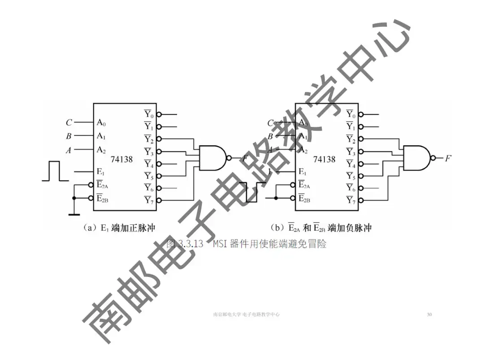

原文：

(a) $\mathrm { E } _ { 1 }$ 端加正脉冲

(b) $\overline { { \mathrm { E } } } _ { 2 \mathrm { A } }$ 和 $\overline { { \mathrm { E } } } _ { 2 \mathrm { R } }$ 端加负脉冲

MSI器件用使能端避免冒险

南京邮电大学 电子电路教学中心

30

### 作业题3.22

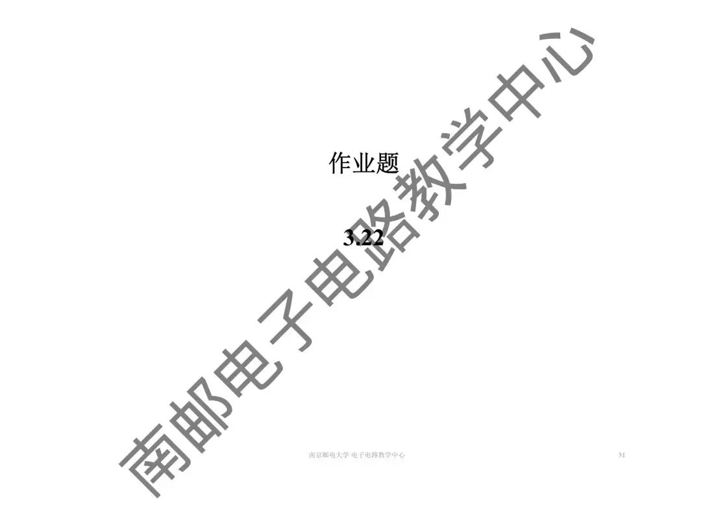

原文：

<table><tr><td>作业题3.22</td></tr></table>

3 1
