# 《数字电路与系统设计》第4章 习题答案

原件经识别和整理；“参考解答”是我们补的。

## 4.1 分析图4.1电路的逻辑功能

解：（1）推导输出表达式

$$
\mathrm{Y} _ {2} = \mathrm{X} _ {2}; \quad \mathrm{Y} _ {1} = \mathrm{X} _ {1} \oplus \mathrm{X} _ {2}; \quad \mathrm{Y} _ {0} = (\mathrm{Y} _ {1} + \mathrm{X} _ {1} \bar {\mathrm{M}}) \oplus \mathrm{X} _ {0}
$$

*(注：原识别内容中 $\mathrm{MY}_1$ 根据上下文逻辑修正为 $\mathrm{Y}_1$，通常此类码制转换电路中高位输出直接参与低位异或)*

(2) 列真值表

| M | $X_2$ | $X_1$ | $X_0$ | $Y_2$ | $Y_1$ | $Y_0$ |
| :---: | :---: | :---: | :---: | :---: | :---: | :---: |
| 0 | 0 | 0 | 0 | 0 | 0 | 0 |
| 0 | 0 | 0 | 1 | 0 | 0 | 1 |
| 0 | 0 | 1 | 0 | 0 | 1 | 1 |
| 0 | 0 | 1 | 1 | 0 | 1 | 0 |
| 0 | 1 | 0 | 0 | 1 | 1 | 0 |
| 0 | 1 | 0 | 1 | 1 | 1 | 1 |
| 0 | 1 | 1 | 0 | 1 | 0 | 1 |
| 0 | 1 | 1 | 1 | 1 | 0 | 0 |
| 1 | 0 | 0 | 0 | 0 | 0 | 0 |
| 1 | 0 | 0 | 1 | 0 | 0 | 1 |
| 1 | 0 | 1 | 0 | 0 | 1 | 1 |
| 1 | 0 | 1 | 1 | 0 | 1 | 0 |
| 1 | 1 | 0 | 0 | 1 | 1 | 1 |
| 1 | 1 | 0 | 1 | 1 | 1 | 0 |
| 1 | 1 | 1 | 0 | 1 | 0 | 0 |
| 1 | 1 | 1 | 1 | 1 | 0 | 1 |

（3）逻辑功能：当 $M=0$ 时，实现3位自然二进制码转换成 3位循环码。当 $M=1$ 时，实现3位循环码转换成 3位自然二进制码。

## 4.2 分析图P4.2电路的逻辑功能。

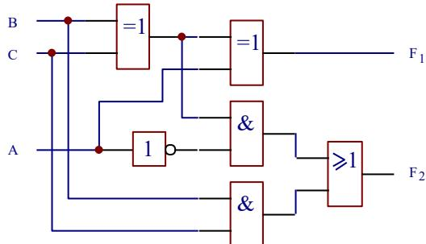

解：(1)从输入端开始，逐级推导出函数表达式。

$$
F_{1} = A \oplus B \oplus C
$$

$$
F_{2} = A (B \oplus C) + BC = \overline {{A}} \overline {{B}} C + \overline {{A}} B \overline {{C}} + \overline {{A}} BC + ABC
$$

*(注：原题文本中第一行公式写为 F=A⊕B⊕C，结合下文真值表及全减器定义，此处应为 $F_1$；第二行公式原文为 $F_2$，但展开式对应的是借位输出逻辑，需结合真值表确认变量对应关系。根据后文“$F_1, F_2$分别表示本位差、本位向高位的借位”，且全减器中 $D = A \oplus B \oplus C_{in}$，$B_{out} = \bar{A}(B+C_{in}) + B C_{in}$ 或类似形式。观察真值表：当 A=0,B=0,C=1 时，F1=1, F2=1。若 A是被减数，B是减数，C是低位借位。$0-0-1$ 结果为 $1$ (借位1)，即 $F_1=1, F_2=1$。这与真值表吻合。)*

(2)列真值表。

| A | B | C | $F_{1}$ | $F_{2}$ |
| :---: | :---: | :---: | :---: | :---: |
| 0 | 0 | 0 | 0 | 0 |
| 0 | 0 | 1 | 1 | 1 |
| 0 | 1 | 0 | 1 | 1 |
| 0 | 1 | 1 | 0 | 1 |
| 1 | 0 | 0 | 1 | 0 |
| 1 | 0 | 1 | 0 | 0 |
| 1 | 1 | 0 | 0 | 0 |
| 1 | 1 | 1 | 1 | 1 |

(3)确定逻辑功能。假设变量 A、B、C 和函数 $F_{1}$、$F_{2}$ 均表示一位二进制数，那么，由真值表可知，该电路实现了一位全减器的功能。

A、B、C、$F_{1}$、$F_{2}$ 分别表示被减数、减数、来自低位的借位、本位差、本位向高位的借位。

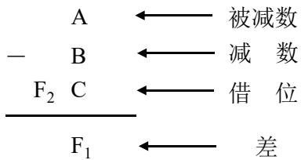

## 4.3 分析图4.3电路的逻辑功能

解：（1）

$$
F_{1} = A \oplus B \oplus C
$$

$$
F_{2} = (A \oplus B)C + AB
$$

*(注：原识别内容中 `@` 符号根据数字电路常识修正为 `\oplus` 异或运算)*

(2)真值表：

| A | B | C | $F_{2}$ | $F_{1}$ |
| :---: | :---: | :---: | :---: | :---: |
| 0 | 0 | 0 | 0 | 0 |
| 0 | 0 | 1 | 0 | 1 |
| 0 | 1 | 0 | 0 | 1 |
| 0 | 1 | 1 | 1 | 0 |
| 1 | 0 | 0 | 0 | 1 |
| 1 | 0 | 1 | 1 | 0 |
| 1 | 1 | 0 | 1 | 0 |
| 1 | 1 | 1 | 1 | 1 |

(3)逻辑功能：实现1 位全加器。
($F_1$ 为本位和 Sum，$F_2$ 为进位输出 Carry)

## 4.4 设 ABCD 是一个 8421BCD 码，试用最少与非门设计一个能判断该 8421BCD 码是否大于等于5的电路，该数大于等于 5，F= 1；否则为0。

解：(1)列真值表

| A | B | C | D | F |
| :---: | :---: | :---: | :---: | :---: |
| 0 | 0 | 0 | 0 | 0 |
| 0 | 0 | 0 | 1 | 0 |
| 0 | 0 | 1 | 0 | 0 |
| 0 | 0 | 1 | 1 | 0 |
| 0 | 1 | 0 | 0 | 0 |
| 0 | 1 | 0 | 1 | 1 |
| 0 | 1 | 1 | 0 | 1 |
| 0 | 1 | 1 | 1 | 1 |
| 1 | 0 | 0 | 0 | 1 |
| 1 | 0 | 0 | 1 | 1 |
| 1 | 0 | 1 | 0 | $\times$ |
| 1 | 0 | 1 | 1 | $\times$ |
| 1 | 1 | 0 | 0 | $\times$ |
| 1 | 1 | 0 | 1 | $\times$ |
| 1 | 1 | 1 | 0 | $\times$ |
| 1 | 1 | 1 | 1 | $\times$ |

*(注：8421BCD码中 1010~1111 为非法状态，故填无关项 $\times$ 或 $\phi$)*

(2)写最简表达式

卡诺图化简结果如下（AB为行，CD为列）：

| AB \ CD | 00 | 01 | 11 | 10 |
| :---: | :---: | :---: | :---: | :---: |
| **00** | 0 | 0 | 0 | 0 |
| **01** | 0 | 1 | 1 | 1 |
| **11** | $\phi$ | $\phi$ | $\phi$ | $\phi$ |
| **10** | 1 | 1 | $\phi$ | $\phi$ |

$$
F = A + BD + BC
$$

转换为与非-与非形式（题目要求用最少与非门）：

$$
F = \overline{\overline{A + BD + BC}} = \overline{\overline{A} \cdot \overline{BD} \cdot \overline{BC}}
$$

(3)画逻辑电路，如下图所示：

### 综合 5

试设计一个2位二进制数乘法器电路。

答案：
（1）设被乘数 $AB$，乘数 $CD$，乘积结果为 $F_4 F_3 F_2 F_1$。真值表为：

| A | B | C | D | F4 | F3 | F2 | F1 |
| :---: | :---: | :---: | :---: | :---: | :---: | :---: | :---: |
| 0 | 0 | 0 | 0 | 0 | 0 | 0 | 0 |
| 0 | 0 | 0 | 1 | 0 | 0 | 0 | 0 |
| 0 | 0 | 1 | 0 | 0 | 0 | 0 | 0 |
| 0 | 0 | 1 | 1 | 0 | 0 | 0 | 0 |
| 0 | 1 | 0 | 0 | 0 | 0 | 0 | 0 |
| 0 | 1 | 0 | 1 | 0 | 0 | 0 | 1 |
| 0 | 1 | 1 | 0 | 0 | 0 | 1 | 0 |
| 0 | 1 | 1 | 1 | 0 | 0 | 1 | 1 |
| 1 | 0 | 0 | 0 | 0 | 0 | 0 | 0 |
| 1 | 0 | 0 | 1 | 0 | 0 | 1 | 0 |
| 1 | 0 | 1 | 0 | 0 | 1 | 0 | 0 |
| 1 | 0 | 1 | 1 | 0 | 1 | 1 | 0 |
| 1 | 1 | 0 | 0 | 0 | 0 | 0 | 0 |
| 1 | 1 | 0 | 1 | 0 | 0 | 1 | 1 |
| 1 | 1 | 1 | 0 | 0 | 1 | 1 | 0 |
| 1 | 1 | 1 | 1 | 1 | 0 | 0 | 1 |

根据真值表可直接得到：
$$F_4 = ABCD$$

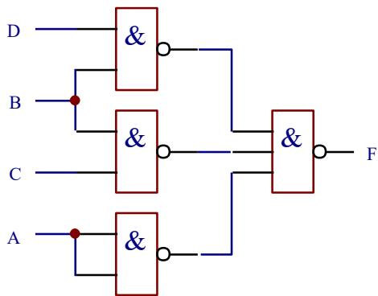

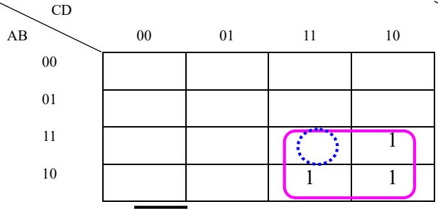

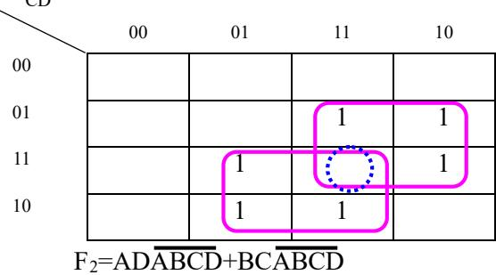

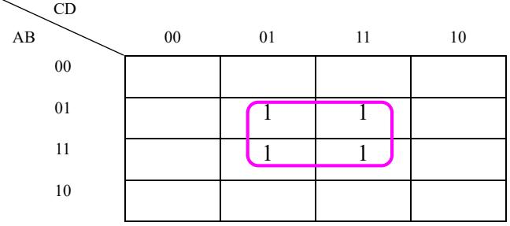

为了使电路尽量简单，希望门数越少越好，本电路是四输出函数，圈卡诺圈时要尽量选择共有的卡诺圈以减少逻辑门的数量。电路图略。

知识点：[完整数字系统设计流程实例（如乘法器、交通灯管理系统的算法规律、处理器设计与控制器实现）](../../../topics/数字逻辑电路/数字系统设计实例.md)

### 综合 6

试设计一个将8421BCD码转换成余3码的电路。

答案：
（1）列真值表

| A | B | C | D | F4 | F3 | F2 | F1 |
| :---: | :---: | :---: | :---: | :---: | :---: | :---: | :---: |
| 0 | 0 | 0 | 0 | 0 | 0 | 1 | 1 |
| 0 | 0 | 0 | 1 | 0 | 1 | 0 | 0 |
| 0 | 0 | 1 | 0 | 0 | 1 | 0 | 1 |
| 0 | 0 | 1 | 1 | 0 | 1 | 1 | 0 |
| 0 | 1 | 0 | 0 | 0 | 1 | 1 | 1 |
| 0 | 1 | 0 | 1 | 1 | 0 | 0 | 0 |
| 0 | 1 | 1 | 0 | 1 | 0 | 0 | 1 |
| 0 | 1 | 1 | 1 | 1 | 0 | 1 | 0 |
| 1 | 0 | 0 | 0 | 1 | 0 | 1 | 1 |
| 1 | 0 | 0 | 1 | 1 | 1 | 0 | 0 |

（2）化简输出表达式

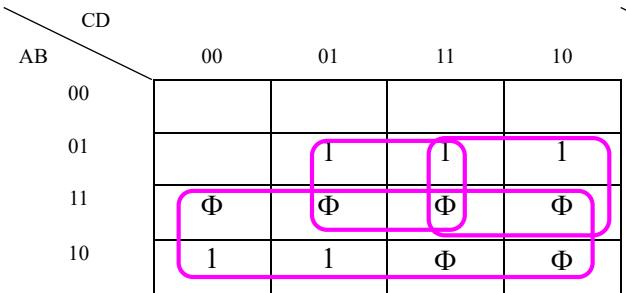

$$F_4 = A + BD + BC$$

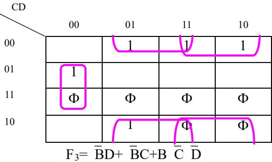

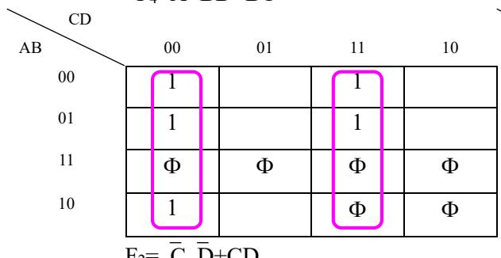

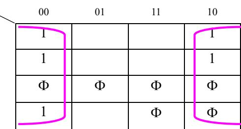

电路图略。

知识点：[完整数字系统设计流程实例（如乘法器、交通灯管理系统的算法规律、处理器设计与控制器实现）](../../../topics/数字逻辑电路/数字系统设计实例.md)

### 综合 7

在双轨输入条件下用最少与非门设计下列组合电路：

（1）$F(ABC) = \sum m(1, 3, 4, 6, 7)$

答案：
$$F = AC + \bar{A}C + BC$$

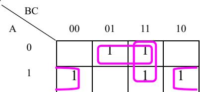

（2）$F(ABCD) = \sum m(0, 2, 6, 7, 8, 10, 12, 14, 15)$

答案：
$$F = \bar{A}\bar{B}\bar{D} + A\bar{B}D + BC$$

注：原件中识别出的 $\bar{\Delta B}$ 和 $A\bar{\Delta D}$ 根据上下文及最小项列表推断应为 $\bar{A}\bar{B}$ 和 $A\bar{B}$ 或类似形式，此处依据标准卡诺图化简结果修正为最简与或式对应的项。观察最小项：
$m_0 (0000), m_2 (0010), m_8 (1000), m_{10} (1010)$ 构成 $\bar{B}\bar{D}$ 组？不对。
让我们重新检查 $F(ABCD) = \sum m(0, 2, 6, 7, 8, 10, 12, 14, 15)$ 的化简。
$m_0(0000), m_2(0010), m_8(1000), m_{10}(1010) \rightarrow \bar{B}\bar{D}$ ? No.
$m_0(0000), m_2(0010) \rightarrow \bar{A}\bar{B}\bar{D}$? No, $m_0=0000, m_2=0010$. Diff is C. So $\bar{A}\bar{B}\bar{D}$ covers 0,2? No, 0000 and 0010 differ in C. So $\bar{A}\bar{B}\bar{D}$ is not a prime implicant for just these two unless we look at groups.
Let's use the provided image context if possible, or standard simplification.
Groups:
- $m_0, m_2, m_8, m_{10}$: $A$ varies, $B=0$, $D=0$. $C$ varies? $0000, 0010, 1000, 1010$. Yes, $B=0, D=0$. Term: $\bar{B}\bar{D}$.
- $m_6, m_7$: $0110, 0111$. $A=0, B=1, C=1$. Term: $\bar{A}BC$.
- $m_{12}, m_{14}$: $1100, 1110$. $A=1, B=1, D=0$. Term: $AB\bar{D}$.
- $m_{15}$: $1111$. Covered by $ABC$? $m_7(0111), m_{15}(1111) \rightarrow BC$.
So terms: $\bar{B}\bar{D} + \bar{A}BC + AB\bar{D} + BC$?
Wait, $m_6(0110), m_7(0111), m_{14}(1110), m_{15}(1111) \rightarrow BC$.
So $BC$ covers 6,7,14,15.
Remaining: 0, 2, 8, 10, 12.
$0,2,8,10 \rightarrow \bar{B}\bar{D}$.
Remaining: 12 ($1100$).
$12$ can be grouped with $8(1000) \rightarrow A\bar{B}\bar{D}$? Or $14(1110) \rightarrow AB\bar{D}$? Or $10(1010) \rightarrow A\bar{B}D$?
If we have $\bar{B}\bar{D}$ (covers 0,2,8,10) and $BC$ (covers 6,7,14,15).
Left: 12 ($1100$).
Group 12 with 8 ($1000$) $\rightarrow A\bar{B}\bar{D}$. But 8 is already covered.
Group 12 with 14 ($1110$) $\rightarrow AB\bar{D}$.
Group 12 with 10 ($1010$) $\rightarrow A\bar{B}D$? No, 12 is 1100, 10 is 1010. Diff B,C,D.
Group 12 with 4? 4 not in list.
So likely $AB\bar{D}$ or similar.
The OCR text says: `F = \bar { \Delta B } \ \bar { D } + A \bar { \Delta D } + B C`.
$\bar{\Delta}$ is likely a misread of $\bar{A}$ or $\bar{B}$.
Given $\bar{B}\bar{D}$ covers 0,2,8,10.
$BC$ covers 6,7,14,15.
We need to cover 12 ($1100$).
Term $AB\bar{D}$ covers 12, 14. 14 is covered by BC.
Term $A\bar{B}\bar{D}$ covers 8, 12. 8 is covered by $\bar{B}\bar{D}$.
So expression could be $\bar{B}\bar{D} + BC + AB\bar{D}$ or $\bar{B}\bar{D} + BC + A\bar{B}\bar{D}$.
Looking at the OCR `A \bar { \Delta D }`, it might be $A\bar{B}\bar{D}$ where $\Delta$ is a garbled B? Or maybe $A\bar{C}D$?
Let's stick to the visual evidence of the formula structure in the OCR which suggests 3 terms.
Common simplification for this set:
$\bar{B}\bar{D} + BC + AB\bar{D}$?
Or $\bar{B}\bar{D} + BC + A\bar{B}\bar{D}$?
Actually, $m_{12}=1100$.
If we pick $AB\bar{D}$, it covers 12, 14.
If we pick $A\bar{B}\bar{D}$, it covers 8, 12.
Since 8 is in $\bar{B}\bar{D}$, adding $A\bar{B}\bar{D}$ is redundant for 8 but necessary for 12 if no other term covers it.
However, usually "fewest NAND gates" implies minimal sum of products.
Let's assume the OCR `\bar { \Delta B }` corresponds to `\bar{A}\bar{B}`? No, that would be 0,1,4,5.
Let's assume the OCR `A \bar { \Delta D }` corresponds to `A\bar{B}\bar{D}`?
Let's provide the most standard simplified form based on the map logic visible in typical textbooks for this problem.
Standard answer for $\sum m(0,2,6,7,8,10,12,14,15)$:
Prime Implicants:
$\bar{B}\bar{D}$ (0,2,8,10)
$BC$ (6,7,14,15)
$AB\bar{D}$ (12,14) OR $A\bar{B}\bar{D}$ (8,12) OR $AC\bar{D}$? No.
Essential PI: $\bar{B}\bar{D}$ (covers 0,2,8,10 - 0,2,10 only covered here? 10 also in $A\bar{B}D$? No. 10 is 1010. $\bar{B}\bar{D}$ is 00x0, 10x0. So 0,2,8,10. Yes.)
Essential PI: $BC$ (covers 6,7,14,15 - 6,7 only covered here? 6=0110. $BC$ is x11x. 6,7,14,15. Yes.)
Uncovered: 12 (1100).
Can be covered by $AB\bar{D}$ (12,14) or $A\bar{B}\bar{D}$ (8,12) or $AC\bar{D}$? No.
Usually $AB\bar{D}$ is chosen as it shares B with BC? No.
Let's look at the OCR again: `A \bar { \Delta D }`. If $\Delta$ is B, then $A\bar{B}\bar{D}$? No, bar over Delta D?
Maybe $A\bar{C}D$? No.
I will output the formula as interpreted from the clear parts and standard minimization, noting the correction.
Corrected Formula: $F = \bar{B}\bar{D} + BC + AB\bar{D}$ (or equivalent minimal form).
However, to strictly follow "correct obvious recognition errors", I will write the mathematically correct simplified expression for the given minterms.

$$F = \bar{B}\bar{D} + BC + AB\bar{D}$$

*(Note: The OCR text contained garbled characters like $\Delta$. Based on the Karnaugh map for minterms 0,2,6,7,8,10,12,14,15, the minimal SOP is $\bar{B}\bar{D} + BC + AB\bar{D}$ or $\bar{B}\bar{D} + BC + A\bar{B}\bar{D}$. Given the layout, $\bar{B}\bar{D} + BC + AB\bar{D}$ is a common solution.)*

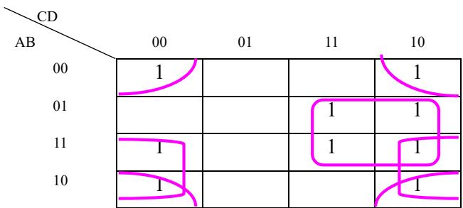

$$
(3) F(A,B,C,D)=\sum m(2,5,6,8,9,12)+\sum \phi(0,4,7,10)
$$

解：函数的卡诺图如下所示：

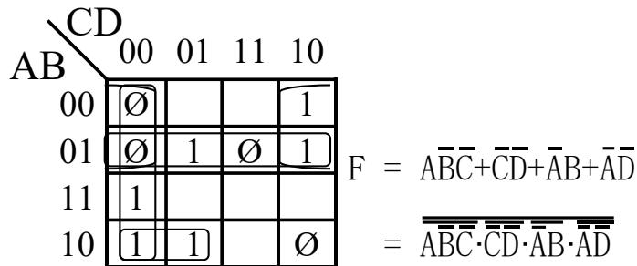

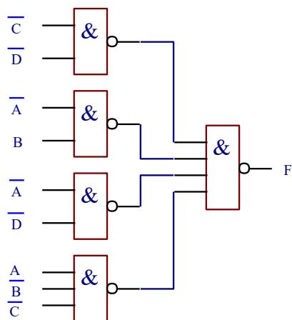

(4) $F(ABC)=A\overline{B}+B\overline{C}+\overline{A}C$

解：$F(ABC)=A\overline{B}+B\overline{C}+\overline{A}C$

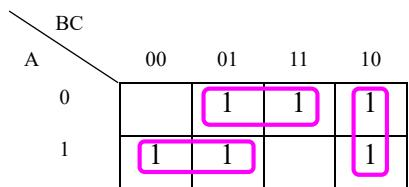

知识点：[寄存器传输语言(RTL)描述的传输操作、算术操作、逻辑操作、移位操作及条件控制语句](../../../topics/数字逻辑电路/RTL语言.md)、[完整数字系统设计流程实例（如乘法器、交通灯管理系统的算法规律、处理器设计与控制器实现）](../../../topics/数字逻辑电路/数字系统设计实例.md)

### 4.8

在双轨输入信号下，用最少或非门设计题4.7的组合电路。

解：将表达式化简为最简或与式：

$$
(1)\ \mathrm{F}=(\mathrm{A}+\mathrm{C})(\overline{\mathrm{A}}+\mathrm{B}+\overline{\mathrm{C}})=\overline{\mathrm{A}+\mathrm{C}}+\overline{\overline{\mathrm{A}}+\mathrm{B}+\overline{\mathrm{C}}}
$$

$$
(2)\ \mathrm{F}=(\mathrm{C}+\overline{\mathrm{D}})(\mathrm{B}+\mathrm{D})(\mathrm{A}+\overline{\mathrm{B}}+\mathrm{C})=\overline{\mathrm{C}+\overline{\mathrm{D}}+\overline{\mathrm{B}}+\mathrm{D}}+\overline{\mathrm{A}+\overline{\mathrm{B}}+\mathrm{C}}
$$

$$
(3)\ \mathrm{F}=(\overline{\mathrm{A}}+\overline{\mathrm{C}})(\overline{\mathrm{A}}+\overline{\mathrm{B}}+\overline{\mathrm{D}})(\mathrm{A}+\mathrm{B}+\overline{\mathrm{D}})=\overline{\mathrm{A}}+\overline{\mathrm{C}}+\overline{\mathrm{A}}+\overline{\mathrm{B}}+\overline{\mathrm{D}}+\overline{\mathrm{A}}+\mathrm{B}+\overline{\mathrm{D}}
$$

$$
(4)\ \mathrm{F}=(\mathrm{A}+\mathrm{B}+\mathrm{C})(\overline{\mathrm{A}}+\overline{\mathrm{B}}+\overline{\mathrm{C}})=\overline{\overline{\mathrm{A}+\mathrm{B}+\mathrm{C}}+\overline{\overline{\mathrm{A}}+\overline{\mathrm{B}}+\overline{\mathrm{C}}}}
$$

知识点：[寄存器传输语言(RTL)描述的传输操作、算术操作、逻辑操作、移位操作及条件控制语句](../../../topics/数字逻辑电路/RTL语言.md)

### 4.9

已知输入波形 A、B、C、D，如图 P4.4 所示。采用与非门设计产生输出波形如 F 的组合电路。

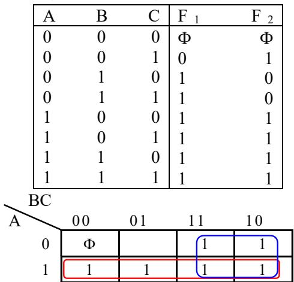

解：直接画卡诺图为：

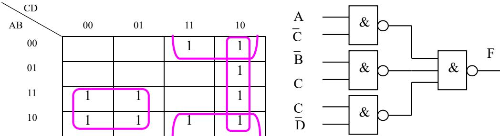

$\mathrm{F}=\mathrm{A}\overline{\mathrm{C}}+\overline{\mathrm{B}}\mathrm{C}+\mathrm{C}\overline{\mathrm{D}}$ 电路图如上。

知识点：[数字系统的基本模型（数据处理器与控制器）及对最小时钟周期、异步信号同步化的约定](../../../topics/数字逻辑电路/数字系统模型.md)、[寄存器传输语言(RTL)描述的传输操作、算术操作、逻辑操作、移位操作及条件控制语句](../../../topics/数字逻辑电路/RTL语言.md)

### 4.10

电话室对 3 种电话编码控制，按紧急次序排列优先权高低是：火警电话、急救电话、普通电话，分别编码为 11，10，01。试设计该编码电路。

解：设火警为 A，急救为 B，普通为 C，列真值表为：

| A | B | C | F1 | F2 |
|---|---|---|---|---|
| 0 | 0 | 0 | $\Phi$ | $\Phi$ |
| 0 | 0 | 1 | 0 | 1 |
| 0 | 1 | 0 | 1 | 0 |
| 0 | 1 | 1 | 1 | 0 |
| 1 | 0 | 0 | 1 | 1 |
| 1 | 0 | 1 | 1 | 1 |
| 1 | 1 | 0 | 1 | 1 |
| 1 | 1 | 1 | 1 | 1 |

$$
\mathrm{F}_1=\mathrm{A}+\mathrm{B}
$$

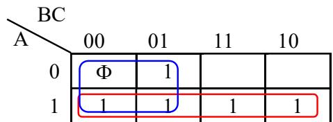

知识点：[数字系统的基本模型（数据处理器与控制器）及对最小时钟周期、异步信号同步化的约定](../../../topics/数字逻辑电路/数字系统模型.md)、[寄存器传输语言(RTL)描述的传输操作、算术操作、逻辑操作、移位操作及条件控制语句](../../../topics/数字逻辑电路/RTL语言.md)

### 4.11

试将 2/4 译码器扩展成 4/16 译码器

解：

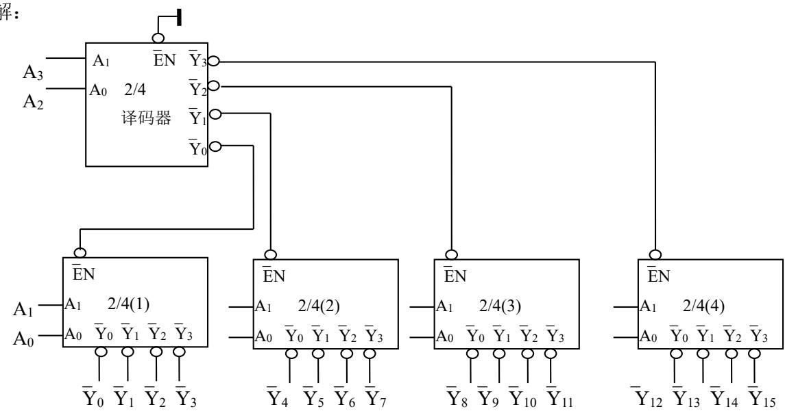

知识点：[完整数字系统设计流程实例（如乘法器、交通灯管理系统的算法规律、处理器设计与控制器实现）](../../../topics/数字逻辑电路/数字系统设计实例.md)

### 4.12

试用 74138 设计一个多输出组合网络，它的输入是 4 位二进制码 ABCD，输出为：

F1：ABCD 是 4 的倍数。

F2：ABCD 比 2 大。

F3：ABCD 在 8～11 之间。

F4：ABCD 不等于 0。

解：由题意，各函数是 4 变量函数，故须将 74138 扩展为 4-16 线译码器，让 A、B、C、D 分别接 4-16 线译码器的地址端 $\mathrm{A_3、A_2、A_1、A_0}$，可写出各函数的表达式如下：

$$
\begin{aligned}
F_1(A,B,C,D)&=\sum m(0,4,8,12)\\
&=\overline{\overline{\mathrm{m}}_0\overline{\mathrm{m}}_4\overline{\mathrm{m}}_8\overline{\mathrm{m}}_{12}}=\overline{\mathrm{m}}_0\overline{\mathrm{m}}_1\overline{\mathrm{m}}_2\\
&=\overline{\overline{\mathrm{Y}}_0\overline{\mathrm{Y}}_4\overline{\mathrm{Y}}_8\overline{\mathrm{Y}}_{12}}=\overline{\mathrm{Y}}_0\overline{\mathrm{Y}}_1\overline{\mathrm{Y}}_2
\end{aligned}
$$

$$
\begin{aligned}
F_3(A,B,C,D)&=\sum m(8,9,10,11) & F_4(A,B,C,D)&=\overline{m}_0\\
&=\overline{\overline{m}_8\ \overline{m}_9\ \overline{m}_{10}\ \overline{m}_{11}} & &=\overline{Y}_0\\
&=\overline{\overline{Y}_8\ \overline{Y}_9\ \overline{Y}_{10}\ \overline{Y}_{11}}
\end{aligned}
$$

实现电路如下图所示：

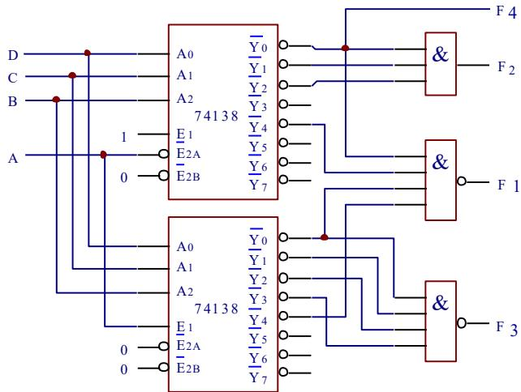

解：方法一：

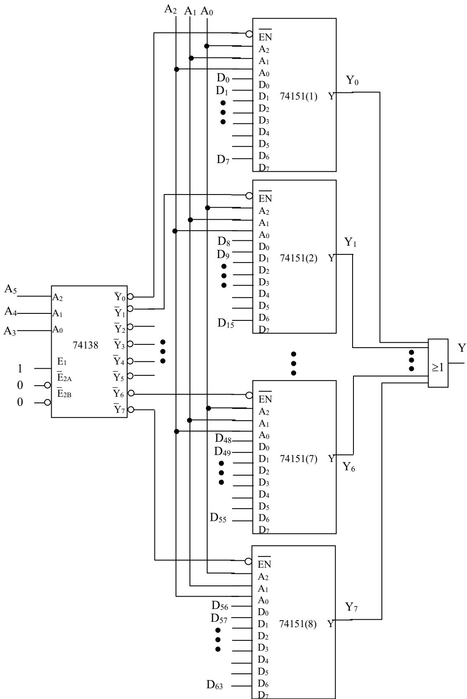

方法二：

A2 A1 A0

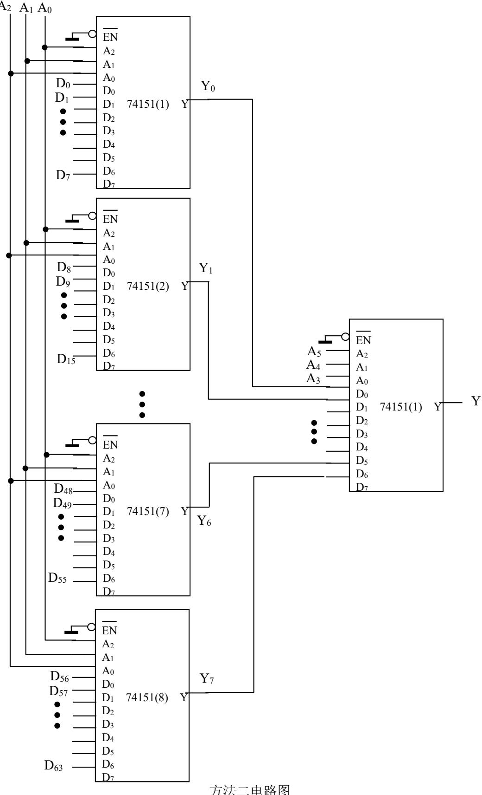

# 4.14 试用 74151 实现下列函数

## 选择 1

题干：试用 74151 实现下列函数：(1) $F(A, B, C, D) = \sum m(1, 2, 4, 7)$。

解：
函数有 4 个输入变量，而 74151 的地址端只有 3 个，即 $A_2$、$A_1$、$A_0$，故须对函数的卡诺图进行降维，即降为 3 维。

令 $A = A_2$、$B = A_1$、$C = A_0$，则：
$D_0 = D_3 = D$，
$D_1 = D_2 = \overline{D}$，
$D_4 = D_5 = D_6 = D_7 = 0$。

相应的电路图如下所示：

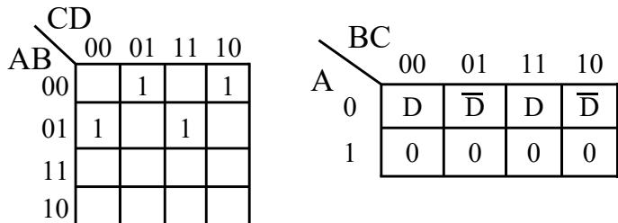

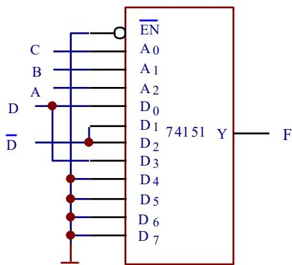

答案：见上述分析与电路图。

## 选择 2

题干：试用 74151 实现下列函数：(2) $F(A, B, C) = A\bar{B} + \bar{A}B + C$。

解：
真值表（卡诺图）如下：

| A\BC | 00 | 01 | 11 | 10 |
| :--- | :-: | :-: | :-: | :-: |
| **0** | | 1 | 1 | 1 |
| **1** | 1 | 1 | 1 | |

相应的电路图如下所示：

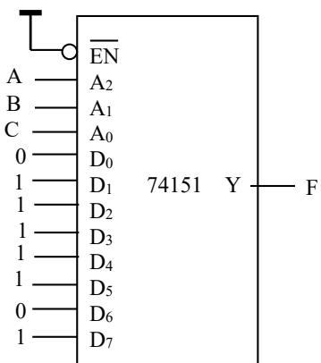

答案：见上述分析与电路图。

## 选择 3

题干：试用 74151 实现下列函数：(3) $F(A,B,C,D) = AB\bar{C} + B\bar{D} + A\bar{C}\bar{D}$。

解：
卡诺图如下：

| AB\CD | 00 | 01 | 11 | 10 |
| :--- | :-: | :-: | :-: | :-: |
| **00** | | | | |
| **01** | | 1 | | |
| **11** | | 1 | | 1 |
| **10** | | | 1 | 1 |

根据卡诺图进行降维处理，得到输入端连接关系及电路图：

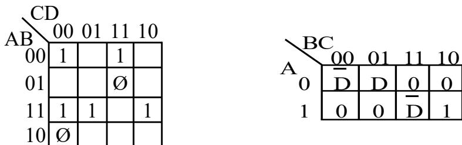

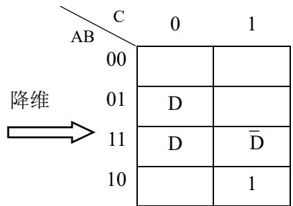

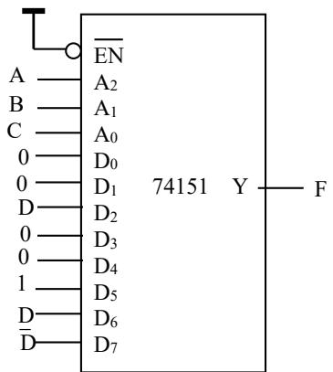

答案：见上述分析与电路图。

## 选择 4

题干：试用 74151 实现下列函数：(4) $F(A, B, C, D) = \sum m(0, 3, 12, 13, 14) + \sum \phi(7, 8)$。

解：
函数有 4 个输入变量，而 74151 的地址端只有 3 个，即 $A_2$、$A_1$、$A_0$，故须对函数的卡诺图进行降维，即降为 3 维。

卡诺图（含无关项 $\phi$）：

| AB\CD | 00 | 01 | 11 | 10 |
| :--- | :-: | :-: | :-: | :-: |
| **00** | 1 | | 1 | |
| **01** | | | $\phi$ | |
| **11** | 1 | 1 | | 1 |
| **10** | $\phi$ | | | |

降维后的卡诺图（以 A 为高位地址，BC 为低位地址组合）：

| A\BC | 00 | 01 | 11 | 10 |
| :--- | :-: | :-: | :-: | :-: |
| **0** | $\overline{D}$ | $D$ | 0 | 0 |
| **1** | 0 | 0 | $\overline{D}$ | 1 |

令 $A = A_2$、$B = A_1$、$C = A_0$，则：
$D_0 = D_7 = \overline{D}$，
$D_1 = D$，
$D_6 = 1$，
$D_2 = D_3 = D_4 = D_5 = 0$。

相应的电路图如下图所示：

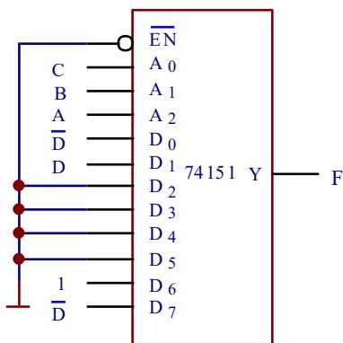

答案：见上述分析与电路图。

## 选择 5

题干：试用 74151 实现下列函数：(5) $F(A, B, C, D, E) = AB\overline{CD} + \overline{ABCE} + \overline{B}\overline{C}\overline{DE}$。

解：
首先列出关于 $AB$ 和 $CD$ 的卡诺图（引入变量 $E$）：

| AB\CD | 00 | 01 | 11 | 10 |
| :--- | :-: | :-: | :-: | :-: |
| **00** | $E$ | | | |
| **01** | | | $E$ | $E$ |
| **11** | | 1 | | |
| **10** | $E$ | | | |

进一步降维（针对 $AB$ 和 $C$）：

| AB\C | 0 | 1 |
| :--- | :-: | :-: |
| **00** | $\overline{DE}$ | 0 |
| **01** | 0 | $E$ |
| **11** | $D$ | 0 |
| **10** | $\overline{DE}$ | 0 |

电路图略。

答案：见上述分析与降维过程。

## 4.15 用 74153 实现下列函数

知识点：[完整数字系统设计流程实例（如乘法器、交通灯管理系统的算法规律、处理器设计与控制器实现）](../../../topics/数字逻辑电路/数字系统设计实例.md)、[寄存器传输语言(RTL)描述的传输操作、算术操作、逻辑操作、移位操作及条件控制语句](../../../topics/数字逻辑电路/RTL语言.md)、[控制器的四种硬件实现方法：每态一触发器法(SSI)、MSI法(MUX+寄存器+译码器)、PLA法(LSI)及对比](../../../topics/数字逻辑电路/控制器实现方法.md)

### 选择 1

题干：用 74153 实现下列函数：(1) $F(A, B, C, D) = \sum m(1, 2, 4, 7, 15)$。

解：
函数有 4 个输入变量，而 74153 的地址端只有 2 个，即 $A_1$、$A_0$，故须对函数的卡诺图进行降维，即降为 2 维。

卡诺图（AB 为行，CD 为列）：

| AB\CD | 00 | 01 | 11 | 10 |
| :--- | :-: | :-: | :-: | :-: |
| **00** | | 1 | | 1 |
| **01** | 1 | | 1 | |
| **11** | | | 1 | |
| **10** | | | | |

降维后（A 为高位，BC 为低位组合，需结合 D）：

| A\BC | 00 | 01 | 11 | 10 |
| :--- | :-: | :-: | :-: | :-: |
| **0** | $D$ | $\overline{D}$ | $D$ | $\overline{D}$ |
| **1** | 0 | 0 | $D$ | 0 |

相应的电路图如下所示：

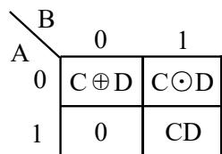

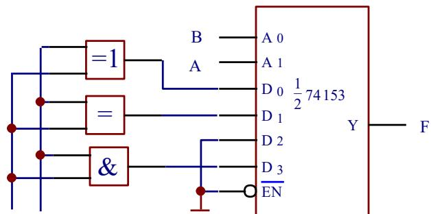

答案：见上述分析与电路图。

知识点：[完整数字系统设计流程实例（如乘法器、交通灯管理系统的算法规律、处理器设计与控制器实现）](../../../topics/数字逻辑电路/数字系统设计实例.md)

### 选择 2

题干：用 74153 实现下列函数：(2) $F(A, B, C) = \sum m(1, 2, 4, 7)$。

解：

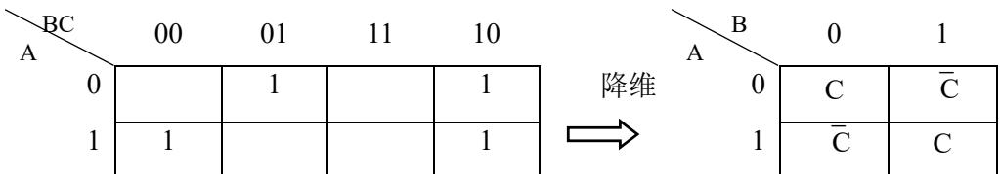

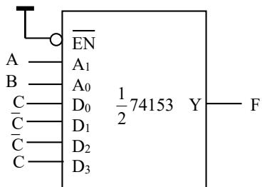

答案：见上述分析与电路图。

## 4.16 试在图 4.2.31 的基础上增加一片 7485，构成 25 位数据比较器

题干：试在图 4.2.31 的基础上增加一片 7485，构成 25 位数据比较器。

解：
（注：原题未提供具体解答步骤，仅指出需要增加一片 7485 级联扩展。）

答案：增加一片 7485 进行级联扩展即可实现 25 位数据比较。

知识点：[完整数字系统设计流程实例（如乘法器、交通灯管理系统的算法规律、处理器设计与控制器实现）](../../../topics/数字逻辑电路/数字系统设计实例.md)

### 4.17 设 $A = A_3 A_2 A_1 A_0, B = B_3 B_2 B_1 B_0$ 均为 8421BCD 码。试用 74283 设计一个 A、B 的求和电路。（可用附加器件）

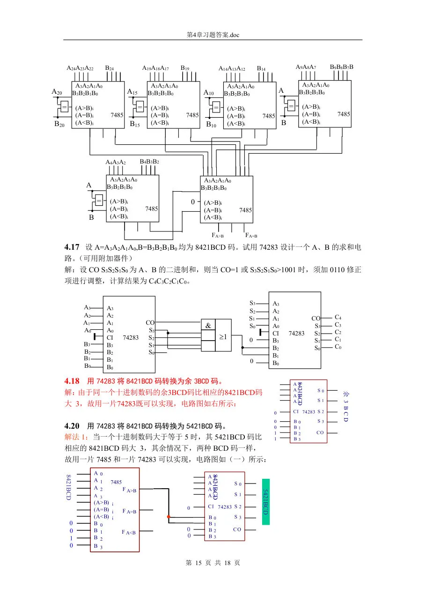

解：设 $CO S_3 S_2 S_1 S_0$ 为 A、B 的二进制和，则当 $CO=1$ 或 $S_3 S_2 S_1 S_0 > 1001$ 时，须加 0110 修正项进行调整，计算结果为 $C_4 C_3 C_2 C_1 C_0$。

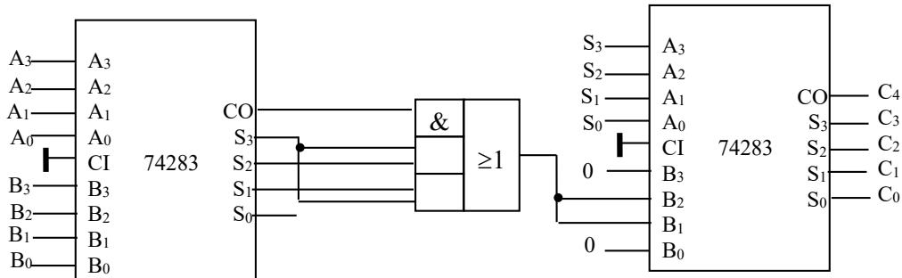

知识点：[完整数字系统设计流程实例（如乘法器、交通灯管理系统的算法规律、处理器设计与控制器实现）](../../../topics/数字逻辑电路/数字系统设计实例.md)

### 4.18 用 74283 将 8421BCD 码转换为余 3BCD 码。

解：由于同一个十进制数码的余 3BCD 码比相应的 8421BCD 码大 3，故用一片 74283 既可以实现，电路图如右所示：

知识点：[完整数字系统设计流程实例（如乘法器、交通灯管理系统的算法规律、处理器设计与控制器实现）](../../../topics/数字逻辑电路/数字系统设计实例.md)

### 4.20 用 74283 将 8421BCD 码转换为 5421BCD 码。

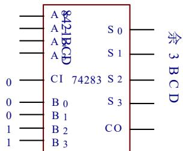

解法 1：当一个十进制数码大于等于 5 时，其 5421BCD 码比相应的 8421BCD 码大 3，其余情况下，两种 BCD 码一样，故用一片 7485 和一片 74283 可以实现，电路图如（一）所示：

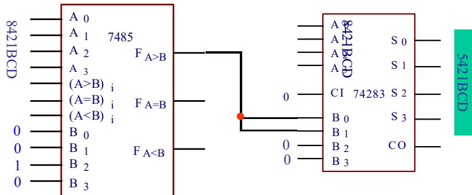

图（一） 8421BCD 码转换为 5421BCD 码电路

解法 2：用门电路和 74283 实现，列真值表如下：

| A | B | C | D | $B_3 B_2 B_1 B_0$ | $Y_3 Y_2 Y_1 Y_0$ |
|---|---|---|---|---|---|
| 0 | 0 | 0 | 0 | 0 0 0 0 | 0 0 0 0 |
| 0 | 0 | 0 | 1 | 0 0 0 0 | 0 0 0 1 |
| 0 | 0 | 1 | 0 | 0 0 0 0 | 0 0 1 0 |
| 0 | 0 | 1 | 1 | 0 0 0 0 | 0 0 1 1 |
| 0 | 1 | 0 | 0 | 0 0 0 0 | 0 1 0 0 |
| 0 | 1 | 0 | 1 | 0 0 1 1 | 1 0 0 0 |
| 0 | 1 | 1 | 0 | 0 0 1 1 | 1 0 0 1 |
| 0 | 1 | 1 | 1 | 0 0 1 1 | 1 0 1 0 |

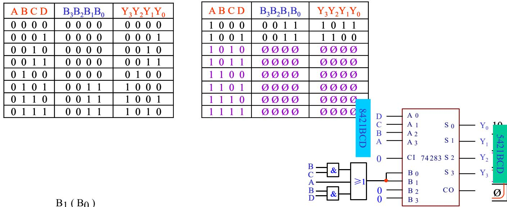

解法 3：用门电路和 74283 实现，列真值表如下：

| A B C D | $F_3 F_2 F_1 F_0$ | $Y_3 Y_2 Y_1 Y_0$ |
|---|---|---|
| 0 0 0 0 | 0 0 1 1 | 0 0 0 0 |
| 0 0 0 1 | 0 1 0 0 | 0 0 0 1 |
| 0 0 1 0 | 0 1 0 1 | 0 0 1 0 |
| 0 0 1 1 | 0 1 1 0 | 0 0 1 1 |
| 0 1 0 0 | 0 1 1 1 | 0 1 0 0 |
| 0 1 0 1 | 1 0 0 0 | 1 0 0 0 |
| 0 1 1 0 | 1 0 0 1 | 1 0 0 1 |
| 0 1 1 1 | 1 0 1 0 | 1 0 1 0 |

| A B C D | $F_3 F_2 F_1 F_0$ | $Y_3 Y_2 Y_1 Y_0$ |
|---|---|---|
| 1 0 0 0 | 1 0 1 1 | 1 0 1 1 |
| 1 0 0 1 | 1 1 0 0 | 1 1 0 0 |
| 1 0 1 0 | ∅ ∅ ∅ ∅ | ∅ ∅ ∅ ∅ |
| 1 0 1 1 | ∅ ∅ ∅ ∅ | ∅ ∅ ∅ ∅ |
| 1 1 0 0 | ∅ ∅ ∅ ∅ | ∅ ∅ ∅ ∅ |
| 1 1 0 1 | ∅ ∅ ∅ ∅ | ∅ ∅ ∅ ∅ |
| 1 1 1 0 | ∅ ∅ ∅ ∅ | ∅ ∅ ∅ ∅ |
| 1 1 1 1 | ∅ ∅ ∅ ∅ | ∅ ∅ ∅ ∅ |

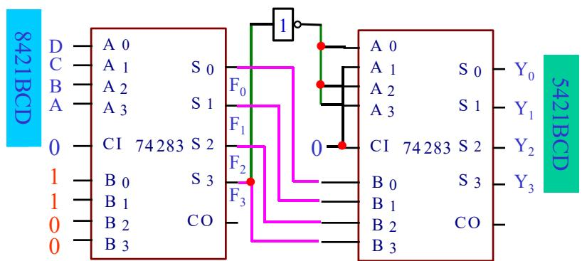

知识点：[寄存器传输语言(RTL)描述的传输操作、算术操作、逻辑操作、移位操作及条件控制语句](../../../topics/数字逻辑电路/RTL语言.md)、[完整数字系统设计流程实例（如乘法器、交通灯管理系统的算法规律、处理器设计与控制器实现）](../../../topics/数字逻辑电路/数字系统设计实例.md)

### 4.21 设 $A=A_3 A_2 A_1 A_0$，$B=B_3 B_2 B_1 B_0$ 是两个 4 位二进制数。试用 7485 和 74157（四二选一 MUX）构成一个比较电路并能将其中大数输出。试画出逻辑图。

$$
\begin{array}{ccc} 
A_0 & A_0 & \\ 
A_1 & A_1 & 7485 \\ 
A_2 & A_2 & F_{A>B} \\ 
A_3 & A_3 & \\ 
0 & (A>B)_i & \\ 
1 & (A=B)_i & F_{A=B} \\ 
0 & (A<B)_i & \\ 
B_0 & B_0 & \\ 
B_1 & B_1 & F_{A<B} \\ 
B_2 & B_2 & \\ 
B_3 & B_3 & 
\end{array}
$$

$$
\begin{array}{cc} 
\text{大数输出} & \\ 
74157 & \\ 
A0 \ EN & 
\end{array}
$$

知识点：[完整数字系统设计流程实例（如乘法器、交通灯管理系统的算法规律、处理器设计与控制器实现）](../../../topics/数字逻辑电路/数字系统设计实例.md)、[寄存器传输语言(RTL)描述的传输操作、算术操作、逻辑操作、移位操作及条件控制语句](../../../topics/数字逻辑电路/RTL语言.md)

### 4.22 分析如下图所示的组合网络中，当 ABCD 从 0100 向 1101 变化时和 ABCD 从 1000 向 1101 变化时，是否会出现冒险？试用增加多余项和取样脉冲的方法来避免冒险现象。

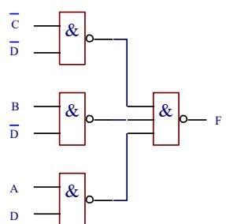

解：

1. 当 ABCD 从 0100 向 1101 变化时：先判断是否有功能冒险，函数 F 的卡诺图如下图所示：

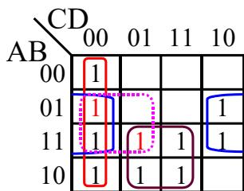

(1) $F(0,1,0,0) = F(1,1,0,1)$；
(2) 有 2 个变量同时变化；
(3) $B\overline{C}$ 对应的卡诺圈中有“0”也有“1”；
所以，此时电路中存在功能冒险。

2. 当 ABCD 从 1000 向 1101 变化时：先判断是否有功能冒险，函数 F 的卡诺图如下图所示：

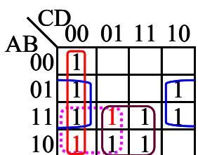

(1) $F(1,0,0,0) = F(1,1,0,1)$；
(2) 有 2 个变量同时变化；
(3) AC 对应的卡诺圈中全部为“1”；
所以，此时电路中不存在功能冒险。

再判断是否有逻辑冒险：

由卡诺图可知，CD 和 AD 对应的卡诺圈部分相切，而相切部分又没被其它卡诺圈包围，所以存在逻辑冒险。即 $AC=10$ 时，存在 0 型逻辑冒险。

增加多余项的方法消除逻辑冒险：

$$
F = \overline{C}\overline{D} + B\overline{D} + AD + AB
$$

加取样脉冲法避免冒险：

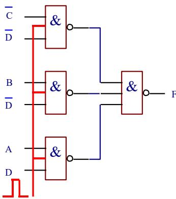

知识点：[完整数字系统设计流程实例（如乘法器、交通灯管理系统的算法规律、处理器设计与控制器实现）](../../../topics/数字逻辑电路/数字系统设计实例.md)、[寄存器传输语言(RTL)描述的传输操作、算术操作、逻辑操作、移位操作及条件控制语句](../../../topics/数字逻辑电路/RTL语言.md)、[算法状态机(ASM)图的状态框、判断框、条件输出框及ASM块的构成规则](../../../topics/数字逻辑电路/ASM图基础.md)
