# 《数字电路与系统设计》第5章 同步计数器的设计（课件）

原件的每一页，下面附识别出的文字。

### 同步计数器的设计

原文：

同步计数器的设计

### 设计要求：

原文：

设计要求：

1）用小规模集成电路（触发器和门电路）设计。

2）计数器应能自启动

3）电路应力求简单

同步计数器的设计步骤：

(1) 根据模长要求，确定FF的级数，列出状态转移表

(2) 选择FF类型，求各级FF的激励方程。

(3) 检查自启动性，若无自启动性，则修改激励方程。

(4) 画出电路图

### 例：用DFF和JKFF设计具有下列状态转移表的M=6的计数器，要求具有自启动性。

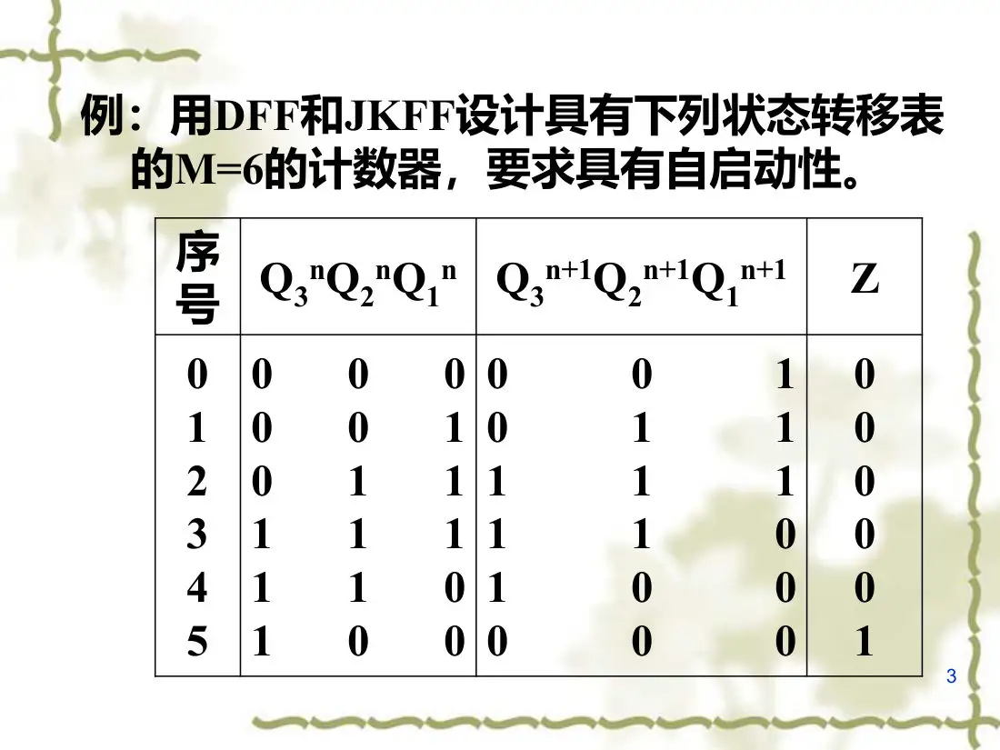

原文：

例：用DFF和JKFF设计具有下列状态转移表的M=6的计数器，要求具有自启动性。

<table><tr><td>序号</td><td colspan="3"> $Q_3^nQ_2^nQ_1^n$ </td><td colspan="3"> $Q_3^{n+1}Q_2^{n+1}Q_1^{n+1}$ </td><td>Z</td></tr><tr><td>0</td><td>0</td><td>0</td><td>0</td><td>0</td><td>0</td><td>1</td><td>0</td></tr><tr><td>1</td><td>0</td><td>0</td><td>1</td><td>0</td><td>1</td><td>1</td><td>0</td></tr><tr><td>2</td><td>0</td><td>1</td><td>1</td><td>1</td><td>1</td><td>1</td><td>0</td></tr><tr><td>3</td><td>1</td><td>1</td><td>1</td><td>1</td><td>1</td><td>0</td><td>0</td></tr><tr><td>4</td><td>1</td><td>1</td><td>0</td><td>1</td><td>0</td><td>0</td><td>0</td></tr><tr><td>5</td><td>1</td><td>0</td><td>0</td><td>0</td><td>0</td><td>0</td><td>1</td></tr></table>

### 第 4 页

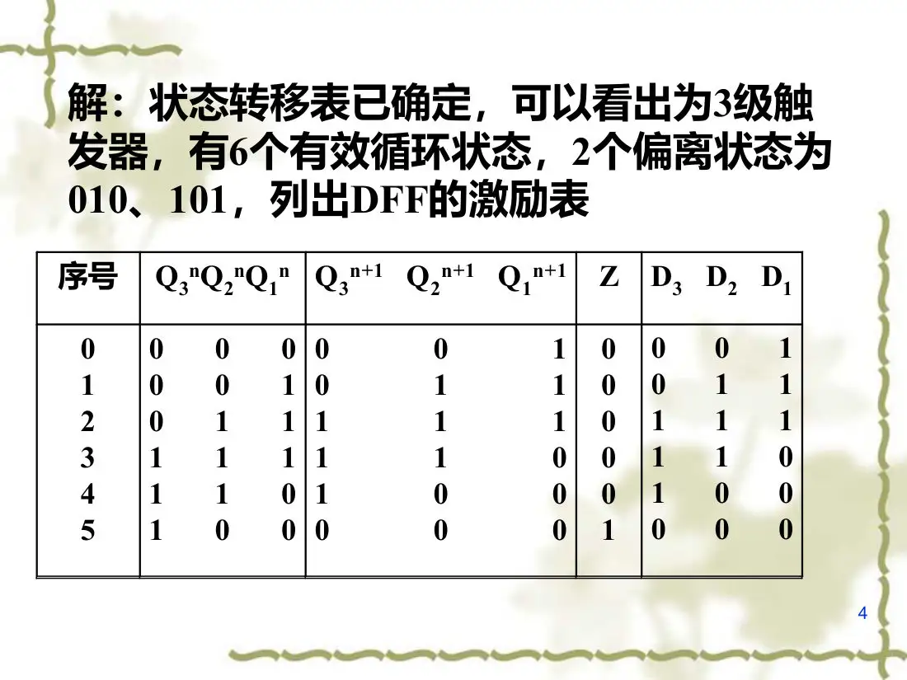

原文：

解：状态转移表已确定，可以看出为3级触发器，有6个有效循环状态，2个偏离状态为010、101，列出DFF的激励表

<table><tr><td>序号</td><td colspan="3"> $Q_{3}^{n}Q_{2}^{n}Q_{1}^{n}$ </td><td> $Q_{3}^{n+1}$ </td><td> $Q_{2}^{n+1}$ </td><td> $Q_{1}^{n+1}$ </td><td>Z</td><td> $D_{3}$ </td><td> $D_{2}$ </td><td> $D_{1}$ </td></tr><tr><td>0</td><td>0</td><td>0</td><td>0</td><td>0</td><td>0</td><td>1</td><td>0</td><td>0</td><td>0</td><td>1</td></tr><tr><td>1</td><td>0</td><td>0</td><td>1</td><td>0</td><td>1</td><td>1</td><td>0</td><td>0</td><td>1</td><td>1</td></tr><tr><td>2</td><td>0</td><td>1</td><td>1</td><td>1</td><td>1</td><td>1</td><td>0</td><td>1</td><td>1</td><td>1</td></tr><tr><td>3</td><td>1</td><td>1</td><td>1</td><td>1</td><td>1</td><td>0</td><td>0</td><td>1</td><td>1</td><td>0</td></tr><tr><td>4</td><td>1</td><td>1</td><td>0</td><td>1</td><td>0</td><td>0</td><td>0</td><td>1</td><td>0</td><td>0</td></tr><tr><td>5</td><td>1</td><td>0</td><td>0</td><td>0</td><td>0</td><td>0</td><td>1</td><td>0</td><td>0</td><td>0</td></tr></table>

4

### $$

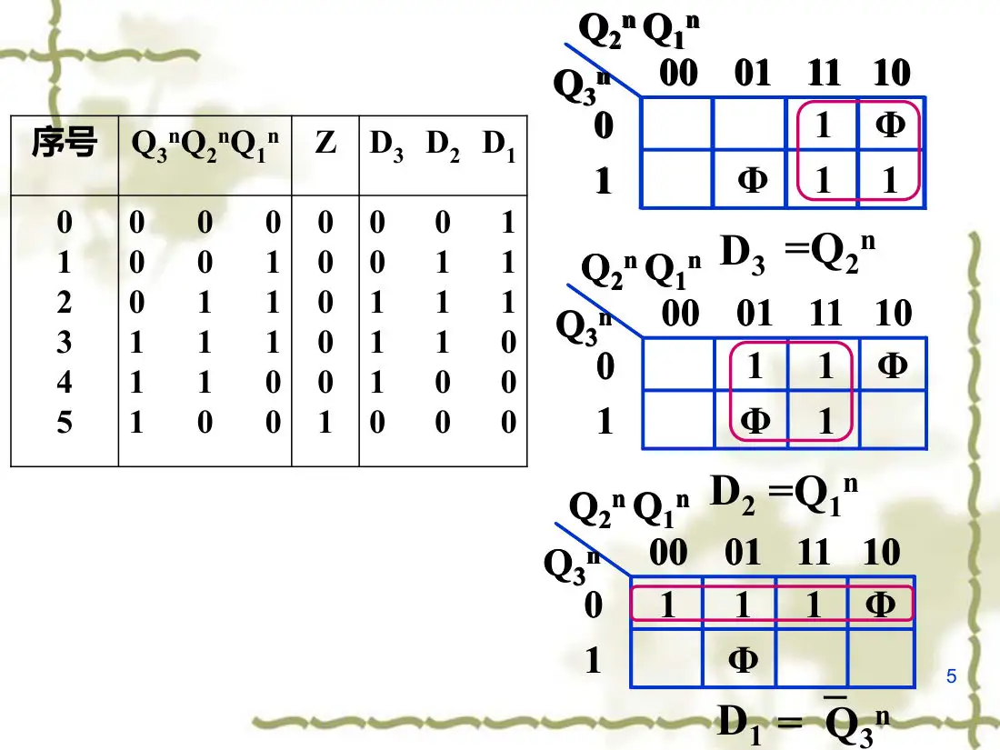

原文：

<table><tr><td>序号</td><td colspan="3"> ${\mathrm{Q}}_{3}{}^{\mathrm{n}}{\mathrm{Q}}_{2}{}^{\mathrm{n}}{\mathrm{Q}}_{1}{}^{\mathrm{n}}$ </td><td>Z</td><td colspan="3"> ${\mathrm{D}}_{3}$   ${\mathrm{D}}_{2}$   ${\mathrm{D}}_{1}$ </td></tr><tr><td>0</td><td>0</td><td>0</td><td>0</td><td>0</td><td>0</td><td>0</td><td>1</td></tr><tr><td>1</td><td>0</td><td>0</td><td>1</td><td>0</td><td>0</td><td>1</td><td>1</td></tr><tr><td>2</td><td>0</td><td>1</td><td>1</td><td>0</td><td>1</td><td>1</td><td>1</td></tr><tr><td>3</td><td>1</td><td>1</td><td>1</td><td>0</td><td>1</td><td>1</td><td>0</td></tr><tr><td>4</td><td>1</td><td>1</td><td>0</td><td>0</td><td>1</td><td>0</td><td>0</td></tr><tr><td>5</td><td>1</td><td>0</td><td>0</td><td>1</td><td>0</td><td>0</td><td>0</td></tr></table>

$$
\begin{array}{c c c c c} \mathbf {Q} _ {2} ^ {\mathrm{n}} & \mathbf {Q} _ {1} ^ {\mathrm{n}} & \mathbf {D} _ {3} = \mathbf {Q} _ {2} ^ {\mathrm{n}} \\ \hline \mathbf {Q} _ {3} ^ {\mathrm{n}} & 0 0 & 0 1 & 1 1 & 1 0 \\ \hline 0 & & 1 & 1 & \Phi \\ 1 & & \Phi & 1 \end{array}
$$

$$
\begin{array}{c c c c c} \mathbf {Q} _ {2} ^ {\mathrm{n}} \mathbf {Q} _ {1} ^ {\mathrm{n}} & \mathbf {D} _ {2} = \mathbf {Q} _ {1} ^ {\mathrm{n}} \\ \hline \mathbf {Q} _ {3} ^ {\mathrm{n}} & 0 0 & 0 1 & 1 1 & 1 0 \\ \hline 0 & 1 & 1 & 1 & \Phi \\ 1 & & \Phi & & \end{array}
$$

$$
\mathbf {D} _ {1} = \overline {{\mathbf {Q}}} _ {3} ^ {\mathrm{n}}
$$

### $$

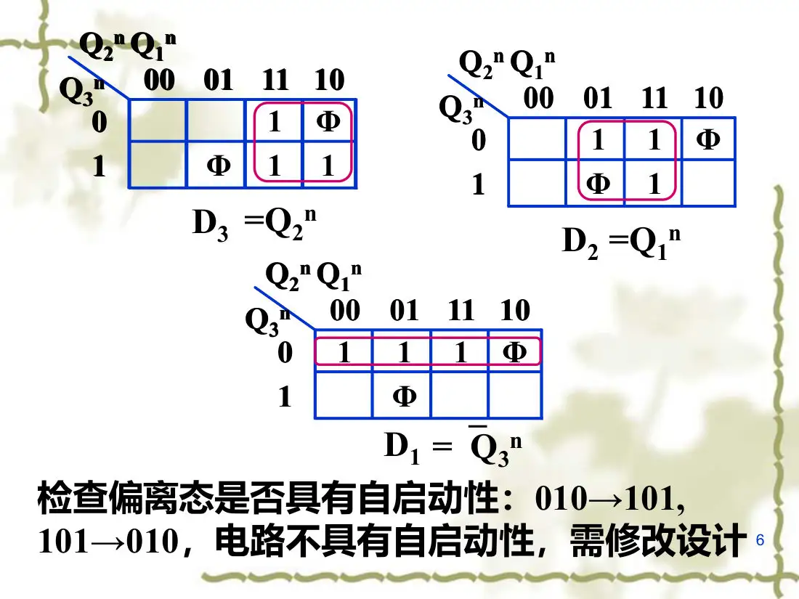

原文：

$$
\mathbf {D} _ {3} = \mathbf {Q} _ {2} ^ {\mathrm{n}}
$$

$$
\mathbf {D} _ {1} = \overline {{\mathbf {Q}}} _ {3} ^ {\mathrm{n}}
$$

检查偏离态是否具有自启动性：010→101，101→010，电路不具有自启动性，需修改设计 $^{6}$

### $$

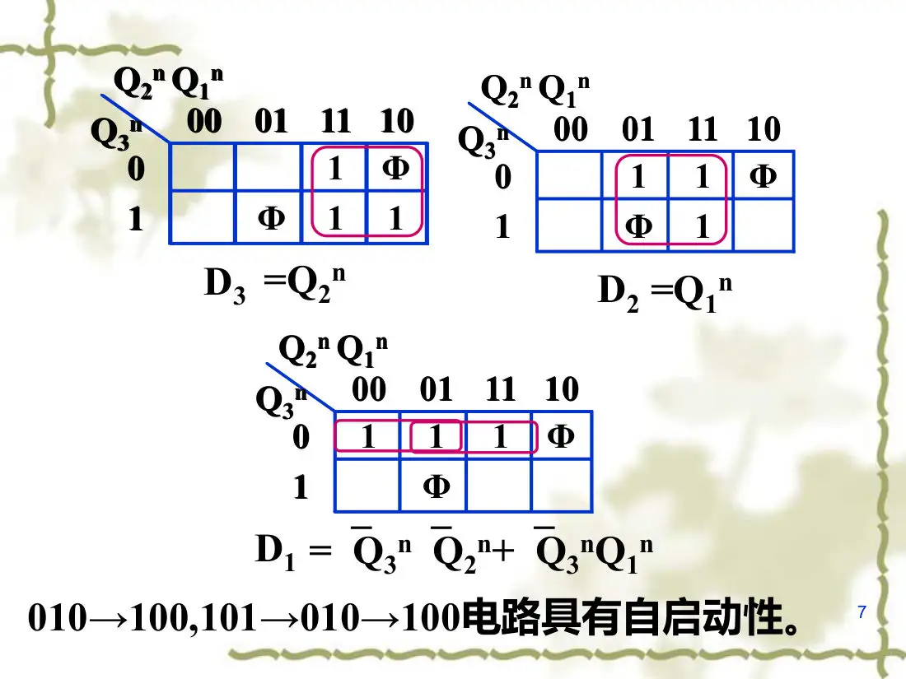

原文：

$$
\mathbf {D} _ {3} = \mathbf {Q} _ {2} ^ {\mathrm{n}}
$$

$$
\mathbf {D} _ {1} = \overline {{\mathbf {Q}}} _ {3} ^ {\mathrm{n}} \overline {{\mathbf {Q}}} _ {2} ^ {\mathrm{n+}} \overline {{\mathbf {Q}}} _ {3} ^ {\mathrm{n}} \mathbf {Q} _ {1} ^ {\mathrm{n}}
$$

010→100,101→010→100电路具有自启动性。

### 第 8 页

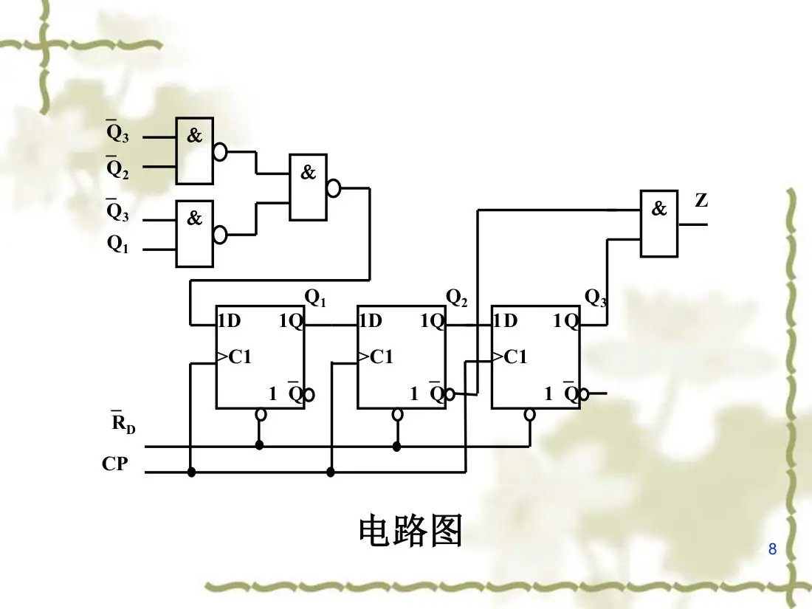

### 列出JKFF的激励表

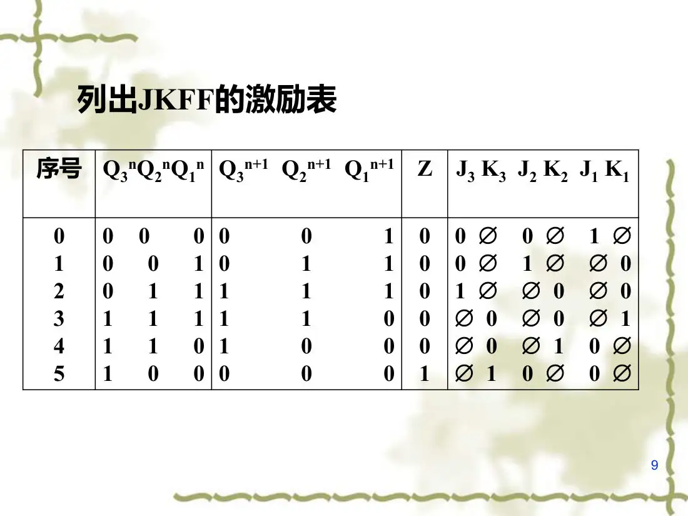

原文：

列出JKFF的激励表

<table><tr><td>序号</td><td colspan="3"> $Q_{3}^{n}Q_{2}^{n}Q_{1}^{n}$ </td><td colspan="3"> $Q_{3}^{n+1}$   $Q_{2}^{n+1}$   $Q_{1}^{n+1}$ </td><td>Z</td><td colspan="4"> $J_{3}K_{3}$   $J_{2}K_{2}$   $J_{1}K_{1}$ </td><td></td></tr><tr><td>0</td><td>0</td><td>0</td><td>0</td><td>0</td><td>0</td><td>1</td><td>0</td><td>0</td><td>∅</td><td>0</td><td>∅</td><td>1</td></tr><tr><td>1</td><td>0</td><td>0</td><td>1</td><td>0</td><td>1</td><td>1</td><td>0</td><td>0</td><td>∅</td><td>1</td><td>∅</td><td>∅</td></tr><tr><td>2</td><td>0</td><td>1</td><td>1</td><td>1</td><td>1</td><td>1</td><td>0</td><td>1</td><td>∅</td><td>∅</td><td>0</td><td>∅</td></tr><tr><td>3</td><td>1</td><td>1</td><td>1</td><td>1</td><td>1</td><td>0</td><td>0</td><td>∅</td><td>0</td><td>∅</td><td>0</td><td>∅</td></tr><tr><td>4</td><td>1</td><td>1</td><td>0</td><td>1</td><td>0</td><td>0</td><td>0</td><td>∅</td><td>0</td><td>∅</td><td>1</td><td>0</td></tr><tr><td>5</td><td>1</td><td>0</td><td>0</td><td>0</td><td>0</td><td>0</td><td>1</td><td>∅</td><td>1</td><td>0</td><td>∅</td><td>0</td></tr></table>

9

### $$

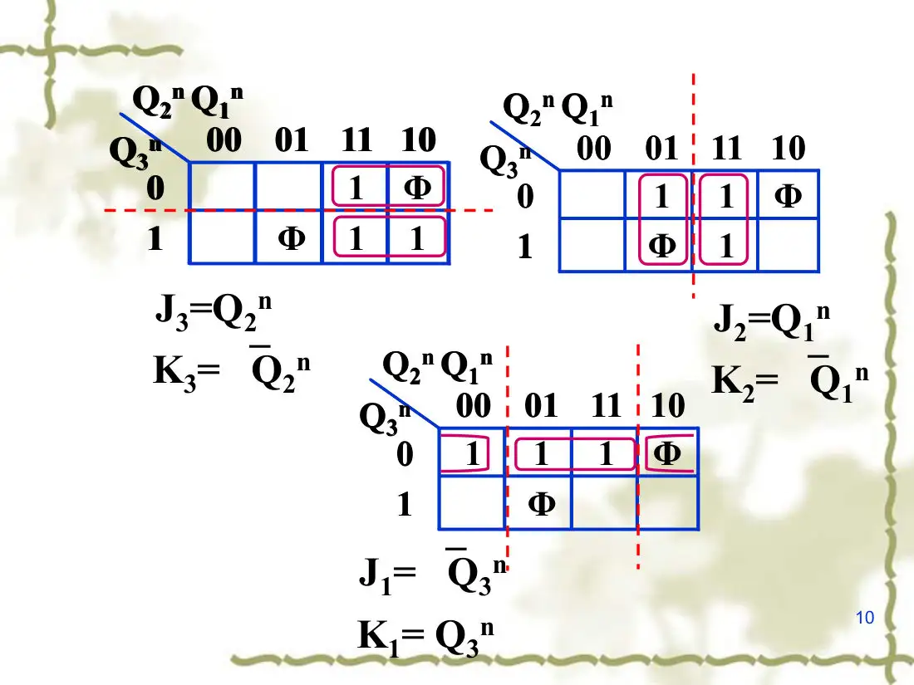

原文：

$$
\begin{array}{c c c c c} \hline Q _ {2 ^ {n}} Q _ {1 ^ {n}} & Q _ {2 ^ {n}} Q _ {1 ^ {n}} \\ Q _ {3 ^ {n}} & 0 0 & 0 1 & 1 1 & 1 0 \\ 0 & & & 1 & \Phi \\ 1 & & \Phi & 1 & 1 \\ \hline \end{array} \quad \begin{array}{c c c c c} \hline Q _ {2 ^ {n}} Q _ {1 ^ {n}} & 0 0 & 0 1 & 1 1 & 1 0 \\ Q _ {3 ^ {n}} & 0 & 1 & 1 & \Phi \\ 0 & & \Phi & 1 \\ \hline \end{array} \quad \begin{array}{c c c c c} J _ {3} = Q _ {2 ^ {n}} & J _ {2} = Q _ {1 ^ {n}} \\ K _ {3} = \overline {{Q}} _ {2 ^ {n}} & K _ {2} = \overline {{Q}} _ {1 ^ {n}} \\ \hline Q _ {3 ^ {n}} & 0 0 & 0 1 & 1 1 & 1 0 \\ 0 & 1 & 1 & 1 & \Phi \\ 1 & & \Phi \\ \hline J _ {1} = \overline {{Q}} _ {3 ^ {n}} & \\ K _ {1} = Q _ {3 ^ {n}} & \end{array}
$$

### 练习：设计一个具有自启动性的七进制计数器，要求它的状态转换图如下

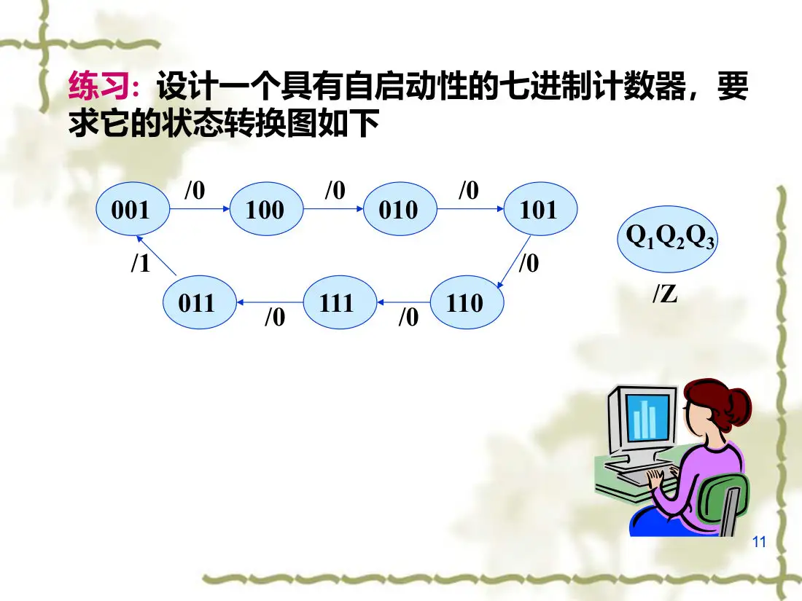

原文：

练习：设计一个具有自启动性的七进制计数器，要求它的状态转换图如下

101

11

### 解：1、填总的次态/输出卡诺图

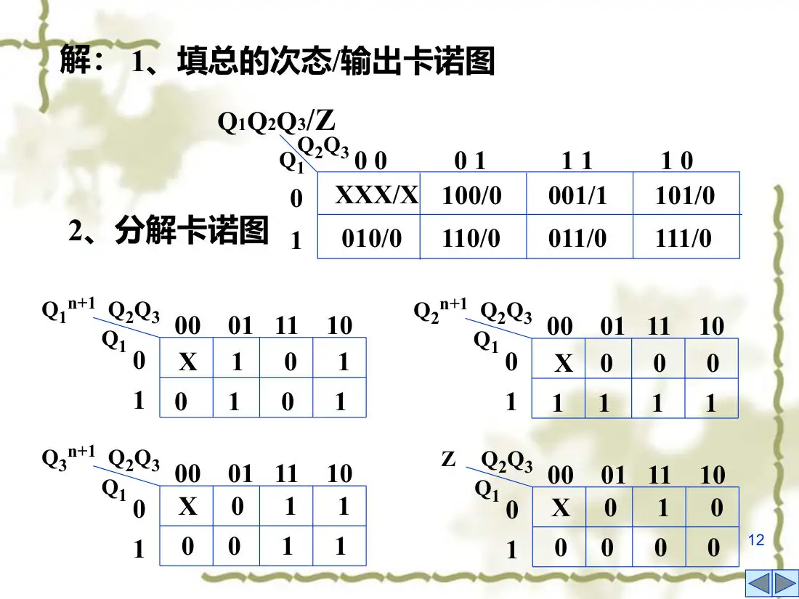

原文：

解：1、填总的次态/输出卡诺图
<table><tr><td colspan="5">Q1Q2Q3/Z</td></tr><tr><td>Q1</td><td>0 0</td><td>0 1</td><td>1 1</td><td>1 0</td></tr><tr><td>0</td><td>XXX/X</td><td>100/0</td><td>001/1</td><td>101/0</td></tr><tr><td>1</td><td>010/0</td><td>110/0</td><td>011/0</td><td>111/0</td></tr></table>

2、分解卡诺图

<table><tr><td rowspan="4">Q1n+1</td><td>Q2Q3</td><td>00</td><td>01</td><td>11</td><td>10</td></tr><tr><td>Q1</td><td></td><td></td><td></td><td></td></tr><tr><td>0</td><td>X</td><td>1</td><td>0</td><td>1</td></tr><tr><td>1</td><td>0</td><td>1</td><td>0</td><td>1</td></tr></table>

<table><tr><td rowspan="3">Q3n+1Q2Q3Q1</td><td>00</td><td>01</td><td>11</td><td>10</td></tr><tr><td>X</td><td>0</td><td>1</td><td>1</td></tr><tr><td>0</td><td>0</td><td>1</td><td>1</td></tr></table>

<table><tr><td rowspan="3">Q2n+1Q2Q3Q1</td><td>00</td><td>01</td><td>11</td><td>10</td></tr><tr><td>X</td><td>0</td><td>0</td><td>0</td></tr><tr><td>1</td><td>1</td><td>1</td><td>1</td></tr></table>

<table><tr><td rowspan="3">Z\Q1\Q2Q3</td><td>00</td><td>01</td><td>11</td><td>10</td></tr><tr><td>X</td><td>0</td><td>1</td><td>0</td></tr><tr><td>0</td><td>0</td><td>0</td><td>0</td></tr></table>

◀◀

### 3、化简次态方程

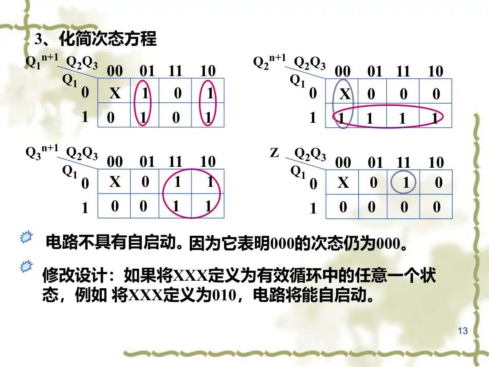

原文：

3、化简次态方程

$$
\begin{array}{c c c c c} \mathrm{Q} _ {1} ^ {\mathrm{n+1}} & \mathrm{Q} _ {2} \mathrm{Q} _ {3} \\ \hline & \mathrm{Q} _ {1} & 0 0 & 0 1 & 1 1 & 1 0 \\ \hline 0 & \mathrm{X} & 1 & 0 & 1 \\ \hline 1 & 0 & 1 & 0 & 1 \end{array}
$$

$$
\begin{array}{c c c c c} \mathrm{Q} _ {2} ^ {\mathrm{n+1}} & \mathrm{Q} _ {2} \mathrm{Q} _ {3} & 0 0 & 0 1 & 1 1 & 1 0 \\ \hline \mathrm{Q} _ {1} & 0 & \text {X} & 0 & 0 & 0 \\ \hline & 1 & 1 & 1 & 1 & 1 \end{array}
$$

$$
\begin{array}{c c c c c} \mathrm{Q} _ {3} ^ {\mathrm{n+1}} & \mathrm{Q} _ {2} \mathrm{Q} _ {3} & 0 0 & 0 1 & 1 1 & 1 0 \\ \hline \mathrm{Q} _ {1} & 0 & \mathrm{X} & 0 & 1 & 1 \\ \hline 1 & 0 & 0 & 1 & 1 \end{array}
$$

<table><tr><td rowspan="3">Z\Q1\Q2Q3</td><td>00</td><td>01</td><td>11</td><td>10</td></tr><tr><td>X</td><td>0</td><td>1</td><td>0</td></tr><tr><td>0</td><td>0</td><td>0</td><td>0</td></tr></table>

电路不具有自启动。因为它表明000的次态仍为000。

修改设计：如果将XXX定义为有效循环中的任意一个状态，例如将XXX定义为010，电路将能自启动。

13

### 4、写状态方程和输出方程

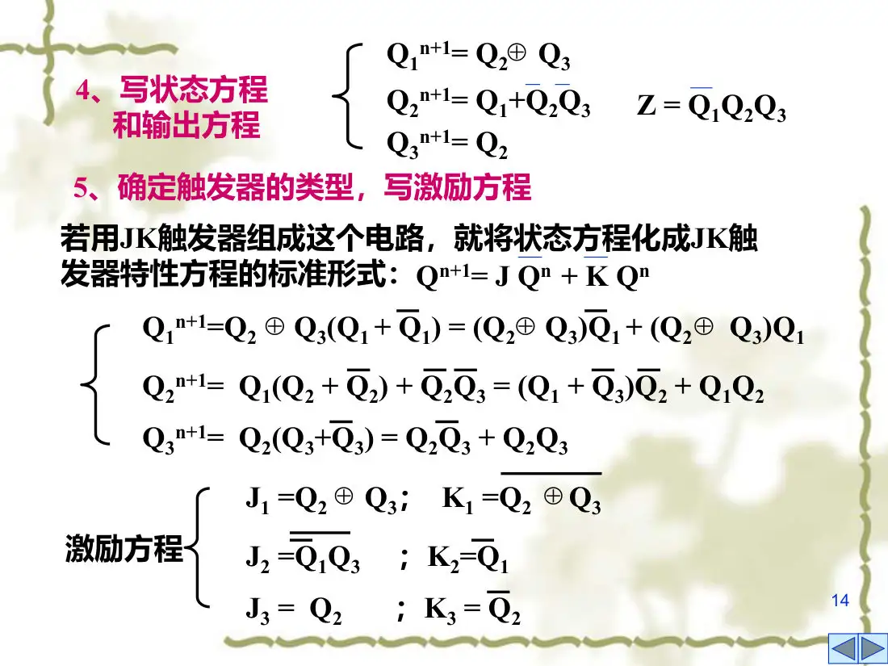

原文：

4、写状态方程和输出方程

$$
\left\{ \begin{array}{l l} Q _ {1} ^ {n + 1} = Q _ {2} \oplus Q _ {3} \\ Q _ {2} ^ {n + 1} = Q _ {1} + \overline {{Q}} _ {2} \overline {{Q}} _ {3} & Z = \overline {{Q}} _ {1} Q _ {2} Q _ {3} \\ Q _ {3} ^ {n + 1} = Q _ {2} \end{array} \right.
$$

5、确定触发器的类型，写激励方程

若用JK触发器组成这个电路，就将状态方程化成JK触发器特性方程的标准形式： $Q^{n+1}=J\overline{Q}^{n}+K\overline{Q}^{n}$

$$
\left\{ \begin{array}{l} {{\mathbf {Q} _ {1} ^ {\mathrm{n+1}} = \mathbf {Q} _ {2} \oplus \mathbf {Q} _ {3} (\mathbf {Q} _ {1} + \overline {{{{\mathbf {Q}}}}} _ {1}) = (\mathbf {Q} _ {2} \oplus \mathbf {Q} _ {3}) \overline {{{{\mathbf {Q}}}}} _ {1} + (\mathbf {Q} _ {2} \oplus \mathbf {Q} _ {3}) \mathbf {Q} _ {1}}} \\ {{\mathbf {Q} _ {2} ^ {\mathrm{n+1}} = \mathbf {Q} _ {1} (\mathbf {Q} _ {2} + \overline {{{{\mathbf {Q}}}}} _ {2}) + \overline {{{{\mathbf {Q}}}}} _ {2} \overline {{{{\mathbf {Q}}}}} _ {3} = (\mathbf {Q} _ {1} + \overline {{{{\mathbf {Q}}}}} _ {3}) \overline {{{{\mathbf {Q}}}}} _ {2} + \mathbf {Q} _ {1} \mathbf {Q} _ {2}}} \\ {{\mathbf {Q} _ {3} ^ {\mathrm{n+1}} = \mathbf {Q} _ {2} (\mathbf {Q} _ {3} + \overline {{{{\mathbf {Q}}}}} _ {3}) = \mathbf {Q} _ {2} \overline {{{{\mathbf {Q}}}}} _ {3} + \mathbf {Q} _ {2} \mathbf {Q} _ {3}}} \\ {\text {激励方程}} \left\{ \begin{array}{l l} {{\mathbf {J} _ {1} = \mathbf {Q} _ {2} \oplus \mathbf {Q} _ {3}; \quad \mathbf {K} _ {1} = \overline {{{{\mathbf {Q} _ {2} \oplus \mathbf {Q} _ {3}}}}}}} \\ {{\mathbf {J} _ {2} = \overline {{{{\overline {{{{\mathbf {Q}}}}} _ {1} \mathbf {Q}}}}} _ {3}; \quad \mathbf {K} _ {2} = \overline {{{{\mathbf {Q}}}}} _ {1}}} \\ {{\mathbf {J} _ {3} = \mathbf {Q} _ {2}; \quad \mathbf {K} _ {3} = \overline {{{{\mathbf {Q}}}}} _ {2}}} \end{array} \right. \end{array} \right.
$$

14

### 激励方程·

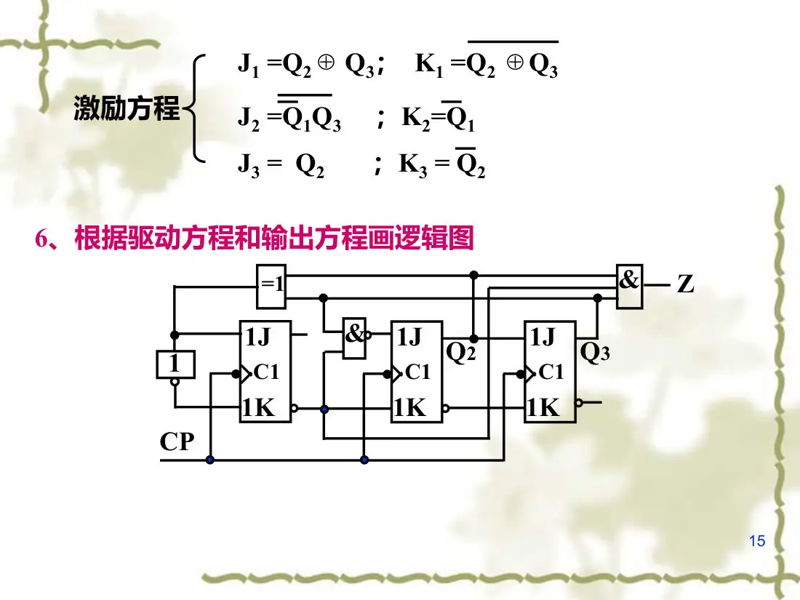

原文：

激励方程·

$$
\begin{array}{l} \mathbf {J} _ {1} = \mathbf {Q} _ {2} \oplus \mathbf {Q} _ {3}; \quad \mathbf {K} _ {1} = \mathbf {Q} _ {2} \oplus \mathbf {Q} _ {3} \\ \mathbf {J} _ {2} = \overline {{\overline {{\mathbf {Q}}} _ {1} \mathbf {Q} _ {3}}}; \quad \mathbf {K} _ {2} = \overline {{\mathbf {Q}}} _ {1} \\ \mathbf {J} _ {3} = \mathbf {Q} _ {2}; \quad \mathbf {K} _ {3} = \overline {{\mathbf {Q}}} _ {2} \end{array}
$$

6、根据驱动方程和输出方程画逻辑图

15

### 7、画状态转换图

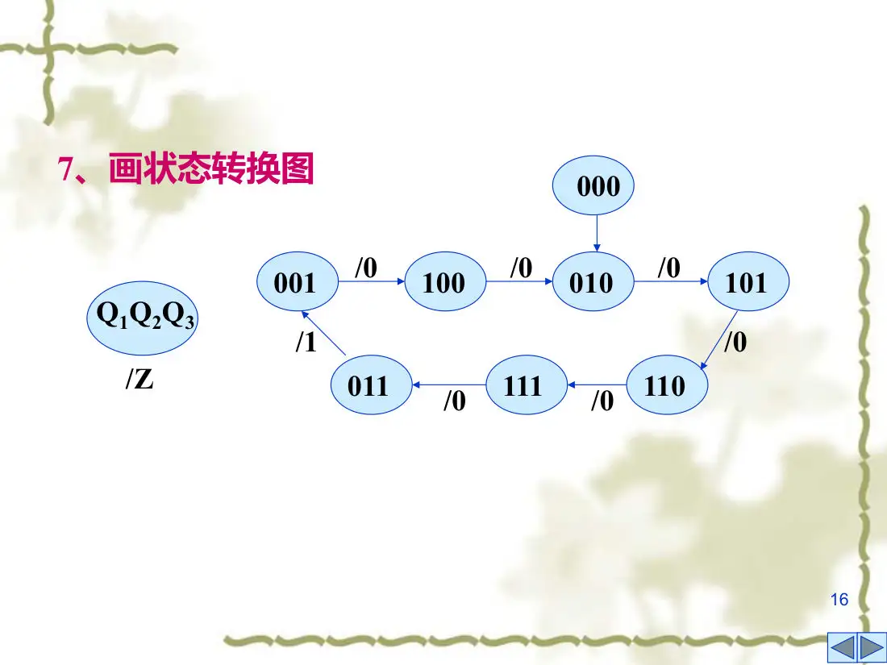

原文：

7、画状态转换图

16

### 若用D触发器组成这个电路:

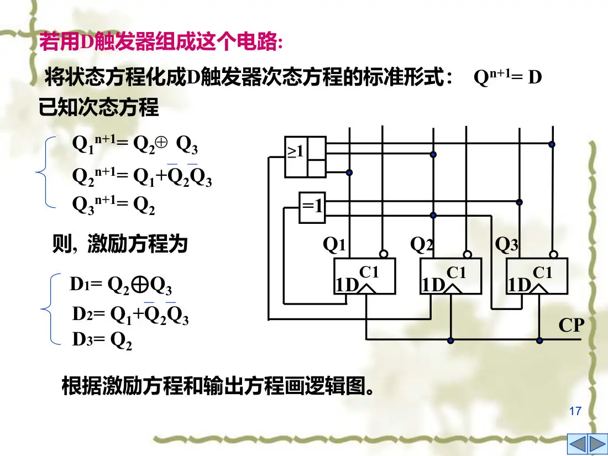

原文：

若用D触发器组成这个电路:

将状态方程化成D触发器次态方程的标准形式: $Q^{n+1} = D$ 已知次态方程

$$
\left\{ \begin{array}{l} Q _ {1} ^ {n + 1} = Q _ {2} \oplus Q _ {3} \\ Q _ {2} ^ {n + 1} = Q _ {1} + \overline {{Q}} _ {2} \overline {{Q}} _ {3} \\ Q _ {3} ^ {n + 1} = Q _ {2} \end{array} \right.
$$

则，激励方程为

$$
\left\{ \begin{array}{l} \mathbf {D} _ {1} = \mathbf {Q} _ {2} \oplus \mathbf {Q} _ {3} \\ \mathbf {D} _ {2} = \mathbf {Q} _ {1} + \overline {{\mathbf {Q}}} _ {2} \overline {{\mathbf {Q}}} _ {3} \\ \mathbf {D} _ {3} = \mathbf {Q} _ {2} \end{array} \right.
$$

根据激励方程和输出方程画逻辑图。

◀ ▶

17

### 同步计数器的MSI 器件

原文：

同步计数器的MSI 器件

18

### 3.MSI二进制计数器

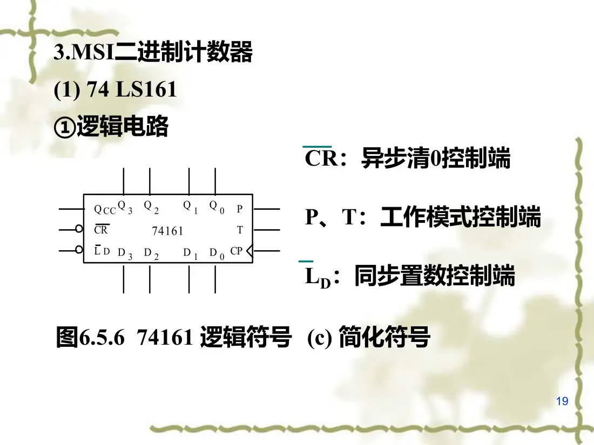

原文：

3.MSI二进制计数器

(1) 74 LS161

①逻辑电路

CR: 异步清0控制端

P、T：工作模式控制端

$\overline{L}_{D}$ ：同步置数控制端

19

### ②功能表 表6.5.2 74161 的功能表

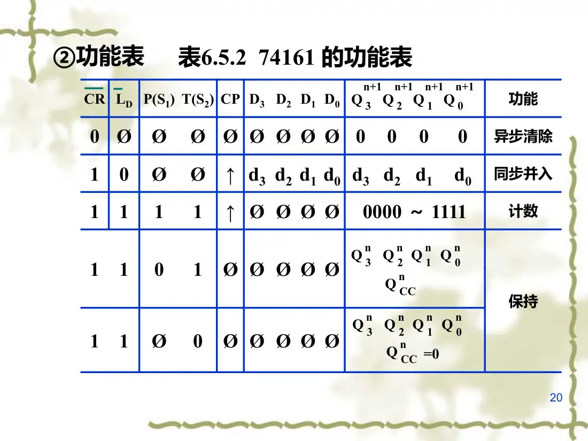

原文：

②功能表 表6.5.2 74161 的功能表

<table><tr><td> $\overline{\text{CR}}$ </td><td> $\overline{\text{L}}_{\text{D}}$ </td><td>P(S1) T(S2)</td><td>CP</td><td>D3 D2 D1 D0</td><td> $Q_{3}^{n+1} Q_{2}^{n+1} Q_{1}^{n+1} Q_{0}^{n+1}$ </td><td>功能</td></tr><tr><td>0</td><td>∅</td><td>∅ ∅</td><td>∅</td><td>∅ ∅ ∅ ∅</td><td>0 0 0 0</td><td>异步清除</td></tr><tr><td>1</td><td>0</td><td>∅ ∅</td><td>↑</td><td>d3 d2 d1 d0</td><td>d3 d2 d1 d0</td><td>同步并入</td></tr><tr><td>1</td><td>1</td><td>1 1</td><td>↑</td><td>∅ ∅ ∅ ∅</td><td>0000 ~ 1111</td><td>计数</td></tr><tr><td colspan="2">1 1</td><td>0 1</td><td>∅</td><td>∅ ∅ ∅ ∅</td><td> $Q_{3}^{n} Q_{2}^{n} Q_{1}^{n} Q_{0}^{n} Q_{CC}^{n}$ </td><td rowspan="2">保持</td></tr><tr><td colspan="2">1 1</td><td>∅ 0</td><td>∅</td><td>∅ ∅ ∅ ∅</td><td> $Q_{3}^{n} Q_{2}^{n} Q_{1}^{n} Q_{0}^{n} Q_{CC}^{n}=0$ </td></tr></table>

20

### 74161的应用1:级联扩展

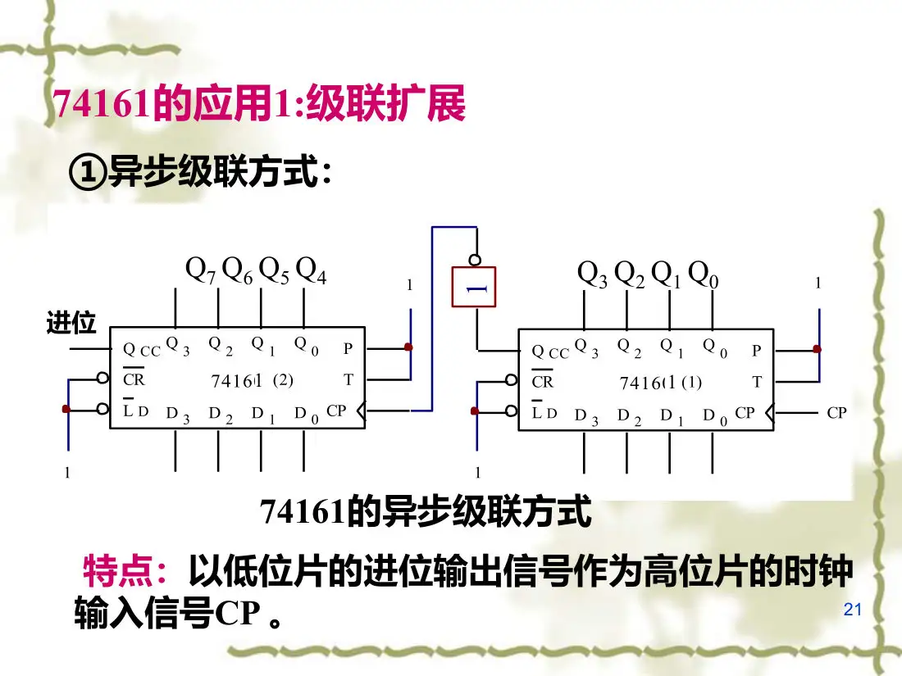

原文：

74161的应用1:级联扩展

①异步级联方式：

特点: 以低位片的进位输出信号作为高位片的时钟输入信号CP。

### 两片之间用非门连接的原理

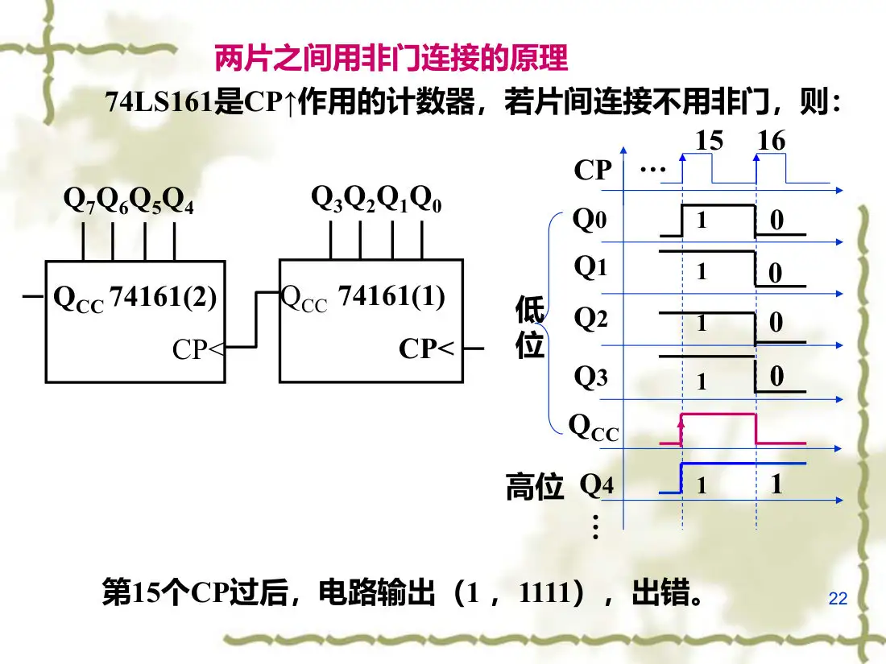

原文：

两片之间用非门连接的原理

74LS161是CP↑作用的计数器，若片间连接不用非门，则：

第15个CP过后，电路输出（1，1111），出错。

22

### 两片之间用非门连接的原理

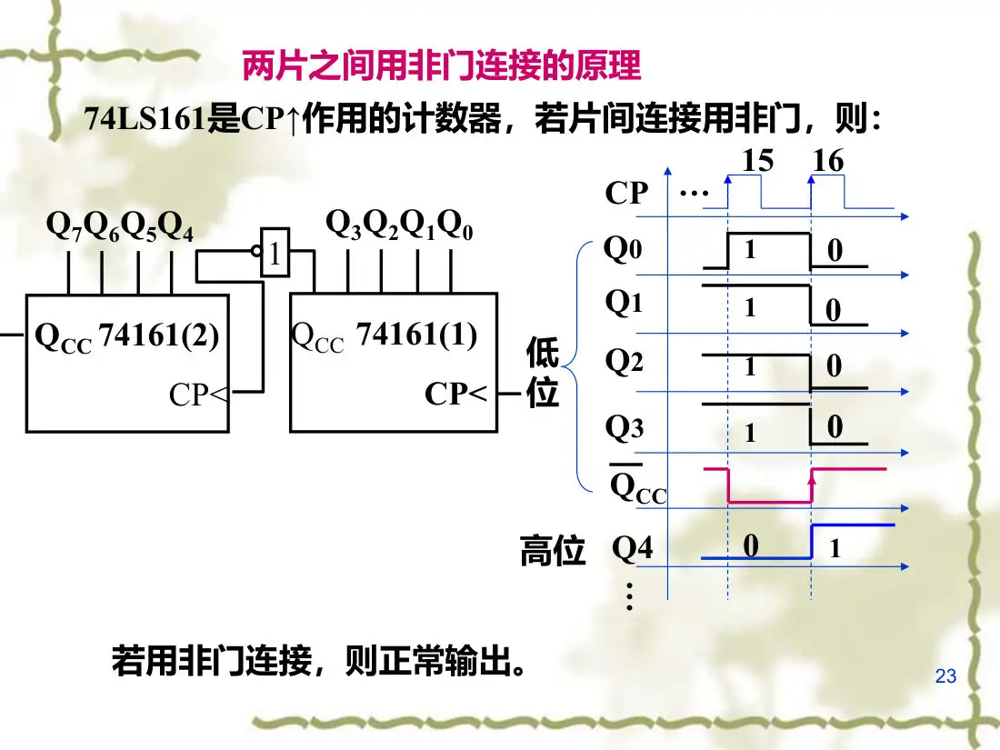

原文：

两片之间用非门连接的原理

74LS161是CP↑作用的计数器，若片间连接用非门，则：

若用非门连接，则正常输出。

23

### ②同步级联方式：

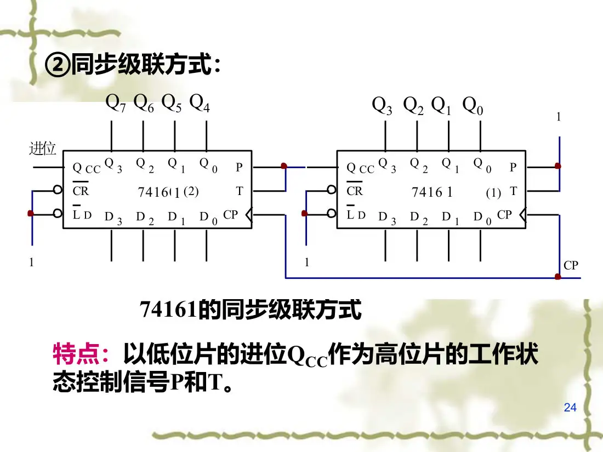

原文：

②同步级联方式：

特点：以低位片的进位 $Q_{CC}$ 作为高位片的工作状态控制信号P和T。

24

### 74161的应用2：实现任意进制计数器

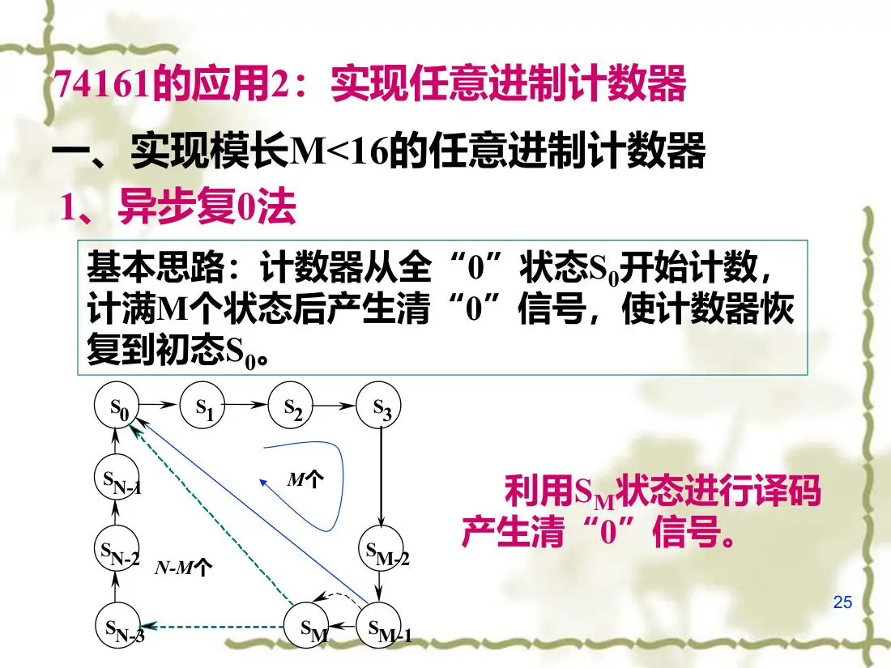

原文：

74161的应用2：实现任意进制计数器

一、实现模长M<16的任意进制计数器

1、异步复0法

基本思路：计数器从全 “0” 状态 $S_{0}$ 开始计数，计满M个状态后产生清 “0” 信号，使计数器恢复到初态 $S_{0}$ 。

利用 $S_{M}$ 状态进行译码产生清“0”信号。

25

### 例1 试将74161用异步复0法设计M=6的计数器。

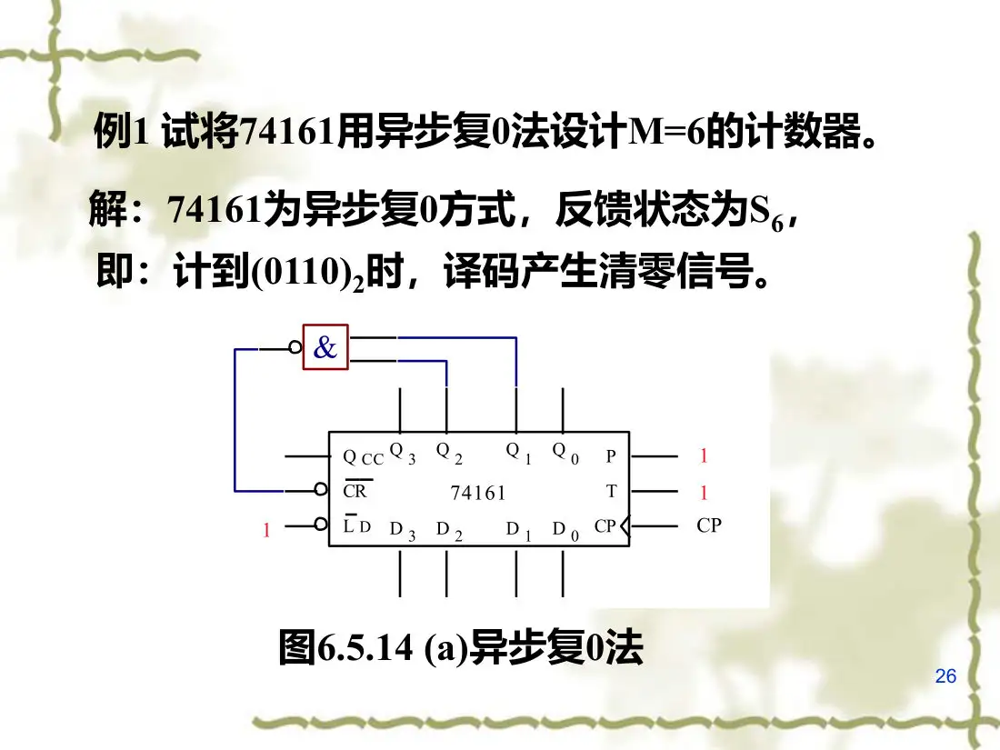

原文：

例1 试将74161用异步复0法设计M=6的计数器。

解：74161为异步复0方式，反馈状态为 $S_{6}$ ，

即：计到 $(0110)_{2}$ 时，译码产生清零信号。

26

### 电路的工作波形图

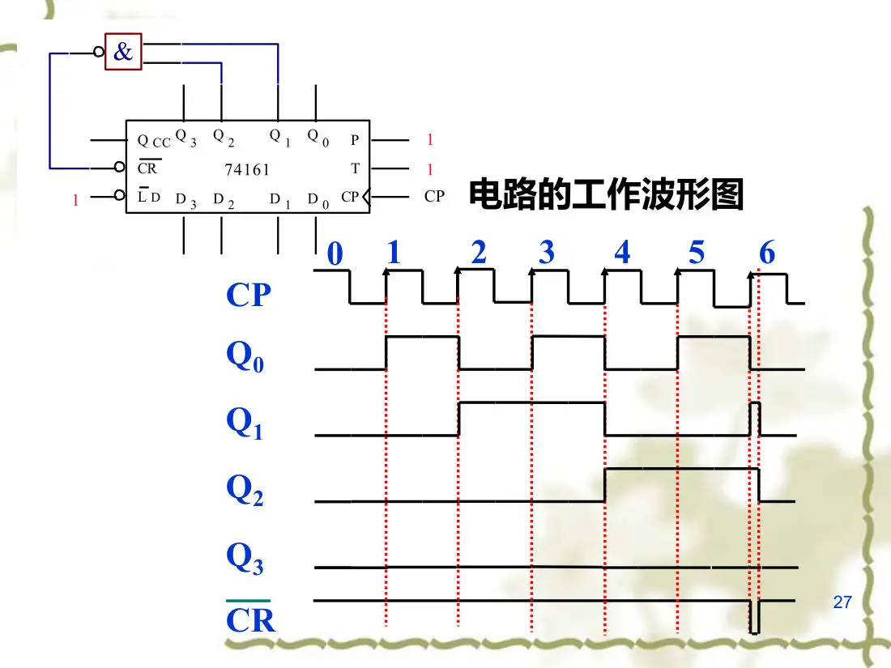

原文：

电路的工作波形图

### 电路的状态转移表：

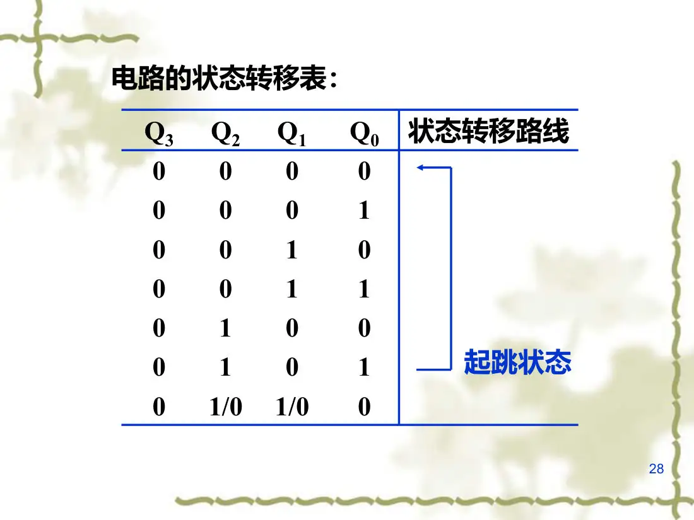

原文：

电路的状态转移表：

<table><tr><td> $Q_3$ </td><td> $Q_2$ </td><td> $Q_1$ </td><td> $Q_0$ </td><td>状态转移路线</td></tr><tr><td>0</td><td>0</td><td>0</td><td>0</td><td rowspan="7">起跳状态</td></tr><tr><td>0</td><td>0</td><td>0</td><td>1</td></tr><tr><td>0</td><td>0</td><td>1</td><td>0</td></tr><tr><td>0</td><td>0</td><td>1</td><td>1</td></tr><tr><td>0</td><td>1</td><td>0</td><td>0</td></tr><tr><td>0</td><td>1</td><td>0</td><td>1</td></tr><tr><td>0</td><td>1/0</td><td>1/0</td><td>0</td></tr></table>

28

### 异步复0法总结

原文：

异步复0法总结

利用CR端的异步复0法实现任意进制计数器，若模长为M，则电路反馈状态为 $S_{M}$ ，将 $S_{M}$ 对应的二进制数中含“1”的端子引入与非门的输入端，与非门的输出端连到CR端即可。

29

### 2、同步置0法

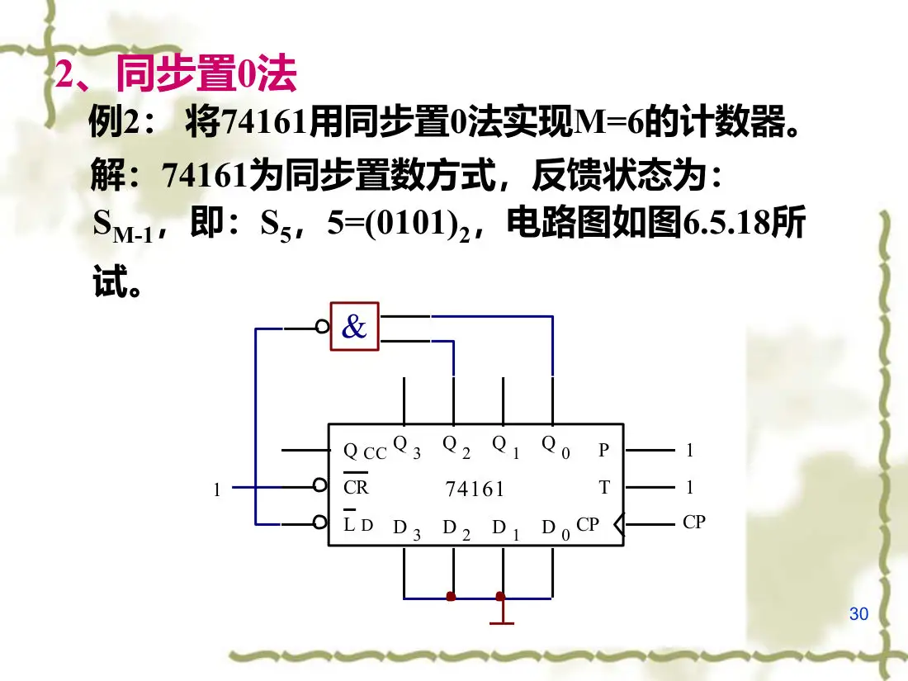

原文：

2、同步置0法

例2：将74161用同步置0法实现M=6的计数器。

解：74161为同步置数方式，反馈状态为：

$S_{M-1}$ ，即： $S_{5}$ ， $5=(0101)_{2}$ ，电路图如图6.5.18所试。

30

### 电路的状态转移表

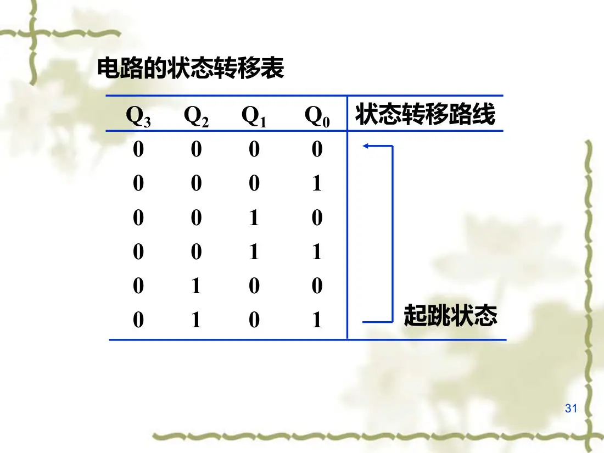

原文：

电路的状态转移表

<table><tr><td> $Q_3$ </td><td> $Q_2$ </td><td> $Q_1$ </td><td> $Q_0$ </td><td>状态转移路线</td></tr><tr><td>0</td><td>0</td><td>0</td><td>0</td><td rowspan="6">起跳状态</td></tr><tr><td>0</td><td>0</td><td>0</td><td>1</td></tr><tr><td>0</td><td>0</td><td>1</td><td>0</td></tr><tr><td>0</td><td>0</td><td>1</td><td>1</td></tr><tr><td>0</td><td>1</td><td>0</td><td>0</td></tr><tr><td>0</td><td>1</td><td>0</td><td>1</td></tr></table>

31

### 同步置0法总结

原文：

同步置0法总结

利用 $\overline{L_{D}}$ 端的同步置0法实现任意进制计数器，若实现模长为M，则反馈状态为 $S_{M-1}$ 。将 $S_{M-1}$ 对应的二进制数中为1的端子引入与非门的输入端，与非门的输出端接 $L_{D}$ ，同时，数据输入端送“0”。

32

### 3、置最小数法

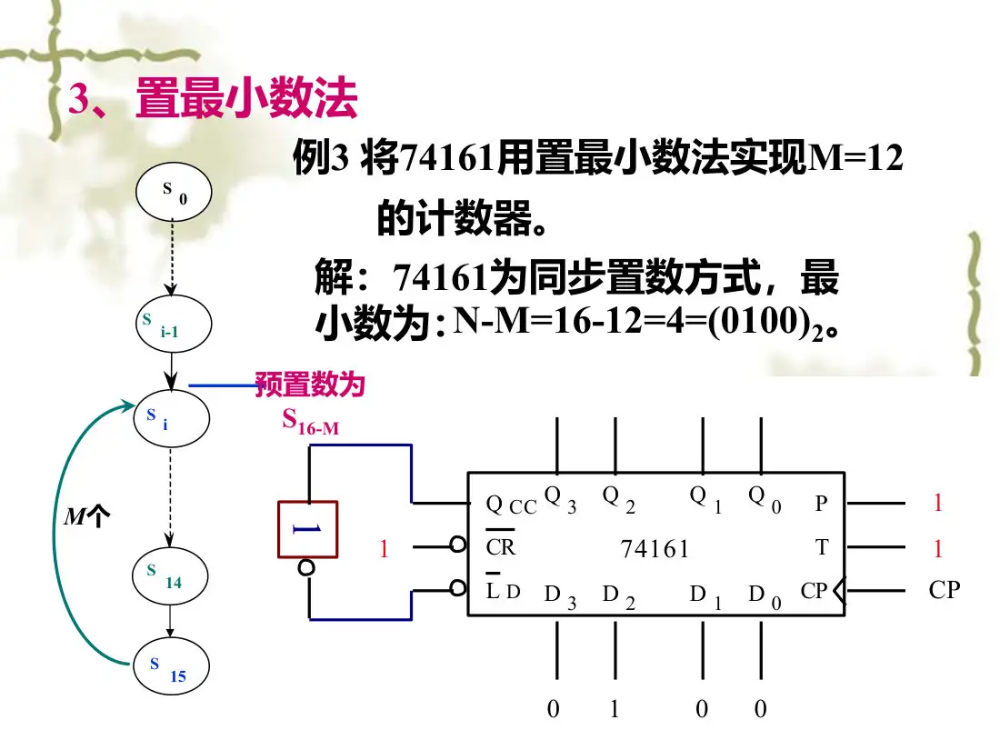

原文：

3、置最小数法

例3 将74161用置最小数法实现M=12的计数器。

解：74161为同步置数方式，最小数为：N-M=16-12=4=(0100) $_{2}$ 。

预置数为

### 34

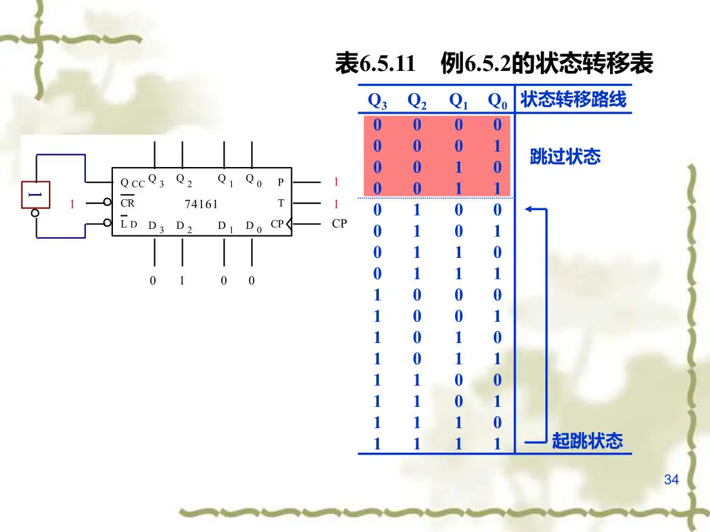

原文：

34

### 置最小数法总结

原文：

置最小数法总结

利用 $\overline{L_{D}}$ 端的置最小数法实现任意进制计数器，若实现模长为M，则预置的最小数为 $2^{n}-M$ 。将Qcc取反送给 $\overline{L_{D}}$ 即可。

35

### 4、置最大数法

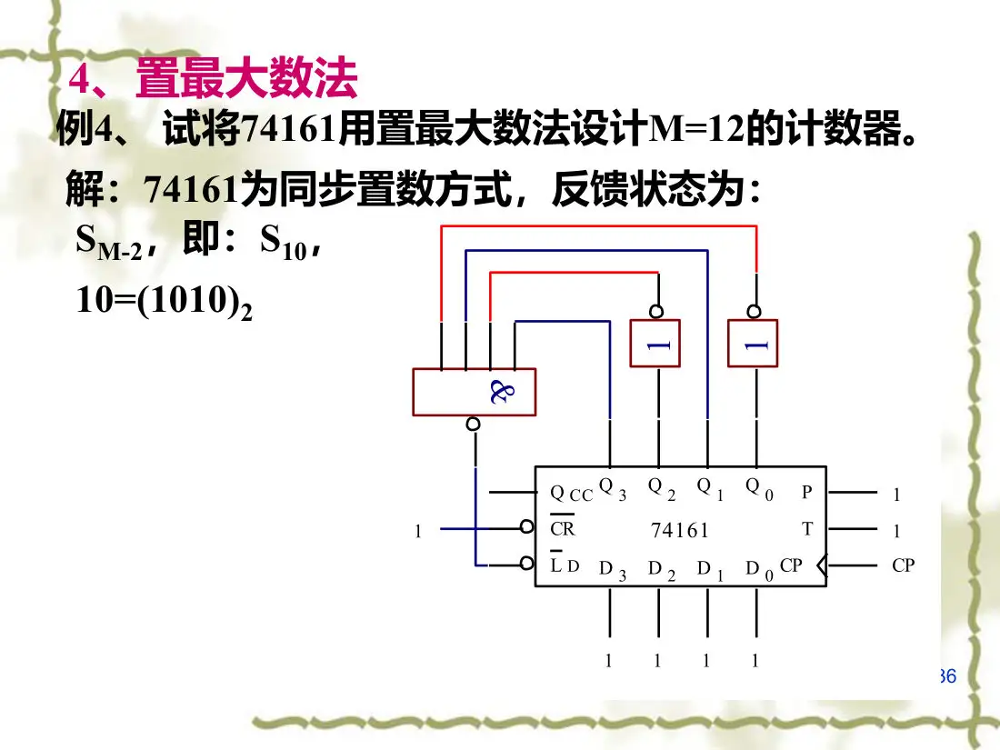

原文：

4、置最大数法

例4、试将74161用置最大数法设计M=12的计数器。

解：74161为同步置数方式，反馈状态为：

$\mathbf{S}_{\mathbf{M - 2}}$ ，即： $\mathbf{S}_{10}$

$$
1 0 = (1 0 1 0) _ {2}
$$

36

### 状态转移表

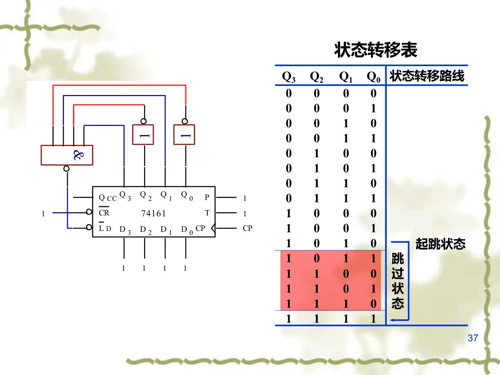

原文：

状态转移表
<table><tr><td> $Q_3$ </td><td> $Q_2$ </td><td> $Q_1$ </td><td> $Q_0$ </td><td>状态转移路线</td></tr><tr><td>0</td><td>0</td><td>0</td><td>0</td><td></td></tr><tr><td>0</td><td>0</td><td>0</td><td>1</td><td></td></tr><tr><td>0</td><td>0</td><td>1</td><td>0</td><td></td></tr><tr><td>0</td><td>0</td><td>1</td><td>1</td><td></td></tr><tr><td>0</td><td>1</td><td>0</td><td>0</td><td></td></tr><tr><td>0</td><td>1</td><td>0</td><td>1</td><td></td></tr><tr><td>0</td><td>1</td><td>1</td><td>0</td><td></td></tr><tr><td>0</td><td>1</td><td>1</td><td>1</td><td></td></tr><tr><td>1</td><td>0</td><td>0</td><td>0</td><td></td></tr><tr><td>1</td><td>0</td><td>0</td><td>1</td><td></td></tr><tr><td>1</td><td>0</td><td>1</td><td>0</td><td></td></tr><tr><td>1</td><td>0</td><td>1</td><td>1</td><td>起跳状态</td></tr><tr><td>1</td><td>1</td><td>0</td><td>0</td><td rowspan="4">跳过状态</td></tr><tr><td>1</td><td>1</td><td>0</td><td>1</td></tr><tr><td>1</td><td>1</td><td>1</td><td>0</td></tr><tr><td>1</td><td>1</td><td>1</td><td>1</td></tr></table>

37

### 置最大数法总结

原文：

置最大数法总结

利用 $\overline{L_{D}}$ 端的置最大数法实现任意进制计数器，若实现模长为M，则反馈状态为 $S_{M-2}$ 。将 $S_{M-2}$ 对应的二进制数中为1的端子引入与非门的输入端，为0的端子取反引入与非门的输入端，与非门的输出端接 $\overline{L_{D}}$ 即可。

38

### 总结：74161实现模长为M的任意进制计数器

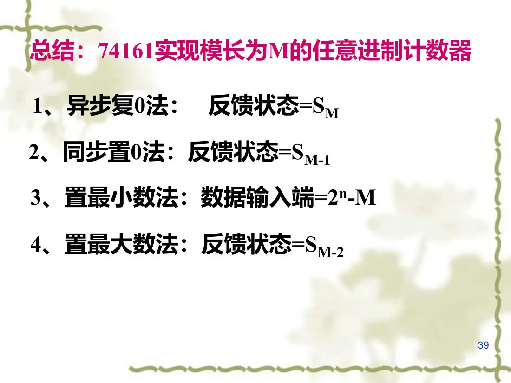

原文：

总结：74161实现模长为M的任意进制计数器

1、异步复0法: 反馈状态= $S_{M}$

2、同步置0法：反馈状态= $S_{M-1}$

3、置最小数法：数据输入端= $2^{n}-M$

4、置最大数法：反馈状态= $S_{M-2}$

39

### 进位信号的选取方法

原文：

进位信号的选取方法

上述通过反馈法得到的任意进制计数器，其进位信号可以方便的从与非门输出端引出。

40

### 实现模长M>16的任意进制计数器

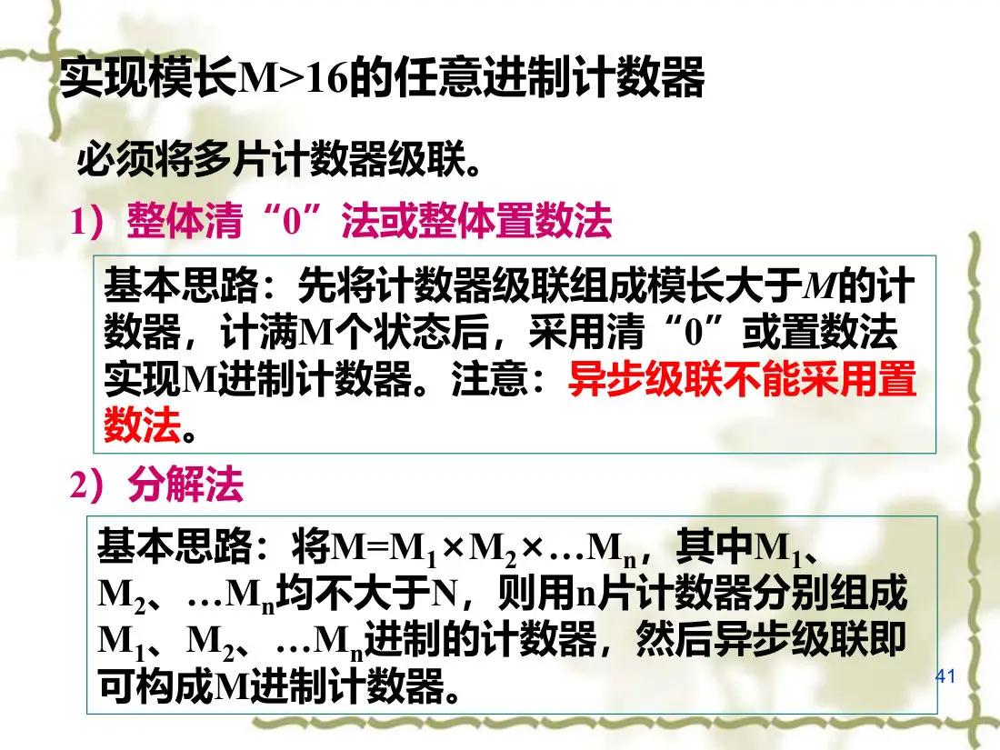

原文：

实现模长M>16的任意进制计数器

必须将多片计数器级联。

1）整体清“0”法或整体置数法

基本思路：先将计数器级联组成模长大于M的计数器，计满M个状态后，采用清“0”或置数法实现M进制计数器。注意：异步级联不能采用置数法。

2）分解法

基本思路：将 $M=M_{1}\times M_{2}\times\ldots M_{n}$ ，其中 $M_{1}$ 、 $M_{2}$ 、 $\ldots M_{n}$ 均不大于N，则用n片计数器分别组成 $M_{1}$ 、 $M_{2}$ 、 $\ldots M_{n}$ 进制的计数器，然后异步级联即可构成M进制计数器。

41

### 例：用整体异步复0法将74161实现M=28的计数器：

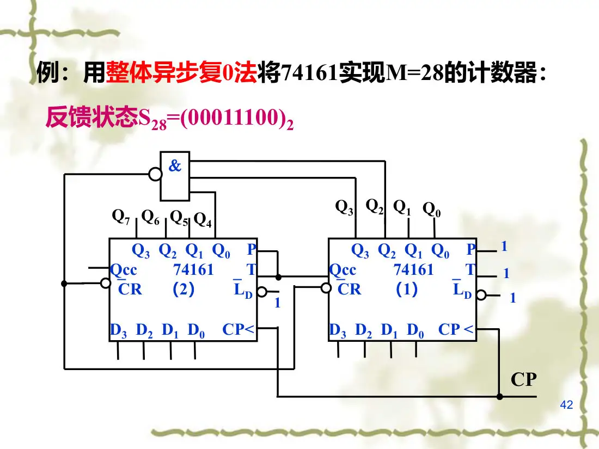

原文：

例：用整体异步复0法将74161实现M=28的计数器：
反馈状态 $S_{28}=(00011100)_{2}$

42

### 例: 用整体置0法将74161实现M=28的计数器:

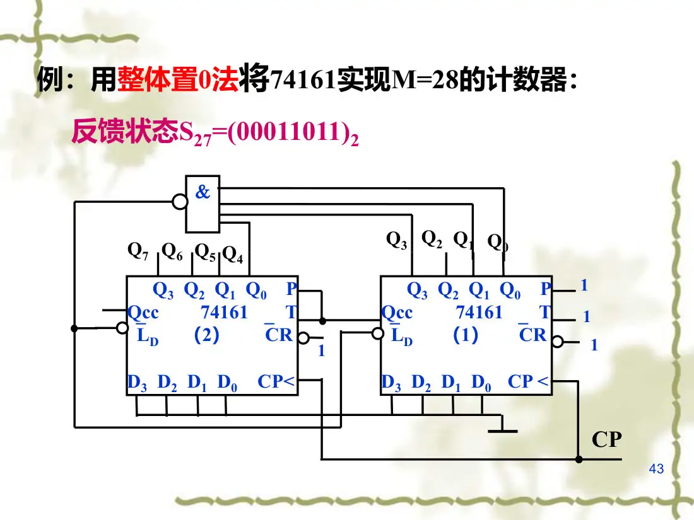

原文：

例: 用整体置0法将74161实现M=28的计数器:
反馈状态 $S_{27}=(00011011)_{2}$

43

### 异步级联的计数器不能采用整体置数法

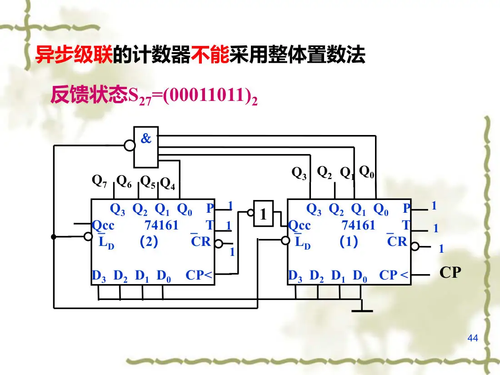

原文：

异步级联的计数器不能采用整体置数法
反馈状态 $S_{27}=(00011011)_{2}$

44

### 例：用分解法将74161实现M=28的计数器：

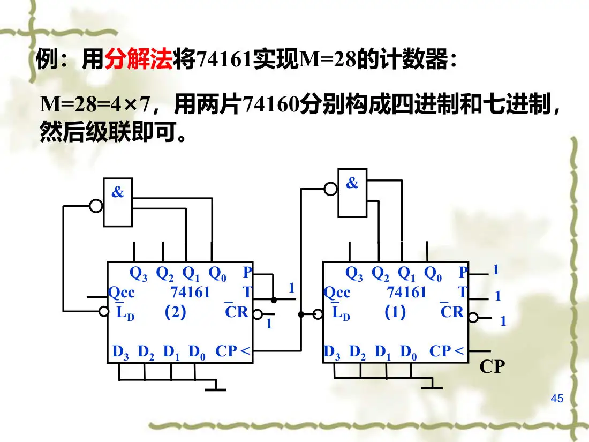

原文：

例：用分解法将74161实现M=28的计数器：

M=28=4×7，用两片74160分别构成四进制和七进制，然后级联即可。

45

### (2) 74 LS163

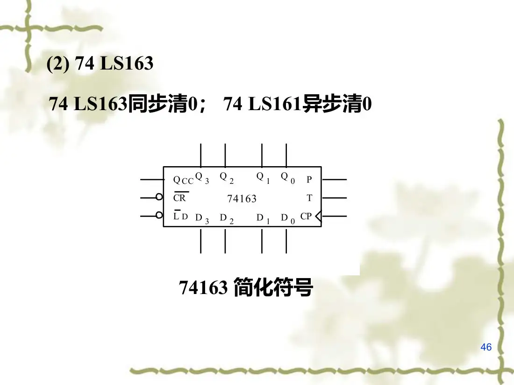

原文：

(2) 74 LS163

74 LS163同步清0；74 LS161异步清0

46

### 例3 将74163用复0法设计M=6的计数器。

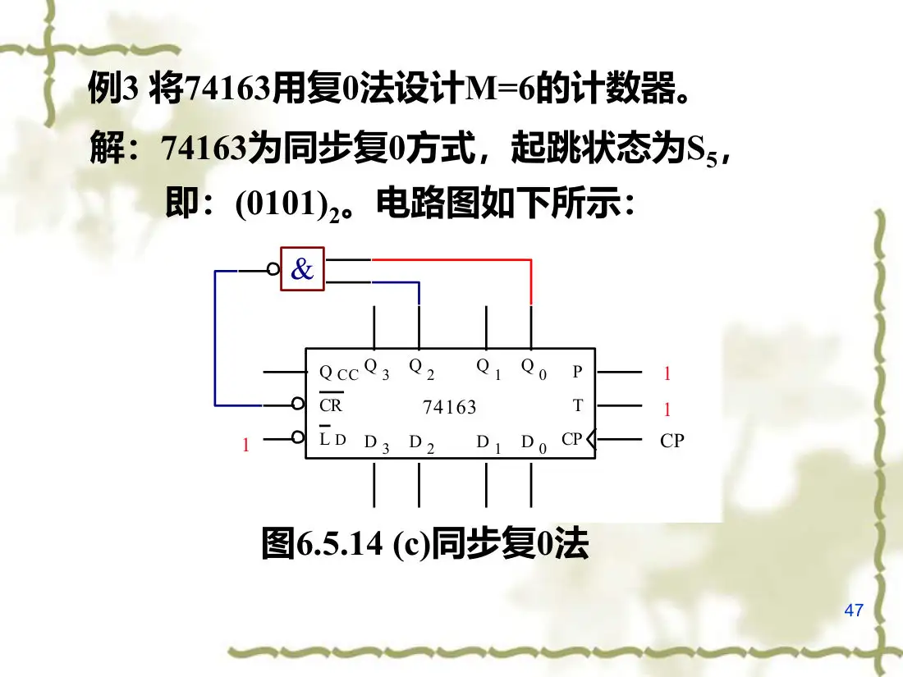

原文：

例3 将74163用复0法设计M=6的计数器。

解：74163为同步复0方式，起跳状态为 $S_{5}$ ，

即： $(0101)_2$ 。电路图如下所示：

47

### (3) 74 LS160

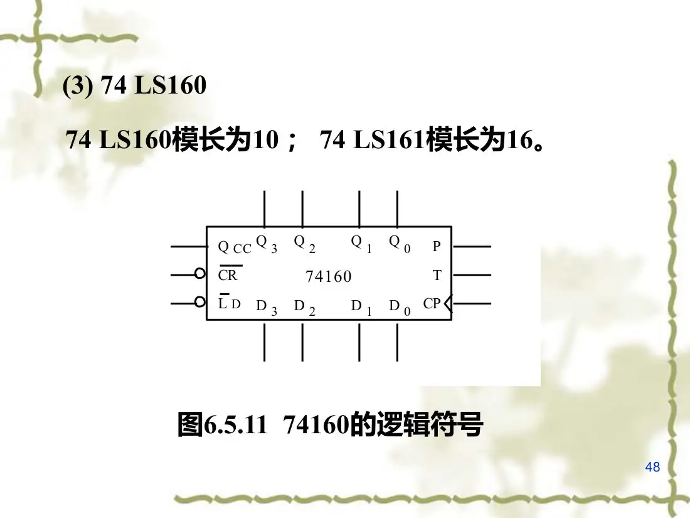

原文：

(3) 74 LS160

74 LS160模长为10；74 LS161模长为16。

48

### 表6.5.8 74160的功能表

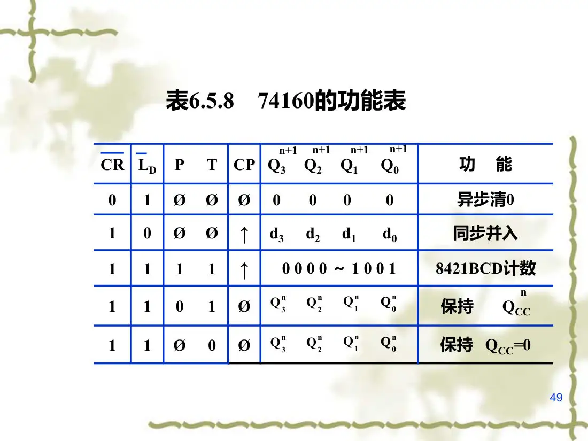

原文：

表6.5.8 74160的功能表
<table><tr><td rowspan="2"> $\overline{\text{CR}}$ </td><td rowspan="2"> $\overline{\text{L}}_{\text{D}}$ </td><td rowspan="2">P</td><td rowspan="2">T</td><td rowspan="2">CP</td><td colspan="4"> $n+1$   $n+1$   $n+1$   $n+1$ </td><td rowspan="2">功 能</td></tr><tr><td> $Q_3$ </td><td> $Q_2$ </td><td> $Q_1$ </td><td> $Q_0$ </td></tr><tr><td>0</td><td>1</td><td>∅</td><td>∅</td><td>∅</td><td>0</td><td>0</td><td>0</td><td>0</td><td>异步清0</td></tr><tr><td>1</td><td>0</td><td>∅</td><td>∅</td><td>↑</td><td> $d_3$ </td><td> $d_2$ </td><td> $d_1$ </td><td> $d_0$ </td><td>同步并入</td></tr><tr><td>1</td><td>1</td><td>1</td><td>1</td><td>↑</td><td>0</td><td>0</td><td>0</td><td>~ 1</td><td>0 0 1</td></tr><tr><td>1</td><td>1</td><td>0</td><td>1</td><td>∅</td><td> $Q_n^3$ </td><td> $Q_n^2$ </td><td> $Q_n^1$ </td><td> $Q_n^0$ </td><td>保持  $Q_{CC}^{n}$ </td></tr><tr><td>1</td><td>1</td><td>∅</td><td>0</td><td>∅</td><td> $Q_n^3$ </td><td> $Q_n^2$ </td><td> $Q_n^1$ </td><td> $Q_n^0$ </td><td>保持  $Q_{CC}=0$ </td></tr></table>

49

### 例：试用74160组成百进制计数器。

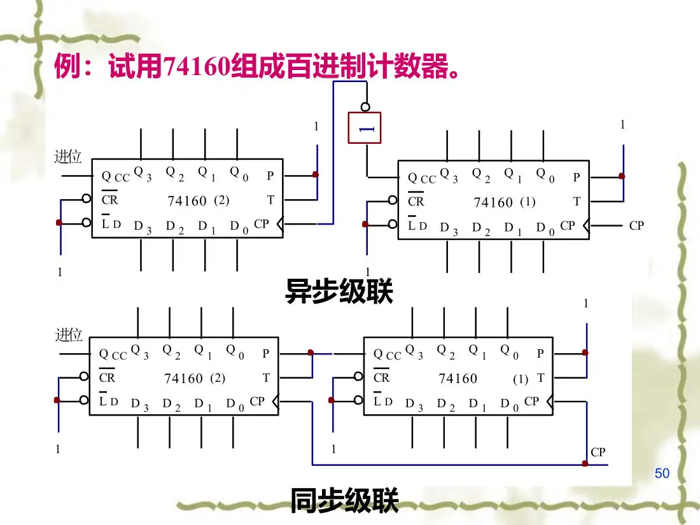

原文：

例：试用74160组成百进制计数器。

同步级联

50

### 例：试用两片74160实现54进制计数器。

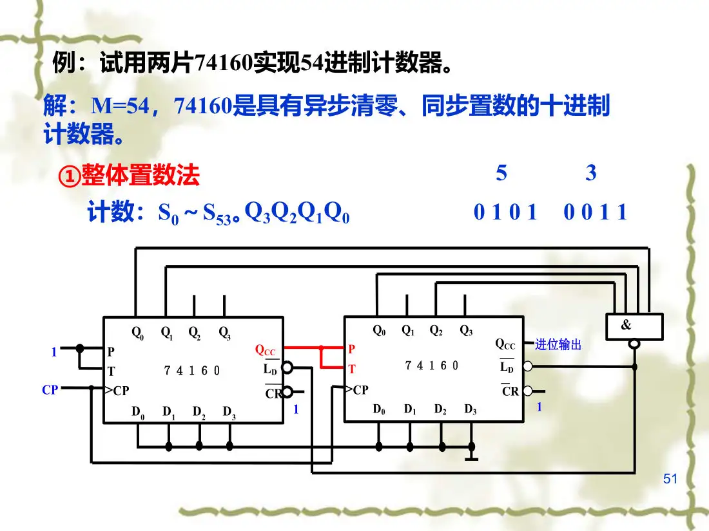

原文：

例：试用两片74160实现54进制计数器。

解：M=54，74160是具有异步清零、同步置数的十进制计数器。

①整体置数法

计数: $S_{0} \sim S_{53}$ 。 $Q_{3}Q_{2}Q_{1}Q_{0}$

### ②分解法

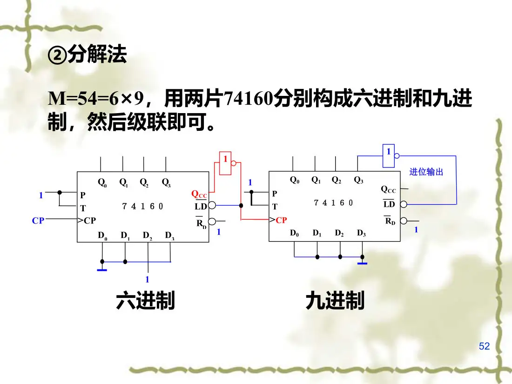

原文：

②分解法

M=54=6×9，用两片74160分别构成六进制和九进制，然后级联即可。

52

### 数码管

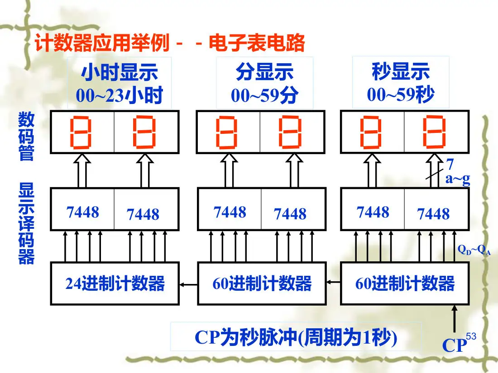

原文：

数码管
显示译码器

计数器应用举例 - - 电子表电路

小时显示00\~23小时

7448

7448

分显示

00\~59分

7448

7448秒显示00\~59秒

7448

7448

24进制计数器

60进制计数器

60进制计数器

CP为秒脉冲(周期为1秒)

53

### 第 54 页

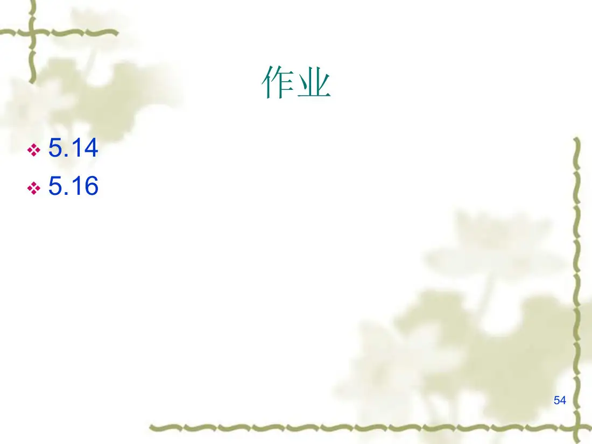
