# 《数字电路与系统设计》第5章 异步计数器和移存型计数器（课件）

原件的每一页，下面附识别出的文字。

### 5 3 4 异步计数器的分析和设计

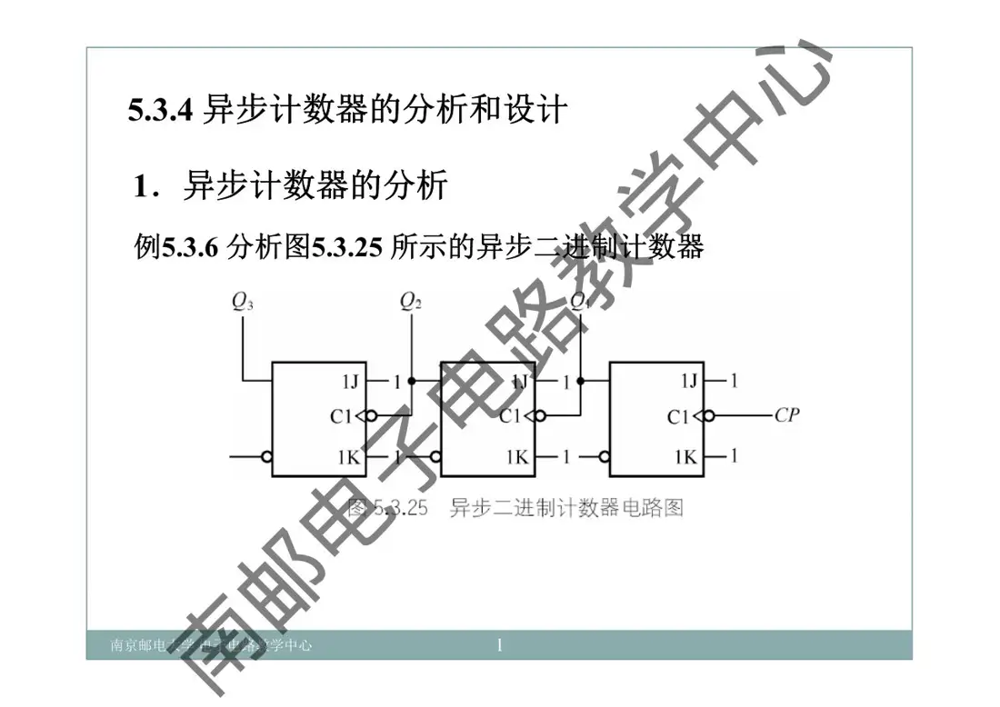

原文：

5 3 4 异步计数器的分析和设计

1． 异步计数器的分析

例5.3.6 分析图5.3.25 所示的异步二进制计数器

南京邮电大学 电子电路教学中心

1

### 解：（1）列激励方程和以态方程激励方程为

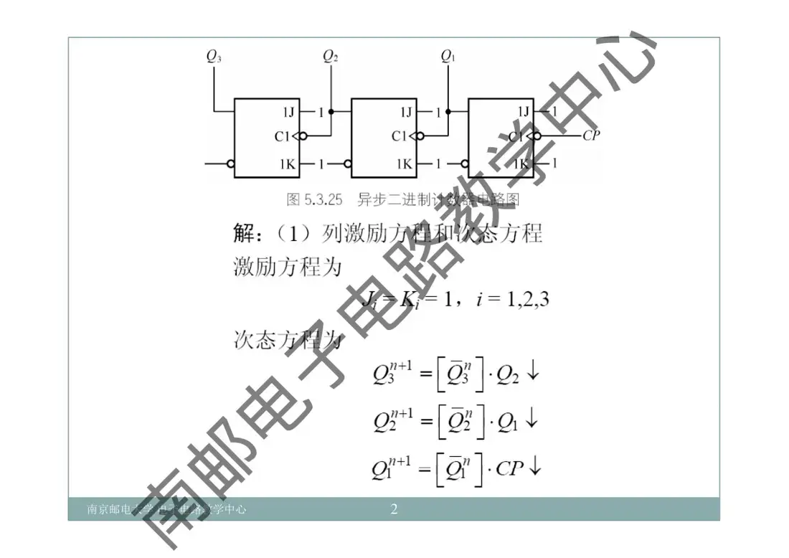

原文：

解：（1）列激励方程和以态方程激励方程为

$$
J _ {i} = K _ {i} = 1, \quad i = 1, 2, 3
$$

次态方程为

$$
Q _ {3} ^ {n + 1} = \left[ \bar {Q} _ {3} ^ {n} \right] \cdot Q _ {2} \downarrow
$$

$$
Q _ {2} ^ {n + 1} = \left[ \bar {Q} _ {2} ^ {n} \right] \cdot Q _ {1} \downarrow
$$

$$
Q _ {1} ^ {n + 1} = \left[ \overline {{Q}} _ {1} ^ {n} \right] \cdot C P \downarrow
$$

南京邮电大学 电子电路教学中心

2

### （2） 列状态转移表

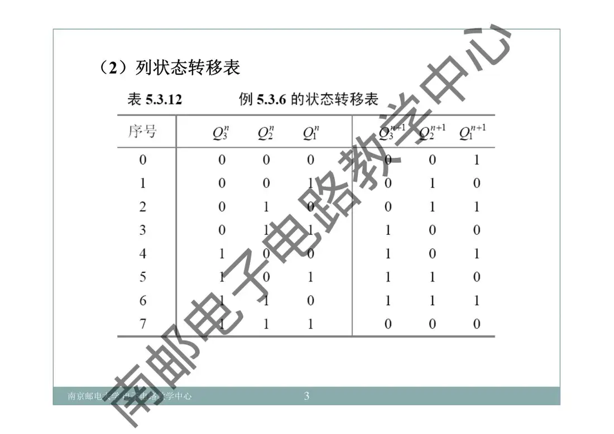

原文：

（2） 列状态转移表

表 5.3.12 例 5.3.6 的状态转移表
<table><tr><td>序号</td><td> $Q_3^n$ </td><td> $Q_2^n$ </td><td> $Q_1^n$ </td><td> $Q_3^{n+1}$ </td><td> $Q_2^{n+1}$ </td><td> $Q_1^{n+1}$ </td></tr><tr><td>0</td><td>0</td><td>0</td><td>0</td><td>0</td><td>0</td><td>1</td></tr><tr><td>1</td><td>0</td><td>0</td><td>1</td><td>0</td><td>1</td><td>0</td></tr><tr><td>2</td><td>0</td><td>1</td><td>0</td><td>0</td><td>1</td><td>1</td></tr><tr><td>3</td><td>0</td><td>1</td><td>1</td><td>1</td><td>0</td><td>0</td></tr><tr><td>4</td><td>1</td><td>0</td><td>0</td><td>1</td><td>0</td><td>1</td></tr><tr><td>5</td><td>1</td><td>0</td><td>1</td><td>1</td><td>1</td><td>0</td></tr><tr><td>6</td><td>1</td><td>1</td><td>0</td><td>1</td><td>1</td><td>1</td></tr><tr><td>7</td><td>1</td><td>1</td><td>1</td><td>0</td><td>0</td><td>0</td></tr></table>

南京邮电大学 电子电路教学中心

3

### （3） 功能分析

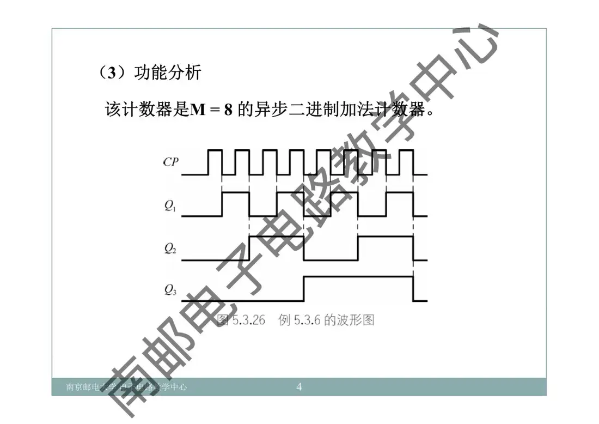

原文：

（3） 功能分析

该计数器是M = 8 的异步 进制加法计数器二 。

南京邮电大学 电子电路教学中心

4

### M 2= n异步二进制加法计数器的 般规律如下一

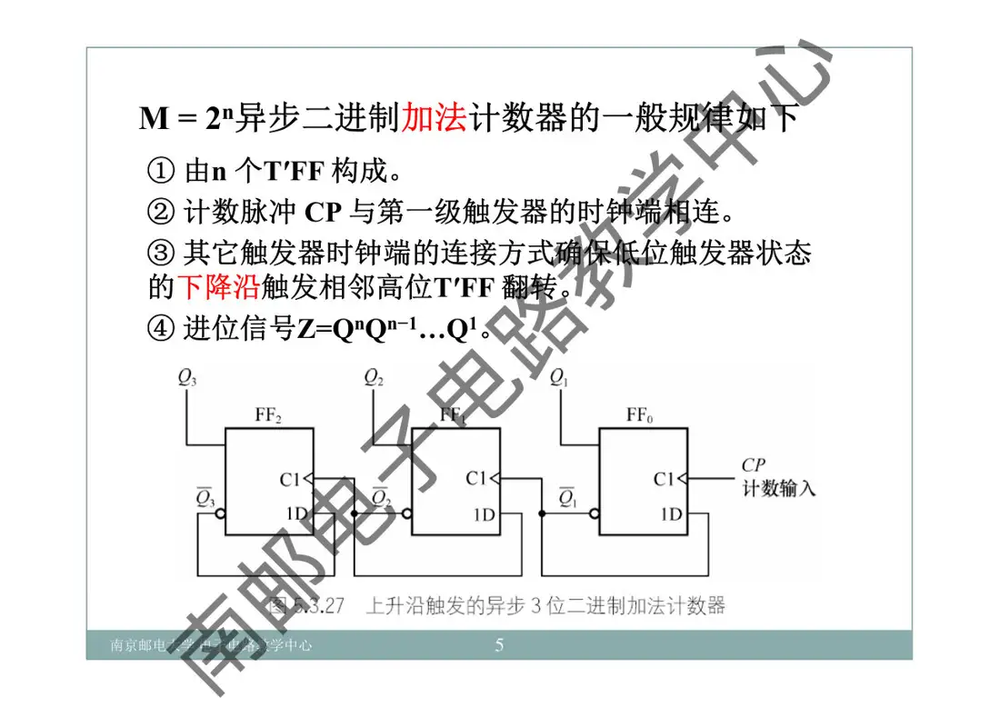

原文：

M 2= n异步二进制加法计数器的 般规律如下一

① 由 n 个T′FF 构成 。

② 计数脉冲 CP 与第一级触发器的时钟端相连。

③ 其它触发器时钟端的连接方式确保低位触发器状态的下降沿触发相邻高位T′FF 翻转。

④ 进位信号 $\mathbf { Z } { = } \mathbf { Q } ^ { \mathbf { n } } \mathbf { Q } ^ { \mathbf { n } - 1 } { \mathbf { - } } { \mathbf { \overline { { { \Gamma } } } } } \mathbf { \cdot } { \mathbf { - } } \mathbf { Q } ^ { 1 }$

南京邮电大学 电子电路教学中心

5

### 加法计数器状态转移表

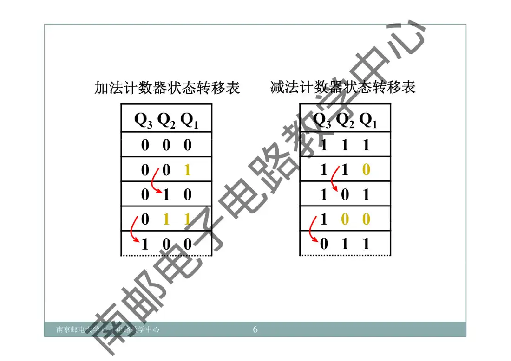

原文：

加法计数器状态转移表

$$
\begin{array}{c c c} \hline & Q _ {3} & Q _ {2} & Q _ {1} \\ \hline & 0 & 0 & 0 \\ \hline & 0 & 0 & 1 \\ \hline & 0 & 1 & 0 \\ \hline & 0 & 1 & 1 \\ \hline & 1 & 0 & 0 \\ \hline \end{array}
$$

减法计数器状态转移表

$$
\begin{array}{c c c} \hline Q _ {3} & Q _ {2} & Q _ {1} \\ \hline 1 & 1 & 1 \\ \hline 1 & 1 & 0 \\ \hline 1 & 0 & 1 \\ \hline 1 & 0 & 0 \\ \hline 0 & 1 & 1 \\ \hline \end{array}
$$

南京邮电大学 电子电路教学中心

6

### M 2= n异步二进制减法计数器的 般规律如下一

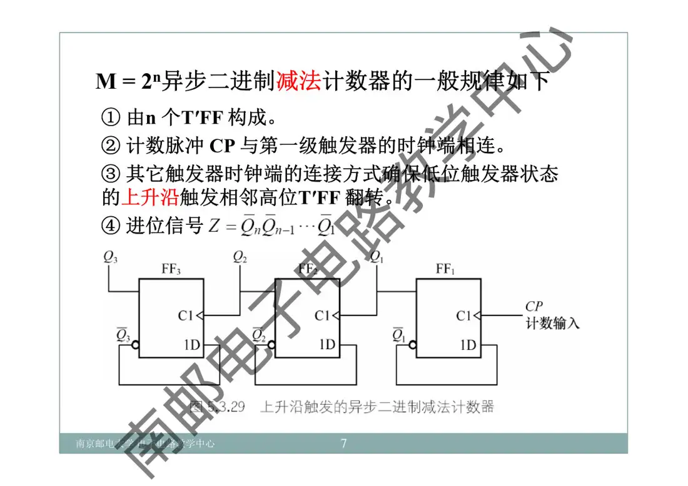

原文：

M 2= n异步二进制减法计数器的 般规律如下一

① 由 n 个T′FF 构成 。

② 计数脉冲 CP 与第一级触发器的时钟端相连。

③ 其它触发器时钟端的连接方式确保低位触发器状态的上升沿触发相邻高位T′FF 翻转。

④ 进位信号 $Z = \overline { { { Q } } } _ { n } \overline { { { Q } } } _ { n - 1 } \cdots \overline { { { Q } } } _ { 1 } \overline { { { \longrightarrow } } } \nonumber$ 解：（1）列激励方程和次态方程激励方程为

南京邮电大学 电子电路教学中心

7

### 南京邮电大学 电子电路教学中心

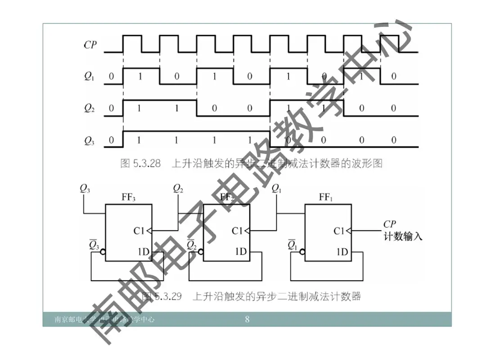

原文：

南京邮电大学 电子电路教学中心

8

### 南京邮电大学 电子电路教学中心

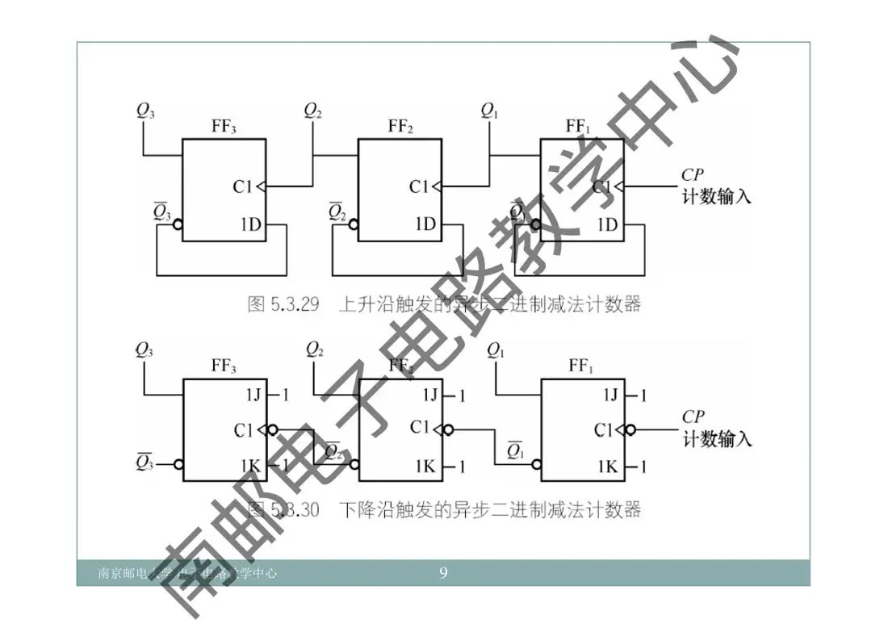

原文：

南京邮电大学 电子电路教学中心

9

### 南京邮电大学 电子电路教学中心

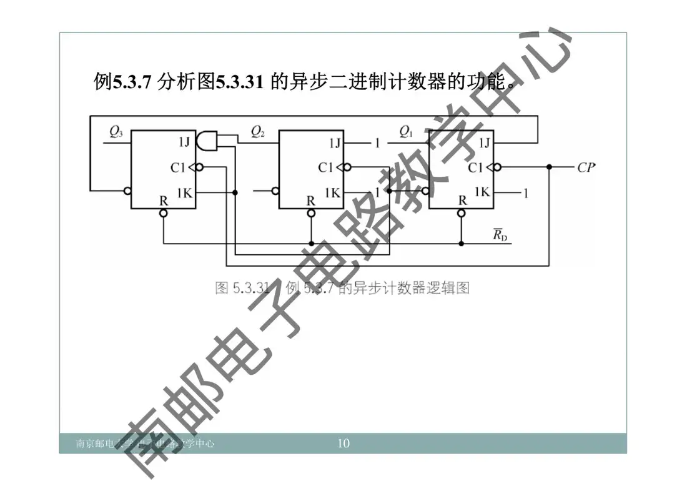

原文：

南京邮电大学 电子电路教学中心

1 0

### $$

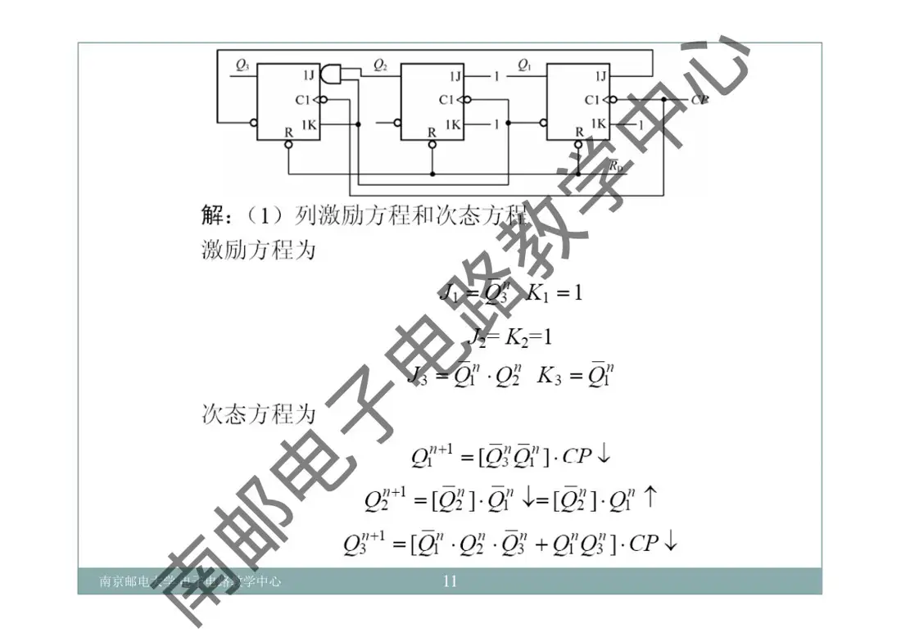

原文：

$$
J _ {2} = K _ {2} = 1
$$

$$
J _ {3} = \bar {Q} _ {1} ^ {n} \cdot Q _ {2} ^ {n} K _ {3} = \bar {Q} _ {1} ^ {n}
$$

次态方程为

$$
Q _ {1} ^ {n + 1} = [ \overline {{Q}} _ {3} ^ {n} \overline {{Q}} _ {1} ^ {n} ] \cdot C P \downarrow
$$

$$
Q _ {2} ^ {n + 1} = \left[ \bar {Q} _ {2} ^ {n} \right] \cdot \bar {Q} _ {1} ^ {n} \downarrow = \left[ \bar {Q} _ {2} ^ {n} \right] \cdot Q _ {1} ^ {n} \uparrow
$$

$$
Q _ {3} ^ {n + 1} = \left[ \bar {Q} _ {1} ^ {n} \cdot Q _ {2} ^ {n} \cdot \bar {Q} _ {3} ^ {n} + Q _ {1} ^ {n} Q _ {3} ^ {n} \right] \cdot C P \downarrow
$$

南京邮电大学 电子电路教学中心

1 1

### （2） 列状态转移表

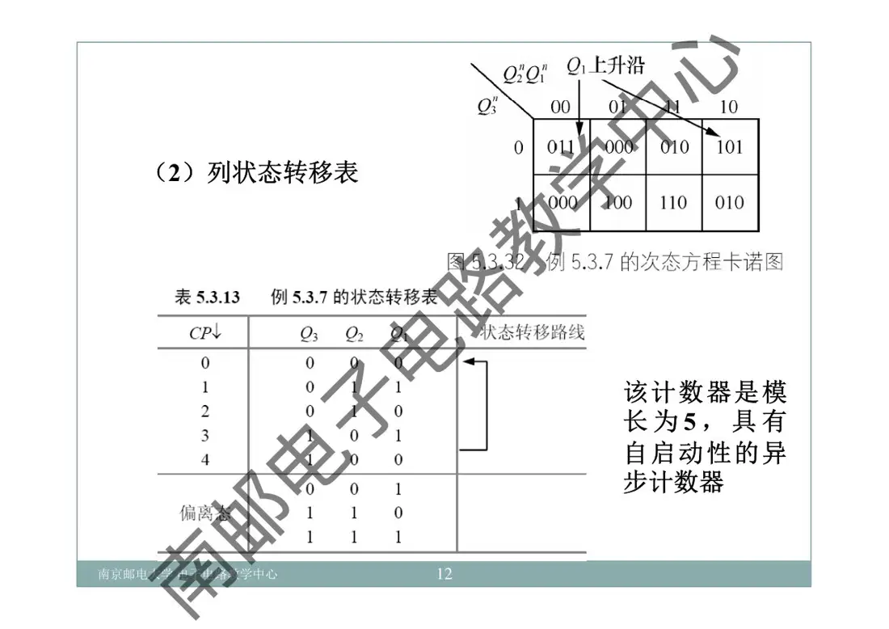

原文：

（2） 列状态转移表

表 5.3.13 例 5.3.7 的状态转移表
<table><tr><td>CP↓</td><td> $Q_3$ </td><td> $Q_2$ </td><td> $Q_1$ </td><td>状态转移路线</td></tr><tr><td>0</td><td>0</td><td>0</td><td>0</td><td rowspan="5"></td></tr><tr><td>1</td><td>0</td><td>1</td><td>1</td></tr><tr><td>2</td><td>0</td><td>1</td><td>0</td></tr><tr><td>3</td><td>1</td><td>0</td><td>1</td></tr><tr><td>4</td><td>1</td><td>0</td><td>0</td></tr><tr><td rowspan="3">偏离态</td><td>0</td><td>0</td><td>1</td><td rowspan="3"></td></tr><tr><td>1</td><td>1</td><td>0</td></tr><tr><td>1</td><td>1</td><td>1</td></tr></table>

该计数器是模长 为 5 ， 具 有自 启 动性 的 异步计数器

南京邮电大学 电子电路教学中心

1 2

### 2． 异步计数器的设计

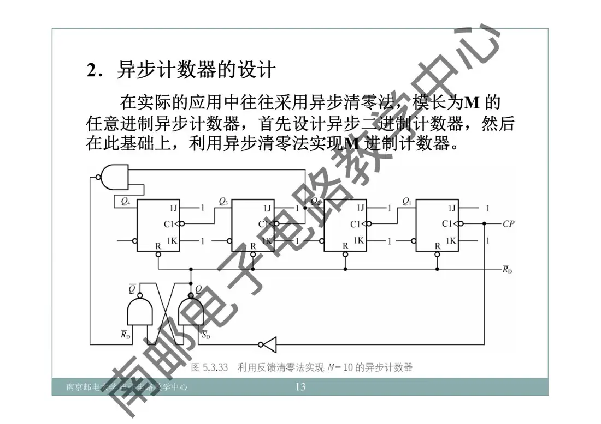

原文：

2． 异步计数器的设计

在实际的应用 中往往采用异步清零法， 模长为M 的任意进制异步 数 计 器， 首先 异步 进制 数 设计 二 计 器， 然后在此基础上， 利用异步清零法实现M 进制计数器。

南京邮电大学 电子电路教学中心

1 3

### 5 3 5. . 移存型计数器

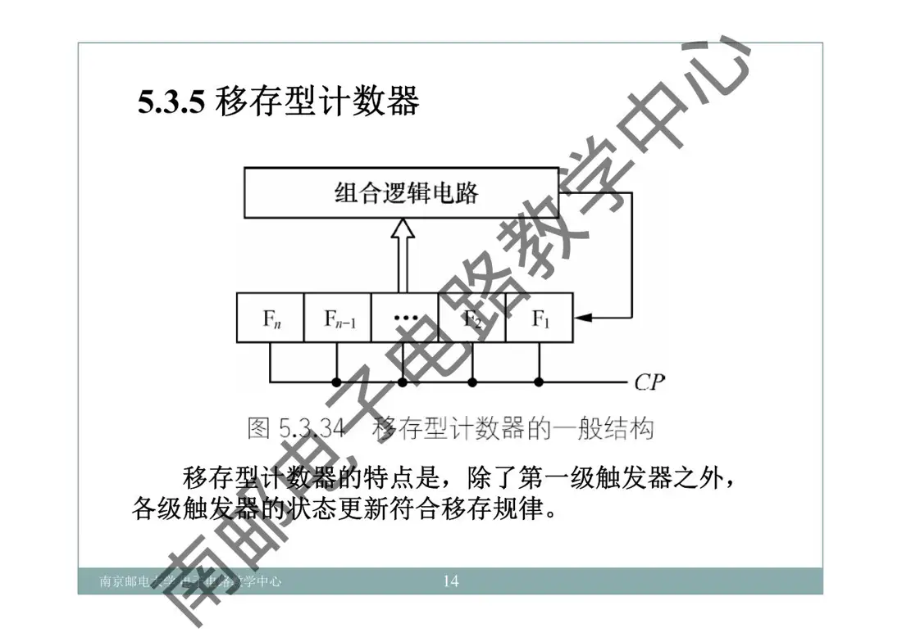

原文：

5 3 5. . 移存型计数器

移存型计数器的特点是， 除了第一级触发器之外，各级触发器的状态更新符合移存规律。

南京邮电大学 电子电路教学中心

1 4

### 例 6.5.6 试用DFF设计 M=5的移存型计数器 。

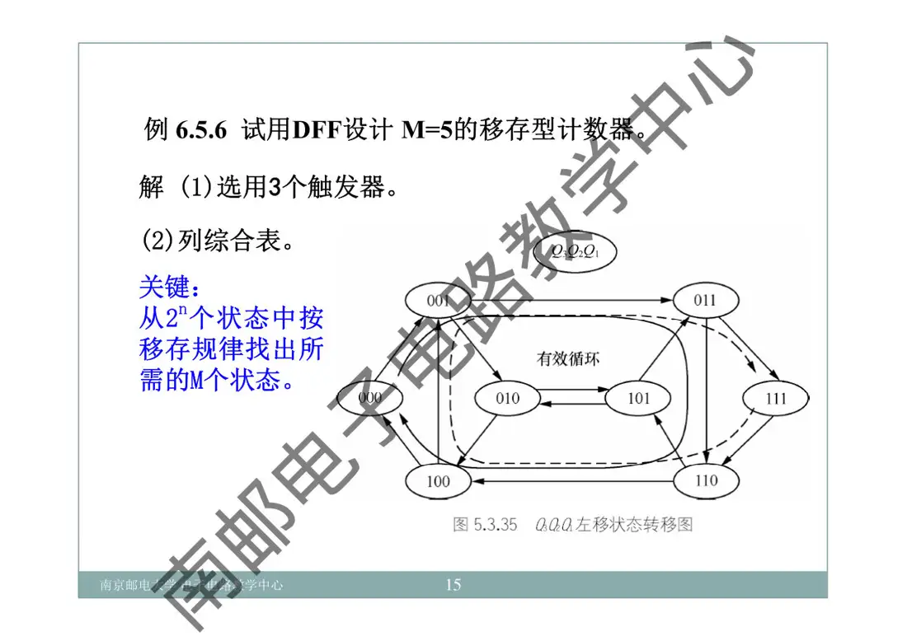

原文：

例 6.5.6 试用DFF设计 M=5的移存型计数器 。

解 (1) 选用3个触发器。

(2) 列综合表 。

关键：从2n个状态 中按移存规律找出所需的M个状态。

南京邮电大学 电子电路教学中心

1 5

### (2) 列综合表 。

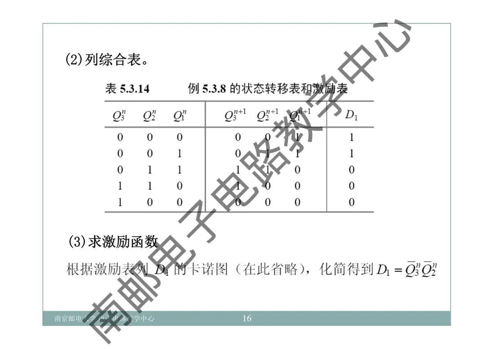

原文：

(2) 列综合表 。

表 5.3.14 例 5.3.8 的状态转移表和激励表
<table><tr><td> $Q_3^n$ </td><td> $Q_2^n$ </td><td> $Q_1^n$ </td><td> $Q_3^{n+1}$ </td><td> $Q_2^{n+1}$ </td><td> $Q_1^{n+1}$ </td><td> $D_1$ </td></tr><tr><td>0</td><td>0</td><td>0</td><td>0</td><td>0</td><td>1</td><td>1</td></tr><tr><td>0</td><td>0</td><td>1</td><td>0</td><td>1</td><td>1</td><td>1</td></tr><tr><td>0</td><td>1</td><td>1</td><td>1</td><td>1</td><td>0</td><td>0</td></tr><tr><td>1</td><td>1</td><td>0</td><td>1</td><td>0</td><td>0</td><td>0</td></tr><tr><td>1</td><td>0</td><td>0</td><td>0</td><td>0</td><td>0</td><td>0</td></tr></table>

(3) 求激励函数

根据激励表列 $\mathbf { \textmu } _ { \mathbb { { D } _ { 1 } } }$ 的卡诺图（在此省略），化简得到 $D _ { 1 } = \overline { { { Q } } } _ { 3 } ^ { n } \overline { { { Q } } } _ { 2 } ^ { n }$

南京邮电大学 电子电路教学中心

1 6

### (4) 作 电路图

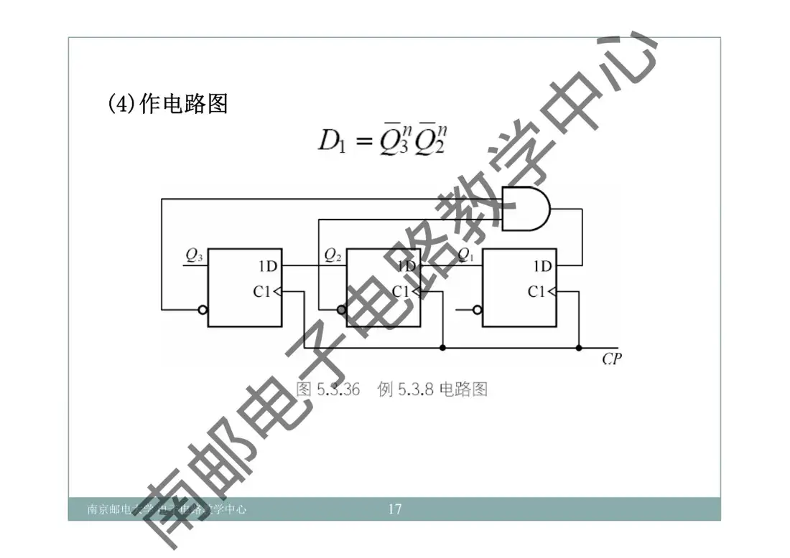

原文：

(4) 作 电路图

南京邮电大学 电子电路教学中心

1 7

### 3. 典型 电路

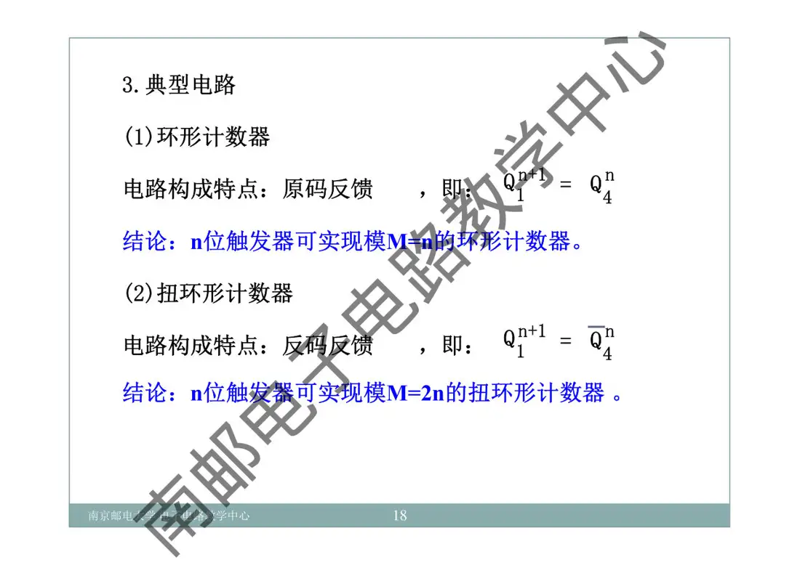

原文：

3. 典型 电路

(1) 环形计数器

电路构成特点： 原码反馈 ， 即 ： $\mathsf { \Delta \mathsf { Q } _ { 1 } ^ { n + 1 } } = \mathsf { \Delta \mathsf { Q } _ { 4 } ^ { n } }$

结论： n位触发器可实现模M=n的环形计数器。

(2) 扭环形计数器

电路构成特点： 反码反馈 即 ：， ${ \sf Q } _ { 1 } ^ { \mathrm { n + 1 } } = { \sf Q } _ { 4 } ^ { \mathrm { n } }$

结论： n位触发器可实现模M=2n的扭环形计数器 。

南京邮电大学 电子电路教学中心

1 8

### 表 5.3.15 环形计数器的状态转移表

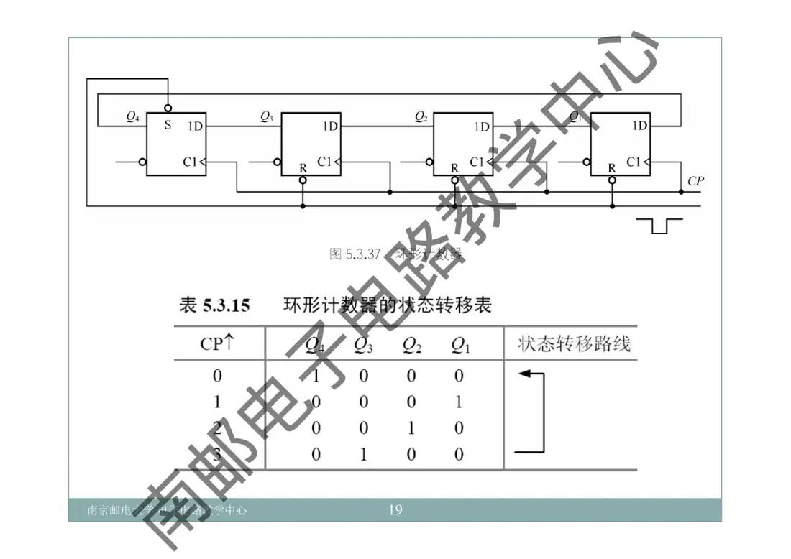

原文：

表 5.3.15 环形计数器的状态转移表
<table><tr><td>CP↑</td><td> $Q_4$ </td><td> $Q_3$ </td><td> $Q_2$ </td><td> $Q_1$ </td><td>状态转移路线</td></tr><tr><td>0</td><td>1</td><td>0</td><td>0</td><td>0</td><td rowspan="4"></td></tr><tr><td>1</td><td>0</td><td>0</td><td>0</td><td>1</td></tr><tr><td>2</td><td>0</td><td>0</td><td>1</td><td>0</td></tr><tr><td>3</td><td>0</td><td>1</td><td>0</td><td>0</td></tr></table>

南京邮电大学 电子电路教学中心

1 9

### 南京邮电大学 电子电路教学中心

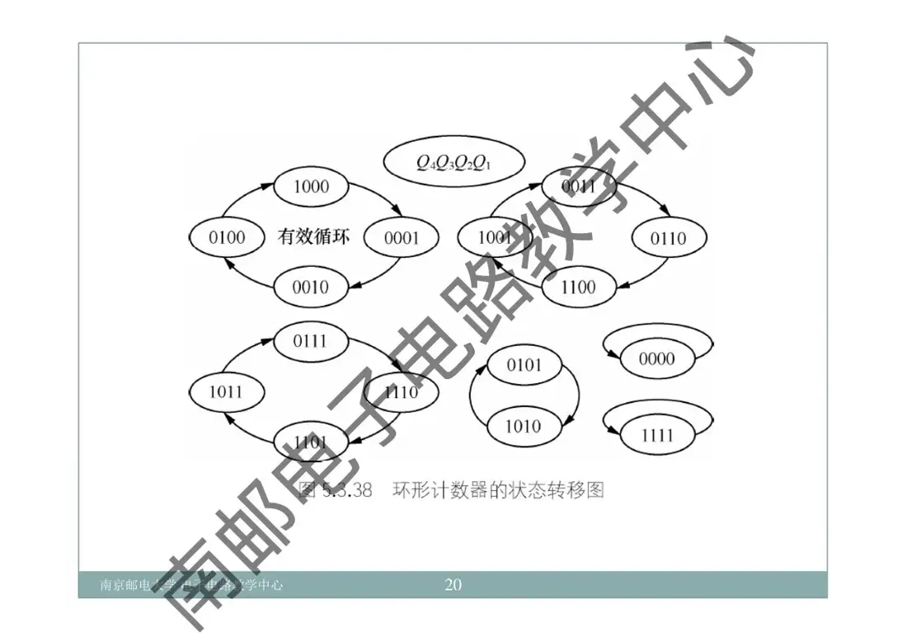

原文：

南京邮电大学 电子电路教学中心

20

### D 1

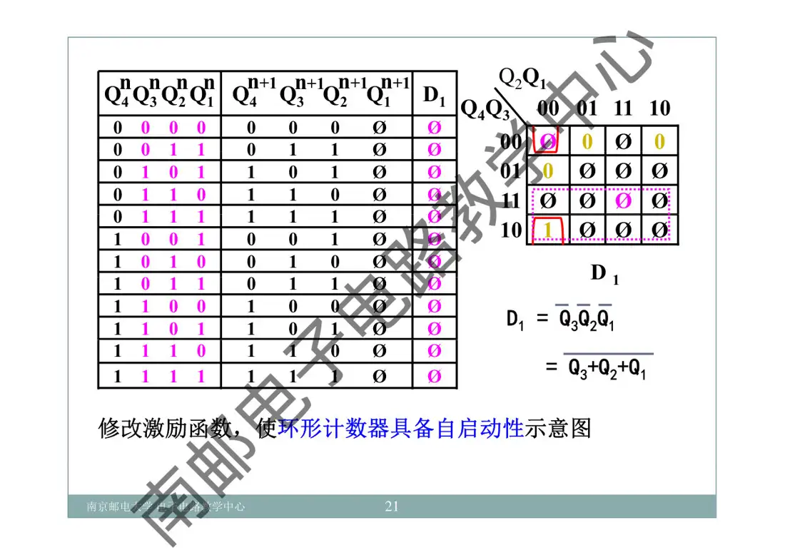

原文：

D 1

$$
\begin{array}{c c c c} \mathbf {Q} _ {4} ^ {\mathrm{n}} \mathbf {Q} _ {3} ^ {\mathrm{n}} \mathbf {Q} _ {2} ^ {\mathrm{n}} \mathbf {Q} _ {1} ^ {\mathrm{n}} & \mathbf {Q} _ {4} ^ {\mathrm{n+1}} \mathbf {Q} _ {3} ^ {\mathrm{n+1}} \mathbf {Q} _ {2} ^ {\mathrm{n+1}} \mathbf {Q} _ {1} ^ {\mathrm{n+1}} & \mathbf {D} _ {1} \\ \hline 0 & 0 & 0 & 0 \\ 0 & 0 & 1 & 1 \\ 0 & 1 & 0 & 1 \\ 0 & 1 & 1 & 0 \\ 0 & 1 & 1 & 1 \\ 1 & 0 & 0 & 1 \\ 1 & 0 & 1 & 0 \\ 1 & 0 & 1 & 1 \\ 1 & 1 & 0 & 0 \\ 1 & 1 & 0 & 1 \\ 1 & 1 & 0 & 1 \\ 1 & 1 & 1 & 0 \\ 1 & 1 & 1 & 1 \end{array}
$$

$$
\begin{array}{r l} \mathsf {D} _ {1} & = \overline {{\mathsf {Q}}} _ {3} \overline {{\mathsf {Q}}} _ {2} \overline {{\mathsf {Q}}} _ {1} \\ & = \overline {{\mathsf {Q}}} _ {3} + \mathsf {Q} _ {2} + \mathsf {Q} _ {1} \end{array}
$$

修改激励函数， 使环形计数器具备 自 启动性示意图

南京邮电大学 电子电路教学中心

2 1

### （2） 扭环形计数器

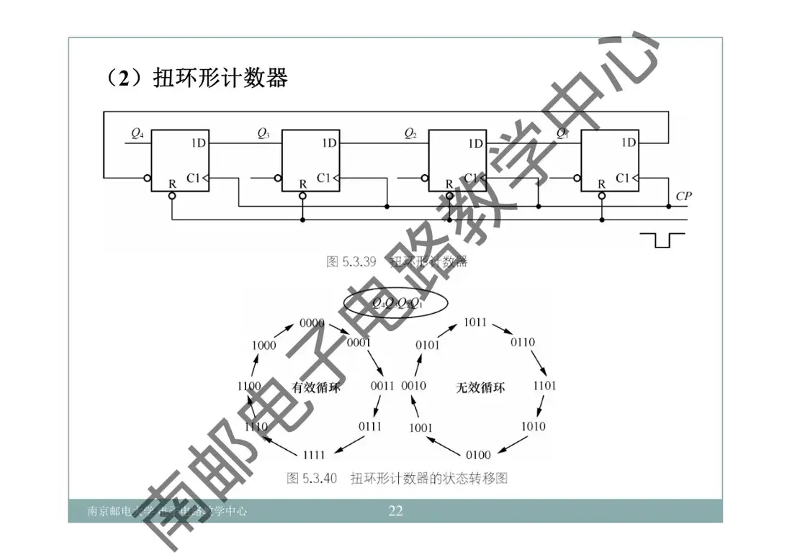

原文：

（2） 扭环形计数器

南京邮电大学 电子电路教学中心

22

### 用MSI移存器构成环形或扭环形计数器。

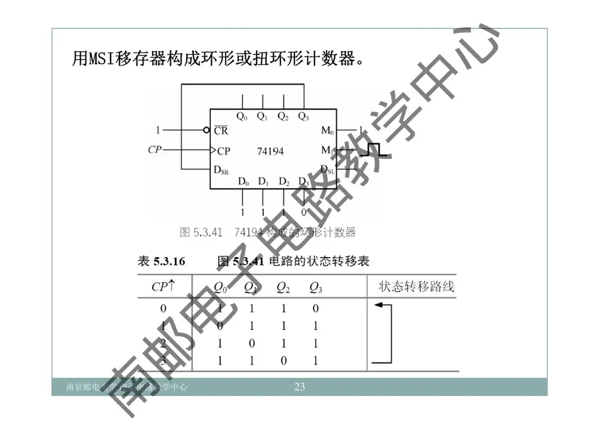

原文：

用MSI移存器构成环形或扭环形计数器。

表 5.3.16 图5.3.41 电路的状态转移表
<table><tr><td> $CP \uparrow$ </td><td> $Q_0$ </td><td> $Q_1$ </td><td> $Q_2$ </td><td> $Q_3$ </td><td>状态转移路线</td></tr><tr><td>0</td><td>1</td><td>1</td><td>1</td><td>0</td><td rowspan="4"></td></tr><tr><td>1</td><td>0</td><td>1</td><td>1</td><td>1</td></tr><tr><td>2</td><td>1</td><td>0</td><td>1</td><td>1</td></tr><tr><td>3</td><td>1</td><td>1</td><td>0</td><td>1</td></tr></table>

南京邮电大学 电子电路教学中心

23

### 作业5.12(1)5.145.16

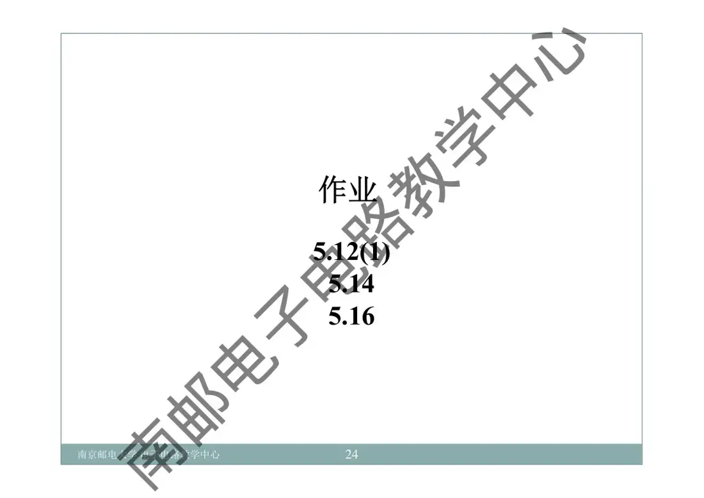

原文：

<table><tr><td>作业</td></tr><tr><td>5.12(1)</td></tr><tr><td>5.14</td></tr><tr><td>5.16</td></tr></table>
