# 《数字电路与系统设计》第5章 时序逻辑电路（课件）

原件的每一页，下面附识别出的文字。

### 5 时序逻辑电路

原文：

5 时序逻辑电路

5.1 概述

在数字电路中，凡是任一时刻的稳定输出不仅决定于该时刻的输入，而且还和电路原来的状态有关者，都叫做时序逻辑电路，简称时序电路。

时序电路的特点：具有记忆功能。

时序电路的基本单元：触发器。

常用时序电路：寄存器、移位寄存器、计数器、序列信号发生器

### 组合电路

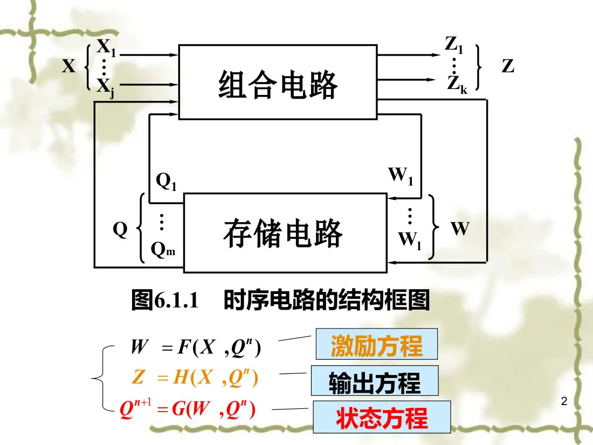

原文：

组合电路

存储电路

图6.1.1 时序电路的结构框图

$$
\left\{ \begin{array}{r l} W & = F (X, Q ^ {n}) \\ Z & = H (X, Q ^ {n}) \\ Q ^ {n + 1} & = G (W, Q ^ {n}) \end{array} \right.
$$

激励方程

输出方程

状态方程

### 5.2 寄存器和移存器

原文：

5.2 寄存器和移存器

5.2.1寄存器

在数字电路中，用来存放一组二进制数据或代码的电路称为寄存器。寄存器是计算机的主要部件之一，它用来暂时存放数据或指令。

寄存器是由具有存储功能的触发器组合起来构成的。一个触发器可以存储1位二进制代码，存放n位二进制代码的寄存器，需用n个触发器来构成。

3

### 并行方式

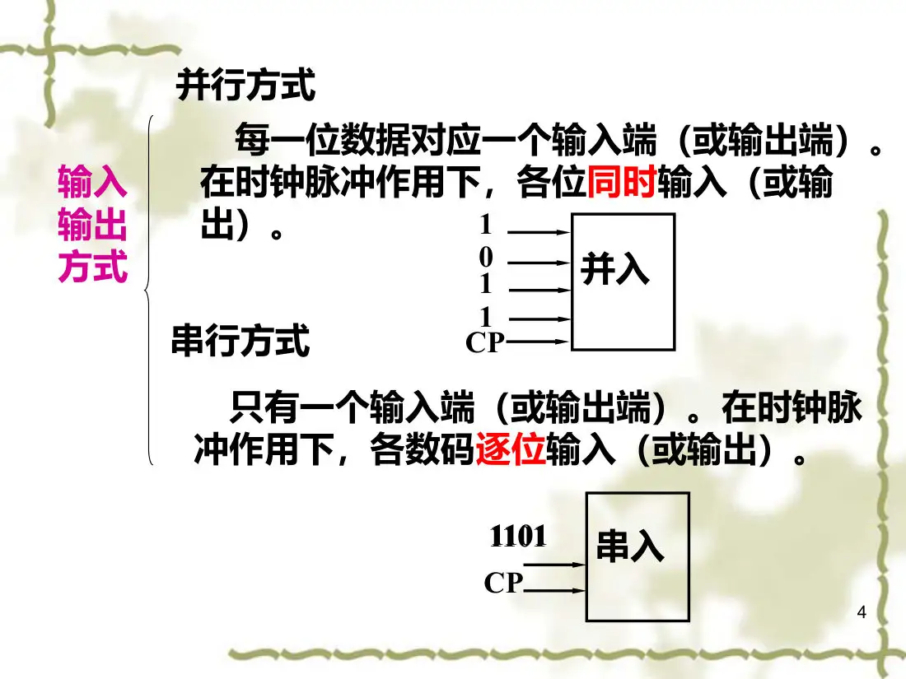

原文：

并行方式

输入
输出
方式

每一位数据对应一个输入端（或输出端）。在时钟脉冲作用下，各位同时输入（或输出）。

$$
\begin{array}{c c} 1 & \text {并入} \\ 0 & \\ 1 & \\ 1 & \\ C P & \end{array}
$$

串行方式

只有一个输入端（或输出端）。在时钟脉冲作用下，各数码逐位输入（或输出）。

$$
\begin{array}{c c} \text {1101} & \text {串入} \\ \text {CP} & \end{array}
$$

4

### 1. 数码寄存器

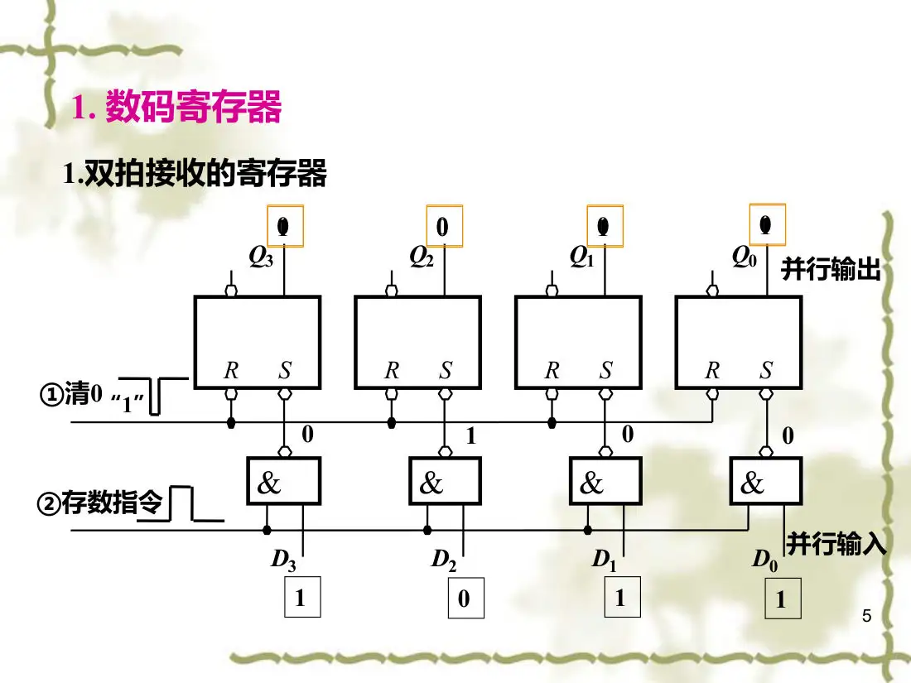

原文：

1. 数码寄存器

1. 双拍接收的寄存器

### 2. 单拍接收的寄存器

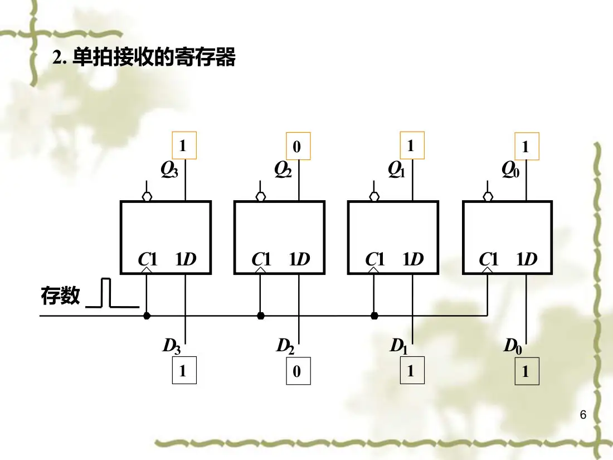

原文：

2. 单拍接收的寄存器

6

### 2. MSI寄存器 74175

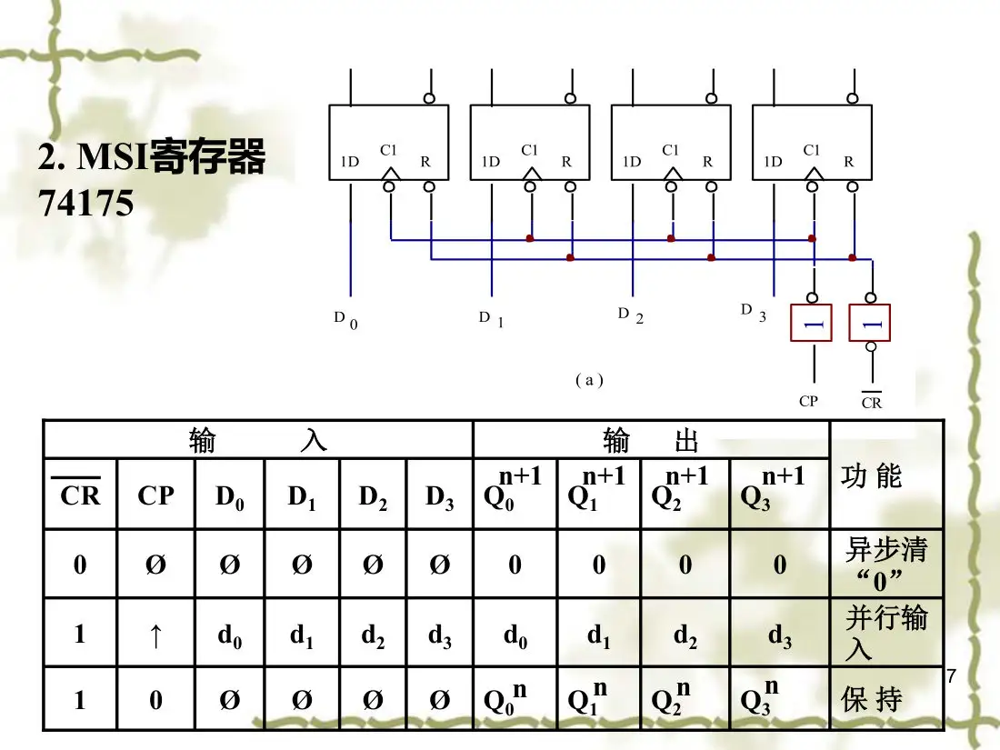

原文：

2. MSI寄存器 74175

<table><tr><td colspan="6">输入</td><td colspan="4">输出</td><td rowspan="2">功能</td></tr><tr><td> $\overline{\text{CR}}$ </td><td>CP</td><td> $D_0$ </td><td> $D_1$ </td><td> $D_2$ </td><td> $D_3$ </td><td> $Q_0^{n+1}$ </td><td> $Q_1^{n+1}$ </td><td> $Q_2^{n+1}$ </td><td> $Q_3^{n+1}$ </td></tr><tr><td>0</td><td>∅</td><td>∅</td><td>∅</td><td>∅</td><td>∅</td><td>0</td><td>0</td><td>0</td><td>0</td><td>异步清“0”</td></tr><tr><td>1</td><td>↑</td><td> $d_0$ </td><td> $d_1$ </td><td> $d_2$ </td><td> $d_3$ </td><td> $d_0$ </td><td> $d_1$ </td><td> $d_2$ </td><td> $d_3$ </td><td>并行输入</td></tr><tr><td>1</td><td>0</td><td>∅</td><td>∅</td><td>∅</td><td>∅</td><td> $Q_0^n$ </td><td> $Q_1^n$ </td><td> $Q_2^n$ </td><td> $Q_3^n$ </td><td>保持</td></tr></table>

### 第 8 页

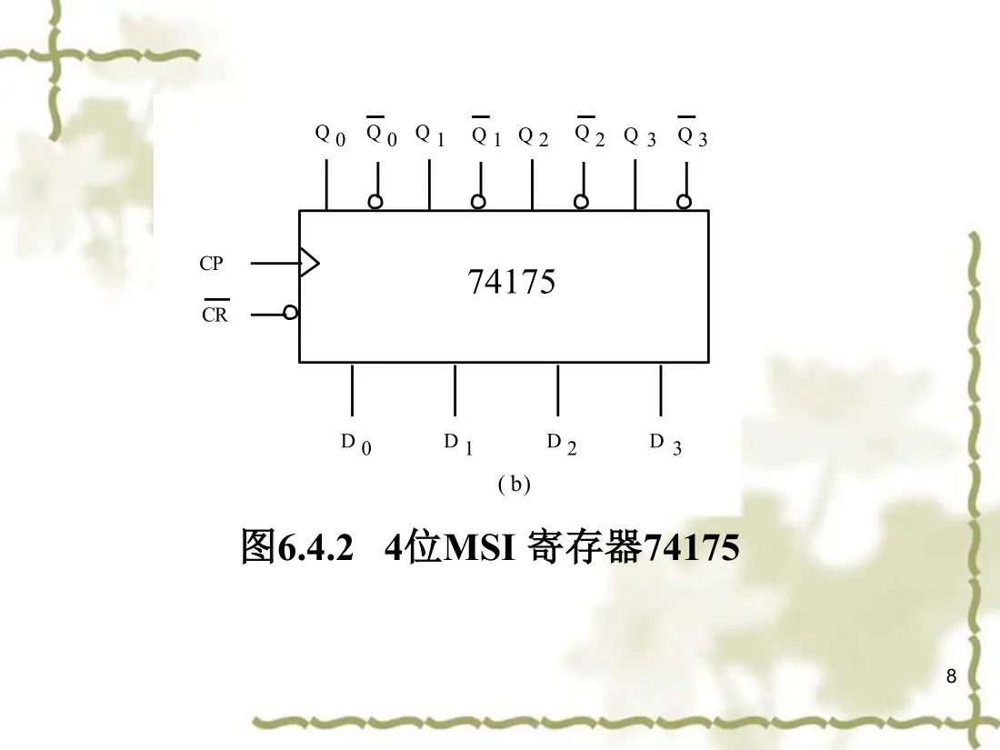

原文：

8

### 表5.2.1 图 5.2.1 的时序举例

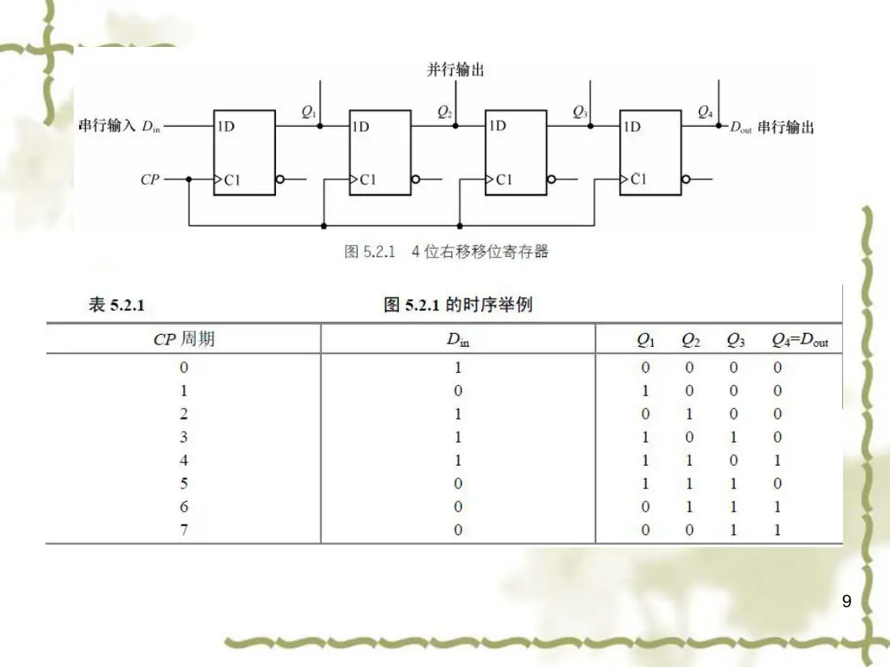

原文：

表5.2.1 图 5.2.1 的时序举例
<table><tr><td>CP 周期</td><td> $D_{in}$ </td><td> $Q_1$ </td><td> $Q_2$ </td><td> $Q_3$ </td><td> $Q_4=D_{out}$ </td></tr><tr><td>0</td><td>1</td><td>0</td><td>0</td><td>0</td><td>0</td></tr><tr><td>1</td><td>0</td><td>1</td><td>0</td><td>0</td><td>0</td></tr><tr><td>2</td><td>1</td><td>0</td><td>1</td><td>0</td><td>0</td></tr><tr><td>3</td><td>1</td><td>1</td><td>0</td><td>1</td><td>0</td></tr><tr><td>4</td><td>1</td><td>1</td><td>1</td><td>0</td><td>1</td></tr><tr><td>5</td><td>0</td><td>1</td><td>1</td><td>1</td><td>0</td></tr><tr><td>6</td><td>0</td><td>0</td><td>1</td><td>1</td><td>1</td></tr><tr><td>7</td><td>0</td><td>0</td><td>0</td><td>1</td><td>1</td></tr></table>

9

### 并行输出

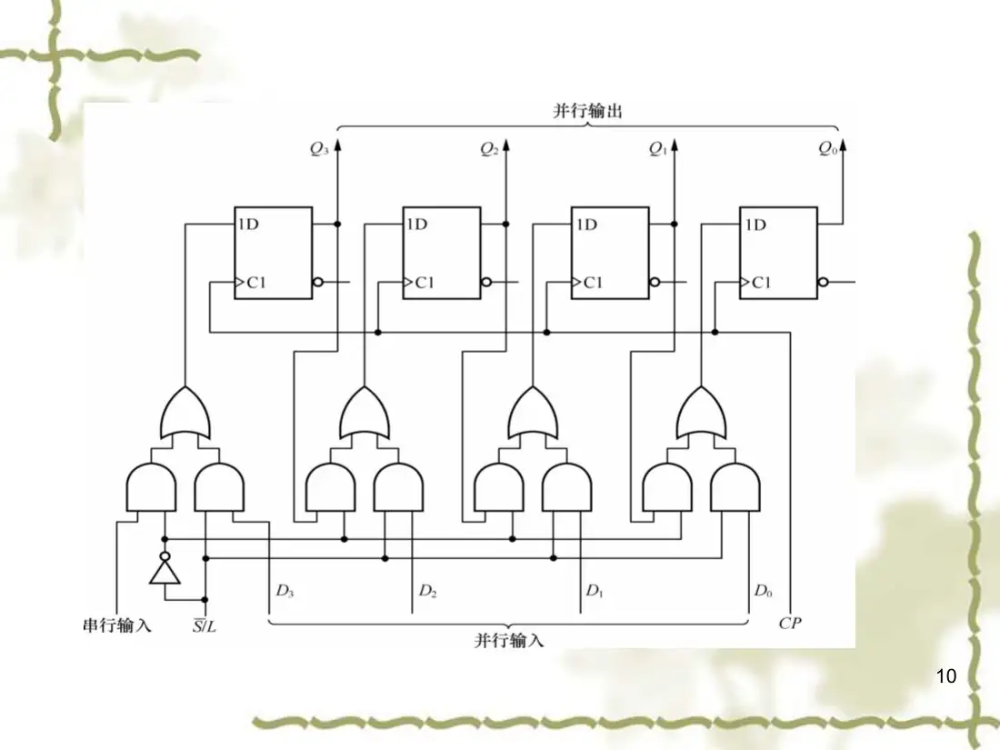

原文：

并行输出

10

### 5.2.2 移位寄存器 ( shift register )

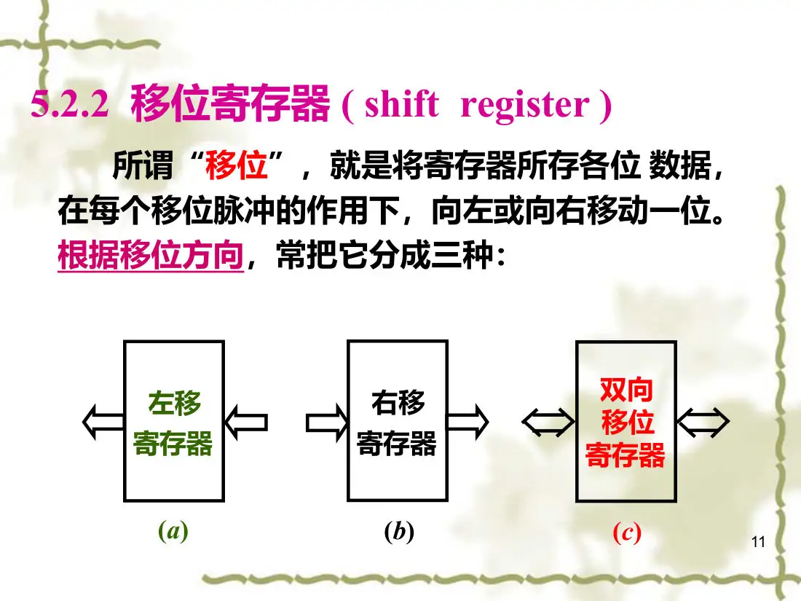

原文：

5.2.2 移位寄存器 ( shift register )

所谓 “移位”，就是将寄存器所存各位数据，在每个移位脉冲的作用下，向左或向右移动一位。根据移位方向，常把它分成三种：

11

### 根据移位数据的输入 - 输出方式，又可将它分为四种：

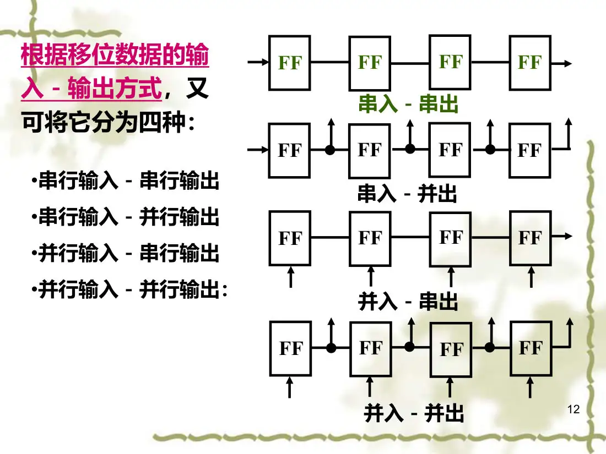

原文：

根据移位数据的输入 - 输出方式，又可将它分为四种：

·串行输入 - 串行输出

·串行输入 - 并行输出

·并行输入 - 串行输出

·并行输入 - 并行输出：

12

### 例6.4.1 四位串入并出右移移存器。

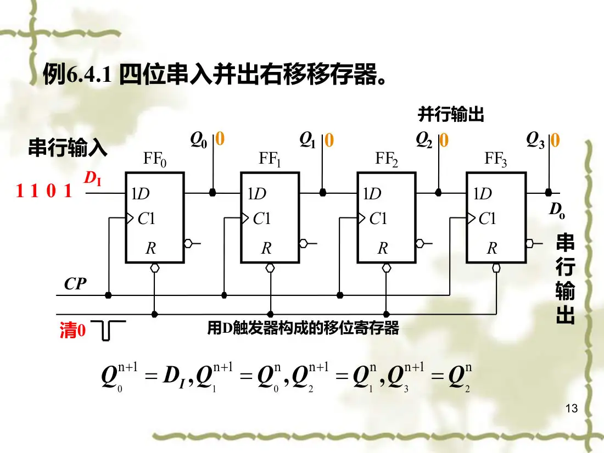

原文：

例6.4.1 四位串入并出右移移存器。

并行输出

串行输入

$$
Q _ {0} ^ {\mathrm{n+1}} = D _ {I}, Q _ {1} ^ {\mathrm{n+1}} = Q _ {0} ^ {\mathrm{n}}, Q _ {2} ^ {\mathrm{n+1}} = Q _ {1} ^ {\mathrm{n}}, Q _ {3} ^ {\mathrm{n+1}} = Q _ {2} ^ {\mathrm{n}}
$$

13

### CP 移存脉冲

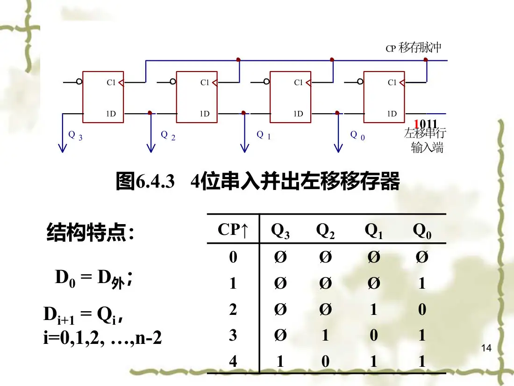

原文：

CP 移存脉冲

结构特点:

$$
\mathbf {D _ {0}} = \mathbf {D _ {\text {外}}} i
$$

$$
\mathbf {D} _ {\mathrm{i+1}} = \mathbf {Q} _ {\mathrm{i}},
$$

$$
\mathbf {i} = 0, 1, 2, \dots , \mathbf {n} - 2
$$

<table><tr><td>CP↑</td><td>Q3</td><td>Q2</td><td>Q1</td><td>Q0</td></tr><tr><td>0</td><td>∅</td><td>∅</td><td>∅</td><td>∅</td></tr><tr><td>1</td><td>∅</td><td>∅</td><td>∅</td><td>1</td></tr><tr><td>2</td><td>∅</td><td>∅</td><td>1</td><td>0</td></tr><tr><td>3</td><td>∅</td><td>1</td><td>0</td><td>1</td></tr><tr><td>4</td><td>1</td><td>0</td><td>1</td><td>1</td></tr></table>

14

### MSI移存器：4位串入、并入—串出、并出双向移存器 74194

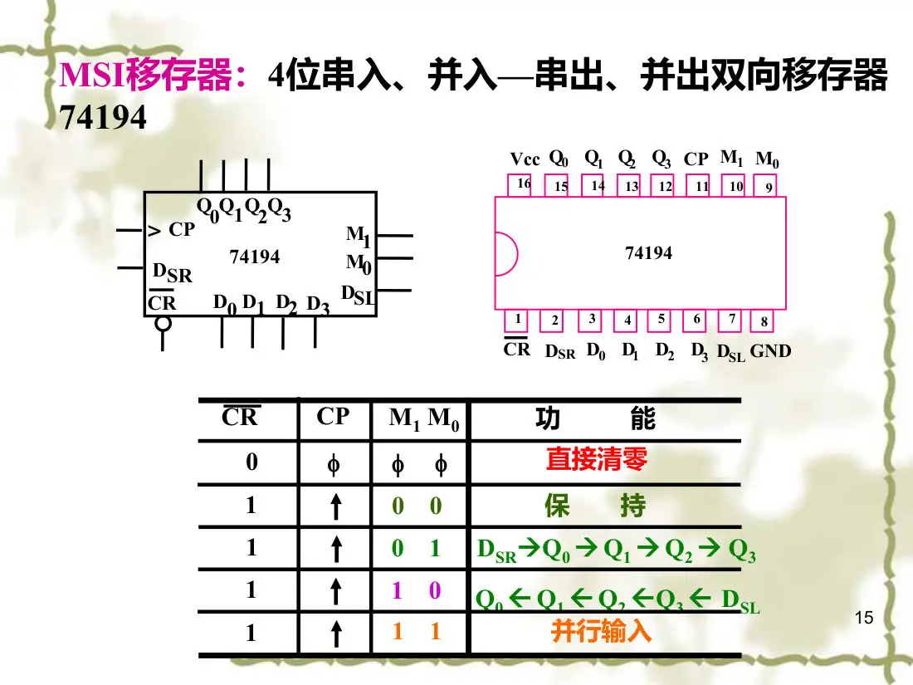

原文：

MSI移存器：4位串入、并入—串出、并出双向移存器 74194

<table><tr><td> $\overline{CR}$ </td><td>CP</td><td> $M_1$   $M_0$ </td><td>功能</td></tr><tr><td>0</td><td> $\phi$ </td><td> $\phi$   $\phi$ </td><td>直接清零</td></tr><tr><td>1</td><td>↑</td><td>0 0</td><td>保持</td></tr><tr><td>1</td><td>↑</td><td>0 1</td><td> $D_{SR} \rightarrow Q_0 \rightarrow Q_1 \rightarrow Q_2 \rightarrow Q_3$ </td></tr><tr><td>1</td><td>↑</td><td>1 0</td><td> $Q_0 \leftarrow Q_1 \leftarrow Q_2 \leftarrow Q_3 \leftarrow D_{SL}$ </td></tr><tr><td>1</td><td>↑</td><td>1 1</td><td>并行输入</td></tr></table>

15

### ②功能表

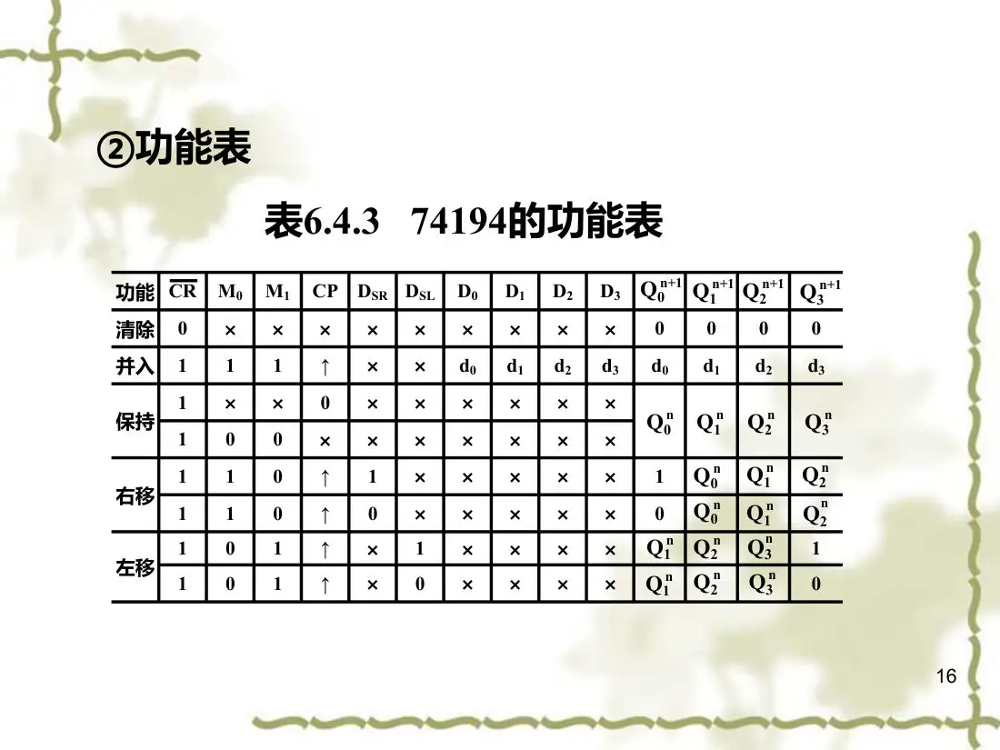

原文：

②功能表

表6.4.3 74194的功能表
<table><tr><td>功能</td><td> $\overline{\mathrm{{CR}}}$ </td><td> ${\mathrm{M}}_{0}$ </td><td> ${\mathrm{M}}_{1}$ </td><td>CP</td><td> ${\mathrm{D}}_{\mathrm{{SR}}}$ </td><td> ${\mathrm{D}}_{\mathrm{{SL}}}$ </td><td> ${\mathrm{D}}_{0}$ </td><td> ${\mathrm{D}}_{1}$ </td><td> ${\mathrm{D}}_{2}$ </td><td> ${\mathrm{D}}_{3}$ </td><td> ${\mathrm{Q}}_{0}^{\mathrm{n} + 1}$ </td><td> ${\mathrm{Q}}_{1}^{\mathrm{n} + 1}$ </td><td> ${\mathrm{Q}}_{2}^{\mathrm{n} + 1}$ </td><td> ${\mathrm{Q}}_{3}^{\mathrm{n} + 1}$ </td></tr><tr><td>清除</td><td>0</td><td>×</td><td>×</td><td>×</td><td>×</td><td>×</td><td>×</td><td>×</td><td>×</td><td>×</td><td>0</td><td>0</td><td>0</td><td>0</td></tr><tr><td>并入</td><td>1</td><td>1</td><td>1</td><td>↑</td><td>×</td><td>×</td><td> ${\mathrm{d}}_{0}$ </td><td> ${\mathrm{d}}_{1}$ </td><td> ${\mathrm{d}}_{2}$ </td><td> ${\mathrm{d}}_{3}$ </td><td> ${\mathrm{d}}_{0}$ </td><td> ${\mathrm{d}}_{1}$ </td><td> ${\mathrm{d}}_{2}$ </td><td> ${\mathrm{d}}_{3}$ </td></tr><tr><td rowspan="2">保持</td><td>1</td><td>×</td><td>×</td><td>0</td><td>×</td><td>×</td><td>×</td><td>×</td><td>×</td><td>×</td><td rowspan="2"> ${\mathrm{Q}}_{0}^{\mathrm{n}}$ </td><td rowspan="2"> ${\mathrm{Q}}_{1}^{\mathrm{n}}$ </td><td rowspan="2"> ${\mathrm{Q}}_{2}^{\mathrm{n}}$ </td><td rowspan="2"> ${\mathrm{Q}}_{3}^{\mathrm{n}}$ </td></tr><tr><td>1</td><td>0</td><td>0</td><td>×</td><td>×</td><td>×</td><td>×</td><td>×</td><td>×</td><td>×</td></tr><tr><td rowspan="2">右移</td><td>1</td><td>1</td><td>0</td><td>↑</td><td>1</td><td>×</td><td>×</td><td>×</td><td>×</td><td>×</td><td>1</td><td> ${\mathrm{Q}}_{0}^{\mathrm{n}}$ </td><td> ${\mathrm{Q}}_{1}^{\mathrm{n}}$ </td><td> ${\mathrm{Q}}_{2}^{\mathrm{n}}$ </td></tr><tr><td>1</td><td>1</td><td>0</td><td>↑</td><td>0</td><td>×</td><td>×</td><td>×</td><td>×</td><td>×</td><td>0</td><td> ${\mathrm{Q}}_{0}^{\mathrm{n}}$ </td><td> ${\mathrm{Q}}_{1}^{\mathrm{n}}$ </td><td> ${\mathrm{Q}}_{2}^{\mathrm{n}}$ </td></tr><tr><td rowspan="2">左移</td><td>1</td><td>0</td><td>1</td><td>↑</td><td>×</td><td>1</td><td>×</td><td>×</td><td>×</td><td>×</td><td> ${\mathrm{Q}}_{1}^{\mathrm{n}}$ </td><td> ${\mathrm{Q}}_{2}^{\mathrm{n}}$ </td><td> ${\mathrm{Q}}_{3}^{\mathrm{n}}$ </td><td>1</td></tr><tr><td>1</td><td>0</td><td>1</td><td>↑</td><td>×</td><td>0</td><td>×</td><td>×</td><td>×</td><td>×</td><td> ${\mathrm{Q}}_{1}^{\mathrm{n}}$ </td><td> ${\mathrm{Q}}_{2}^{\mathrm{n}}$ </td><td> ${\mathrm{Q}}_{3}^{\mathrm{n}}$ </td><td>0</td></tr></table>

16

### ③应用举例

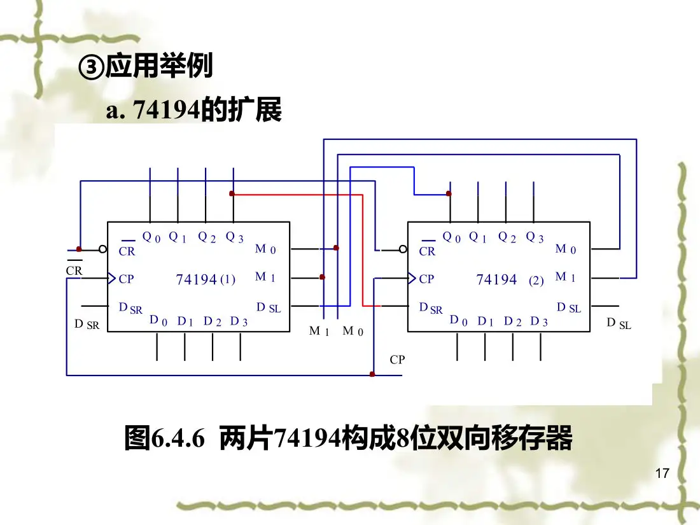

原文：

③应用举例

a. 74194的扩展

17

### b. 实现数据传输方式转换

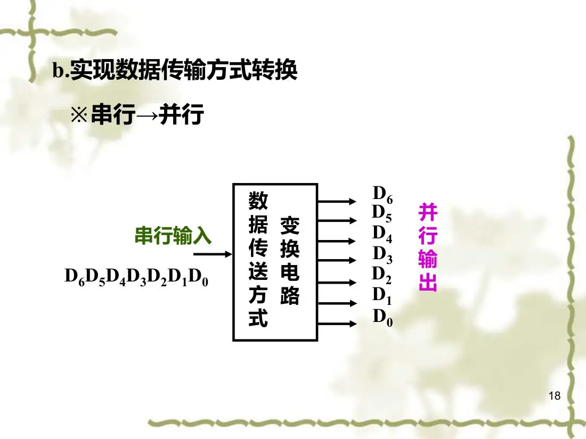

原文：

b. 实现数据传输方式转换

※串行→并行

$$
\begin{array}{r l} & \text {串行输入} \\ & D _ {6} D _ {5} D _ {4} D _ {3} D _ {2} D _ {1} D _ {0} \end{array} \xrightarrow {\text {数据传送方式}} \begin{array}{l} \text {变换电路} \\ \text {并行输出} \end{array}
$$

18

### 第 19 页

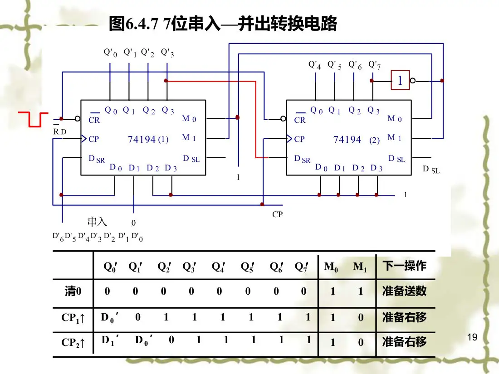

原文：

<table><tr><td></td><td> $Q_0'$ </td><td> $Q_1'$ </td><td> $Q_2'$ </td><td> $Q_3'$ </td><td> $Q_4'$ </td><td> $Q_5'$ </td><td> $Q_6'$ </td><td> $Q_7'$ </td><td> $M_0$ </td><td> $M_1$ </td><td>下一操作</td></tr><tr><td>清0</td><td>0</td><td>0</td><td>0</td><td>0</td><td>0</td><td>0</td><td>0</td><td>0</td><td>1</td><td>1</td><td>准备送数</td></tr><tr><td> $CP_1\uparrow$ </td><td> $D_0'$ </td><td>0</td><td>1</td><td>1</td><td>1</td><td>1</td><td>1</td><td>1</td><td>1</td><td>0</td><td>准备右移</td></tr><tr><td> $CP_2\uparrow$ </td><td> $D_1'$ </td><td> $D_0'$ </td><td>0</td><td>1</td><td>1</td><td>1</td><td>1</td><td>1</td><td>1</td><td>0</td><td>准备右移</td></tr></table>

### 表6.4.4 7位串入—并出转换电路的状态转移表

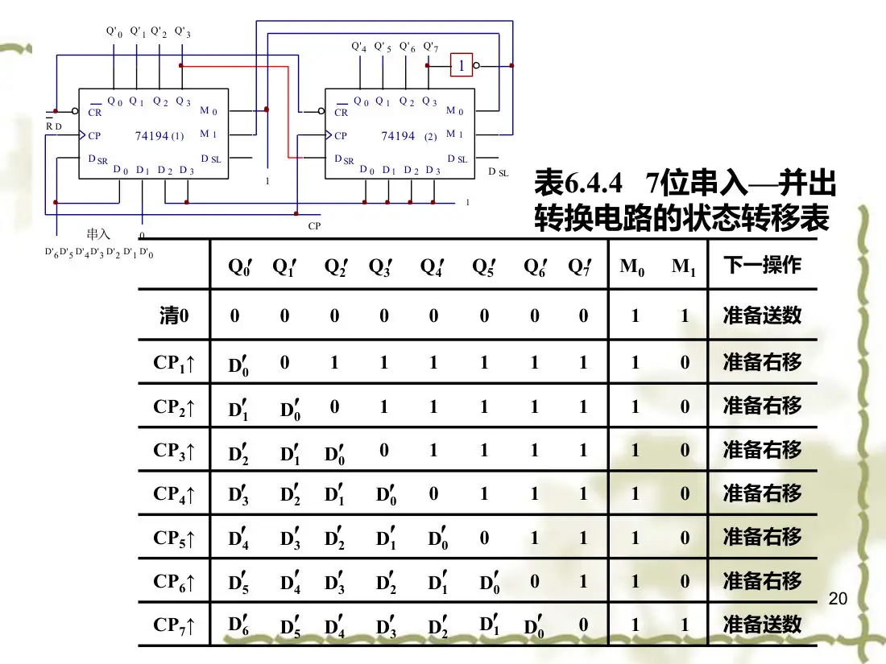

原文：

表6.4.4 7位串入—并出转换电路的状态转移表
<table><tr><td> $^{1}D'_{0}$ </td><td> $Q_0'$ </td><td> $Q_1'$ </td><td> $Q_2'$ </td><td> $Q_3'$ </td><td> $Q_4'$ </td><td> $Q_5'$ </td><td> $Q_6'$ </td><td> $Q_7'$ </td><td> $M_0$ </td><td> $M_1$ </td><td>下一操作</td></tr><tr><td>清0</td><td>0</td><td>0</td><td>0</td><td>0</td><td>0</td><td>0</td><td>0</td><td>0</td><td>1</td><td>1</td><td>准备送数</td></tr><tr><td> $CP_1\uparrow$ </td><td> $D'_0$ </td><td>0</td><td>1</td><td>1</td><td>1</td><td>1</td><td>1</td><td>1</td><td>1</td><td>0</td><td>准备右移</td></tr><tr><td> $CP_2\uparrow$ </td><td> $D'_1$ </td><td> $D'_0$ </td><td>0</td><td>1</td><td>1</td><td>1</td><td>1</td><td>1</td><td>1</td><td>0</td><td>准备右移</td></tr><tr><td> $CP_3\uparrow$ </td><td> $D'_2$ </td><td> $D'_1$ </td><td> $D'_0$ </td><td>0</td><td>1</td><td>1</td><td>1</td><td>1</td><td>1</td><td>0</td><td>准备右移</td></tr><tr><td> $CP_4\uparrow$ </td><td> $D'_3$ </td><td> $D'_2$ </td><td> $D'_1$ </td><td> $D'_0$ </td><td>0</td><td>1</td><td>1</td><td>1</td><td>1</td><td>0</td><td>准备右移</td></tr><tr><td> $CP_5\uparrow$ </td><td> $D'_4$ </td><td> $D'_3$ </td><td> $D'_2$ </td><td> $D'_1$ </td><td> $D'_0$ </td><td>0</td><td>1</td><td>1</td><td>1</td><td>0</td><td>准备右移</td></tr><tr><td> $CP_6\uparrow$ </td><td> $D'_5$ </td><td> $D'_4$ </td><td> $D'_3$ </td><td> $D'_2$ </td><td> $D'_1$ </td><td> $D'_0$ </td><td>0</td><td>1</td><td>1</td><td>0</td><td>准备右移</td></tr><tr><td> $CP_7\uparrow$ </td><td> $D'_6$ </td><td> $D'_5$ </td><td> $D'_4$ </td><td> $D'_3$ </td><td> $D'_2$ </td><td> $D'_1$ </td><td> $D'_0$ </td><td>0</td><td>1</td><td>1</td><td>准备送数</td></tr></table>

20

$\mathbf{D}_{6}^{\prime}$

$\mathbf{CP}_{7}\uparrow$

$\mathbf{D}_4^{\prime}$

$\mathbf{D}_{0}^{\prime}$

### 21

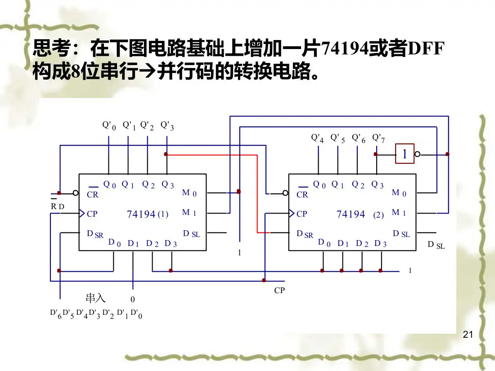

原文：

思考：在下图电路基础上增加一片74194或者DFF构成8位串行 $\rightarrow$ 并行码的转换电路。

21

### 22

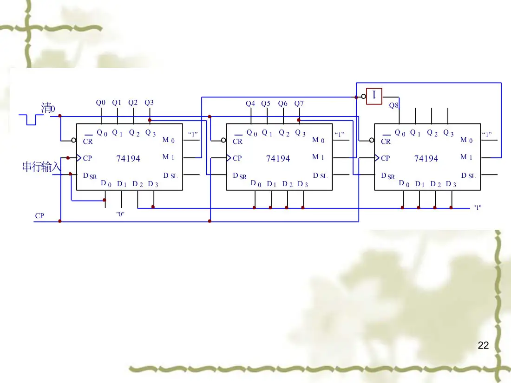

原文：

22

### 8位串入—并出转换电路的状态转移表

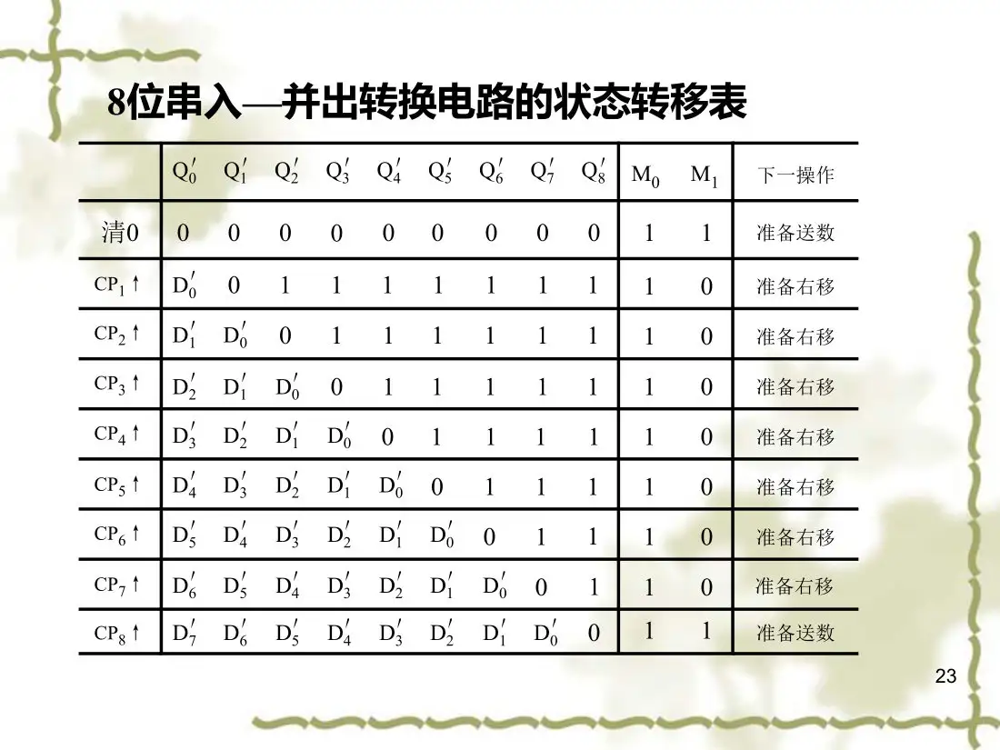

原文：

8位串入—并出转换电路的状态转移表
<table><tr><td></td><td> $Q_0'$ </td><td> $Q_1'$ </td><td> $Q_2'$ </td><td> $Q_3'$ </td><td> $Q_4'$ </td><td> $Q_5'$ </td><td> $Q_6'$ </td><td> $Q_7'$ </td><td> $Q_8'$ </td><td> $M_0$ </td><td> $M_1$ </td><td>下一操作</td></tr><tr><td>清0</td><td>0</td><td>0</td><td>0</td><td>0</td><td>0</td><td>0</td><td>0</td><td>0</td><td>0</td><td>1</td><td>1</td><td>准备送数</td></tr><tr><td> $CP_1 \uparrow$ </td><td> $D_0'$ </td><td>0</td><td>1</td><td>1</td><td>1</td><td>1</td><td>1</td><td>1</td><td>1</td><td>1</td><td>0</td><td>准备右移</td></tr><tr><td> $CP_2 \uparrow$ </td><td> $D_1'$ </td><td> $D_0'$ </td><td>0</td><td>1</td><td>1</td><td>1</td><td>1</td><td>1</td><td>1</td><td>1</td><td>0</td><td>准备右移</td></tr><tr><td> $CP_3 \uparrow$ </td><td> $D_2'$ </td><td> $D_1'$ </td><td> $D_0'$ </td><td>0</td><td>1</td><td>1</td><td>1</td><td>1</td><td>1</td><td>1</td><td>0</td><td>准备右移</td></tr><tr><td> $CP_4 \uparrow$ </td><td> $D_3'$ </td><td> $D_2'$ </td><td> $D_1'$ </td><td> $D_0'$ </td><td>0</td><td>1</td><td>1</td><td>1</td><td>1</td><td>1</td><td>0</td><td>准备右移</td></tr><tr><td> $CP_5 \uparrow$ </td><td> $D_4'$ </td><td> $D_3'$ </td><td> $D_2'$ </td><td> $D_1'$ </td><td> $D_0'$ </td><td>0</td><td>1</td><td>1</td><td>1</td><td>1</td><td>0</td><td>准备右移</td></tr><tr><td> $CP_6 \uparrow$ </td><td> $D_5'$ </td><td> $D_4'$ </td><td> $D_3'$ </td><td> $D_2'$ </td><td> $D_1'$ </td><td> $D_0'$ </td><td>0</td><td>1</td><td>1</td><td>1</td><td>0</td><td>准备右移</td></tr><tr><td> $CP_7 \uparrow$ </td><td> $D_6'$ </td><td> $D_5'$ </td><td> $D_4'$ </td><td> $D_3'$ </td><td> $D_2'$ </td><td> $D_1'$ </td><td> $D_0'$ </td><td>0</td><td>1</td><td>1</td><td>0</td><td>准备右移</td></tr><tr><td> $CP_8 \uparrow$ </td><td> $D_7'$ </td><td> $D_6'$ </td><td> $D_5'$ </td><td> $D_4'$ </td><td> $D_3'$ </td><td> $D_2'$ </td><td> $D_1'$ </td><td> $D_0'$ </td><td>0</td><td>1</td><td>1</td><td>准备送数</td></tr></table>

23

### 触发器输出作 $Q_{0}^{\prime}$

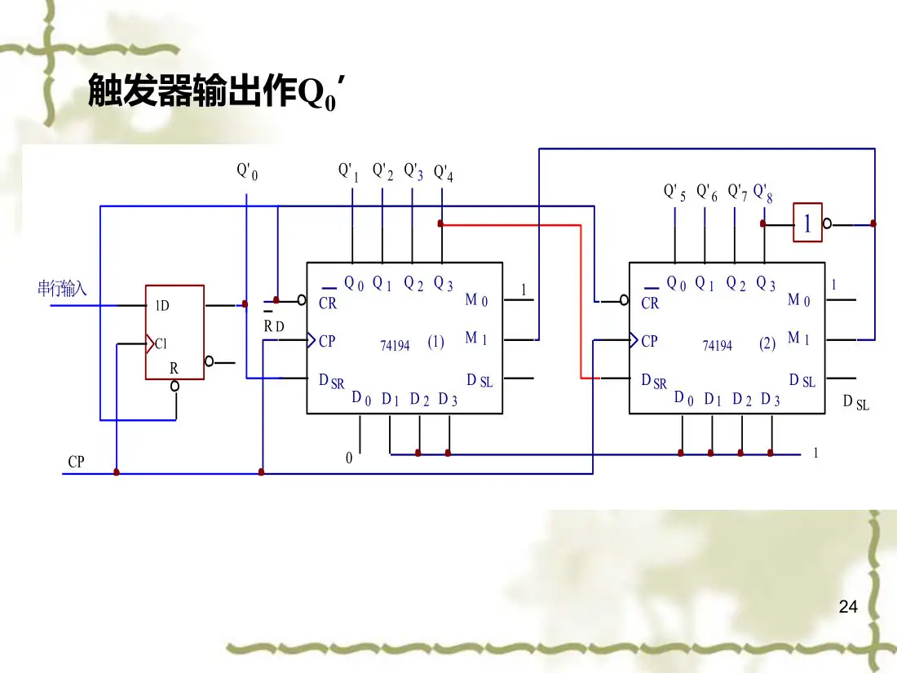

原文：

触发器输出作 $Q_{0}^{\prime}$

24

### 25

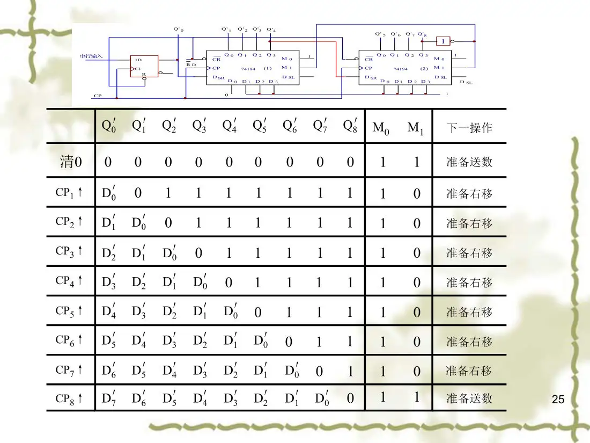

原文：

<table><tr><td></td><td> $Q_0'$ </td><td> $Q_1'$ </td><td> $Q_2'$ </td><td> $Q_3'$ </td><td> $Q_4'$ </td><td> $Q_5'$ </td><td> $Q_6'$ </td><td> $Q_7'$ </td><td> $Q_8'$ </td><td> $M_0$ </td><td> $M_1$ </td><td>下一操作</td></tr><tr><td>清0</td><td>0</td><td>0</td><td>0</td><td>0</td><td>0</td><td>0</td><td>0</td><td>0</td><td>0</td><td>1</td><td>1</td><td>准备送数</td></tr><tr><td> $CP_1 \uparrow$ </td><td> $D_0'$ </td><td>0</td><td>1</td><td>1</td><td>1</td><td>1</td><td>1</td><td>1</td><td>1</td><td>1</td><td>0</td><td>准备右移</td></tr><tr><td> $CP_2 \uparrow$ </td><td> $D_1'$ </td><td> $D_0'$ </td><td>0</td><td>1</td><td>1</td><td>1</td><td>1</td><td>1</td><td>1</td><td>1</td><td>0</td><td>准备右移</td></tr><tr><td> $CP_3 \uparrow$ </td><td> $D_2'$ </td><td> $D_1'$ </td><td> $D_0'$ </td><td>0</td><td>1</td><td>1</td><td>1</td><td>1</td><td>1</td><td>1</td><td>0</td><td>准备右移</td></tr><tr><td> $CP_4 \uparrow$ </td><td> $D_3'$ </td><td> $D_2'$ </td><td> $D_1'$ </td><td> $D_0'$ </td><td>0</td><td>1</td><td>1</td><td>1</td><td>1</td><td>1</td><td>0</td><td>准备右移</td></tr><tr><td> $CP_5 \uparrow$ </td><td> $D_4'$ </td><td> $D_3'$ </td><td> $D_2'$ </td><td> $D_1'$ </td><td> $D_0'$ </td><td>0</td><td>1</td><td>1</td><td>1</td><td>1</td><td>0</td><td>准备右移</td></tr><tr><td> $CP_6 \uparrow$ </td><td> $D_5'$ </td><td> $D_4'$ </td><td> $D_3'$ </td><td> $D_2'$ </td><td> $D_1'$ </td><td> $D_0'$ </td><td>0</td><td>1</td><td>1</td><td>1</td><td>0</td><td>准备右移</td></tr><tr><td> $CP_7 \uparrow$ </td><td> $D_6'$ </td><td> $D_5'$ </td><td> $D_4'$ </td><td> $D_3'$ </td><td> $D_2'$ </td><td> $D_1'$ </td><td> $D_0'$ </td><td>0</td><td>1</td><td>1</td><td>0</td><td>准备右移</td></tr><tr><td> $CP_8 \uparrow$ </td><td> $D_7'$ </td><td> $D_6'$ </td><td> $D_5'$ </td><td> $D_4'$ </td><td> $D_3'$ </td><td> $D_2'$ </td><td> $D_1'$ </td><td> $D_0'$ </td><td>0</td><td>1</td><td>1</td><td>准备送数</td></tr></table>

25

### ※并行→串行

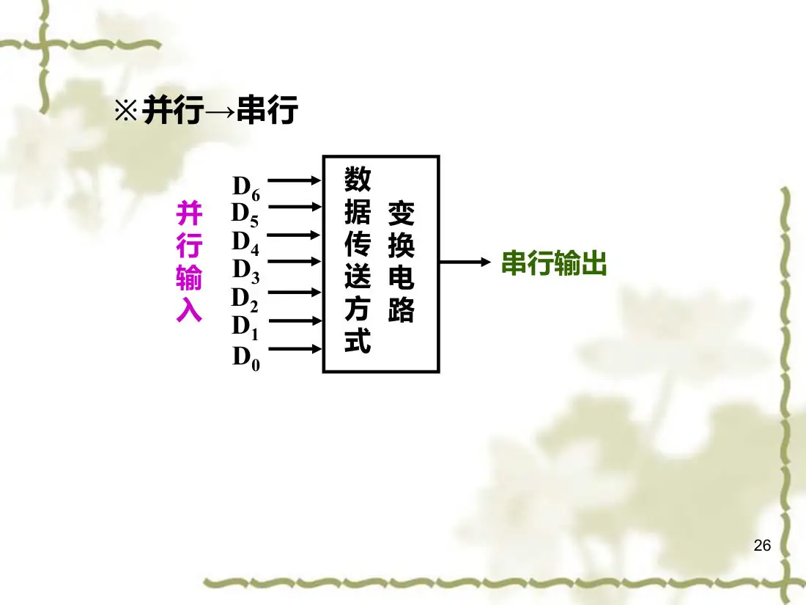

原文：

※并行→串行

并行输入

26

### 27

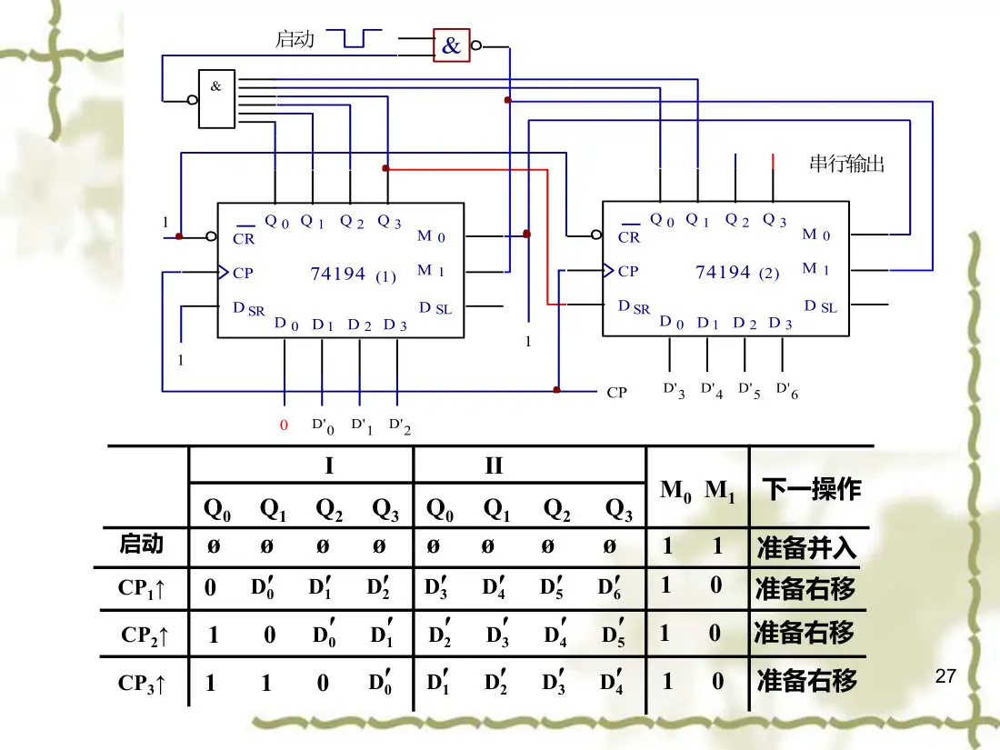

原文：

<table><tr><td rowspan="2"></td><td colspan="4">I</td><td colspan="4">II</td><td rowspan="2"> $M_0$   $M_1$ </td><td rowspan="2">下一操作</td></tr><tr><td> $Q_0$ </td><td> $Q_1$ </td><td> $Q_2$ </td><td> $Q_3$ </td><td> $Q_0$ </td><td> $Q_1$ </td><td> $Q_2$ </td><td> $Q_3$ </td></tr><tr><td>启动</td><td>∅</td><td>∅</td><td>∅</td><td>∅</td><td>∅</td><td>∅</td><td>∅</td><td>∅</td><td>1 1</td><td>准备并入</td></tr><tr><td> $CP_1\uparrow$ </td><td>0</td><td> $D'_0$ </td><td> $D'_1$ </td><td> $D'_2$ </td><td> $D'_3$ </td><td> $D'_4$ </td><td> $D'_5$ </td><td> $D'_6$ </td><td>1 0</td><td>准备右移</td></tr><tr><td> $CP_2\uparrow$ </td><td>1</td><td>0</td><td> $D'_0$ </td><td> $D'_1$ </td><td> $D'_2$ </td><td> $D'_3$ </td><td> $D'_4$ </td><td> $D'_5$ </td><td>1 0</td><td>准备右移</td></tr><tr><td> $CP_3\uparrow$ </td><td>1</td><td>1</td><td>0</td><td> $D'_0$ </td><td> $D'_1$ </td><td> $D'_2$ </td><td> $D'_3$ </td><td> $D'_4$ </td><td>1 0</td><td>准备右移</td></tr></table>

27

### 表6.4.5 7位并入—串出转换电路的状态转移表

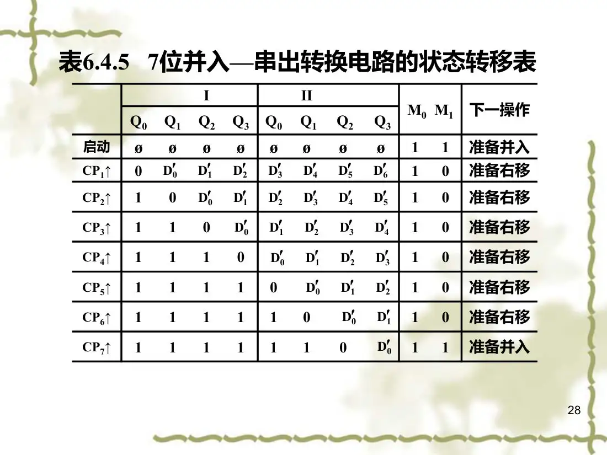

原文：

表6.4.5 7位并入—串出转换电路的状态转移表
<table><tr><td rowspan="2"></td><td colspan="4">I</td><td colspan="4">II</td><td rowspan="2"> $M_0$   $M_1$ </td><td rowspan="2">下一操作</td></tr><tr><td> $Q_0$ </td><td> $Q_1$ </td><td> $Q_2$ </td><td> $Q_3$ </td><td> $Q_0$ </td><td> $Q_1$ </td><td> $Q_2$ </td><td> $Q_3$ </td></tr><tr><td>启动</td><td>∅</td><td>∅</td><td>∅</td><td>∅</td><td>∅</td><td>∅</td><td>∅</td><td>∅</td><td>1 1</td><td>准备并入</td></tr><tr><td> $CP_1\uparrow$ </td><td>0</td><td> $D'_0$ </td><td> $D'_1$ </td><td> $D'_2$ </td><td> $D'_3$ </td><td> $D'_4$ </td><td> $D'_5$ </td><td> $D'_6$ </td><td>1 0</td><td>准备右移</td></tr><tr><td> $CP_2\uparrow$ </td><td>1</td><td>0</td><td> $D'_0$ </td><td> $D'_1$ </td><td> $D'_2$ </td><td> $D'_3$ </td><td> $D'_4$ </td><td> $D'_5$ </td><td>1 0</td><td>准备右移</td></tr><tr><td> $CP_3\uparrow$ </td><td>1</td><td>1</td><td>0</td><td> $D'_0$ </td><td> $D'_1$ </td><td> $D'_2$ </td><td> $D'_3$ </td><td> $D'_4$ </td><td>1 0</td><td>准备右移</td></tr><tr><td> $CP_4\uparrow$ </td><td>1</td><td>1</td><td>1</td><td>0</td><td> $D'_0$ </td><td> $D'_1$ </td><td> $D'_2$ </td><td> $D'_3$ </td><td>1 0</td><td>准备右移</td></tr><tr><td> $CP_5\uparrow$ </td><td>1</td><td>1</td><td>1</td><td>1</td><td>0</td><td> $D'_0$ </td><td> $D'_1$ </td><td> $D'_2$ </td><td>1 0</td><td>准备右移</td></tr><tr><td> $CP_6\uparrow$ </td><td>1</td><td>1</td><td>1</td><td>1</td><td>1</td><td>0</td><td> $D'_0$ </td><td> $D'_1$ </td><td>1 0</td><td>准备右移</td></tr><tr><td> $CP_7\uparrow$ </td><td>1</td><td>1</td><td>1</td><td>1</td><td>1</td><td>1</td><td>0</td><td> $D'_0$ </td><td>1 1</td><td>准备并入</td></tr></table>

28

### 4位右移移存器74195

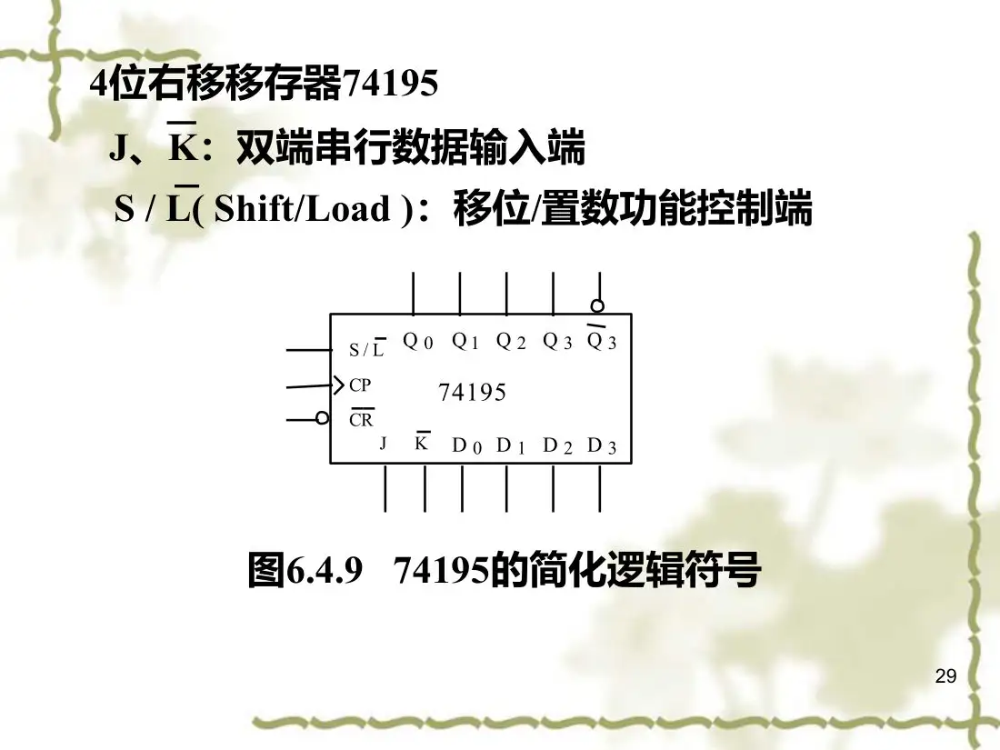

原文：

4位右移移存器74195

J、 $\overline{\mathbf{K}}$ ：双端串行数据输入端

S / L( Shift/Load ): 移位/置数功能控制端

29

### 表6.4.6 74195的功能表

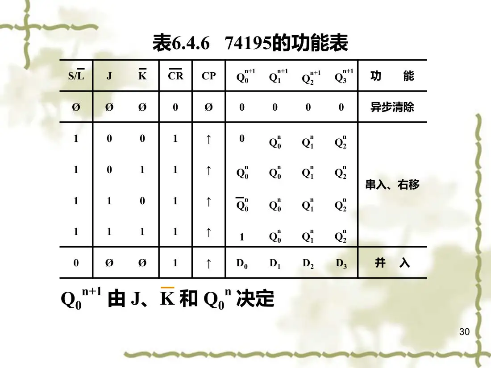

原文：

表6.4.6 74195的功能表
<table><tr><td>S/L</td><td>J</td><td>K</td><td>CR</td><td>CP</td><td> $Q_0^{n+1}$ </td><td> $Q_1^{n+1}$ </td><td> $Q_2^{n+1}$ </td><td> $Q_3^{n+1}$ </td><td>功能</td></tr><tr><td>∅</td><td>∅</td><td>∅</td><td>0</td><td>∅</td><td>0</td><td>0</td><td>0</td><td>0</td><td>异步清除</td></tr><tr><td>1</td><td>0</td><td>0</td><td>1</td><td>↑</td><td>0</td><td> $Q_0^n$ </td><td> $Q_1^n$ </td><td> $Q_2^n$ </td><td rowspan="4">串入、右移</td></tr><tr><td>1</td><td>0</td><td>1</td><td>1</td><td>↑</td><td> $Q_0^n$ </td><td> $Q_0^n$ </td><td> $Q_1^n$ </td><td> $Q_2^n$ </td></tr><tr><td>1</td><td>1</td><td>0</td><td>1</td><td>↑</td><td> $\overline{Q}_0^n$ </td><td> $Q_0^n$ </td><td> $Q_1^n$ </td><td> $Q_2^n$ </td></tr><tr><td>1</td><td>1</td><td>1</td><td>1</td><td>↑</td><td>1</td><td> $Q_0^n$ </td><td> $Q_1^n$ </td><td> $Q_2^n$ </td></tr><tr><td>0</td><td>∅</td><td>∅</td><td>1</td><td>↑</td><td> $D_0$ </td><td> $D_1$ </td><td> $D_2$ </td><td> $D_3$ </td><td>并入</td></tr></table>
$Q_{0}^{n+1}$ 由 J、K 和 $Q_{0}^{n}$ 决定

30

### 串入、并入——串出8位右移移存器74165

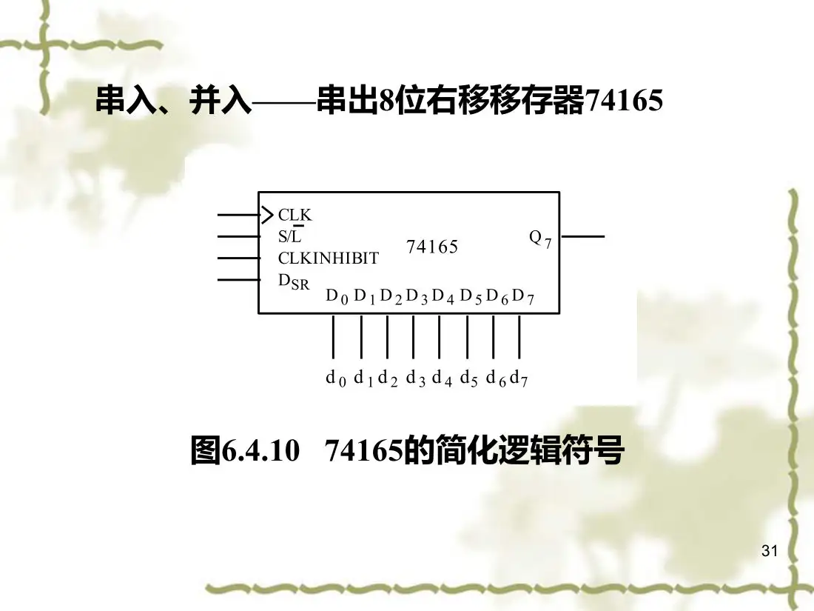

原文：

串入、并入——串出8位右移移存器74165

31

### 表6.4.7 74165的功能表

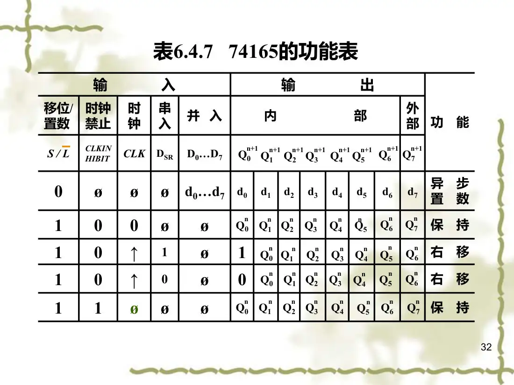

原文：

表6.4.7 74165的功能表
<table><tr><td colspan="5">输入</td><td colspan="7">输出</td><td rowspan="2">功能</td></tr><tr><td>移位/置数</td><td>时钟禁止</td><td>时钟</td><td>串入</td><td>并入</td><td colspan="6">内部</td><td>外部</td></tr><tr><td> $S/L$ </td><td>CLKINHIBIT</td><td>CLK</td><td> $D_{SR}$ </td><td> $D_0...D_7$ </td><td> $Q_0^{n+1}$ </td><td> $Q_1^{n+1}$ </td><td> $Q_2^{n+1}$ </td><td> $Q_3^{n+1}$ </td><td> $Q_4^{n+1}$ </td><td> $Q_5^{n+1}$ </td><td> $Q_6^{n+1}$ </td><td> $Q_7^{n+1}$ </td></tr><tr><td>0</td><td>∅</td><td>∅</td><td>∅</td><td> $d_0...d_7$ </td><td> $d_0$ </td><td> $d_1$ </td><td> $d_2$ </td><td> $d_3$ </td><td> $d_4$ </td><td> $d_5$ </td><td> $d_6$ </td><td> $d_7$ </td></tr><tr><td>1</td><td>0</td><td>0</td><td>∅</td><td>∅</td><td> $Q_0^n$ </td><td> $Q_1^n$ </td><td> $Q_2^n$ </td><td> $Q_3^n$ </td><td> $Q_4^n$ </td><td> $Q_5^n$ </td><td> $Q_6^n$ </td><td>保持</td></tr><tr><td>1</td><td>0</td><td>↑</td><td>1</td><td>∅</td><td>1</td><td> $Q_0^n$ </td><td> $Q_1^n$ </td><td> $Q_2^n$ </td><td> $Q_3^n$ </td><td> $Q_4^n$ </td><td> $Q_5^n$ </td><td>右移</td></tr><tr><td>1</td><td>0</td><td>↑</td><td>0</td><td>∅</td><td>0</td><td> $Q_0^n$ </td><td> $Q_1^n$ </td><td> $Q_2^n$ </td><td> $Q_3^n$ </td><td> $Q_4^n$ </td><td> $Q_5^n$ </td><td>右移</td></tr><tr><td>1</td><td>1</td><td>∅</td><td>∅</td><td>∅</td><td> $Q_0^n$ </td><td> $Q_1^n$ </td><td> $Q_2^n$ </td><td> $Q_3^n$ </td><td> $Q_4^n$ </td><td> $Q_5^n$ </td><td> $Q_6^n$ </td><td>保持</td></tr></table>

32

### 6.5 在下图基础上增加一片74194或DFF构成8位并行→串行码的转换电路。

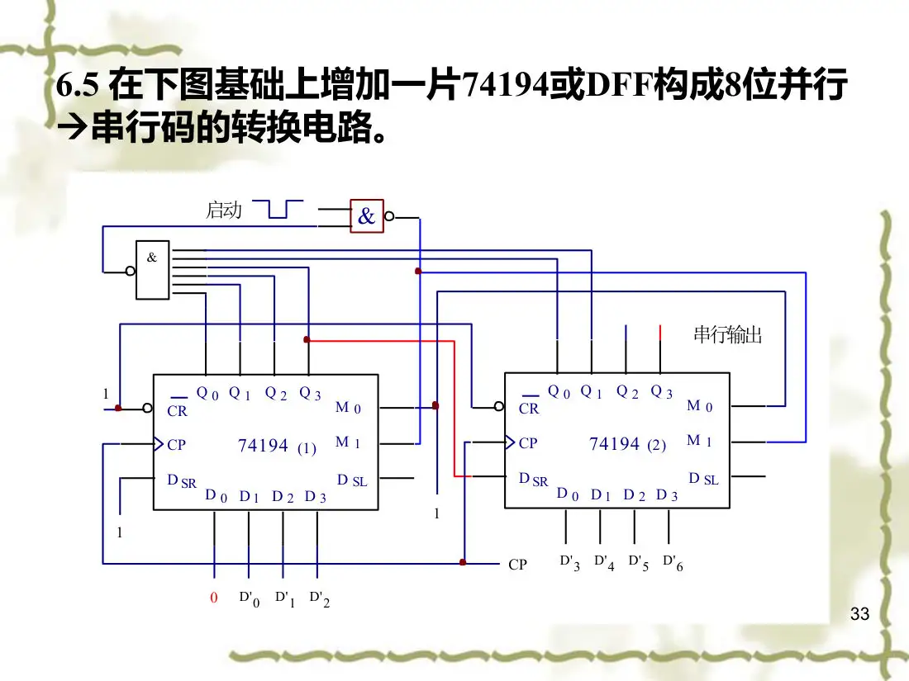

原文：

6.5 在下图基础上增加一片74194或DFF构成8位并行→串行码的转换电路。

33

### 触发器输出作 $Q_{0}^{\prime}$

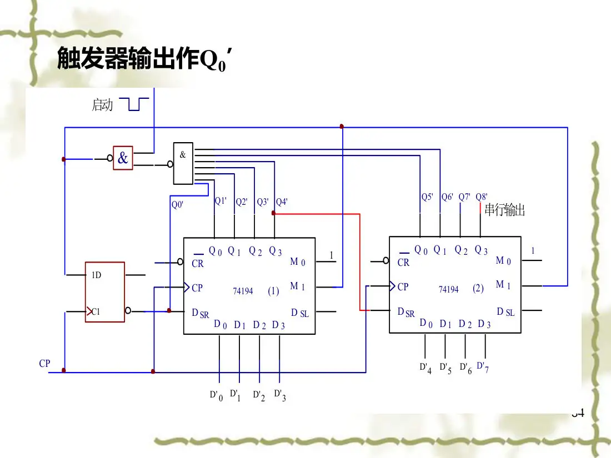

原文：

触发器输出作 $Q_{0}^{\prime}$

### 状态转移表:

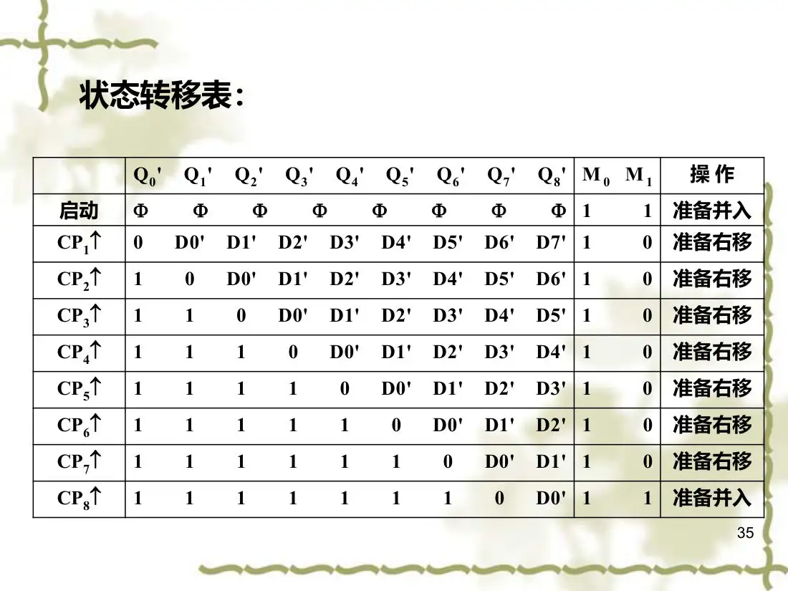

原文：

状态转移表:

<table><tr><td></td><td> $Q_{0}'$ </td><td> $Q_{1}'$ </td><td> $Q_{2}'$ </td><td> $Q_{3}'$ </td><td> $Q_{4}'$ </td><td> $Q_{5}'$ </td><td> $Q_{6}'$ </td><td> $Q_{7}'$ </td><td> $Q_{8}'$ </td><td> $M_{0}$ </td><td> $M_{1}$ </td><td>操作</td></tr><tr><td>启动</td><td> $\Phi$ </td><td> $\Phi$ </td><td> $\Phi$ </td><td> $\Phi$ </td><td> $\Phi$ </td><td> $\Phi$ </td><td> $\Phi$ </td><td> $\Phi$ </td><td> $\Phi$ </td><td>1</td><td>1</td><td>准备并入</td></tr><tr><td> $CP_{1}\uparrow$ </td><td>0</td><td>D0&#x27;</td><td>D1&#x27;</td><td>D2&#x27;</td><td>D3&#x27;</td><td>D4&#x27;</td><td>D5&#x27;</td><td>D6&#x27;</td><td>D7&#x27;</td><td>1</td><td>0</td><td>准备右移</td></tr><tr><td> $CP_{2}\uparrow$ </td><td>1</td><td>0</td><td>D0&#x27;</td><td>D1&#x27;</td><td>D2&#x27;</td><td>D3&#x27;</td><td>D4&#x27;</td><td>D5&#x27;</td><td>D6&#x27;</td><td>1</td><td>0</td><td>准备右移</td></tr><tr><td> $CP_{3}\uparrow$ </td><td>1</td><td>1</td><td>0</td><td>D0&#x27;</td><td>D1&#x27;</td><td>D2&#x27;</td><td>D3&#x27;</td><td>D4&#x27;</td><td>D5&#x27;</td><td>1</td><td>0</td><td>准备右移</td></tr><tr><td> $CP_{4}\uparrow$ </td><td>1</td><td>1</td><td>1</td><td>0</td><td>D0&#x27;</td><td>D1&#x27;</td><td>D2&#x27;</td><td>D3&#x27;</td><td>D4&#x27;</td><td>1</td><td>0</td><td>准备右移</td></tr><tr><td> $CP_{5}\uparrow$ </td><td>1</td><td>1</td><td>1</td><td>1</td><td>0</td><td>D0&#x27;</td><td>D1&#x27;</td><td>D2&#x27;</td><td>D3&#x27;</td><td>1</td><td>0</td><td>准备右移</td></tr><tr><td> $CP_{6}\uparrow$ </td><td>1</td><td>1</td><td>1</td><td>1</td><td>1</td><td>0</td><td>D0&#x27;</td><td>D1&#x27;</td><td>D2&#x27;</td><td>1</td><td>0</td><td>准备右移</td></tr><tr><td> $CP_{7}\uparrow$ </td><td>1</td><td>1</td><td>1</td><td>1</td><td>1</td><td>1</td><td>0</td><td>D0&#x27;</td><td>D1&#x27;</td><td>1</td><td>0</td><td>准备右移</td></tr><tr><td> $CP_{8}\uparrow$ </td><td>1</td><td>1</td><td>1</td><td>1</td><td>1</td><td>1</td><td>1</td><td>0</td><td>D0&#x27;</td><td>1</td><td>1</td><td>准备并入</td></tr></table>

35

### 作业题

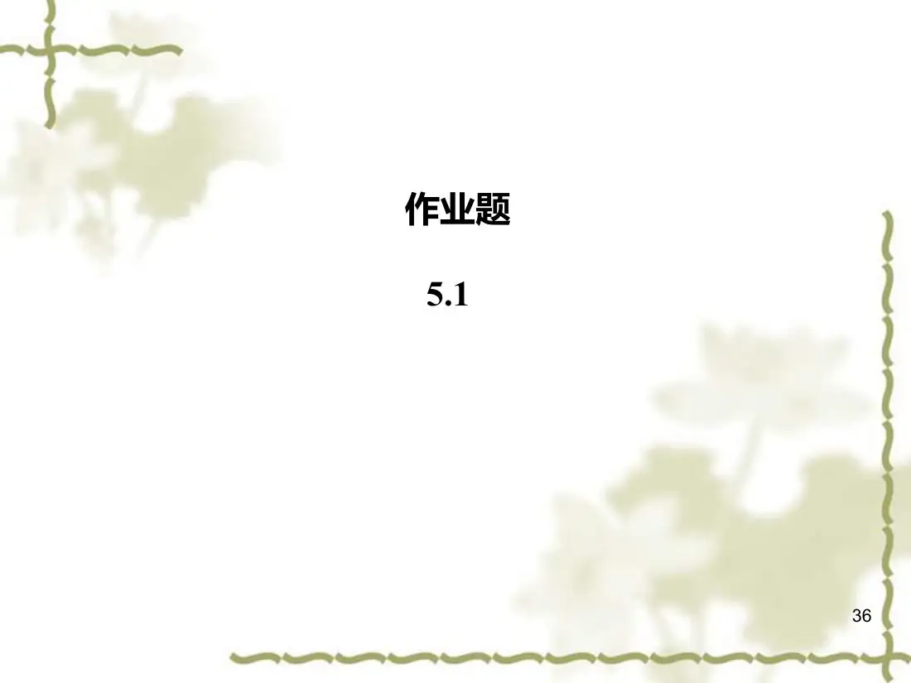

原文：

作业题

5.1
