# 《数字电路与系统设计》第5章 触发器逻辑功能的转换（课件）

原件的每一页，下面附识别出的文字。

### 5.6 触发器逻辑功能的转换

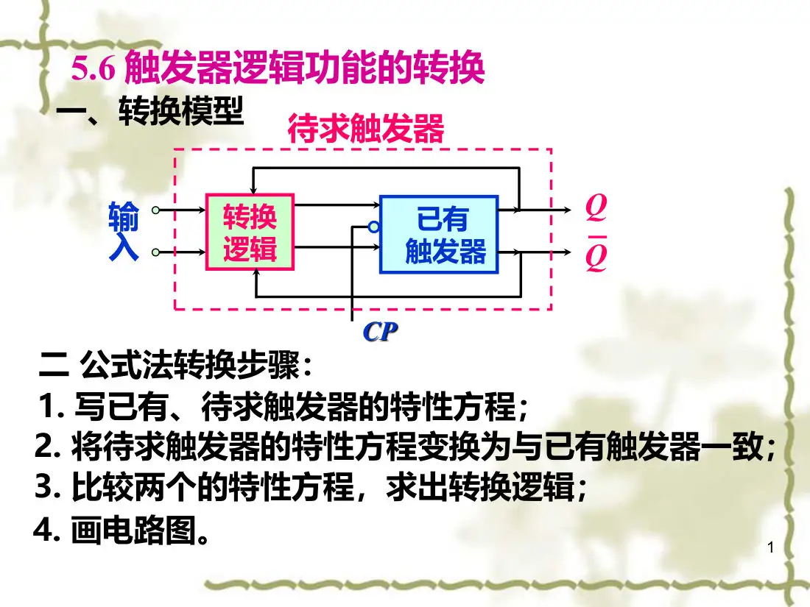

原文：

5.6 触发器逻辑功能的转换

一、转换模型

待求触发器

二 公式法转换步骤：

1. 写已有、待求触发器的特性方程;

2. 将待求触发器的特性方程变换为与已有触发器一致;

3. 比较两个的特性方程，求出转换逻辑；

4. 画电路图。

1

### 例5.6.1 试将JKFF转换成DFF。

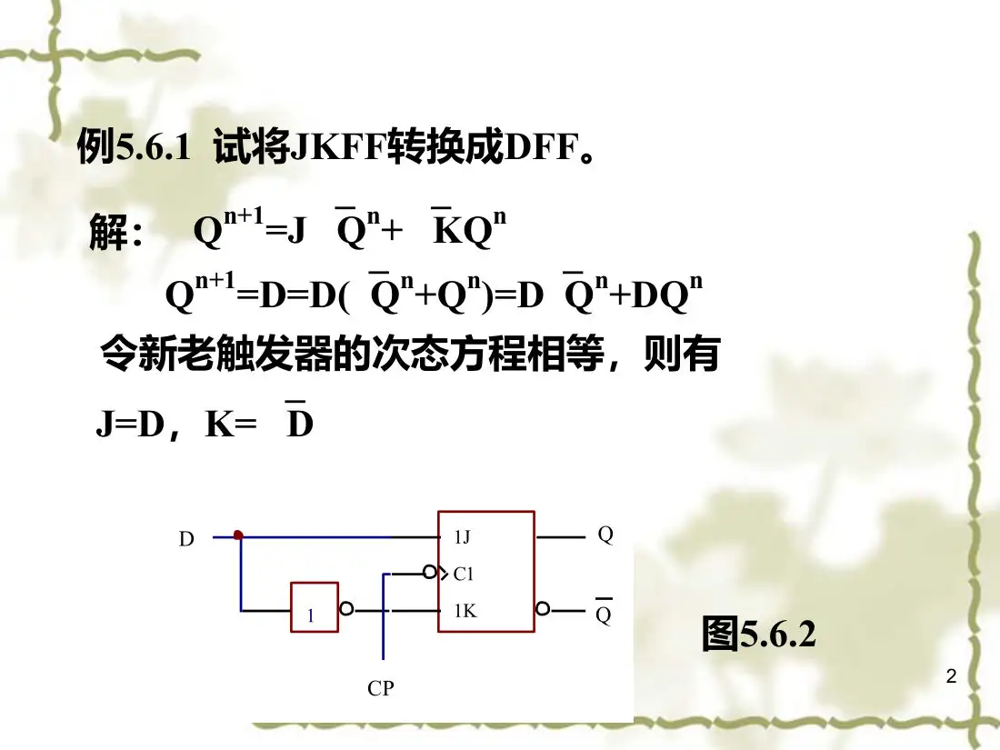

原文：

例5.6.1 试将JKFF转换成DFF。

解： $Q^{n+1}=J\quad\overline{Q}^{n}+\quad\overline{K}Q^{n}$

$$
\mathbf {Q} ^ {\mathrm{n+1}} = \mathbf {D} = \mathbf {D} (\overline {{\mathbf {Q}}} ^ {\mathrm{n}} + \mathbf {Q} ^ {\mathrm{n}}) = \mathbf {D} \overline {{\mathbf {Q}}} ^ {\mathrm{n}} + \mathbf {D} \mathbf {Q} ^ {\mathrm{n}}
$$

令新老触发器的次态方程相等，则有
J=D, K= $\overline{D}$

2

### 例：将SRFF转换成DFF。

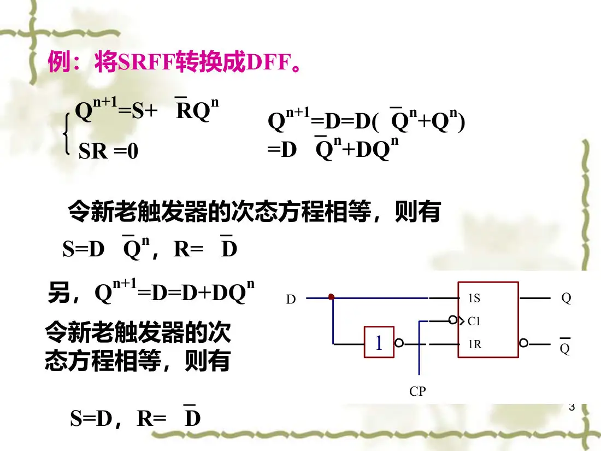

原文：

例：将SRFF转换成DFF。

$$
\left\{ \begin{array}{l l} \mathbf {Q} ^ {\mathrm{n+1}} = \mathbf {S} + \overline {{\mathbf {R}}} \mathbf {Q} ^ {\mathrm{n}} & \mathbf {Q} ^ {\mathrm{n+1}} = \mathbf {D} = \mathbf {D} (\overline {{\mathbf {Q}}} ^ {\mathrm{n}} + \mathbf {Q} ^ {\mathrm{n}}) \\ \mathbf {S R} = \mathbf {0} & = \mathbf {D} \overline {{\mathbf {Q}}} ^ {\mathrm{n}} + \mathbf {D Q} ^ {\mathrm{n}} \end{array} \right.
$$

令新老触发器的次态方程相等，则有

$$
\mathbf {S} = \mathbf {D} \quad \overline {{\mathbf {Q}}} ^ {\mathrm{n}}, \quad \mathbf {R} = \overline {{\mathbf {D}}}
$$

另， $Q^{n+1}=D=D+DQ^{n}$

令新老触发器的次态方程相等，则有

$$
\mathbf {S} = \mathbf {D}, \quad \mathbf {R} = \overline {{\mathbf {D}}}
$$

### 三、列表图解法

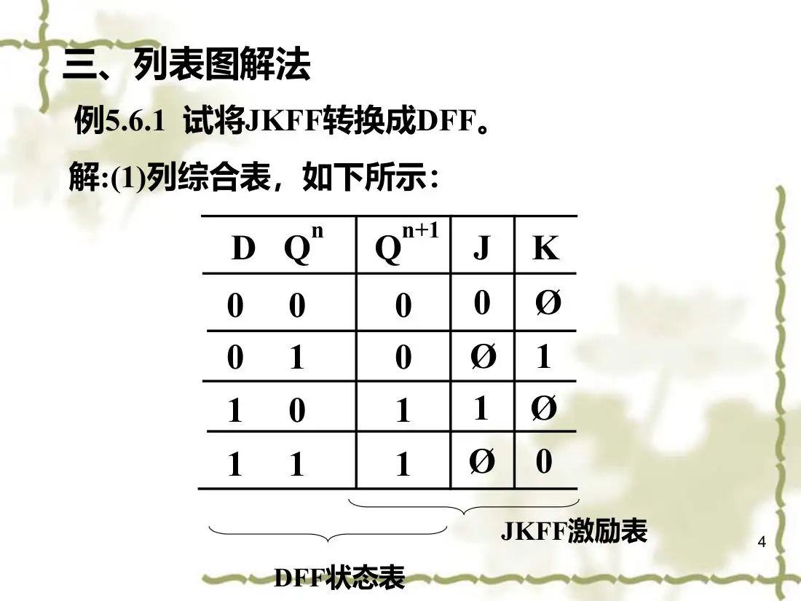

原文：

三、列表图解法

例5.6.1 试将JKFF转换成DFF。

解:(1)列综合表，如下所示:

<table><tr><td>D</td><td> $Q^{n}$ </td><td> $Q^{n+1}$ </td><td>J</td><td>K</td></tr><tr><td>0</td><td>0</td><td>0</td><td>0</td><td>∅</td></tr><tr><td>0</td><td>1</td><td>0</td><td>∅</td><td>1</td></tr><tr><td>1</td><td>0</td><td>1</td><td>1</td><td>∅</td></tr><tr><td>1</td><td>1</td><td>1</td><td>∅</td><td>0</td></tr></table>

DFF状态表

4

### (2)作卡诺图，如下图所示

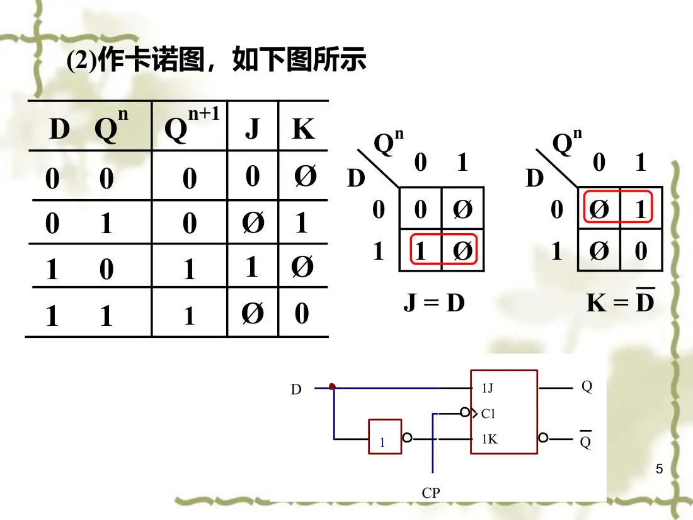

原文：

(2)作卡诺图，如下图所示

<table><tr><td>D</td><td> $Q^{n}$ </td><td> $Q^{n+1}$ </td><td>J</td><td>K</td></tr><tr><td>0</td><td>0</td><td>0</td><td>0</td><td>∅</td></tr><tr><td>0</td><td>1</td><td>0</td><td>∅</td><td>1</td></tr><tr><td>1</td><td>0</td><td>1</td><td>1</td><td>∅</td></tr><tr><td>1</td><td>1</td><td>1</td><td>∅</td><td>0</td></tr></table>

$$
\begin{array}{c c c} \mathbf {Q} ^ {\mathrm{n}} & 0 & 1 \\ \hline D & 0 & \emptyset \\ 0 & 0 & \emptyset \\ 1 & 1 & \emptyset \end{array}
$$

$\mathbf{J} = \mathbf{D}$

$$
\begin{array}{c c c} \mathbf {Q} ^ {\mathrm{n}} & 0 & 1 \\ \hline \mathbf {D} & 0 & 0 \\ 0 & \emptyset & 1 \\ 1 & \emptyset & 0 \end{array}
$$

$\mathbf{K} = \overline{\mathbf{D}}$

CP

5

### 结：触发器根据逻辑功能不同分为

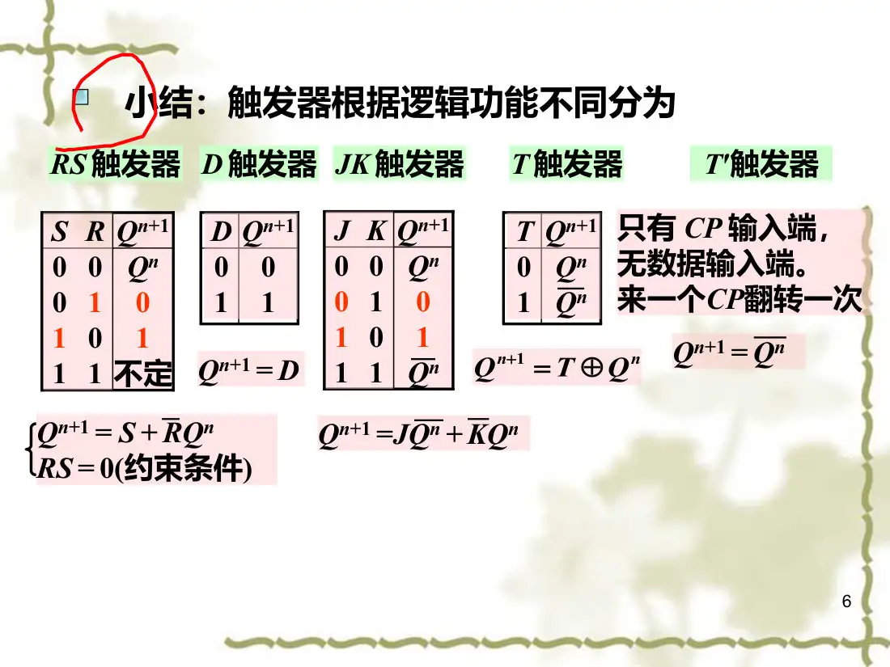

原文：

结：触发器根据逻辑功能不同分为

RS 触发器

D 触发器

JK 触发器

$$
\begin{array}{c c c} \hline S & R & Q ^ {n + 1} \\ \hline 0 & 0 & Q ^ {n} \\ 0 & 1 & 0 \\ 1 & 0 & 1 \\ 1 & 1 & \text {不定} \end{array}
$$

T触发器

$\left\{ \begin{array}{l} Q^{n + 1} = S + \overline{R} Q^n \\ RS = 0 \text{(约束条件)} \end{array} \right.$

$$
\begin{array}{c c} \hline D & Q ^ {n + 1} \\ \hline 0 & 0 \\ 1 & 1 \end{array}
$$

$$
Q ^ {n + 1} = D
$$

T'触发器

$$
\begin{array}{c c c} \hline J & K & Q ^ {n + 1} \\ \hline 0 & 0 & Q ^ {n} \\ 0 & 1 & 0 \\ 1 & 0 & 1 \\ 1 & 1 & \overline {{Q ^ {n}}} \\ \hline \end{array}
$$

$$
\begin{array}{c c} \hline T & Q ^ {n + 1} \\ \hline 0 & \underline {{Q ^ {n}}} \\ 1 & \overline {{Q ^ {n}}} \\ \hline \end{array}
$$

$$
Q ^ {n + 1} = T \oplus Q ^ {n}
$$

$$
Q ^ {n + 1} = J \overline {{Q ^ {n}}} + \overline {{K}} Q ^ {n}
$$

只有 CP 输入端，
无数据输入端。
来一个CP翻转一次

$$
Q ^ {n + 1} = \overline {{Q ^ {n}}}
$$

6

### 5.1 基本触发器的逻辑符号与输入波形如图P5.1所示。试作出Q、Q的波形。

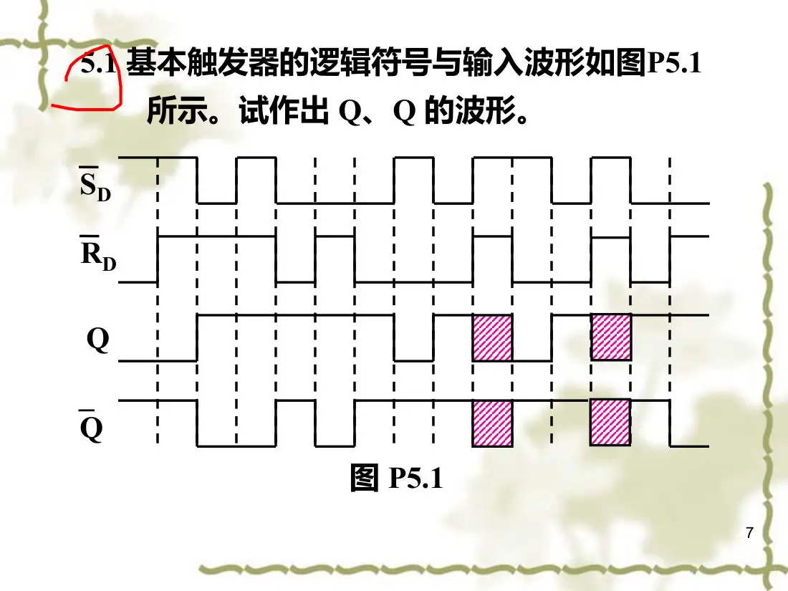

原文：

5.1 基本触发器的逻辑符号与输入波形如图P5.1所示。试作出Q、Q的波形。

7

### 第 8 页

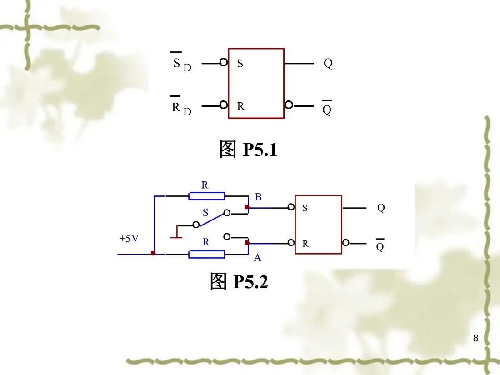

原文：

8

### 第 9 页

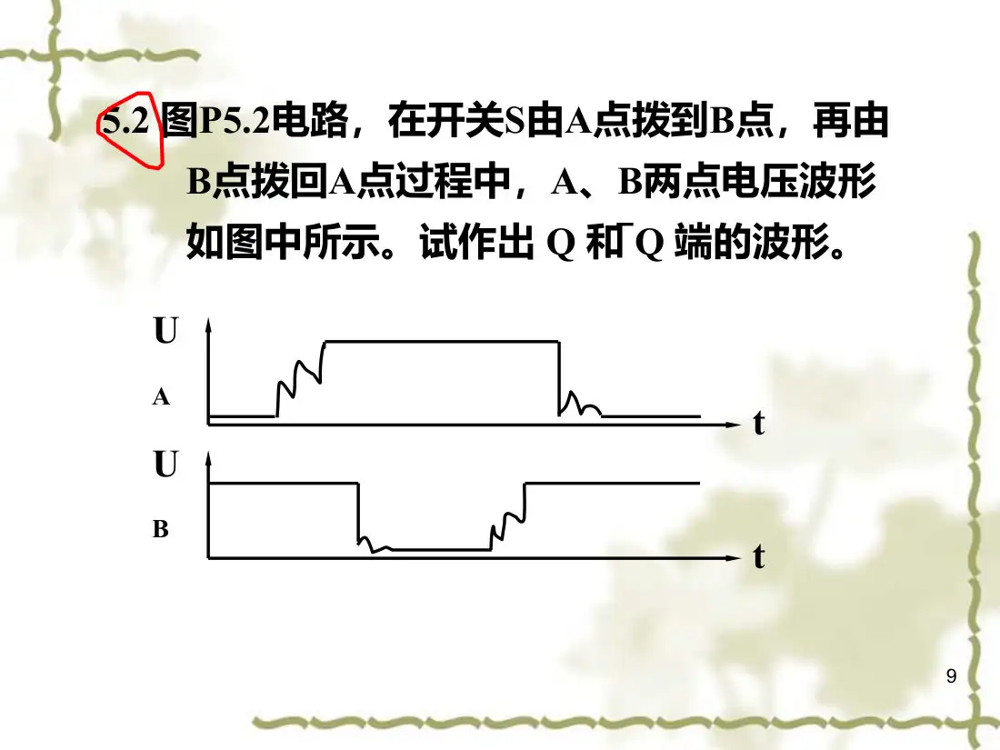

原文：

5.2 图P5.2电路，在开关S由A点拨到B点，再由B点拨回A点过程中，A、B两点电压波形如图中所示。试作出Q和Q端的波形。

### 第 10 页

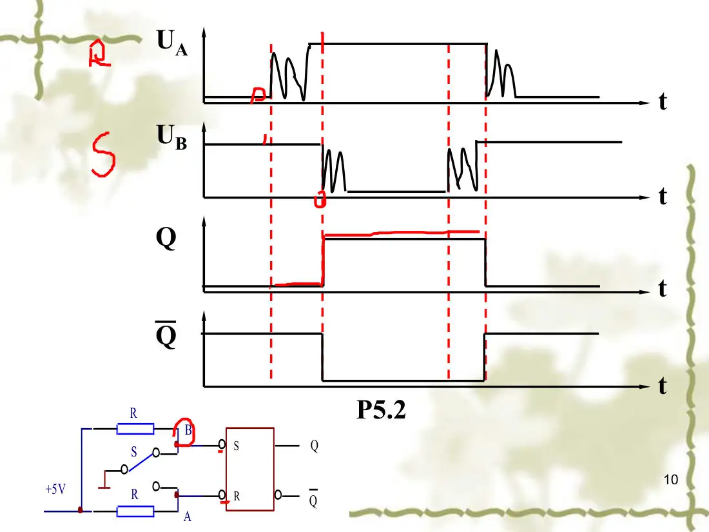

### 解：(1)列功能表如下

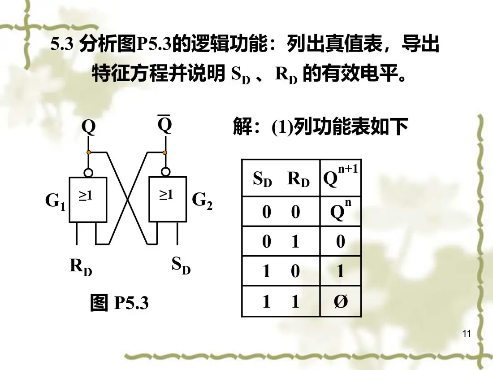

原文：

5.3 分析图P5.3的逻辑功能：列出真值表，导出特征方程并说明 $S_{D}$ 、 $R_{D}$ 的有效电平。

解：(1)列功能表如下

<table><tr><td> $S_D$   $R_D$ </td><td> $Q^{n+1}$ </td></tr><tr><td>0 0</td><td> $Q^n$ </td></tr><tr><td>0 1</td><td>0</td></tr><tr><td>1 0</td><td>1</td></tr><tr><td>1 1</td><td>∅</td></tr></table>

11

### (2)求特征方程

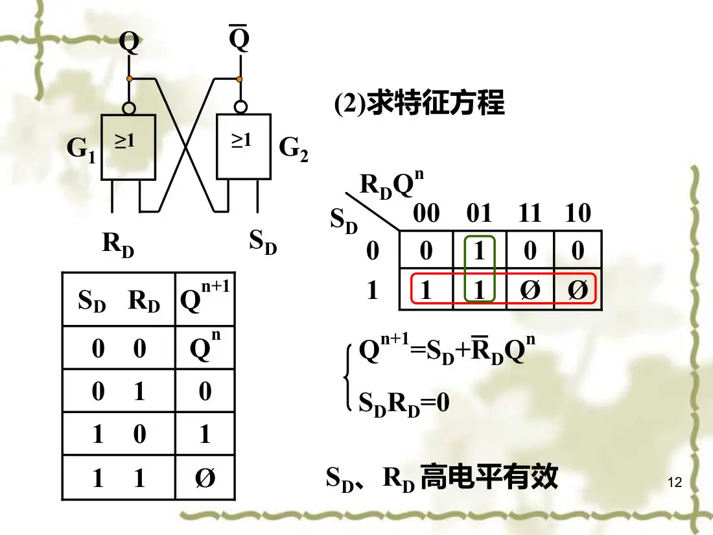

原文：

<table><tr><td> $S_D$   $R_D$ </td><td> $Q^{n+1}$ </td></tr><tr><td>0 0</td><td> $Q^n$ </td></tr><tr><td>0 1</td><td>0</td></tr><tr><td>1 0</td><td>1</td></tr><tr><td>1 1</td><td>∅</td></tr></table>

(2)求特征方程

$$
\left\{ \begin{array}{l} \mathbf {Q} ^ {\mathrm{n+1}} = \mathbf {S _ {D}} + \overline {{\mathbf {R}}} _ {\mathrm{D}} \mathbf {Q} ^ {\mathrm{n}} \\ \mathbf {S _ {D}} \mathbf {R _ {D}} = \mathbf {0} \end{array} \right.
$$

$S_{D}$ 、 $R_{D}$ 高电平有效

12

### 5.4 对于图P5.4电路,试导出其特征方程并说明对

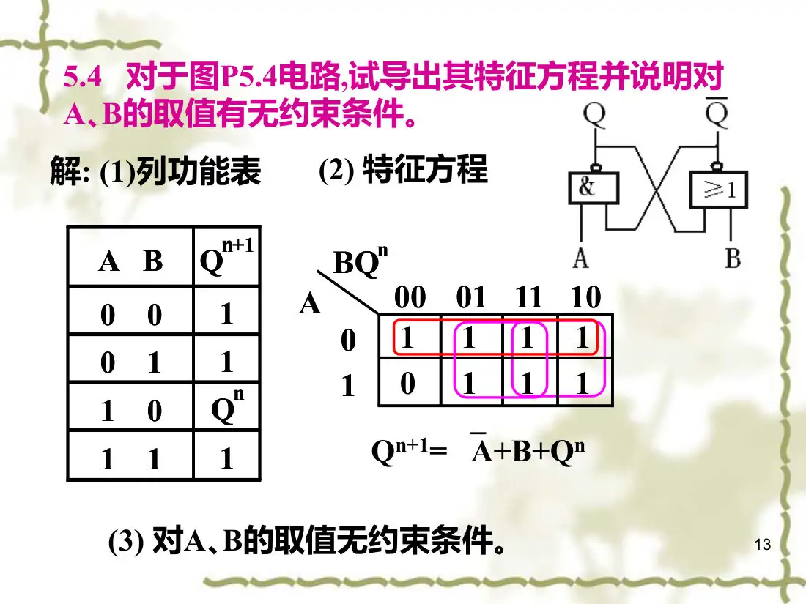

原文：

5.4 对于图P5.4电路,试导出其特征方程并说明对

A、B的取值有无约束条件。

解: (1)列功能表

<table><tr><td>A B</td><td> $Q^{n+1}$ </td></tr><tr><td>0 0</td><td>1</td></tr><tr><td>0 1</td><td>1</td></tr><tr><td>1 0</td><td> $Q^n$ </td></tr><tr><td>1 1</td><td>1</td></tr></table>

(2) 特征方程

A

B

$$
\mathbf {Q} ^ {\mathrm{n+1}} = \overline {{\mathbf {A}}} + \mathbf {B} + \mathbf {Q} ^ {\mathrm{n}}
$$

(3) 对A、B的取值无约束条件。

13

### 5.5 试写出图P5.5触发器电路的特征方程。

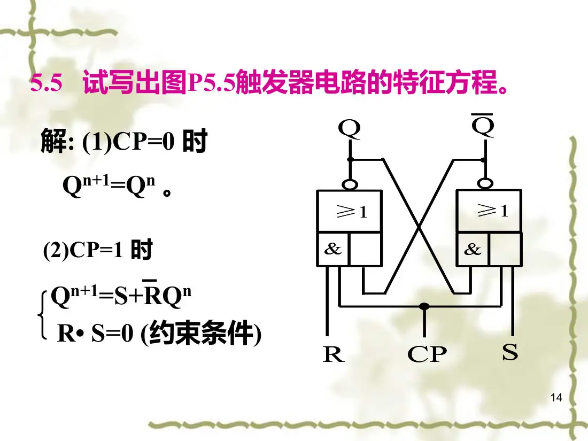

原文：

5.5 试写出图P5.5触发器电路的特征方程。

解: (1) CP=0 时 $Q^{n+1}=Q^{n}$

(2) $\mathrm{CP} = 1$ 时

$\left\{ \begin{array}{l} Q^{n+1} = S + \overline{R} Q^n \\ R \cdot S = 0 \text{(约束条件)} \end{array} \right.$

14

### 5.8 维阻DFF构成的电路如图，试作Q端波形

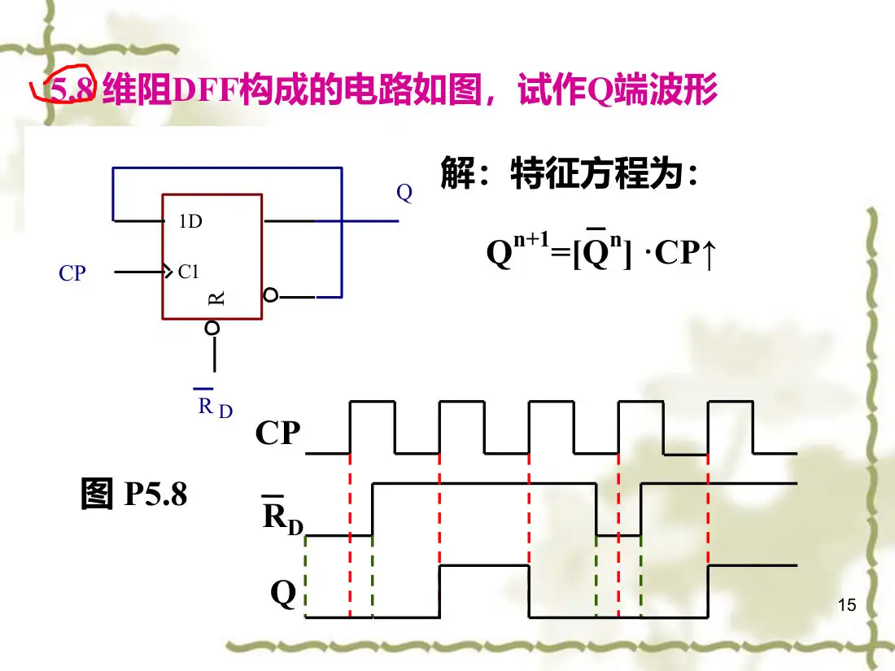

原文：

5.8 维阻DFF构成的电路如图，试作Q端波形

解：特征方程为：

$$
\mathbf {Q} ^ {\mathrm{n+1}} = [ \overline {{\mathbf {Q}}} ^ {\mathrm{n}} ] \cdot \mathbf {C P} \uparrow
$$

15

### 5.10 画出图P5.10中Q端的波形。设初态为 “0”

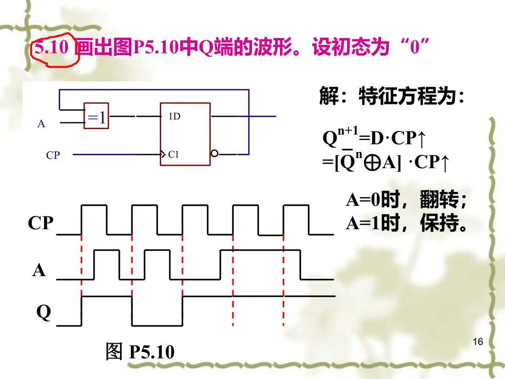

原文：

5.10 画出图P5.10中Q端的波形。设初态为 “0”

解：特征方程为：

$$
\begin{array}{l} \mathbf {Q} ^ {\mathrm{n+1}} = \mathbf {D} \cdot \mathbf {C P} \uparrow \\ = [ \overline {{\mathbf {Q}}} ^ {\mathrm{n}} \oplus \mathbf {A} ] \cdot \mathbf {C P} \uparrow \end{array}
$$

A=0时，翻转；
A=1时，保持。

16

### 5.11 画出图P5.11电路Q端的波形。设初态为 “0”

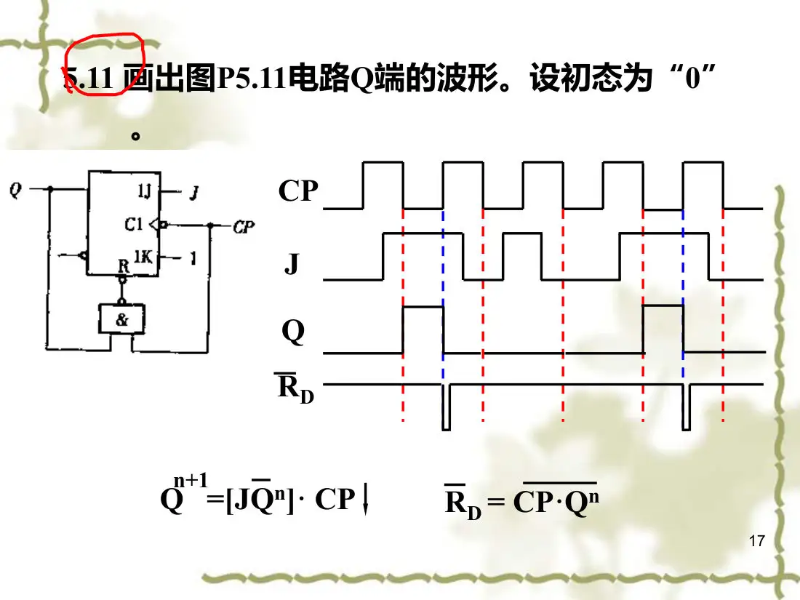

原文：

5.11 画出图P5.11电路Q端的波形。设初态为 “0”

$$
\mathbf {Q} ^ {\mathrm{n+1}} = [ \mathbf {J} \overline {{\mathbf {Q}}} ^ {\mathrm{n}} ] \cdot \mathbf {C P} \downarrow
$$

$$
\overline {{\mathbf {R}}} _ {\mathrm{D}} = \overline {{\mathbf {C P} \cdot \mathbf {Q} ^ {\mathrm{n}}}}
$$

17

### 5.12 画出图P5.12电路中 $Q_{1} 、 Q_{2}$ 的波形。

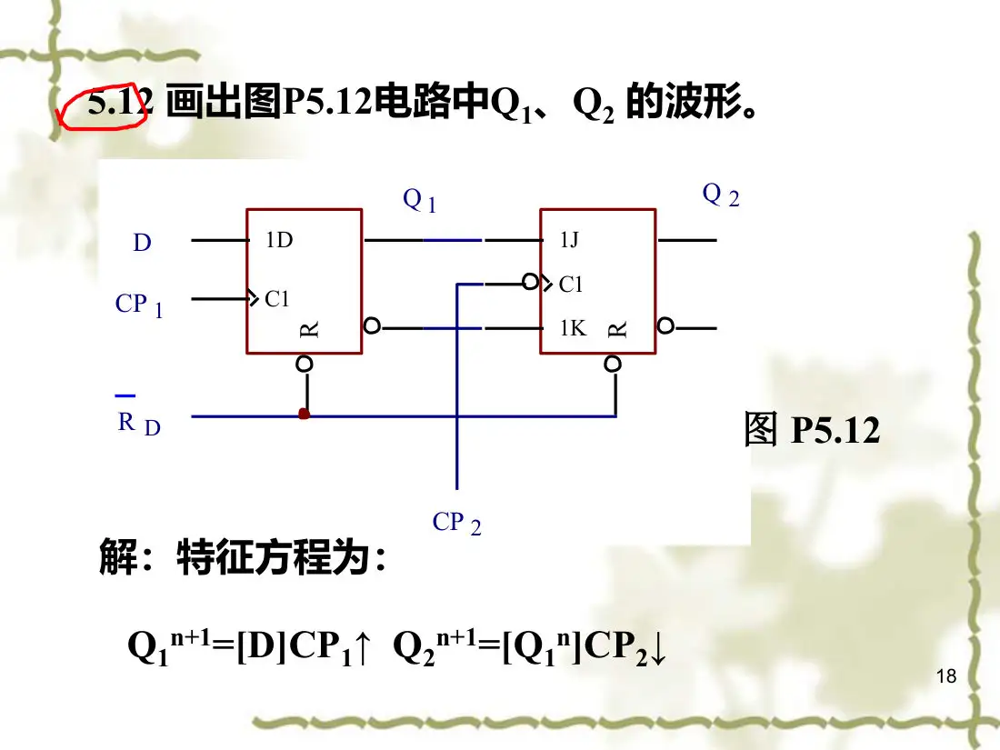

原文：

5.12 画出图P5.12电路中 $Q_{1} 、 Q_{2}$ 的波形。

$$
\mathbf {Q} _ {1} ^ {\mathrm{n+1}} = [ \mathbf {D} ] \mathbf {C P} _ {1} \uparrow \quad \mathbf {Q} _ {2} ^ {\mathrm{n+1}} = [ \mathbf {Q} _ {1} ^ {\mathrm{n}} ] \mathbf {C P} _ {2} \downarrow
$$

18

### $$

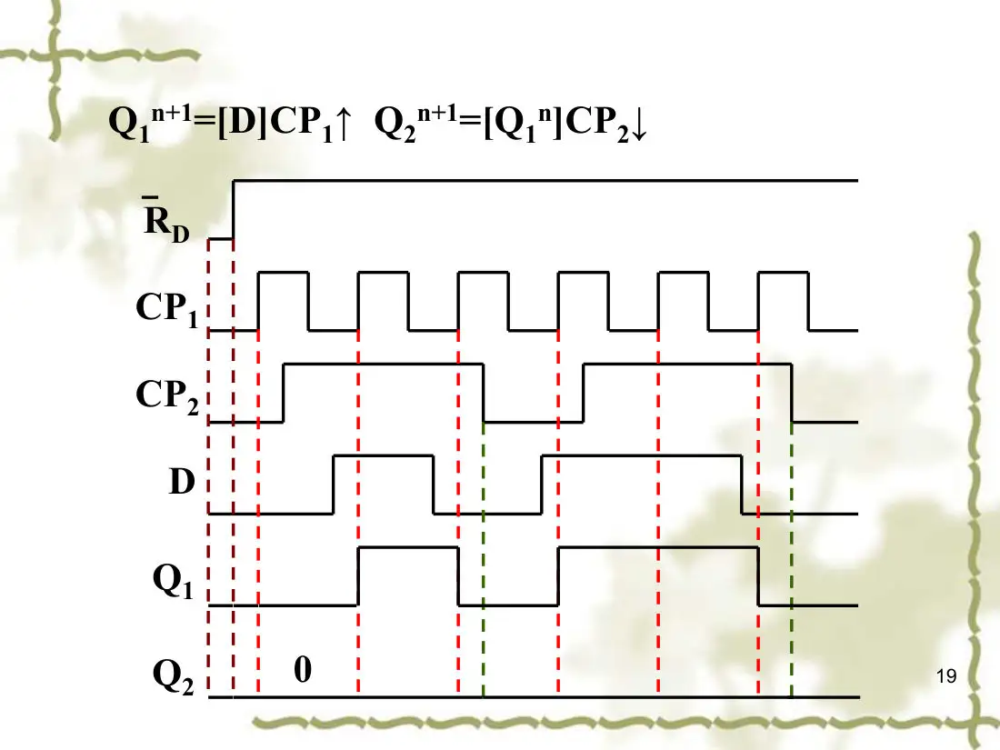

原文：

$$
\mathbf {Q} _ {1} ^ {\mathrm{n+1}} = [ \mathbf {D} ] \mathbf {C P} _ {1} \uparrow \quad \mathbf {Q} _ {2} ^ {\mathrm{n+1}} = [ \mathbf {Q} _ {1} ^ {\mathrm{n}} ] \mathbf {C P} _ {2} \downarrow
$$

### 5.13 画出图P5.13电路中 $Q_{1}$ 和 $Q_{2}$ 的波形。

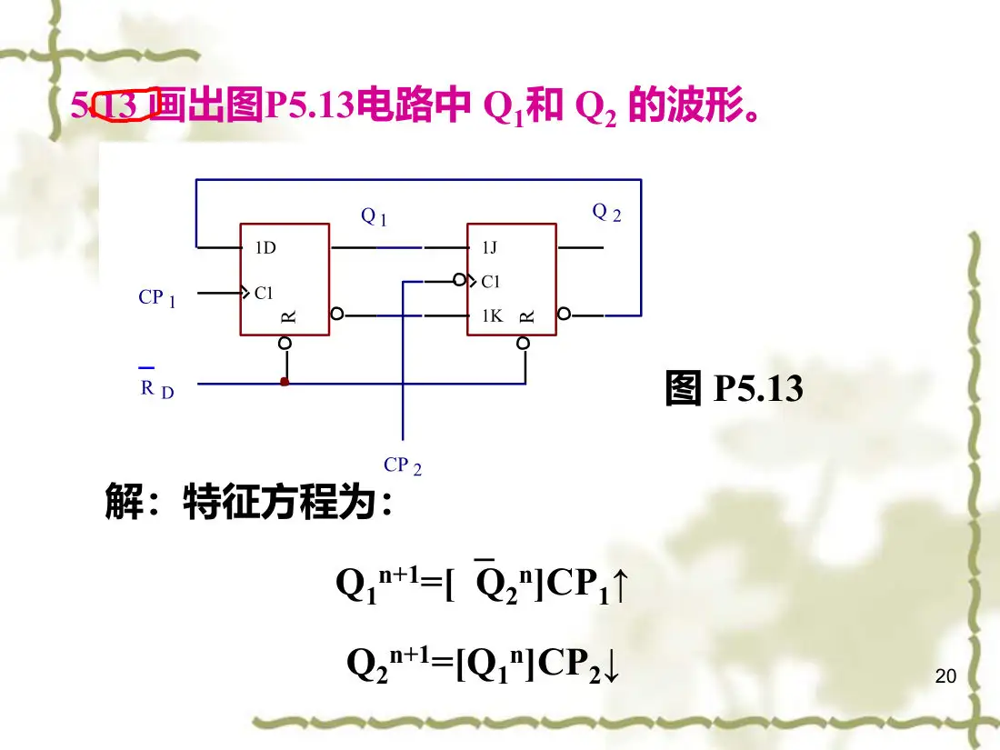

原文：

5.13 画出图P5.13电路中 $Q_{1}$ 和 $Q_{2}$ 的波形。

$$
\mathbf {Q} _ {1} ^ {\mathrm{n+1}} = [ \overline {{\mathbf {Q}}} _ {2} ^ {\mathrm{n}} ] \mathbf {C P} _ {1} \uparrow
$$

$$
\mathbf {Q} _ {2} ^ {\mathrm{n+1}} = [ \mathbf {Q} _ {1} ^ {\mathrm{n}} ] \mathbf {C P} _ {2} \downarrow
$$

20

### $$

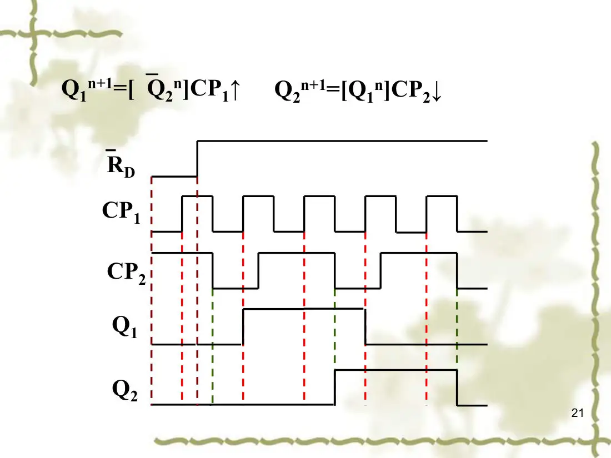

原文：

$$
\mathbf {Q} _ {1} ^ {\mathrm{n+1}} = [ \overline {{\mathbf {Q}}} _ {2} ^ {\mathrm{n}} ] \mathbf {C P} _ {1} \uparrow \quad \mathbf {Q} _ {2} ^ {\mathrm{n+1}} = [ \mathbf {Q} _ {1} ^ {\mathrm{n}} ] \mathbf {C P} _ {2} \downarrow
$$

21

### (5.14)试作出图P5.14中Q端和Z端的波形。设Q的初态为“0”。

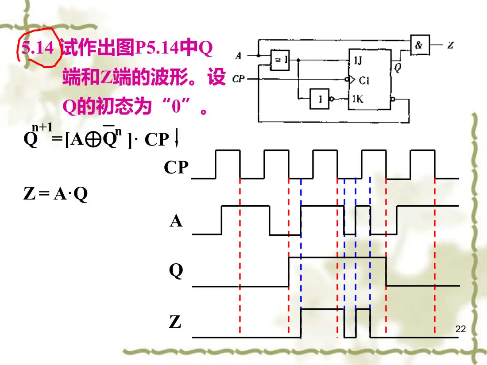

原文：

(5.14)试作出图P5.14中Q端和Z端的波形。设Q的初态为“0”。

$$
\mathbf {Q} ^ {\mathrm{n+1}} = [ \mathbf {A} \oplus \overline {{\mathbf {Q}}} ^ {\mathrm{n}} ] \cdot \mathbf {C P} \downarrow
$$

$$
\mathbf {Z} = \mathbf {A} \cdot \mathbf {Q}
$$

### (5.17) 试作出图P5.17电路中 $Q_{1} 、 Q_{2}$ 的波形。

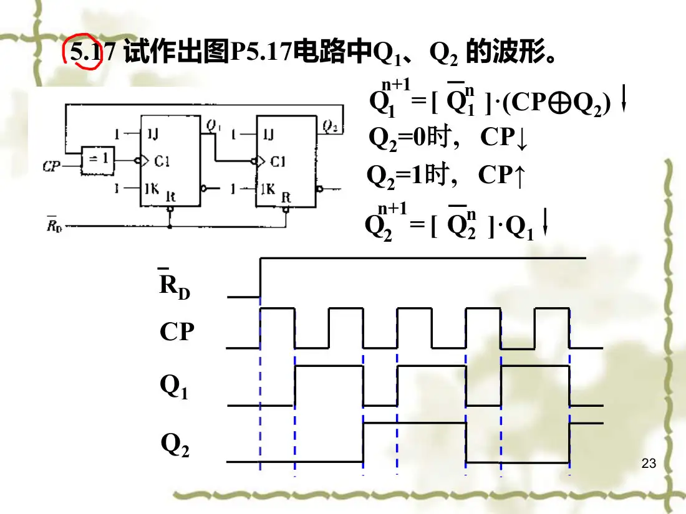

原文：

(5.17) 试作出图P5.17电路中 $Q_{1} 、 Q_{2}$ 的波形。

$$
\mathbf {Q} _ {1} ^ {\mathrm{n+1}} = [ \overline {{\mathbf {Q}}} _ {1} ^ {\mathrm{n}} ] \cdot (\mathbf {C P} \oplus \mathbf {Q} _ {2}) \downarrow
$$

$$
\mathbf {Q} _ {2} = \mathbf {0} \text {时，} \mathbf {C P} \downarrow
$$

$$
\mathbf {Q} _ {2} = \mathbf {1} \text {时,} \mathbf {C P} \uparrow
$$

$$
\mathbf {Q} _ {2} ^ {\mathrm{n+1}} = [ \overline {{\mathbf {Q}}} _ {2} ^ {\mathrm{n}} ] \cdot \mathbf {Q} _ {1} \downarrow
$$

23

### $$

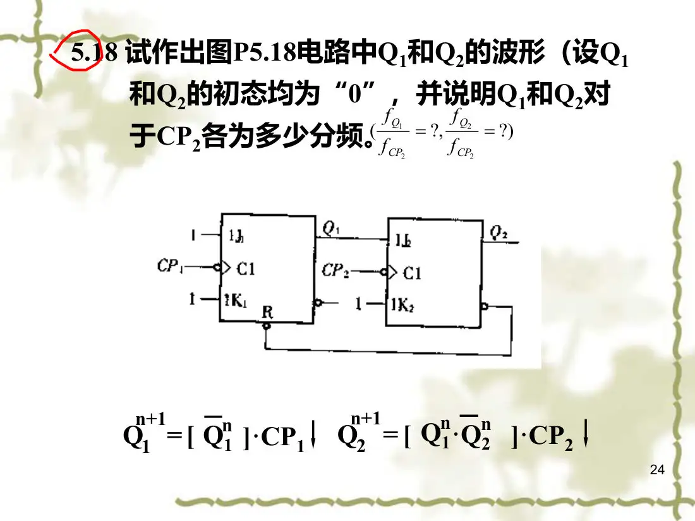

原文：

5.18 试作出图P5.18电路中 $Q_{1}$ 和 $Q_{2}$ 的波形（设 $Q_{1}$ 和 $Q_{2}$ 的初态均为“0”，并说明 $Q_{1}$ 和 $Q_{2}$ 对于 $CP_{2}$ 各为多少分频。 $\left(\frac{f_{Q_{1}}}{f_{CP_{2}}} = ?,\frac{f_{Q_{2}}}{f_{CP_{2}}} = ?\right)$

$$
\mathbf {Q} _ {1} ^ {\mathrm{n+1}} = [ \overline {{\mathbf {Q}}} _ {1} ^ {\mathrm{n}} ] \cdot \mathbf {C P} _ {1} \downarrow \quad \mathbf {Q} _ {2} ^ {\mathrm{n+1}} = [ \mathbf {Q} _ {1} ^ {\mathrm{n}} \cdot \overline {{\mathbf {Q}}} _ {2} ^ {\mathrm{n}} ] \cdot \mathbf {C P} _ {2} \downarrow
$$

24

### 25

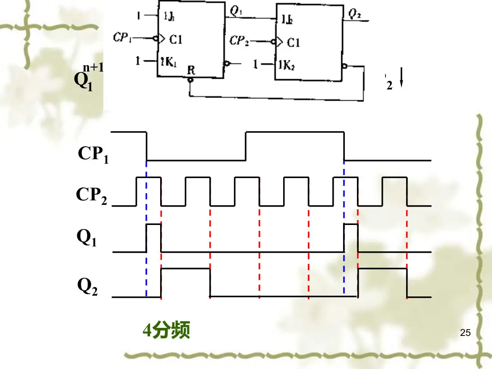

原文：

25

### 5.19 已知电路如图P5.19，试作出Q端的波形。设Q的初态为“0”。

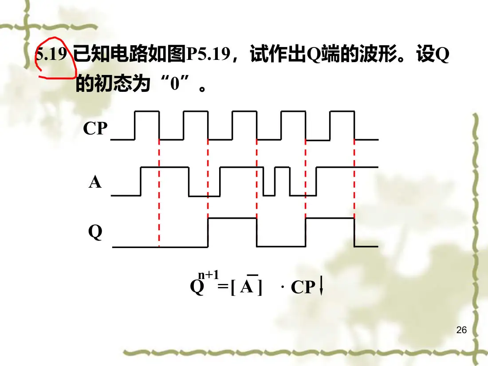

原文：

5.19 已知电路如图P5.19，试作出Q端的波形。设Q的初态为“0”。

$$
\mathbf {Q} ^ {\mathbf {n + 1}} = [ \mathbf {\bar {A}} ] \cdot \mathbf {C P} \downarrow
$$

26

### 27

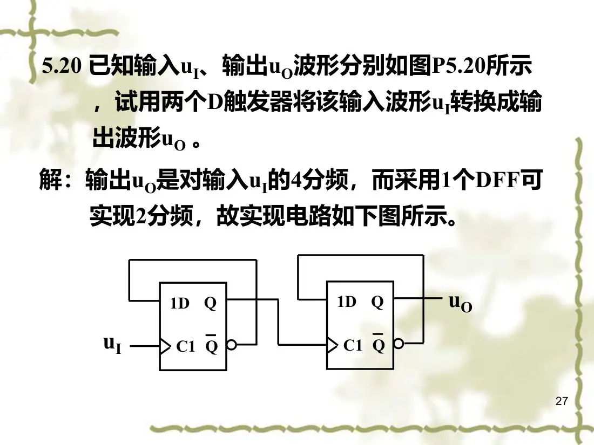

原文：

5.20 已知输入 $u_{I}$ 、输出 $u_{O}$ 波形分别如图P5.20所示，试用两个D触发器将该输入波形 $u_{I}$ 转换成输出波形 $u_{O}$ 。

解：输出 $u_{O}$ 是对输入 $u_{I}$ 的4分频，而采用1个DFF可实现2分频，故实现电路如下图所示。

27

### 5.21 试分别用公式法和列表图解法将主从SR触发器转换成JK触发器。

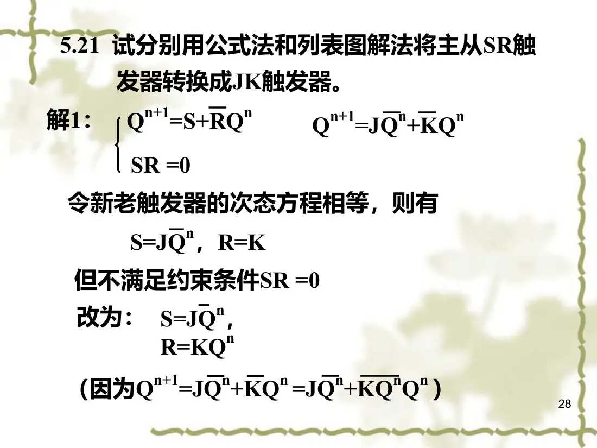

原文：

5.21 试分别用公式法和列表图解法将主从SR触发器转换成JK触发器。

解1: $\left\{\begin{aligned}Q^{n+1}&=S+\overline{R}Q^{n}\\ S R&=0\end{aligned}\right.$ $Q^{n+1}=J\overline{Q}^{n}+\overline{K}Q^{n}$

令新老触发器的次态方程相等，则有

$$
\mathbf {S} = \mathbf {J} \overline {{\mathbf {Q}}} ^ {\mathrm{n}}, \quad \mathbf {R} = \mathbf {K}
$$

但不满足约束条件SR = 0

改为： $S=J\bar{Q}^{n},$ $R=KQ^{n}$

(因为 $Q^{n+1}=J\overline{Q}^{n}+KQ^{n}=J\overline{Q}^{n}+KQ^{n}Q^{n}$ )

28

### 解2:(1)列综合表，如下所示:

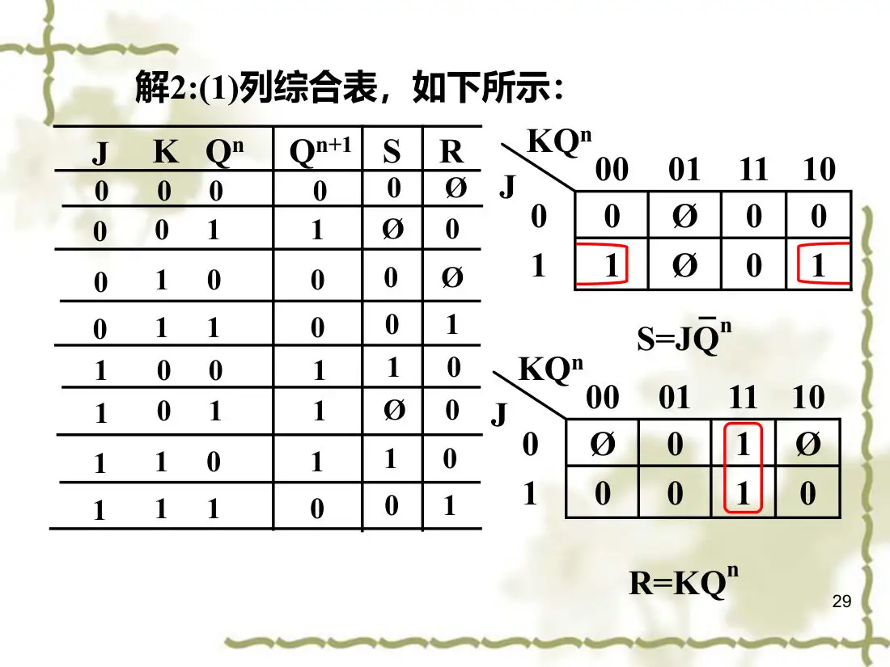

原文：

解2:(1)列综合表，如下所示:

<table><tr><td>J</td><td>K</td><td> $Q^{n}$ </td><td> $Q^{n+1}$ </td><td>S</td><td>R</td></tr><tr><td>0</td><td>0</td><td>0</td><td>0</td><td>0</td><td>∅</td></tr><tr><td>0</td><td>0</td><td>1</td><td>1</td><td>∅</td><td>0</td></tr><tr><td>0</td><td>1</td><td>0</td><td>0</td><td>0</td><td>∅</td></tr><tr><td>0</td><td>1</td><td>1</td><td>0</td><td>0</td><td>1</td></tr><tr><td>1</td><td>0</td><td>0</td><td>1</td><td>1</td><td>0</td></tr><tr><td>1</td><td>0</td><td>1</td><td>1</td><td>∅</td><td>0</td></tr><tr><td>1</td><td>1</td><td>0</td><td>1</td><td>1</td><td>0</td></tr><tr><td>1</td><td>1</td><td>1</td><td>0</td><td>0</td><td>1</td></tr></table>

<table><tr><td>J\KQn</td><td>00</td><td>01</td><td>11</td><td>10</td></tr><tr><td>0</td><td>∅</td><td>0</td><td>1</td><td>∅</td></tr><tr><td>1</td><td>0</td><td>0</td><td>1</td><td>0</td></tr></table>
$\mathbf{R} = \mathbf{KQ}^{\mathbf{n}}$

29

### (2)作卡诺图，如下图所示

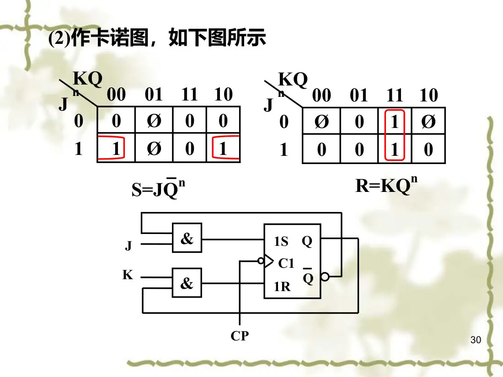

原文：

(2)作卡诺图，如下图所示

$$
\begin{array}{c c c c c} \text { KQ } & 0 0 & 0 1 & 1 1 & 1 0 \\ \text { J } ^ {\text { n }} & 0 & \emptyset & 0 & 0 \\ 1 & 1 & \emptyset & 0 & 1 \end{array}
$$

<table><tr><td>J^n\KQ</td><td>00</td><td>01</td><td>11</td><td>10</td></tr><tr><td>0</td><td>∅</td><td>0</td><td>1</td><td>∅</td></tr><tr><td>1</td><td>0</td><td>0</td><td>1</td><td>0</td></tr></table>
$\mathbf{S} = \mathbf{J}\overline{\mathbf{Q}}^{\mathbf{n}}$ $\mathbf{R} = \mathbf{KQ}^{\mathbf{n}}$

30

### 作业

原文：

作业

写出五种触发器的功能表，特征方程。画出状态转移图。

31
