# 《数字电路与系统设计》第5章 计数器（课件）

原件的每一页，下面附识别出的文字。

### 5.3 计数器

原文：

5.3 计数器

1. 计数器的作用

记忆输入脉冲的个数；用于定时、分频、产生节拍脉冲及进行数字运算等等。

2. 计数器的分类
按工作方式分: 同步计数器和异步计数器。

按功能分：加法计数器、减法计数器和可逆计数器。

按计数器的计数容量(或称模数)来分: 各种不同的计数器, 如二进制计数器、十进制计数器、任意进制计数器等等。

### 第 2 页

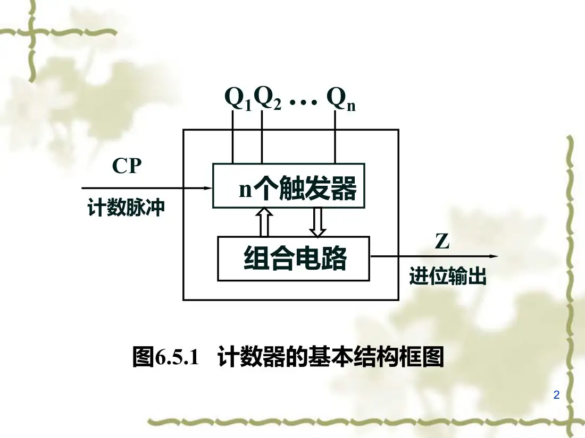

### 6.5.1 同步计数器的分析

原文：

6.5.1 同步计数器的分析

同步计数器的特点：在同步计数器内部，各个触发器都受同一时钟脉冲——输入计数脉冲的控制，因此，它们状态的更新几乎是同时的，故被称为“同步计数器”。

3

### 分析步骤:

原文：

分析步骤:

①分析电路结构

②写出三组方程

a.各触发器的激励方程

b.各触发器的次态方程

c.电路的输出方程

③作状态转移表、状态转移图或波形图

④电路的逻辑功能描述

4

### 下图为一个同步计数器，试分析该电路。

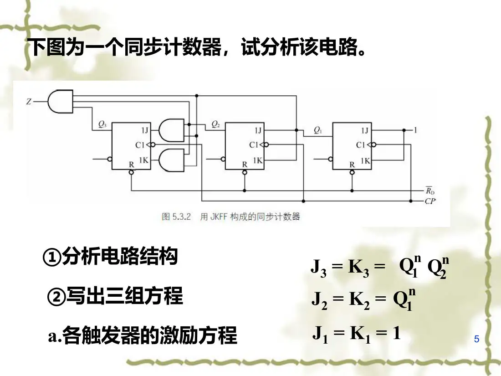

原文：

下图为一个同步计数器，试分析该电路。

①分析电路结构

$$
\mathbf {J} _ {3} = \mathbf {K} _ {3} = \mathbf {Q} _ {1} ^ {\mathrm{n}} \mathbf {Q} _ {2} ^ {\mathrm{n}}
$$

②写出三组方程

$$
\mathbf {J} _ {2} = \mathbf {K} _ {2} = \mathbf {Q} _ {1} ^ {\mathbf {n}}
$$

a.各触发器的激励方程

$$
\mathbf {J _ {1}} = \mathbf {K _ {1}} = \mathbf {1}
$$

### $$

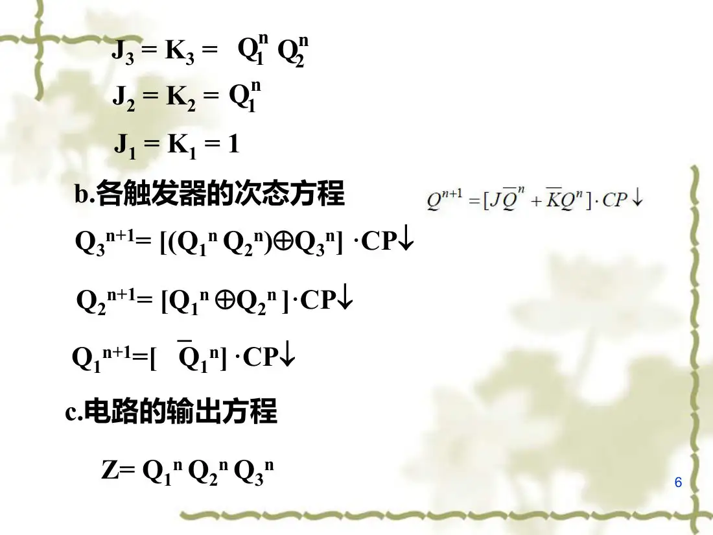

原文：

$$
\mathbf {J} _ {3} = \mathbf {K} _ {3} = \mathbf {Q} _ {1} ^ {\mathrm{n}} \mathbf {Q} _ {2} ^ {\mathrm{n}}
$$

$$
\mathbf {J} _ {2} = \mathbf {K} _ {2} = \mathbf {Q} _ {1} ^ {\mathbf {n}}
$$

$$
\mathbf {J} _ {1} = \mathbf {K} _ {1} = \mathbf {1}
$$

b.各触发器的次态方程

$$
Q ^ {n + 1} = [ J \overline {{{{Q}}}} ^ {n} + \overline {{{{K}}}} Q ^ {n} ] \cdot C P \downarrow
$$

$$
\mathbf {Q} _ {3} ^ {\mathrm{n+1}} = [ (\mathbf {Q} _ {1} ^ {\mathrm{n}} \mathbf {Q} _ {2} ^ {\mathrm{n}}) \oplus \mathbf {Q} _ {3} ^ {\mathrm{n}} ] \cdot \mathbf {C P} \downarrow
$$

$$
\mathbf {Q} _ {2} ^ {\mathrm{n+1}} = [ \mathbf {Q} _ {1} ^ {\mathrm{n}} \oplus \mathbf {Q} _ {2} ^ {\mathrm{n}} ] \cdot \mathbf {C P} \downarrow
$$

$$
\mathbf {Q} _ {1} ^ {\mathrm{n+1}} = [ \overline {{\mathbf {Q}}} _ {1} ^ {\mathrm{n}} ] \cdot \mathbf {C P} \downarrow
$$

c.电路的输出方程

$$
\mathbf {Z} = \mathbf {Q} _ {1} ^ {\mathrm{n}} \mathbf {Q} _ {2} ^ {\mathrm{n}} \mathbf {Q} _ {3} ^ {\mathrm{n}}
$$

### ③作状态转移表、状态转移图或波形图

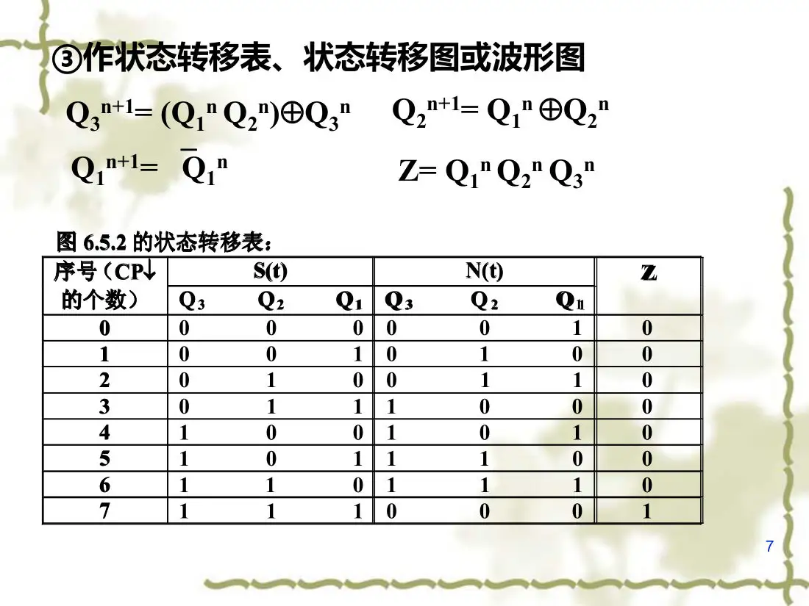

原文：

③作状态转移表、状态转移图或波形图

$$
\begin{array}{l l} \mathbf {Q} _ {3} ^ {\mathrm{n+1}} = (\mathbf {Q} _ {1} ^ {\mathrm{n}} \mathbf {Q} _ {2} ^ {\mathrm{n}}) \oplus \mathbf {Q} _ {3} ^ {\mathrm{n}} & \mathbf {Q} _ {2} ^ {\mathrm{n+1}} = \mathbf {Q} _ {1} ^ {\mathrm{n}} \oplus \mathbf {Q} _ {2} ^ {\mathrm{n}} \\ \mathbf {Q} _ {1} ^ {\mathrm{n+1}} = \overline {{\mathbf {Q}}} _ {1} ^ {\mathrm{n}} & \mathbf {Z} = \mathbf {Q} _ {1} ^ {\mathrm{n}} \mathbf {Q} _ {2} ^ {\mathrm{n}} \mathbf {Q} _ {3} ^ {\mathrm{n}} \end{array}
$$

图 6.5.2 的状态转移表:
<table><tr><td rowspan="2">序号(CP↓的个数)</td><td colspan="3">S(t)</td><td colspan="3">N(t)</td><td rowspan="2">Z</td></tr><tr><td> $Q_3$ </td><td> $Q_2$ </td><td> $Q_1$ </td><td> $Q_3$ </td><td> $Q_2$ </td><td> $Q_{11}$ </td></tr><tr><td>0</td><td>0</td><td>0</td><td>0</td><td>0</td><td>0</td><td>1</td><td>0</td></tr><tr><td>1</td><td>0</td><td>0</td><td>1</td><td>0</td><td>1</td><td>0</td><td>0</td></tr><tr><td>2</td><td>0</td><td>1</td><td>0</td><td>0</td><td>1</td><td>1</td><td>0</td></tr><tr><td>3</td><td>0</td><td>1</td><td>1</td><td>1</td><td>0</td><td>0</td><td>0</td></tr><tr><td>4</td><td>1</td><td>0</td><td>0</td><td>1</td><td>0</td><td>1</td><td>0</td></tr><tr><td>5</td><td>1</td><td>0</td><td>1</td><td>1</td><td>1</td><td>0</td><td>0</td></tr><tr><td>6</td><td>1</td><td>1</td><td>0</td><td>1</td><td>1</td><td>1</td><td>0</td></tr><tr><td>7</td><td>1</td><td>1</td><td>1</td><td>0</td><td>0</td><td>0</td><td>1</td></tr></table>

7

### 表6.5.1 图6.5.2电路的状态转移表

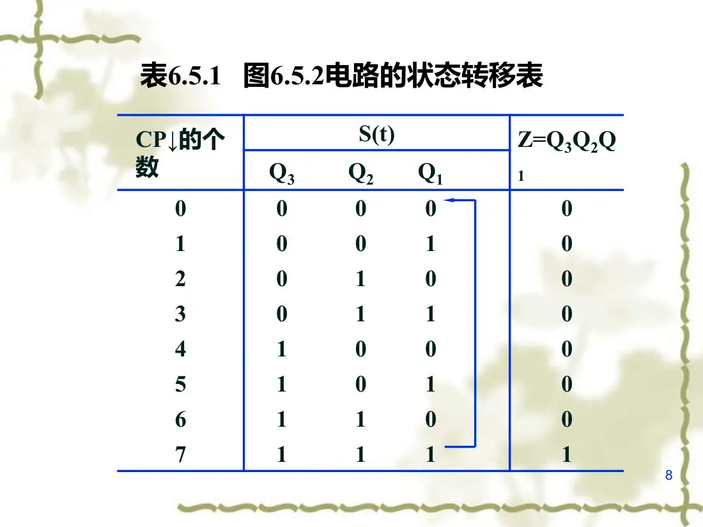

原文：

表6.5.1 图6.5.2电路的状态转移表
<table><tr><td rowspan="2">CP↓的个数</td><td colspan="3">S(t)</td><td rowspan="2">Z=Q3Q2Q1</td></tr><tr><td>Q3</td><td>Q2</td><td>Q1</td></tr><tr><td>0</td><td>0</td><td>0</td><td>0</td><td>0</td></tr><tr><td>1</td><td>0</td><td>0</td><td>1</td><td>0</td></tr><tr><td>2</td><td>0</td><td>1</td><td>0</td><td>0</td></tr><tr><td>3</td><td>0</td><td>1</td><td>1</td><td>0</td></tr><tr><td>4</td><td>1</td><td>0</td><td>0</td><td>0</td></tr><tr><td>5</td><td>1</td><td>0</td><td>1</td><td>0</td></tr><tr><td>6</td><td>1</td><td>1</td><td>0</td><td>0</td></tr><tr><td>7</td><td>1</td><td>1</td><td>1</td><td>1</td></tr></table>

8

### 第 9 页

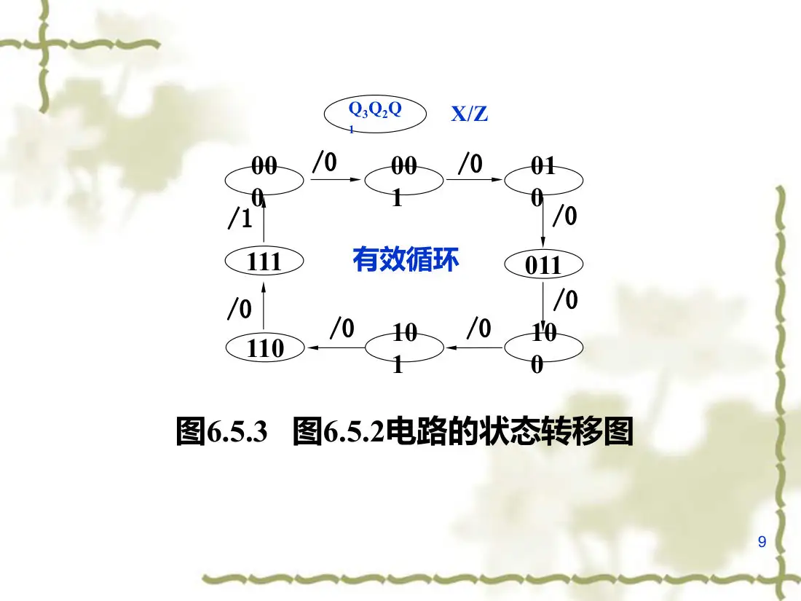

### CP 1 2 3 4 5 6 7 8

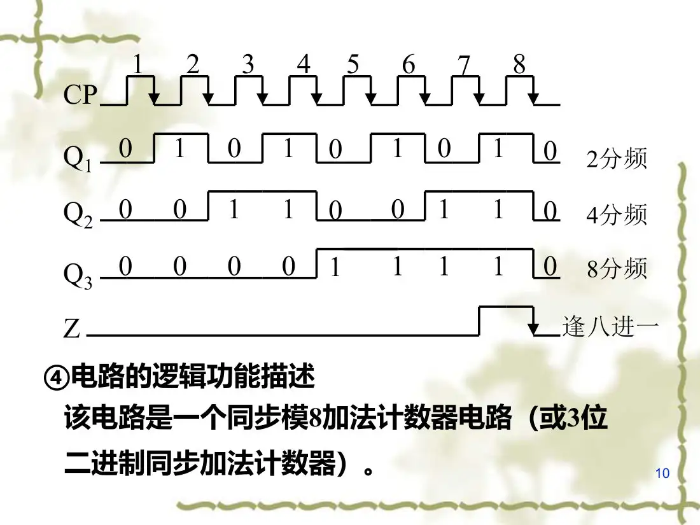

原文：

CP 1 2 3 4 5 6 7 8
Q₁ 0 1 0 1 0 1 0 1 0 2分频
Q₂ 0 0 1 1 0 0 1 1 0 4分频
Q₃ 0 0 0 0 1 1 1 1 0 8分频
Z \_\_\_\_ 達八进一

④电路的逻辑功能描述
该电路是一个同步模8加法计数器电路（或3位二进制同步加法计数器）。

10

### 总结规律：

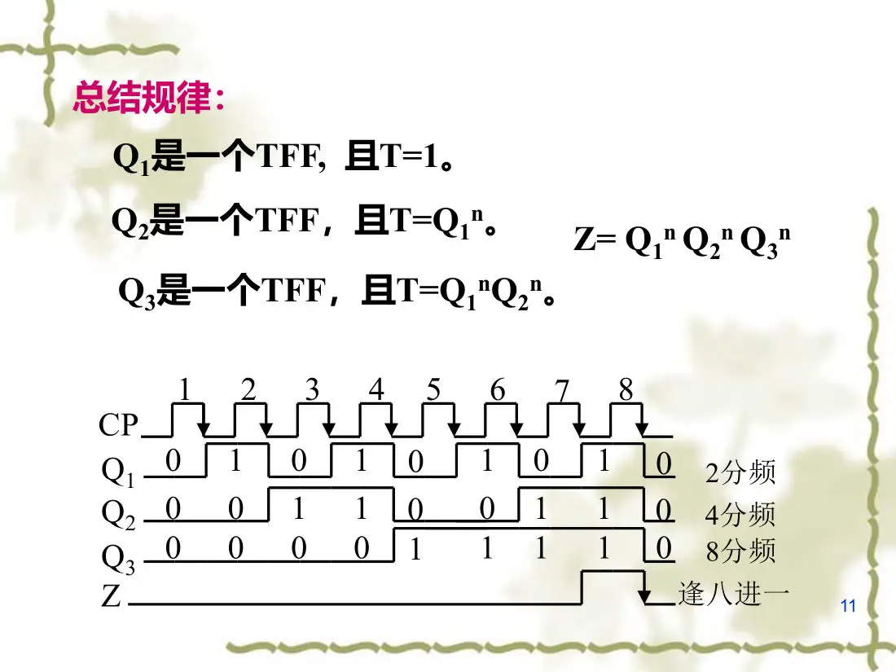

原文：

总结规律：

$Q_{1}$ 是一个TFF，且T=1。

$Q_{2}$ 是一个TFF，且 $T=Q_{1}^{n}$ 。

$$
\mathrm{Z} = \mathrm{Q} _ {1} ^ {\mathrm{n}} \mathrm{Q} _ {2} ^ {\mathrm{n}} \mathrm{Q} _ {3} ^ {\mathrm{n}}
$$

$Q_{3}$ 是一个TFF，且 $T=Q_{1}^{n}Q_{2}^{n}$ 。

11

### 二进制同步加法计数器的结构特点

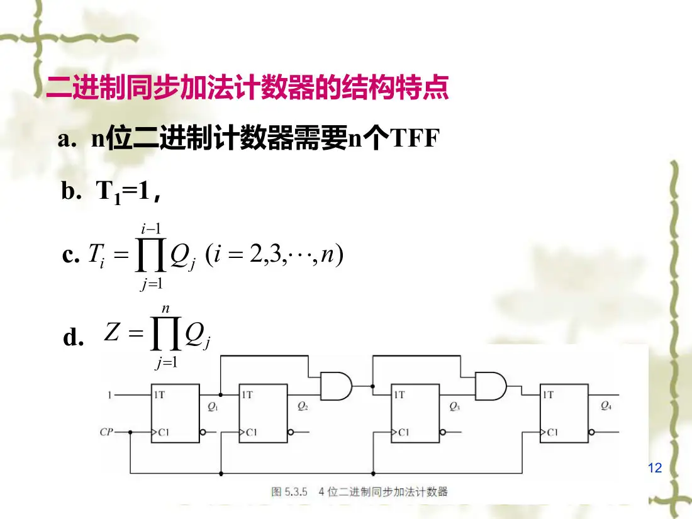

原文：

二进制同步加法计数器的结构特点

a. n位二进制计数器需要n个TFF

b. $T_{1}=1$ ,

c. $T_{i}=\prod_{j=1}^{i-1}Q_{j}\;(i=2,3,\cdots,n)$

$$
Z = \prod^ {n} Q _ {j}
$$

### 减法计数器

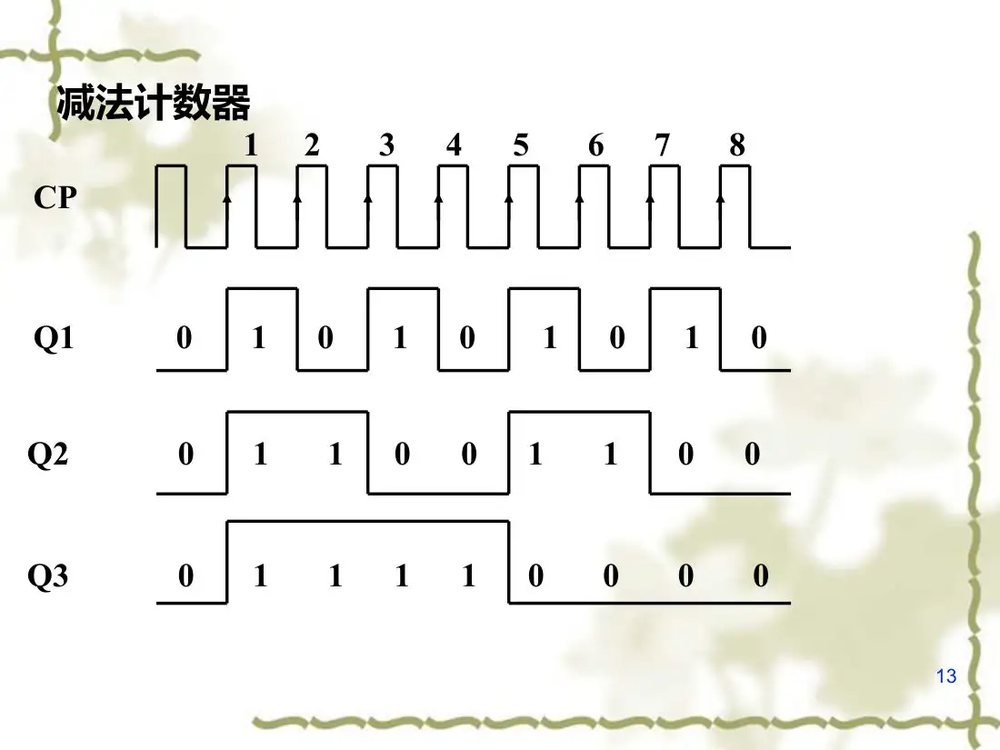

原文：

减法计数器

CP

$$
\begin{array}{c c c c c c c c c c c c c c} 1 & 2 & 3 & 4 & 5 & 6 & 7 & 8 \\ \hline \end{array}
$$

Q1

$$
\begin{array}{c c c c c c c c c} \hline 0 & 1 & 0 & 1 & 0 & 1 & 0 & 1 & 0 \\ \hline \end{array}
$$

Q2

$$
\begin{array}{c c c c c c c c} \hline 0 & \framebox {1} & 1 & 0 & 0 & 1 & 1 & 0 & 0 \\ \hline \end{array}
$$

Q3

$$
\boxed {0} \boxed {1} \boxed {1} \boxed {1} \boxed {1} \boxed {0} \boxed {0} \boxed {0} \boxed {0}
$$

13

### ①结构特点

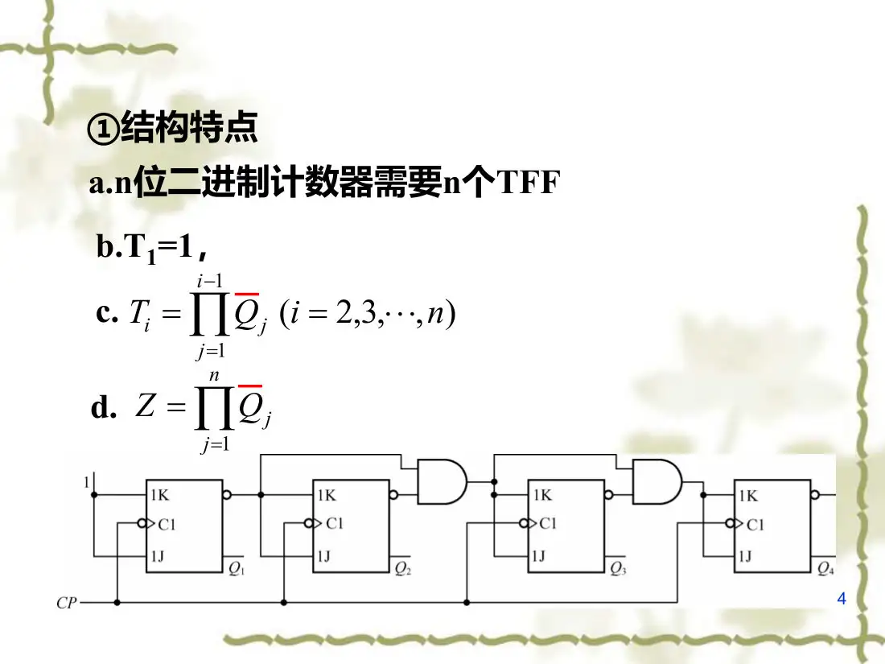

原文：

①结构特点

a.n位二进制计数器需要n个TFF

b. $T_{1}=1$ ,

c. $T_{i}=\prod_{j=1}^{i-1}\overline{Q}_{j}(i=2,3,\cdots,n)$

d. $Z = \prod_{j=1}^{n} \overline{Q}_{j}$

### 例5.3.2、任意进制计数器的分析

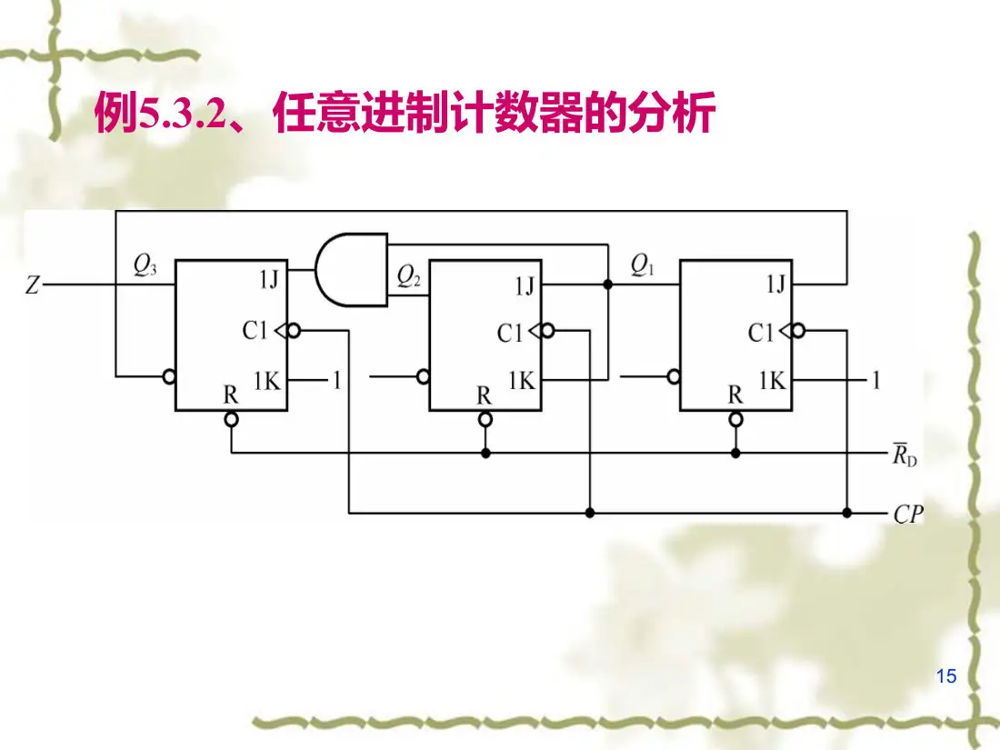

原文：

例5.3.2、任意进制计数器的分析

15

### 解：1、写出三组方程：

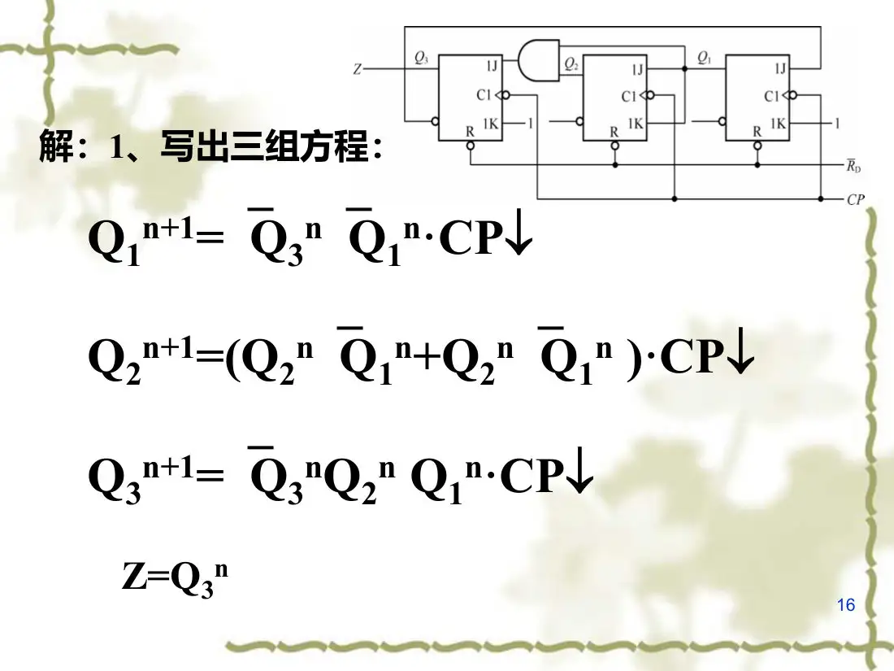

原文：

解：1、写出三组方程：

$$
\mathbf {Q} _ {1} ^ {\mathrm{n+1}} = \overline {{\mathbf {Q}}} _ {3} ^ {\mathrm{n}} \overline {{\mathbf {Q}}} _ {1} ^ {\mathrm{n}} \cdot \mathbf {C P} \downarrow
$$

$$
\mathbf {Q} _ {2} ^ {\mathrm{n+1}} = (\mathbf {Q} _ {2} ^ {\mathrm{n}} \overline {{\mathbf {Q}}} _ {1} ^ {\mathrm{n}} + \mathbf {Q} _ {2} ^ {\mathrm{n}} \overline {{\mathbf {Q}}} _ {1} ^ {\mathrm{n}}) \cdot \mathbf {C P} \downarrow
$$

$$
\mathbf {Q} _ {3} ^ {\mathrm{n+1}} = \overline {{\mathbf {Q}}} _ {3} ^ {\mathrm{n}} \mathbf {Q} _ {2} ^ {\mathrm{n}} \mathbf {Q} _ {1} ^ {\mathrm{n}} \cdot \mathbf {C P} \downarrow
$$

$$
\mathbf {Z} = \mathbf {Q _ {3}} ^ {\mathbf {n}}
$$

16

### $$

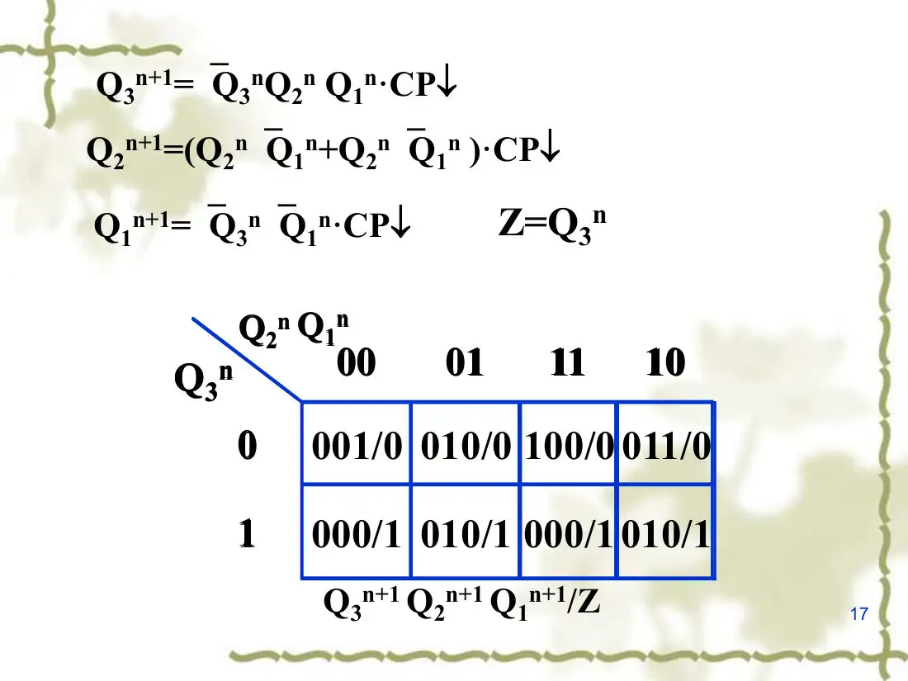

原文：

$$
\begin{array}{r l} & {\mathbf {Q} _ {3} ^ {n + 1} = \overline {{\mathbf {Q}}} _ {3} ^ {n} \mathbf {Q} _ {2} ^ {n} \mathbf {Q} _ {1} ^ {n} \cdot \mathbf {C P} \downarrow} \\ & {\mathbf {Q} _ {2} ^ {n + 1} = (\mathbf {Q} _ {2} ^ {n} \overline {{\mathbf {Q}}} _ {1} ^ {n} + \mathbf {Q} _ {2} ^ {n} \overline {{\mathbf {Q}}} _ {1} ^ {n}) \cdot \mathbf {C P} \downarrow} \\ & {\mathbf {Q} _ {1} ^ {n + 1} = \overline {{\mathbf {Q}}} _ {3} ^ {n} \overline {{\mathbf {Q}}} _ {1} ^ {n} \cdot \mathbf {C P} \downarrow \qquad \mathbf {Z} = \mathbf {Q} _ {3} ^ {n}} \end{array}
$$

$$
\begin{array}{c c c c c} \hline Q _ {2 ^ {n}} & Q _ {1 ^ {n}} & 0 0 & 0 1 & 1 1 & 1 0 \\ \hline Q _ {3 ^ {n}} & 0 & 0 0 1 / 0 & 0 1 0 / 0 & 1 0 0 / 0 & 0 1 1 / 0 \\ \hline 0 & 0 0 1 / 0 & 0 1 0 / 0 & 1 0 0 / 0 & 0 1 1 / 0 \\ \hline 1 & 0 0 0 / 1 & 0 1 0 / 1 & 0 0 0 / 1 & 0 1 0 / 1 \\ \hline \end{array}
$$

17

### 0 001 010 100 011

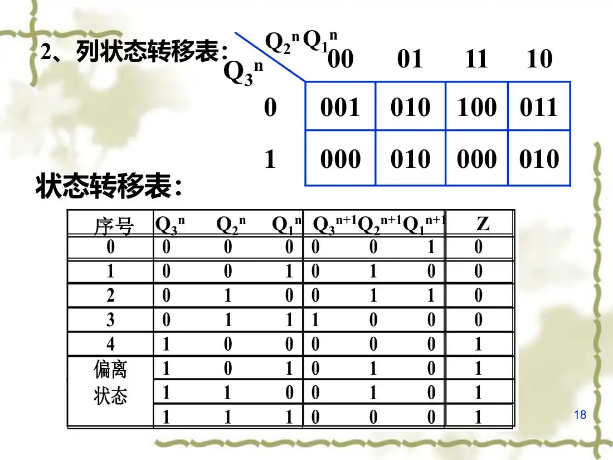

原文：

2、列状态转移表: $Q_{3}^{n}$ $Q_{2}^{n}Q_{1}^{n}$ 00 01 11 10

0 001 010 100 011

1 000 010 000 010

状态转移表:

<table><tr><td>序号</td><td> $Q_{3}^{n}$ </td><td> $Q_{2}^{n}$ </td><td> $Q_{1}^{n}$ </td><td colspan="3"> $Q_{3}^{n+1}Q_{2}^{n+1}Q_{1}^{n+1}$ </td><td>Z</td></tr><tr><td>0</td><td>0</td><td>0</td><td>0</td><td>0</td><td>0</td><td>1</td><td>0</td></tr><tr><td>1</td><td>0</td><td>0</td><td>1</td><td>0</td><td>1</td><td>0</td><td>0</td></tr><tr><td>2</td><td>0</td><td>1</td><td>0</td><td>0</td><td>1</td><td>1</td><td>0</td></tr><tr><td>3</td><td>0</td><td>1</td><td>1</td><td>1</td><td>0</td><td>0</td><td>0</td></tr><tr><td>4</td><td>1</td><td>0</td><td>0</td><td>0</td><td>0</td><td>0</td><td>1</td></tr><tr><td rowspan="3">偏离状态</td><td>1</td><td>0</td><td>1</td><td>0</td><td>1</td><td>0</td><td>1</td></tr><tr><td>1</td><td>1</td><td>0</td><td>0</td><td>1</td><td>0</td><td>1</td></tr><tr><td>1</td><td>1</td><td>1</td><td>0</td><td>0</td><td>0</td><td>1</td></tr></table>

18

### 111

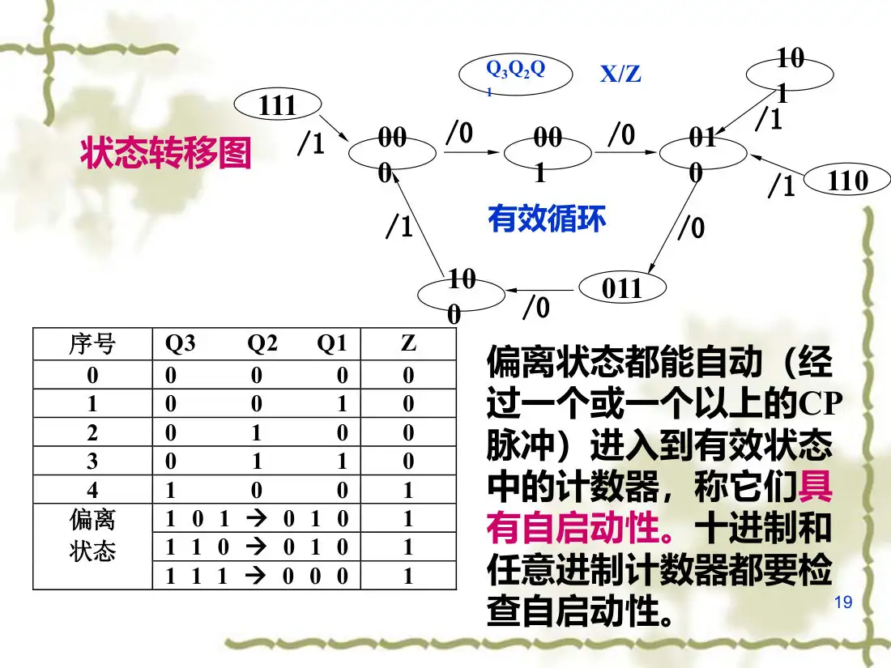

原文：

111

状态转移图

有效循环

<table><tr><td>序号</td><td>Q3</td><td>Q2</td><td>Q1</td><td>Z</td></tr><tr><td>0</td><td>0</td><td>0</td><td>0</td><td>0</td></tr><tr><td>1</td><td>0</td><td>0</td><td>1</td><td>0</td></tr><tr><td>2</td><td>0</td><td>1</td><td>0</td><td>0</td></tr><tr><td>3</td><td>0</td><td>1</td><td>1</td><td>0</td></tr><tr><td>4</td><td>1</td><td>0</td><td>0</td><td>1</td></tr><tr><td rowspan="3">偏离状态</td><td colspan="3">1 0 1 → 0 1 0</td><td>1</td></tr><tr><td colspan="3">1 1 0 → 0 1 0</td><td>1</td></tr><tr><td colspan="3">1 1 1 → 0 0 0</td><td>1</td></tr></table>

偏离状态都能自动（经过一个或一个以上的CP脉冲）进入到有效状态中的计数器，称它们具有自启动性。十进制和任意进制计数器都要检查自启动性。

19

### 功能：模长为5、具有自启动性的加法计数器

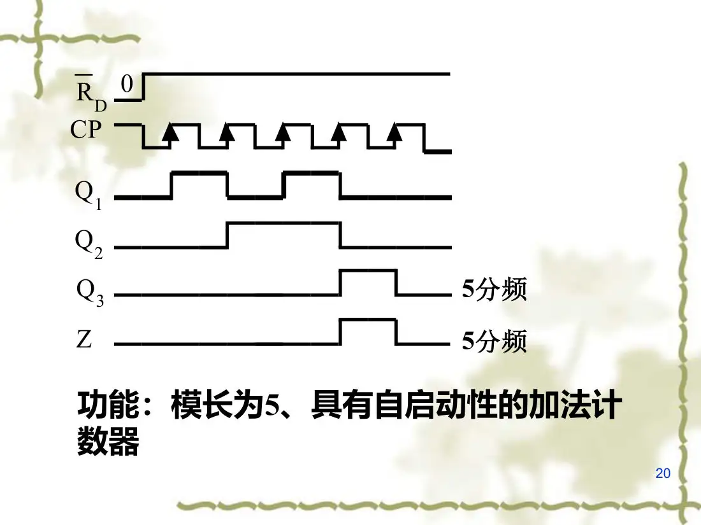

原文：

功能：模长为5、具有自启动性的加法计数器

20

### 练习：分析下面计数器

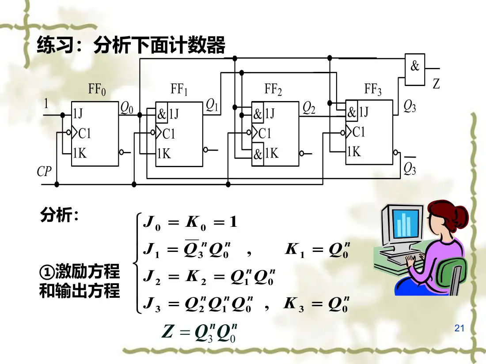

原文：

练习：分析下面计数器

分析:

①激励方程和输出方程

$$
\left\{ \begin{array}{l l} J _ {0} = K _ {0} = 1 \\ J _ {1} = \overline {{Q}} _ {3} ^ {n} Q _ {0} ^ {n}, & K _ {1} = Q _ {0} ^ {n} \\ J _ {2} = K _ {2} = Q _ {1} ^ {n} Q _ {0} ^ {n} \\ J _ {3} = Q _ {2} ^ {n} Q _ {1} ^ {n} Q _ {0} ^ {n}, & K _ {3} = Q _ {0} ^ {n} \\ Z = Q _ {3} ^ {n} Q _ {0} ^ {n} \end{array} \right.
$$

21

### $$

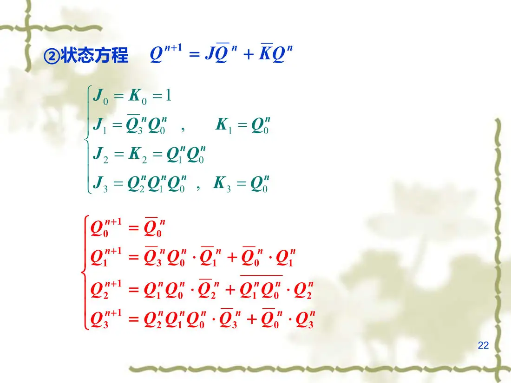

原文：

②状态方程 $Q^{n + 1} = J\overline{Q}^n +\overline{K} Q^n$

$$
\left\{ \begin{array}{l l} J _ {0} = K _ {0} = 1 \\ J _ {1} = \overline {{Q}} _ {3} ^ {n} Q _ {0} ^ {n}, & K _ {1} = Q _ {0} ^ {n} \\ J _ {2} = K _ {2} = Q _ {1} ^ {n} Q _ {0} ^ {n} \\ J _ {3} = Q _ {2} ^ {n} Q _ {1} ^ {n} Q _ {0} ^ {n}, & K _ {3} = Q _ {0} ^ {n} \end{array} \right.
$$

$$
\left\{ \begin{array}{l} Q _ {0} ^ {n + 1} = \overline {{Q}} _ {0} ^ {n} \\ Q _ {1} ^ {n + 1} = \overline {{Q}} _ {3} ^ {n} Q _ {0} ^ {n} \cdot \overline {{Q}} _ {1} ^ {n} + \overline {{Q}} _ {0} ^ {n} \cdot Q _ {1} ^ {n} \\ Q _ {2} ^ {n + 1} = Q _ {1} ^ {n} Q _ {0} ^ {n} \cdot \overline {{Q}} _ {2} ^ {n} + \overline {{Q _ {1} ^ {n} Q _ {0} ^ {n}}} \cdot Q _ {2} ^ {n} \\ Q _ {3} ^ {n + 1} = Q _ {2} ^ {n} Q _ {1} ^ {n} Q _ {0} ^ {n} \cdot \overline {{Q}} _ {3} ^ {n} + \overline {{Q}} _ {0} ^ {n} \cdot Q _ {3} ^ {n} \end{array} \right.
$$

22

### ③状态表

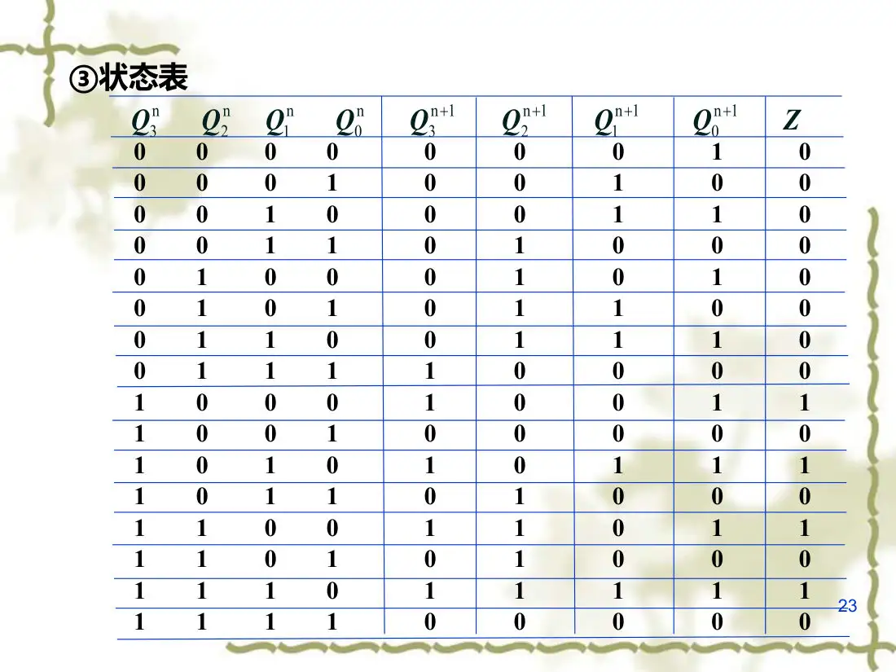

原文：

③状态表

<table><tr><td> $Q_3^n$ </td><td> $Q_2^n$ </td><td> $Q_1^n$ </td><td> $Q_0^n$ </td><td> $Q_3^{n+1}$ </td><td> $Q_2^{n+1}$ </td><td> $Q_1^{n+1}$ </td><td> $Q_0^{n+1}$ </td><td>Z</td></tr><tr><td>0</td><td>0</td><td>0</td><td>0</td><td>0</td><td>0</td><td>0</td><td>1</td><td>0</td></tr><tr><td>0</td><td>0</td><td>0</td><td>1</td><td>0</td><td>0</td><td>1</td><td>0</td><td>0</td></tr><tr><td>0</td><td>0</td><td>1</td><td>0</td><td>0</td><td>0</td><td>1</td><td>1</td><td>0</td></tr><tr><td>0</td><td>0</td><td>1</td><td>1</td><td>0</td><td>1</td><td>0</td><td>0</td><td>0</td></tr><tr><td>0</td><td>1</td><td>0</td><td>0</td><td>0</td><td>1</td><td>0</td><td>1</td><td>0</td></tr><tr><td>0</td><td>1</td><td>0</td><td>1</td><td>0</td><td>1</td><td>1</td><td>0</td><td>0</td></tr><tr><td>0</td><td>1</td><td>1</td><td>0</td><td>0</td><td>1</td><td>1</td><td>1</td><td>0</td></tr><tr><td>0</td><td>1</td><td>1</td><td>1</td><td>1</td><td>0</td><td>0</td><td>0</td><td>0</td></tr><tr><td>1</td><td>0</td><td>0</td><td>0</td><td>1</td><td>0</td><td>0</td><td>1</td><td>1</td></tr><tr><td>1</td><td>0</td><td>0</td><td>1</td><td>0</td><td>0</td><td>0</td><td>0</td><td>0</td></tr><tr><td>1</td><td>0</td><td>1</td><td>0</td><td>1</td><td>0</td><td>1</td><td>1</td><td>1</td></tr><tr><td>1</td><td>0</td><td>1</td><td>1</td><td>0</td><td>1</td><td>0</td><td>0</td><td>0</td></tr><tr><td>1</td><td>1</td><td>0</td><td>0</td><td>1</td><td>1</td><td>0</td><td>1</td><td>1</td></tr><tr><td>1</td><td>1</td><td>0</td><td>1</td><td>0</td><td>1</td><td>0</td><td>0</td><td>0</td></tr><tr><td>1</td><td>1</td><td>1</td><td>0</td><td>1</td><td>1</td><td>1</td><td>1</td><td>1</td></tr><tr><td>1</td><td>1</td><td>1</td><td>1</td><td>0</td><td>0</td><td>0</td><td>0</td><td>0</td></tr></table>

### ④状态图

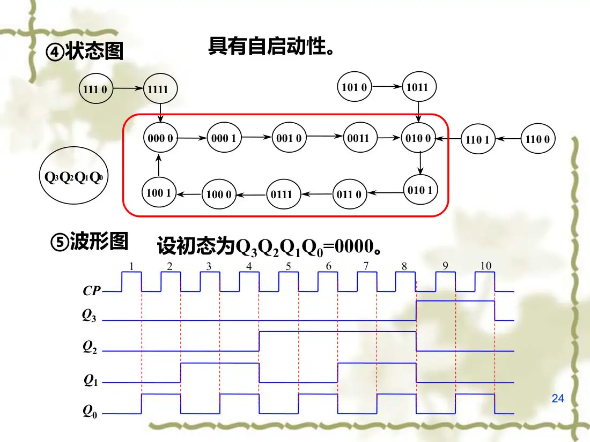

原文：

④状态图

具有自启动性。

⑤波形图 设初态为 $Q_{3}Q_{2}Q_{1}Q_{0}=0000$ 。

24

### 第 25 页

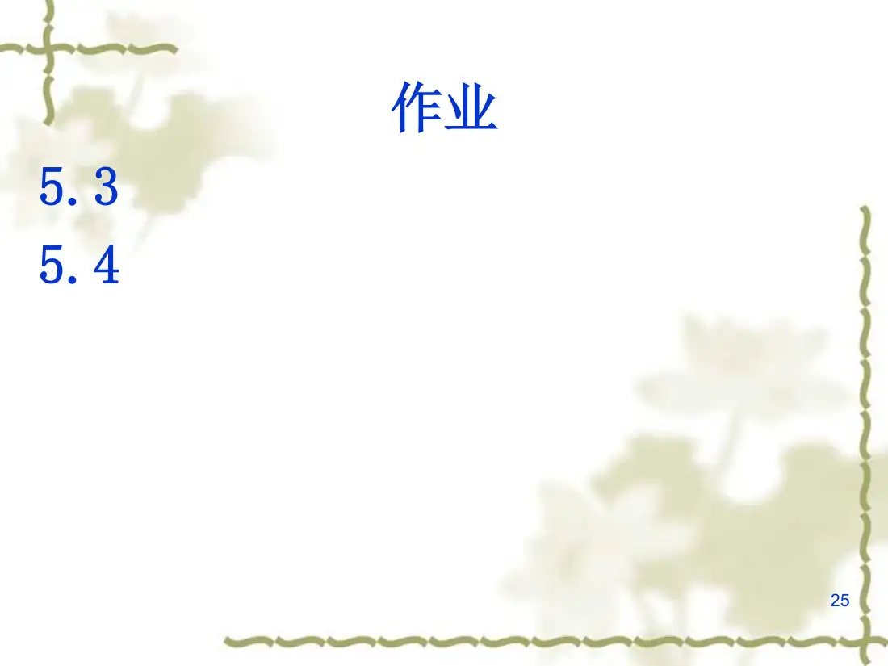
