# 《数字电路与系统设计》第5章习题答案

原件经识别和整理；“参考解答”是我们补的。

# 数字电路与系统设计 第5章习题答案（1-3页）

本部分为《数字电路与系统设计》第5章习题答案的前三页内容整理，包含基本触发器波形分析、逻辑功能分析及特征方程推导。

## 一、填空题与分析题

### 选择 1

题干：基本触发器的逻辑符号与输入波形如图 P5.1所示。试作出 $Q, \overline{Q}$ 的波形。

知识点：[数字系统的基本模型（数据处理器与控制器）及对最小时钟周期、异步信号同步化的约定](../../../topics/数字逻辑电路/数字系统模型.md)

### 选择 2

题干：图P5.2电路，在开关S 由A 点拨到 B点，再由B 点拨回A点过程中，A、B 两点电压波形如图中所示。试作出 Q 和 $\overline{Q}$ 端的波形。

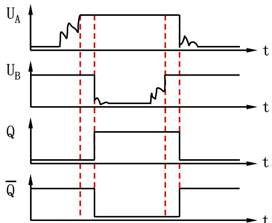

图 P5.2

知识点：[数字系统的基本模型（数据处理器与控制器）及对最小时钟周期、异步信号同步化的约定](../../../topics/数字逻辑电路/数字系统模型.md)

### 选择 3

题干：分析图 P5.3 的逻辑功能：列出真值表，导出特征方程并说明 $S_D$ 、 $R_D$ 的有效电平。

解：(1)列真值表如下

| $S_D$ | $R_D$ | $Q^{n+1}$ |
| :---: | :---: | :---: |
| 0 | 0 | $Q^n$ |
| 0 | 1 | 0 |
| 1 | 0 | 1 |
| 1 | 1 | $\emptyset$ |

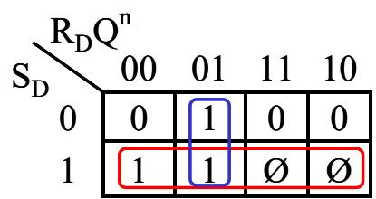

(2)求特征方程

$$
\left\{ \begin{array}{l} Q ^ {n + 1} = S _ {D} + \overline {{R}} _ {D} Q ^ {n} \\ S _ {D} R _ {D} = 0 \end{array} \right.
$$

$S_D$、 $R_D$ 高电平有效。

知识点：[数字系统的基本模型（数据处理器与控制器）及对最小时钟周期、异步信号同步化的约定](../../../topics/数字逻辑电路/数字系统模型.md)

### 选择 4

题干：对于图 电路，试导出其特征方程并说明对 A、B 的取值有无约束条件。

解：(1)列真值表如下

(2)求特征方程

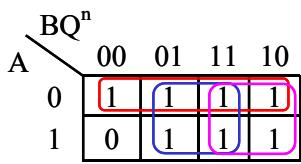

$Q ^ {n + 1 } = \overline { { A } } + B + Q ^ { n }$ 对 A、B 的取值无约束条件。

### 选择 5

题干：试写出图P5.5触发器电路的特征方程。

当 $\mathrm { CP=0 }$ 时， ${ \boldsymbol { \mathrm { Q } } } ^ { \mathrm { n + 1 } } { = } { \boldsymbol { \mathrm { Q } } } ^ { \mathrm { n } }$

图 P5.5

当 $\mathrm { CP=1 }$ 时， $\scriptstyle \left\{ { \begin{array} { l } { { \mathsf { Q } } ^ { { \mathsf { n } } + 1 } = { \mathsf { S } } + { \overline { { \mathsf { R } } } } { \mathsf { Q } } ^ { \mathrm { n } } } \\ { { \mathsf { S } } { \mathsf { R } } { = } 0 } \end{array} } \right.$

知识点：[数字系统的基本模型（数据处理器与控制器）及对最小时钟周期、异步信号同步化的约定](../../../topics/数字逻辑电路/数字系统模型.md)

### 选择 6

题干：试写出图P5.6各触发器电路的特征方程。

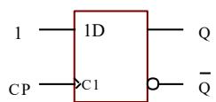

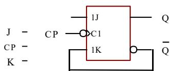
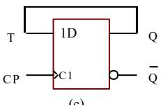
(e)
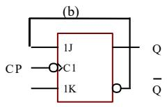
(f)

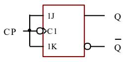

(a)特征方程： $\mathsf { Q } ^ { \mathrm { n + 1 } } { = } [ 1 ] \cdot \mathrm { CP }$

(b)特征方程： $\boldsymbol { \mathsf { Q } } ^ { \mathrm { n + 1 } } = [ \boldsymbol { \mathsf { Q } } ^ { \mathrm { n } } ] \cdot \boldsymbol { \mathsf { CP }}$

(c)特征方程： $\mathsf { Q } ^ { \mathrm { n + 1 } } = [ \bar { \mathsf { Q } } ^ { \mathrm { n } } ] \cdot \mathsf { CP }$

(d)特征方程： $\mathsf { Q } ^ { \mathrm { n + 1 } } = [ \mathsf { J } \overline { { \mathsf { Q } } } ^ { \mathrm { n } } + \overline { { \mathsf { K } } } \mathsf { Q } ^ { \mathrm { n } } ] \cdot \mathsf { CP }$

(e)特征方程： $\mathsf { Q } ^ { \mathrm { n + 1 } } = [ \overline { { \mathsf { Q } } } ^ { \mathrm { n } } ] \cdot \mathrm { CP }$

(f) 特征方程： $\mathsf { Q } ^ { \mathrm { n + 1 } } = [ \overline { { \mathsf { Q } } } ^ { \mathrm { n } } ] \cdot \mathrm { CP }$

(g)特征方程： $\mathsf { Q } ^ { \mathrm { n + 1 } } = [ \overline { { \mathsf { Q } } } ^ { \mathrm { n } } ] \cdot \mathrm { CP }$

(h)特征方程： $\mathsf { Q } ^ { \mathrm { n + 1 } } = \left[ 1 \right] \cdot \mathrm { CP }$

知识点：[控制器的四种硬件实现方法：每态一触发器法(SSI)、MSI法(MUX+寄存器+译码器)、PLA法(LSI)及对比](../../../topics/数字逻辑电路/控制器实现方法.md)

### 选择 7

题干：维阻D触发器的CP和D 信号如图P5.7 所示，设触发器Q端的初态为“0”，试作Q 端波形。

## 习题

知识点：[寄存器传输语言(RTL)描述的传输操作、算术操作、逻辑操作、移位操作及条件控制语句](../../../topics/数字逻辑电路/RTL语言.md)

### 5.7

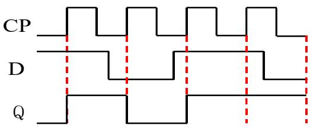

知识点：[算法状态机(ASM)图的状态框、判断框、条件输出框及ASM块的构成规则](../../../topics/数字逻辑电路/ASM图基础.md)、[根据文字描述建立ASM图的原则，以及从ASM图推导处理器明细表和控制器状态转移图](../../../topics/数字逻辑电路/ASM图建立与分析.md)、[控制器的四种硬件实现方法：每态一触发器法(SSI)、MSI法(MUX+寄存器+译码器)、PLA法(LSI)及对比](../../../topics/数字逻辑电路/控制器实现方法.md)

### 5.8

维阻 D 触发器构成的电路如图 P5.8 所示，试作 Q 端波形。

解：特征方程为：，Q 端波形如图 P5.8 所示。

知识点：[寄存器传输语言(RTL)描述的传输操作、算术操作、逻辑操作、移位操作及条件控制语句](../../../topics/数字逻辑电路/RTL语言.md)、[数字系统的基本模型（数据处理器与控制器）及对最小时钟周期、异步信号同步化的约定](../../../topics/数字逻辑电路/数字系统模型.md)、[控制器的四种硬件实现方法：每态一触发器法(SSI)、MSI法(MUX+寄存器+译码器)、PLA法(LSI)及对比](../../../topics/数字逻辑电路/控制器实现方法.md)

### 5.10

画出图 P5.10 中 Q 端的波形。设初态为 "$0$"。

解：特征方程为：，Q 端波形如图 P5.10 所示。

知识点：[数字系统的基本模型（数据处理器与控制器）及对最小时钟周期、异步信号同步化的约定](../../../topics/数字逻辑电路/数字系统模型.md)

### 5.11

画出图 P5.11 电路 Q 端的波形。设初态为 "$0$"。

解：特征方程为：$Q^{n+1}=[J\overline{Q}^n]$ 而且 $\overline{R}_D=\overline{CP\cdot Q^n}$，Q 端波形如图 P5.11 所示。

知识点：[数字系统的基本模型（数据处理器与控制器）及对最小时钟周期、异步信号同步化的约定](../../../topics/数字逻辑电路/数字系统模型.md)

### 5.12

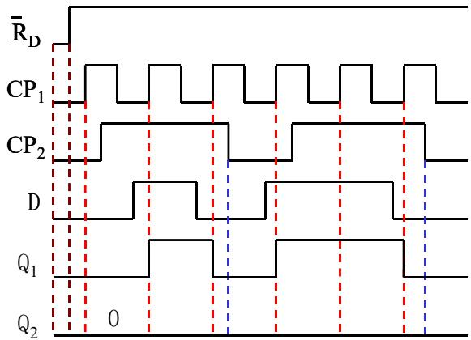

画出图 P5.12 电路中 $Q_1$、$Q_2$ 的波形。

解：特征方程为：$Q_1^{n+1}=[D]\cdot CP_1\dag$，$Q_2^{n+1}=[Q_1^n]$，Q 端波形如图 P5.12 所示。

知识点：[数字系统的基本模型（数据处理器与控制器）及对最小时钟周期、异步信号同步化的约定](../../../topics/数字逻辑电路/数字系统模型.md)

### 5.13

画出图 P5.13 电路中 $Q_1$ 和 $Q_2$ 的波形。

解：特征方程为：$Q_1^{n+1}=[\overline{Q_2^n}]\cdot CP_1\sharp$，$Q_2^{n+1}=[Q_1^n]\cdot CP_2\ d\dag$，Q 端波形如图 P5.13 所示。

知识点：[数字系统的基本模型（数据处理器与控制器）及对最小时钟周期、异步信号同步化的约定](../../../topics/数字逻辑电路/数字系统模型.md)

### 5.14

试作出图 P5.14 中 Q 端和 Z 端的波形。设 Q 的初态为 "0"。

解：特征方程为：$Q^{n+1}=[A\oplus\overline{Q}^n]$，$CP\nmid$，而且 $Z=A\cdot Q^n$，Q、Z 端波形如图 P5.14 所示。

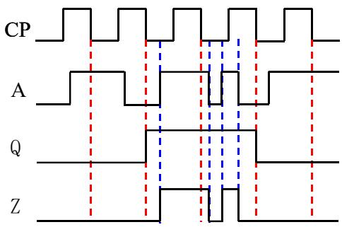

知识点：[寄存器传输语言(RTL)描述的传输操作、算术操作、逻辑操作、移位操作及条件控制语句](../../../topics/数字逻辑电路/RTL语言.md)、[数字系统的基本模型（数据处理器与控制器）及对最小时钟周期、异步信号同步化的约定](../../../topics/数字逻辑电路/数字系统模型.md)

### 5.15

画出图 P5.15 电路中 Q 端的波形。

解：Q 端波形如图 P5.15 所示。

知识点：[数字系统的基本模型（数据处理器与控制器）及对最小时钟周期、异步信号同步化的约定](../../../topics/数字逻辑电路/数字系统模型.md)

### 5.16

试作出图 P5.16 电路中 $Q_A$、$Q_B$ 的波形。

解：特征方程为：

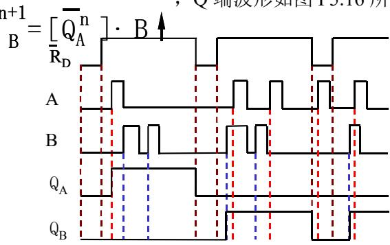

，Q 端波形如图 P5.16 所示。

知识点：[数字系统的基本模型（数据处理器与控制器）及对最小时钟周期、异步信号同步化的约定](../../../topics/数字逻辑电路/数字系统模型.md)

### 5.17

试作出图 P5.17 电路中 Q 的波形。

解：特征方程为：$Q_2^{n+1}=[\overline{Q}_2^n]\cdot Q_1$，$Q_1=[Q_1$，Q 端波形如图 P5.17 所示。

## 5.18

试作出图 P5.18 电路中 $\mathrm{Q}_1$ 和 $\mathrm{Q}_2$ 的波形（设 $\mathrm{Q}_1$ 和 $\mathrm{Q}_2$ 的初态均为 $0$），并说明 $\mathrm{Q}_1$ 和 $\mathrm{Q}_2$ 对于 $\mathrm{CP}_2$ 各为多少分频。$(\frac{f_{Q_1}}{f_{CP_2}} = ?, \frac{f_{Q_2}}{f_{CP_2}} = ?)$

答案：
特征方程为：
$$ \mathrm{Q}_1^{n+1} = [\overline{\mathrm{Q}}_1^n] \cdot \mathrm{CP}_1 \uparrow $$
$$ \mathrm{Q}_2^{n+1} = [\mathrm{Q}_1^n \cdot \overline{\mathrm{Q}}_2^n] \cdot \mathrm{CP}_2 \uparrow $$
$\mathrm{Q}_1$ 和 $\mathrm{Q}_2$ 对于 $\mathrm{CP}_2$ 都是 4 分频，即 $\frac{f_{Q_1}}{f_{CP_2}} = \frac{1}{4}, \frac{f_{Q_2}}{f_{CP_2}} = \frac{1}{4}$。

## 5.19

已知电路如图 P5.19，试作出 Q 端的波形。设 Q 的初态为“0”。

答案：
特征方程为：
$$ \mathrm{Q}^{n+1} = [\overline{\mathrm{A}}] \cdot \mathrm{CP} \uparrow $$
Q 端波形如图 P5.19 所示。

## 5.20

已知输入 $\mathrm{u_I}$、输出 $\mathrm{u_O}$ 波形分别如图 P5.20 所示，试用两个 D 触发器将该输入波形 $\mathrm{u_I}$ 转换成输出波形 $\mathrm{u_O}$。

答案：
输出 $\mathrm{u_O}$ 是对输入 $\mathrm{u_I}$ 的 4 分频，而采用 1 个 DFF 可实现 2 分频，故实现电路如图 P5.20 所示。

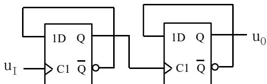

## 5.21

试分别用公式法和列表图解法将主从 SR 触发器转换成 JK 触发器。

答案：
**解 1（公式法）：**
令新老触发器的次态方程相等，则有 $\mathrm{S}=\mathrm{J}\bar{\mathrm{Q}}^{\mathrm{n}}$，$\mathrm{R}=\mathrm{K}\mathrm{Q}^{\mathrm{n}}$。但不满足约束条件 $\mathrm{SR}=0$。改为：
$$ \mathrm{S} = \mathrm{J}\bar{\mathrm{Q}}^{\mathrm{n}} $$
$$ \mathrm{R} = \mathrm{K}\mathrm{Q}^{\mathrm{n}} $$

**解 2（列表图解法）：**
(1) 列综合表，如下所示：

| J | K | $Q^n$ | $Q^{n+1}$ | S | R |
| :---: | :---: | :---: | :---: | :---: | :---: |
| 0 | 0 | 0 | 0 | 0 | ∅ |
| 0 | 0 | 1 | 1 | ∅ | 0 |
| 0 | 1 | 0 | 0 | 0 | ∅ |
| 0 | 1 | 1 | 0 | 0 | 1 |
| 1 | 0 | 0 | 1 | 1 | 0 |
| 1 | 0 | 1 | 1 | ∅ | 0 |
| 1 | 1 | 0 | 1 | 1 | 0 |
| 1 | 1 | 1 | 0 | 0 | 1 |

(2) 作卡诺图，如下图所示：

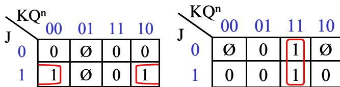

由卡诺图得：
$$ \mathrm{S} = \mathrm{J}\overline{\mathrm{Q}}^{\mathrm{n}} $$
$$ \mathrm{R} = \mathrm{K}\mathrm{Q}^{\mathrm{n}} $$

(3) 电路图如下：

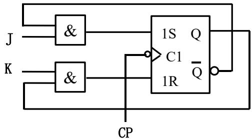

知识点：[数字系统的基本模型（数据处理器与控制器）及对最小时钟周期、异步信号同步化的约定](../../../topics/数字逻辑电路/数字系统模型.md)、[寄存器传输语言(RTL)描述的传输操作、算术操作、逻辑操作、移位操作及条件控制语句](../../../topics/数字逻辑电路/RTL语言.md)
