# 《数字电路与系统设计》第7章 脉冲信号的产生和变换（课件）

原件的每一页，下面附识别出的文字。

### 第七章 脉冲信号的产生和变换

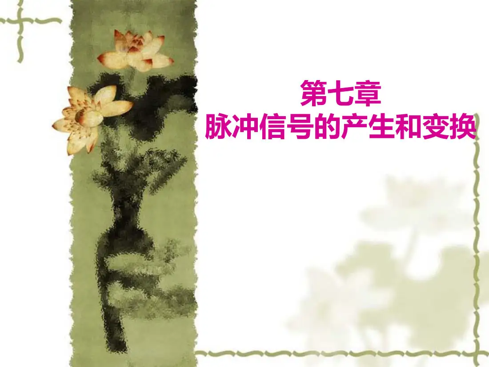

原文：

第七章 脉冲信号的产生和变换

### 7.1 概述

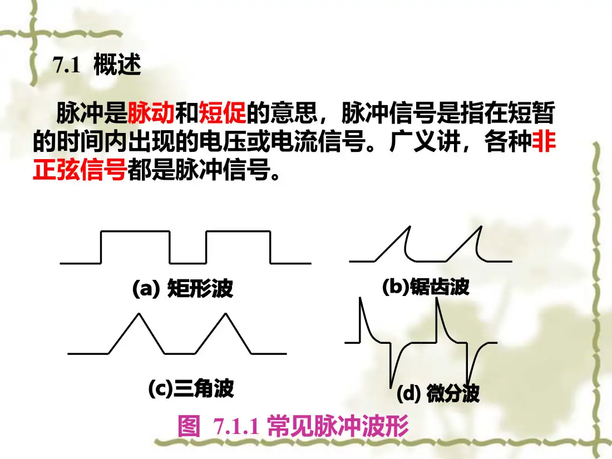

原文：

7.1 概述

脉冲是脉动和短促的意思，脉冲信号是指在短暂的时间内出现的电压或电流信号。广义讲，各种非正弦信号都是脉冲信号。

### 2.上升时间 $t_{\mathrm{r}}$ 5.脉冲周期T

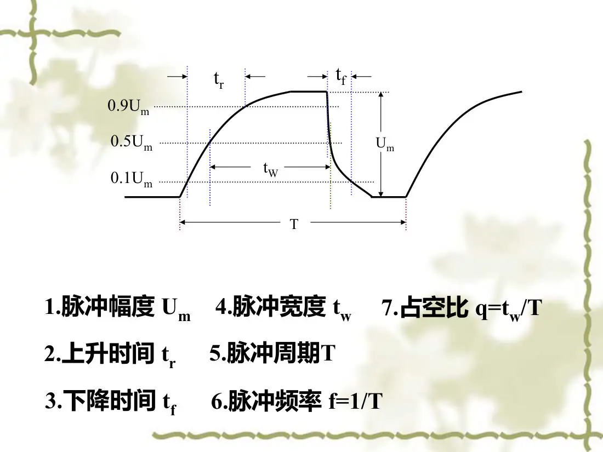

原文：

1.脉冲幅度 $\mathrm{U}_{\mathrm{m}}$ 4.脉冲宽度 $t_{\mathrm{w}}$ 7.占空比 $q = t_{\mathrm{w}} / T$

2.上升时间 $t_{\mathrm{r}}$ 5.脉冲周期T

3. 下降时间 $t_{\mathrm{f}}$ 6. 脉冲频率 $\mathrm{f} = 1 / \mathrm{T}$

### ①脉冲产生电路直接产生，如多谐振荡器；

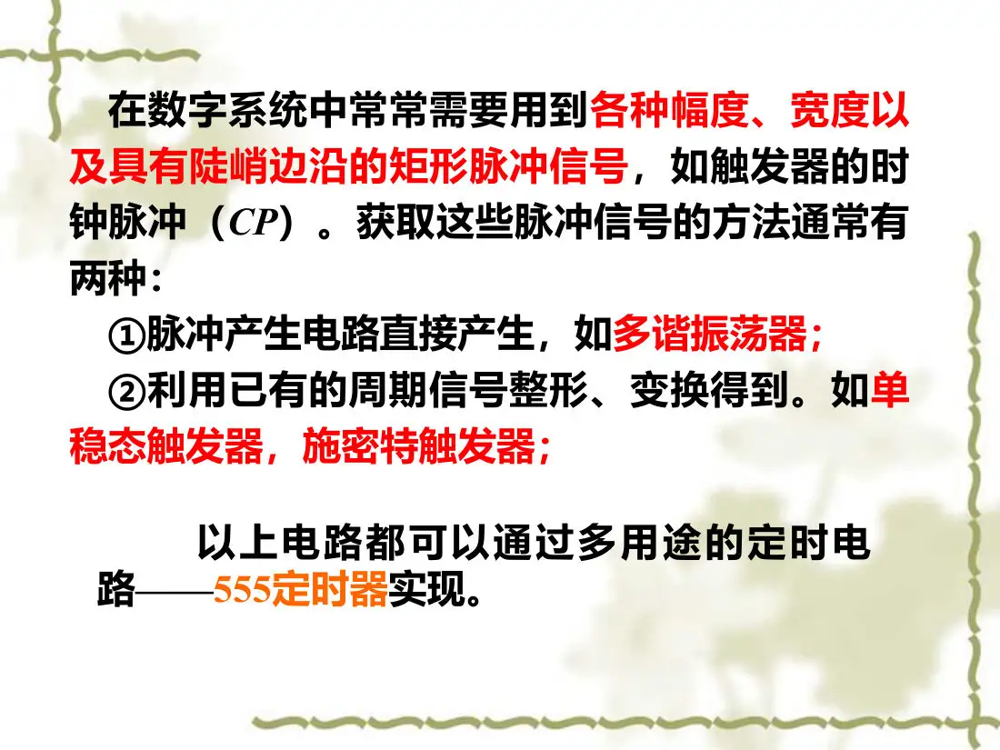

原文：

在数字系统中常常需要用到各种幅度、宽度以及具有陡峭边沿的矩形脉冲信号，如触发器的时钟脉冲（CP）。获取这些脉冲信号的方法通常有两种：

①脉冲产生电路直接产生，如多谐振荡器；

②利用已有的周期信号整形、变换得到。如单稳态触发器，施密特触发器；

以上电路都可以通过多用途的定时电路——555定时器实现。

### 7.2 集成定时器

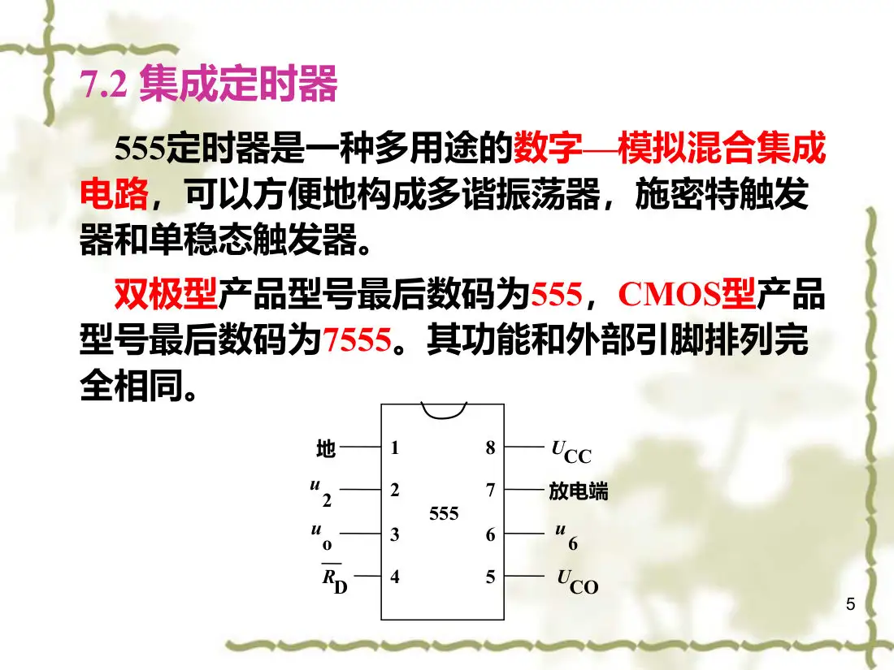

原文：

7.2 集成定时器

555定时器是一种多用途的数字—模拟混合集成电路，可以方便地构成多谐振荡器，施密特触发器和单稳态触发器。

双极型产品型号最后数码为555，CMOS型产品型号最后数码为7555。其功能和外部引脚排列完全相同。

$$
\begin{array}{c c c c} \text {地} & 1 & 8 & U _ {\mathrm{CC}} \\ u _ {2} & 2 & 7 & \text {放电端} \\ u _ {0} & 3 & 6 & u _ {6} \\ \overline {{R}} _ {\mathrm{D}} & 4 & 5 & U _ {\mathrm{CO}} \end{array}
$$

5

### 555定时器的内部电路包括以下几部分：

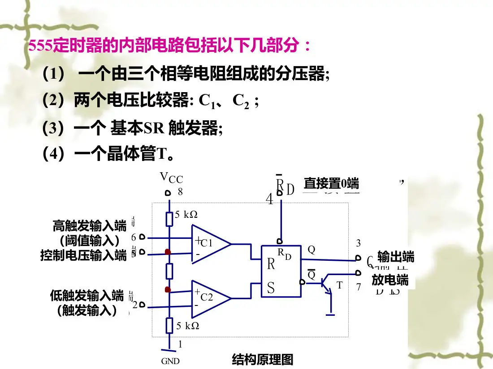

原文：

555定时器的内部电路包括以下几部分：

(1) 一个由三个相等电阻组成的分压器;

(2) 两个电压比较器: $C_{1} 、 C_{2}$ ;

(3) 一个基本SR触发器;

(4) 一个晶体管T。

高触发输入端
(阈值输入)
控制电压输入端

低触发输入端
(触发输入)

### 高触发输入端

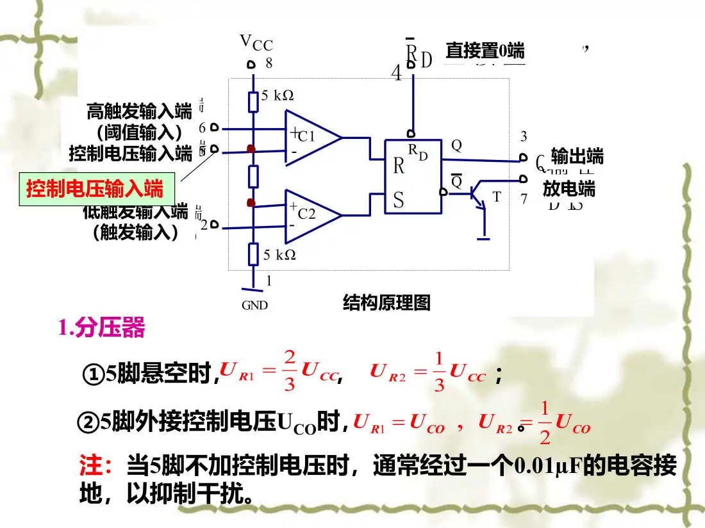

原文：

高触发输入端
(阈值输入)
控制电压输入端

控制电压输入端

低触发输入端
(触发输入)

1. 分压器

①5脚悬空时, $U_{R1}=\frac{2}{3}U_{CC},\quad U_{R2}=\frac{1}{3}U_{CC}$ ;

②5脚外接控制电压 $U_{CO}$ 时, $U_{R1}=U_{CO}$ , $U_{R2}=\frac{1}{2}U_{CO}$

注：当5脚不加控制电压时，通常经过一个0.01μF的电容接地，以抑制干扰。

### GND

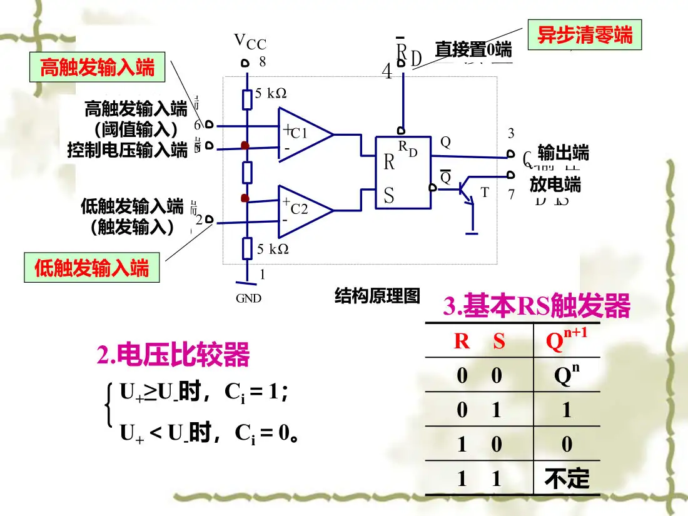

原文：

GND

异步清零端

高触发输入端

高触发输入端
(阈值输入)
控制电压输入端

低触发输入端
(触发输入)

低触发输入端

2.电压比较器

$\left\{ \begin{array}{l} \mathrm{U}_{+} \geq \mathrm{U}_{-}\text {时, } \mathrm{C}_{\mathrm{i}} = 1; \\ \mathrm{U}_{+} < \mathrm{U}_{-}\text {时, } \mathrm{C}_{\mathrm{i}} = 0. \end{array} \right.$

3.基本RS触发器

<table><tr><td colspan="2">R S</td><td> $Q^{n+1}$ </td></tr><tr><td>0</td><td>0</td><td> $Q^n$ </td></tr><tr><td>0</td><td>1</td><td>1</td></tr><tr><td>1</td><td>0</td><td>0</td></tr><tr><td>1</td><td>1</td><td>不定</td></tr></table>

### 高触发输入端

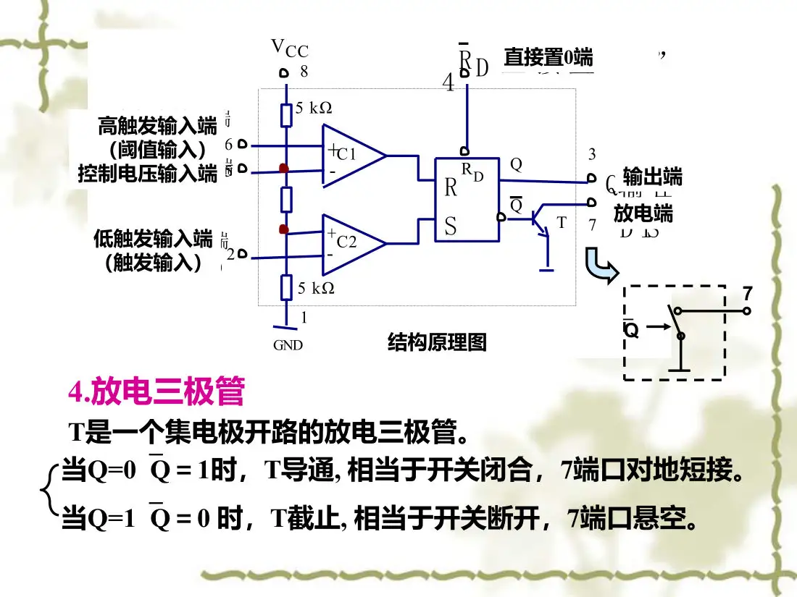

原文：

高触发输入端
(阈值输入)
控制电压输入端

低触发输入端
(触发输入)

4. 放电三极管

T是一个集电极开路的放电三极管。

$\left\{ \begin{array}{l}\text {当} Q = 0 \overline{Q} = 1 \text {时, T导通, 相当于开关闭合, 7端口对地短接。} \\ \text {当} Q = 1 \overline{Q} = 0 \text {时, T截止, 相当于开关断开, 7端口悬空。} \end{array} \right.$

### 二、功能分析 Vcc 8

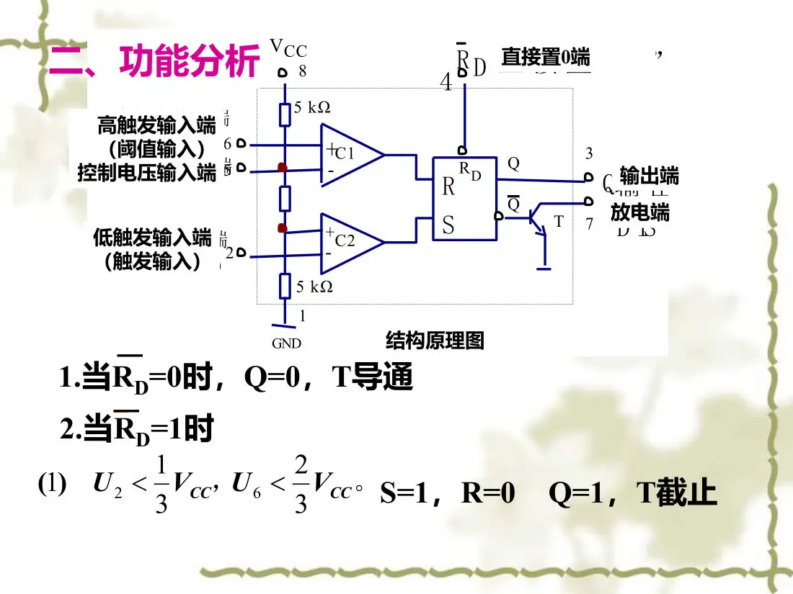

原文：

二、功能分析 Vcc 8

高触发输入端
(阈值输入)
控制电压输入端

低触发输入端
(触发输入)

1. 当 $\overline{R_{D}}=0$ 时，Q=0，T 导通

2. 当 $\overline{\mathbf{R}}_{\mathrm{D}} = 1$ 时

(1) $U_{2} < \frac{1}{3} V_{cc}, U_{6} < \frac{2}{3} V_{cc}$ S=1, R=0 Q=1, T截止

### 二、功能分析

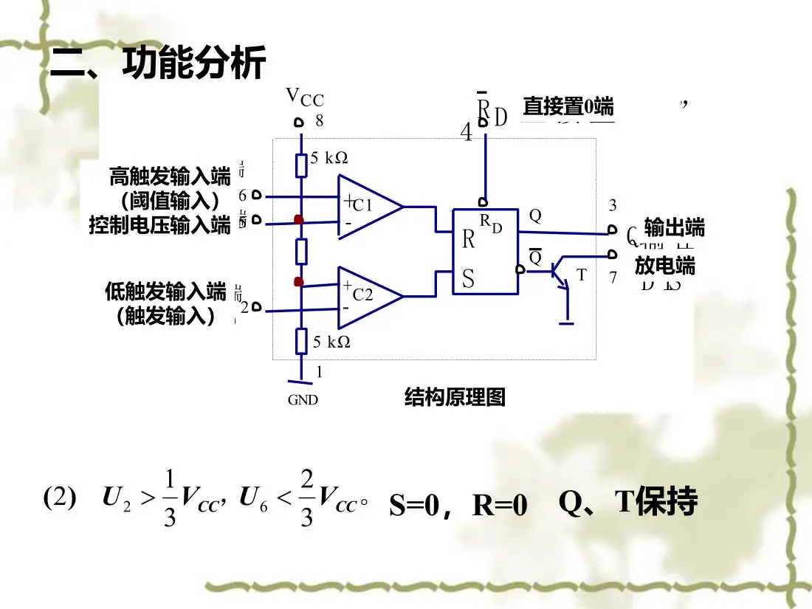

原文：

二、功能分析

高触发输入端
(阈值输入)
控制电压输入端

低触发输入端
(触发输入)

(2)

$U_{2}>\frac{1}{3}V_{cc},\ U_{6}<\frac{2}{3}V_{cc^{\circ}}\quad S=0,\ R=0\quad Q、T保持$

### 二、功能分析

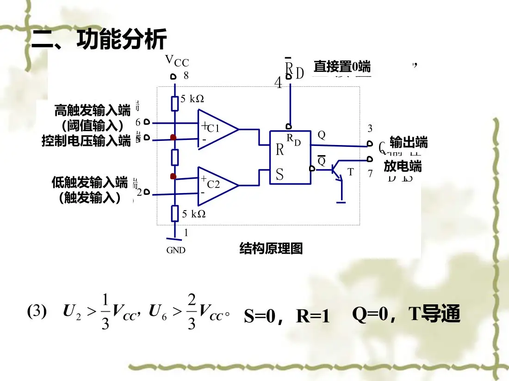

原文：

二、功能分析

高触发输入端
(阈值输入)
控制电压输入端

低触发输入端
(触发输入)

$$
U _ {2} > \frac {1}{3} V _ {c c}, U _ {6} > \frac {2}{3} V _ {c c ^ {\circ}} \quad \mathrm{S=0,R=1Q=0,T导通}\tag{3}
$$

### 二、功能分析

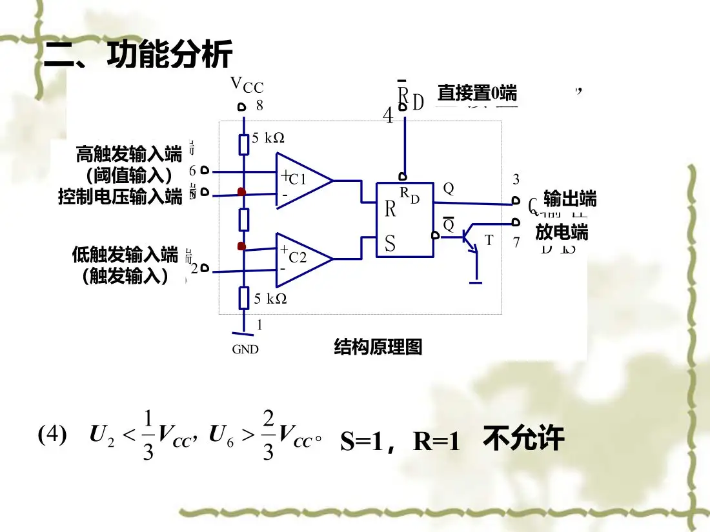

原文：

二、功能分析

高触发输入端
(阈值输入)
控制电压输入端

低触发输入端
(触发输入)

$$
U _ {2} <   \frac {1}{3} V _ {c c}, U _ {6} > \frac {2}{3} V _ {c c ^ {\circ}} \quad \mathrm{S=1,R=1} \text {不允许}\tag{4}
$$

### 表 7.2.1 555定时器功能表

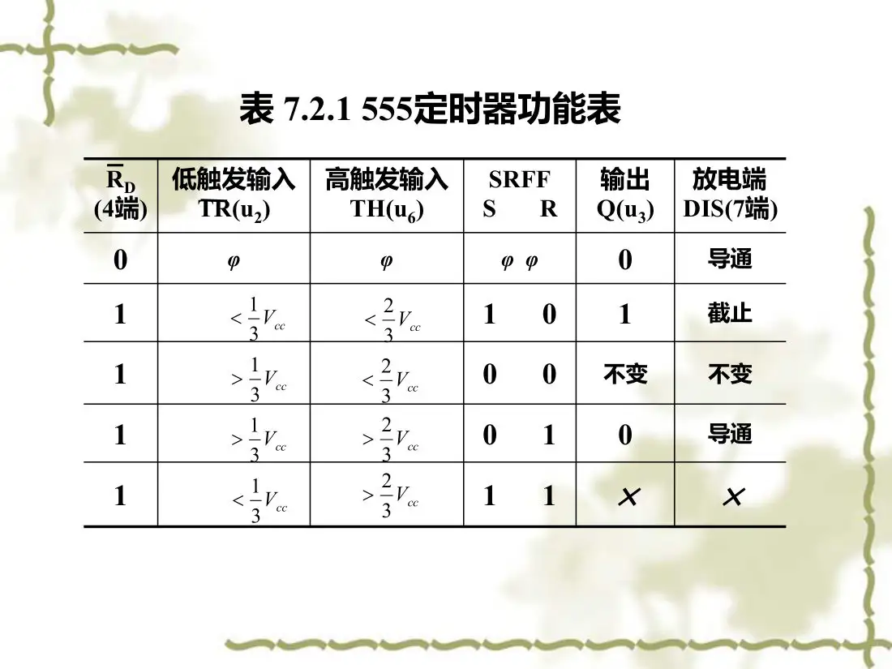

原文：

表 7.2.1 555定时器功能表
<table><tr><td> $\overline{R}_{D}$ (4端)</td><td>低触发输入TR(u2)</td><td>高触发输入TH(u6)</td><td>SRFFS R</td><td>输出Q(u3)</td><td>放电端DIS(7端)</td></tr><tr><td>0</td><td>φ</td><td>φ</td><td>φ φ</td><td>0</td><td>导通</td></tr><tr><td>1</td><td>&lt; $\frac{1}{3}V_{cc}$ </td><td>&lt; $\frac{2}{3}V_{cc}$ </td><td>1 0</td><td>1</td><td>截止</td></tr><tr><td>1</td><td>&gt;  $\frac{1}{3}V_{cc}$ </td><td>&lt; $\frac{2}{3}V_{cc}$ </td><td>0 0</td><td>不变</td><td>不变</td></tr><tr><td>1</td><td>&gt;  $\frac{1}{3}V_{cc}$ </td><td>&gt;  $\frac{2}{3}V_{cc}$ </td><td>0 1</td><td>0</td><td>导通</td></tr><tr><td>1</td><td>&lt; $\frac{1}{3}V_{cc}$ </td><td>&gt;  $\frac{2}{3}V_{cc}$ </td><td>1 1</td><td>×</td><td>×</td></tr></table>

### 7.3 555定时器应用

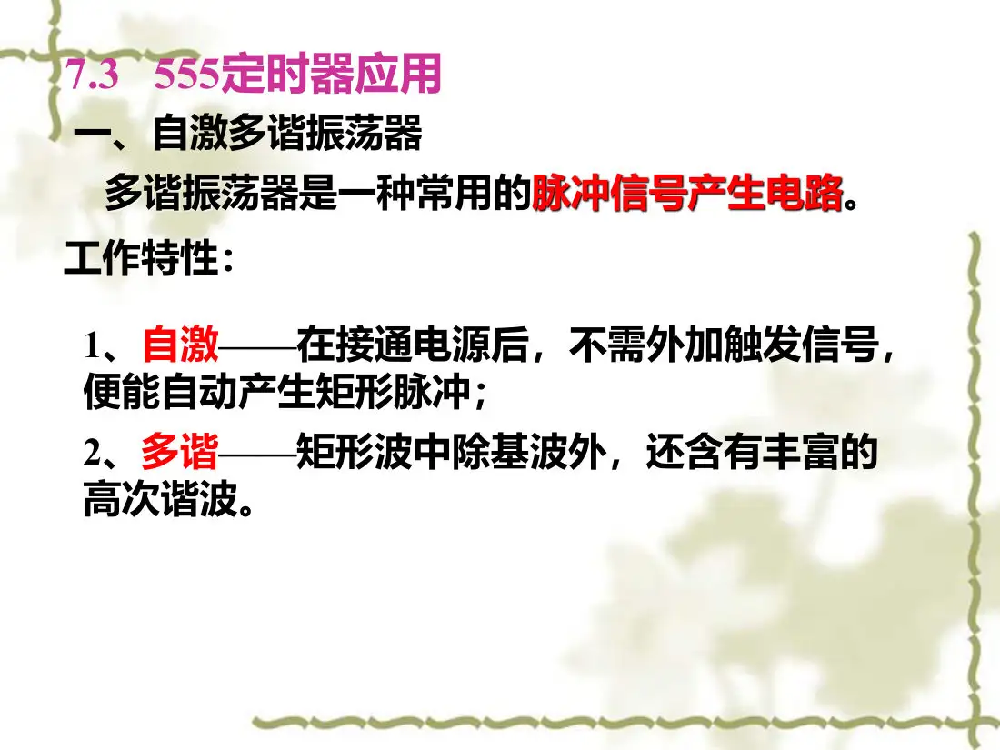

原文：

7.3 555定时器应用

一、自激多谐振荡器

多谐振荡器是一种常用的脉冲信号产生电路。

工作特性:

1、自激——在接通电源后，不需外加触发信号，便能自动产生矩形脉冲；

2、多谐——矩形波中除基波外，还含有丰富的高次谐波。

### 工作原理:设初始化 $u_{C}=0V,$ 0

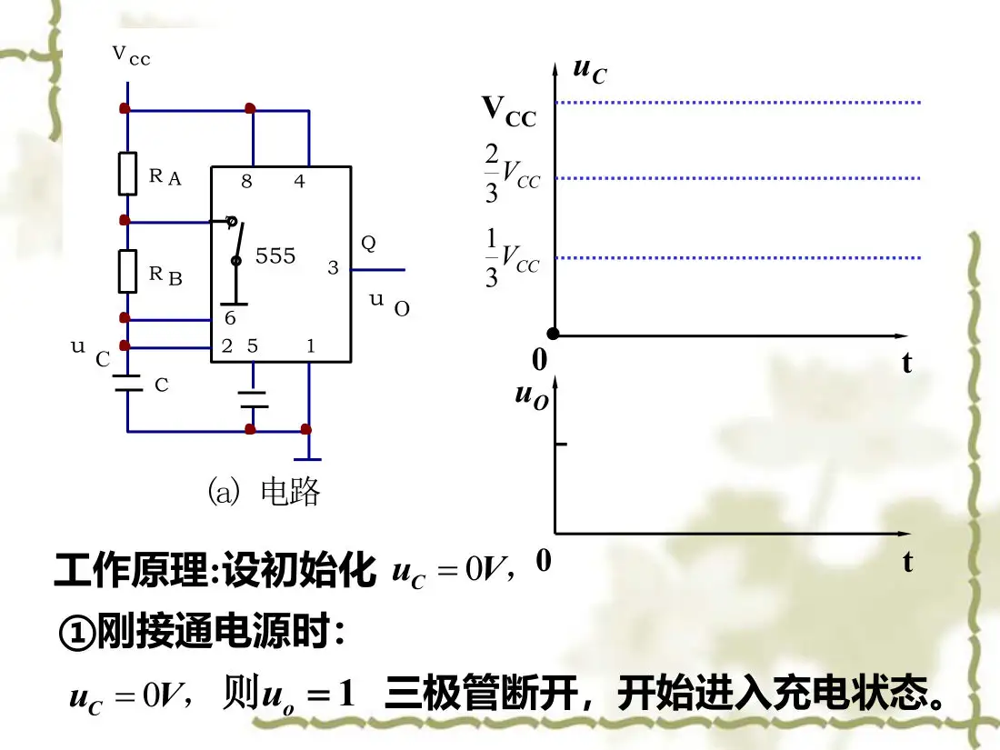

原文：

工作原理:设初始化 $u_{C}=0V,$ 0

①刚接通电源时:

$u_{C}=0V$ ，则 $u_{o}=1$ 三极管断开，开始进入充电状态。

### ②充电阶段：

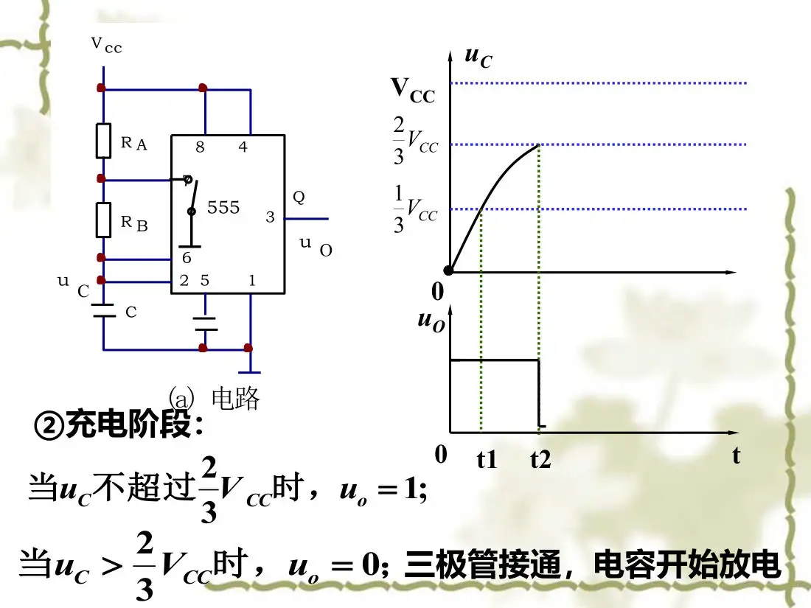

原文：

②充电阶段：

当 $u_{c}$ 不超过 $\frac{2}{3}V_{cc}$ 时， $u_{o}=1;$

当 $u_{c} > \frac{2}{3} V_{cc}$ 时， $u_{o} = 0$ ; 三极管接通，电容开始放电

### ③放电阶段：

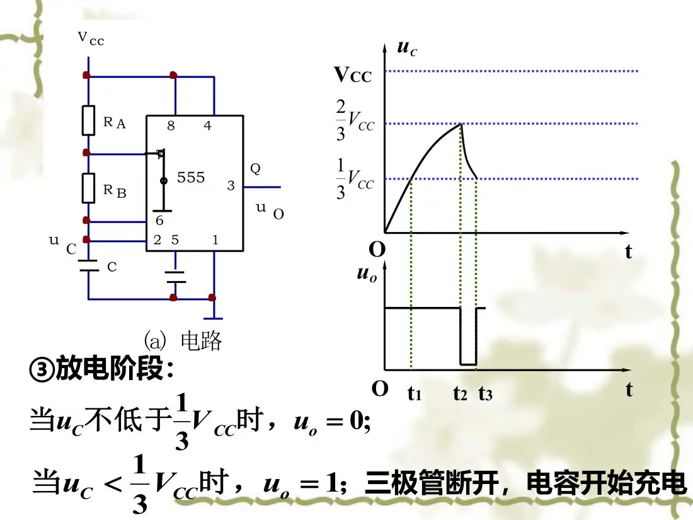

原文：

③放电阶段：

当 $u_{c}$ 不低于 $\frac{1}{3}V_{cc}$ 时， $u_{o}=0;$

当 $u_{c}<\frac{1}{3}V_{cc}$ 时， $u_{o}=1$ ；三极管断开，电容开始充电

### 3. 矩形波参数

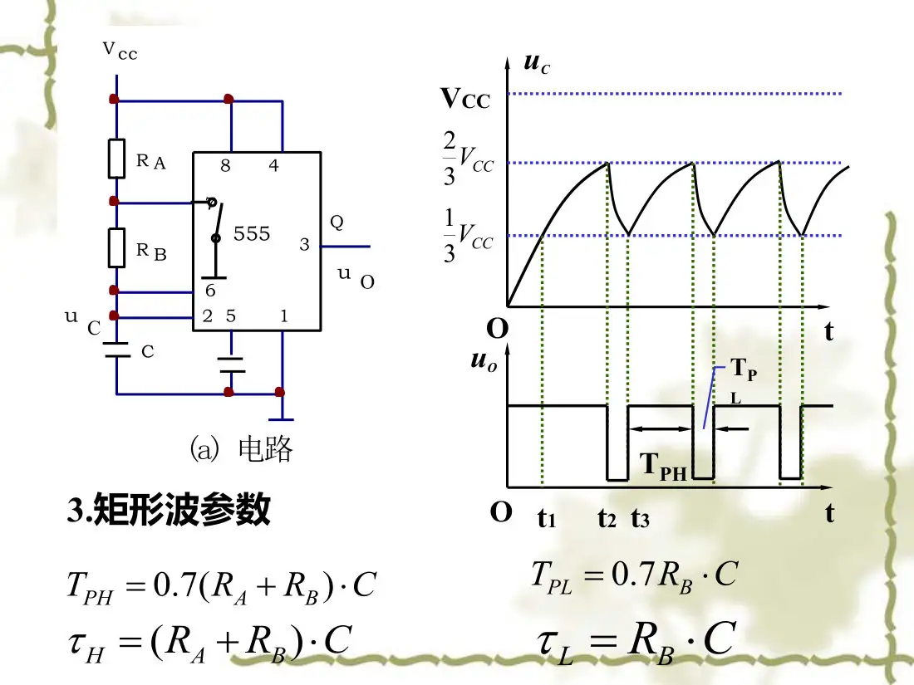

原文：

3. 矩形波参数

$$
T _ {P H} = 0. 7 (R _ {A} + R _ {B}) \cdot C
$$

$$
\tau_ {H} = (R _ {A} + R _ {B}) \cdot C
$$

$$
T _ {P L} = 0. 7 R _ {B} \cdot C
$$

$$
\tau_ {L} = R _ {B} \cdot C
$$

### $$

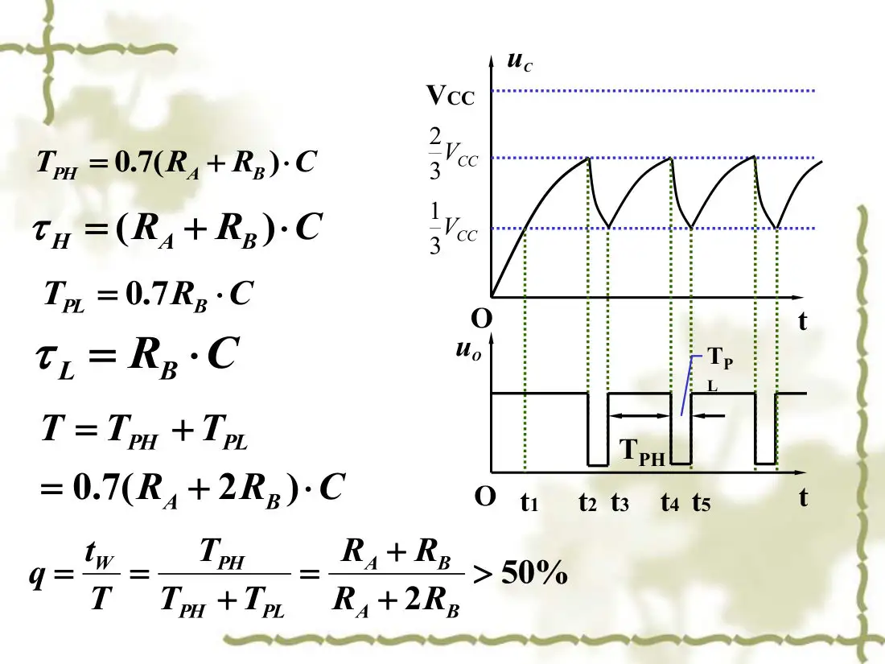

原文：

$$
T _ {P H} = 0. 7 (R _ {A} + R _ {B}) \cdot C
$$

$$
\boldsymbol {\tau} _ {H} = (\boldsymbol {R} _ {A} + \boldsymbol {R} _ {B}) \cdot \boldsymbol {C}
$$

$$
T _ {P L} = 0. 7 R _ {B} \cdot C
$$

$$
\boldsymbol {\tau} _ {L} = \boldsymbol {R} _ {B} \cdot \boldsymbol {C}
$$

$$
\begin{array}{l} {T = T _ {P H} + T _ {P L}} \\ {= 0. 7 (R _ {A} + 2 R _ {B}) \cdot C} \end{array}
$$

$$
q = \frac {t _ {W}}{T} = \frac {T _ {P H}}{T _ {P H} + T _ {P L}} = \frac {R _ {A} + R _ {B}}{R _ {A} + 2 R _ {B}} > 50
$$

### 4.占空比可变的多谐振荡器

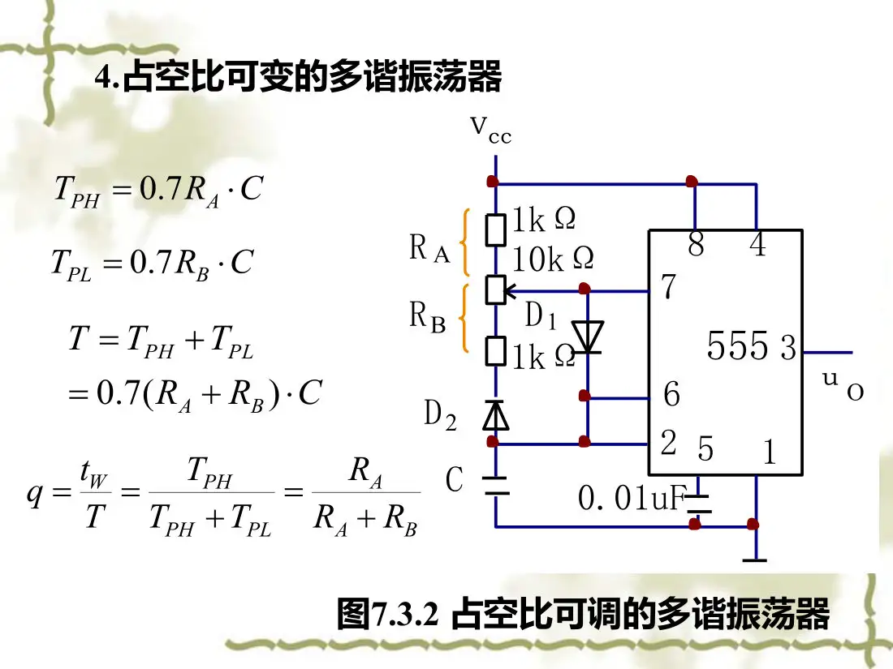

原文：

4.占空比可变的多谐振荡器

$$
\begin{array}{l} T _ {P H} = 0. 7 R _ {A} \cdot C \\ T _ {P L} = 0. 7 R _ {B} \cdot C \\ T = T _ {P H} + T _ {P L} \\ = 0. 7 (R _ {A} + R _ {B}) \cdot C \\ q = \frac {t _ {W}}{T} = \frac {T _ {P H}}{T _ {P H} + T _ {P L}} = \frac {R _ {A}}{R _ {A} + R _ {B}} \end{array}
$$

图7.3.2 占空比可调的多谐振荡器例 试用555定时器设计一个振荡周期为1秒，输出脉冲占空比q=2/3的多谐振荡器。（取C=10μF）

### 解：

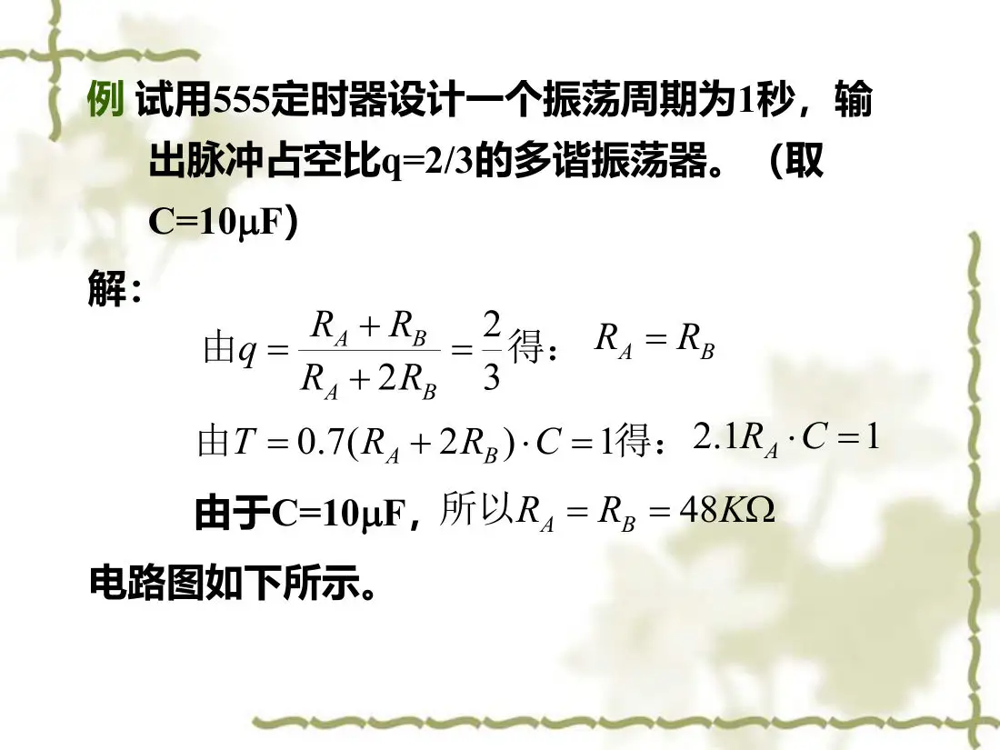

原文：

解：

由 $q = \frac{R_A + R_B}{R_A + 2R_B} = \frac{2}{3}$ 得： $R_{A} = R_{B}$

由 $T = 0.7(R_{A} + 2R_{B})\cdot C = 1$ 得： $2.1R_{A}\cdot C = 1$

由于C=10μF，所以 $R_{A}=R_{B}=48K\Omega$ 电路图如下所示。

### 第 23 页

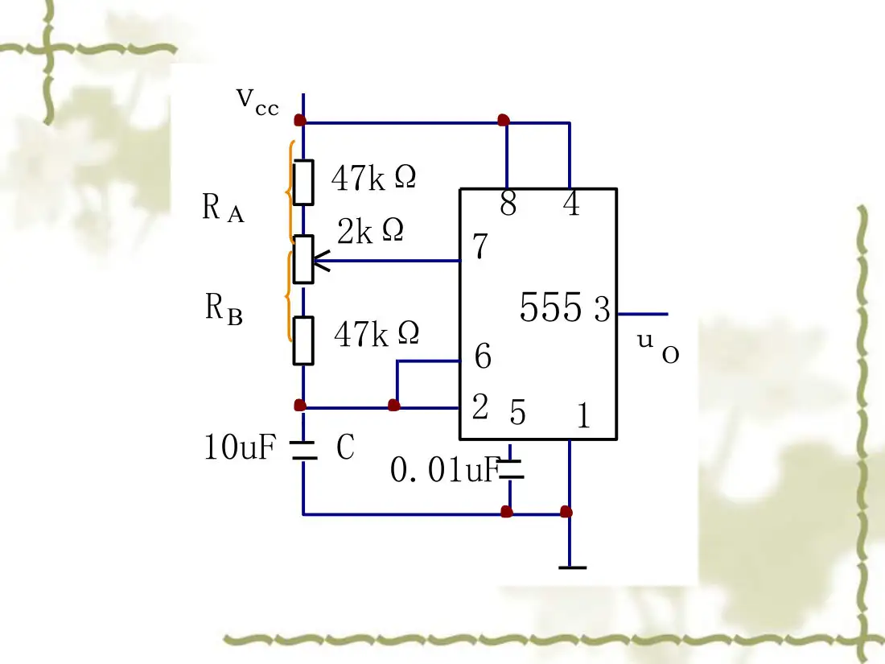

### 第 24 页

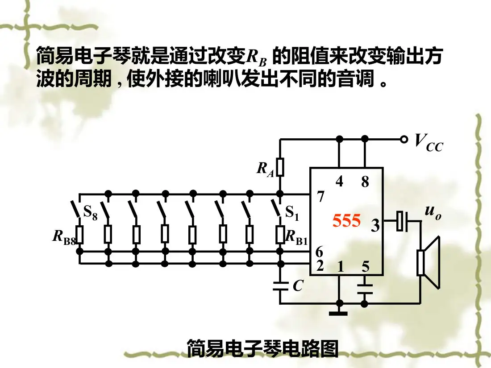

原文：

简易电子琴就是通过改变 $R_{B}$ 的阻值来改变输出方波的周期，使外接的喇叭发出不同的音调。

### 7.3.2施密特触发器

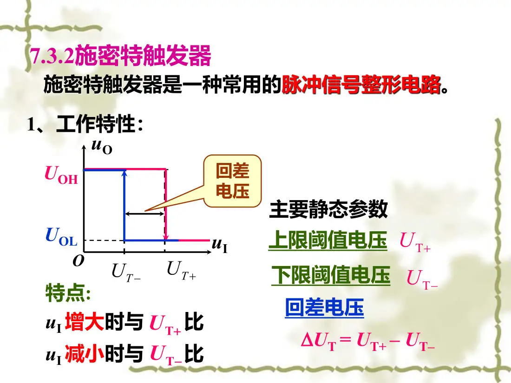

原文：

7.3.2施密特触发器

施密特触发器是一种常用的脉冲信号整形电路。

1、工作特性：

特点:

$u_{I}$ 增大时与 $U_{T+}$ 比

$u_{I}$ 减小时与 $U_{T-}$ 比

主要静态参数

上限阈值电压 $U_{T+}$

下限阈值电压 $U_{\mathrm{T-}}$

回差电压

$$
\Delta U _ {\mathrm{T}} = U _ {\mathrm{T+}} - U _ {\mathrm{T-}}
$$

### 第 26 页

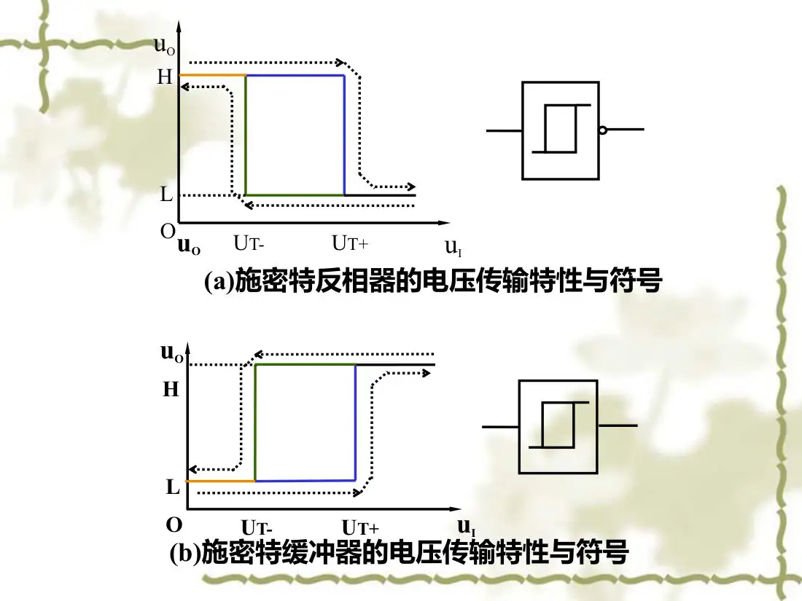

### 2. 由555定时器构成的施密特反相器

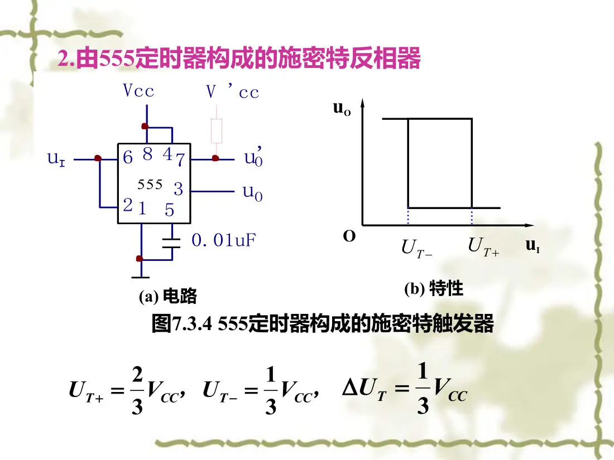

原文：

2. 由555定时器构成的施密特反相器

$$
U _ {T +} = \frac {2}{3} V _ {c c}, U _ {T -} = \frac {1}{3} V _ {c c}, \Delta U _ {T} = \frac {1}{3} V _ {c c}
$$

### 施密特反相器和普通反相器的比较

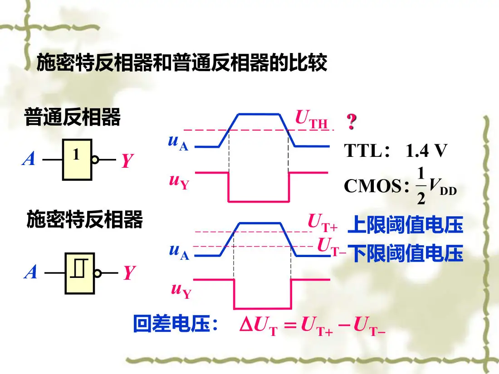

原文：

施密特反相器和普通反相器的比较

普通反相器

$$
A \text { —— } 1 \text { —— } Y
$$

施密特反相器

TTL: 1.4 V
CMOS: $\frac{1}{2} V_{\mathrm{DD}}$

$U_{T+}$ 上限阈值电压 $-U_{T-}$ 下限阈值电压

回差电压: $\Delta U_{\mathrm{T}} = U_{\mathrm{T+}} - U_{\mathrm{T-}}$

### 3.施密特触发器典型应用

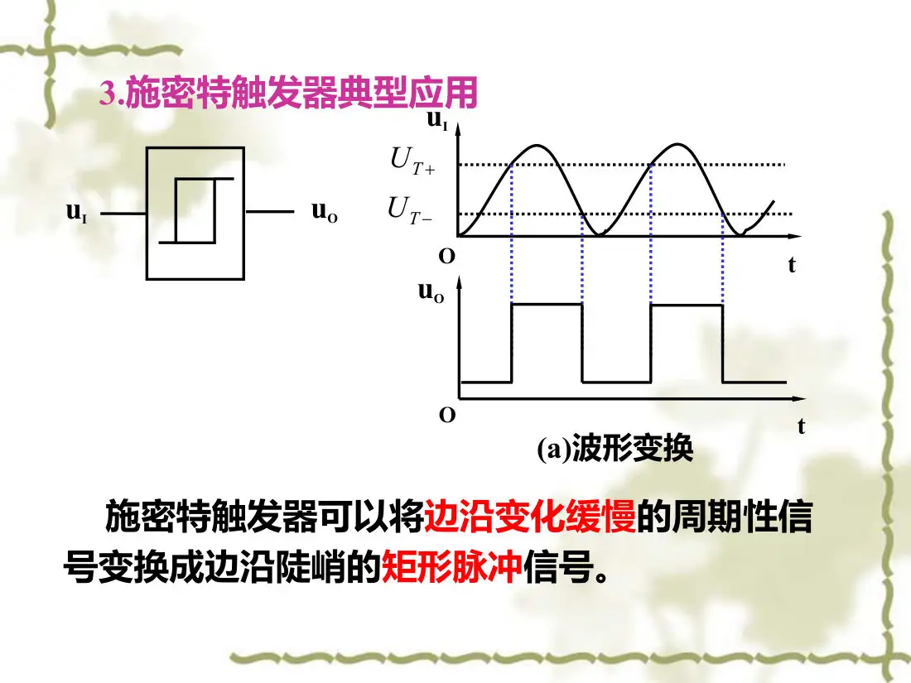

原文：

3.施密特触发器典型应用

施密特触发器可以将边沿变化缓慢的周期性信号变换成边沿陡峭的矩形脉冲信号。

### 第 30 页

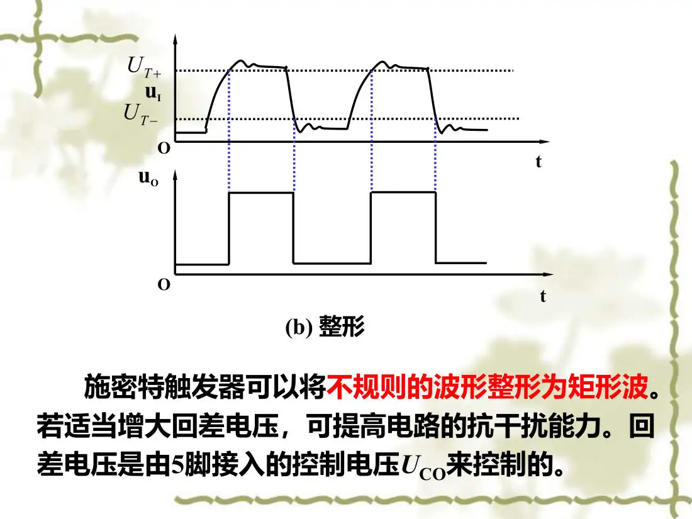

原文：

施密特触发器可以将不规则的波形整形为矩形波。若适当增大回差电压，可提高电路的抗干扰能力。回差电压是由5脚接入的控制电压 $U_{CO}$ 来控制的。

### 第 31 页

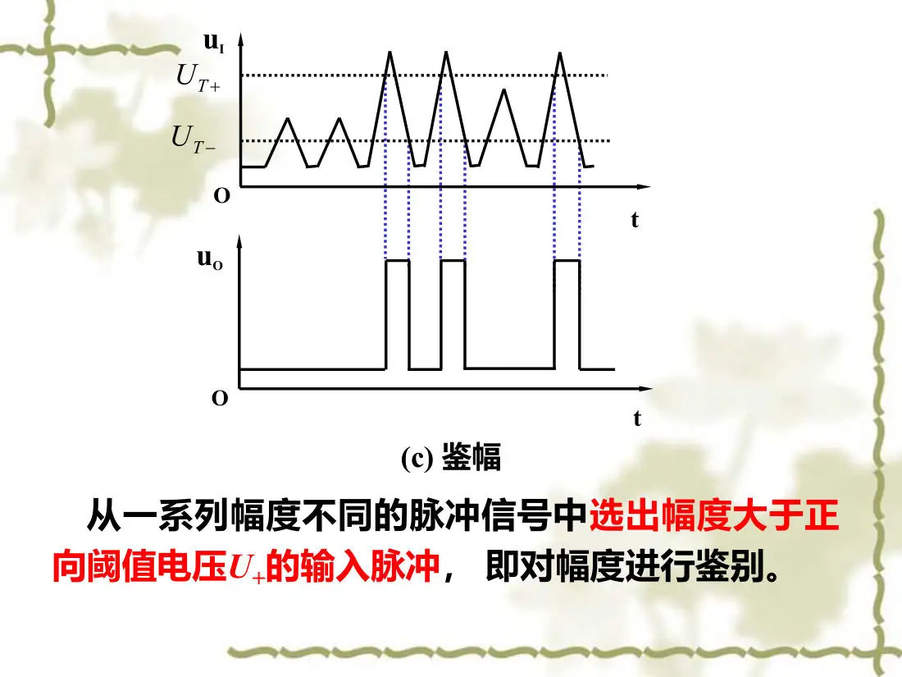

原文：

从一系列幅度不同的脉冲信号中选出幅度大于正向阈值电压 $U_{+}$ 的输入脉冲，即对幅度进行鉴别。

### 7.3.3单稳态触发器

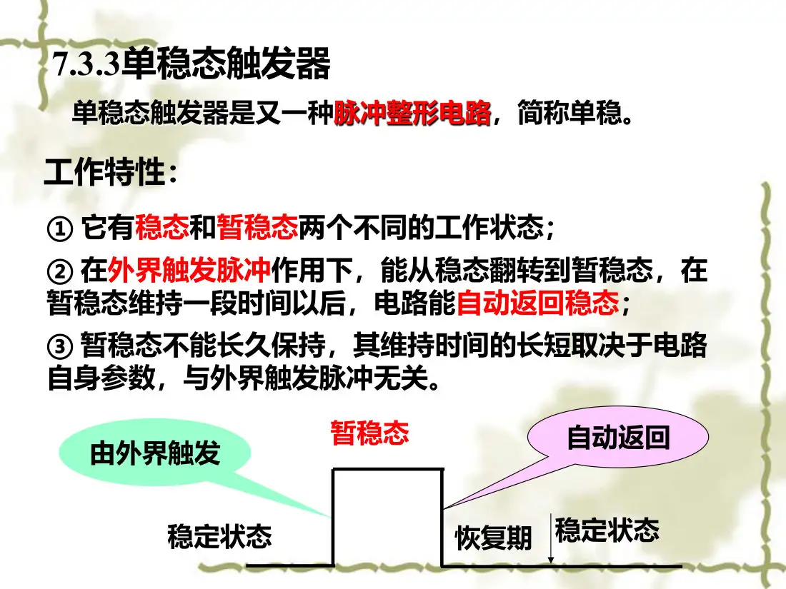

原文：

7.3.3单稳态触发器

单稳态触发器是又一种脉冲整形电路，简称单稳。

工作特性：

① 它有稳态和暂稳态两个不同的工作状态；

② 在外界触发脉冲作用下，能从稳态翻转到暂稳态，在暂稳态维持一段时间以后，电路能自动返回稳态；

③ 暂稳态不能长久保持，其维持时间的长短取决于电路自身参数，与外界触发脉冲无关。

由外界触发

### 一、555定时器构成的单稳态触发器

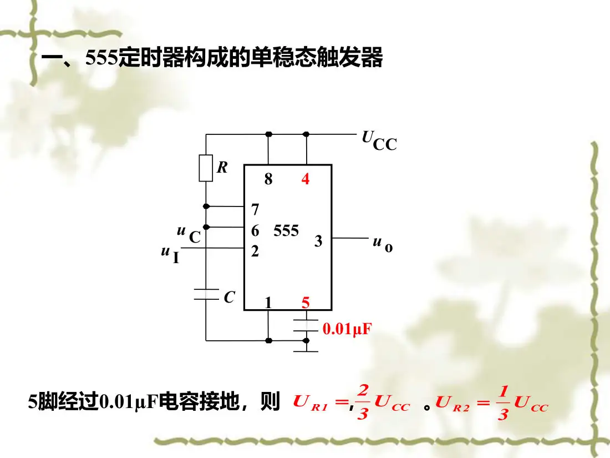

原文：

一、555定时器构成的单稳态触发器

5脚经过0.01μF电容接地, 则 $U_{R1} = \frac{2}{3} U_{CC}$ 。 $U_{R2} = \frac{1}{3} U_{CC}$

### 1. 工作原理

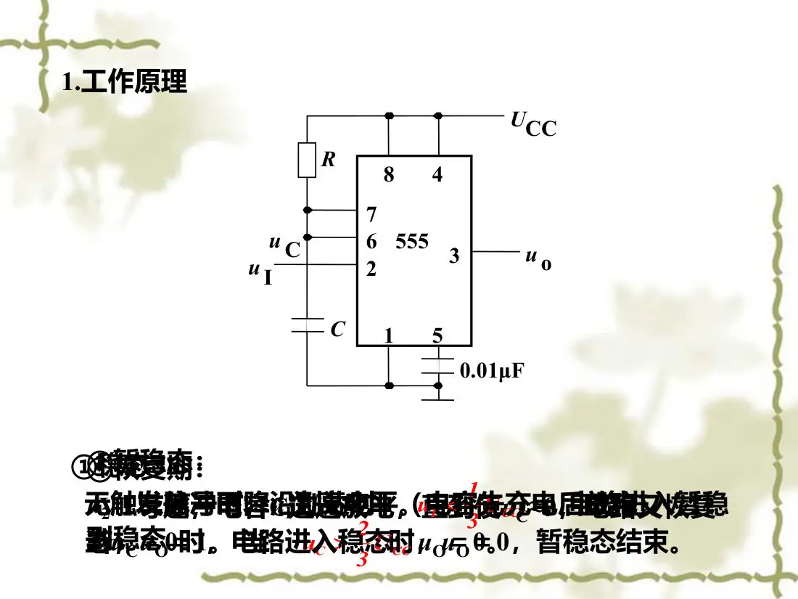

原文：

1. 工作原理

① 辍穏廬：

无触发随浮电容远通滤电，(直方使充电后电能又恢复稳态时。电路进入稳态时 $\mu_0\nu_0\theta_0.0$ ，暂稳态结束。

### 第 35 页

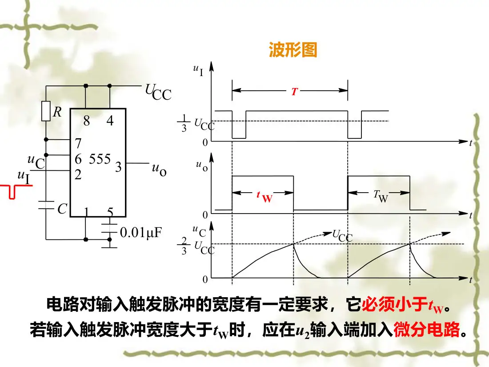

原文：

电路对输入触发脉冲的宽度有一定要求，它必须小于 $t_{\mathrm{W}}$ 。若输入触发脉冲宽度大于 $t_{\mathrm{W}}$ 时，应在 $u_{2}$ 输入端加入微分电路。

### 2. 输出脉冲宽度 $t_{\mathrm{W}}$

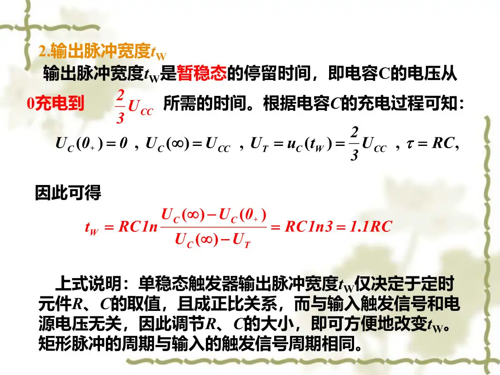

原文：

2. 输出脉冲宽度 $t_{\mathrm{W}}$

输出脉冲宽度 $t_\mathrm{w}$ 是暂稳态的停留时间，即电容C的电压从

0充电到 $\frac{2}{3}U_{cc}$ 所需的时间。根据电容C的充电过程可知：

$$
U _ {C} (\theta_ {+}) = 0, U _ {C} (\infty) = U _ {C C}, U _ {T} = u _ {C} (t _ {W}) = \frac {2}{3} U _ {C C}, \tau = R C,
$$

因此可得

$$
t _ {W} = R C 1 n \frac {U _ {C} (\infty) - U _ {C} (\theta_ {+})}{U _ {C} (\infty) - U _ {T}} = R C 1 n 3 = 1. 1 R C
$$

上式说明：单稳态触发器输出脉冲宽度 $t_{\mathrm{W}}$ 仅决定于定时元件R、C的取值，且成正比关系，而与输入触发信号和电源电压无关，因此调节R、C的大小，即可方便地改变 $t_{\mathrm{W}}$ 。矩形脉冲的周期与输入的触发信号周期相同。

### 二、单稳态触发器的应用

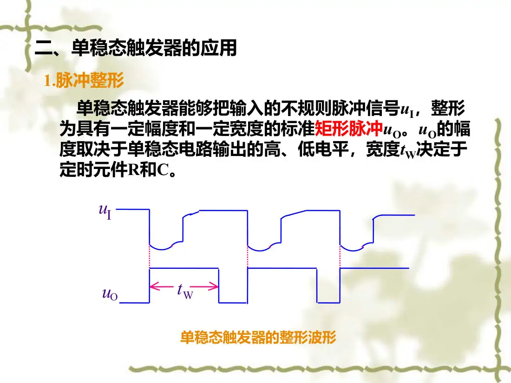

原文：

二、单稳态触发器的应用

1.脉冲整形

单稳态触发器能够把输入的不规则脉冲信号 $u_{I}$ ，整形为具有一定幅度和一定宽度的标准矩形脉冲 $u_{0}$ 。 $u_{0}$ 的幅度取决于单稳态电路输出的高、低电平，宽度 $t_{w}$ 决定于定时元件R和C。

单稳态触发器的整形波形

### 2.脉冲延时

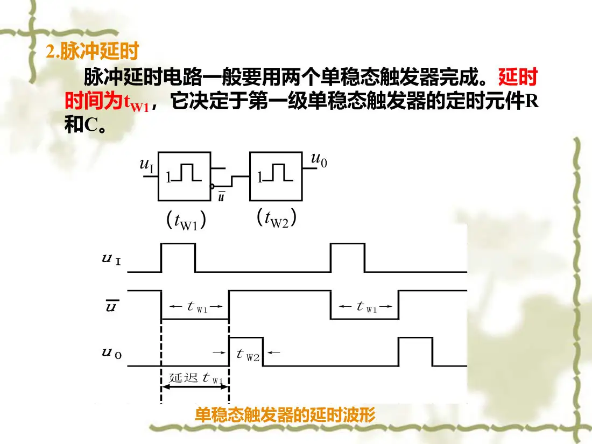

原文：

2.脉冲延时

脉冲延时电路一般要用两个单稳态触发器完成。延时时间为 $t_{w1}$ ，它决定于第一级单稳态触发器的定时元件R和C。

### 3. 定时

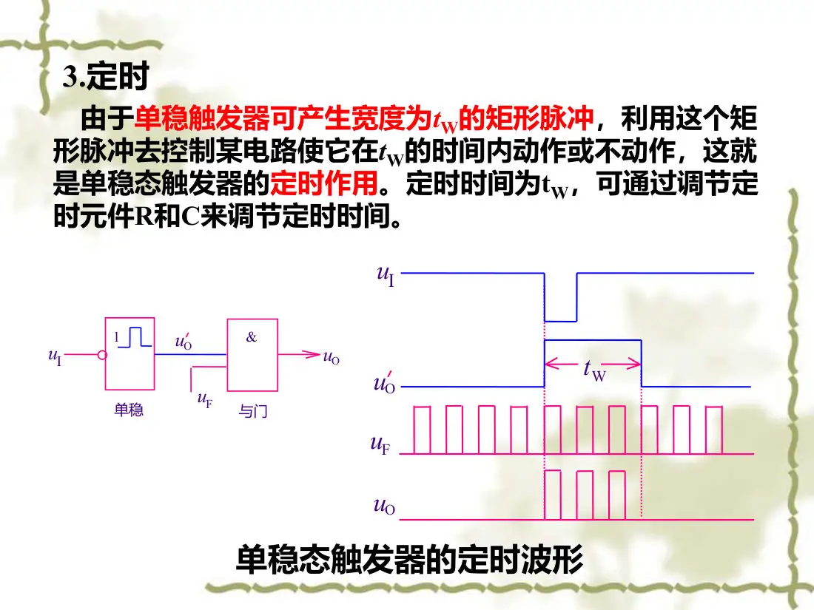

原文：

3. 定时

由于单稳触发器可产生宽度为 $t_{\mathrm{w}}$ 的矩形脉冲，利用这个矩形脉冲去控制某电路使它在 $t_{\mathrm{w}}$ 的时间内动作或不动作，这就是单稳态触发器的定时作用。定时时间为 $t_{\mathrm{w}}$ ，可通过调节定时元件R和C来调节定时时间。

单稳态触发器的定时波形

### 第 40 页

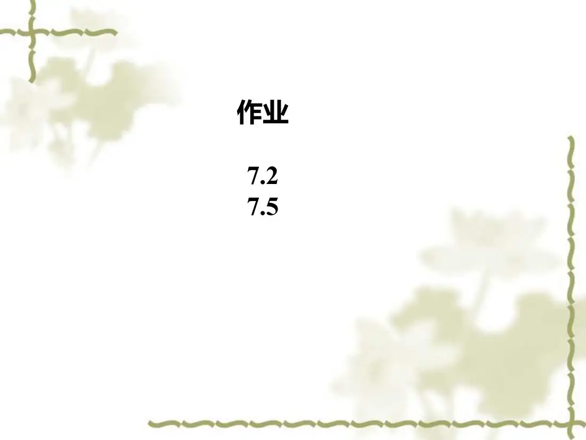
