# 《数字电路与系统设计》第7章习题答案

原件经识别和整理；“参考解答”是我们补的。

# 数字电路与系统设计 第7章习题答案（1）

本资料为《数字电路与系统设计》第7章习题解答的第一部分，包含第7.1至7.9题的详细解析。内容基于识别工具读取的原件整理，修正了明显的排版错误和乱码。

## 一、填空题与计算题

### 选择 1

题干：在图 P7.1 555 定时器构成的多谐振荡器中设 $R_A = R_B = 5 \text{k}\Omega$, $C = 960 \text{pF}$。试求输出波形的振荡频率 $f$ 及占空比 $q$。

答案：$f = 99 \text{kHz}$, $q = 66.7\%$。

参考解答：
输出波形的振荡周期为：
$$
T = T_{PH} + T_{PL} = 0.7 (R_A + 2R_B) \cdot C = 0.7 \times 15 \times 10^3 \times 960 \times 10^{-12} = 1.008 \times 10^{-5} \text{s}
$$
振荡频率为：
$$
f = \frac{1}{T} = \frac{1}{1.008 \times 10^{-5}} = 9.9 \times 10^4 \text{Hz} = 99 \text{kHz}
$$
占空比：
$$
q = \frac{t_W}{T} = \frac{T_{PH}}{T_{PH} + T_{PL}} = \frac{R_A + R_B}{R_A + 2R_B} = \frac{10}{15} = 66.7\%
$$

知识点：[完整数字系统设计流程实例（如乘法器、交通灯管理系统的算法规律、处理器设计与控制器实现）](../../../topics/数字逻辑电路/数字系统设计实例.md)

### 选择 2

题干：对于图P7.2 占空比可调的多谐振荡器：
(1) 试计算其 $q$ 最大值 $q_{\max}$ 和最小值 $q_{\min}$；
(2) 说明该电路在改变占空比时振荡频率 $f$ 是否发生变化，原因何在？

答案：(1) $q_{\max} = 91.7\%$, $q_{\min} = 8.3\%$；(2) 频率不变。

参考解答：
(1) $\because q = \frac{t_W}{T} = \frac{T_{PH}}{T_{PH} + T_{PL}} = \frac{R_A}{R_A + R_B}$
$$
\therefore q_{\max} = \frac{11}{12} = 91.7\% \quad q_{\min} = \frac{1}{12} = 8.3\%
$$
（注：原题解中第二个公式误写为 $q_{mas}$，根据上下文应为 $q_{\min}$，且分子对应较小电阻值）

(2) 该电路在改变占空比时振荡频率 $f$ 不发生变化。
因为 $T = T_{PH} + T_{PL} = 0.7 (R_A + R_B) \cdot C$，而 $(R_A + R_B)$ 为常数。

知识点：[完整数字系统设计流程实例（如乘法器、交通灯管理系统的算法规律、处理器设计与控制器实现）](../../../topics/数字逻辑电路/数字系统设计实例.md)

### 选择 3

题干：在图P7.3 电路中，设5端外接的控制电压 $U_{IC} = \frac{V_{CC}}{2}$
(1) 试求振荡频率 $f$ 与定时参数 $R_A, R_B$、$C$ 的关系式；
(2) 说明当 $U_{IC}$ 增大时，振荡频率 $f$ 是升高还是下降。

答案：(1) $f = \frac{1}{0.4 R_A C + 1.1 R_B C}$；(2) 频率下降。

参考解答：
（1）5端外接控制电压 $U_{IC} = \frac{V_{CC}}{2}$ 时，555定时器的高、低触发电平分别为 $U_{IC} = \frac{V_{CC}}{2}$, $\frac{U_{IC}}{2} = \frac{V_{CC}}{4}$，从而可求得：
$$
T_{PH} = (R_A + R_B) C \ln \frac{u_{C(\infty)} - u_{C(t_1)}}{u_{C(\infty)} - u_{C(t_2)}} = (R_A + R_B) C \ln \frac{V_{CC} - \frac{V_{CC}}{4}}{V_{CC} - \frac{V_{CC}}{2}} = 0.4 (R_A + R_B) C
$$
$$
T_{PL} = R_B C \ln \frac{u_{C(\infty)} - u_{C(t_2)}}{u_{C(\infty)} - u_{C(t_3)}} = R_B C \ln \frac{0 - \frac{V_{CC}}{2}}{0 - \frac{V_{CC}}{4}} = 0.7 R_B C
$$
所以振荡周期为： $T = T_{PH} + T_{PL} = 0.4 R_A C + 1.1 R_B C$
振荡频率为： $f = \frac{1}{T} = \frac{1}{0.4 R_A C + 1.1 R_B C}$

（2）设 $U_{IC} = n V_{CC} (n \leq 1)$ 则
$$
T_{PH} = (R_A + R_B) C \ln \frac{u_{C(\infty)} - u_{C(t_1)}}{u_{C(\infty)} - u_{C(t_2)}} = (R_A + R_B) C \ln \frac{V_{CC} - \frac{U_{IC}}{2}}{V_{CC} - U_{IC}}
$$
$$
= (R_A + R_B) C \ln \frac{1 - \frac{n}{2}}{1 - n} = (R_A + R_B) C \ln \frac{2 - n}{2 (1 - n)} = (R_A + R_B) C \ln \frac{1}{2 (1 - \frac{1}{2 - n})}
$$
$$
T_{PL} = R_B C \ln \frac{u_{C(\infty)} - u_{C(t_2)}}{u_{C(\infty)} - u_{C(t_3)}} = R_B C \ln \frac{0 - U_{IC}}{0 - \frac{U_{IC}}{2}} = 0.7 R_B C
$$
可见 $U_{IC}$ 增加（即 $n$ 增加），$T_{PH}$ 增加，$T_{PL}$ 不变，所以振荡频率 $f$ 下降。

知识点：[完整数字系统设计流程实例（如乘法器、交通灯管理系统的算法规律、处理器设计与控制器实现）](../../../topics/数字逻辑电路/数字系统设计实例.md)

### 简答 1

题干：简述施密特触发器的主要工作特点和主要用途。用 555 定时器构成的施密特触发器的上限触发电平 $U_{T+}$、下限触发电平 $U_{T-}$ 及回差电压 $\Delta U_T$ 的数值各为多少？

答案：见参考解答。

参考解答：
1. 施密特触发器的主要工作特点：
   (1) 输出信号从低电平上升到高电平时的转换电平和从高电平下降到低电平时的转换电平不同；
   (2) 在电路状态转换时，通过电路内部的正反馈过程使输出电压波形的边沿变得很陡。

2. 施密特触发器的主要用途：
   (1) 波形变换；
   (2) 脉冲整形；
   (3) 脉冲鉴幅；

3. （1）若555 定时器的第5引脚通过滤波电容接地，则
   $$
   U_{T+} = \frac{2}{3} V_{CC}, \quad U_{T-} = \frac{1}{3} V_{CC}, \quad \Delta U_T = \frac{1}{3} V_{CC}
   $$
   （2）若555定时器的第 5引脚外接参考电源 $U_{IC}$ ，则
   $$
   U_{T+} = U_{IC}, \quad U_{T-} = \frac{1}{2} U_{IC}, \quad \Delta U_T = \frac{1}{2} U_{IC}
   $$

### 简答 2

题干：己知施密特反相器的输入信号如图 P7.4 所示．试作出对应的输出波形 $U_O$ 。

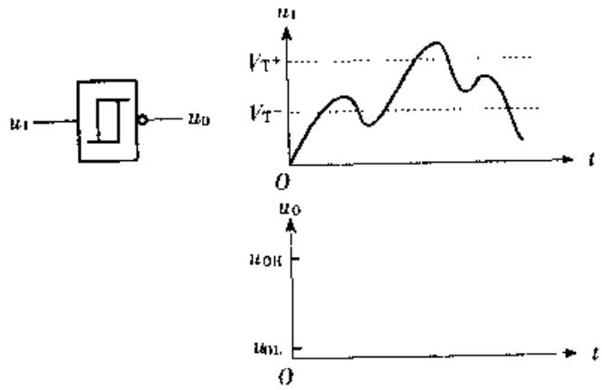

答案：输出波形 $U_O$ 如图 7.3.1 所示。

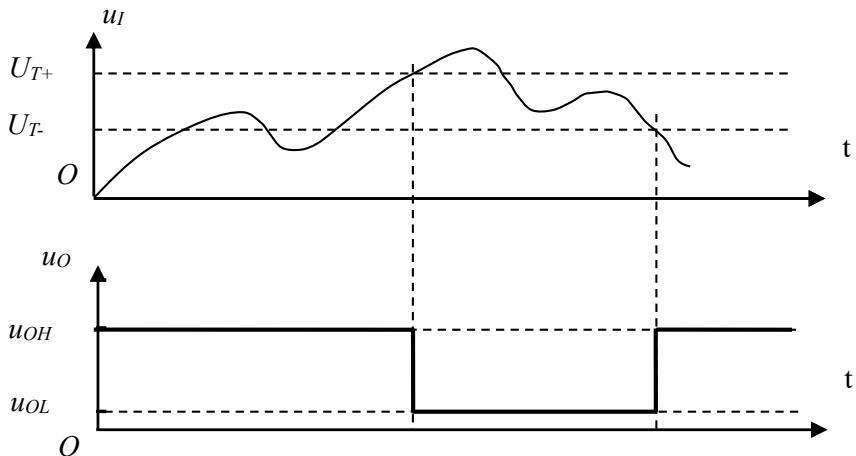

知识点：[数字系统的基本模型（数据处理器与控制器）及对最小时钟周期、异步信号同步化的约定](../../../topics/数字逻辑电路/数字系统模型.md)

### 设计 1

题干：现有一信号 $u_I$ 如图 P7.5 所示。现需检出幅度大于 6V 的脉冲，试设计用555定时器构成的电路，并确定 $V_{CC}$ 的数应为多大。

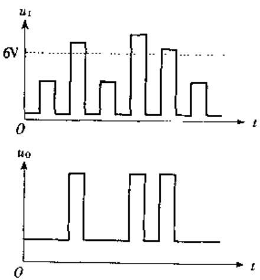

答案：$V_{CC} = 9 \text{V}$。电路采用555定时器构成的施密特触发器，连接方式见图 7.3.2。

参考解答：
由图可知此电路完成同相鉴幅功能，用 555定时器构成的施密特触发器来实现。上限触发电平、下限触发电平分别为 $U_{T+} = \frac{2}{3} V_{CC} = 6 \text{V}, U_{T-} = \frac{1}{3} V_{CC} = 3 \text{V}$，所以电源电压 $V_{CC} = 9 \text{V}$。电路如图7.3.2所示。

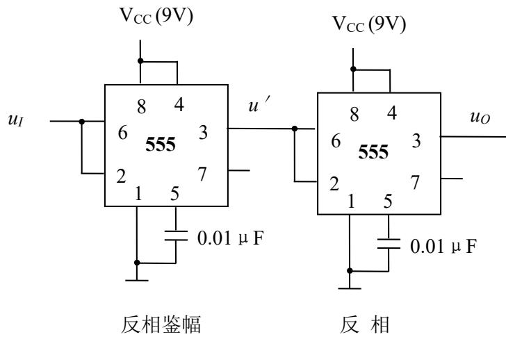

### 简答 3

题干：简述单稳态触发器的工作特点和主要用途。用 555 定时器构成的单稳对触发信号有何要求。

答案：见参考解答。

参考解答：
1. 单稳态触发器的工作特点：
   （1）输出有一个稳定状态和一个暂稳态；
   （2）在外界触发信号作用下，输出能从稳态翻转到暂稳态，在暂稳态维持一段时间后，又能自动返回稳态；
   （3）在暂稳态维持时间的长短取决于电路本身的参数，与触发脉冲的宽度和幅度无关。

2. 单稳态触发器的主要用途：
   (1) 定时；
   (2) 脉冲整形；
   (3) 延时；

3. 用555定时器构成的单稳对触发信号的要求：
   (1) 间隔应大于 $t_d$；
   (2) 触发脉冲的低电平宽度应小于 $t_w$；
   (3) 触发脉冲的高电平应大于 $V_{CC}/3$，低电平应小于 $V_{CC}/3$

其中：
$t_w = 1.1 R_T C_T$ ：输出正脉冲宽度（暂态时间）；
$t_{re} = (3 \sim 5) R_{on} \cdot C_T$ ：恢复时间；

7.8 图P7.6 为 555定时器构成的单稳态触发器，已知 $\mathrm { V } _ { \mathrm { C C } } { = } 1 0 \mathrm { V } , \ \mathrm { R } { = } 3 3 \mathrm { K } \ \Omega$ C=0.1μF。要求：

(1)画出 uI、uC、uO 的波形；

(2)求出uO的脉冲宽度tW。

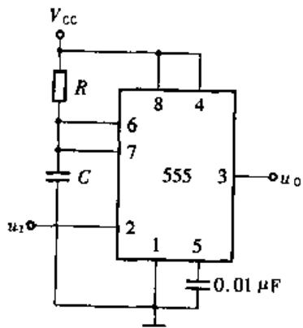

解： $( 1 ) u _ { \mathrm { I } } , ~ u _ { \mathrm { C } } , ~ u _ { 0 }$ 的波形如图7.3.3所示：

(2)u 的脉冲宽度 t 为：

$$
t _ {W} = 1. 1 R _ {T} C _ {T} = 1. 1 \times 3 3 \times 1 0 ^ {3} \times 0. 1 \times 1 0 ^ {- 6} = 3. 6 3 \times 1 0 ^ {- 3} S
$$

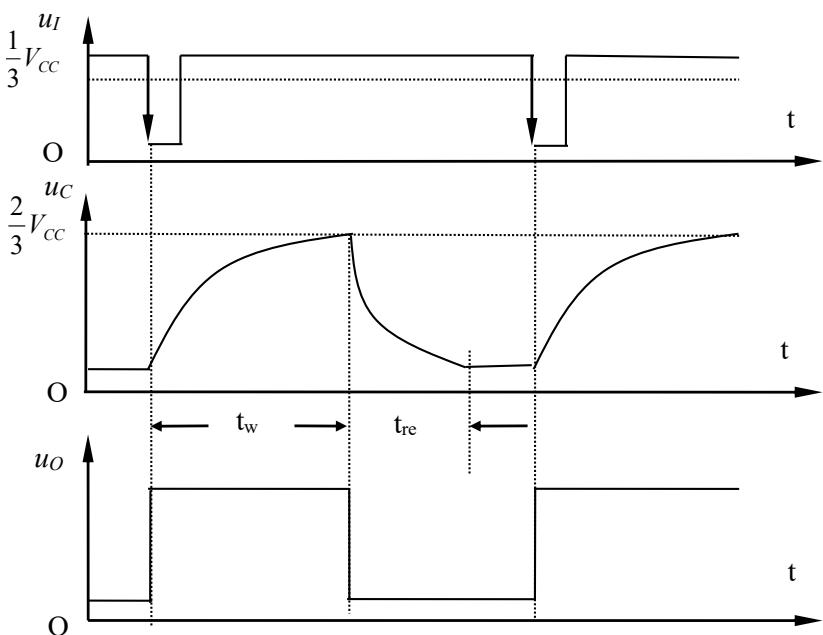

7.9 试用555 定时器设计一个单稳态电路，要求输出脉冲宽度在 $1 { \sim } 1 0 s$ 内连续可调，设定时电容 C的容量为 $1 0 \mu \mathrm { F }$ o

解： $t _ { \scriptscriptstyle { W } } = 1 . 1 R _ { \scriptscriptstyle { T } } C _ { \scriptscriptstyle { T } } = 1 . 1 \times R _ { \scriptscriptstyle { T } } \times 1 0 \times 1 0 ^ { - 6 } = 1 S , R _ { \scriptscriptstyle { T } } = 9 . 1 \times 1 0 ^ { 4 } \Omega = 9 1 K \Omega$

$$
t _ {W} = 1. 1 R _ {T} C _ {T} = 1. 1 \times R _ {T} \times 1 0 \times 1 0 ^ {- 6} = 1 0 S, R _ {T} = 9. 1 \times 1 0 ^ { 5 } \Omega = 9 1 0 K \Omega
$$

从而， $9 1 K \Omega \le t _ { \scriptscriptstyle W } \le 9 1 0 K \Omega$ ，用82KΩ 固定电阻和1000KΩ电位器串联实现定时电阻 $R _ { T }$ （用 $\mathrm { E _ { 1 2 } }$ 电阻标称值系列，误差为 10％）。电路图如图7.3.4 所示。

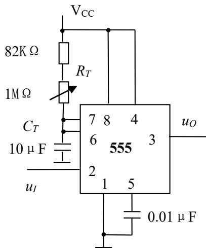

7.10 设有一个 555 定时器和一个容量为 1μF 的电容，试设计一个输入 $U _ { \mathrm { I } }$ 和输出 $u _ { \mathrm { O } }$ 的波形如图 P7.7 所示的电路，并设计所需电源电压的大小。

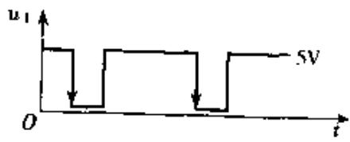

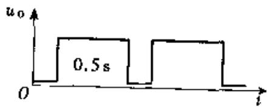

解：由输入 $U _ { \mathrm { I } }$ 和输出 $u _ { \mathrm { O } }$ 的波形可知，待设计的电路为单稳态触发器，由于触发脉冲的高电平应大于 $\mathrm { V } _ { \mathrm { C C } } / 3$ ，低电平应小于 $\mathrm { V } _ { \mathrm { C C } } / 3$ ，所以电源电压的大小为：

$$
5 > \frac {V _ {c c}}{3}, V _ {c c} <   1 5 V, \text {取} V _ {c c} = 9 V 。
$$

由图知脉冲宽度 $t \mathrm { w }$ 为0.5S，又已知：

$$
t _ {W} = 1. 1 R _ {T} C _ {T} = 1. 1 \times R _ {T} \times 1 \times 1 0 ^ {- 6} = 0. 5 S
$$

所以， $R _ { { T } } = 4 . 5 { \times } 1 0 ^ { 5 } \Omega = 4 5 0 K \Omega$ ，用 390KΩ 固定电阻和 120KΩ 电位器串联实现定时电阻 R（用 $\mathrm { E _ { 1 2 } }$ 电阻标称值系列，误差为 10％）。电路图如图7.3.5所示。

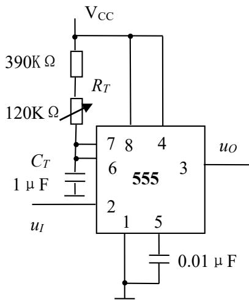

7.11 图P7.8 为用两个555 定时器接成的延迟报警电路，开关 S 平时合上，当S 断开后又经延时时间 $t _ { \mathrm { d } }$ 扬声器便发声，试问：

(1) 555(1)和(2)各接成何种脉冲单元电路；

(2) $t _ { \mathrm { d } } { = } ?$

(3)扬声器的发声频率为多少？

(4)S 断开后，如在不足 $t _ { \mathrm { d } }$ 时间内又合上，扬声器是否会发声？

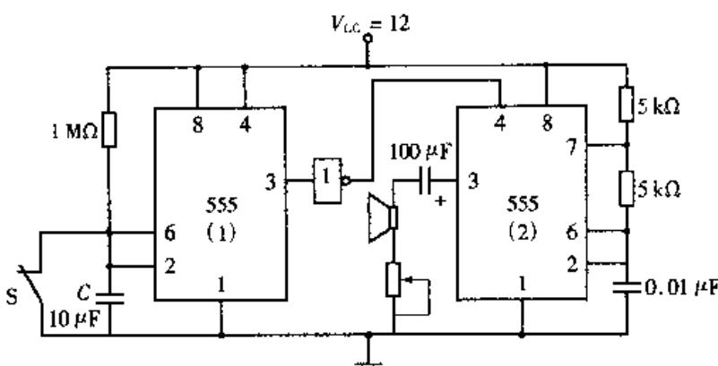

解：(1) 555(1) 接成施密特反相器，555 (2)接成多谐振荡器；

(2) 开关S 合上，555(1)的3 端输出高电平（“1”），经反相后555 (2)的4端为“0”，555 (2)被异步清零，3端输出低电平 $( ^ { 6 6 } 0 ^ { 9 } )$ ），扬声器不发声。当 S 断开，10μF 电容被充电，当电容两端电压升到 $\frac { 2 } { 3 } V _ { C C } = 8 \mathrm { V }$ 时，555(1)的 3 端输出低电平 $( ^ { 6 6 } 0 ^ { 9 } )$ ），经反相后 555 (2)的 4 端为“1”，555 (2)接成的多谐振荡器工作， 3端输出矩形波，扬声器发声。

$$
\begin{array}{r l} t _ {d} & = R C \ln \frac {u _ {C (\infty)} - u _ {C (t _ {1})}}{u _ {C (\infty)} - u _ {C (t _ {2})}} = R C \ln \frac {V _ {C C} - 0}{V _ {C C} - \frac {2}{3} V _ {C C}} = 1. 1 R C \\ & = 1. 1 \times 1 \times 1 0 ^ {6} \times 1 0 \times 1 0 ^ {- 6} = 1 1 S \end{array}
$$

(3)扬声器的发声频率为多少？

$$
T = T _ {P H} + T _ {P L} = 0. 7 \left(R _ {A} + 2 R _ {B}\right) \cdot C = 0. 7 \times 1 5 \times 1 0 ^ {3} \times 0. 0 1 \times 1 0 ^ {- 6} = 1. 0 5 \times 1 0 ^ {- 4} s
$$

振荡频率为 $f = \frac { 1 } { T } = \frac { 1 } { 1 . 0 5 \times 1 0 ^ { - 4 } } = 9 . 5 2 \times 1 0 ^ { 3 } H z = 9 . 5 2 K H z$

(4)S 断开后，如在不足 $t _ { \mathrm { d } }$ 时间内又合上，扬声器是否会发声？

S 断开后，如在不足 td 时间内又合上，则 10μF 电容被放电，由于电容两端电压达不到 $\frac { 2 } { 3 } V _ { c c } , \ 5 5 5 ( 1 )$ 的3端输出不变，仍为高电平 $( ^ { 6 6 } 1 ^ { 9 } )$ ），扬声器不会发声。

知识点：[数字系统的基本模型（数据处理器与控制器）及对最小时钟周期、异步信号同步化的约定](../../../topics/数字逻辑电路/数字系统模型.md)、[控制器的四种硬件实现方法：每态一触发器法(SSI)、MSI法(MUX+寄存器+译码器)、PLA法(LSI)及对比](../../../topics/数字逻辑电路/控制器实现方法.md)
