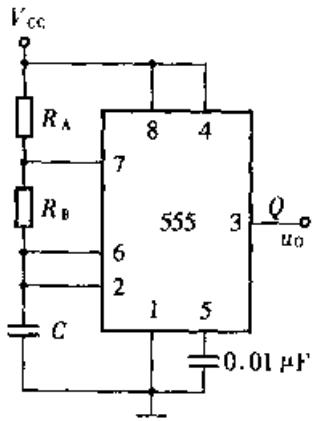
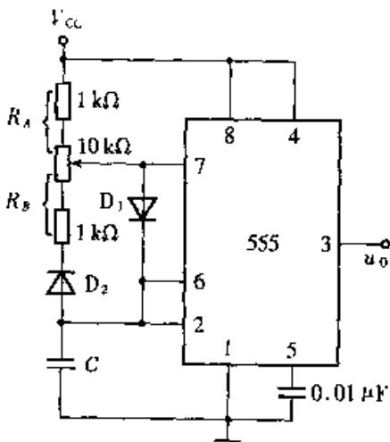
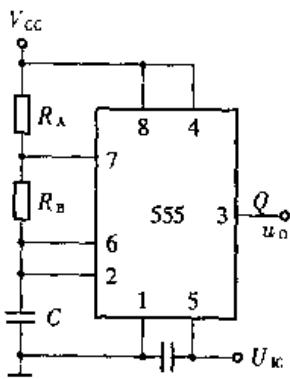

# 《数字电路与系统设计》第7章习题答案

原件经识别和整理；“参考解答”是我们补的。

# 数字电路与系统设计 第7章习题答案（1）

## 一、填空题与计算题

### 选择 1

题干：在图 P7.1 555 定时器构成的多谐振荡器中设 $R_A = R_B = 5 \text{k}\Omega$, $C = 960 \text{pF}$。试求输出波形的振荡频率 $f$ 及占空比 $q$。

答案：$f = 99 \text{kHz}$, $q = 66.7\%$。

知识点：[完整数字系统设计流程实例（如乘法器、交通灯管理系统的算法规律、处理器设计与控制器实现）](../../../topics/数字逻辑电路/数字系统设计实例.md)

### 选择 2

题干：对于图P7.2 占空比可调的多谐振荡器：
(1) 试计算其 $q$ 最大值 $q_{\max}$ 和最小值 $q_{\min}$；
(2) 说明该电路在改变占空比时振荡频率 $f$ 是否发生变化，原因何在？

答案：(1) $q_{\max} = 91.7\%$, $q_{\min} = 8.3\%$；(2) 频率不变。

知识点：[完整数字系统设计流程实例（如乘法器、交通灯管理系统的算法规律、处理器设计与控制器实现）](../../../topics/数字逻辑电路/数字系统设计实例.md)

### 选择 3

题干：在图P7.3 电路中，设5端外接的控制电压 $U_{IC} = \frac{V_{CC}}{2}$
(1) 试求振荡频率 $f$ 与定时参数 $R_A, R_B$、$C$ 的关系式；
(2) 说明当 $U_{IC}$ 增大时，振荡频率 $f$ 是升高还是下降。

答案：(1) $f = \frac{1}{0.4 R_A C + 1.1 R_B C}$；(2) 频率下降。

知识点：[完整数字系统设计流程实例（如乘法器、交通灯管理系统的算法规律、处理器设计与控制器实现）](../../../topics/数字逻辑电路/数字系统设计实例.md)

### 简答 1

题干：简述施密特触发器的主要工作特点和主要用途。用 555 定时器构成的施密特触发器的上限触发电平 $U_{T+}$、下限触发电平 $U_{T-}$ 及回差电压 $\Delta U_T$ 的数值各为多少？

答案：见参考解答。

知识点：[数字系统的基本模型（数据处理器与控制器）及对最小时钟周期、异步信号同步化的约定](../../../topics/数字逻辑电路/数字系统模型.md)

### 设计 1

题干：现有一信号 $u_I$ 如图 P7.5 所示。现需检出幅度大于 6V 的脉冲，试设计用555定时器构成的电路，并确定 $V_{CC}$ 的数应为多大。

答案：$V_{CC} = 9 \text{V}$。电路采用555定时器构成的施密特触发器，连接方式见图 7.3.2。

知识点：[数字系统的基本模型（数据处理器与控制器）及对最小时钟周期、异步信号同步化的约定](../../../topics/数字逻辑电路/数字系统模型.md)、[控制器的四种硬件实现方法：每态一触发器法(SSI)、MSI法(MUX+寄存器+译码器)、PLA法(LSI)及对比](../../../topics/数字逻辑电路/控制器实现方法.md)
