# 《数字电路与系统设计》第8章 A/D和D/A变换（课件）

原件的每一页，下面附识别出的文字。

### 第八章 A/D和D/A变换 一、概念及其应用

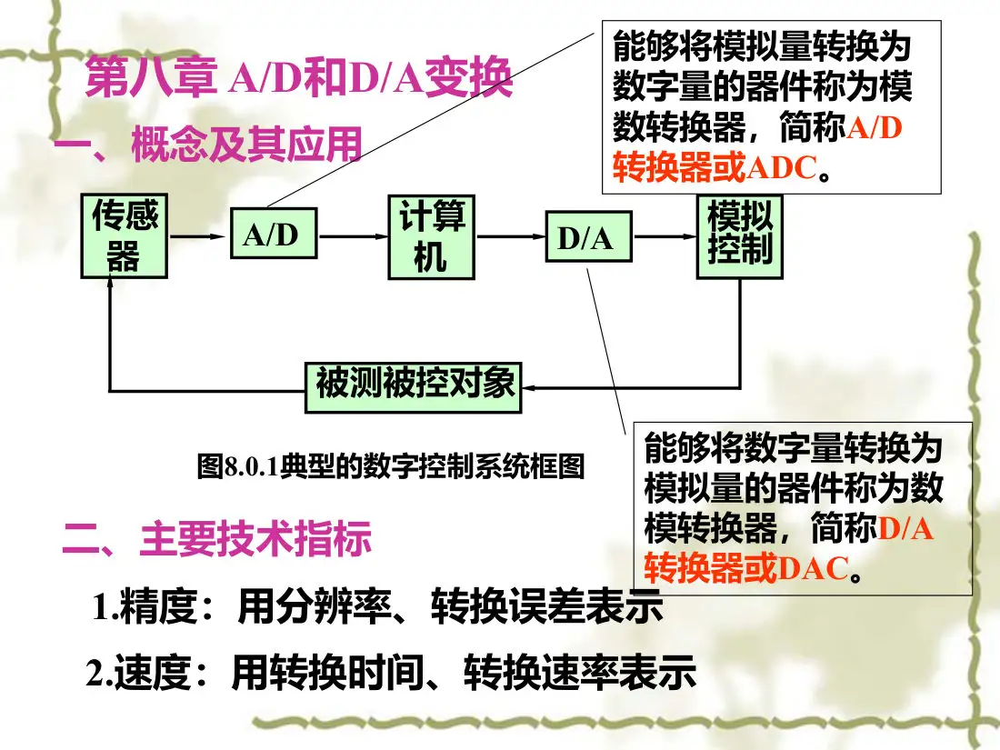

原文：

第八章 A/D和D/A变换 一、概念及其应用

能够将模拟量转换为数字量的器件称为模数转换器，简称A/D转换器或ADC。

二、主要技术指标

1. 精度：用分辨率、转换误差表示能够将数字量转换为模拟量的器件称为数模转换器，简称D/A转换器或DAC。

2. 速度：用转换时间、转换速率表示

### 8.1 数模转换 (D/A)

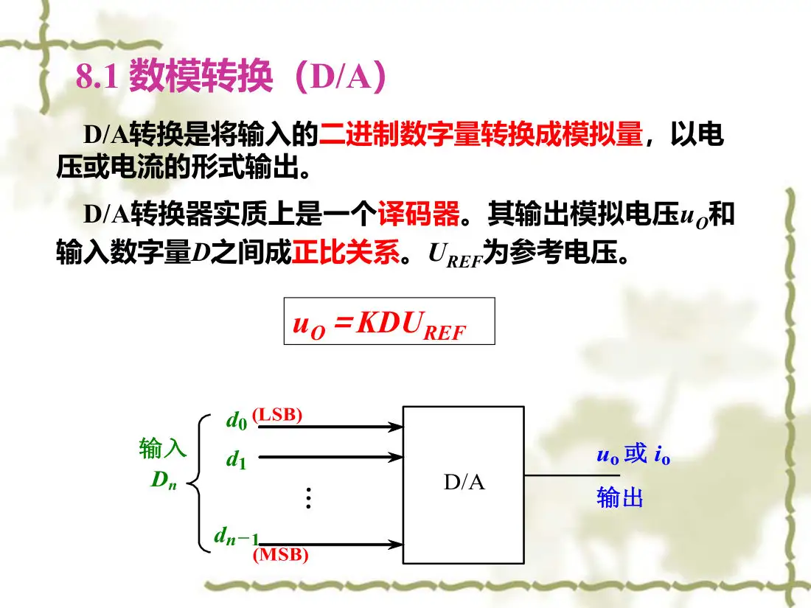

原文：

8.1 数模转换 (D/A)

D/A转换是将输入的二进制数字量转换成模拟量，以电压或电流的形式输出。

D/A转换器实质上是一个译码器。其输出模拟电压 $u_{O}$ 和输入数字量D之间成正比关系。 $U_{REF}$ 为参考电压。

$$
\boxed {u _ {O} = K D U _ {R E F}}
$$

$$
\text {输入} _ {D _ {n}} \left\{ \begin{array}{c c} d _ {0} (\text {LSB}) & \\ d _ {1} & \\ \vdots & \\ d _ {n - 1} (\text {MSB}) & \end{array} \right. \xrightarrow {\text {D / A}} \xrightarrow [ ]{u _ {0} \text {或} i _ {0}} \text {输出}
$$

### 第 3 页

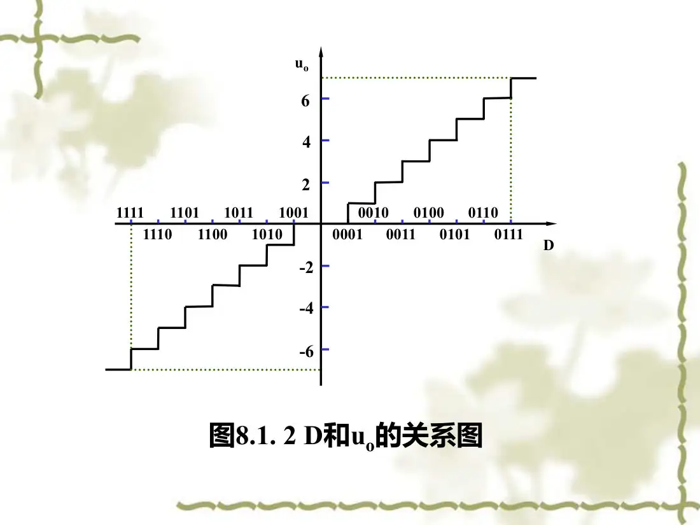

### $$

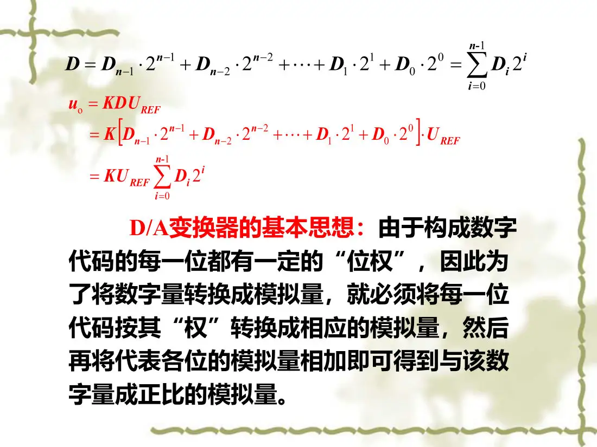

原文：

$$
\begin{array}{r l} & {\pmb {D} = \pmb {D} _ {n - 1} \cdot 2 ^ {n - 1} + \pmb {D} _ {n - 2} \cdot 2 ^ {n - 2} + \dots + \pmb {D} _ {1} \cdot 2 ^ {1} + \pmb {D} _ {0} \cdot 2 ^ {0} = \sum_ {i = 0} ^ {n - 1} \pmb {D} _ {i} 2 ^ {i}} \\ & {\pmb {u} _ {\mathrm{o}} = K D U _ {R E F}} \\ & {\qquad = K \Big [ \pmb {D} _ {n - 1} \cdot 2 ^ {n - 1} + \pmb {D} _ {n - 2} \cdot 2 ^ {n - 2} + \dots + \pmb {D} _ {1} \cdot 2 ^ {1} + \pmb {D} _ {0} \cdot 2 ^ {0} \Big ] \cdot U _ {R E F}} \\ & {\qquad = K U _ {R E F} \sum_ {i = 0} ^ {n - 1} \pmb {D} _ {i} 2 ^ {i}} \end{array}
$$

D/A变换器的基本思想：由于构成数字代码的每一位都有一定的“位权”，因此为了将数字量转换成模拟量，就必须将每一位代码按其“权”转换成相应的模拟量，然后再将代表各位的模拟量相加即可得到与该数字量成正比的模拟量。

### 第 5 页

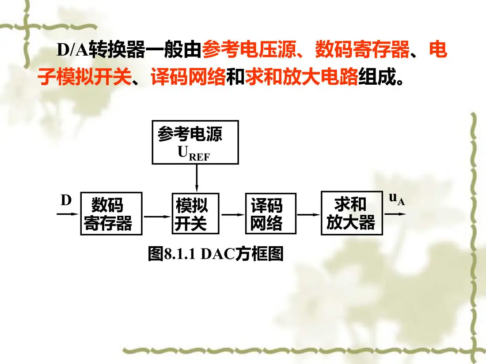

原文：

D/A转换器一般由参考电压源、数码寄存器、电子模拟开关、译码网络和求和放大电路组成。

### 将电流量转化成电压量输出。

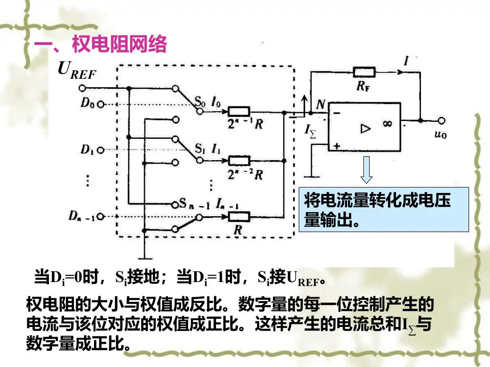

原文：

将电流量转化成电压量输出。

一、权电阻网络

当 $D_{i}=0$ 时， $S_{i}$ 接地；当 $D_{i}=1$ 时， $S_{i}$ 接 $U_{REF}$ 。

权电阻的大小与权值成反比。数字量的每一位控制产生的电流与该位对应的权值成正比。这样产生的电流总和 $I_{\Sigma}$ 与数字量成正比。

### 运放线性应用的特点：

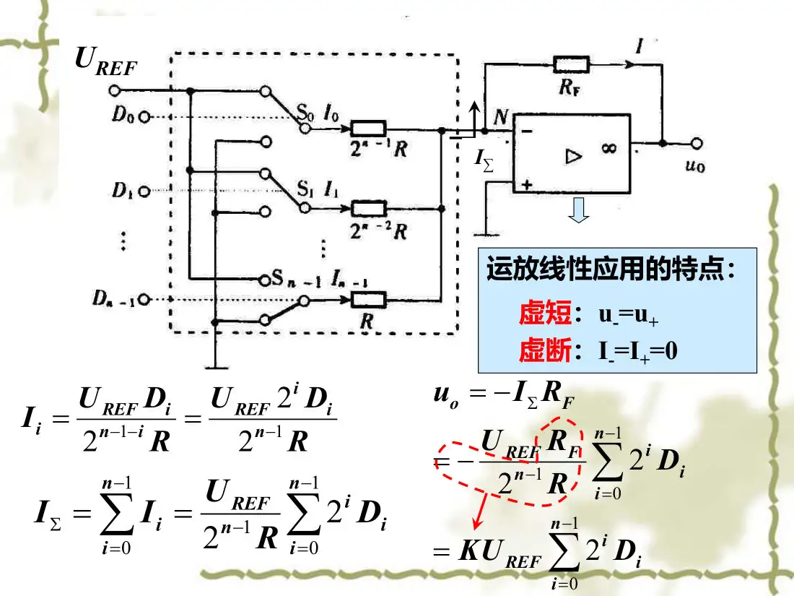

原文：

运放线性应用的特点：

$$
\boldsymbol {I} _ {i} = \frac {\boldsymbol {U} _ {R E F} \boldsymbol {D} _ {i}}{2 ^ {n - 1 - i} \boldsymbol {R}} = \frac {\boldsymbol {U} _ {R E F} 2 ^ {i} \boldsymbol {D} _ {i}}{2 ^ {n - 1} \boldsymbol {R}}
$$

$$
I _ {\Sigma} = \sum_ {i = 0} ^ {n - 1} I _ {i} = \frac {U _ {R E F}}{2 ^ {n - 1} R} \sum_ {i = 0} ^ {n - 1} 2 ^ {i} D _ {i}
$$

虚短: $\mathbf{u}_{-} = \mathbf{u}_{+}$

虚断: $I_{-} = I_{+} = 0$

$$
\pmb {u} _ {o} = - \pmb {I} _ {\Sigma} \pmb {R} _ {F}
$$

$$
\begin{array}{l} = - \frac {U _ {R E F} R _ {F}}{2 ^ {n - 1} R} \sum_ {i = 0} ^ {n - 1} 2 ^ {i} D _ {i} \\ = K U _ {R E F} \sum_ {i = 0} ^ {n - 1} 2 ^ {i} D _ {i} \end{array}
$$

### ①优点：结构简单，直观；

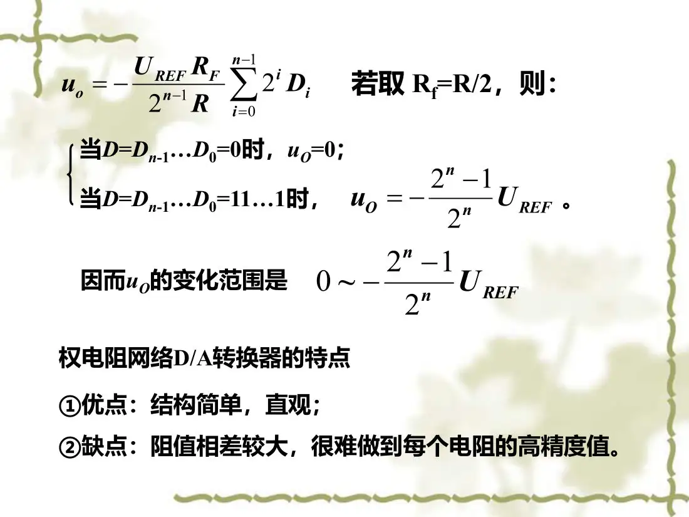

原文：

$u_{o}=-\frac{U_{REF}R_{F}}{2^{n-1}R}\sum_{i=0}^{n-1}2^{i}D_{i}$ 若取 $R_{f}=R/2$ ，则： $\left\{\begin{aligned}& 当 D=D_{n-1}\ldots D_{0}=0 时，u_{O}=0;\\& 当 D=D_{n-1}\ldots D_{0}=11\ldots1 时，u_{O}=-\frac{2^{n}-1}{2^{n}}U_{REF}\end{aligned}\right.$ 因而 $u_{O}$ 的变化范围是 $0 \sim -\frac{2^{n}-1}{2^{n}}U_{REF}$ 权电阻网络D/A转换器的特点

①优点：结构简单，直观；

②缺点：阻值相差较大，很难做到每个电阻的高精度值。

### 二、倒T型R-2R电阻网络DAC

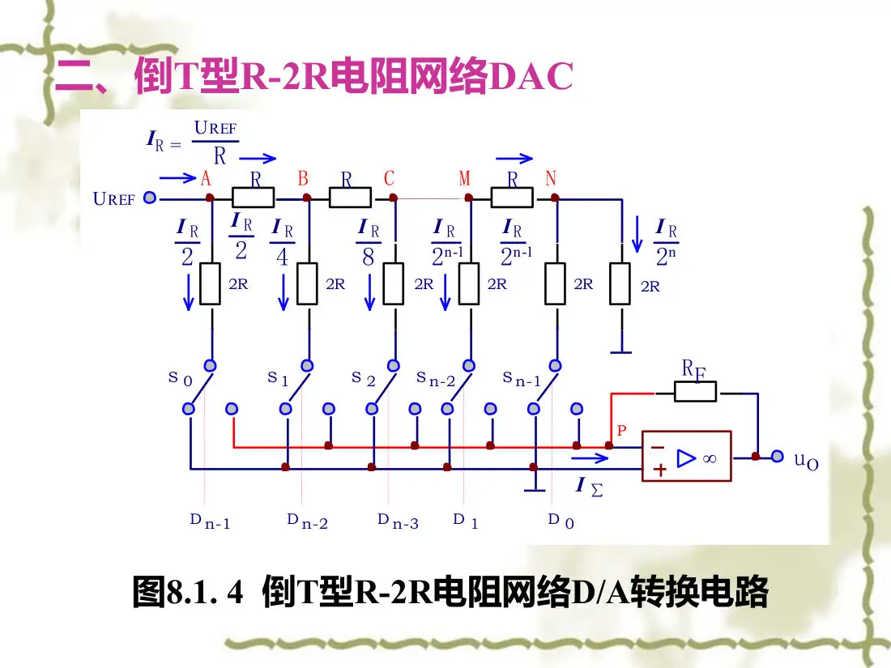

原文：

二、倒T型R-2R电阻网络DAC

### 第 10 页

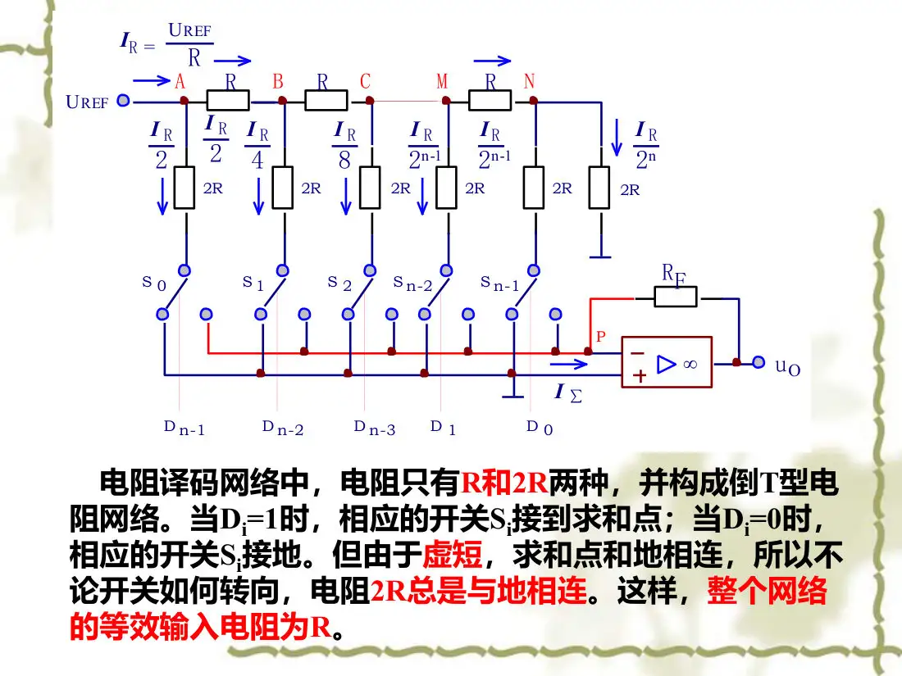

原文：

电阻译码网络中，电阻只有R和2R两种，并构成倒T型电阻网络。当 $D_{i}=1$ 时，相应的开关 $S_{i}$ 接到求和点；当 $D_{i}=0$ 时，相应的开关 $S_{i}$ 接地。但由于虚短，求和点和地相连，所以不论开关如何转向，电阻2R总是与地相连。这样，整个网络的等效输入电阻为R。

### 每个 2R 支路中的电流逐位减半。流入求和点的各支路电流为：

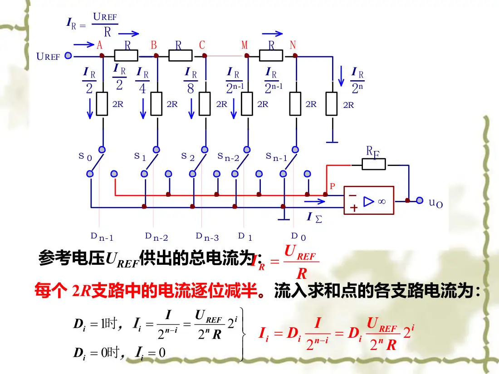

原文：

参考电压 $U_{REF}$ 供出的总电流为 $I_{R}=\frac{U_{REF}}{R}$

每个 2R 支路中的电流逐位减半。流入求和点的各支路电流为：

$D_{i} = 1$ 时， $I_{i} = \frac{I}{2^{n - i}} = \frac{U_{REF}}{2^{n}R} 2^{i}$ $D_{i} = 0$ 时， $I_{i} = 0$

### $$

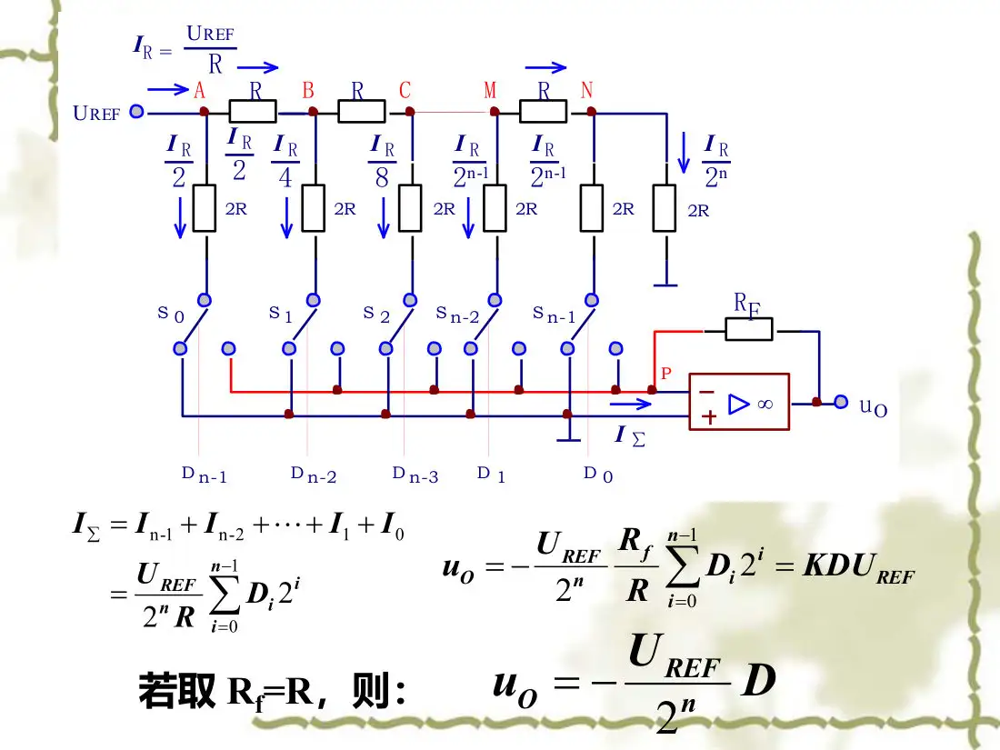

原文：

$$
\begin{array}{r l} I _ {\Sigma} = I _ {n - 1} + I _ {n - 2} + \dots + I _ {1} + I _ {0} & \\ = \frac {U _ {R E F}}{2 ^ {n} R} \sum_ {i = 0} ^ {n - 1} D _ {i} 2 ^ {i} & u _ {o} = - \frac {U _ {R E F}}{2 ^ {n}} \frac {R _ {f}}{R} \sum_ {i = 0} ^ {n - 1} D _ {i} 2 ^ {i} = K D U _ {R E F} \end{array}
$$

若取 $R_{f}=R$ ，则：

$$
u _ {o} = - \frac {U _ {R E F}}{2 ^ {n}} D
$$

### 倒T型电阻网络D/A转换器的特点：

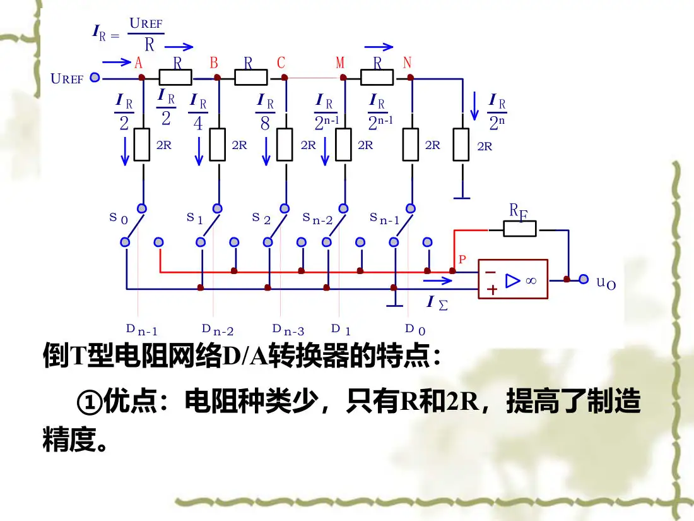

原文：

倒T型电阻网络D/A转换器的特点：

①优点：电阻种类少，只有R和2R，提高了制造精度。

### 第 14 页

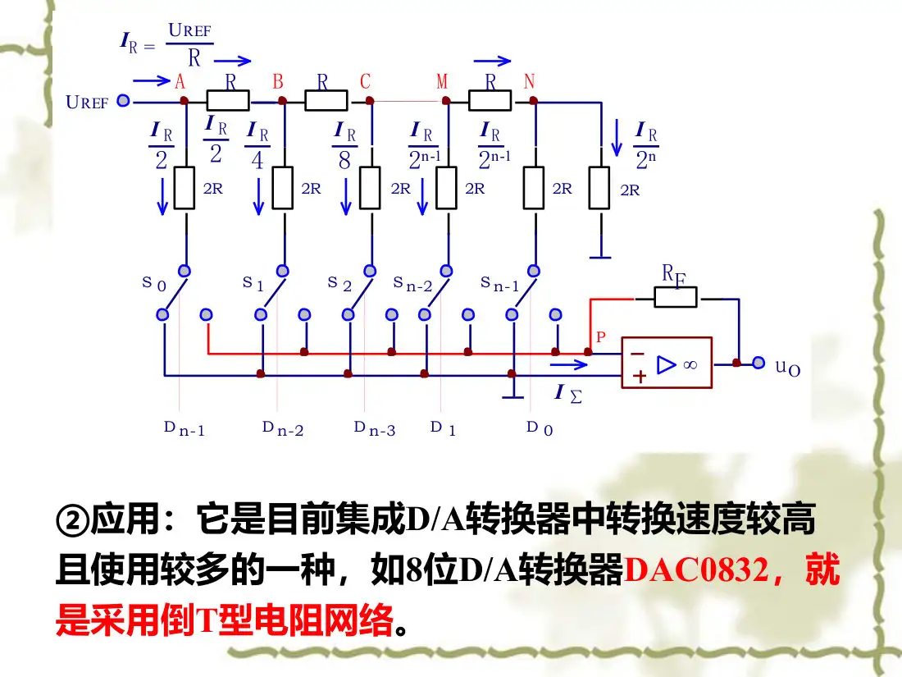

原文：

②应用：它是目前集成D/A转换器中转换速度较高且使用较多的一种，如8位D/A转换器DAC0832，就是采用倒T型电阻网络。

### 三、D/A转换器的主要技术指标

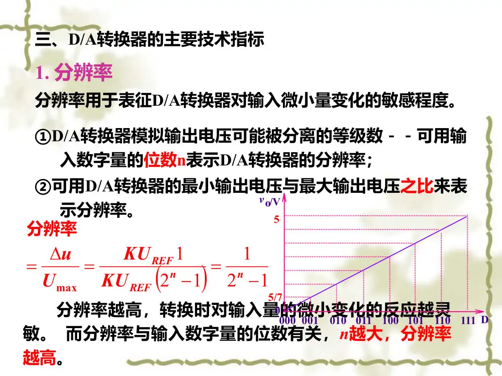

原文：

三、D/A转换器的主要技术指标

1. 分辨率

分辨率用于表征D/A转换器对输入微小量变化的敏感程度。

①D/A转换器模拟输出电压可能被分离的等级数 - - 可用输入数字量的位数n表示D/A转换器的分辨率；

(2)可用D/A转换器的最小输出电压与最大输出电压之比来表示分辨率。

分辨率

$$
= \frac {\Delta u}{U _ {\max}} = \frac {K U _ {R E F} 1}{K U _ {R E F} (2 ^ {n} - 1)} = \frac {1}{2 ^ {n} - 1}
$$

分辨率越高，转换时对输入量的微小变化的反应越灵敏。而分辨率与输入数字量的位数有关，n越大，分辨率越高。

111 D

### 2. 转换精度

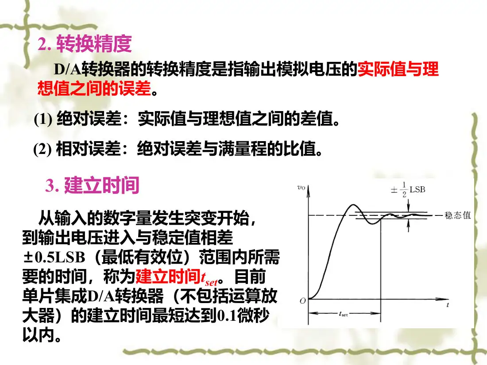

原文：

2. 转换精度

D/A转换器的转换精度是指输出模拟电压的实际值与理想值之间的误差。

(1) 绝对误差：实际值与理想值之间的差值。

(2) 相对误差：绝对误差与满量程的比值。

3. 建立时间

从输入的数字量发生突变开始，到输出电压进入与稳定值相差±0.5LSB（最低有效位）范围内所需要的时间，称为建立时间 $t_{set}$ 。目前单片集成D/A转换器（不包括运算放大器）的建立时间最短达到0.1微秒以内。

### 8.3 模数转换A/D

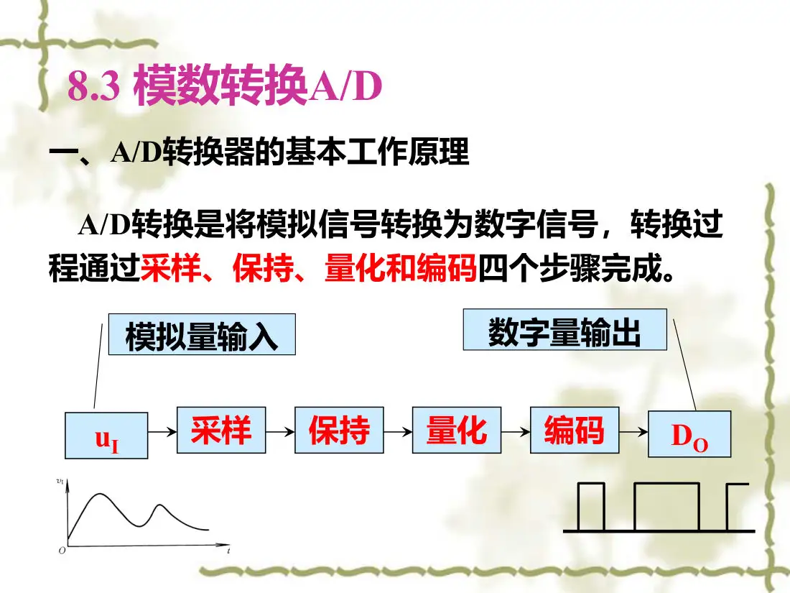

原文：

8.3 模数转换A/D

一、A/D转换器的基本工作原理

A/D转换是将模拟信号转换为数字信号，转换过程通过采样、保持、量化和编码四个步骤完成。

模拟量输入

数字量输出

采样

保持

量化

编码

$D_{0}$

### 1.采样和保持

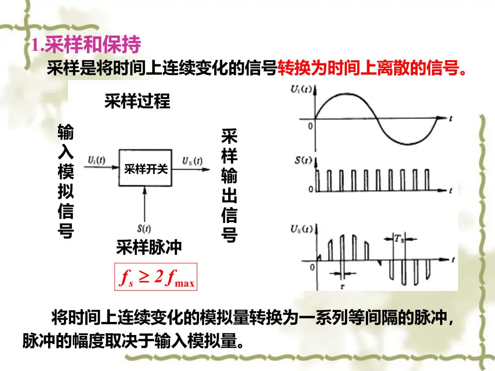

原文：

1.采样和保持

采样是将时间上连续变化的信号转换为时间上离散的信号。

采样输出信号

输入模拟信号

采样脉冲

$$
\boxed {f _ {s} \geq 2 f _ {\max}}
$$

将时间上连续变化的模拟量转换为一系列等间隔的脉冲，脉冲的幅度取决于输入模拟量。

### 场效应管VT为采样门，电容C为保持电容，运算放大器为跟随器，起缓冲隔离作用。

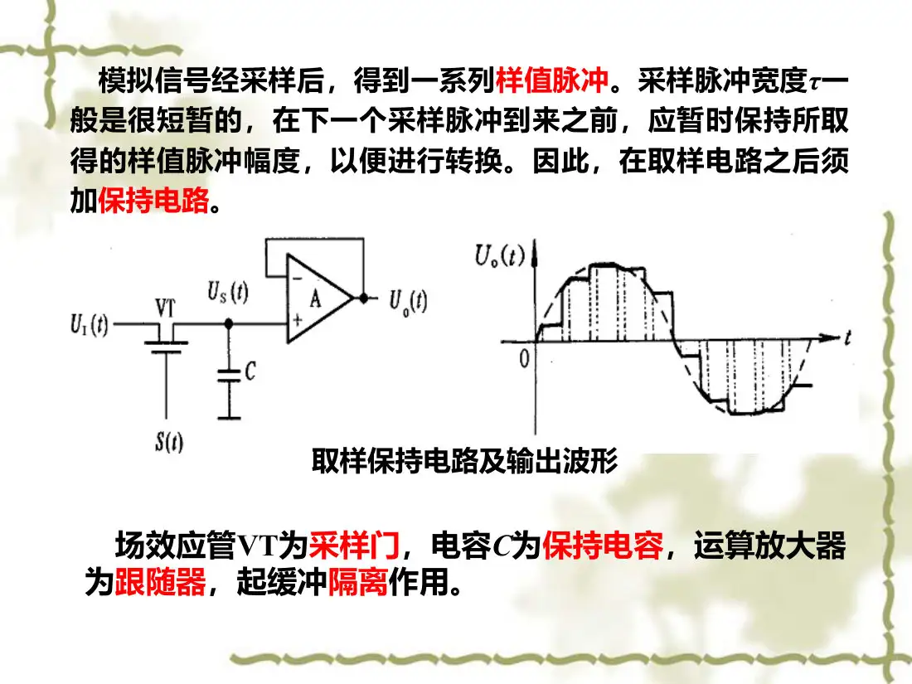

原文：

模拟信号经采样后，得到一系列样值脉冲。采样脉冲宽度 $\tau$ 一般是很短暂的，在下一个采样脉冲到来之前，应暂时保持所取得的样值脉冲幅度，以便进行转换。因此，在取样电路之后须加保持电路。

场效应管VT为采样门，电容C为保持电容，运算放大器为跟随器，起缓冲隔离作用。

### 第 20 页

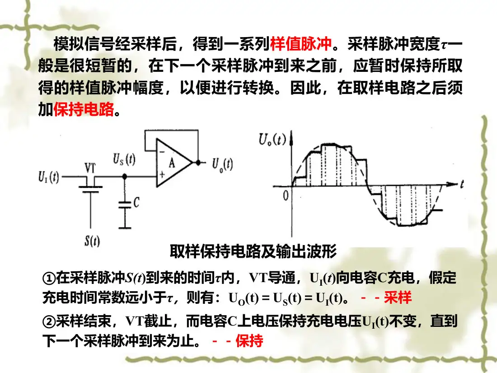

原文：

模拟信号经采样后，得到一系列样值脉冲。采样脉冲宽度 $\tau$ 一般是很短暂的，在下一个采样脉冲到来之前，应暂时保持所取得的样值脉冲幅度，以便进行转换。因此，在取样电路之后须加保持电路。

①在采样脉冲 $S(t)$ 到来的时间 $\tau$ 内，VT导通， $U_{I}(t)$ 向电容C充电，假定充电时间常数远小于 $\tau$ ，则有： $U_{O}(t)=U_{S}(t)=U_{I}(t)$ 。 -- 采样

②采样结束，VT截止，而电容C上电压保持充电电压 $U_{I}(t)$ 不变，直到下一个采样脉冲到来为止。-- 保持

### 2.量化与编码

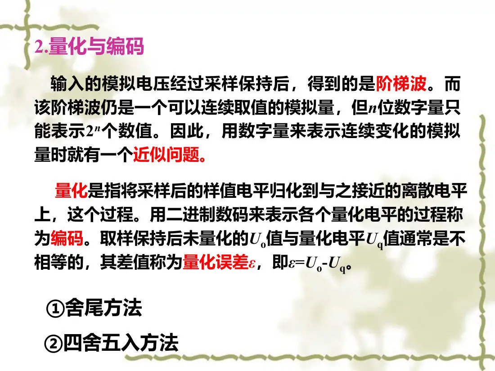

原文：

2.量化与编码

输入的模拟电压经过采样保持后，得到的是阶梯波。而该阶梯波仍是一个可以连续取值的模拟量，但 $n$ 位数字量只能表示 $2^{n}$ 个数值。因此，用数字量来表示连续变化的模拟量时就有一个近似问题。

量化是指将采样后的样值电平归化到与之接近的离散电平上，这个过程。用二进制数码来表示各个量化电平的过程称为编码。取样保持后未量化的 $U_{0}$ 值与量化电平 $U_{q}$ 值通常是不相等的，其差值称为量化误差 $\varepsilon$ ，即 $\varepsilon = U_{0} - U_{q}$ 。

①舍尾方法

②四舍五入方法

### 舍尾法

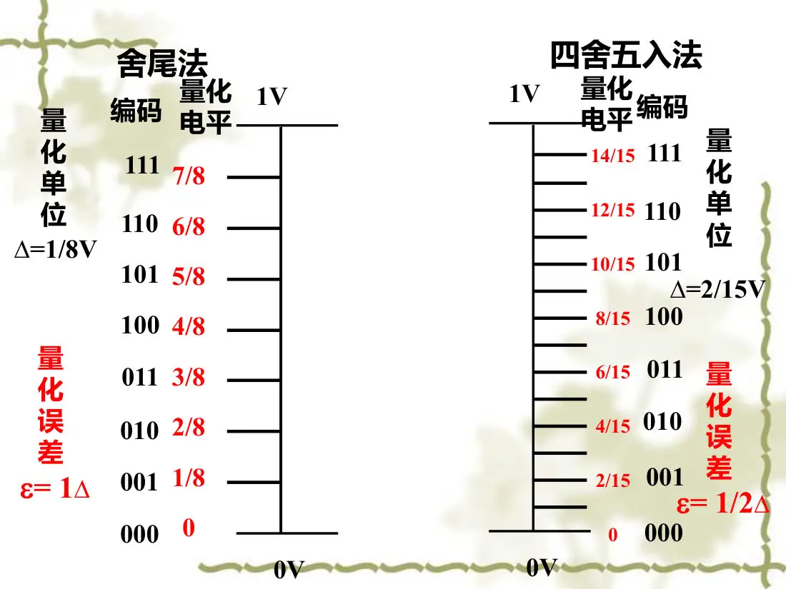

原文：

舍尾法

$$
\begin{array}{c c} \text {编码} & \text {量化电平} \\ 1 1 1 & 7 / 8 \\ 1 1 0 & 6 / 8 \\ 1 0 1 & 5 / 8 \\ 1 0 0 & 4 / 8 \\ 0 1 1 & 3 / 8 \\ 0 1 0 & 2 / 8 \\ 0 0 1 & 1 / 8 \\ 0 0 0 & 0 \end{array}
$$

四舍五入法

$$
\begin{array}{c c c} 1 \mathrm{V} & \text {量化} \\ & \text {电平编码} \\ \hline 1 4 / 1 5 & 1 1 1 & \text {量化} \\ 1 2 / 1 5 & 1 1 0 & \text {单位} \\ 1 0 / 1 5 & 1 0 1 \\ \Delta = 2 / 1 5 \mathrm{V} \\ 8 / 1 5 & 1 0 0 \\ \hline 6 / 1 5 & 0 1 1 & \text {量化} \\ 4 / 1 5 & 0 1 0 & \text {误差} \\ 2 / 1 5 & 0 0 1 & \varepsilon = 1 / 2 \Delta \\ \hline 0 & 0 0 0 \end{array}
$$

### 8.3.2 ADC

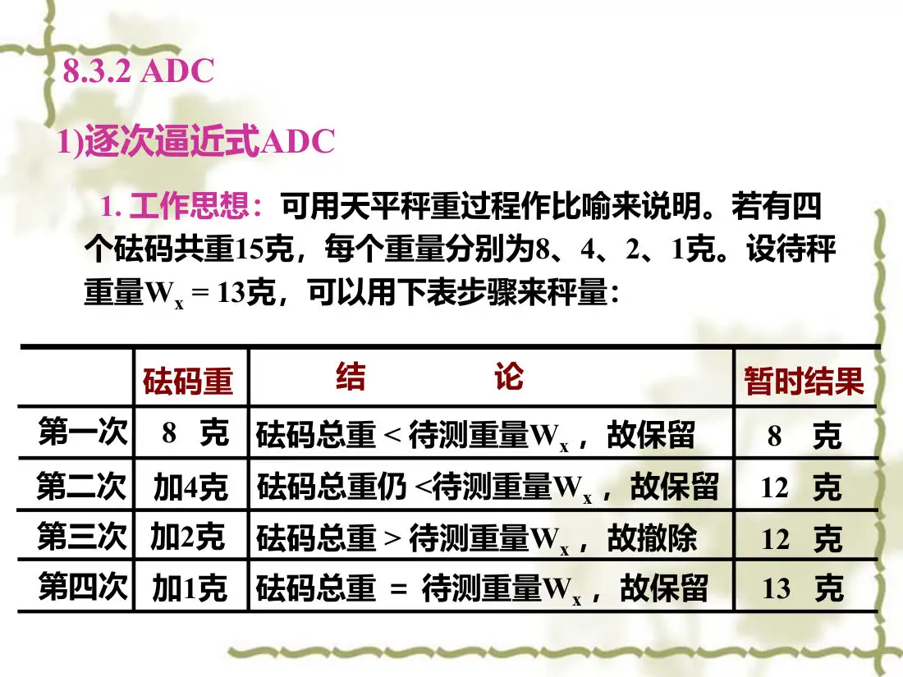

原文：

8.3.2 ADC

1)逐次逼近式ADC

1. 工作思想：可用天平秤重过程作比喻来说明。若有四个砝码共重15克，每个重量分别为8、4、2、1克。设待秤重量 $W_{x}=13$ 克，可以用下表步骤来秤量：

<table><tr><td></td><td>砝码重</td><td>结论</td><td>暂时结果</td></tr><tr><td>第一次</td><td>8 克</td><td>砝码总重&lt;待测重量 $W_x$ ,故保留</td><td>8 克</td></tr><tr><td>第二次</td><td>加4克</td><td>砝码总重仍&lt;待测重量 $W_x$ ,故保留</td><td>12 克</td></tr><tr><td>第三次</td><td>加2克</td><td>砝码总重&gt;待测重量 $W_x$ ,故撤除</td><td>12 克</td></tr><tr><td>第四次</td><td>加1克</td><td>砝码总重=待测重量 $W_x$ ,故保留</td><td>13 克</td></tr></table>

### 逐次逼近型A/D转换器的工作原理：

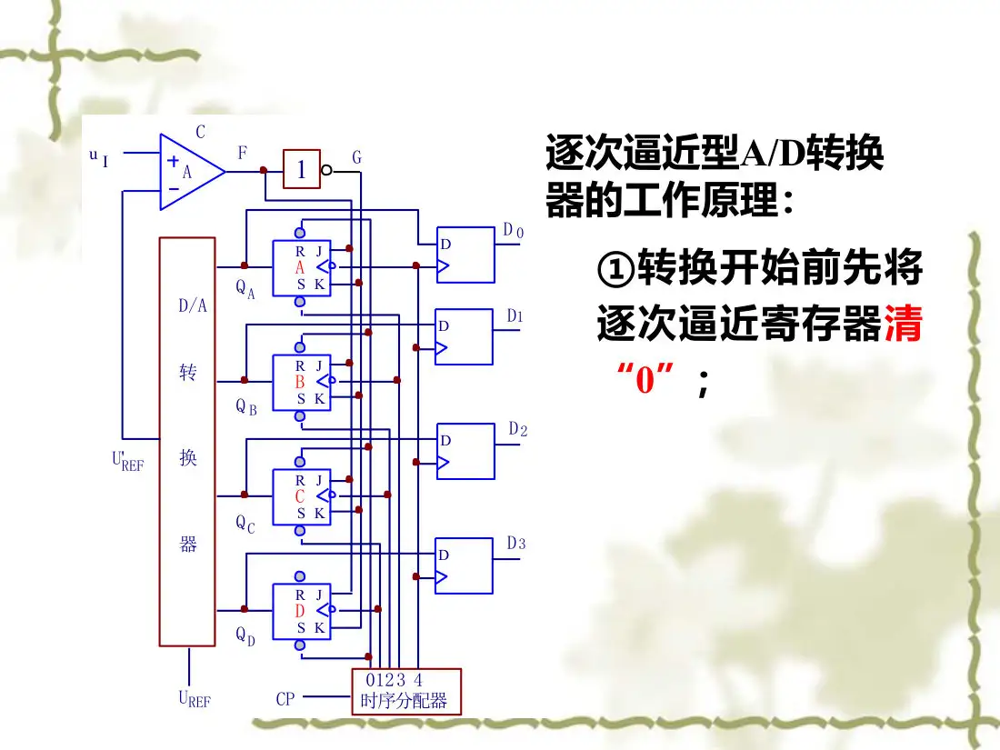

原文：

逐次逼近型A/D转换器的工作原理：

①转换开始前先将逐次逼近寄存器清“0”；

### 逐次逼近型A/D转换器的工作原理：

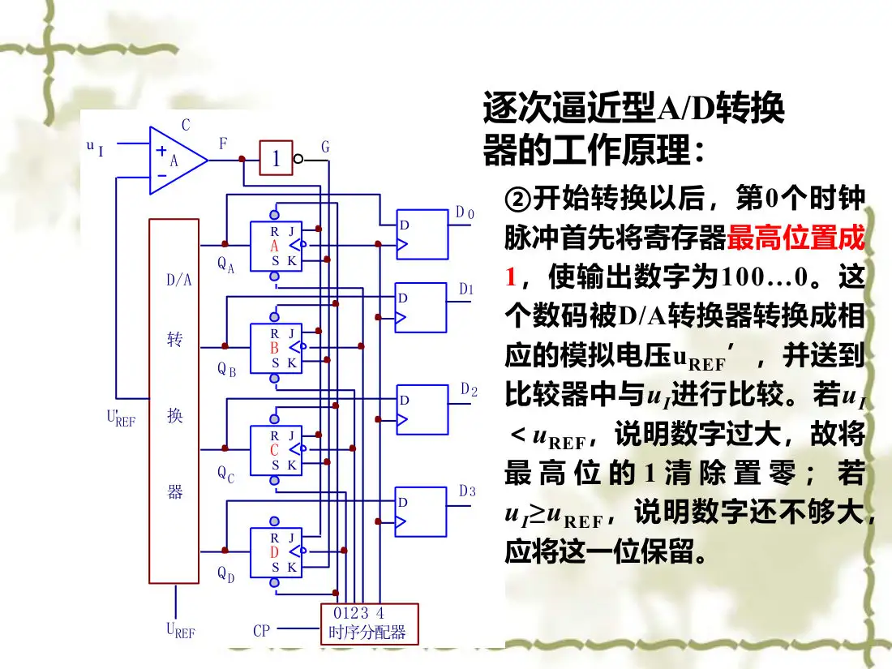

原文：

逐次逼近型A/D转换器的工作原理：

②开始转换以后，第0个时钟脉冲首先将寄存器最高位置成1，使输出数字为100...0。这个数码被D/A转换器转换成相应的模拟电压 $u_{REF}'$ ，并送到比较器中与 $u_{I}$ 进行比较。若 $u_{I}<u_{REF}$ ，说明数字过大，故将最高位的1清除置零；若 $u_{I}\geq u_{REF}$ ，说明数字还不够大，应将这一位保留。

### 逐次逼近型A/D转换器的工作原理：

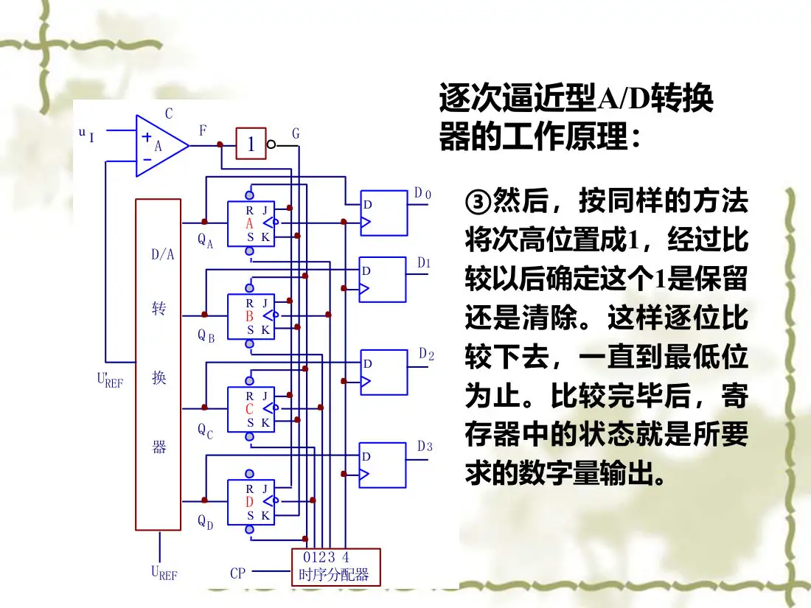

原文：

逐次逼近型A/D转换器的工作原理：

③然后，按同样的方法将次高位置成1，经过比较以后确定这个1是保留还是清除。这样逐位比较下去，一直到最低位为止。比较完毕后，寄存器中的状态就是所要求的数字量输出。

### 转换的结果为： $D_{3}D_{2}D_{1}D_{0}=1001$ 。

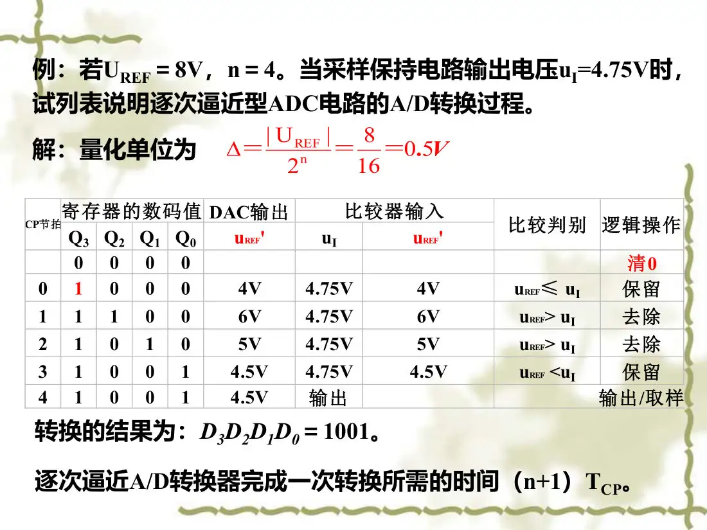

原文：

例：若 $U_{REF}=8V$ ，n=4。当采样保持电路输出电压 $u_{I}=4.75V$ 时，试列表说明逐次逼近型ADC电路的A/D转换过程。

解: 量化单位为 $\Delta = \frac{|U_{\mathrm{REF}}|}{2^{\mathrm{n}}} = \frac{8}{16} = 0.5V$

<table><tr><td rowspan="2">CP节拍</td><td colspan="4">寄存器的数码值</td><td>DAC输出</td><td colspan="2">比较器输入</td><td rowspan="2">比较判别</td><td rowspan="2">逻辑操作</td></tr><tr><td> $Q_3$ </td><td> $Q_2$ </td><td> $Q_1$ </td><td> $Q_0$ </td><td> $u_{REF}'$ </td><td> $u_I$ </td><td> $u_{REF}'$ </td></tr><tr><td></td><td>0</td><td>0</td><td>0</td><td>0</td><td></td><td></td><td></td><td></td><td>清0</td></tr><tr><td>0</td><td>1</td><td>0</td><td>0</td><td>0</td><td>4V</td><td>4.75V</td><td>4V</td><td> $u_{REF} \leq u_I$ </td><td>保留</td></tr><tr><td>1</td><td>1</td><td>1</td><td>0</td><td>0</td><td>6V</td><td>4.75V</td><td>6V</td><td> $u_{REF} > u_I$ </td><td>去除</td></tr><tr><td>2</td><td>1</td><td>0</td><td>1</td><td>0</td><td>5V</td><td>4.75V</td><td>5V</td><td> $u_{REF} > u_I$ </td><td>去除</td></tr><tr><td>3</td><td>1</td><td>0</td><td>0</td><td>1</td><td>4.5V</td><td>4.75V</td><td>4.5V</td><td> $u_{REF} < u_I$ </td><td>保留</td></tr><tr><td>4</td><td>1</td><td>0</td><td>0</td><td>1</td><td>4.5V</td><td>输出</td><td></td><td></td><td>输出/取样</td></tr></table>

转换的结果为： $D_{3}D_{2}D_{1}D_{0}=1001$ 。

逐次逼近A/D转换器完成一次转换所需的时间（n+1） $\mathrm{T}_{\mathrm{CP}}$ 。

### 2. 并行比较型A/D转换器

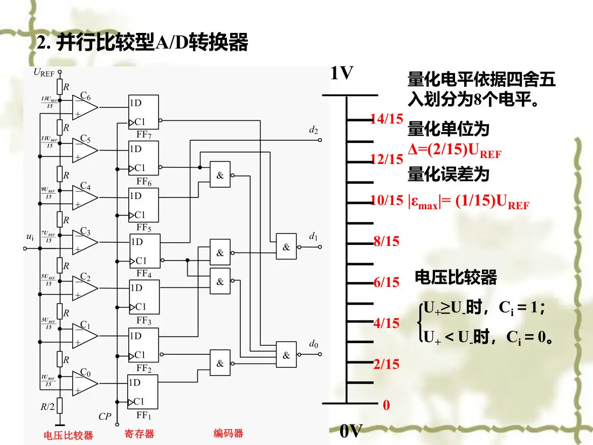

原文：

2. 并行比较型A/D转换器

量化电平依据四舍五入划分为8个电平。

量化单位为

量化误差为

$\left\{ \begin{array}{l} \mathrm{U}_{+} \geq \mathrm{U}_{-} \text{时, } \mathrm{C}_{\mathrm{i}} = 1; \\ \mathrm{U}_{+} < \mathrm{U}_{-} \text{时, } \mathrm{C}_{\mathrm{i}} = 0. \end{array} \right.$

.6/15 电压比较器

### 并行比较型A/D转换器真值表

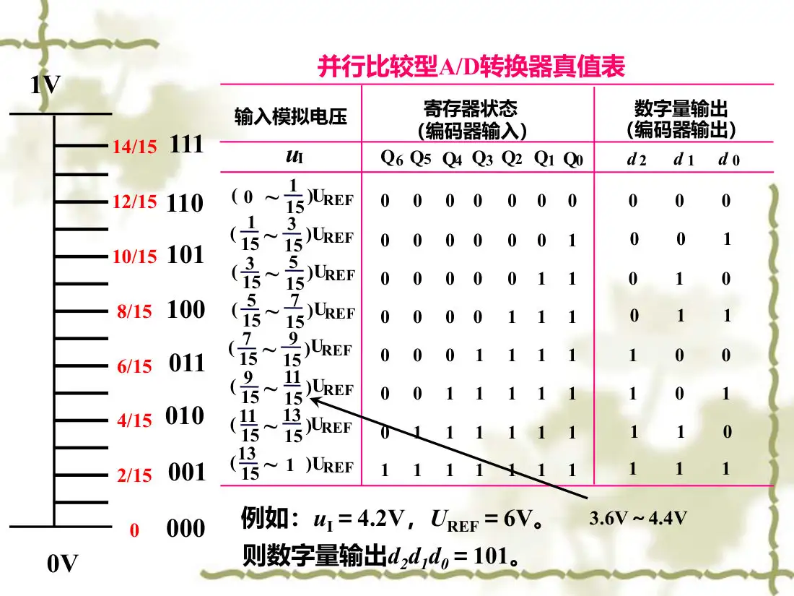

原文：

并行比较型A/D转换器真值表
<table><tr><td>输入模拟电压</td><td colspan="7">寄存器状态(编码器输入)</td><td colspan="3">数字量输出(编码器输出)</td></tr><tr><td> $u_{\text{I}}$ </td><td>Q6</td><td>Q5</td><td>Q4</td><td>Q3</td><td>Q2</td><td>Q1</td><td>Q0</td><td>d2</td><td>d1</td><td>d0</td></tr><tr><td> $(0 \sim \frac{1}{15})U_{\text{REF}}$ </td><td>0</td><td>0</td><td>0</td><td>0</td><td>0</td><td>0</td><td>0</td><td>0</td><td>0</td><td>0</td></tr><tr><td> $(\frac{1}{15} \sim \frac{3}{15})U_{\text{REF}}$ </td><td>0</td><td>0</td><td>0</td><td>0</td><td>0</td><td>0</td><td>1</td><td>0</td><td>0</td><td>1</td></tr><tr><td> $(\frac{3}{15} \sim \frac{5}{15})U_{\text{REF}}$ </td><td>0</td><td>0</td><td>0</td><td>0</td><td>0</td><td>1</td><td>1</td><td>0</td><td>1</td><td>0</td></tr><tr><td> $(\frac{5}{15} \sim \frac{7}{15})U_{\text{REF}}$ </td><td>0</td><td>0</td><td>0</td><td>0</td><td>1</td><td>1</td><td>1</td><td>0</td><td>1</td><td>1</td></tr><tr><td> $(\frac{7}{15} \sim \frac{9}{15})U_{\text{REF}}$ </td><td>0</td><td>0</td><td>0</td><td>1</td><td>1</td><td>1</td><td>1</td><td>1</td><td>0</td><td>0</td></tr><tr><td> $(\frac{9}{15} \sim \frac{11}{15})U_{\text{REF}}$ </td><td>0</td><td>0</td><td>1</td><td>1</td><td>1</td><td>1</td><td>1</td><td>1</td><td>0</td><td>1</td></tr><tr><td> $(\frac{11}{15} \sim \frac{13}{15})U_{\text{REF}}$ </td><td>0</td><td>1</td><td>1</td><td>1</td><td>1</td><td>1</td><td>1</td><td>1</td><td>1</td><td>0</td></tr><tr><td> $(\frac{13}{15} \sim 1 )U_{\text{REF}}$ </td><td>1</td><td>1</td><td>1</td><td>1</td><td>1</td><td>1</td><td>1</td><td>1</td><td>1</td><td>1</td></tr></table>

例如： $u_{\mathrm{I}} = 4.2\mathrm{V}$ ， $U_{\mathrm{REF}} = 6\mathrm{V}$ 。

3.6V \~ 4.4V

则数字量输出 $d_{2}d_{1}d_{0}=101$ 。

### 并行比较型A/D转换器的特点：

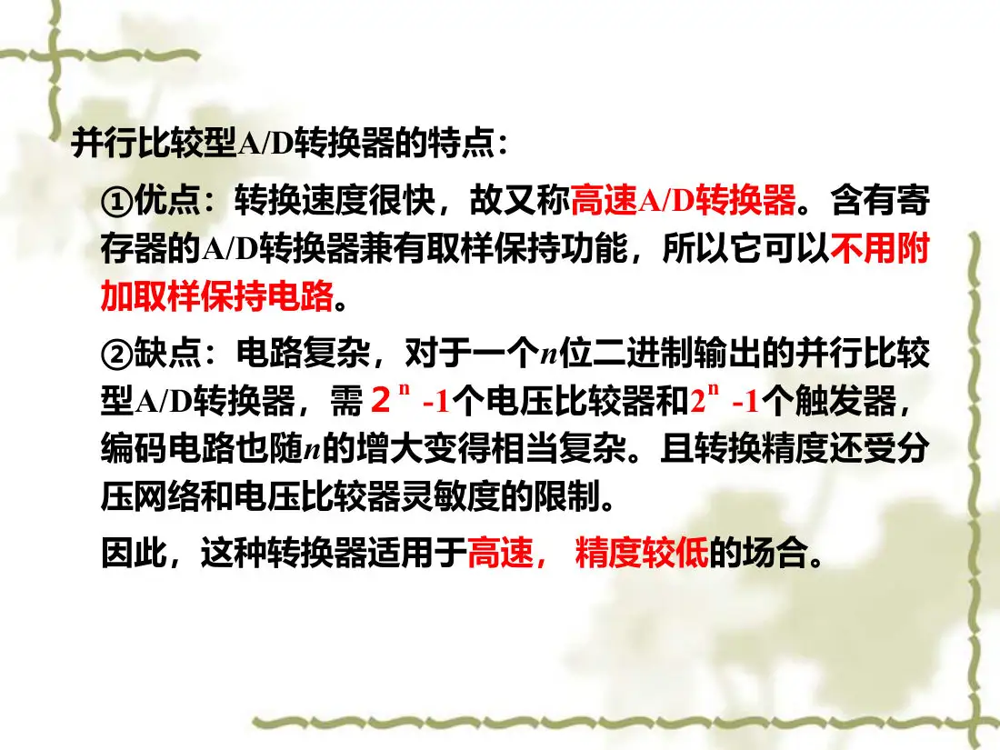

原文：

并行比较型A/D转换器的特点：

①优点：转换速度很快，故又称高速A/D转换器。含有寄存器的A/D转换器兼有取样保持功能，所以它可以不用附加取样保持电路。

②缺点: 电路复杂, 对于一个 $n$ 位二进制输出的并行比较型A/D转换器, 需 $2^{n} - 1$ 个电压比较器和 $2^{n} - 1$ 个触发器,编码电路也随 $n$ 的增大变得相当复杂。且转换精度还受分压网络和电压比较器灵敏度的限制。

因此，这种转换器适用于高速，精度较低的场合。

### 3. 双积分型A/D转换器

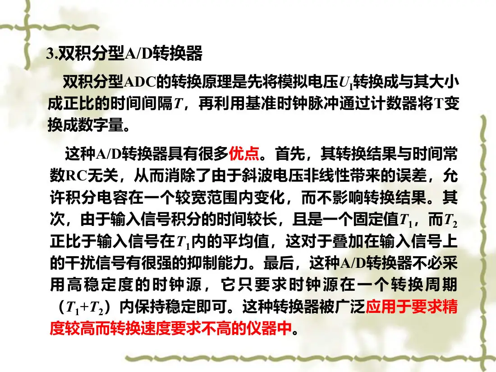

原文：

3. 双积分型A/D转换器

双积分型ADC的转换原理是先将模拟电压 $U_{1}$ 转换成与其大小成正比的时间间隔T，再利用基准时钟脉冲通过计数器将T变换成数字量。

这种A/D转换器具有很多优点。首先，其转换结果与时间常数RC无关，从而消除了由于斜波电压非线性带来的误差，允许积分电容在一个较宽范围内变化，而不影响转换结果。其次，由于输入信号积分的时间较长，且是一个固定值 $T_{1}$ ，而 $T_{2}$ 正比于输入信号在 $T_{1}$ 内的平均值，这对于叠加在输入信号上的干扰信号有很强的抑制能力。最后，这种A/D转换器不必采用高稳定度的时钟源，它只要求时钟源在一个转换周期 $(T_{1}+T_{2})$ 内保持稳定即可。这种转换器被广泛应用于要求精度较高而转换速度要求不高的仪器中。

### 三、A/D转换器的主要技术指标

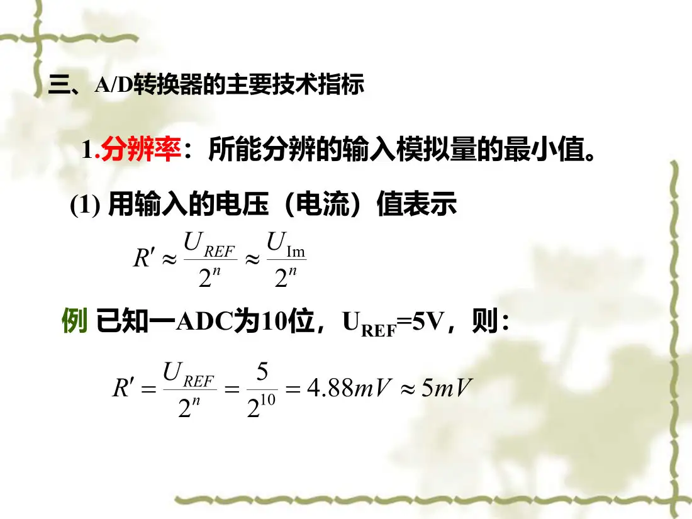

原文：

三、A/D转换器的主要技术指标

1. 分辨率：所能分辨的输入模拟量的最小值。

(1) 用输入的电压（电流）值表示

$$
R ^ {\prime} \approx \frac {U _ {R E F}}{2 ^ {n}} \approx \frac {U _ {\mathrm{Im}}}{2 ^ {n}}
$$

例 已知一ADC为10位， $U_{REF}=5V$ ，则：

$$
R ^ {\prime} = \frac {U _ {R E F}}{2 ^ {n}} = \frac {5}{2 ^ {1 0}} = 4. 8 8 m V \approx 5 m V
$$

### (2) 用百分比表示

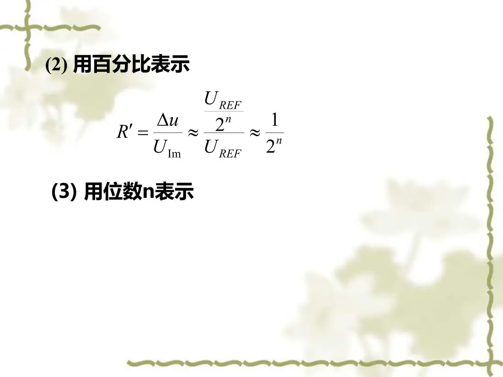

原文：

(2) 用百分比表示

$$
R ^ {\prime} = \frac {\Delta u}{U _ {\mathrm{Im}}} \approx \frac {\frac {U _ {R E F}}{2 ^ {n}}}{U _ {R E F}} \approx \frac {1}{2 ^ {n}}
$$

(3) 用位数n表示

### 2. 转换精度

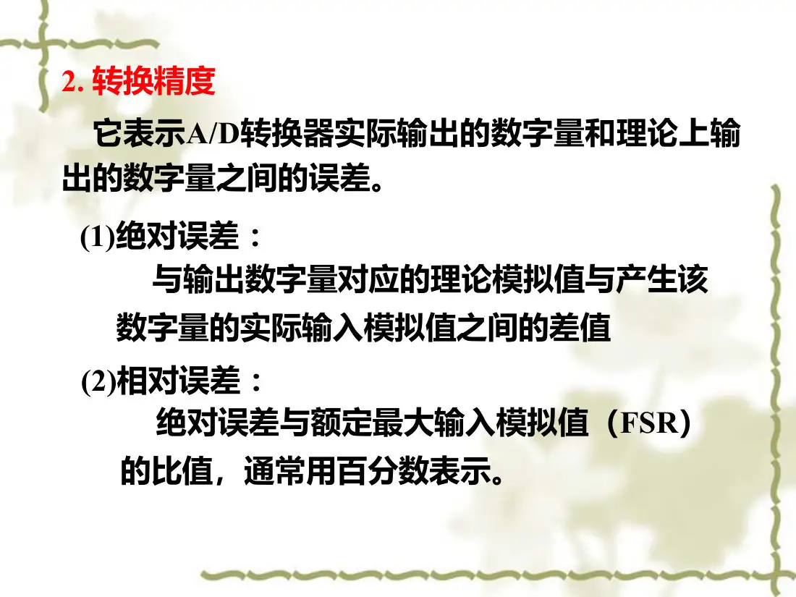

原文：

2. 转换精度

它表示A/D转换器实际输出的数字量和理论上输出的数字量之间的误差。

(1)绝对误差：

与输出数字量对应的理论模拟值与产生该数字量的实际输入模拟值之间的差值

(2)相对误差：

绝对误差与额定最大输入模拟值（FSR）的比值，通常用百分数表示。

### 3. 转换时间

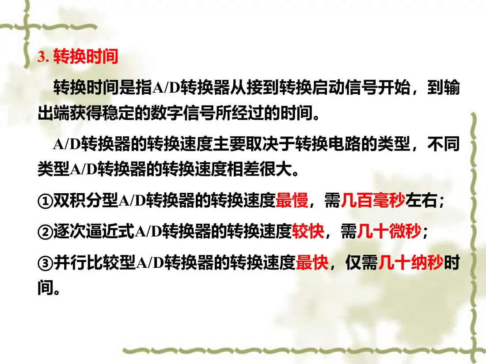

原文：

3. 转换时间

转换时间是指A/D转换器从接到转换启动信号开始，到输出端获得稳定的数字信号所经过的时间。

A/D转换器的转换速度主要取决于转换电路的类型，不同类型A/D转换器的转换速度相差很大。

①双积分型A/D转换器的转换速度最慢，需几百毫秒左右；

②逐次逼近式A/D转换器的转换速度较快，需几十微秒；

③并行比较型A/D转换器的转换速度最快，仅需几十纳秒时间。

### 四、8位集成ADC0809

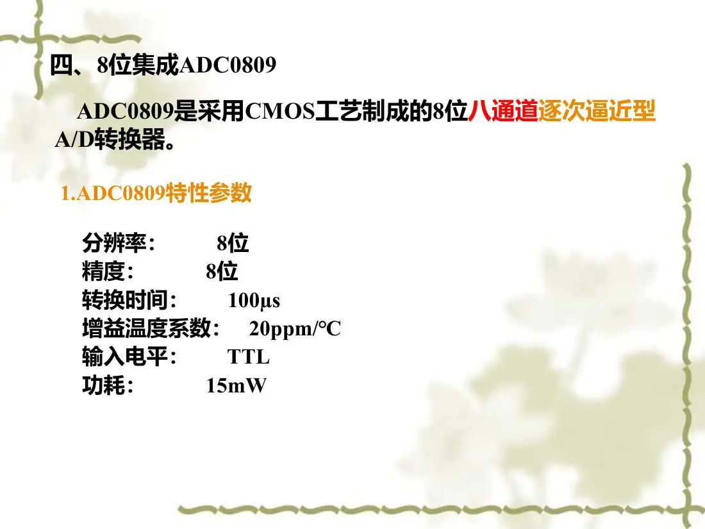

原文：

四、8位集成ADC0809

ADC0809是采用CMOS工艺制成的8位八通道逐次逼近型A/D转换器。

1.ADC0809特性参数

分辨率：8位

精度: 8位

转换时间： $100\mu \mathrm{s}$

增益温度系数: $20 \mathrm{ppm} / ^{\circ} \mathrm{C}$

输入电平: TTL

功耗： 15mW

### 2.ADC0809工作原理

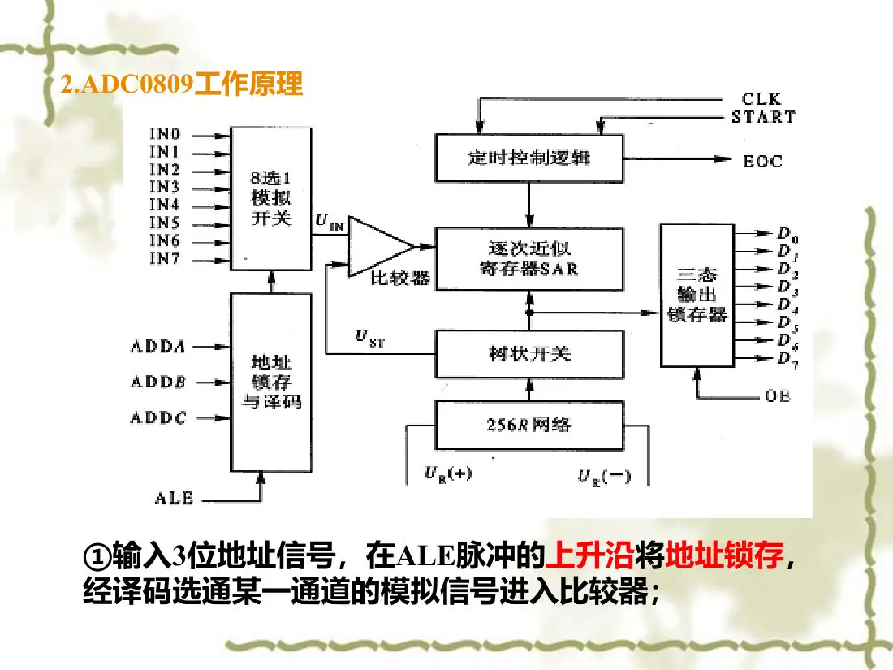

原文：

2.ADC0809工作原理

①输入3位地址信号，在ALE脉冲的上升沿将地址锁存，经译码选通某一通道的模拟信号进入比较器；

### 2.ADC0809工作原理

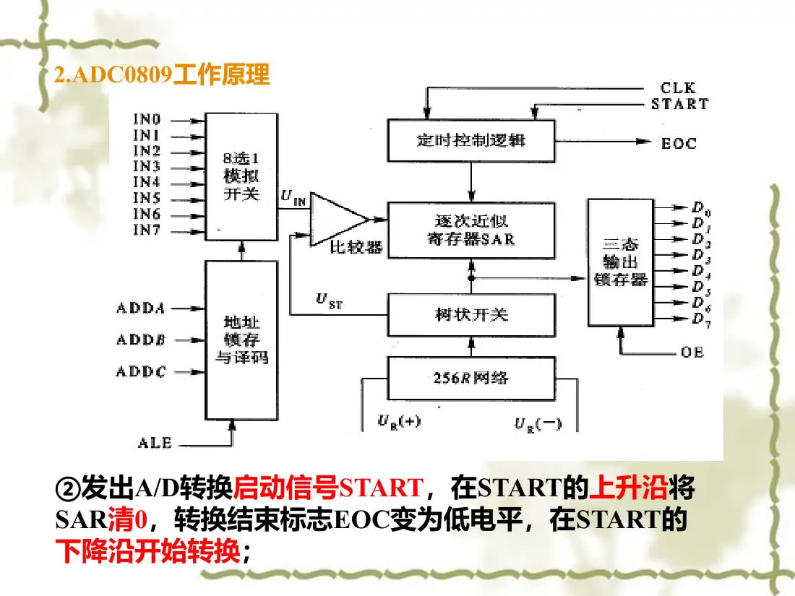

原文：

2.ADC0809工作原理

②发出A/D转换启动信号START，在START的上升沿将SAR清0，转换结束标志EOC变为低电平，在START的下降沿开始转换；

### 2.ADC0809工作原理

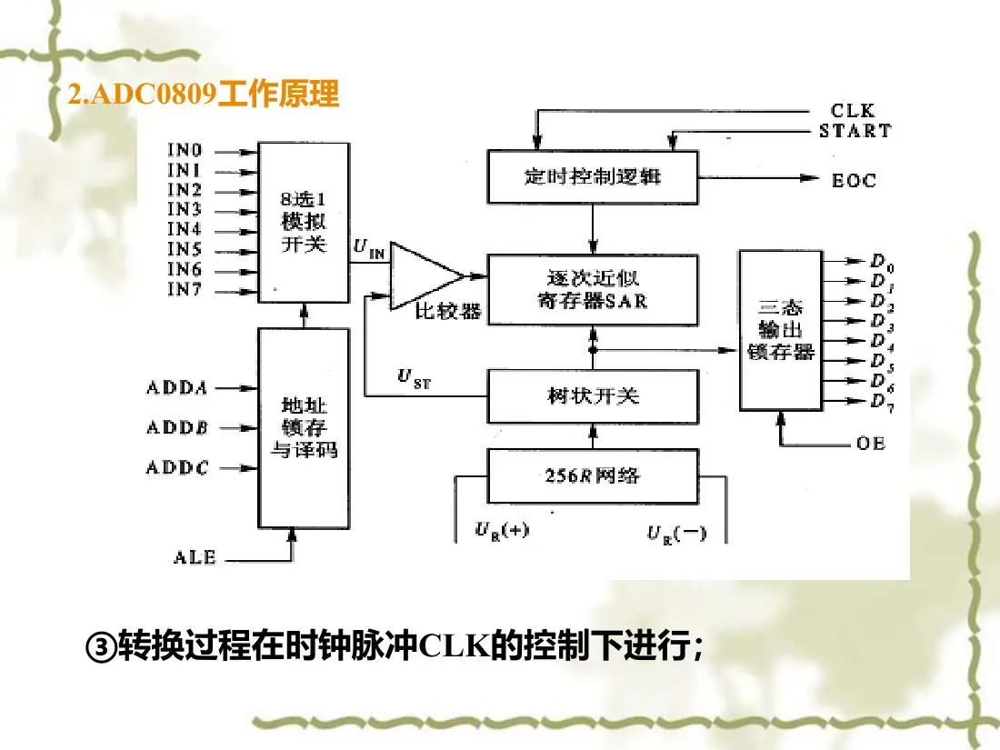

原文：

2.ADC0809工作原理

③转换过程在时钟脉冲CLK的控制下进行;

### 2.ADC0809工作原理

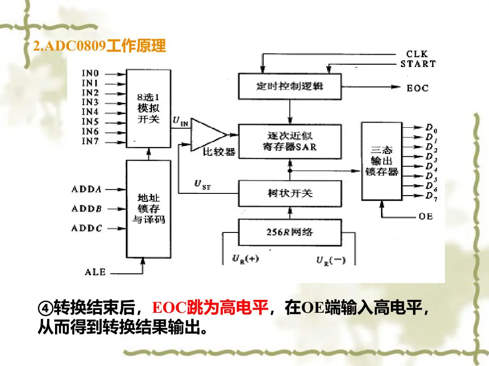

原文：

2.ADC0809工作原理

④转换结束后，EOC跳为高电平，在OE端输入高电平，从而得到转换结果输出。

### 3.ADC0809引脚功能

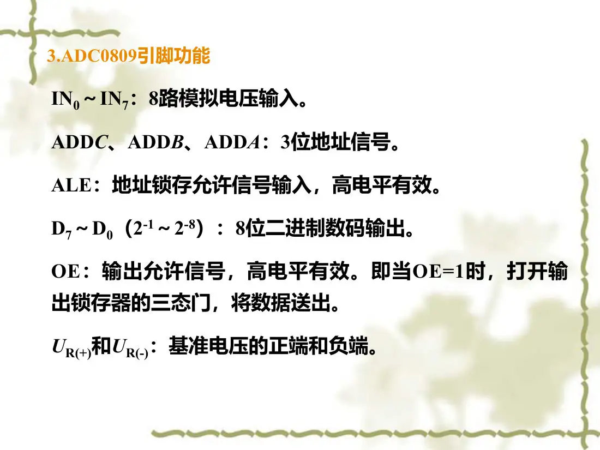

原文：

3.ADC0809引脚功能

$\mathrm{IN}_0 \sim \mathrm{IN}_7$ ：8路模拟电压输入。

ADDC、ADDB、ADDA：3位地址信号。

ALE：地址锁存允许信号输入，高电平有效。

$\mathbf{D}_7 \sim \mathbf{D}_0$ （ $2^{-1} \sim 2^{-8}$ ）：8位二进制数码输出。

OE：输出允许信号，高电平有效。即当OE=1时，打开输出锁存器的三态门，将数据送出。

$U_{\mathrm{R}(+)}$ 和 $U_{\mathrm{R}(-)}$ ：基准电压的正端和负端。

### CLK：时钟脉冲输入端。一般在此端加500kHz的时钟信号。

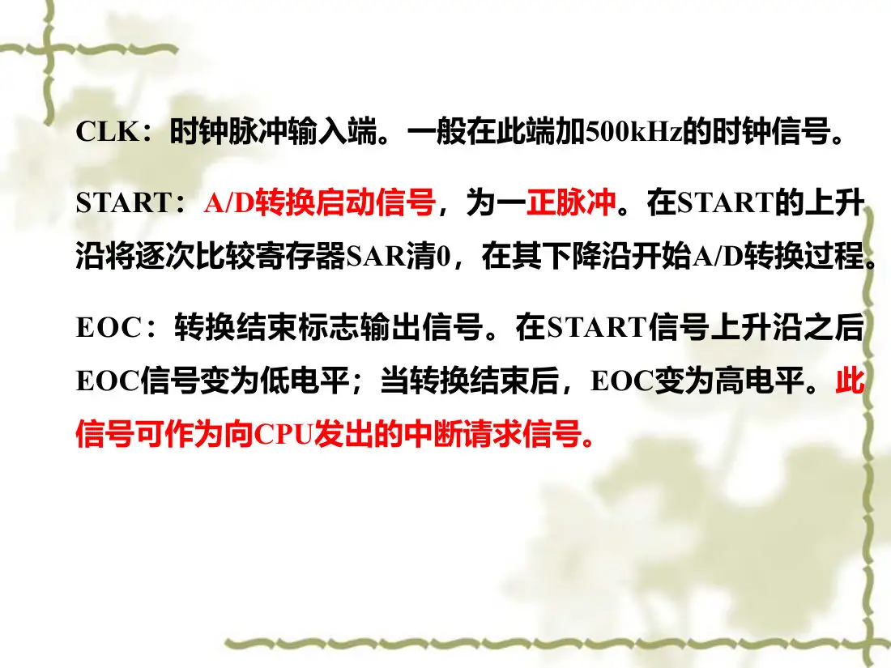

原文：

CLK：时钟脉冲输入端。一般在此端加500kHz的时钟信号。

START: A/D转换启动信号，为一正脉冲。在START的上升沿将逐次比较寄存器SAR清0，在其下降沿开始A/D转换过程。

EOC：转换结束标志输出信号。在START信号上升沿之后EOC信号变为低电平；当转换结束后，EOC变为高电平。此信号可作为向CPU发出的中断请求信号。

### 作业题

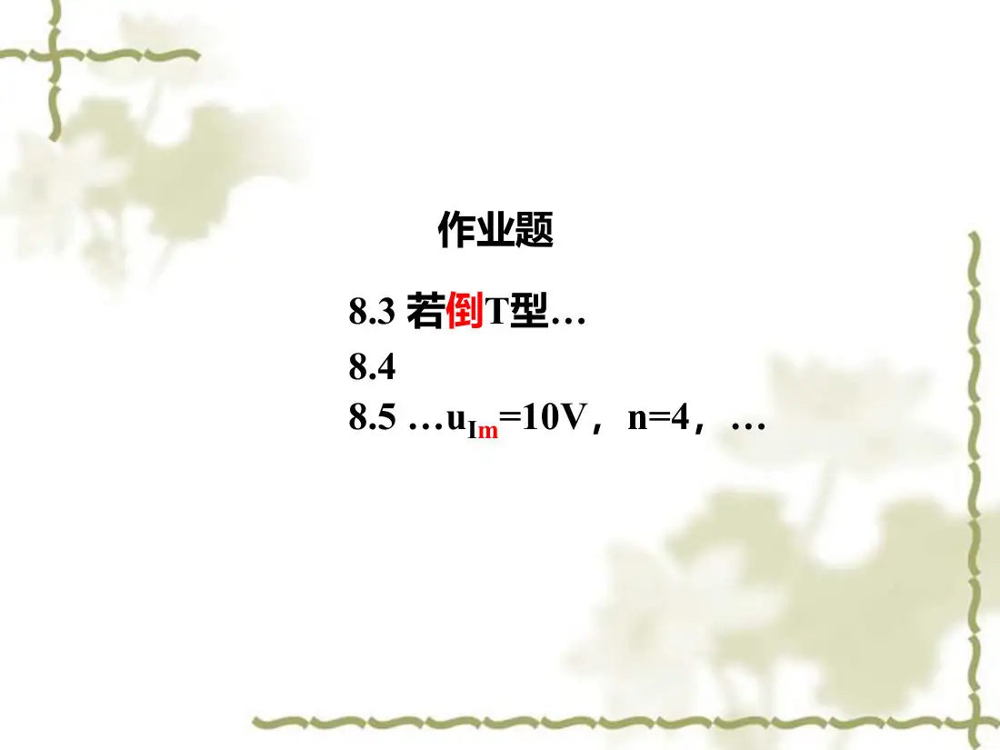

原文：

作业题

8.3 若倒T型...

8.4

8.5 ... $u_{Im}=10V$ , n=4, ...
