# 《数字电路与系统设计》第8章 数模转换和模数转换（课件）

原件的每一页，下面附识别出的文字。

### 第8章 数模转换和模数转换

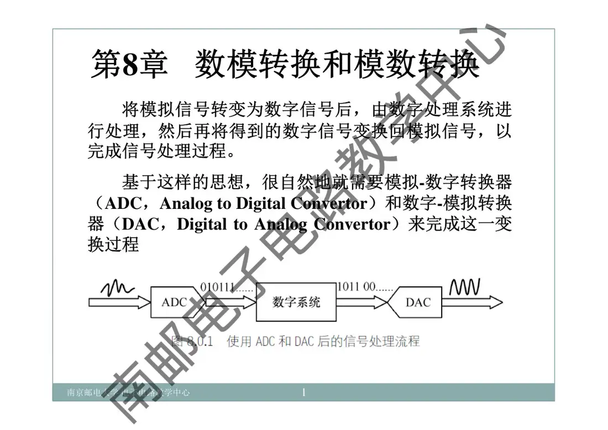

原文：

第8章 数模转换和模数转换

将模拟信号转变为数字信号后， 由数字处理系统进行处理， 然后再将得到的数字信号变换回模拟信号， 以完成信号处理过程。

基于这样的思想， 很 自然地就需要模拟-数字转换器（ ADC ， Analog to Digital Convertor ） 和 数字-模拟转换器 （ DAC ， Digital to Analog Convertor ） 来完成这一变换过程 1

南京邮电大学 电子电路教学中心

1

### 8 1 数模转换 （D/A ）

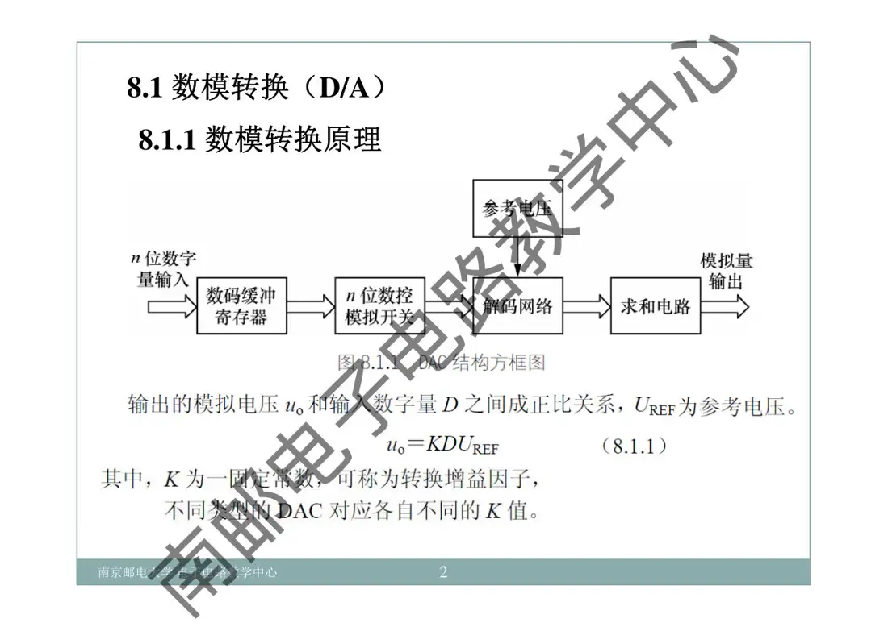

原文：

8 1 数模转换 （D/A ）

8 1 1 数模转换原理

n位数字

图8.1.1DAC结构方框图

输出的模拟电压 $u _ { \mathrm { o } }$ 和输人数字量D之间成正比关系， $U _ { \mathrm { R E F } }$ 为参考电压。

$$
u _ {\mathrm{o}} = K D U _ {\mathrm{REF}}\tag{8.1.1}
$$

其中，K为一固定常数，可称为转换增益因子，

不同类型的DAC对应各自不同的 K值。

南京邮电大学 电子电路教学中心

2

### $$

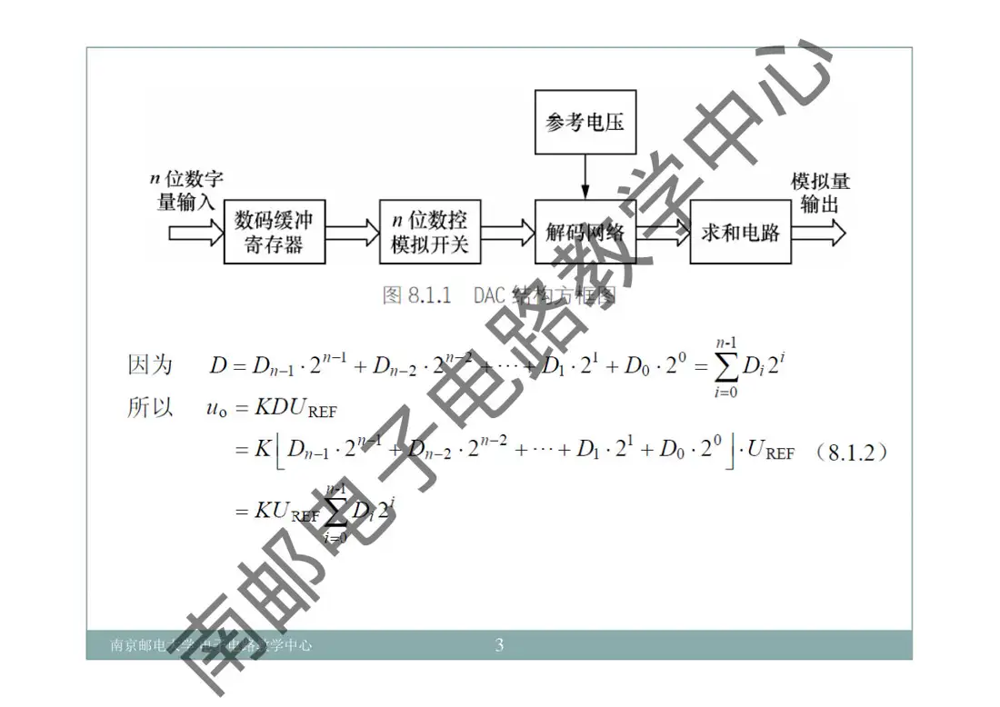

原文：

因为 $D = D _ { n - 1 } \cdot 2 ^ { n - 1 } + D _ { n - 2 }$

$$
D _ {1} \cdot 2 ^ {1} + D _ {0} \cdot 2 ^ {0} = \sum_ {i = 0} ^ {n - 1} D _ {i} 2 ^ {i}
$$

$$
\begin{array}{l} u _ {0} = K D U _ {\text {REF}} \\ = K \left[ D _ {n - 1} \cdot 2 ^ {n - 1} + D _ {n - 2} \cdot 2 ^ {n - 2} + \dots + D _ {1} \cdot 2 ^ {1} + D _ {0} \cdot 2 ^ {0} \right] \cdot U _ {\text {REF}} \\ = K U _ {\text {REF}} \sum_ {i = 1} ^ {n - 1} D _ {i} 2 ^ {i} \end{array}\tag{8.1.2}
$$

南京邮电大学 电子电路教学中心

3

### 南京邮电大学 电子电路教学中心

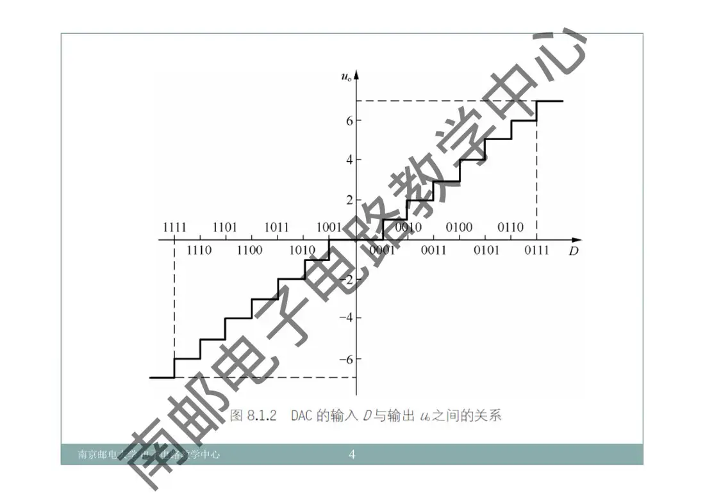

原文：

南京邮电大学 电子电路教学中心

4

### 8 1 2. . 常见 的DAC 结构

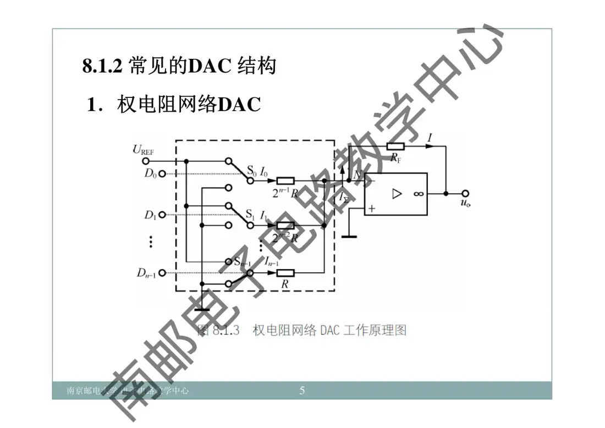

原文：

8 1 2. . 常见 的DAC 结构

1 ． 权 电阻网络DAC

南京邮电大学 电子电路教学中心

5

### $$

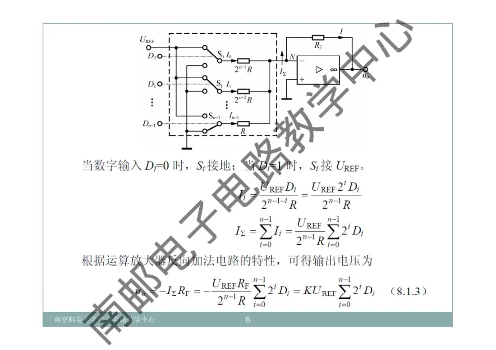

原文：

当数字输入 $D _ { i } { = } 0$ $S _ { i }$ 接地；D=1时， $S _ { i }$ 接 $U _ { \mathrm { R E F } }$

$$
\frac {U _ {\mathrm{REF}} D _ {i}}{2 ^ {n - 1 - i} R} = \frac {U _ {\mathrm{REF}} 2 ^ {i} D _ {i}}{2 ^ {n - 1} R}
$$

$$
I _ {\Sigma} = \sum_ {i = 0} ^ {n - 1} I _ {i} = \frac {U _ {\mathrm{REF}}}{2 ^ {n - 1} R} \sum_ {i = 0} ^ {n - 1} 2 ^ {i} D _ {i}
$$

根据运算放大器反向加法电路的特性，可得输出电压为

$$
- I _ {\Sigma} R _ {\mathrm{F}} = - \frac {U _ {\mathrm{REF}} R _ {\mathrm{F}}}{2 ^ {n - 1} R} \sum_ {i = 0} ^ {n - 1} 2 ^ {i} D _ {i} = K U _ {\mathrm{REF}} \sum_ {i = 0} ^ {n - 1} 2 ^ {i} D _ {i}\tag{8.1.3}
$$

南京邮电大学 电子电路教学中心

6

### $$

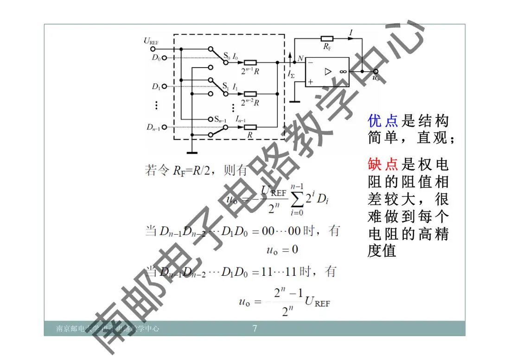

原文：

若令 $R _ { \mathrm { F } } { = } R / 2$ ，则有

$$
u _ {6} = - \frac {U _ {\mathrm{REF}}}{2 ^ {n}} \sum_ {i = 0} ^ {n - 1} 2 ^ {i} D _ {i}
$$

$D _ { n - 1 } \hat { D } _ { n - 2 } \hat { \mathrm { ~  ~ \cdot ~ } } D _ { 1 } D _ { 0 } = 0 0 \cdot \cdot \cdot 0 0$ 时，有

$$
u _ {\mathrm{o}} = 0
$$

D $| D _ { n - 2 } \cdots D _ { 1 } D _ { 0 } = 1 1 \cdots 1 1$ 时，有

$$
u _ {\mathrm{o}} = - \frac {2 ^ {n} - 1}{2 ^ {n}} U _ {\mathrm{REF}}
$$

优 点 是 结 构简 单 ， 直观 ；缺 点 是 权 电阻 的 阻 值 相差 较 大 ， 很难 做 到 每 个电 阻 的 高 精度值

南京邮电大学 电子电路教学中心

7

### 2． 倒T 型R-2R 电阻网络DAC

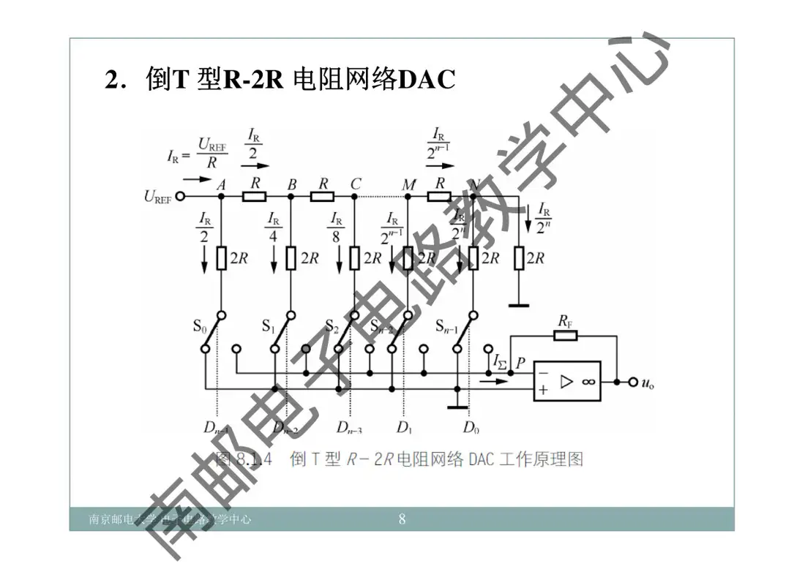

原文：

2． 倒T 型R-2R 电阻网络DAC

南京邮电大学 电子电路教学中心

8

### $$

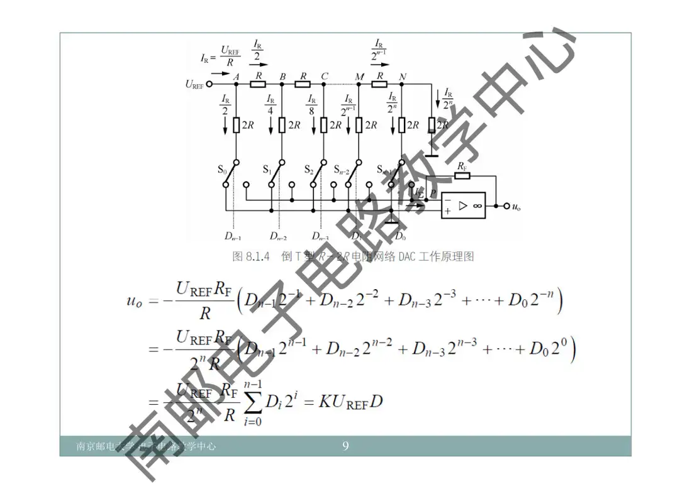

原文：

$$
\begin{array}{r l} u _ {o} & = - \frac {U _ {\mathrm{REF}} R _ {\mathrm{F}}}{R} \left(D _ {n - 1} 2 ^ {- 1} + D _ {n - 2} 2 ^ {- 2} + D _ {n - 3} 2 ^ {- 3} + \dots + D _ {0} 2 ^ {- n}\right) \\ & = - \frac {U _ {\mathrm{REF}} R _ {\mathrm{F}}}{2 ^ {n} R} \left(D _ {n - 1} 2 ^ {n - 1} + D _ {n - 2} 2 ^ {n - 2} + D _ {n - 3} 2 ^ {n - 3} + \dots + D _ {0} 2 ^ {0}\right) \\ & = \frac {U _ {\mathrm{REF}}}{2 ^ {n}} \frac {R _ {\mathrm{F}}}{R} \sum_ {i = 0} ^ {n - 1} D _ {i} 2 ^ {i} = K U _ {\mathrm{REF}} D \end{array}
$$

南京邮电大学 电子电路教学中心

9

### 8 1 3 DAC 的 要参数和 义主 意

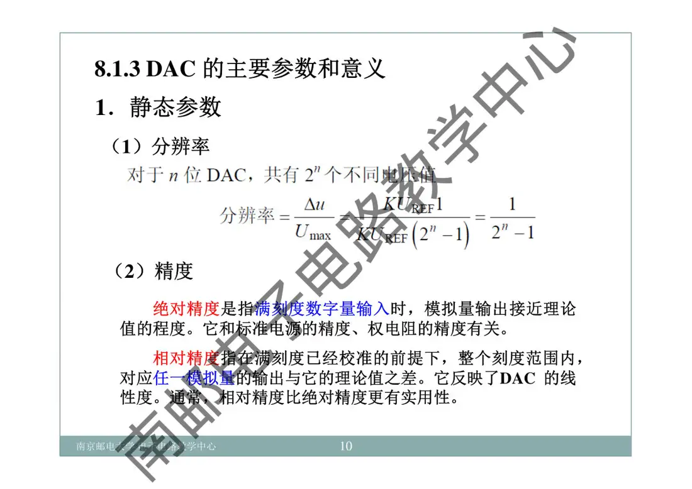

原文：

8 1 3 DAC 的 要参数和 义主 意

1． 静态参数

（ 1 ） 分辨率

对于n位 $\mathrm { D A C }$ $2 ^ { n }$ 个不同鬼本值

$$
\text {分辨率} = \frac {\Delta u}{U _ {\max}} = \frac {K U _ {\mathrm{REF}} 1}{K U _ {\mathrm{REF}} \left(2 ^ {n} - 1\right)} = \frac {1}{2 ^ {n} - 1}
$$

（ 2 ） 精度

绝对精度是指满刻度数字量输入时， 模拟量输出接近理论值的程度。 它和标准电源的精度、 权电阻的精度有关。

相对精度指在满刻度 已经校准的前提下， 整个刻度范围 内 ，对应任一模拟量的输出与它的理论值之差。 它反映了DAC 的线性度。 通常， 相对精度比绝对精度更有实用性。

南京邮电大学 电子电路教学中心

1 0

### （3） 失调误差

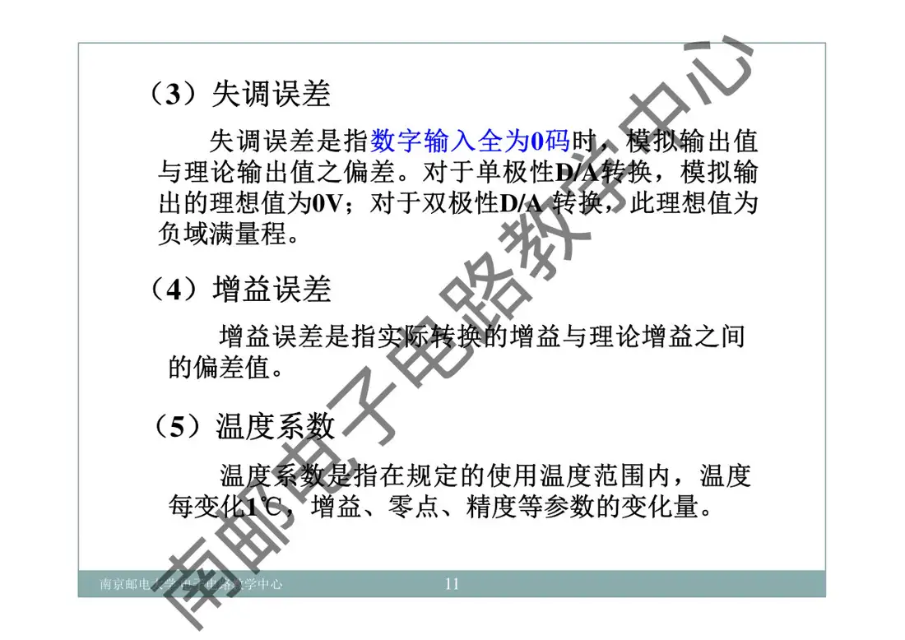

原文：

（3） 失调误差

失调误差是指数字输入全为0码时， 模拟输出值与理论输出值之偏差。 对于单极性D/A转换， 模拟输出 的理想值为0V； 对于双极性D/A 转换， 此理想值为负域满量程。

（4） 增益误差

增益误差是指实际转换的增益与理论增益之间 的偏差值。

（5） 温度系数

温度系数是指在规定的使用温度范围 内 ， 温度每变化1℃ ， 增益、 零点、 精度等参数的变化量。

南京邮电大学 电子电路教学中心

1 1

### 2． 动态参数

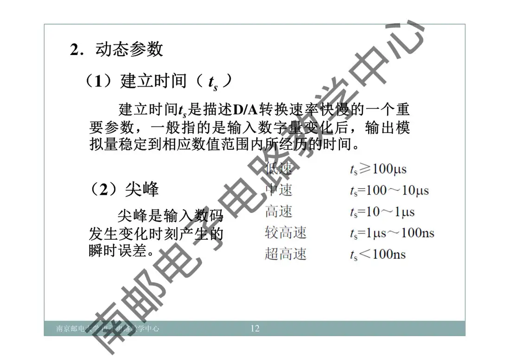

原文：

2． 动态参数

（ 1 ） 建立时间 $( \mathrm { \pmb { \ t } } _ { s } )$

建立时 间 $\dot { \pmb { t } } _ { s }$ 是描述D/A转换速率快慢的一个重要参数， 一般指 的是输入数字量变化后 ， 输出模拟量稳定到相应数值范围 内所经历的时间 。

$$
t _ {\mathrm{s}} \geqslant 1 0 0 \mu \mathrm{s}
$$

（ 2 ） 尖 峰

尖峰是输入数码发生变化时刻产生的瞬时误差。

中速

$$
t _ {\mathrm{s}} = 1 0 0 \sim 1 0 \mu \mathrm{s}
$$

高速

$$
t _ {\mathrm{s}} = 1 0 \sim 1 \mu \mathrm{s}
$$

较高速

超高速

$$
t _ {\mathrm{s}} = 1 \mu \mathrm{s} \sim 1 0 0 \mathrm{ns}
$$

$$
t _ {\mathrm{s}} <   1 0 0 \mathrm{ns}
$$

南京邮电大学 电子电路教学中心

1 2

### 8.2 模数转换 （ A/D ）

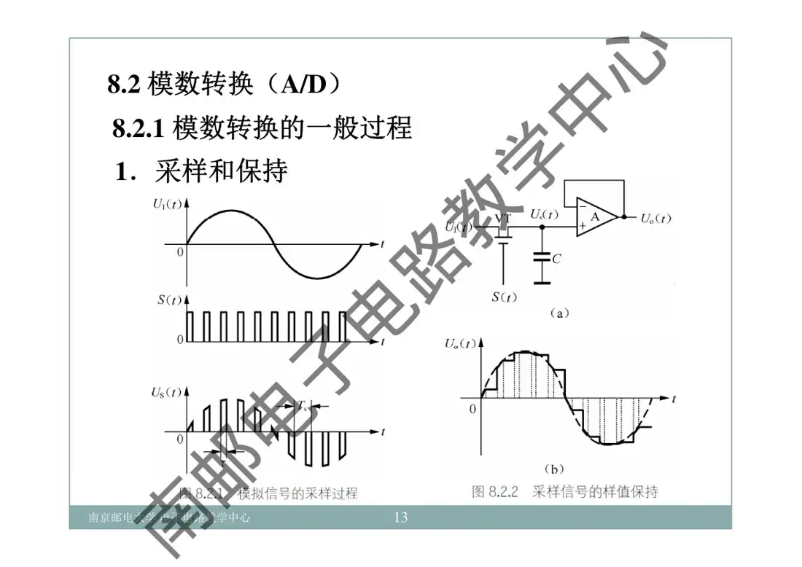

原文：

8.2 模数转换 （ A/D ）

8.2.1 模数转换的一般过程

1． 采样和保持

南京邮电大学 电子电路教学中心

1 3

### 2． 量化和编码

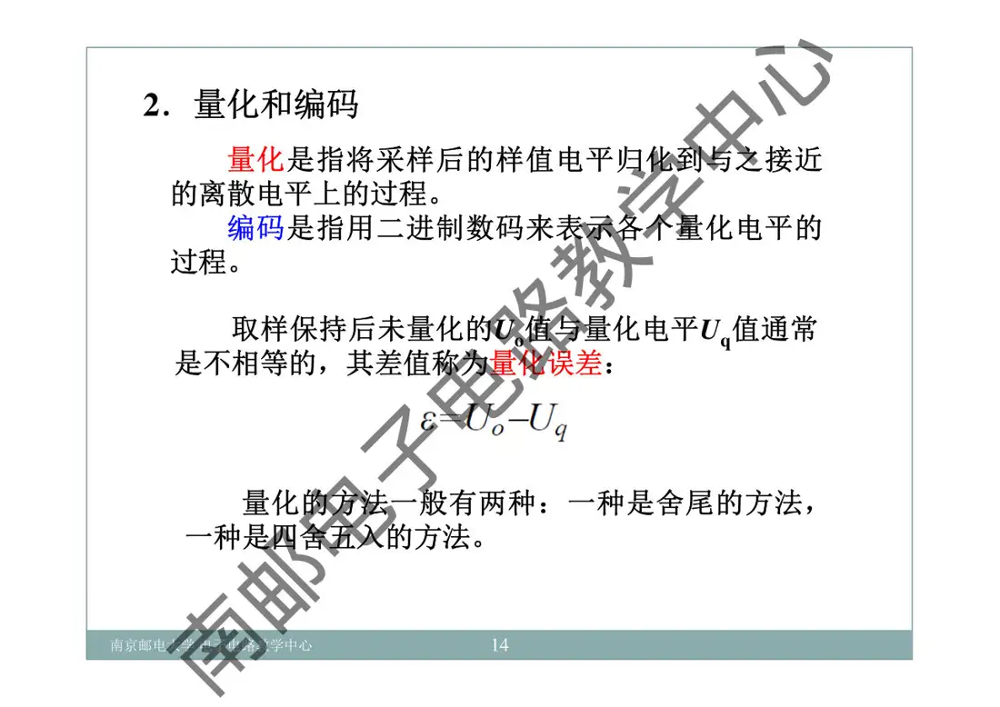

原文：

2． 量化和编码

量化是指将采样后 的样值 电平归化到与之接近的离散电平上的过程。

编码是指用二进制数码来表示各个量化 电平的过程。 我

取样保持后未量化的U 值与量化电平 $U _ { \mathbf { q } }$ 值通常 是不相等的， 其差值称为量化误差：

量化的方法 般有两种一 ： 一种是舍尾的方法，一种是四舍五入的方法。

南京邮电大学 电子电路教学中心

1 4

### （1） 舍尾量化

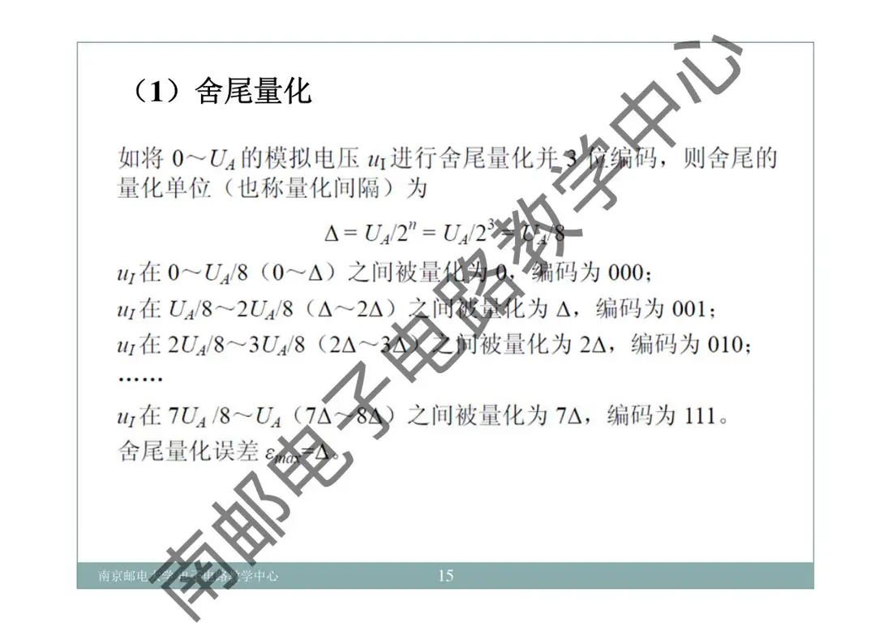

原文：

（1） 舍尾量化

如将 $0 \sim U _ { A }$ 的模拟电压 $u _ { \mathrm { I } }$ 进行舍尾量化并位编码，则舍尾的量化单位（也称量化间隔）为

$$
\Delta = U _ {A} / 2 ^ {n} = U _ {A} / 2 ^ {3} = U _ {A} / 8
$$

$u _ { I }$ 在 $0 { \sim } U _ { A } / 8 ( 0 { \sim } \Delta )$ 之间被量化为0，编码为000;

$u _ { I }$ 在 $U _ { A } / 8 { \sim } 2 U _ { A } / 8 ~ ( \Delta { \sim } 2 \Delta )$ 之间被量化为 $\Delta$ ，编码为 001;

$u _ { I }$ 在 $2 U _ { A } / 8 { \sim } 3 U _ { A } / 8$ (2∆～3△之间被量化为 $2 \Delta$ ，编码为 010;

$u _ { I }$ $7 U _ { A } / 8 { \sim } U _ { A } ~ ( 7 \Delta \gamma { \sim } 8 \Delta )$ 之间被量化为7Δ，编码为111。

舍尾量化误差ε

南京邮电大学 电子电路教学中心

1 5

### （2） 四舍五入量化

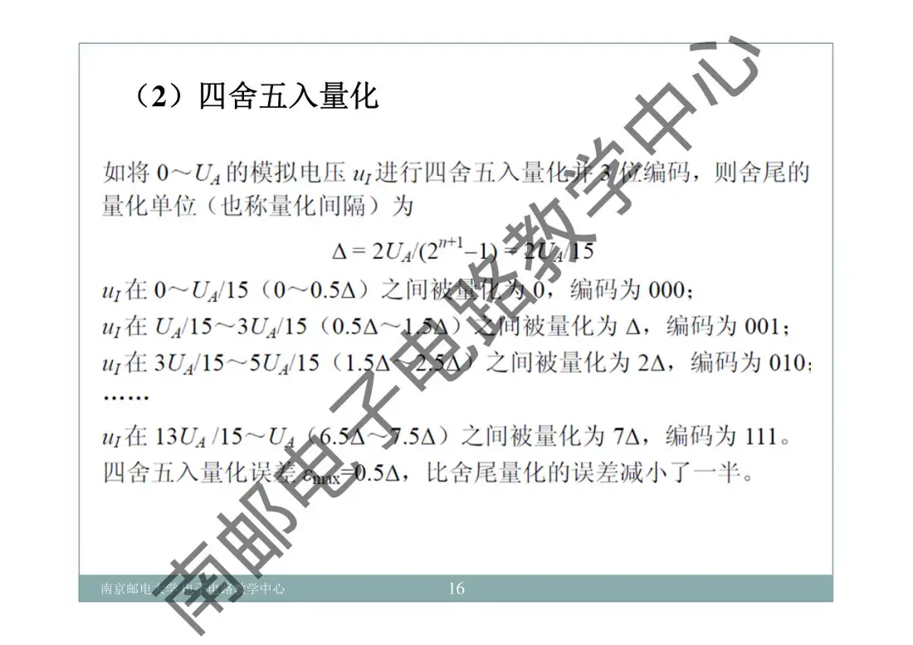

原文：

（2） 四舍五入量化

如将 $0 \sim U _ { A }$ 的模拟电压 $u _ { I }$ 进行四舍五入量化并位编码，则舍尾的量化单位（也称量化间隔）为

$$
\Delta = 2 U _ {A} / \left(2 ^ {n + 1} - 1\right) = 2 U _ {A} / 1 5
$$

$u _ { I }$ 在 $0 { \sim } U _ { A } / 1 5 ~ ( 0 { \sim } 0 . 5 \Delta )$ 之间被量化为0，编码为000；

$u _ { I }$ 在 $U _ { A } / 1 5 { \sim } 3 U _ { A } / 1 5 \ \mathrm { ~ ( } 0 . 5 \Delta$ \~1A)间被量化为Δ，编码为001;

$u _ { I }$ 在 $3 U _ { A } / 1 5 { \sim } 5 U _ { A } / 1 5$ （1.5Δ2Δ）之间被量化为2Δ，编码为010;

$u _ { I }$ 在 $1 3 U _ { A } / 1 5 \small { \sim } U _ { A } ~ \{ 6 . 5 \Delta \sim 7 . 5 \Delta \}$ 之间被量化为7Δ，编码为111。四舍五入量化误差0.5Δ，比舍尾量化的误差减小了一半。

南京邮电大学 电子电路教学中心

1 6

### 8 2 2. . 常见 的ADC 结构

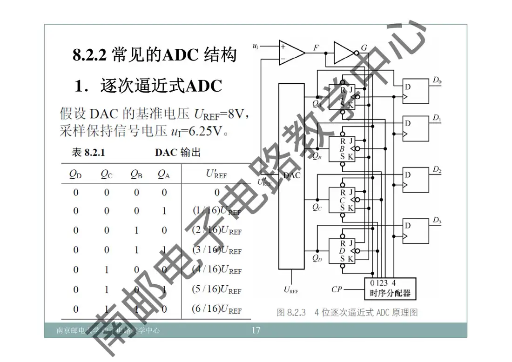

原文：

8 2 2. . 常见 的ADC 结构

1． 逐次逼近式ADC

假设 DAC 的基准电压 $U _ { \mathrm { R E F } } { = } 8 \mathrm { V }$ 采样保持信号电压 $u _ { \mathrm { I } } { = } 6 . 2 5 \mathrm { V }$

表 8.2.1 DAC 输出
<table><tr><td> $Q_D$ </td><td> $Q_C$ </td><td> $Q_B$ </td><td> $Q_A$ </td><td> $U'_REF$ </td></tr><tr><td>0</td><td>0</td><td>0</td><td>0</td><td>0</td></tr><tr><td>0</td><td>0</td><td>0</td><td>1</td><td>(1/16) $U_{REF}$ </td></tr><tr><td>0</td><td>0</td><td>1</td><td>0</td><td>(2/16) $U_{REF}$ </td></tr><tr><td>0</td><td>0</td><td>1</td><td>1</td><td>(3/16) $U_{REF}$ </td></tr><tr><td>0</td><td>1</td><td>0</td><td>0</td><td>(4/16) $U_{REF}$ </td></tr><tr><td>0</td><td>1</td><td>0</td><td>1</td><td>(5/16) $U_{REF}$ </td></tr><tr><td>0</td><td>1</td><td>1</td><td>0</td><td>(6/16) $U_{REF}$ </td></tr></table>

南京邮电大学 电子电路教学中心

1 7

### 南京邮电大学 电子电路教学中心

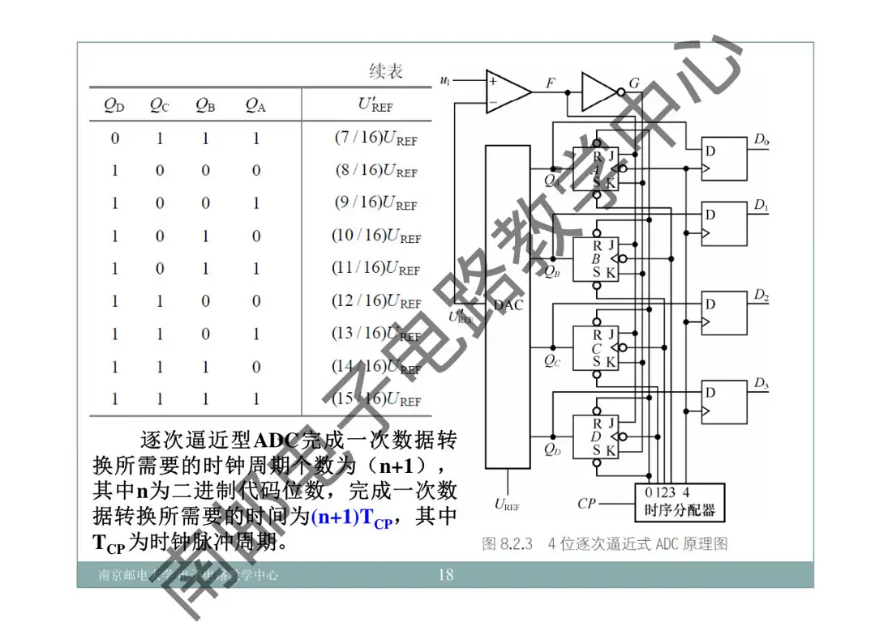

原文：

<table><tr><td colspan="5">续表</td></tr><tr><td> $Q_D$ </td><td> $Q_C$ </td><td> $Q_B$ </td><td> $Q_A$ </td><td> $U'_REF$ </td></tr><tr><td>0</td><td>1</td><td>1</td><td>1</td><td>(7/16) $U_{REF}$ </td></tr><tr><td>1</td><td>0</td><td>0</td><td>0</td><td>(8/16) $U_{REF}$ </td></tr><tr><td>1</td><td>0</td><td>0</td><td>1</td><td>(9/16) $U_{REF}$ </td></tr><tr><td>1</td><td>0</td><td>1</td><td>0</td><td>(10/16) $U_{REF}$ </td></tr><tr><td>1</td><td>0</td><td>1</td><td>1</td><td>(11/16) $U_{REF}$ </td></tr><tr><td>1</td><td>1</td><td>0</td><td>0</td><td>(12/16) $U_{REF}$ </td></tr><tr><td>1</td><td>1</td><td>0</td><td>1</td><td>(13/16) $U_{REF}$ </td></tr><tr><td>1</td><td>1</td><td>1</td><td>0</td><td>(14/16) $U_{REF}$ </td></tr><tr><td>1</td><td>1</td><td>1</td><td>1</td><td>(15/16) $U_{REF}$ </td></tr></table>

逐次逼近型ADC完成一次数据转换所需要 的时钟周期个数为 （n+1 ） ，其中n为二进制代码位数， 完成一次数据转换所需要的时间为 $\mathbf { ( n { + } 1 ) } \mathbf { T } _ { \mathbf { C P } }$ ， 其 中$\mathbf { T _ { C P } }$ 为时钟脉冲周期。

南京邮电大学 电子电路教学中心

1 8

### 2． 并行 比较式ADC

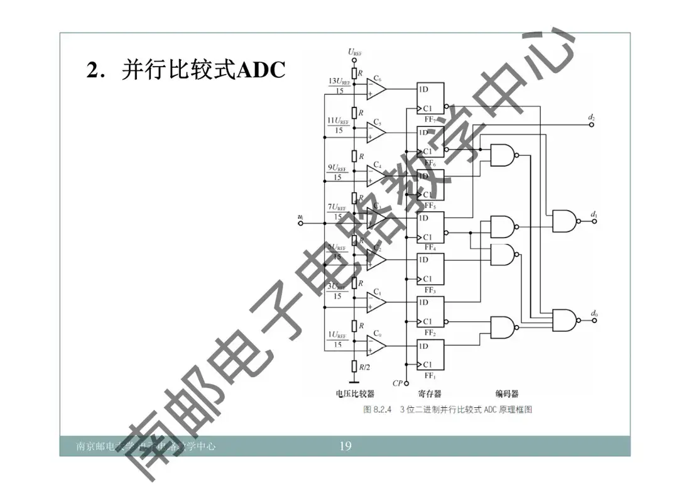

原文：

2． 并行 比较式ADC

南京邮电大学 电子电路教学中心

1 9

### 表 8.2.2 输入电压与编码的对应关系

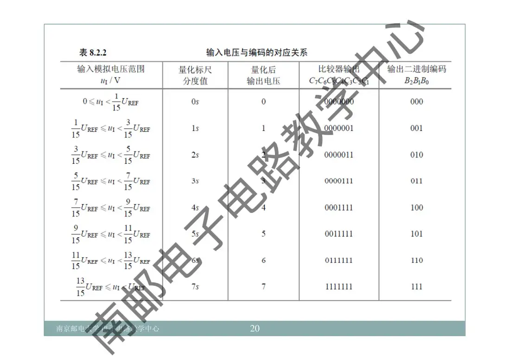

原文：

表 8.2.2 输入电压与编码的对应关系
<table><tr><td>输入模拟电压范围 $u_{\mathrm {I}}/\mathrm {V}$ </td><td>量化标尺分度值</td><td>量化后输出电压</td><td>比较器输出 $C_7C_6C_5C_4C_3C_2C_1$ </td><td>输出二进制编码 $B_2B_1B_0$ </td></tr><tr><td> $0 \leqslant u_{\mathrm {I}} < \frac{1}{15}U_{\mathrm {REF}}$ </td><td>0s</td><td>0</td><td>0000000</td><td>000</td></tr><tr><td> $\frac{1}{15}U_{\mathrm {REF}} \leqslant u_{\mathrm {I}} < \frac{3}{15}U_{\mathrm {REF}}$ </td><td>1s</td><td>1</td><td>0000001</td><td>001</td></tr><tr><td> $\frac{3}{15}U_{\mathrm {REF}} \leqslant u_{\mathrm {I}} < \frac{5}{15}U_{\mathrm {REF}}$ </td><td>2s</td><td>2</td><td>0000011</td><td>010</td></tr><tr><td> $\frac{5}{15}U_{\mathrm {REF}} \leqslant u_{\mathrm {I}} < \frac{7}{15}U_{\mathrm {REF}}$ </td><td>3s</td><td>3</td><td>0000111</td><td>011</td></tr><tr><td> $\frac{7}{15}U_{\mathrm {REF}} \leqslant u_{\mathrm {I}} < \frac{9}{15}U_{\mathrm {REF}}$ </td><td>4s</td><td>4</td><td>0001111</td><td>100</td></tr><tr><td> $\frac{9}{15}U_{\mathrm {REF}} \leqslant u_{\mathrm {I}} < \frac{11}{15}U_{\mathrm {REF}}$ </td><td>5s</td><td>5</td><td>0011111</td><td>101</td></tr><tr><td> $\frac{11}{15}U_{\mathrm {REF}} \leqslant u_{\mathrm {I}} < \frac{13}{15}U_{\mathrm {REF}}$ </td><td>6s</td><td>6</td><td>0111111</td><td>110</td></tr><tr><td> $\frac{13}{15}U_{\mathrm {REF}} \leqslant u_{\mathrm {I}} < U_{\mathrm {REF}}$ </td><td>7s</td><td>7</td><td>1111111</td><td>111</td></tr></table>

南京邮电大学 电子电路教学中心

20

### 3． 双积分式ADC

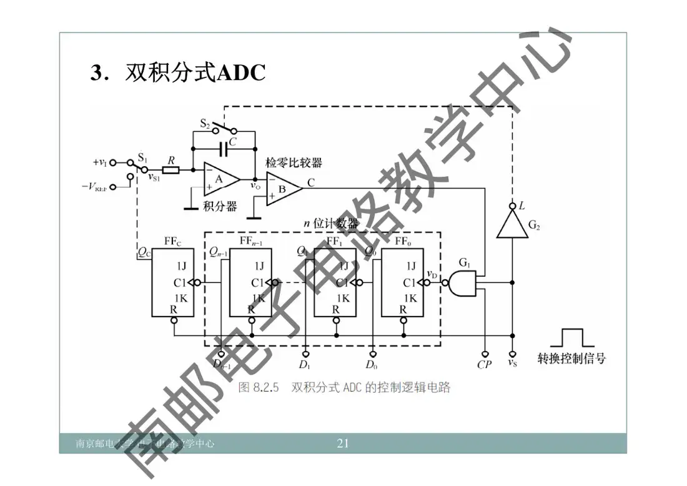

原文：

3． 双积分式ADC

南京邮电大学 电子电路教学中心

2 1

### 电路的工作过程可分为 以下几个阶段:

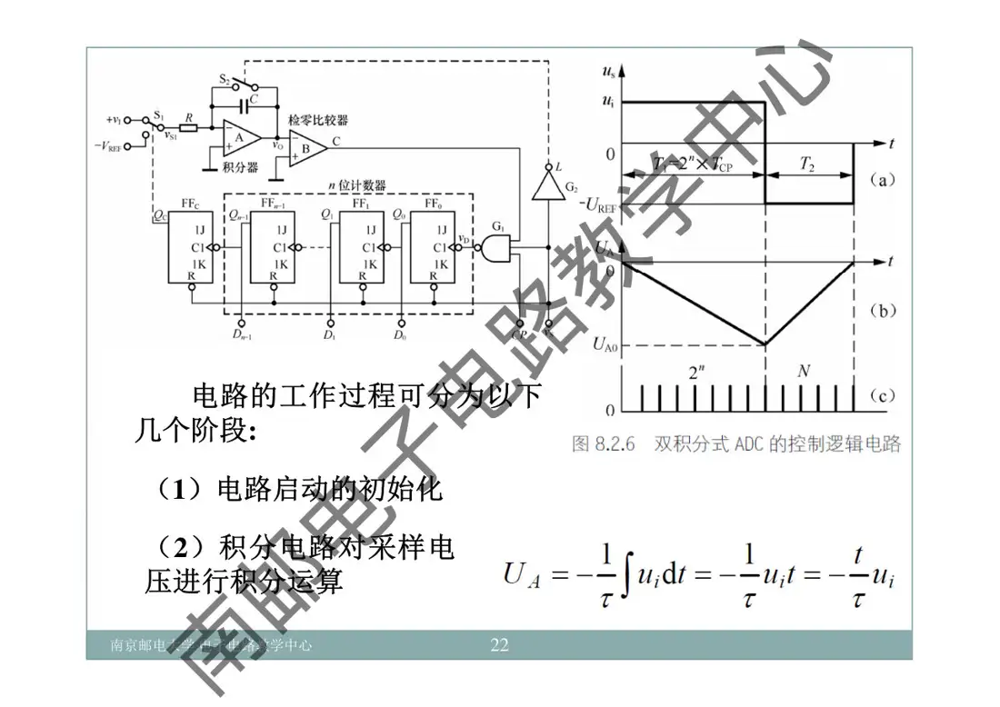

原文：

电路的工作过程可分为 以下几个阶段:

图 8.2.6 双积分式 ADC 的控制逻辑电路

（ 1 ） 电路启动的初始化

（2） 积分 电路对采样 电压进行积分运算

$$
U _ {A} = - \frac {1}{\tau} \int u _ {i} \mathrm{d} t = - \frac {1}{\tau} u _ {i} t = - \frac {t}{\tau} u _ {i}
$$

南京邮电大学 电子电路教学中心

22

### 电路的工作过程可分为 以下几个阶段:

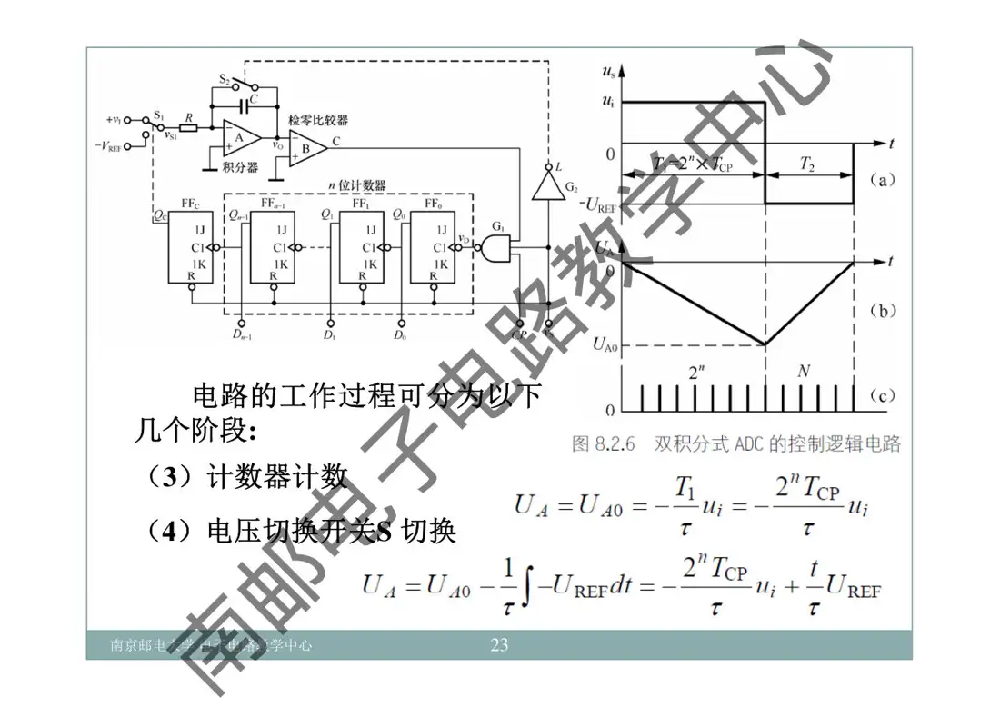

原文：

电路的工作过程可分为 以下几个阶段:

（3） 计数器计数

（4） 电压切换开关S 切换

图 8.2.6 双积分式 ADC 的控制逻辑电路

$$
U _ {A} = U _ {A 0} = - \frac {T _ {1}}{\tau} u _ {i} = - \frac {2 ^ {n} T _ {\mathrm{CP}}}{\tau} u _ {i}
$$

$$
U _ {A} = U _ {A 0} - \frac {1}{\tau} \int - U _ {\mathrm{REF}} d t = - \frac {2 ^ {n} T _ {\mathrm{CP}}}{\tau} u _ {i} + \frac {t}{\tau} U _ {\mathrm{REF}}
$$

南京邮电大学 电子电路教学中心

23

### 电路的工作过程可分为 以下几个阶段:

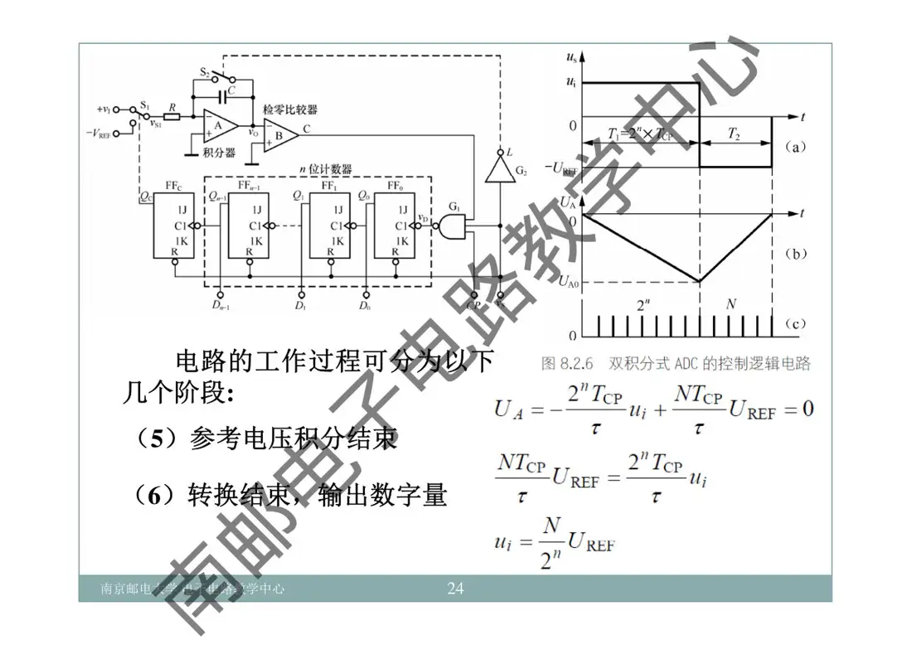

原文：

电路的工作过程可分为 以下几个阶段:

（5） 参考电压积分结束

（6） 转换结束， 输出数字量

图 8.2.6 双积分式 ADC 的控制逻辑电路

$$
U _ {A} = - \frac {2 ^ {n} T _ {\mathrm{CP}}}{\tau} u _ {i} + \frac {N T _ {\mathrm{CP}}}{\tau} U _ {\mathrm{REF}} = 0
$$

$$
\frac {N T _ {\mathrm{CP}}}{\tau} U _ {\mathrm{REF}} = \frac {2 ^ {n} T _ {\mathrm{CP}}}{\tau} u _ {i}
$$

$$
u _ {i} = \frac {N}{2 ^ {n}} U _ {\mathrm{REF}}
$$

南京邮电大学 电子电路教学中心

24

### 双积分式ADC 具有以下优点:

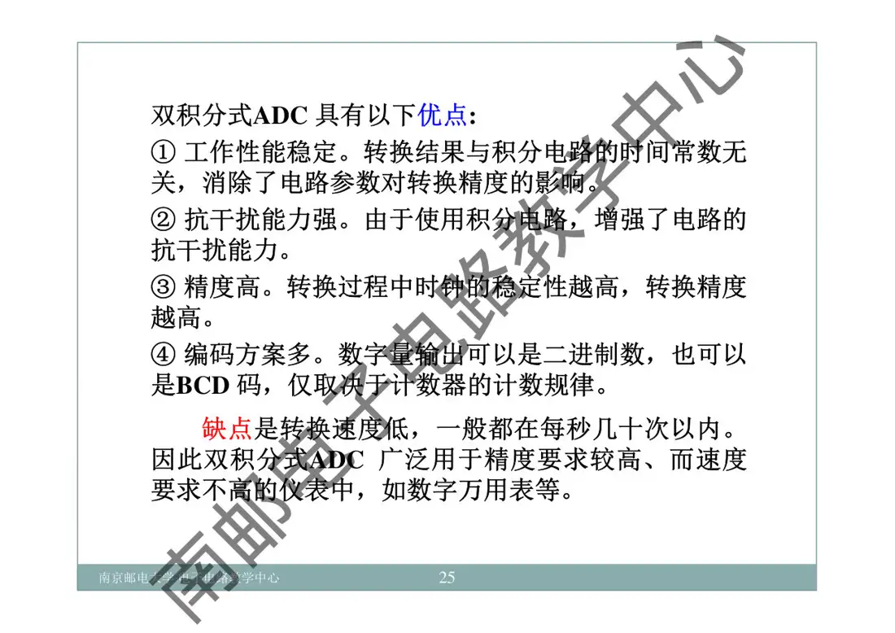

原文：

双积分式ADC 具有以下优点:

① 工作性能稳定。 转换结果与积分电路的时间常数无关， 消除了 电路参数对转换精度的影响。

② 抗干扰能力强。 由于使用积分电路， 增强了 电路的抗干扰能力 。

③ 精度高。 转换过程中时钟的稳定性越高， 转换精度 越高。 AV

④ 编码方案多 。 数字量输出可以是二进制数， 也可以是BCD 码， 仅取决于计数器的计数规律。

缺点是转换速度低， 一般都在每秒几十次以 内 。因此双积分式ADC 广泛用于精度要求较高、 而速度要求不高的仪表中， 如数字万用表等。

南京邮电大学 电子电路教学中心

25

### 第 26 页

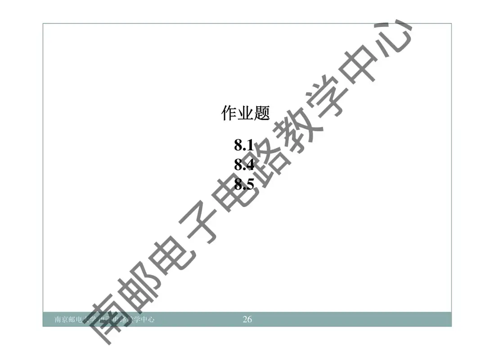
