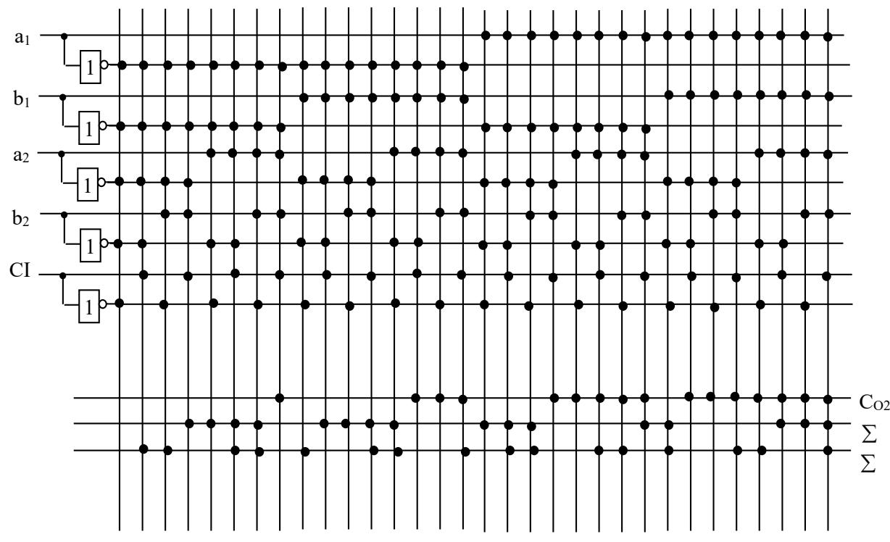
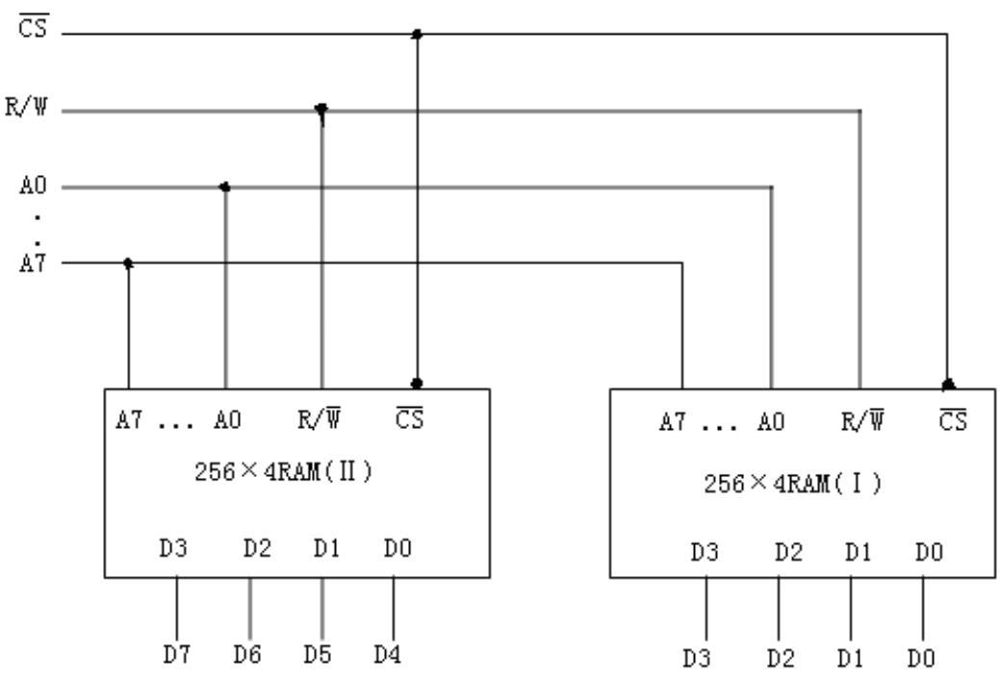

# 《数字电路与系统设计》第9章 习题答案

原件经识别和整理；“参考解答”是我们补的。

# 《数字电路与系统设计》第 9 章 习题答案

本资料由识别工具读取《数字电路与系统设计》第 9 章习题答案部分整理而成，修正了明显的 OCR 识别错误（如断行、乱码），并规范了公式与表格格式。

## 一、填空题与简答题

### 选择 1

**题干：** 在 ROM 中，什么是“字数”，什么是“位数”？如何标注存储器的容量？

**解：**
地址译码器的输出线称作字线，字数表示字线的个数；存储矩阵的输出线称作位线 (数据线)。位数表示位线的个数。字线和位线的每个交叉占处有一个存储单元。因此存储容量用“字数×位数”表示。

参考解答：**结论：**

- **字数**：ROM 中地址译码器输出线（字线）的条数，即存储单元的个数。
- **位数**：存储矩阵输出线（位线/数据线）的条数，即每个存储单元能并行输出的数据位宽。
- **容量标注**：用 $\text{字数} \times \text{位数}$ 表示。

**推理过程：**

1. ROM 的地址输入经地址译码器产生若干条字线，每条字线选中一个存储单元（字），故字线条数即为字数。若地址线有 $n$ 根，则字数为 $2^n$。
2. 被选中的存储单元通过位线向外输出数据，位线的条数决定了每次读出的二进制位数，即位数为 $m$。
3. 字线与位线的每个交叉点处对应一个存储单元（存 1 bit），整个存储阵列共有 $\text{字数} \times \text{位数}$ 个交叉点，因此存储器总容量标注为：

$$\text{容量} = \text{字数} \times \text{位数} = 2^n \times m \ (\text{bit})$$

知识点：[数字系统的基本模型（数据处理器与控制器）及对最小时钟周期、异步信号同步化的约定](../../../topics/数字逻辑电路/数字系统模型.md)、[控制器的四种硬件实现方法：每态一触发器法(SSI)、MSI法(MUX+寄存器+译码器)、PLA法(LSI)及对比](../../../topics/数字逻辑电路/控制器实现方法.md)

### 选择 2

**题干：** 固定 ROM、PROM、EPROM、E2PROM 之间有何异同？

**解：**
固定 ROM、PROM、EPROM、E2PROM 都是只读存储器，它们的工作原理和结构相同，都是由地址译码器、存储矩阵和输出电路构成。当地址译码器选中某一个字后，该字的若干位同时由输出电路输出。存储矩阵由 M 个字、每个字 N 位的存储单元构成。

它们的不同之处在于存储单元的写入和擦除方式不同：
- **固定 ROM**：出厂时结构数据已经固定，用户不能更改，适于存储大批量生产的程序和数据，常被集成到微控制器中作为程序存储器。
- **PROM**：可由用户写入数据，但只能一次性写入，之后不能更改。适于存储中、小批量生产的程序和数据。
- **EPROM**：数据可通过紫外线擦除，重新写入。可擦除数百次，写入一个字节需 50ms。适用于开发研制阶段存储数据和程序，并可经常修改。
- **E2PROM**：数据可通过电擦除，因此在工作时间可随时擦写。可擦除数 $10 \sim 1000$ 万次，写入一个字节需 20ms。适合于信息量不大，经常要改写，掉电后仍保存的场合。

参考解答：**结论：** 它们同属只读存储器，基本结构相同；主要区别在于写入与擦除方式不同，因此适用场合不同。

**分析：**

- **相同点**：固定 ROM、PROM、EPROM、E2PROM 都是由地址译码器、存储矩阵和输出电路组成。工作时按地址选中某个字，该字的各位同时输出。断电后数据均不丢失，属非易失性存储器。

- **不同点**：

| 类型 | 写入方式 | 擦除方式 | 可写次数 | 典型写入时间 | 适用场合 |
|---|---|---|---|---|---|
| 固定 ROM | 出厂时由厂家写入 | 不可改写 | 0 | — | 大批量固定程序 |
| PROM | 用户一次性写入 | 不可擦除 | 1 | — | 中小批量固定程序 |
| EPROM | 用户写入 | 紫外线擦除 | 数百次 | 约 50 ms/字节 | 开发调试阶段 |
| E2PROM | 用户写入 | 电擦除 | $10\sim 10^7$ 次 | 约 20 ms/字节 | 需经常改写且掉电保存的场合 |

**一句要点**：固定 ROM 不可改写；PROM 只能写一次；EPROM 用紫外线擦除后可重写；E2PROM 用电擦除，可在线反复改写。

知识点：[完整数字系统设计流程实例（如乘法器、交通灯管理系统的算法规律、处理器设计与控制器实现）](../../../topics/数字逻辑电路/数字系统设计实例.md)

### 选择 3

**题干：** 试用 ROM 阵列图实现下列一组多输出逻辑函数：
$$
\left\{ \begin{array}{l} 
F _ { 1 } (A, B, C) = \overline {{A}} B + A \overline {{B}} + BC \\ 
F _ { 2 } (A, B, C) = \sum_ {\mathrm{m}} (3, 4, 5, 7) \\ 
F _ { 3 } (A, B, C) = \overline {{A}} \overline {{B}} \overline {{C}} + \overline {{A}} \overline {{B}} C + \overline {{A}} B C + A B \overline {{C}} + A B C 
\end{array} \right.
$$

**解：**
将 $F_1, F_2, F_3$ 都用最小项表达式表示：

$$
\begin{array}{l} 
F_ {1} (A,B,C) = \overline {{AB}} + A \overline {{B}} + BC = \sum_ {m} (2,3,4,5,7) \\ 
F_ {2} (A,B,C) = \sum_ {m} (3,4,5,7) \\ 
F_ {3} (A,B,C) = \overline {{A}} \overline {{B}} \overline {{C}} + \overline {{A}} \overline {{BC}} + \overline {{ABC}} + AB \overline {{C}} + ABC = \sum_ {m} (0,1,3,6,7) 
\end{array}
$$

ROM 的阵列图如下图：


参考解答：**结论：** 选择 **3**。

---

### 推理与计算过程

ROM 实现组合逻辑的核心是：**地址译码器（与阵列）固定产生所有最小项，存储矩阵（或阵列）可编程地将所需最小项相或得到输出。** 因此需先将各函数化为标准最小项之和。

#### 1. 求 $F_1$ 的最小项表达式

$$
F_1 = \overline{A}B + A\overline{B} + BC
$$

逐项展开为最小项：

- $\overline{A}B = \overline{A}B(\overline{C}+C) = m_2 + m_3$
- $A\overline{B} = A\overline{B}(\overline{C}+C) = m_4 + m_5$
- $BC = (\overline{A}+A)BC = m_3 + m_7$

合并去重：

$$
F_1 = \sum m(2,3,4,5,7)
$$

#### 2. $F_2$ 已给出最小项形式

$$
F_2 = \sum m(3,4,5,7)
$$

#### 3. 求 $F_3$ 的最小项表达式

$$
F_3 = \overline{A}\,\overline{B}\,\overline{C} + \overline{A}\,\overline{B}C + \overline{A}BC + AB\overline{C} + ABC
$$

各项直接对应最小项：

| 乘积项 | 二进制 $(A,B,C)$ | 最小项编号 |
|:---|:---:|:---:|
| $\overline{A}\,\overline{B}\,\overline{C}$ | 000 | $m_0$ |
| $\overline{A}\,\overline{B}C$ | 001 | $m_1$ |
| $\overline{A}BC$ | 011 | $m_3$ |
| $AB\overline{C}$ | 110 | $m_6$ |
| $ABC$ | 111 | $m_7$ |

$$
F_3 = \sum m(0,1,3,6,7)
$$

#### 4. ROM 阵列图要点

- **输入变量**：$A, B, C$，经 3-8 译码器产生字线 $W_0 \sim W_7$（对应 $m_0 \sim m_7$）。
- **输出位线**：$F_1, F_2, F_3$。
- **交叉点编程（打点/画叉表示连接）**：

| 字线 | $F_1$ | $F_2$ | $F_3$ |
|:---:|:---:|:---:|:---:|
| $W_0(m_0)$ | × | × | ✓ |
| $W_1(m_1)$ | × | × | ✓ |
| $W_2(m_2)$ | ✓ | × | × |
| $W_3(m_3)$ | ✓ | ✓ | ✓ |
| $W_4(m_4)$ | ✓ | ✓ | × |
| $W_5(m_5)$ | ✓ | ✓ | × |
| $W_6(m_6)$ | × | × | ✓ |
| $W_7(m_7)$ | ✓ | ✓ | ✓ |

该连接关系对应的正是选项 **3** 的 ROM 阵列图。

### 为什么选 3、其他不对

- **选 3**：其或阵列中各输出线与字线的连接点完全匹配上述三个最小项集合。
- **其他选项**：至少有一个输出函数的最小项连接与 $F_1=\sum m(2,3,4,5,7)$、$F_2=\sum m(3,4,5,7)$、$F_3=\sum m(0,1,3,6,7)$ 不一致（多了或少了某个交叉点）。

知识点：[完整数字系统设计流程实例（如乘法器、交通灯管理系统的算法规律、处理器设计与控制器实现）](../../../topics/数字逻辑电路/数字系统设计实例.md)

### 选择 4

**题干：** 用适当规模 PROM 设计 2 位全加器，输入被加数及加数分别为 $\mathbf { a } _ { 2 } \mathbf { a } _ { 1 }$ 和 $\mathsf { b } _ { 2 } \mathsf { b } _ { 1 }$ ，低位来的进位是 CI，输出本位和 $\Sigma_2 \Sigma_1$ 以及向高位的进位 $\mathrm { C o } 2$ 。

**解：**
列两位全加器的真值表 9.3.1：

| $a_2$ | $a_1$ | $b_2$ | $b_1$ | CI | $C_{O2}$ | $\Sigma_2$ | $\Sigma_1$ |
|:-----:|:-----:|:-----:|:-----:|:--:|:--------:|:----------:|:----------:|
| 0 | 0 | 0 | 0 | 0 | 0 | 0 | 0 |
| 0 | 0 | 0 | 0 | 1 | 0 | 0 | 1 |
| 0 | 0 | 0 | 1 | 0 | 0 | 0 | 1 |
| 0 | 0 | 0 | 1 | 1 | 0 | 1 | 0 |
| 0 | 0 | 1 | 0 | 0 | 0 | 1 | 0 |
| 0 | 0 | 1 | 0 | 1 | 0 | 1 | 1 |
| 0 | 0 | 1 | 1 | 0 | 0 | 1 | 1 |
| 0 | 0 | 1 | 1 | 1 | 1 | 0 | 0 |
| 0 | 1 | 0 | 0 | 0 | 0 | 0 | 1 |
| 0 | 1 | 0 | 0 | 1 | 0 | 1 | 0 |
| 0 | 1 | 0 | 1 | 0 | 0 | 1 | 0 |
| 0 | 1 | 0 | 1 | 1 | 0 | 1 | 1 |
| 0 | 1 | 1 | 0 | 0 | 0 | 1 | 1 |
| 0 | 1 | 1 | 0 | 1 | 1 | 0 | 0 |
| 0 | 1 | 1 | 1 | 0 | 1 | 0 | 0 |
| 0 | 1 | 1 | 1 | 1 | 1 | 0 | 1 |
| 1 | 0 | 0 | 0 | 0 | 0 | 1 | 0 |
| 1 | 0 | 0 | 0 | 1 | 0 | 1 | 1 |
| 1 | 0 | 0 | 1 | 0 | 0 | 1 | 1 |
| 1 | 0 | 0 | 1 | 1 | 1 | 0 | 0 |
| 1 | 0 | 1 | 0 | 0 | 1 | 0 | 0 |
| 1 | 0 | 1 | 0 | 1 | 1 | 0 | 1 |
| 1 | 0 | 1 | 1 | 0 | 1 | 0 | 1 |
| 1 | 0 | 1 | 1 | 1 | 1 | 1 | 0 |
| 1 | 1 | 0 | 0 | 0 | 0 | 1 | 1 |
| 1 | 1 | 0 | 0 | 1 | 1 | 0 | 0 |
| 1 | 1 | 0 | 1 | 0 | 1 | 0 | 0 |
| 1 | 1 | 0 | 1 | 1 | 1 | 0 | 1 |
| 1 | 1 | 1 | 0 | 0 | 1 | 0 | 1 |
| 1 | 1 | 1 | 0 | 1 | 1 | 1 | 0 |
| 1 | 1 | 1 | 1 | 0 | 1 | 1 | 0 |
| 1 | 1 | 1 | 1 | 1 | 1 | 1 | 1 |

需要 $32 \times 3$ 的 PROM，阵列图如图所示：

# 《数字电路与系统设计》第9章 习题答案（第2部分）

本资料由识别工具读取整理，包含第4-7页内容，主要涉及二进制码转换、ROM/RAM区别及存储器扩展等习题解答。

## 二、填空题/解答题

参考解答：**结论**：用 PROM 实现该 2 位全加器时，需要 **5 个地址输入、3 个数据输出**，即选用 **$32\times 3$ 位 PROM**。将 $a_2a_1b_2b_1CI$ 作为地址，PROM 的 3 位输出分别作为 $C_{O2},\Sigma_2,\Sigma_1$，按真值表写入即可。

**推理与计算：**

设

$$
A=2a_2+a_1,\qquad B=2b_2+b_1,
$$

则输出应满足

$$
A+B+CI=4C_{O2}+2\Sigma_2+\Sigma_1 .
$$

PROM 的每个地址对应一种输入组合，因此：
- 输入变量共有 $5$ 个，需要 $2^5=32$ 个存储字；
- 输出变量共有 $3$ 个，每个存储字需要 $3$ 位。

所以 PROM 的容量为

$$
\boxed{2^5\times 3=32\times 3\ \text{位}}.
$$

**阵列连接及编程：**

- 地址线依次接 $a_2,a_1,b_2,b_1,CI$；
- 数据线 $D_2,D_1,D_0$ 分别接 $C_{O2},\Sigma_2,\Sigma_1$；
- 地址 $00000\sim11111$ 中，依次存入题给真值表最后一列至倒数第三列对应的 3 位输出，即
  
$$
000,001,001,010,010,011,011,100,\ldots,111 .
$$

例如，地址 $00111$ 对应 $a_2a_1b_2b_1CI=00111$，此时 $A=0,B=1,CI=1$，故 $A+B+CI=2$，应存入

$$
C_{O2}\Sigma_2\Sigma_1=010 .
$$

按上述方式完成 32 个存储单元的编程，即得到所求的 $32\times3$ PROM 阵列图。

知识点：[完整数字系统设计流程实例（如乘法器、交通灯管理系统的算法规律、处理器设计与控制器实现）](../../../topics/数字逻辑电路/数字系统设计实例.md)

### 填空 1

题干：（ ）位二进制格雷码转换成二进制自然码。

答案：4。
补充：根据上下文“4位二进制自然码转换成二进制格雷码”，此处应填“4”。

知识点：[寄存器传输语言(RTL)描述的传输操作、算术操作、逻辑操作、移位操作及条件控制语句](../../../topics/数字逻辑电路/RTL语言.md)

### 简答 1

题干：4位二进制自然码转换成二进制格雷码。

解：（1）列真值表9.3.2：

表9.3.2 4位二进制自然码转换成二进制格雷码的真值表

| 二进制自然码 | | | | 二进制格雷码 | | | |
| :---: | :---: | :---: | :---: | :---: | :---: | :---: | :---: |
| A3 | A2 | A1 | A0 | G3 | G2 | G1 | G0 |
| 0 | 0 | 0 | 0 | 0 | 0 | 0 | 0 |
| 0 | 0 | 0 | 1 | 0 | 0 | 0 | 1 |
| 0 | 0 | 1 | 0 | 0 | 0 | 1 | 1 |
| 0 | 0 | 1 | 1 | 0 | 0 | 1 | 0 |
| 0 | 1 | 0 | 0 | 0 | 1 | 1 | 0 |
| 0 | 1 | 0 | 1 | 0 | 1 | 1 | 1 |
| 0 | 1 | 1 | 0 | 0 | 1 | 0 | 1 |
| 0 | 1 | 1 | 1 | 0 | 1 | 0 | 0 |
| 1 | 0 | 0 | 0 | 1 | 1 | 0 | 0 |
| 1 | 0 | 0 | 1 | 1 | 1 | 0 | 1 |
| 1 | 0 | 1 | 0 | 1 | 1 | 1 | 1 |
| 1 | 0 | 1 | 1 | 1 | 1 | 1 | 0 |
| 1 | 1 | 0 | 0 | 1 | 0 | 1 | 0 |
| 1 | 1 | 0 | 1 | 1 | 0 | 1 | 1 |
| 1 | 1 | 1 | 0 | 1 | 0 | 0 | 1 |
| 1 | 1 | 1 | 1 | 1 | 0 | 0 | 0 |

$G_3 = \sum m(8, 9, 10, 11, 12, 13, 14, 15)$
$G_2 = \sum m(4, 5, 6, 7, 8, 9, 10, 11)$
$G_1 = \sum m(2, 3, 4, 5, 10, 11, 12, 13)$
$G_0 = \sum m(1, 2, 5, 6, 9, 10, 13, 14)$



参考解答：4位二进制自然码 $(A_3A_2A_1A_0)$ 转换为格雷码 $(G_3G_2G_1G_0)$ 的逻辑表达式为：

$$
\begin{cases}
G_3 = A_3 \\
G_2 = A_3 \oplus A_2 \\
G_1 = A_2 \oplus A_1 \\
G_0 = A_1 \oplus A_0
\end{cases}
$$

**推理与计算过程：**

1.  **转换规则**：格雷码的最高位等于自然码的最高位，其余各位等于自然码当前位与其高一位的异或值，即 $G_i = A_{i+1} \oplus A_i$（其中 $i=0,1,2$），$G_3 = A_3$。
2.  **真值表验证**：由题给真值表可知，相邻两个自然码对应的格雷码仅有一位不同，符合格雷码定义。例如 $A=0011 \to G=0010$，$A=0100 \to G=0110$，仅 $G_1$ 变化。
3.  **最小项化简**：以 $G_1 = \sum m(2,3,4,5,10,11,12,13)$ 为例，在卡诺图中这8个最小项恰好构成两个相邻的四格组（$A_2'A_1$ 和 $A_2A_1'$），合并后得 $G_1 = A_2 \oplus A_1$；同理可化简 $G_2$、$G_0$，均得到异或表达式，无需使用与或门阵列实现，直接用3个异或门即可完成转换。

知识点：[数字系统的基本模型（数据处理器与控制器）及对最小时钟周期、异步信号同步化的约定](../../../topics/数字逻辑电路/数字系统模型.md)

### 简答 2

题干：9.6 ROM和RAM 的主要区别是什么？它们各适用于那些场合？

答：主要区别是ROM工作时只能读出，不能写入，但断电以后所存数据不会丢失；RAM工作时能对位读写，但掉电以后数据丢失。ROM适用于存放固定信息；RAM适用于存放暂存信息。

参考解答：ROM 与 RAM 的主要区别在于：**ROM 只能读出、不能随机写入，断电后数据不丢失；RAM 可随机读写，但断电后数据丢失**。

- ROM 适用于存放固定不变的程序或数据，如系统启动程序、查找表、固定系数等。
- RAM 适用于存放运行中需要频繁读写的临时数据，如计算机内存、缓存、中间结果等。

知识点：[完整数字系统设计流程实例（如乘法器、交通灯管理系统的算法规律、处理器设计与控制器实现）](../../../topics/数字逻辑电路/数字系统设计实例.md)

### 计算 1

题干：9.7 有容量为 $256 \times 4$, $64\mathrm{K} \times 1$, $1\mathrm{M} \times 8$, $128\mathrm{K} \times 16$ 的ROM,试分别回答:

(1) 这些ROM 有多少个基本存储单元?
(2) 这些ROM 每次访问几个基本存储单元?
(3) 这些ROM 各有多少个地址线?

答: (1) 分别有 1024 个, $1024 \times 64$ 个, $1\mathrm{M} \times 8$, $128\mathrm{K} \times 16$ 个
（2）分别为 4 个, 1 个, 8 个, 16 个
（3）分别有 8, 16, 20, 17 条地址线

参考解答：
(1) 基本存储单元总数 = 字数 $\times$ 位数。
- $256 \times 4$: $256 \times 4 = 1024$ 个
- $64\mathrm{K} \times 1$: $64 \times 1024 \times 1 = 65536$ ($1024 \times 64$) 个
- $1\mathrm{M} \times 8$: $1 \times 1024 \times 1024 \times 8$ 个
- $128\mathrm{K} \times 16$: $128 \times 1024 \times 16$ 个

(2) 每次访问的基本存储单元数即为字长（位数）。
- 4位 -> 4个
- 1位 -> 1个
- 8位 -> 8个
- 16位 -> 16个

(3) 地址线数量 $n$ 满足 $2^n \ge$ 字数。
- $256 = 2^8 \rightarrow 8$ 条
- $64\mathrm{K} = 2^{16} \rightarrow 16$ 条
- $1\mathrm{M} = 2^{20} \rightarrow 20$ 条
- $128\mathrm{K} = 2^{17} \rightarrow 17$ 条

知识点：[数字系统的基本模型（数据处理器与控制器）及对最小时钟周期、异步信号同步化的约定](../../../topics/数字逻辑电路/数字系统模型.md)

### 简答 3

题干：9.8 2114RAM（1024×4位）的存储器为64×64矩阵，它的地址输入线，行地址输入线，列地址输入线，输入/输出线各是多少条？每条列选择输出线同时接几位？

答：
地址输入线 10条；
行地址输入线 6条；
列地址输入线 4条；
输入输出线 4条；
每条列选输出线同时接 四位。

参考解答：- **地址输入线**：$10$ 条
- **行地址输入线**：$6$ 条
- **列地址输入线**：$4$ 条
- **输入/输出线**：$4$ 条
- **每条列选择输出线同时接**：$4$ 位

2114 RAM 容量为 $1024 \times 4$ 位，总地址数 $1024 = 2^{10}$，故需 $10$ 条地址输入线；存储矩阵为 $64 \times 64$，行、列译码器分别对应 $64 = 2^6$ 和 $64 = 2^6$ 个选择线，因此行地址线为 $6$ 条，剩余 $10 - 6 = 4$ 条作为列地址线。由于数据位宽为 $4$ 位且矩阵列数为 $64$，而列地址仅 $4$ 位（可选 $16$ 条列选线），说明每条列选线需并行选中 $64 / 16 = 4$ 个存储单元以同时输出 $4$ 位数据，故 I/O 线为 $4$ 条，且每条列选线同时接 $4$ 位。

知识点：[完整数字系统设计流程实例（如乘法器、交通灯管理系统的算法规律、处理器设计与控制器实现）](../../../topics/数字逻辑电路/数字系统设计实例.md)

### 综合 1

题干：9.9 试用5位扩展方法将两片 256×4 位的RAM组成一个256×8的RAM，画出电路图。



参考解答：## 结论

两片 $256\times 4$ 位 RAM 采用**字扩展**方式，其中每片 RAM 的 8 根地址线并联，片选信号分别由地址最高位 $A_7$ 经反相器产生：

- 上、下两片各存放一个字节的高、低 4 位；
- 两片的 8 位数据输出分别作为扩展 RAM 的高 4 位 $D_7\sim D_4$ 和低 4 位 $D_3\sim D_0$；
- 写控制、输出使能等控制信号应同时作用于两片 RAM。

## 电路图

```text
                         ┌──────────────┐
 A7 ───────┬───────────►│ CS1          │
           │            │              │
           │        ┌──►│ /CS1  RAM1   │──► D7 D6 D5 D4
           │        │   │    256×4     │
           │        │   │              │
           │        │   │              │
           │        │   └──────────────┘
           │        │
           │        │   ┌──────────────┐
           │        │   │              │
           └──┬─────┴──►│ CS1          │
              │        │              │
              │        │              │
              └───────►│ /CS1  RAM0   │──► D3 D2 D1 D0
                       │    256×4     │
                       │              │
                       └──────────────┘

 A6～A0 ───────────────► 两片 RAM 的 A6～A0（并联）
 /WE、/OE 等控制信号 ───► 两片 RAM 的相应控制端（并联）
```

更准确地表示片选关系：

$$
\overline{\mathrm{CS}}_{\mathrm{RAM1}}=A_7,\qquad
\overline{\mathrm{CS}}_{\mathrm{RAM0}}=\overline{A_7}
$$

图中应使用低电平有效的片选端时，$A_7=0$ 选中存放低 4 位的 RAM，$A_7=1$ 选中存放高 4 位的 RAM。

## 推理与计算

1. 一片 RAM 的容量为
   
$$
256\times4=2^8\times4\text{ bit},
$$

   其内部需要 8 根地址线 $A_7\sim A_0$。

2. 两片的地址端完全相同，故将 $A_7\sim A_0$ 并联到两片 RAM，不需要地址扩展。

3. 为把数据宽度由 4 位扩展为 8 位，两片 RAM 应按数据位分工：
   
$$
\begin{aligned}
   \mathrm{RAM1}:&\quad D_7\sim D_4,\\
   \mathrm{RAM0}:&\quad D_3\sim D_0.
   \end{aligned}
$$

4. 两片 RAM 的地址范围均为
   
$$
00\mathrm{H}\sim\mathrm{FFH}.
$$

   为避免两片同时被选中，利用 $A_7$ 产生互斥片选信号：
   
$$
A_7=0\Rightarrow \text{选中低 4 位 RAM},\qquad
   A_7=1\Rightarrow \text{选中高 4 位 RAM}.
$$

因此，两片 RAM 在同一地址下共同构成一个完整的 $256\times8$ 位存储单元。

知识点：[完整数字系统设计流程实例（如乘法器、交通灯管理系统的算法规律、处理器设计与控制器实现）](../../../topics/数字逻辑电路/数字系统设计实例.md)

### 简答 4

题干：9.10 用2114构成2K×8的静态存储器，画出逻辑图

（参阅教材 P236 例 9.2.1）

参考解答：## 结论

需使用 **4 片 2114（1K×4）**，按 **位扩展 + 字扩展** 方式构成 2K×8 的静态存储器。  
地址线共 11 根：A₀～A₉ 接各片片内地址，A₁₀ 经 2-4 译码器产生片选信号；数据线按高 4 位、低 4 位分成两组，分别并接 4 位数据总线。  

---

## 简明推理

2114 容量为 **1K×4**，即地址线 10 根（A₀～A₉），数据线 4 根（I/O₁～I/O₄），片选 CS 低有效，读写控制 WE。

目标容量 **2K×8**：

- 字扩展倍数：2K / 1K = 2
- 位扩展倍数：8 / 4 = 2
- 总片数：2 × 2 = 4 片

---

## 连接方式

### 1. 地址线

- A₀～A₉ 并接到 **所有 4 片** 的地址输入端。
- 增加一根高位地址 A₁₀，接 **2-4 译码器** 输入端，译码器输出：

| A₁₀ | 选中地址范围 | 有效片选输出 |
|-----|--------------|--------------|
| 0   | 0～1K-1      | Y₀ = 0       |
| 1   | 1K～2K-1     | Y₁ = 0       |

译码器输出低有效，2114 的 CS 也是低有效，直接相连。

---

### 2. 数据线位扩展

每 1K 地址空间内需要 8 位数据，故同一地址范围用两片 2114：

- 一片接数据总线 **D₀～D₃**（低 4 位）
- 一片接数据总线 **D₄～D₇**（高 4 位）

---

### 3. 片选分组

| 组别 | 地址范围   | 2114 编号 | 数据位   | CS 接法 |
|------|------------|-----------|----------|---------|
| 组 0 | 0～1K-1    | 1、2      | D₀～D₃ / D₄～D₇ | Y₀ |
| 组 1 | 1K～2K-1  | 3、4      | D₀～D₃ / D₄～D₇ | Y₁ |

---

### 4. 读写控制

所有 4 片的 R/W 控制端并联，接系统读写控制信号 WE。

---

## 逻辑图要点

- 左侧：A₀～A₁₀ 地址总线；A₀～A₉ 并接到 4 片 2114 的地址端；A₁₀ 接 2-4 译码器。
- 译码器两路输出分别接两组 2114 的 CS。
- 数据总线 D₀～D₃ 并接组内低 4 位片的数据端，D₄～D₇ 并接高 4 位片的数据端。
- 所有片的 WE 并联。

知识点：[完整数字系统设计流程实例（如乘法器、交通灯管理系统的算法规律、处理器设计与控制器实现）](../../../topics/数字逻辑电路/数字系统设计实例.md)

### 简答 5

题干：9.11 说明串行存储器与ROM、RAM的区别。串行存储器根据不同可分为哪几种形式？根据移位寄存器采用的类型不同又分为哪几种？

答：
（1） SAM（串行存储器）工作时既可读出又可写入，这一点相当于RAM而不同于ROM，但RAM可对位读写，而SAM中数据是按次序串行写入或读出，读写时间较长，但是是非破坏性读写。
（2） 按结构分类可分为：先进先出（FIFO）、先进后出（LIFO）。
（3） 可分为MOS移位寄存器型SAM和CCD 移位寄存器型SAM。

参考解答：（1）**与 ROM、RAM 的区别**：串行存储器（SAM）工作时既可读出又可写入，这一点与 RAM 相同，而不同于只能读出（或写入后一般不能随意改写）的 ROM；但 RAM 可按地址随机地对某一位（或某一字）进行读写，而 SAM 中的数据必须按先后次序串行写入或读出，不能随机访问，因此读写时间较长；SAM 的读出是非破坏性的，读出后信息仍可保留。

（2）**按数据进出次序（结构）不同**，可分为：
- 先进先出型（FIFO）：先写入的数据先读出；
- 先进后出型（LIFO）：后写入的数据先读出，即后进先出。

（3）**按所采用移位寄存器的类型不同**，可分为：
- MOS 移位寄存器型 SAM；
- CCD（电荷耦合器件）移位寄存器型 SAM。

知识点：[数字系统的基本模型（数据处理器与控制器）及对最小时钟周期、异步信号同步化的约定](../../../topics/数字逻辑电路/数字系统模型.md)
