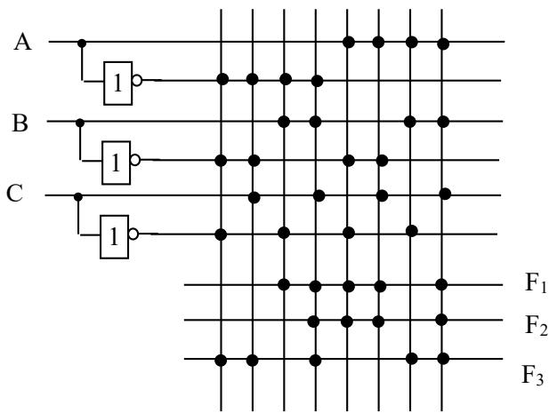

# 《数字电路与系统设计》第9章 习题答案

原件经识别和整理；“参考解答”是我们补的。

# 《数字电路与系统设计》第 9 章 习题答案

本资料由识别工具读取《数字电路与系统设计》第 9 章习题答案部分整理而成，修正了明显的 OCR 识别错误（如断行、乱码），并规范了公式与表格格式。

## 一、填空题与简答题

### 选择 1

**题干：** 在 ROM 中，什么是“字数”，什么是“位数”？如何标注存储器的容量？

**解：**
地址译码器的输出线称作字线，字数表示字线的个数；存储矩阵的输出线称作位线 (数据线)。位数表示位线的个数。字线和位线的每个交叉占处有一个存储单元。因此存储容量用“字数×位数”表示。

知识点：[数字系统的基本模型（数据处理器与控制器）及对最小时钟周期、异步信号同步化的约定](../../../topics/数字逻辑电路/数字系统模型.md)、[控制器的四种硬件实现方法：每态一触发器法(SSI)、MSI法(MUX+寄存器+译码器)、PLA法(LSI)及对比](../../../topics/数字逻辑电路/控制器实现方法.md)

### 选择 2

**题干：** 固定 ROM、PROM、EPROM、E2PROM 之间有何异同？

**解：**
固定 ROM、PROM、EPROM、E2PROM 都是只读存储器，它们的工作原理和结构相同，都是由地址译码器、存储矩阵和输出电路构成。当地址译码器选中某一个字后，该字的若干位同时由输出电路输出。存储矩阵由 M 个字、每个字 N 位的存储单元构成。

它们的不同之处在于存储单元的写入和擦除方式不同：
- **固定 ROM**：出厂时结构数据已经固定，用户不能更改，适于存储大批量生产的程序和数据，常被集成到微控制器中作为程序存储器。
- **PROM**：可由用户写入数据，但只能一次性写入，之后不能更改。适于存储中、小批量生产的程序和数据。
- **EPROM**：数据可通过紫外线擦除，重新写入。可擦除数百次，写入一个字节需 50ms。适用于开发研制阶段存储数据和程序，并可经常修改。
- **E2PROM**：数据可通过电擦除，因此在工作时间可随时擦写。可擦除数 $10 \sim 1000$ 万次，写入一个字节需 20ms。适合于信息量不大，经常要改写，掉电后仍保存的场合。

知识点：[完整数字系统设计流程实例（如乘法器、交通灯管理系统的算法规律、处理器设计与控制器实现）](../../../topics/数字逻辑电路/数字系统设计实例.md)

### 选择 3

**题干：** 试用 ROM 阵列图实现下列一组多输出逻辑函数：
$$
\left\{ \begin{array}{l} 
F _ { 1 } (A, B, C) = \overline {{A}} B + A \overline {{B}} + BC \\ 
F _ { 2 } (A, B, C) = \sum_ {\mathrm{m}} (3, 4, 5, 7) \\ 
F _ { 3 } (A, B, C) = \overline {{A}} \overline {{B}} \overline {{C}} + \overline {{A}} \overline {{B}} C + \overline {{A}} B C + A B \overline {{C}} + A B C 
\end{array} \right.
$$

**解：**
将 $F_1, F_2, F_3$ 都用最小项表达式表示：

$$
\begin{array}{l} 
F_ {1} (A,B,C) = \overline {{AB}} + A \overline {{B}} + BC = \sum_ {m} (2,3,4,5,7) \\ 
F_ {2} (A,B,C) = \sum_ {m} (3,4,5,7) \\ 
F_ {3} (A,B,C) = \overline {{A}} \overline {{B}} \overline {{C}} + \overline {{A}} \overline {{BC}} + \overline {{ABC}} + AB \overline {{C}} + ABC = \sum_ {m} (0,1,3,6,7) 
\end{array}
$$

ROM 的阵列图如下图：

知识点：[完整数字系统设计流程实例（如乘法器、交通灯管理系统的算法规律、处理器设计与控制器实现）](../../../topics/数字逻辑电路/数字系统设计实例.md)

### 选择 4

**题干：** 用适当规模 PROM 设计 2 位全加器，输入被加数及加数分别为 $\mathbf { a } _ { 2 } \mathbf { a } _ { 1 }$ 和 $\mathsf { b } _ { 2 } \mathsf { b } _ { 1 }$ ，低位来的进位是 CI，输出本位和 $\Sigma_2 \Sigma_1$ 以及向高位的进位 $\mathrm { C o } 2$ 。

**解：**
列两位全加器的真值表 9.3.1：

| $a_2$ | $a_1$ | $b_2$ | $b_1$ | CI | $C_{O2}$ | $\Sigma_2$ | $\Sigma_1$ |
|:-----:|:-----:|:-----:|:-----:|:--:|:--------:|:----------:|:----------:|
| 0 | 0 | 0 | 0 | 0 | 0 | 0 | 0 |
| 0 | 0 | 0 | 0 | 1 | 0 | 0 | 1 |
| 0 | 0 | 0 | 1 | 0 | 0 | 0 | 1 |
| 0 | 0 | 0 | 1 | 1 | 0 | 1 | 0 |
| 0 | 0 | 1 | 0 | 0 | 0 | 1 | 0 |
| 0 | 0 | 1 | 0 | 1 | 0 | 1 | 1 |
| 0 | 0 | 1 | 1 | 0 | 0 | 1 | 1 |
| 0 | 0 | 1 | 1 | 1 | 1 | 0 | 0 |
| 0 | 1 | 0 | 0 | 0 | 0 | 0 | 1 |
| 0 | 1 | 0 | 0 | 1 | 0 | 1 | 0 |
| 0 | 1 | 0 | 1 | 0 | 0 | 1 | 0 |
| 0 | 1 | 0 | 1 | 1 | 0 | 1 | 1 |
| 0 | 1 | 1 | 0 | 0 | 0 | 1 | 1 |
| 0 | 1 | 1 | 0 | 1 | 1 | 0 | 0 |
| 0 | 1 | 1 | 1 | 0 | 1 | 0 | 0 |
| 0 | 1 | 1 | 1 | 1 | 1 | 0 | 1 |
| 1 | 0 | 0 | 0 | 0 | 0 | 1 | 0 |
| 1 | 0 | 0 | 0 | 1 | 0 | 1 | 1 |
| 1 | 0 | 0 | 1 | 0 | 0 | 1 | 1 |
| 1 | 0 | 0 | 1 | 1 | 1 | 0 | 0 |
| 1 | 0 | 1 | 0 | 0 | 1 | 0 | 0 |
| 1 | 0 | 1 | 0 | 1 | 1 | 0 | 1 |
| 1 | 0 | 1 | 1 | 0 | 1 | 0 | 1 |
| 1 | 0 | 1 | 1 | 1 | 1 | 1 | 0 |
| 1 | 1 | 0 | 0 | 0 | 0 | 1 | 1 |
| 1 | 1 | 0 | 0 | 1 | 1 | 0 | 0 |
| 1 | 1 | 0 | 1 | 0 | 1 | 0 | 0 |
| 1 | 1 | 0 | 1 | 1 | 1 | 0 | 1 |
| 1 | 1 | 1 | 0 | 0 | 1 | 0 | 1 |
| 1 | 1 | 1 | 0 | 1 | 1 | 1 | 0 |
| 1 | 1 | 1 | 1 | 0 | 1 | 1 | 0 |
| 1 | 1 | 1 | 1 | 1 | 1 | 1 | 1 |

需要 $32 \times 3$ 的 PROM，阵列图如图所示：

# 《数字电路与系统设计》第9章 习题答案（第2部分）

本资料由识别工具读取整理，包含第4-7页内容，主要涉及二进制码转换、ROM/RAM区别及存储器扩展等习题解答。

## 二、填空题/解答题

知识点：[完整数字系统设计流程实例（如乘法器、交通灯管理系统的算法规律、处理器设计与控制器实现）](../../../topics/数字逻辑电路/数字系统设计实例.md)

### 填空 1

题干：（ ）位二进制格雷码转换成二进制自然码。

答案：4。
补充：根据上下文“4位二进制自然码转换成二进制格雷码”，此处应填“4”。

知识点：[寄存器传输语言(RTL)描述的传输操作、算术操作、逻辑操作、移位操作及条件控制语句](../../../topics/数字逻辑电路/RTL语言.md)

### 简答 1

题干：4位二进制自然码转换成二进制格雷码。

解：（1）列真值表9.3.2：

表9.3.2 4位二进制自然码转换成二进制格雷码的真值表

| 二进制自然码 | | | | 二进制格雷码 | | | |
| :---: | :---: | :---: | :---: | :---: | :---: | :---: | :---: |
| A3 | A2 | A1 | A0 | G3 | G2 | G1 | G0 |
| 0 | 0 | 0 | 0 | 0 | 0 | 0 | 0 |
| 0 | 0 | 0 | 1 | 0 | 0 | 0 | 1 |
| 0 | 0 | 1 | 0 | 0 | 0 | 1 | 1 |
| 0 | 0 | 1 | 1 | 0 | 0 | 1 | 0 |
| 0 | 1 | 0 | 0 | 0 | 1 | 1 | 0 |
| 0 | 1 | 0 | 1 | 0 | 1 | 1 | 1 |
| 0 | 1 | 1 | 0 | 0 | 1 | 0 | 1 |
| 0 | 1 | 1 | 1 | 0 | 1 | 0 | 0 |
| 1 | 0 | 0 | 0 | 1 | 1 | 0 | 0 |
| 1 | 0 | 0 | 1 | 1 | 1 | 0 | 1 |
| 1 | 0 | 1 | 0 | 1 | 1 | 1 | 1 |
| 1 | 0 | 1 | 1 | 1 | 1 | 1 | 0 |
| 1 | 1 | 0 | 0 | 1 | 0 | 1 | 0 |
| 1 | 1 | 0 | 1 | 1 | 0 | 1 | 1 |
| 1 | 1 | 1 | 0 | 1 | 0 | 0 | 1 |
| 1 | 1 | 1 | 1 | 1 | 0 | 0 | 0 |

$G_3 = \sum m(8, 9, 10, 11, 12, 13, 14, 15)$
$G_2 = \sum m(4, 5, 6, 7, 8, 9, 10, 11)$
$G_1 = \sum m(2, 3, 4, 5, 10, 11, 12, 13)$
$G_0 = \sum m(1, 2, 5, 6, 9, 10, 13, 14)$

知识点：[数字系统的基本模型（数据处理器与控制器）及对最小时钟周期、异步信号同步化的约定](../../../topics/数字逻辑电路/数字系统模型.md)

### 简答 2

题干：9.6 ROM和RAM 的主要区别是什么？它们各适用于那些场合？

答：主要区别是ROM工作时只能读出，不能写入，但断电以后所存数据不会丢失；RAM工作时能对位读写，但掉电以后数据丢失。ROM适用于存放固定信息；RAM适用于存放暂存信息。

知识点：[完整数字系统设计流程实例（如乘法器、交通灯管理系统的算法规律、处理器设计与控制器实现）](../../../topics/数字逻辑电路/数字系统设计实例.md)

### 计算 1

题干：9.7 有容量为 $256 \times 4$, $64\mathrm{K} \times 1$, $1\mathrm{M} \times 8$, $128\mathrm{K} \times 16$ 的ROM,试分别回答:

(1) 这些ROM 有多少个基本存储单元?
(2) 这些ROM 每次访问几个基本存储单元?
(3) 这些ROM 各有多少个地址线?

答: (1) 分别有 1024 个, $1024 \times 64$ 个, $1\mathrm{M} \times 8$, $128\mathrm{K} \times 16$ 个
（2）分别为 4 个, 1 个, 8 个, 16 个
（3）分别有 8, 16, 20, 17 条地址线

知识点：[数字系统的基本模型（数据处理器与控制器）及对最小时钟周期、异步信号同步化的约定](../../../topics/数字逻辑电路/数字系统模型.md)

### 简答 3

题干：9.8 2114RAM（1024×4位）的存储器为64×64矩阵，它的地址输入线，行地址输入线，列地址输入线，输入/输出线各是多少条？每条列选择输出线同时接几位？

答：
地址输入线 10条；
行地址输入线 6条；
列地址输入线 4条；
输入输出线 4条；
每条列选输出线同时接 四位。

知识点：[完整数字系统设计流程实例（如乘法器、交通灯管理系统的算法规律、处理器设计与控制器实现）](../../../topics/数字逻辑电路/数字系统设计实例.md)

### 综合 1

题干：9.9 试用5位扩展方法将两片 256×4 位的RAM组成一个256×8的RAM，画出电路图。

知识点：[完整数字系统设计流程实例（如乘法器、交通灯管理系统的算法规律、处理器设计与控制器实现）](../../../topics/数字逻辑电路/数字系统设计实例.md)

### 简答 4

题干：9.10 用2114构成2K×8的静态存储器，画出逻辑图

（参阅教材 P236 例 9.2.1）

知识点：[完整数字系统设计流程实例（如乘法器、交通灯管理系统的算法规律、处理器设计与控制器实现）](../../../topics/数字逻辑电路/数字系统设计实例.md)

### 简答 5

题干：9.11 说明串行存储器与ROM、RAM的区别。串行存储器根据不同可分为哪几种形式？根据移位寄存器采用的类型不同又分为哪几种？

答：
（1） SAM（串行存储器）工作时既可读出又可写入，这一点相当于RAM而不同于ROM，但RAM可对位读写，而SAM中数据是按次序串行写入或读出，读写时间较长，但是是非破坏性读写。
（2） 按结构分类可分为：先进先出（FIFO）、先进后出（LIFO）。
（3） 可分为MOS移位寄存器型SAM和CCD 移位寄存器型SAM。

知识点：[数字系统的基本模型（数据处理器与控制器）及对最小时钟周期、异步信号同步化的约定](../../../topics/数字逻辑电路/数字系统模型.md)
